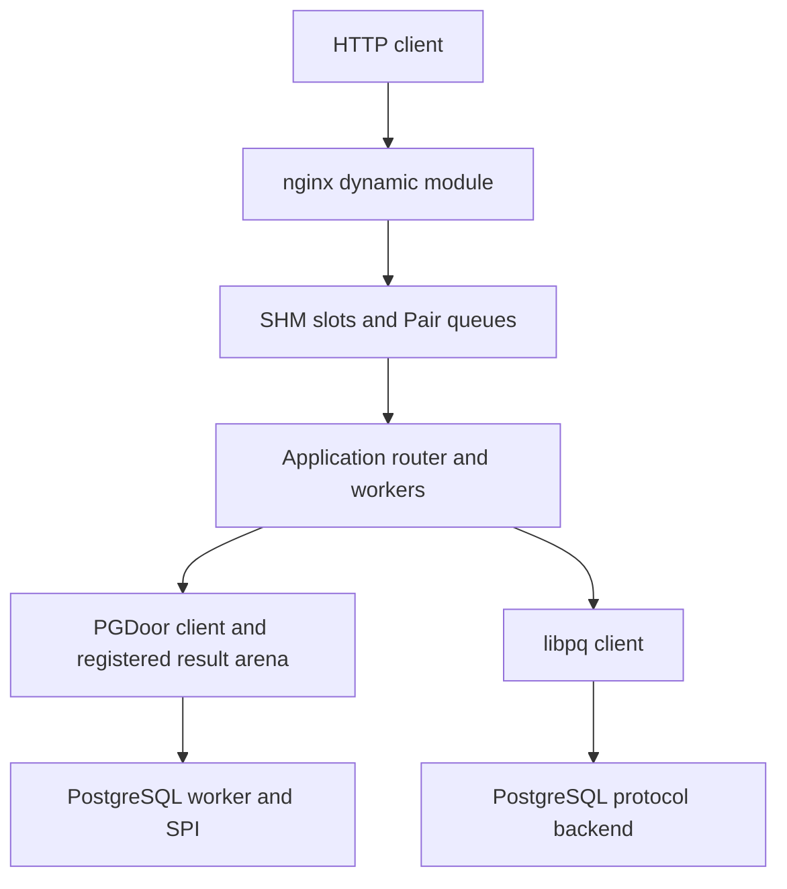
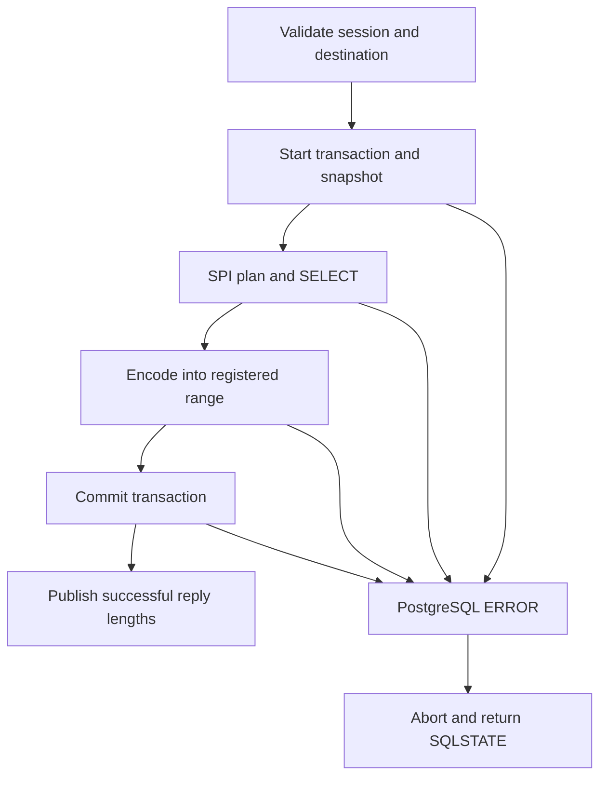
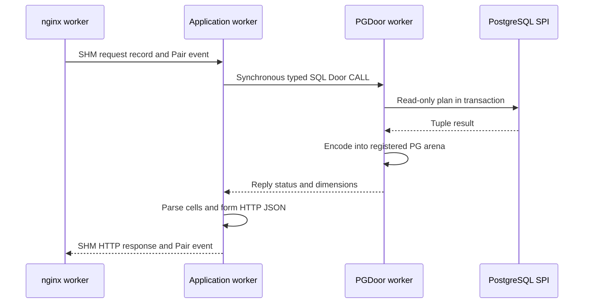

[Monograph index](../README.md) · [Full text](../door-ipc-implementation-for-freebsd_full.md)

<a id="appendix-4"></a>
<a id="contents-appendix-4-real-nginx-and-postgresql-modules"></a>

# Appendix 4. Real nginx and PostgreSQL modules

<a id="appendix4-1"></a>

## A4.1. Scope, components, and source map

This appendix documents the concrete `door-stack` integrations rather than a
hypothetical replacement web server or database. The nginx component is a
transport-only dynamic HTTP module. `door_app` is a separate application process
and reusable application library. PGDoor consists of a PostgreSQL background
worker extension and an independently usable C client library. They can be
built and configured separately; neither database schema nor application route
selection belongs in the nginx module.

The measured application experiments in Appendix 2 include earlier integration
revisions. They are not automatically new measurements of every later generic
routing/configuration change. The source description here establishes what
code does; deployment qualification and benchmarks remain separate records.

| Component | Principal source | Responsibility |
|---|---|---|
| nginx HTTP module | `nginx/ngx_http_door_module.c` | HTTP envelope, request lifetime, slot/output-chain integration |
| Web client transport | `transport/ipc.c`, `ipc.h` | Session setup, Pair or native-async submission, completion validation, mailbox |
| Shared protocol | `transport/protocol.h`, `pair_transport.h`, `http_wire.h` | Bounded wire records, slot layout, request/reply queues |
| Application host | `app/door_backend.c` | Door registration, worker dispatch, session mappings, reply publication |
| Application services | `app/application.c`, `blog_service.c`, `file_service.c`, `benchmark_service.c` | Routing, static/app operations, benchmark management |
| Database adapter | `app/pgsql_service.c`, `pgsql_door.inc` | SQL statements, read-path selection, result-to-JSON conversion |
| PGDoor server | `postgres/pg_door.c` | Background workers, raw Door receive loop, sessions, SPI transactions |
| PGDoor encoding/mapping | `postgres/pgd_encode.h`, `pgd_mapping.h`, `pgd_params.h` | Checked cell encoding, shared-mapping references, typed values |
| PGDoor library | `postgres/pgd_client.c`, `pgd_client.h`, `pgd_wire.h` | Connection/arena registration, bounded query calls, cell framing |
| Build/config/lifecycle | `tools/build-nginx.py`, `build-app.py`, `app_config.py`, `stack.py` | Independent builds, TOML translation, coordinated app/nginx startup |

The important boundaries are HTTP client↔nginx, nginx↔application, and
application↔database. Pair is currently used on the second boundary. The
implemented PGDoor path uses synchronous CALL plus persistent result SHM on the
third. It does **not** use Pair to execute PostgreSQL queries.



<a id="appendix4-2"></a>

## A4.2. nginx module: process and session architecture

nginx's master parses the configuration and forks workers. `nd_init()` opens
Door state only in a worker/single-process instance after fork. There is one
`nd_client` session and one local request-context array per nginx worker.
The master does not create a Door callback pool that workers inherit.

The worker opens the configured application endpoint and checks `door_info()`.
A random nonzero session nonce identifies its registration. In Pair mode it
creates two distinct regions against that Door generation:

1. an ordinary read/write data arena with fixed request/response slot ranges;
2. a Pair control region containing two event words, queue metadata and copied
   request/reply records after the reserved control page.

A synchronous `ND_REGISTER_PAIR` bootstrap sends the nonce, arena id, chunk-size
agreement and control-region id. The backend explicitly attaches both mappings
and validates the declared layout before accepting work. The Pair reply reader
starts in the nginx worker only after successful registration.

The backend associates the session with kernel-derived caller PID/jail id;
commands do not supply authority by claiming a PID. Its current endpoint does
not set `DOOR_CROSS_JAIL`: this web integration is a same-jail setup. Core Door
cross-jail support does not imply that this application configuration has
already enabled or qualified cross-jail sessions.

### A4.2.1. Actual arena and queue layout

| Item | Current definition |
|---|---|
| HTTP slots per nginx worker | `ND_SLOTS = 1024` |
| Payload capacity of one side of a slot | `ND_CAPACITY = chunk_size + 4096` |
| Full slot stride | `2 × ND_CAPACITY`: input followed by output |
| Data arena | `ND_SLOTS × ND_STRIDE` |
| HTTP request header | 28-byte `nd_http_request` plus length-delimited fields |
| Generic command / registration ACK / completion | 40 / 24 / 32 bytes |
| Pair registration | 48 bytes |
| Pair queue counts | 1024 request records and 1024 reply records |
| Pair channel structure | 74176 bytes, placed after the first VM page |
| Native-async admission window | 256; distinct from the 1024 slot budget |

At `door_chunk_size 64k`, the ordinary arena is 136 MiB per nginx worker:
1024 × 2 × (65536 + 4096). Four workers therefore reserve 544 MiB of logical
arena capacity. With 4 KiB VM pages the separate Pair region is 80 KiB per
worker after rounding. This is mapped capacity, not necessarily resident or
uniquely allocated physical memory. Summing both processes' mapping sizes can
double-count shared pages; unused demand-backed pages need not be resident.
The implementation uses fixed slots here, not `door_shm_pool_reserve()` for
each HTTP request. Pool-reuse microbenchmark results must not be mislabeled as
this module's allocator implementation.

### A4.2.2. Request admission and serialization

`nd_body()` first obtains the nginx request body and validates metadata and
combined capacity. It serializes a native local envelope containing lengths
for method, normalized URI, query, header block and body, then copies those
fields into the reserved input slot. No cross-process pointers are included.
The application interprets the envelope and selects its route; nginx does not
encode the blog/file/benchmark API's SQL or operation list.

Metadata is bounded by 4096 bytes; request body storage must be in memory.
File-backed nginx request-body buffers are rejected by this path. nginx's
`client_max_body_size` cannot override the smaller arena/envelope capacity.
This is bounded whole-request/whole-response forwarding, not incremental
socket streaming, arbitrary-size uploads, WebSocket tunnelling or chunked
application output. A bounded streaming IPC mechanism does not automatically
implement HTTP streaming in this module.

Slot allocation increments a per-slot generation and refuses poisoned or
exhausted slots. The worker publishes a fixed command containing session,
slot, length, operation and generation. Queue helpers validate `tail - head`
against `ND_SLOTS`, copy the record, then publish the index. Local producers
are serialized; consumers follow the mode's single-consumer or locked-dequeue
rule. Shared indices and waiter hints use the C atomic operations in
`pair_transport.h`/`ipc.c`; the code is not an unrestricted lock-free MPMC ring.

### A4.2.3. Pair data path and event-loop handoff

A Pair request enqueue runs in the nginx event context and does not post a
blocking native-submit task or execute a per-request synchronous Door CALL.
It may issue a Pair notification syscall when the receiver's waiting hint is
set. This still involves short local/kernel locking; it is not a promise of
wait-free execution. Queue publication establishes the local ACK state.

The backend publishes a checked 32-byte reply after its last payload access.
The dedicated nginx reply thread validates magic/session/slot/generation/length
and records completion under the client lock. An empty-to-nonempty slot bitmap
transition triggers a module-owned EVFILT_USER with NOTE_TRIGGER on nginx's
kqueue. Its event-loop handler drains the bitmap and finalizes requests there.
No pipe or payload byte stream is used for this bridge. On shutdown the
module closes/drains the Door client before removing the user event, and
unposts it only when it was actually posted. The regression check in
`tools/check-nginx-event.py` compiles the real cleanup fragment with nginx’s
multi-statement queue macro; it covers unposted, posted and repeated cleanup.
The notification still requires
a kevent trigger syscall; it is not a direct scheduler handoff. Its unique event
identity avoids replacing the global ngx_notify handler used by thread pools.

The reply reader sets its waiting hint and rechecks queue state before
parking; the event sequence is loaded before the queue check. Waits use a
100 ms bound for liveness/shutdown checks. That bound is not a 100 ms normal
response delay or a correctness substitute for the publish/wait ordering.

### A4.2.4. Native-async alternative

With `ND_TRANSPORT=async` the session instead registers a client-owned ONEWAY
READY Door with the backend and opens native async with a 256-operation window.
nginx submits through its named `door` thread pool because submission may wait
for admission. The ordinary backend callback returns a registration/admission
ACK; a job worker later sends ONEWAY READY. ACK and READY are stored separately,
and either ordering is tolerated. The specialized RAM-inline operation can
return its final record through native completion without a second READY send.
That optimization is not the generic HTTP route's universal completion path.

| Mode | Per-request submission | Final application completion | nginx event-loop bridge |
|---|---|---|---|
| Pair | SHM request queue plus conditional Pair notify | SHM reply queue plus conditional Pair notify | Reply thread → bitmap/user event → event loop |
| Native async, ordinary | Thread-pool native submit and ACK | Backend ONEWAY READY callback | Callback → bitmap/user event → event loop |
| Native async, special RAM-inline | Native submit | Native final completion | Completion callback → bitmap/user event → event loop |

### A4.2.5. Output lifetime, timeout and shutdown

`nd_complete()` verifies the response envelope's magic, HTTP status, length and
content-type flag. It points an nginx memory buffer directly into the output
slot and passes that chain to nginx's output filter. It does not make another
payload buffer solely to return data from the application. The network stack
still has its own send path; this is not NIC-to-application end-to-end zero-copy.

Request cleanup releases the slot after nginx no longer needs its memory.
Blocked-request/task pins prevent request/context destruction while submission
still executes. A five-second lifetime timer poisons uncertain slots rather
than immediately reusing bytes a peer may still modify. Transport failures map
to gateway errors; invalid response framing is rejected. There is no implicit
retry against a replacement application generation.

During exit the client stops admission, waits for sender pins, closes async
callbacks or wakes/joins the Pair reply thread, and invalidates/unmaps the Pair
control handle. Data-arena mappings remain process-scoped in this client path
because backend jobs may still hold mappings. Failure to join callbacks is a
fatal worker-exit condition; code is not unloaded underneath a live callback.
This is an explicit conservative lifetime policy, not a claim that every
mapping is eagerly reclaimed by `nd_close()`.

<a id="appendix4-3"></a>

## A4.3. Application backend: queued and direct dispatch

The application process owns the registered endpoint, HTTP routes and business
services. `process_job()` derives input/output addresses from checked slot
indices and calls `nd_app_process()` for the generic HTTP operation. It does
not follow a client-supplied virtual pointer.

There are three different concurrency controls:

| Setting | What it controls | What it does not control |
|---|---|---|
| `receivers` / `ND_RECEIVERS` | Private Door callback receiver pool for bootstrap and native requests | Number of Pair direct application threads per session |
| `workers` / `ND_JOB_WORKERS` | Shared queued-job worker pool | Direct dispatch's processing concurrency |
| `direct_threads` / `ND_DIRECT_THREADS` | 1–8 Pair direct threads per registered session | PostgreSQL endpoint count or nginx worker count |

In queued Pair mode one Pair receiver per session validates/copies commands
into a bounded shared application job queue. The global job-worker pool takes
work from that queue. This allows workers to serve different nginx sessions
without pinning SQL execution to one session's receiver. No new thread is
created for every request.

In direct mode the session's Pair threads dequeue/admit under the backend lock,
release it, execute application work and publish the reply. Multiple direct
consumers are locally serialized at dequeue; the lock is not held over SQL.
Each direct processing thread owns its own application/database state. Merely
raising `ND_JOB_WORKERS` does not increase direct-path processing concurrency.
The current backend bounds sessions at 64, queued jobs at 64×1024 and total
Pair threads at 128. Direct threads multiply by the number of nginx sessions,
so configure the product rather than just the per-session number.

Reply producers serialize on the existing backend lock before pushing to a
session's reply queue. The backend rejects a busy/replayed slot generation and
tracks active jobs; a session reaper joins Pair threads before unmapping or
reusing session state. This architecture is different from the benchmark's
atomic per-channel batch-claim scheme even though both use the same Pair API.

<a id="appendix4-4"></a>

## A4.4. Independent builds and configuration

The nginx module requires a matching nginx source tree to obtain the correct
module ABI and headers, but the helper builds only dynamic modules. It checks
the installed nginx version/configure flags, requires `--with-threads` and
`--with-compat`, and uses a private source copy. Existing external-module flags
require manual configure review. It does not replace the installed nginx binary.

```sh
cd door-stack
make -C nginx NGINX_SOURCE=/path/to/matching/nginx-source
make -C nginx install
make -C app WITH_PGSQL=1
```

The application build produces `app/build/libdoor_demo.a` and `door_app` without
nginx or PostgreSQL source checkouts. PostgreSQL support adds installed libpq
development files and the separately built `libpgdoor`; a non-PG build does not
need that server integration. Building a module is not installation/startup of
its peer services.

The core nginx directives are:

```nginx
load_module /usr/local/libexec/nginx/ngx_http_door_module.so;
# In http {}:
door_endpoint /tmp/door-demo/application.door;
door_chunk_size 64k;
# In the server/location selected by the deployment:
location / { door_pass; }
```

The supplied full configuration also declares the `door` thread pool, worker
processes, `env ND_TRANSPORT=pair;` and diagnostic controls. Do not copy the
fragment as a complete nginx.conf. Listener address/TLS/UID belong to deployment.
The repository's root/wheel benchmark profile is not a least-privilege service
policy. Chunk size must agree with the application's `chunk_kib` setting;
nginx accepts 64 KiB–4 MiB in 4 KiB increments, with 1 MiB as its directive default.

`conf/application.toml` owns application paths/routes and transport/database
policy. `app_config.py` rejects unknown keys and overlapping route prefixes,
resolves configured paths relative to the file, and constructs a controlled
environment for the executable without shell evaluation. Important sections are:

| Section | Representative keys | Owner |
|---|---|---|
| `[application]` | endpoint, binary, web root, state/token/database files | Application deployment |
| `[transport]` | mode, dispatch, chunk_kib, receivers, workers, direct_threads | App/backend transport |
| `[routes]` | blog, files, benchmark, workload, memory, pgbench, ipcbench | Application router |
| `[database]` | DSN, libpq/door, Door prefix/count, direct encoding, timings | Application database adapter |
| `[tests]`, `[benchmarks]` | Allowed binaries and result directories | Benchmark administration |
| `[pgbench]` | Dedicated benchmark DB/role, provisioning runner and endpoint prefix | Benchmark app; not PostgreSQL's active server GUCs |

`tools/stack.py` starts the app, waits for a fresh READY, starts nginx and checks
the exact configured health URL. It drains/stops nginx before the application
on restart. It does not restart PostgreSQL or silently activate a generated PG
profile on the manual path. The bundled demo wraps this supervisor with
its own cluster lifecycle; see [A4.9](04-local-demo.md#appendix4-9). Diagnose an inactive or
mismatched PostgreSQL prefix/database at that boundary.

<a id="appendix4-5"></a>

## A4.5. PGDoor extension: PostgreSQL main-thread execution

The extension is a PGXS shared module loaded through
`shared_preload_libraries`. `_PG_init()` declares restart-required GUCs and
registers background workers. Defaults create zero workers until a database
and SQL role are explicitly configured. Each worker initializes one UTF8
database connection under a fixed non-superuser role, then publishes an endpoint
named `<prefix>.<index>`.

Unlike a normal libdoor pthread callback service, the PostgreSQL worker creates
and binds its Door through raw operations and runs a receive/RETURN loop on its
**main PostgreSQL thread**. SPI, transactions, snapshots and memory contexts are
not invoked from arbitrary libdoor callback threads. Each worker processes one
request at a time; multiple clients targeting one endpoint share that serial
execution context. More endpoints provide more independently executing backend
processes, subject to CPU and database contention.

The raw endpoint uses `DOOR_PRIVATE | DOOR_REFUSE_DESC`. Each iteration can return
the previous fixed reply and receive the next request. `CHECK_FOR_INTERRUPTS()`
and postmaster-liveness checks surround the wait. A one-second PostgreSQL timer
interrupts the raw Door wait to bound idle shutdown/signal races; its handler
does not execute PostgreSQL operations. SQL has its separate statement timeout.
Workers are registered for restart after five seconds on failure; an old client
capability/session is not transparently rebound to the replacement generation.

### A4.5.1. Server configuration and build

```sh
cd door-stack/postgres
gmake PG_CONFIG=/usr/local/bin/pg_config
gmake install
make -f Makefile.lib
make -f Makefile.lib install
```

Installed PostgreSQL development headers and PGXS are needed for the extension;
a full PostgreSQL source checkout/world/server rebuild is not required. Rebuild
the extension for the selected PostgreSQL major. The standalone client library
requires libdoor, but no PostgreSQL headers or libpq. Benchmark comparison
programs additionally link libpq.

An example PostgreSQL profile selects the pool's fixed identity:

```conf
# Merge pg_door into the existing shared_preload_libraries list.
shared_preload_libraries = 'pg_door'
pg_door.database = 'application_db'
pg_door.role = 'application_read_role'
pg_door.prefix = 'pgdoor'
pg_door.workers = 8
pg_door.max_region_kib = 16384
# Configure the actual application process UID; -1 means the PostgreSQL UID.
pg_door.client_uid = -1
```

The UID value is not an SQL role and is not nginx's UID unless nginx itself is
the database client. In this stack `door_app` calls PGDoor, so authorize its UID.
All these GUCs are `PGC_POSTMASTER`; a PostgreSQL restart is required, not merely
SIGHUP or `stack.py restart`. `max_worker_processes` must accommodate these and
other background workers. Preserve existing preload libraries when installing.

The extension supports any appropriately permitted UTF8 database; no microblog
table names occur in its server. One configured pool belongs to one database
and one fixed role. Requests do not select an arbitrary database/role and this
implementation does not start simultaneous per-database pools within one
cluster. Separate clusters/prefixes can provide separate configured pools.

### A4.5.2. Authentication, sessions and registered mappings

A request is accepted only for the configured effective OS UID, a valid ABI,
known flags and an exact bounded wire size. `PGD_OPEN` registers an arena;
successful sessions record the kernel caller PID. Subsequent calls require
that PID and session id. Up to 32 sessions are held per worker; stale-PID cleanup
occurs on OPEN. The mapping registry reference-counts one process mapping per
region so closing one of several sessions does not unmap another's shared view.

The client creates an ordinary read/write region; the server attaches it with
write access for result publication. This is not a Pair region. An arena must
be at least 64 KiB and no larger than both the server's `max_region_kib` and the
client's 64 MiB cap. The default server limit is 16 MiB. A valid destination is
a nonempty range inside that mapping. No request supplies a server VA pointer.

OPEN, CLOSE, PING, QUERY and QUERY_PARAMS are distinct operations. The local
native-endian version-2 protocol has a 48-byte request prefix, at most 4095 bytes
of SQL/parameter envelope, and a 192-byte reply. Session/region identity and
range checks are independent of SQL parsing. Wire version/size mismatch is a
protocol failure, not an invitation to reinterpret old structures.

### A4.5.3. Query lifecycle, plans and error recovery

For a query the worker starts a PostgreSQL transaction, verifies UTF8 text,
sets read-only execution, enables a five-second statement timeout, acquires an
active snapshot and connects SPI. Parameter values are decoded separately from
SQL; up to eight inputs of text or int8 type are supported. A 32-slot per-worker
cache retains plans keyed by SQL plus parameter types and count.

`SPI_execute_plan()` runs read-only and requests up to 257 rows so a result over
256 is detected rather than silently truncated. Results must be SELECT-shaped
and have at most 64 columns. Normal SQL permissions and callable-function
policy remain part of the selected role; the IPC transport is not an arbitrary
SQL sandbox.



On success, SPI/snapshot cleanup and commit precede publication of valid byte,
row and column counts. On error `PG_CATCH` saves the error message/SQLSTATE,
flushes PostgreSQL error state, aborts the transaction and restores memory
context. The next request can continue in the same worker/session. Bytes already
written before an error can remain in the arena, but no successful result length
is published for them. Transport delivery, successful SQL completion and valid
result publication are therefore separate checks.

### A4.5.4. Direct encoding and the actual zero-copy boundary

Each result cell has a 32-bit byte length followed by text bytes; SQL NULL uses
`UINT32_MAX`. Results are row-major and currently omit column names/OIDs. The
baseline uses `SPI_getvalue()` and copies its textual value into the destination.
`PGD_F_DIRECT` instead obtains Datums with `SPI_getbinval()` and encodes text,
varchar, int2/int4/int8 and bool directly. Unknown types/domains fall back to the
normal output function. NULL is supported in either path.

For text/varchar, packed/detoasted bytes are written to the registered range;
detoasting may allocate. Integers still need decimal formatting; all cells need
length prefixes and payload stores. The optimization removes unnecessary
intermediate textual allocation/copying for supported types; it does not expose
backend Datum pointers, move SPI tuple storage into the client, or make query
execution/all result writes zero-cost. Appendix 2 compares direct versus
baseline encoding and libpq as whole execution paths.

The caller can select arbitrary offsets/capacities within its registered arena,
including unaligned byte offsets. It cannot target an unrelated process buffer
or an arena belonging to a different Door generation. `pgd_result_data()` returns
a borrowed pointer valid only while the arena/range is retained and not reused.
See the complete typed-parameter client in §14.20.

<a id="appendix4-6"></a>

## A4.6. How the HTTP application uses PostgreSQL

The application's SQL adapter can use libpq or PGDoor for selected reads. It
keeps database handles in thread-local state. PGDoor endpoint assignment is
round-robin at connection creation, not a per-query global work-stealing
scheduler. Several application threads may target one worker; setting the
client count greater than available endpoints does not create more PostgreSQL
workers.

At startup the adapter checks database, role and schema version against its
actual libpq connection and probes typed-parameter support. This catches the
previously observed situation where the benchmark profile named one database
but active PostgreSQL workers served another. The generic PGDoor extension
knows nothing about the application schema; this check belongs in the adapter.

The current microblog integration routes list/feed/get/user/me reads through
PGDoor when selected. Registration, login and SQL writes remain on libpq. It is
a mixed database transport application, not an application with libpq removed.
On protocol/transport poisoning the thread closes/reopens its database state
rather than consuming uncertain result bytes.

A normal request traverses the following boundaries:



The adapter currently uses `pgd_connect()` with its own PG result arena and
then reads cell slices to form the application's JSON output. It does not borrow
the nginx HTTP arena for PostgreSQL output. Those arenas are associated with
different Door endpoints/generations; the library's borrowed-arena API does not
make them interchangeable. Further fusion would require an explicit authority,
layout and lifetime design, not passing an nginx output pointer to PostgreSQL.

The install-from-scratch demo selects libpq for the blog so the separate
SQL benchmark can own the PGDoor profile in its private PostgreSQL cluster.
The mixed HTTP/PGDoor path above is an available manual configuration, not
the managed demo default.

This also explains why a 2× improvement in tiny SQL microbenchmarks need not
produce 2× HTTP RPS: SQL work, application JSON construction, nginx scheduling,
network/client CPU and offered load remain in the path. Equal RPS at a fixed
8000/s offer can coexist with substantially lower latency.

<a id="appendix4-7"></a>

## A4.7. Validation, observations, and remaining boundaries

| Layer | Maintained check/example | What it establishes |
|---|---|---|
| HTTP envelope/router | `app/tests/router.c`, `app/tests/check-router.sh` | Bounded framing, route ownership and response construction without a server |
| Worker/client transport | Host transport models and native integration runs | Session, generation, mailbox and lifecycle paths under tested conditions |
| PG wire/parameters/encoding | `postgres/tests/check-wire.sh`, `client_into.c`, `mapping.c`, `encode.c` | Wire/typed-parameter checks plus separate host models for client ranges, mapping references and encoding |
| PG runtime | `postgres/tests/smoke.sh` | Reported SQL error recovery, NULL/UTF8, overflow, row limits, plan reuse and concurrent sessions |
| Borrowed arena/ranges | `pg_door_into_test` | Reported offset/capacity guards, direct/fallback equivalence, 1 MiB result, recovery and lifetime |
| End-to-end app behavior | `app/pgsql/smoke.py` | Reported registration/login, sessions, Unicode, pagination and ownership behavior |
| Performance | Appendix 2 | Measured configurations; not a substitute for functional/security coverage |

Do not interpret a host model as native PostgreSQL execution or an nginx browser
run. Do not label this SELECT-only PGDoor library a complete libpq replacement:
SQL writes, explicit multi-statement transactions, COPY, arbitrary type
parameters, network access and per-call database/role switching are not supplied.
The HTTP module does not yet provide incremental large-message streaming or
per-client jail deployment. The Pair primitive supports other architectures,
but their application protocols and qualification must be explicit.

Troubleshooting follows the boundary that failed:

| Symptom | First evidence to inspect |
|---|---|
| nginx cannot load `.so` | Installed module path, nginx version/configure match, libdoor loader dependencies |
| nginx master exists but HTTP hangs | Worker startup errors; application READY and active endpoint generation |
| Stack health timeout | Actual listen address/port and exact health URL, then app/nginx logs |
| Pair attach/wake gives EPERM | Which process created the region and whether the Door owner attached it |
| PGDoor endpoint missing | Active GUCs, preload library, worker startup logs and actual prefix/count |
| PGDoor fails but libpq works | Configured OS UID, fixed role/database, arena quota and typed-wire compatibility |
| HTTP 401 after DB switch | Application session/account data in the selected DB, not load-generator speed |
| Benchmark HTTP 500 with healthy app | Listener, exact response body, result directory and application log; accepted jobs have a separate output log |
| Full offered RPS but changed latency | Offered-load cap, scheduler lag and backend/client intervals |
| Memory mapping looks large but RSS low | Logical capacity versus resident unique shared pages |

<a id="appendix4-8"></a>

## A4.8. Source provenance

The architecture above was checked against `door-stack.zip` (9 November
2026) and `doors_07.11.2026.zip`, which includes the expanded forwarding suite.
The source files reviewed were:

- `nginx/ngx_http_door_module.c`
- `transport/ipc.c`
- `transport/pair_transport.h`
- `app/door_backend.c`
- `app/pgsql_door.inc`
- `postgres/pg_door.c`
- `postgres/pgd_client.c`
- `postgres/pgd_wire.h`
- `postgres/pgd_encode.h`
- `tools/app_config.py`

The module-owned kqueue user-event bridge replaces the earlier nginx pipe
bridge. Appendix 2 separates the earlier RAM campaign from the follow-up
FreeBSD runs. Native readiness and reported benchmarks are observations,
not exhaustive qualification of every shutdown or callback interleaving.
