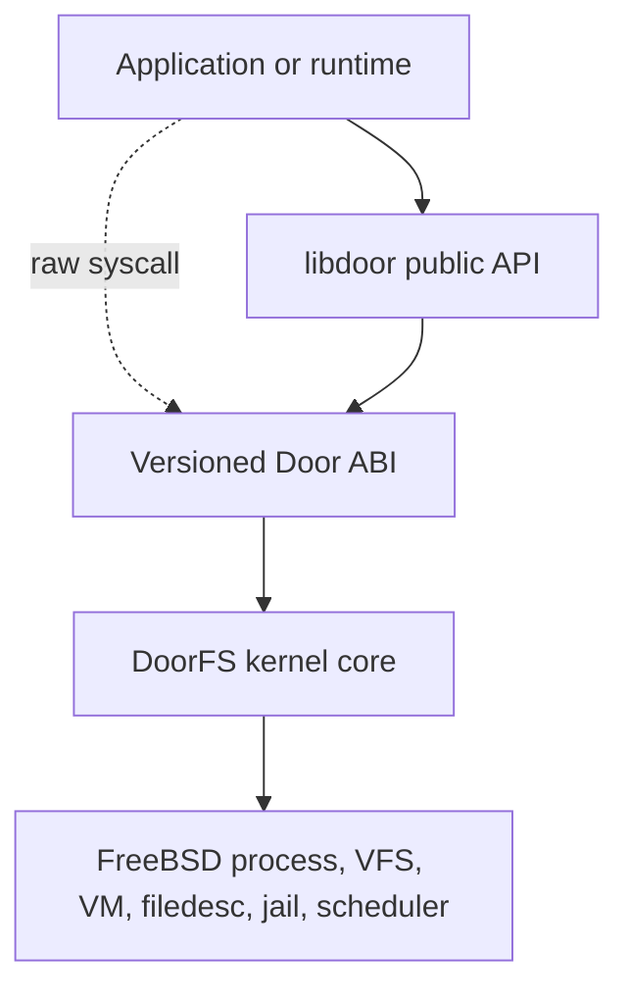
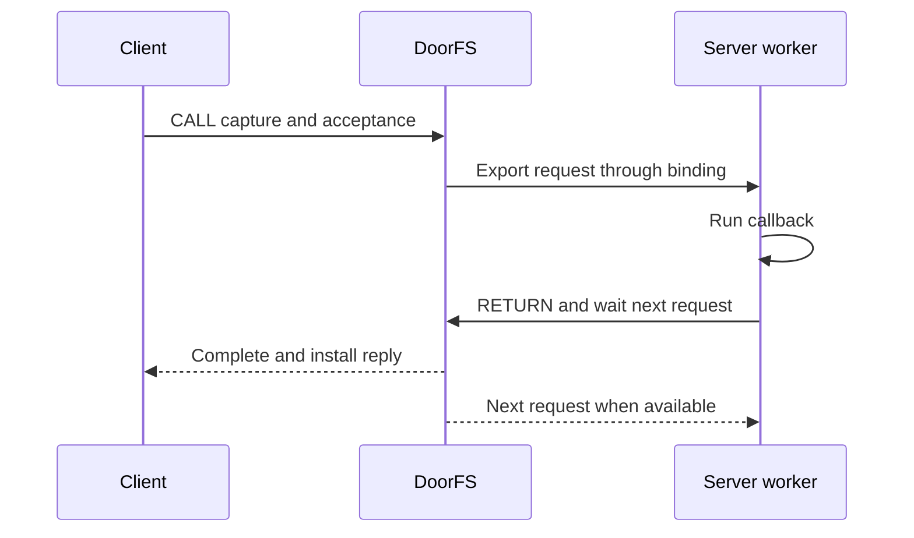
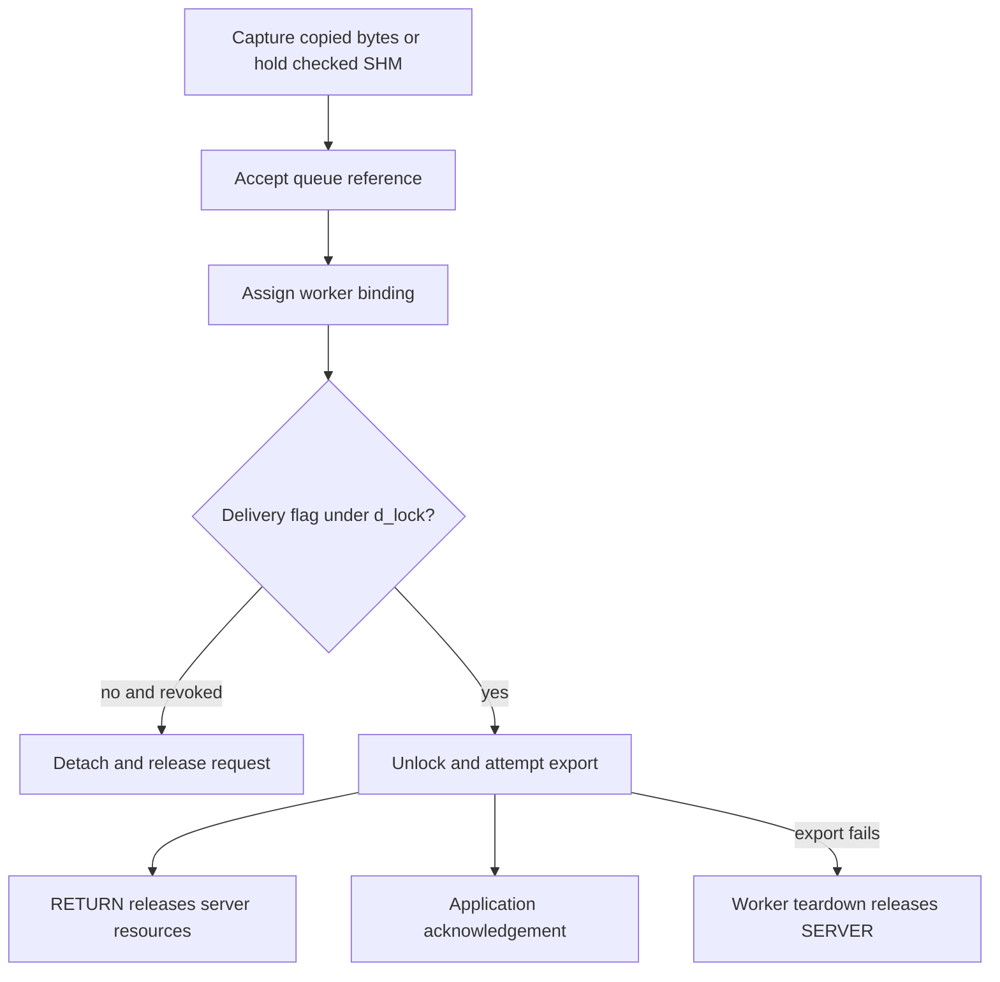
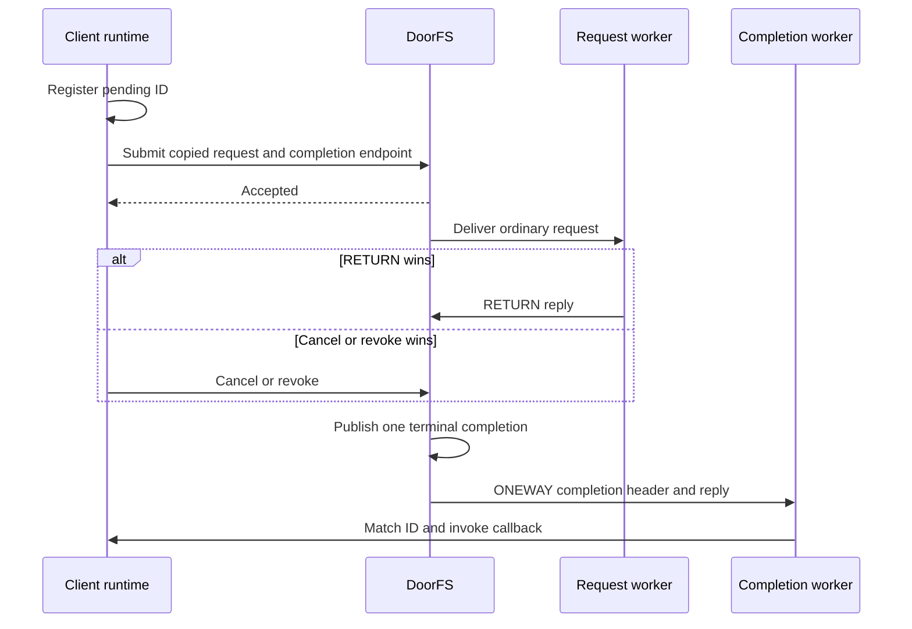
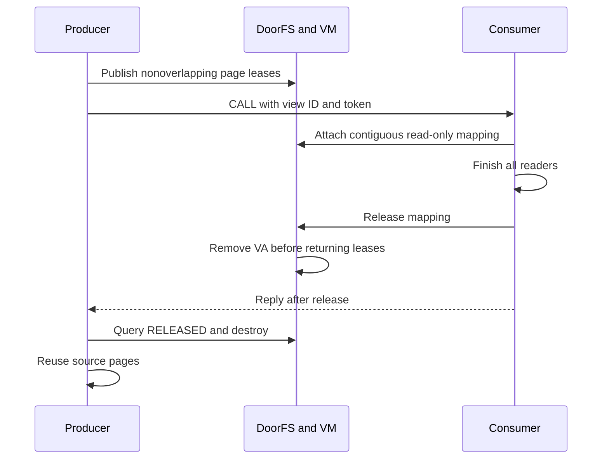
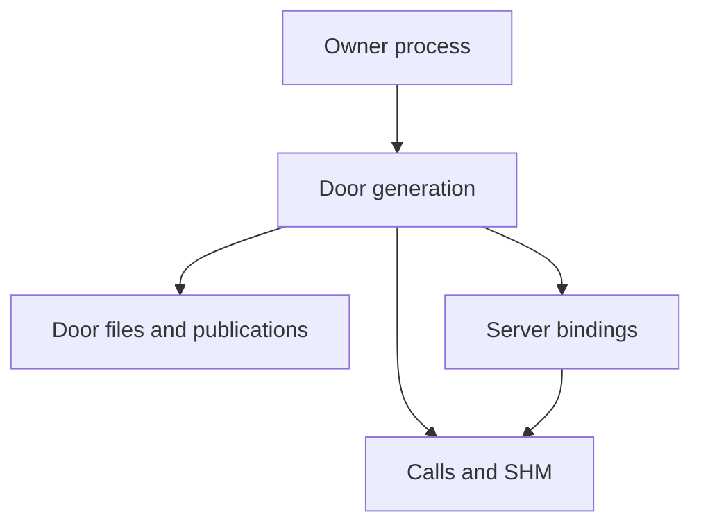

[Monograph index](../README.md) · [Full text](../door-ipc-implementation-for-freebsd_full.md)

## Chapter 4. System architecture

The implementation is a set of cooperating subsystems. DoorFS owns kernel
transaction and lifetime semantics. libdoor owns the compatible callback
runtime. Scheduler support can shorten a handoff but does not own RPC state.
DoorCTL and NameFS publish capabilities without becoming data transports.

### 4.1. Components and boundaries

#### 4.1.1. Layered architecture

Applications normally call libdoor, which converts public structures into the
versioned FreeBSD Door ABI. Applications may also invoke that ABI directly.
The ABI enters DoorFS, which in turn uses process/thread lifecycle, filedesc,
Capsicum, VM, VFS, jail, sleepqueue, and scheduler services.

Because libdoor is bypassable, it can improve diagnostics but cannot establish
a kernel security property. DoorFS validates every untrusted argument and
authorizes every operation independently.

| Component | Owns | Does not own |
|---|---|---|
| DoorFS | Door identity, references, calls, bindings, revoke, descriptors, credentials, SHM | Callback code, public-name policy, scheduler queues |
| Door ABI | Selector decoding, copyin/copyout, fd-right selection, ABI dispatch | Callback registry |
| libdoor | Public API conversion, registry, workers, pools, TLS, buffers | Kernel authorization and raw-caller safety |
| Shuttle API | Optional wait/resume/reservation and fallback | Door identity, payloads, RPC policy |
| 4BSD/ULE | Runnable state, affinity, run queues, context switch | Endpoint and application semantics |
| DoorCTL | Logical names, scope, LIVE/DEAD generation, connect | Filesystem identity and RPC transport |
| NameFS | Pathname vnode, target Door file, open/rebind lifetime | Request processing and worker selection |
| VM support | Mapping and VM-object lifetime | Application record completion |

#### 4.1.2. Authority and identity domains

The design separates discovery authority, an installed file capability,
immutable generation identity, and operation-specific authority. Discovery of
a path or logical name never substitutes for CALL, SERVICE, ADMIN, INFO, or
SHM rights.

| Identity | Scope | Stability |
|---|---|---|
| Numeric fd | One process table | Reusable after close |
| struct file | Kernel object | Stable while referenced |
| Door uniquifier | One generation | Immutable |
| DoorCTL name | Registry scope | May survive replacement |
| NameFS vnode/path | VFS namespace | Stable during publication |
| SHM region id | One generation | Not globally unique |
| Strong SHM identity | Uniquifier plus region id | Never retargeted |
| Call id | Accepted transaction | Valid through call lifetime |

Kernel code holds referenced objects after lookup instead of trusting numeric
handles. An old fd, call, or SHM reference never follows a replacement name.

#### 4.1.3. Control plane and data plane

The control plane comprises CREATE, INFO, parameters, bind/unbind, revoke,
DoorCTL, NameFS publication, SHM management, and generation replacement. The
data plane comprises CALL/RETURN, fast selectors, ONEWAY, descriptor transfer,
and SHM-referenced calls.

Control-plane state establishes identity and authority consumed by the data
plane. Hot paths still validate file capability, endpoint state, rights, jail
policy, call identity, and transport limits.

#### 4.1.4. Optional components

Anonymous CALL/RETURN requires DoorFS and a worker implementation. Other
features are optional per service:

- direct fd transfer can replace named discovery;
- ordinary buffers can replace persistent SHM;
- generic wake/switch can replace shuttle;
- a conforming raw runtime can replace libdoor;
- DoorCTL and NameFS can be used independently or together.

Optional means unnecessary for basic operation, not weakly specified. Once
selected, each extension retains its full lifetime and security contract.

### 4.2. End-to-end flows

#### 4.2.1. Creation and readiness

1. libdoor validates callback, cookie, attributes, and pool policy and creates
   provisional registry state.
2. CREATE validates the kernel ABI.
3. DoorFS allocates generation identity, owner credential, lock, queues,
   limits, reference state, and uniquifier.
4. The file layer installs a service file and descriptor.
5. libdoor commits its registry entry and creates or obtains a worker.
6. BIND publishes a server binding.
7. The worker enters RETURN/wait-next.
8. door_create reports success after initial worker readiness.

Failure before fd installation leaves no visible endpoint. Failure after
installation but before library readiness revokes/closes the endpoint and
rolls back registry state. Raw CREATE ends at kernel endpoint publication; a
raw runtime binds workers itself.

#### 4.2.2. Synchronous CALL/RETURN

1. libdoor converts door_arg_t and selects a compatible generic or fast form.
2. The syscall layer acquires the file with CALL rights and validates ABI
   structures.
3. DoorFS checks liveness, jail policy, attributes, limits, and cancellation
   mode.
4. Data, credentials, and descriptor references are captured in a call object.
5. Under the Door lock, the call is assigned directly or queued. This is CALL
   acceptance.
6. The client waits on that exact call.
7. The worker receives the request through its binding and libdoor invokes the
   registered callback.
8. RETURN authorization derives from the worker binding and active call.
9. DoorFS captures the reply, publishes terminal DONE state, and wakes the
   client.
10. The client installs data and descriptors; MOVE acknowledgement precedes
    successful return.
11. Each side drops its own reference and the worker normally waits for the
    next call in the fused operation.

Signal, cancel, revoke, worker exit, owner exit, and copyout error compete for
one terminal transition. Only the actor publishing that transition owns its
wake and detach actions.

#### 4.2.3. Fast-path convergence

Empty and scalar selectors reduce marshalling when payload and capacity
constraints permit. They converge on the same file authorization and call
state machine. Failed eligibility uses the generic path before incompatible
partial publication.

#### 4.2.4. ONEWAY

ONEWAY progresses through accepted, queued or assigned, delivered, and
completed states. Ordinary bytes are snapshotted before successful submission.
An asynchronous queue reference initially owns the request. Activation
explicitly transfers ownership to the server binding.

Revoke may remove queued or assigned-undelivered work. Delivery commitment
is recorded under d_lock before export unlock; from that point SERVER remains
owned through worker cleanup, including copyout failure. Worker
completion releases the final server resources without a client reply.
Application completion uses a separate acknowledgement, event, query, counter,
or ring-consume protocol.

The delivery flag commits reference ownership before potentially observable
export. It is not a callback-entry acknowledgement. Submit can return before
or after callback execution; success guarantees acceptance, not its ordering
relative to application completion. Reusing
mutable SHM requires the acknowledgement protocol, not submit success.

#### 4.2.5. Persistent SHM and rings

The invocation path for an SHM payload is as follows.

1. SHM CREATE allocates a generation-owned region and creator mapping.
2. SHM ATTACH authorizes and maps a consumer view.
3. The producer writes under an application or ring ownership protocol.
4. CALL_SHM submits generation, region, offset, length, and permissions.
5. DoorFS validates the exact usable range and holds the region.
6. The worker receives only the checked view.
7. Call cleanup drops its strong reference.

Handle destruction prevents future lookup but does not invalidate existing
mappings or active-call holds. Synchronous completion may be an application
barrier; ONEWAY requires explicit acknowledgement before mutable reuse.

The ring adds the state sequence free, reserved, committed, acquired,
consumed/free. Local tokens and shared sequence numbers prevent stale writer
or consumer actions. No process-local pointer is stored in shared memory.

A Pair session follows a separate data path (§2.5.11). CALL can establish
or tear down the session. While it is active, peers publish records and
completions in the mapping and notify by event lane. The consumer validates
shared metadata and observes the ring or application ownership rules. It
does not receive a kernel-validated CALL_SHM range for each record.

#### 4.2.6. Descriptor COPY and MOVE

The transfer layer holds and validates all source files, constructs one bundle,
reserves the complete destination set, installs files, copies metadata, and
then commits. MOVE closes only source slots still matching the captured files.
Any pre-commit failure removes destination installation and preserves sources.

For reply MOVE, successful receiver installation commits the transfer. Revoke
after reply publication cannot bypass install acknowledgement: SERVER waits
for its result, closes the matching source outside d_lock, and publishes
MOVE acknowledgement. The client waits for acknowledgement before success
even if the Door is now revoked (§12.5).

#### 4.2.7. Signals and shuttle waits

The wait path prepares call and shuttle state, acquires the required
thread/scheduler interlock, rechecks signal/cancellation, and only then
publishes sleep. If commit fails, it aborts the shuttle state and continues
through ordinary cancellation or scheduling. State publication always
precedes wakeup.

#### 4.2.8. Revoke and owner exit

Revoke first publishes terminal state and prevents new acquisition. It then
detaches pending work, resolves active state, wakes participants, removes
publication and SHM-list ownership, and lets every actor drop its own
reference. Final Door destruction follows the final reference.

Owner exit publishes the process-exit condition, drops PROC_LOCK, and invokes
Door teardown before generic thread-exit synchronization can strand workers.

#### 4.2.9. DoorCTL publication

REGISTER validates name, flags, scope credential, live Door file, owner
authority, and generation before installing a LIVE entry and publication
reference. CONNECT holds the selected generation under registry protection,
then installs a client file. UNREGISTER removes future discovery without
changing connected fds.

Revoke converts a matching LIVE identity to DEAD and releases its Door
reference. Replacement atomically publishes a new generation inside the
DoorCTL lock domain.

#### 4.2.10. NameFS open and rebind

Initial publication validates the covered vnode and live Door file, creates
mount state, and publishes one synthetic root vnode.

OPEN locks mount state, verifies LIVE target, takes its file reference, releases
the interlock, revalidates Door/jail state, and converts the open file into a
native Door client file.

REBIND swaps the referenced target under the mount lock. Opens linearized
before the swap receive the old generation; later opens receive the new one.
Existing client files are untouched.

#### 4.2.11. Combined recovery

A replacement creates generation B and readies its worker pool before
publication. DoorCTL registration and NameFS rebind are individually atomic
but do not form one cross-subsystem transaction. A supervisor chooses their
order and may expose readiness/version metadata.

Old A descriptors and SHM references remain A. New clients acquire B and
establish new generation-bound resources. Retrying application work requires
idempotence or reconciliation above the Door ABI.

#### 4.2.12. Native asynchronous CALL and correlated completion

Native async invokes an ordinary request Door. The same callback handles sync
and async requests and calls `door_return()`. The client runtime owns a private
ONEWAY completion Door and publishes its pending ID before submission.

RETURN, cancellation, revoke, and worker exit compete for terminal publication.
Acceptance and callback delivery are separate boundaries. Library deduplication
is useful but cannot prove unique kernel publication; raw tests inspect headers
and use an accounted publication drain.

#### 4.2.13. Page-composite SHM view

A producer publishes full-page segments of generation-owned SHM. The consumer
attaches a contiguous read-only VA view of the original VM-object pages. There
is no payload compaction copy and no kernel async CALL_SHM operation.

### 4.3. Object and ownership graph

#### 4.3.1. Principal kernel objects

One owner process anchors a Door generation. Files, calls, bindings,
publications, and SHM state independently hold references to it. A server
binding can own an active call; a call can own credentials, transfers,
descriptor bundles, and a strong SHM region reference.

| Object | Created by | Live owner | Protection | Terminal event |
|---|---|---|---|---|
| Door generation | CREATE | Owner registry and explicit refs | Door lock and registries | Final Door ref |
| Service/client file | CREATE/connect/open/transfer | File reference | Filedesc locks; Door counters | Final file close |
| Door call | Sync CALL/native async/ONEWAY | Client, async queue, or binding | Door lock and call refs | Final call ref |
| Server binding | BIND/worker | Exact worker and server list | Door lock and registry | Worker cleanup |
| Transfer/bundle | Capture | Exact request or reply side | Call state and held files/pages | Commit or rollback |
| SHM region | SHM CREATE | Door list, maps, and calls | Door/VM locks and refs | Final region/map/call ref |
| DoorCTL entry | REGISTER | Registry | Registry lock | Unregister or DEAD GC |
| NameFS mount/vnode | Publication | VFS mount and controlled refs | Mount and VFS locks | VFS teardown |
| libdoor entry | create/xcreate | Registry, workers, callbacks | Library mutexes | All runtime refs drain |

#### 4.3.2. Call ownership by state

| State | Required reference owner |
|---|---|
| Constructing synchronous | Client/local reference |
| Pending synchronous | Client plus queue relationship |
| Active synchronous | Client plus server/binding reference |
| Pending ONEWAY | Asynchronous queue reference |
| Assigned ONEWAY | Server/binding after explicit transfer |
| Delivered ONEWAY | Server until callback completion |
| Terminal synchronous | Client until result unwind; server until detach |
| Terminal ONEWAY | Remaining server/local cleanup only |

Queue removal is not itself a reference drop unless that queue owns the
recorded reference. Terminal state likewise does not authorize an exit thread
to free storage still owned by a worker.

#### 4.3.3. Publication ownership

A LIVE DoorCTL entry holds a Door reference and scope credential; a DEAD entry
retains identity but no Door pointer. NameFS holds a target struct file, and a
concurrent open temporarily holds the selected file. The resulting client file
then owns an independent Door reference.

This permits replacement without capability mutation and prevents endpoint
destruction until legitimate users release their references.

#### 4.3.4. Userspace ownership

The process-local chain is door_entry, worker pool, worker TLS, active callback,
and application state. Kernel references cannot protect callback cookies,
mutexes, maps, or application queues. A service therefore needs its own
active-callback reference and shutdown barrier. Revoke, unregister, fdetach,
and close are not thread joins.

### 4.4. Source map

Paths are relative to the project FreeBSD tree.

#### 4.4.1. ABI declarations

| Path | Responsibility |
|---|---|
| include/door.h | Public types, functions, attributes, descriptors, credentials, SHM/ring and named APIs |
| sys/sys/door_core.h | Versioned raw ABI, selectors, wire structures, limits, DoorCTL ABI |
| sys/sys/door_impl.h | Kernel-private Door, call, binding, transfer and SHM declarations |
| sys/sys/sched.h | Scheduler interface declarations, shuttle state, tokens, flags and results |
| lib/libdoor/Symbol.map | libdoor.so.1 exported symbol version |

door_core.h is a user/kernel compatibility boundary. door_impl.h is private,
but its lock and ownership contracts are cross-file invariants.

#### 4.4.2. DoorFS implementation

| Path | Primary responsibility |
|---|---|
| sys/fs/doorfs/door_syscall.c | Raw entry, ABI validation, rights, copyin/copyout, selector dispatch |
| sys/fs/doorfs/door_core.c | Allocation, refs, owner/publication state, revoke, jail and exit hooks |
| sys/fs/doorfs/door_rpc.c | Calls, queues, bindings, RETURN, cancel, credentials, ONEWAY, wakes |
| sys/fs/doorfs/door_file.c | Fileops, service/client installation, cloning, close, stat/kinfo |
| sys/fs/doorfs/door_xfer.c | Data/page capture, descriptor bundles, reply cache, commit/rollback |
| sys/fs/doorfs/door_shm.c | Regions, mappings, permissions, call holds, bounds and destroy |
| sys/fs/doorfs/door_ctl.c | Logical names, scopes, generations, connect and replacement |

Trace a raw call from door_syscall.c to door_rpc.c, then into door_xfer.c or
door_shm.c and door_file.c. Trace teardown from door_core.c through every
subsystem holding a Door reference.

#### 4.4.3. NameFS and kernel integration

| Path or area | Responsibility |
|---|---|
| sys/fs/namefs/namefs_impl.h | Mount state, locks, references and deferred-work contracts |
| namefs_vfsops.c | Mount/rebind, root, VFS lifecycle, recovery and events |
| namefs_vnops.c | Open conversion, attributes/access, inactive and reclaim |
| sys/sys/proc.h and kern_exit.c | Owner exit and thread/binding state |
| signal, condvar and sleepqueue paths | Interruptible private wait publication |
| sys/kern/sched_4bsd.c | Global-lock reservation, remote enqueue, idle handoff, fallback |
| sys/kern/sched_ule.c | TDQ reservation, switch, remote enqueue, fallback |
| sys/kern/sched_shim.c | Boot selection and IFUNC dispatch to the active scheduler |
| sys/conf/files (scheduler rules) | Generate the per-scheduler namespace headers in the build directory |
| filedesc/Capsicum code | File type, rights and transactional descriptor install |
| sys/conf and base makefiles | Kernel/user ABI build integration |

NameFS depends on Door file APIs; Door RPC does not depend on NameFS.
Scheduler code manipulates thread state but never interprets Door payload or
application policy.

#### 4.4.4. libdoor

| File | Primary responsibility |
|---|---|
| libdoor_impl.h | Registry, TLS, pools, locks and internal contracts |
| door_create.c | Creation and initial worker readiness |
| door_call.c / door_oneway.c | Synchronous and asynchronous public calls |
| door_server.c | Bind/return/wait, callbacks, pools and xcreate |
| door_registry.c | Registry, TLS destructor and atfork handling |
| door_misc.c | Revoke, info, parameters, credentials, bind/unbind |
| door_desc.c / door_iov.c | Descriptor conversion and vector validation |
| door_shm.c / door_shm_ring.c / door_shm_view.c | Persistent SHM, SPSC ring, and page-view handles |
| door_async.c / door_async_server.c | Native async and framed ONEWAY protocol with authenticated session routing |
| door_named.c | DoorCTL helpers |
| door_attach.c | NameFS fattach/fdetach |
| door_safe.c | Fault-safe convenience operations |

#### 4.4.5. Verification and examples

| Tree | Role |
|---|---|
| lib/libdoor/tests | Public API, ABI, lifetime, race, descriptor, SHM and stress specification |
| tests/sys/fs/doorfs | Raw ABI and Door file behavior |
| tests/sys/fs/namefs | VFS, recovery, NullFS and jail behavior |
| freebsd-doors-guide/examples | Complete application patterns |
| freebsd-doors-guide/docs | Monograph and retained source material |

Library tests do not replace raw ABI tests, and DoorFS tests do not replace
NameFS VFS tests.

#### 4.4.6. Responsibility rule

A property belongs in the lowest layer able to enforce it for all callers:

- ABI and authority validation in the kernel;
- callback selection and pool policy in libdoor;
- run-queue and affinity decisions in the scheduler;
- pathname identity in VFS/NameFS;
- logical registry scope in DoorCTL;
- application completion and idempotence in the service protocol.

Higher layers may add convenience or early rejection, but cannot become the
only implementation of a Chapter 3 requirement.
