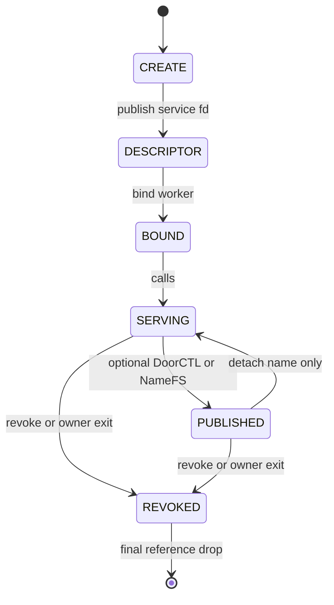

[Monograph index](../README.md) · [Full text](../door-ipc-implementation-for-freebsd_full.md)

<a id="chapter-6"></a>

<a id="contents-chapter-6-doorfs-architecture"></a>

## Chapter 6. DoorFS architecture

This chapter describes the internal object, reference, and transaction model
of DoorFS.  It covers the kernel implementation in `sys/fs/doorfs`, the wire
ABI in `sys/sys/door_core.h`, and the private structures in
`sys/sys/door_impl.h`.  The public `libdoor` runtime is a consumer of this ABI;
it is not trusted to enforce the invariants described here.

The central architectural rule is that state and lifetime are separate:

- a Door may be revoked while references still keep its storage alive;
- a call may be terminal while a client or server still owns cleanup work;
- a named identity may survive after its Door generation is dead;
- an SHM handle may be destroyed while mappings and active calls retain the
  underlying VM object;
- a file descriptor may disappear while another file, binding, publication,
  or call still owns the endpoint.

<a id="contents-6-1-core-objects"></a>

### 6.1. Core objects

<a id="contents-ch6-struct-door"></a>

#### `struct door`

`struct door` is the endpoint-generation object.  It contains identity,
owner, policy, queues, workers, SHM regions, reference counts, publication
state, limits, and the lock that serializes the endpoint state machine.

Important groups of fields are:

```c
struct door {
	struct mtx d_lock;
	u_int d_refs;
	u_int d_file_count;
	uint64_t d_unref_generation;
	bool d_unref_once_fired;

	struct proc *d_owner;
	pid_t d_owner_pid;
	struct ucred *d_owner_cred;
	TAILQ_ENTRY(door) d_owner_link;
	bool d_owner_linked;

	/*
	 * Every allocated Door remains on the all-object list until its final
	 * reference is released.  Unlike d_owner_link this membership survives
	 * owner exit/orphaning and is used to prevent module unload while an
	 * unlinked Door is still referenced by a file, client, publication or
	 * server binding.
	 */
	TAILQ_ENTRY(door) d_all_link;
	bool d_all_linked;

	/*
	 * doorctl LIVE entries own a publication count and a Door ref. namefs
	 * instead holds its target struct file; each open clones an independent
	 * native Door capability pinned to that generation.
	 */
	u_int d_publications;
	u_int d_client_count;
	u_int d_async_reserved; /* accepted completions not yet enqueued */
	/*
	 * Set while the owner-list anchor is being removed.  This closes the
	 * small lifetime window between unlinking the Door from door_list and
	 * the later revoke pass: no new client/publication may attach there.
	 */
	bool d_orphaning;
	bool d_revoked;

	/*
	 * Lockless CALL precheck state.
	 *
	 * d_revoked remains the authoritative value under d_lock.  These bits
	 * only allow the overwhelmingly common default-policy path to reject
	 * cheaply or skip the first d_lock acquisition.  The post-capture check
	 * under d_lock remains authoritative for races with SETPARAM/REVOKE.
	 */
	volatile u_int d_hot_flags;
#define DOOR_HOT_REVOKED 0x00000001u
#define DOOR_HOT_CUSTOM_LIMITS 0x00000002u

	struct door_call_head d_pending;
	struct door_call_head d_active;
	struct door_server_head d_servers;
	struct door_shm_region_head d_shm_regions;
	uint64_t d_next_shm_region;
	u_int d_shm_region_count;
	vm_size_t d_shm_bytes;

	/*
	 * The idle-server hint is protected by d_lock and extends no lifetime.
	 * A miss falls back to d_servers; td_door_server is the separate worker binding.
	 */
	struct door_server_binding *d_idle_server_hint;

	uint64_t d_next_call_id;
	u_int d_pending_count;
	u_int d_active_count;
	u_int d_server_count;

	uint64_t d_cookie;
	uint64_t d_uniquifier;
	uint32_t d_attributes;

	/* Per-door invocation limits, matching illumos door_node_t. */
	size_t d_data_min;
	size_t d_data_max;
	u_int d_desc_max;
};
```

| Object | Creator / owner | References | Protecting lock | Final destruction |
|---|---|---|---|---|
| `struct door` | `door_alloc()`; initially owned by the creating process | owner-list anchor, service/client files, server bindings, DoorCTL/NameFS publications, temporary syscall holds | `d_lock` for endpoint state; global registry locks for registry membership; atomic refcount operations for `d_refs` | `door_drop()` releases the final reference only after the object is unlinked, revoked/orphaned, queues and bindings are empty, and SHM list references are gone |

`d_uniquifier` identifies one endpoint generation.  `d_cookie` is the
application-visible callback cookie; it is not a security identity.

`d_hot_flags` is a lockless rejection/precheck cache.  `d_revoked` under
`d_lock` remains authoritative.  After potentially sleeping capture work, the
call path reacquires `d_lock` and rechecks revoke and custom limits.

<a id="contents-ch6-struct-door-call"></a>

#### `struct door_call`

`struct door_call` is one invocation and all kernel-owned resources required
to carry it from the client to the server and, for synchronous RPC, back to
the client.

```c
struct door_call {
	TAILQ_ENTRY(door_call) dc_link;
	struct cv dc_cv;
	u_int dc_refs;
	enum door_call_state dc_state;
	enum door_call_type dc_type;
	uint64_t dc_id;
	uint64_t dc_unref_generation;
	int dc_error;
	struct ucred *dc_cred;
	struct proc *dc_client;
	struct thread *dc_client_td;
	struct thread *dc_server_td;
	bool dc_client_shuttle_armed;
	/*
	 * Allocation class.  Every normal RPC call object comes from
	 * one of the UMA zones below; the class selects the matching zfree path.
	 */
	uint8_t dc_alloc_class;
#define DOOR_CALL_ALLOC_FIXED 1
#define DOOR_CALL_ALLOC_INLINE_256 2
#define DOOR_CALL_ALLOC_INLINE_1K 3
#define DOOR_CALL_ALLOC_INLINE_4K 4
#define DOOR_CALL_ALLOC_INLINE_8K 5
#define DOOR_CALL_ALLOC_MALLOC 6
	struct door_fd_bundle dc_request_fds;
	struct door_fd_bundle dc_reply_fds;
	pid_t dc_pid;
	struct door_xfer dc_request;
	struct door_xfer dc_reply;

	/* Kernel-managed persistent SHM reference for this invocation. */
	struct door_shm_region *dc_shm_region;
	size_t dc_shm_offset;
	size_t dc_shm_size;

	/*
	 * Descriptor-only early-dispatch state.
	 * dc_early_dispatch is immutable after call publication.
	 */
	volatile u_int dc_request_ready;
	bool dc_early_dispatch;
	bool dc_oneway;
	/* Kernel async: one terminal schedule; endpoint loss can prevent delivery. */
	bool dc_async;
	bool dc_async_scheduled; /* protected by the request Door's d_lock */
	bool dc_async_reserved;
	struct door *dc_async_target; /* held through completion task */
	struct task dc_async_task;
	struct door_call *dc_async_enqueue_next; /* temporary post-unlock batch */
	uint8_t *dc_async_result;
	size_t dc_async_result_size;
	int dc_async_status;
	/* Lockless release/acquire publication for bounded client spinning. */
	volatile u_int dc_client_ready;

	/*
	 * Protected by d_lock.  Distinguishes an ONEWAY request merely assigned
	 * to a worker from one already committed for export to server userspace.
	 */
	bool dc_server_delivered;

	bool dc_reply_install_done;
	int dc_reply_install_error;

	/*
	 * A successful reply descriptor MOVE is not complete until the server
	 * thread has removed the source descriptor from its own file table.
	 * install_done first authorizes the sender to close its source fd;
	 * move_done then acknowledges that close to the client before CALL returns.
	 */
	bool dc_reply_move_required;
	bool dc_reply_move_done;
};
```

| Object | Creator / owner | References | Protecting lock | Final destruction |
|---|---|---|---|---|
| `struct door_call` | client syscall or kernel UNREF producer; ownership changes with queue/activation | submitter/client reference, pending asynchronous reference for ONEWAY, server reference after activation, temporary local completion holds | endpoint `d_lock` protects state, queue membership, binding association, delivered/install flags; `dc_refs` is atomic; release/acquire fields publish readiness | `door_call_drop()` destroys request/reply transfer state, SHM hold, fd bundles, credential snapshot and CV, then frees through the correct UMA allocation class when `dc_refs` reaches zero |

Normal RPC begins with one client/local reference.  Activation adds a server
reference.  ONEWAY adds an asynchronous reference before returning to the
submitter; activation transfers that ownership to the server.

The call object may be allocated from fixed, inline-256, inline-1K,
inline-4K, inline-8K, or malloc storage.  The allocation class is part of the
destruction contract, not an ABI field.

<a id="contents-ch6-struct-door-server-binding"></a>

#### `struct door_server_binding`

A binding is the kernel relationship between one server thread and one Door.
It prevents an arbitrary thread from returning a reply for a call it does not
own.

```c
struct door_server_binding {
	LIST_ENTRY(door_server_binding) ds_link;
	LIST_ENTRY(door_server_binding) ds_global_link;
	struct door *ds_door;
	struct thread *ds_td;
	struct proc *ds_proc;
	struct door_call *ds_call;
	struct door_reply_cache *ds_reply_cache;
	struct cv ds_cv;
	u_int ds_refs;
	bool ds_waiting;
	bool ds_door_ref;
	bool ds_linked;
	bool ds_global_linked;
};
```

| Object | Creator / owner | References | Protecting lock | Final destruction |
|---|---|---|---|---|
| `struct door_server_binding` | `door_server_bind()` for the calling server thread | thread pointer `td_door_server`, Door server list, global binding registry, transient cleanup/return holds; optionally one Door ref and reply-cache ref | `d_lock` protects Door membership, waiting state and `ds_call`; global binding lock protects independent cleanup registry; refcount protects storage | worker unbind/exit detaches call and lists, clears `td_door_server`, drops Door/cache refs, and frees only after the last independent binding ref |

The binding registry has a lifetime independent of the endpoint list so thread
destruction can find and clean a live binding even during owner teardown.

<a id="contents-ch6-struct-door-xfer"></a>

#### `struct door_xfer`

`door_xfer` owns an ordinary byte payload in one of three modes:

```c
enum door_xfer_mode {
        DOOR_XFER_NONE,
        DOOR_XFER_BUFFER,
        DOOR_XFER_PAGES
};

struct door_xfer {
        enum door_xfer_mode dx_mode;
        size_t dx_size;
        uint8_t *dx_buffer;
        vm_page_t *dx_pages;
        int dx_npages;
        vm_offset_t dx_page_offset;
        bool dx_buffer_owned;
        struct door_reply_cache *dx_reply_cache;
};
```

| Object | Creator / owner | References | Protecting lock | Final destruction |
|---|---|---|---|---|
| `struct door_xfer` | request/reply capture helpers; embedded in `door_call` | owned exclusively by its call; page mode holds each user page; cached buffer holds reply-cache reference | constructed before publication or while call owner is exclusive; call state under `d_lock` controls visibility | `door_xfer_destroy()` frees owned buffer or drops cache, unholds pages and page array, then resets mode to `NONE` |

`BUFFER` can refer to inline call storage, an allocated buffer, or a claimed
per-worker reply cache.  Ownership flags distinguish them so cleanup never
frees embedded memory or releases a cache twice.

<a id="contents-ch6-struct-door-reply-cache"></a>

#### `struct door_reply_cache`

Each binding may keep reusable response storage.  A reply atomically claims
the cache; a busy cache falls back to allocation rather than blocking a worker.

| Object | Creator / owner | References | Protecting lock | Final destruction |
|---|---|---|---|---|
| reply cache | binding creation / server runtime | binding reference plus a temporary xfer reference while client copyout may still use it | atomic `drc_refs` and `drc_busy`; no endpoint lock required for payload ownership | freed after binding and all claimed replies drop their references |

<a id="contents-ch6-descriptor-bundle"></a>

#### Descriptor bundle

`struct door_fd_bundle` is the kernel staging area for transactional
descriptor transfer:

```c
struct door_fd_bundle {
	struct file **df_files;
	struct filecaps *df_caps;
	int *df_source_fds;
	uint32_t *df_flags;
	uint32_t df_count;
};
```

| Object | Creator / owner | References | Protecting lock | Final destruction |
|---|---|---|---|---|
| `door_fd_bundle` | capture of request or reply descriptor vector | one held `struct file` per entry; copied Capsicum rights; source fd numbers and MOVE flags | source fd table during capture/move acknowledgement; destination fd table during atomic install; call `d_lock` controls transaction phase | bundle drop releases every held file/caps allocation; successful install transfers appropriate file refs; MOVE closes sources only after acknowledgement barrier |

The bundle is all-or-nothing.  A partially captured or installed array is
rolled back before userspace is told the operation failed.

<a id="contents-ch6-persistent-shm-region"></a>

#### Persistent SHM region

```c
struct door_shm_region {
	TAILQ_ENTRY(door_shm_region) dr_link;
	u_int dr_refs;
	bool dr_dead;
	uint64_t dr_id;
	vm_size_t dr_size;       /* Page-rounded VM object and mapping size. */
	vm_size_t dr_usable_size; /* Exact caller-visible bounds. */
	uint32_t dr_flags;
	vm_object_t dr_object;

	struct vmspace *dr_creator_vm;
	vm_offset_t dr_creator_addr;

	struct vmspace *dr_consumer_vm;
	vm_offset_t dr_consumer_addr;
	uint32_t dr_consumer_flags;

    /* Non-NULL parts distinguish a borrowed page view from an owning region. */
    struct door_shm_view_part *dr_view_parts;
    struct door *dr_view_door;
    struct door *dr_view_budget_door; /* dead source still charged while lent */
    unsigned int dr_view_count, dr_view_state, dr_view_loans;
    unsigned int dr_attach_pending; /* legacy mapping outside d_lock */
    uint64_t dr_view_token;
    pid_t dr_view_creator_pid, dr_view_consumer_pid;
    bool dr_view_creator_gone, dr_view_used;
    pid_t dr_creator_pid;
};
```

| Object | Creator / owner | References | Protecting lock | Final destruction |
|---|---|---|---|---|
| `door_shm_region` | `door_shm_create()`; listed by one Door generation | Door-list reference, active-call references, VM map/object references, creator/consumer vmspace references | Door `d_lock` protects region list, `dr_dead`, identifiers and accounting; atomic `dr_refs` protects storage; VM locks protect mappings | destroy/revoke removes list reference and marks dead; final `door_shm_region_drop()` frees vmspaces and private VM object reference after all active calls are gone; user mappings live until `munmap()`/process teardown |

`dr_size` is page-rounded storage size; `dr_usable_size` is the exact
caller-visible bound.  Validation always uses the usable size.

<a id="contents-ch6-doorctl-service-identity"></a>

#### DoorCTL service identity

DoorCTL separates a logical service identity from a live endpoint generation:

```c
struct door_named_entry {
	LIST_ENTRY(door_named_entry) dne_link;
	TAILQ_ENTRY(door_named_entry) dne_dead_link;

	/*
	 * Service identity outlives one Door generation.  DEAD entries have no
	 * Door pointer and therefore cannot pin a revoked generation in memory.
	 */
	struct door *dne_door;
	struct ucred *dne_scope_cred;
	uint64_t dne_uniquifier;
	time_t dne_dead_since;
	enum door_named_state dne_state;
	bool dne_global;
	bool dne_dead_linked;
	char dne_name[DOOR_NAME_MAX];
};
```

| Object | Creator / owner | References | Protecting lock | Final destruction |
|---|---|---|---|---|
| `door_named_entry` | DoorCTL register/replacement operation | LIVE entry holds one Door publication/generation reference and one scope credential; DEAD entry holds identity/credential but no Door pointer | global `door_named_lock`; Door state is separately checked under `d_lock` | unregister or generation revoke changes LIVE to DEAD and drops Door ref; grace-period GC removes DEAD identity and frees credential/name storage |

`dne_uniquifier` records the generation last associated with the identity.
DEAD entries allow controlled restart/replacement without pinning revoked Door
objects forever.

<a id="contents-ch6-door-file-wrappers"></a>

#### Door file wrappers

DoorFS uses two `struct fileops` sets:

- service files can perform owner/admin/service operations;
- client files expose the call capability and logical client-open accounting.

Both use `DTYPE_DOOR`, store `struct door *` in `f_data`, are passable between
processes, and provide `fo_stat`, `fo_close`, and `fo_fill_kinfo`.

| Object | Creator / owner | References | Protecting lock | Final destruction |
|---|---|---|---|---|
| service `struct file` | create/install path | one Door ref plus `d_file_count` participation | fd-table locks protect descriptor; live file ref protects `f_data`; `d_lock` protects Door counters/state | `door_file_close()` clears `f_data`, updates last-file/orphan state, drops Door ref; kernel frees file normally |
| client `struct file` | DoorCTL connect, NameFS open clone, fd transfer or client install | one Door ref plus `d_client_count` | same file/fd locks; `d_lock` for client-open accounting | `door_client_file_close()` decrements client count and drops Door ref |

The type and exact fileops are both validated.  This prevents a reused fd or a
different `DTYPE_*` object from being interpreted through an incompatible
`f_data` pointer.

<a id="contents-ch6-namefs-vnode-and-mount-wrapper"></a>

#### NameFS vnode and mount wrapper

NameFS is not part of the call transport, but it holds a Door file generation
for pathname publication:

```c
struct namefs_mount {
	struct mtx nm_lock;
	struct file *nm_target;
	struct vnode *nm_rootvp;
	struct ucred *nm_attach_cred;
	struct vattr nm_attr;

	LIST_ENTRY(namefs_mount) nm_registry_link;
	char *nm_attach_path;
	bool nm_registry_linked;

	enum namefs_state nm_state;
	u_int nm_internal_vrefs;
	struct namefs_gc *nm_gc;
};
```

| Object | Creator / owner | References | Protecting lock | Final destruction |
|---|---|---|---|---|
| `namefs_mount` / root vnode | NameFS mount or rebind | held target Door file, root vnode refs, attach credential, VFS mount reference, optional GC task hold | `nm_lock` for state/target/GC; VFS vnode and mount locks for namespace lifetime; global NameFS registry lock | unmount/recovery detaches target, drains GC, releases vnode/file/credential refs and destroys `nm_lock` only after external vnode users are gone |

Opening the vnode clones the currently selected target file into a native Door
client file.  The resulting fd no longer requires NameFS for calls.

<a id="contents-6-2-endpoint-lifecycle"></a>

### 6.2. Endpoint lifecycle



The conceptual sequence is:

```text
CREATE
→ descriptor publication
→ worker binding
→ calls
→ optional named publication
→ revoke/orphan
→ final reference drop
```

Not every endpoint uses every phase, and phases overlap.  A Door may be
published before a worker is ready; multiple workers and clients may coexist;
publication may be replaced while older descriptors remain live.

<a id="contents-ch6-creation"></a>

#### Creation

`door_alloc()` validates attributes, rejects creation by a process already in
`P2_WEXIT`, allocates identity and credentials, initializes lock/queues/limits,
links the object to the owner and live-object registries, and establishes the
initial references.

<a id="contents-ch6-descriptor-publication"></a>

#### Descriptor publication

The create syscall installs a service `struct file`.  Installation takes a
Door reference before exposing the fd.  If fd allocation or copyout fails, the
file and endpoint references unwind without leaving a descriptor the caller
does not know about.

`d_file_count` tracks visible service-file participation separately from
`d_refs`.  The last service close may trigger orphan/revoke decisions, but it
does not by itself prove the object has no other references.

<a id="contents-ch6-worker-binding"></a>

#### Worker binding

An owner-authorized thread binds to the endpoint.  Binding:

- creates a `door_server_binding`;
- publishes it on the Door server list and global cleanup registry;
- stores it in `td_door_server`;
- holds the Door independently of the service descriptor;
- prepares reusable reply storage;
- waits for assignment through the return/wait protocol.

A worker unbinds itself, exits, or is detached during revoke.  An unrelated
thread cannot reply through that binding.

<a id="contents-ch6-calls-and-publication"></a>

#### Calls and publication

Calls add call-object/resource references but do not normally add a separate
Door reference for each call because queue and binding lifetime is nested in
the live endpoint state.  File/syscall entry holds protect the Door while the
operation locates or creates call state.

DoorCTL and NameFS each hold the exact published generation.  They do not
replace `d_uniquifier` inside an existing Door.

<a id="contents-ch6-revoke-and-orphan"></a>

#### Revoke and orphan

Explicit revoke and owner exit mark `d_revoked`, publish the hot revoked bit,
prevent new calls/bindings/SHM, detach queued work, resolve active work, wake
clients and workers, revoke regions, and notify DoorCTL generation state.

`d_orphaning` closes the narrow interval while the owner-list anchor is being
removed: no new client/publication may attach between unlink and the revoke
pass.

Revoke is not destruction.  It is a terminal service-state transition.

<a id="contents-ch6-distinct-lifetimes"></a>

#### Distinct lifetimes

| Lifetime | Begins | Ends | What may outlive it |
|---|---|---|---|
| descriptor | file installation/open | close/exec/fd-table teardown | endpoint through other files, publications or bindings |
| owner process | successful create link | owner exit/unlink | revoked endpoint storage and old client fds |
| publication | DoorCTL register or NameFS attach | unregister, detach, replacement, revoke notification | descriptors opened from that generation |
| server binding | bind | unbind/thread exit/revoke cleanup | endpoint and calls held by other actors |
| NameFS vnode | mount/root vnode publication | unmount/recovery after external vrefs drain | already opened native Door fds |
| named identity | first DoorCTL register | explicit deletion/DEAD GC | no live Door is required during DEAD grace period |
| endpoint storage | allocation | last `d_refs` release | nothing |

<a id="contents-ch6-why-last-visible-fd-does-not-imply-immediate-destruction"></a>

#### Why last visible fd does not imply immediate destruction

The kernel cannot equate “no descriptor found in this process” with “no
references” because any of the following may still exist:

- a duplicated or passed descriptor in another process;
- a client file opened through NameFS or DoorCTL;
- a bound worker;
- a DoorCTL LIVE entry;
- a NameFS target file;
- a temporary syscall/file reference;
- a live-object registry reference;
- SHM region list state;
- teardown or GC work retaining the object.

Conversely, storage survival does not mean service survival: revoked Door fds
remain type-safe references that return the terminal error.

<a id="contents-6-3-call-lifecycle"></a>

### 6.3. Call lifecycle

<a id="contents-ch6-states"></a>

#### States

```text
PENDING → ACTIVE → DONE
```

Exceptional transitions are:

```text
PENDING/ACTIVE → CANCELLED
PENDING/ACTIVE → REVOKED
ACTIVE → worker loss / ECONNRESET
```

`dc_error` carries the terminal cause.  For owner revoke, `REVOKED` is
authoritative and the client observes `EBADF` even if a late worker attempted
to publish success.

<a id="contents-ch6-reference-model"></a>

#### Reference model

| Reference | Created | Transferred/dropped |
|---|---|---|
| client/local | call allocation | after result copyout/install or failure unwind |
| pending async | ONEWAY or native async accepted before submit returns | transferred to server ownership on activation; dropped if pending call is revoked |
| server | activation of sync RPC/native async/ONEWAY | after reply/completion, requeue, cancellation cleanup, worker exit or revoke |
| temporary completion | paths that must operate after detaching from queues | dropped after copyout/install/wakeup work |
| embedded resource holds | credential, xfers, fd bundles, SHM region | released by final `door_call_drop()` |

The call refcount protects storage.  `d_lock` protects who owns the call's
state and which queue/binding contains it.

<a id="contents-ch6-pending"></a>

#### PENDING

The call is linked in `d_pending` when no idle worker exists.  A synchronous
client still holds its reference and waits.  ONEWAY has an asynchronous queue
reference because the submitting thread may already have returned.

Pending calls have no `dc_server_td` and no binding `ds_call`.

<a id="contents-ch6-direct-assignment"></a>

#### Direct assignment

If an idle binding exists, `door_call_activate_locked()` performs one atomic
ownership transition under `d_lock`:

```c
door_server_set_waiting_locked(door, ds, false);
door_call_hold(call);              /* server reference */
call->dc_state = DOOR_CALL_ACTIVE;
TAILQ_INSERT_TAIL(&door->d_active, call, dc_link);
ds->ds_call = call;
call->dc_server_td = ds->ds_td;

if (call->dc_oneway)
        door_call_drop(call);      /* transfer async ownership */
```

The actual source includes special UNREF rules, but the invariant is the same:
after activation the binding, active list, server thread pointer, state, and
reference ownership agree before the lock is released.

<a id="contents-ch6-pending-queue-activation"></a>

#### Pending-queue activation

When a worker returns to wait, it takes the head eligible call from
`d_pending`, removes the pending ownership/list entry, and activates it using
the same helper.  There is no distinct weaker lifecycle for queued calls.

<a id="contents-ch6-assigned-but-not-delivered"></a>

#### Assigned but not delivered

`ACTIVE` initially means assigned, not necessarily copied to server userspace.
`dc_server_delivered` distinguishes these phases.  If the receive buffer is
too small or export copyout fails before delivery, the call can be requeued:

- remove from active list;
- clear `ds_call` and `dc_server_td`;
- return to `PENDING`;
- restore ONEWAY async queue ownership;
- drop server ownership;
- insert at the pending queue head.

Once delivery is committed, requeue would replay an operation already visible
to the callback and is forbidden.

<a id="contents-ch6-done-and-client-wake-publication"></a>

#### DONE and client wake publication

The server captures a reply in private kernel state, then under `d_lock` sets
`DONE`, records error/size/descriptor metadata, and calls
`door_call_wake_client_locked()`.

Wake publication uses the shuttle protocol when legal and CV/scheduler
fallback otherwise.  The state transition precedes the wake, so a client that
runs immediately observes the terminal state.

For simple buffer/no-descriptor replies, the server can release immediately
after publishing the private reply.  For page-backed or descriptor replies, an
installation barrier keeps the necessary ownership until client copyout and
fd installation report completion.

<a id="contents-ch6-cancelled"></a>

#### CANCELLED

For a pending call, cancellation removes it from the queue and wakes the
client.  For an active call, the state becomes `CANCELLED`; the worker still
owns the server reference until it notices/discards the call.  The client must
not free storage still reachable through `ds_call`.

`DOOR_NO_CANCEL` suppresses ordinary client signal cancellation according to
the ABI, but revoke and owner exit remain terminal operations.

<a id="contents-ch6-revoked"></a>

#### REVOKED

Pending calls are detached and woken.  Active calls are marked revoked, their
worker is awakened, and cleanup is divided between revoke and the worker so
neither frees the other's live reference.

For ONEWAY, revoke treats queued, assigned-undelivered, and delivered calls
differently because only the last may already have affected application state.

<a id="contents-ch6-worker-loss-econnreset"></a>

#### Worker loss / `ECONNRESET`

If an individual worker disappears while the owner endpoint remains live, its
active call cannot receive a reply.  Binding cleanup clears assignment and
publishes worker loss to the synchronous client, normally as `ECONNRESET`.
Owner-process exit instead revokes the endpoint and dominates with `EBADF`.

<a id="contents-ch6-final-reference-rule"></a>

#### Final-reference rule

The final drop asserts that no client shuttle remains armed, then destroys:

- request and reply transfer storage;
- held pages or reply cache;
- persistent SHM region hold;
- request and reply file bundles;
- caller credential snapshot;
- call CV and allocation-class storage.

No code may dereference the call after the class-specific free.

<a id="contents-6-4-synchronous-rpc"></a>

### 6.4. Synchronous RPC

<a id="contents-ch6-1-syscall-entry-and-capability-validation"></a>

#### 1. Syscall entry and capability validation

`door_syscall.c` decodes the selector and fd, obtains the file with
`CAP_DOOR_CALL`, validates `DTYPE_DOOR` and fileops, checks jail policy, and
holds the file across the operation.  Service/admin selectors request their
own rights rather than inheriting call authority.

All ABI versions, reserved flags, pointer/length pairs, counts, signed fd
fields and packed fast-call fields are validated before use.

<a id="contents-ch6-2-call-allocation-and-credential-snapshot"></a>

#### 2. Call allocation and credential snapshot

The request size selects an inline UMA class or a fixed call object.  The call
starts `PENDING` with one client/local reference.  Unless `DOOR_NO_CRED` is
set, the kernel holds the caller's `ucred` and records its pid at call creation.

The snapshot cannot be replaced by request bytes supplied by the client.

<a id="contents-ch6-3-request-data-and-descriptor-capture"></a>

#### 3. Request data and descriptor capture

For the normal capture-before-dispatch path:

1. capture and validate all descriptors;
2. copy small request bytes into inline/owned buffer or hold page-backed
   storage according to policy;
3. publish `dc_request_ready` with release semantics;
4. acquire `d_lock`;
5. recheck revoke and limits;
6. capture an SHM region reference if applicable;
7. assign a unique call id;
8. dispatch or queue.

Capture failure destroys the unexposed call and all partial resources.

<a id="contents-ch6-4-early-descriptor-dispatch"></a>

#### 4. Early descriptor dispatch

For expensive requests the worker may be assigned before capture completes.
This overlaps wake latency with copyin/descriptor work.  It does not allow the
worker to consume incomplete state.

`dc_request_ready` is a release/acquire publication point.  The worker spins
for a bounded interval and then waits on the CV while state is still active.
Capture error cancels the call and wakes both sides.  `d_lock` remains the
authority for revoke and terminal state.

<a id="contents-ch6-5-worker-selection"></a>

#### 5. Worker selection

Under `d_lock`, `door_idle_server_find_locked()` first checks the non-owning
idle hint and then the authoritative binding list.  A valid worker is changed
from waiting to active and linked to the call atomically.  Otherwise the call
enters `d_pending`.

The hint never extends a binding lifetime.  A stale hint is discarded and a
list scan supplies the authoritative result.

<a id="contents-ch6-6-client-wait-and-shuttle-preparation"></a>

#### 6. Client wait and shuttle preparation

The client tests terminal state under `d_lock`. The private Door path
publishes `PREPARED` while the mutex is held, can wake or reserve the selected
worker, and drops the mutex before publishing a blocked thread state. An
early wake is recorded for the final park check; a pending interrupt can
abort the park (§5.4).

A worker that cannot be reserved as the exact successor can still be made
runnable through the ordinary scheduler. When private waiting is unavailable,
the client can use the CV/sleepqueue fallback.

<a id="contents-ch6-7-request-delivery"></a>

#### 7. Request delivery

The worker's return/wait syscall validates the existing binding.  DoorFS waits
for early capture readiness if necessary, checks that the call is not
cancelled/revoked, validates receive capacity, exports request bytes, installs
request descriptors, and only then sets `dc_server_delivered`.

If capacity is insufficient before delivery, the call returns to `PENDING`
instead of remaining attached to a worker that is leaving the syscall with an
error.  Resizable receive mode reports required sizes and lets the library
retry without replaying a delivered callback.

<a id="contents-ch6-8-callback-execution"></a>

#### 8. Callback execution

After successful copyout/install, the kernel returns to the bound server
thread.  `libdoor` invokes the registered callback, but the kernel still owns
the call identity and binding.  A raw server must obey the same return ABI.

<a id="contents-ch6-9-reply-capture"></a>

#### 9. Reply capture

On `door_return()` the kernel verifies that `td_door_server`, `ds_door`, and
`ds_call` agree.  It captures reply bytes and reply descriptors into private
kernel state before marking the call done.  A cancelled or revoked call
discards the late reply safely.

Small replies may claim per-worker cached storage; busy cache falls back to an
allocation instead of blocking another call.

<a id="contents-ch6-10-reply-publication-and-installation"></a>

#### 10. Reply publication and installation

The server sets `DONE` and wakes the exact client.  The client then:

- checks terminal error and required capacities;
- copies reply bytes to its buffer;
- atomically installs the reply descriptor bundle;
- reports installation outcome through `dc_reply_install_done`;
- waits for required reply-MOVE source-close acknowledgement;
- acknowledges successful request-MOVE sources in the client table.

MOVE acknowledgement is delayed until the destination installation succeeds.
This prevents both endpoints from believing they own the same moved
capability or neither endpoint owning it after a copyout error.

<a id="contents-ch6-11-completion-and-cleanup"></a>

#### 11. Completion and cleanup

The worker drops its server reference when the protocol barrier permits.  The
client drops its local reference after copyout/install and MOVE completion.
Whichever side releases the last reference performs final resource cleanup.

<a id="contents-6-5-oneway-rpc"></a>

### 6.5. ONEWAY RPC

<a id="contents-ch6-acceptance-semantics"></a>

#### Acceptance semantics

Successful ONEWAY submit means:

- the kernel validated the endpoint and limits;
- all request bytes are detached from mutable caller storage;
- the permitted request transport is captured or its SHM reference held;
- the call has an asynchronous lifetime reference;
- it is queued or assigned to a worker.

It does **not** mean:

- a worker entered the callback;
- callback execution completed;
- application state was committed;
- SHM contents were consumed;
- the service will survive immediately after acceptance.

<a id="contents-ch6-why-large-oneway-requests-use-a-snapshot"></a>

#### Why large ONEWAY requests use a snapshot

Ordinary synchronous page-backed requests may hold caller pages because the
caller remains blocked until completion.  ONEWAY returns immediately.  A
large ONEWAY request therefore uses a detached snapshot path rather than
leaving the server dependent on caller memory that may be modified, unmapped,
or reused after submit.

<a id="contents-ch6-oneway-states-and-ownership"></a>

#### ONEWAY states and ownership

| Phase | Call state | Reference owner | Revocation behavior |
|---|---|---|---|
| queued | `PENDING` | async pending reference | remove queue entry and drop async ref |
| assigned, not delivered | `ACTIVE`, `dc_server_delivered == false` | server reference | revoke detaches the binding and drops SERVER; requeue is only for a live endpoint |
| delivery committed | `ACTIVE`, `dc_server_delivered == true` | server reference | retain SERVER through RETURN/worker teardown, including export failure |
| completed | `DONE`/detached | final server/local cleanup | drop last reference, no client wake |

Activation transfers ownership explicitly:

```text
async pending reference
→ add server reference
→ link ds_call / active list
→ drop async pending reference
```

Requeue of an undelivered call reverses the transfer before dropping server
ownership.

<a id="contents-ch6-delivery-commitment-and-revoke"></a>

#### Delivery commitment and revoke

Under `d_lock`, the worker checks assignment, terminal state, and receive
capacity before setting `dc_server_delivered`. It sets this flag before
unlocking for request copyout/install. The flag commits SERVER lifetime;
it does not certify completed copyout or entry into the userspace callback.
If export later fails, RETURN/worker teardown still owns that reference.

Before commitment, revoke can detach `ds_call`, clear server association, and
drop SERVER after unlocking. Export resumes through assignment/state checks.
The EXPORT test gate holds a temporary call reference across its unlock and
rechecks `ds_call` before using the pointer. A stale local pointer is not
authority to export a revoked request.

The internal `dc_oneway` flag also covers native kernel async ownership.
Native async still has correlated reply/error completion; public ONEWAY does
not. Revoke can publish an async error completion while a delivered request
callback continues to hold SERVER. Cancellation/completion is not a reader
quiescence barrier for SHM or page-view source reuse (§10.7–10.8).

<a id="contents-ch6-no-reply-channel"></a>

#### No reply channel

ONEWAY has no client thread pointer, reply buffer, reply descriptor capacity,
or synchronous completion wake.  The server completion path releases the
request resources directly.  Attempting to return a normal reply is rejected
or treated according to the no-return ABI, never delivered to an unrelated
future call.

<a id="contents-ch6-application-level-completion"></a>

#### Application-level completion

Applications needing proof of execution must build it explicitly, for example:

- a second Door callback carrying an acknowledgement id;
- a shared-memory completion sequence;
- an event capability established beforehand through synchronous control;
- a later query operation;
- a durable application queue and idempotency key.

The Door kernel acceptance point is not an application transaction commit.

<a id="contents-ch6-storage-and-mapping-reuse"></a>

#### Storage and mapping reuse

Copied/snapshotted request buffers may be reused after submit returns because
the kernel detached their contents.  Persistent SHM is different: submit holds
a region object, but the payload itself remains shared.  The producer must not
overwrite, unmap as a synchronization substitute, or recycle the referenced
ring slot until the application protocol reports consumption.

The kernel prevents use-after-free of the region object; it does not infer
when application data is semantically safe to overwrite.

<a id="contents-6-6-data-transport"></a>

### 6.6. Data transport

<a id="contents-ch6-empty-and-scalar-fast-paths"></a>

#### Empty and scalar fast paths

Empty and scalar selectors reduce structure copyin/copyout and avoid general
marshalling for common small calls.  Packed fields carry reply capacity,
descriptor count, call id, and ONEWAY flags within checked masks.

Fast paths retain the same checks for file type, Capsicum rights, endpoint
state, jail policy, limits, binding identity, cancellation, descriptor
capacity, and teardown.  If an assumption does not hold, they fall back to the
full path or return the same ABI error.

<a id="contents-ch6-buffered-transfers"></a>

#### Buffered transfers

Requests below `DOOR_REQUEST_PAGE_THRESHOLD` use buffer storage, preferably an
inline allocation adjoining `struct door_call`.  Replies below the reply
threshold use an owned buffer or worker reply cache.

Benefits include:

- no per-page hold array;
- predictable cleanup;
- detached ONEWAY contents;
- cache-local call metadata and payload;
- simple reply completion without an install barrier when no descriptors are
  present.

<a id="contents-ch6-page-backed-transfers"></a>

#### Page-backed transfers

Large synchronous data may hold user pages and record page offset/count.  Copy
to the destination uses a UIO over the held pages.  The call owns page holds
until final transfer destruction.

All page holds are rolled back if a later page cannot be held.  Page-backed
reply lifetime extends through client copyout, so the server cannot release
the call as early as for a private buffer reply.

<a id="contents-ch6-separate-request-and-reply-thresholds"></a>

#### Separate request and reply thresholds

The ABI defines:

```c
#define DOOR_REQUEST_PAGE_THRESHOLD (8 * 1024)
#define DOOR_REPLY_PAGE_THRESHOLD   (8 * 1024)
```

They are separate policy constants even when currently equal.  Request and
reply lifetimes differ: request capture may overlap dispatch, while reply
storage may be cached and must survive client copyout.  Future tuning can
change one without silently changing the other ABI path.

<a id="contents-ch6-request-readiness"></a>

#### Request readiness

`dc_request_ready` uses release/acquire ordering.  The producer initializes all
request xfer and fd-bundle fields, then publishes readiness.  The worker reads
the flag before accessing them.  A bounded spin avoids a sleep for short
captures; CV wait handles longer captures without unbounded polling.

<a id="contents-ch6-resizable-receive-buffers"></a>

#### Resizable receive buffers

The server can advertise receive capacity.  If a pending/assigned request does
not fit and has not been delivered, the kernel reports required sizes and
requeues it.  The library grows its buffers and re-enters wait.

This mechanism must not execute the callback twice.  `dc_server_delivered` is
the barrier separating safe requeue from visible delivery.

<a id="contents-ch6-copyout-and-rollback"></a>

#### Copyout and rollback

No userspace copyout is assumed infallible.  On failure:

- uninstalled fd slots are released;
- captured file references are dropped or remain with the original owner;
- MOVE sources are not closed without destination acknowledgement;
- page and buffer resources remain owned by the call until cleanup;
- call state records an error before wakeup where another actor can observe it;
- a delivered request is not silently replayed.

<a id="contents-ch6-transport-selection-and-asynchronous-results"></a>

#### Transport selection and asynchronous results

Sync CALL and native async both associate a request with RETURN. Native async
uses copied data and deferred completion delivery; it does not expose the
synchronous descriptor or CALL_SHM transport. ONEWAY captures input without
a built-in result transaction. Page views are separately published page loans
whose ID/token can be carried in a copied application command. Their mapping
and release protocol does not change the selected call mode (§10.8).

<a id="contents-6-7-descriptor-transfer"></a>

### 6.7. Descriptor transfer

<a id="contents-ch6-capture-and-validation"></a>

#### Capture and validation

The kernel validates the entire vector before publication:

- count against ABI and per-Door limits;
- pointer/count consistency and overflow;
- descriptor flags and reserved bits;
- every source fd and underlying file;
- transferable/passable file semantics;
- Capsicum rights snapshot;
- `DOOR_REFUSE_DESC` endpoint policy;
- duplicate descriptors and MOVE combinations.

Each accepted entry holds its `struct file`, copies its `filecaps`, and records
the source fd and requested transfer flags.

<a id="contents-ch6-copy"></a>

#### COPY

COPY leaves the source descriptor installed.  The held file reference is
installed in a newly reserved destination slot with the copied rights.  After
commit, source and destination descriptors refer to the same open file
description under normal FreeBSD semantics.

<a id="contents-ch6-transactional-move"></a>

#### Transactional MOVE

MOVE is not implemented as “close source, then try to install destination”.
That would lose the capability on destination failure.

The protocol is:

```text
capture and hold source
→ reserve every destination fd
→ install complete destination bundle
→ copy destination fd numbers to receiver
→ acknowledge successful installation
→ close matching source descriptors
```

The source close checks that the fd still identifies the captured file.  If
another thread closed and reused the numeric fd, MOVE must not close the new
unrelated file.

<a id="contents-ch6-install-barrier"></a>

#### Install barrier

Reply descriptors require the server to retain enough call/bundle state until
the client reports `dc_reply_install_done`.  If any descriptor has MOVE
semantics, the client may wait for `dc_reply_move_done` before returning
success.

Request descriptors use the symmetric acknowledgement: the client closes MOVE
sources only after the server-side installation completed successfully.

<a id="contents-ch6-rollback"></a>

#### Rollback

| Failure point | Rollback |
|---|---|
| capture entry N | drop holds/caps for entries `0..N-1`; expose nothing |
| destination reservation | release every reserved fd; retain sources |
| file installation | remove installed prefix and close transferred holds |
| fd-number copyout | undo destination bundle when ABI still permits; do not acknowledge MOVE |
| call cancel/revoke before delivery | drop captured bundle; sources remain unless successful acknowledgement already occurred |
| receiver capacity too small | report required count and keep/requeue undelivered request safely |

<a id="contents-ch6-graphs-and-duplicates"></a>

#### Graphs and duplicates

A Door descriptor may itself be transferred, creating a graph of endpoint
capabilities.  Reference counting, not tree ownership, handles these graphs.
Cycles do not grant service after revoke and cannot bypass generation
identity.

Duplicate source fds or multiple entries naming the same `struct file` are
processed as distinct descriptor operations but MOVE close acknowledgement
must avoid double-closing a numeric source.  Limits bound memory and fd-table
work even for hostile graphs.

<a id="contents-ch6-capsicum-and-generation-safety"></a>

#### Capsicum and generation safety

Destination descriptors receive the captured rights, never an implicit full
rights reset.  A call-only Door capability cannot become an admin/service
capability merely by transfer.

The transferred file holds the exact endpoint object.  Rebinding a DoorCTL or
NameFS name cannot redirect it to a new generation.  Revoke state remains on
the old object and is observed by calls through the transferred fd.

<a id="contents-ch6-double-close-and-replay-protection"></a>

#### Double-close and replay protection

Protection comes from:

- held `struct file` identity, not numeric fd alone;
- destination all-or-nothing reservation;
- MOVE acknowledgement flags in the call;
- source identity revalidation before close;
- `dc_server_delivered` preventing replay after callback visibility;
- generation-qualified call/endpoint identity;
- one terminal owner for each bundle cleanup path.

<a id="contents-6-8-shared-memory-and-persistent-mappings"></a>

### 6.8. Shared memory and persistent mappings

<a id="contents-ch6-region-creation"></a>

#### Region creation

`door_shm_create()` validates version, nonzero size, allowed flags and integer
rounding.  Under `d_lock` it reserves per-Door region/byte quotas, then creates
a VM object and maps it into the creator.  It reacquires `d_lock` before list
publication to catch concurrent revoke.

Only after successful mapping and the second revoke check does it assign a
nonzero `dr_id`, insert the region, and return address, id and Door
`uniquifier`.

<a id="contents-ch6-handle-and-generation-identity"></a>

#### Handle and generation identity

A region id is meaningful only within one Door generation.  Userspace handles
carry the endpoint uniquifier so a stale handle cannot be applied to a
replacement service that happens to reuse a small numeric region id.

Lookup requires:

- live Door generation;
- matching region id;
- `!dr_dead`;
- requested access permitted by region flags;
- correct creator/consumer role;
- exact offset/length bounds.

<a id="contents-ch6-owner-server-attach"></a>

#### Owner/server attach

Attach maps the same VM object into the consumer/server vmspace with checked
protections.  `DOOR_SHM_F_CONSUMER_RO` can prevent a consumer from obtaining
write access even if the creator mapping is writable.

The region records vmspace/address for each participant and rejects invalid
duplicate/conflicting attachment according to the ABI.

<a id="contents-ch6-bounds-and-overflow"></a>

#### Bounds and overflow

For a reference `(offset, length)`, validation is subtraction-based or uses
checked arithmetic:

```text
offset <= usable_size
length <= usable_size - offset
```

Page-rounded `dr_size` is never used to authorize access beyond
`dr_usable_size`.  Zero, wraparound, out-of-range and permission-inconsistent
references fail before a call holds the region.

<a id="contents-ch6-call-held-references"></a>

#### Call-held references

`door_shm_call_capture_locked()` finds the live region under `d_lock`, checks
the reference, increments `dr_refs`, and stores region/offset/size in the call.
Final call destruction drops that reference.

Destroy or revoke removes the handle from future lookup but cannot free the
region while an active call still dereferences it.

<a id="contents-ch6-handle-destruction-versus-object-lifetime"></a>

#### Handle destruction versus object lifetime

Destroy marks the region dead, removes it from the Door list and quota
accounting, and drops the list reference.  Existing VM mappings own their own
VM object references and are not torn out from underneath either process.

Thus:

```text
destroy handle ≠ forced munmap
destroy handle ≠ immediate region free
```

The library/user process unmaps addresses during channel teardown; process
exit also removes mappings normally.

<a id="contents-ch6-persistent-shm-protocol"></a>

#### Persistent SHM protocol

Persistent SHM eliminates repeated mapping/copy setup.  Door calls carry a
checked reference to already mapped storage.  The kernel guarantees identity,
bounds, permissions and object lifetime; the application guarantees
publication and reuse ordering.

<a id="contents-ch6-ring-protocol"></a>

#### Ring protocol

`door_shm_ring_*()` adds a userspace SPSC record protocol:

- producer reserves a sequence/slot;
- producer writes payload;
- commit publishes length and sequence with release ordering;
- consumer acquires with acquire ordering;
- consumer reads payload;
- consume releases the slot for reuse.

Abort cancels an uncommitted producer reservation.  A view or writer token is
valid only for its sequence and ring instance.  The ring is not automatically
MPMC.

<a id="contents-ch6-oneway-completion-requirement"></a>

#### ONEWAY completion requirement

ONEWAY acceptance only ensures the kernel holds the region object and queued
reference.  It does not ensure the server copied or consumed the shared bytes.
The producer must wait for ring consumption or another application
acknowledgement before:

- overwriting the referenced range;
- reusing the slot;
- destroying logical contents;
- treating `munmap()` as completion.

<a id="contents-ch6-page-composite-source-loans"></a>

#### Page-composite source loans

Page-view metadata holds the exact source VM objects and offsets. Attach
reserves a contiguous VA range and installs source segments consecutively.
PUBLISHED, MAPPING, ATTACHED, RELEASING, and RELEASED distinguish metadata,
in-flight mapping, active readers, and returned loans. Retired sources remain
charged while views retain their pages; aliased payload bytes are not charged
as a second allocation. The mapping/loan transition and authority checks are
specified in §10.8; mapping success alone permits no producer reuse.

<a id="pair-mechanism"></a>

### 6.8.1. Paired SHM events and variable-length allocation chains

Persistent SHM now supports a second communication pattern beside invocation:
a bounded application-defined data stream with independent notification. The
Door remains the capability and generation anchor. The kernel validates and
parks participants; the application defines queue entries, ordering, payload
ownership, completion and backpressure. This is an extension of the data plane,
not a change to the CALL/RETURN transaction or to Door file operations.

<a id="contents-ch6-region-layout-roles-and-authority"></a>

#### Region layout, roles, and authority

`door_shm_pair_create(fd, size, &shm)` creates read/write persistent SHM with
`DOOR_SHM_PAIR`. At least one VM page is required. The entire first page is
reserved for control; two aligned 32-bit sequence words occupy offsets 0 and
64. `DOOR_SHM_PAIR_CONTROL_SIZE` is 128 bytes, the span containing those words,
not permission to place application payload at offset 128: payload starts at
`getpagesize()`. Lane 0 and lane 1 are independent event sequences. Neither is
a buffer, a thread identifier, a queue index, or a reservation slot.

A conventional session assigns lane 0 to request availability and lane 1 to
response availability or returned capacity. These meanings are application
policy; both registered participants may notify either lane. Multiple threads
inside either participant can use the same region. There is no kernel rule
that binds one lane or one region to one worker at pool startup.

The creating process owns the region handle. Only the owning process of the
associated Door may attach the peer mapping with
`door_shm_pair_attach(fd, region_id, &peer)`. Attachment registers the consumer
VM space. WAIT and WAKE authorize the creator or registered consumer VM space;
a known region id plus an inherited or received Door fd is insufficient.
A third process cannot obtain a new mapping through this API simply by
knowing the id. Explicitly fork-inherited mappings remain inherited memory;
Pair does not erase that access or make their holder a registered waiter.

Isolation is at the region/process boundary, not between threads or leases in
a mapping. A server attached to several client regions can read all of those
regions; two threads in the same address space are not mutually isolated.
Private sessions use distinct regions. A process-wide pool mapped into several
untrusted clients would not acquire per-lease memory protection merely from
its descriptors. The current pool API does not implement such a global allocator.

<a id="contents-ch6-atomic-fast-path-and-kernel-wait-registration"></a>

#### Atomic fast path and kernel wait registration

| Operation | Userspace work | Kernel work | Successful-return meaning |
|---|---|---|---|
| `door_shm_pair_load` | Acquire load of the selected sequence | None | Observed event value only |
| `door_shm_pair_notify` | Release increment of the sequence | Authorize region/participant, broadcast lane CV | Wake operation accepted; not application completion |
| `door_shm_pair_wait` | Acquire comparison with `expected`; return on mismatch | If unchanged: authorize, hold region, recheck and interruptibly wait | Sequence changed; recheck the application predicate |

`DOOR_SC_SHM_PAIR_WAIT` and `DOOR_SC_SHM_PAIR_WAKE` use the fixed-width
`door_ioc_shm_pair` record, including ABI version, region, lane, expected value,
relative timeout, and reserved field. The kernel validates raw callers as well
as libdoor callers. A shared word never chooses a kernel object, pointer,
allocation or condition variable: the validated region and lane do.

The control page is mapped and wired into kernel virtual address space. WAIT
reads the VM-object-backed word while holding the same `door->d_lock` used by
WAKE and invalidation. It takes a region reference before sleeping. The
condition-variable wait atomically registers the sleeper and drops that lock.
A notification either changes the word before registration, so the recheck
observes it, or broadcasts after registration. The reference keeps the CV and
wired mapping alive until the waiter has left the kernel wait path.

The implementation does not contain an adaptive spin phase before
`cv_wait_sig()` or `cv_timedwait_sig_sbt()`. It tests the predicate and sleeps
if necessary. Application polling, batching, or an optional bounded spin is a
separate policy. Pair is futex-like in its userspace comparison/kernel parking
split; it is not an arbitrary-address futex, a direct context handoff, or a
lock-free replacement for all kernel and allocator locking. Pair operations
on one Door use that Door's lock.

Zero timeout polls; `DOOR_SHM_PAIR_FOREVER` has no timeout; finite timeouts are
relative nanoseconds up to one day. The kernel computes one absolute deadline,
so spurious wakes do not restart it. Signal interruption is reported as
`EINTR`; an unchanged sequence at the deadline yields `ETIMEDOUT`. Sequence
words must not be reset while active. A complete 32-bit wrap between observation
and wait is an ABA boundary that the application must bound or cover with its
own generation protocol.

<a id="contents-ch6-two-different-lost-wakeup-obligations"></a>

#### Two different lost-wakeup obligations

The basic application wait pattern is:

```c
for (;;) {
        uint32_t observed;
        if (door_shm_pair_load(shm, lane, &observed) == -1)
                return (-1);
        if (queue_predicate_is_ready()) /* acquire reads */
                return (0);
        if (door_shm_pair_wait(shm, lane, observed, timeout_ns) == -1)
                return (-1);
}
```

`queue_predicate_is_ready()` is application pseudocode, not a libdoor entry
point. Producers write payload, release-publish the actual queue predicate,
then notify. Loading the event before rechecking the predicate closes the
empty-check/registration gap. A wake is a hint to examine queue state, never a
substitute for that state. One notification can cover a published batch.

A second obligation appears when an application suppresses notifications
using a separate `waiting` hint. The consumer publishes its waiting flag and
rechecks completion before parking; the producer publishes completion and
checks that flag before deciding whether to notify. Those two sides need a
StoreLoad ordering argument. The corrected M:N benchmark uses sequentially
consistent publication/checks in that handshake, including completion
publication before the waiting-hint load. A release store alone did not close
that race. This correction is in the benchmark protocol, not a new kernel
Pair operation. A timeout must not be the normal mechanism that makes a
missed wake eventually progress.

<a id="contents-ch6-invalidation-and-retained-mappings"></a>

#### Invalidation and retained mappings

Destroy, Door revoke, and participant exit/exec invalidate the region and wake
registered waiters. The expected errors are `ENOENT` for an absent/dead region
and `EBADF` for a revoked Door. A memory-only libdoor mismatch can still return
success after invalidation because that fast path does not inspect kernel
state. It proves no liveness or completed request.

Invalidation does not forcibly remove retained userspace mappings. Threads
must stop and join before local unmap. Destroying the creator-owned handle,
unmapping either participant, detaching the peer from the application session,
and acknowledging final payload access remain distinct operations.

The implementation limits live Pair control pages globally to 1024, in addition
to existing per-Door SHM count/byte quotas. Creation rollback returns reserved
quota on failure. These bounds are resource controls, not a promise of unlimited
queue length or address space.

<a id="contents-ch6-variable-length-chains-and-private-allocation-metadata"></a>

#### Variable-length chains and private allocation metadata

`door_shm_pool_create(fd, bytes, max_leases, &pool)` creates a Pair region with
at least the requested payload capacity rounded to 64 bytes, plus the control
page. The process-local allocator stores its mutex, free extents and lease
table in private memory, outside peer-writable SHM. It supports concurrent
threads in its creating process and rejects use of the copied allocator after
fork. The pool-region accessor returns a borrowed handle; it must not be
destroyed or unmapped independently of its pool.

A reservation returns a `door_shm_chain_t` with region, Door uniquifier, lease,
logical byte length, count, reserved field, and up to 64 offset/length segments.
The 1064-byte descriptor contains no process-local pointers; its segment array
begins at offset 40. Allocation first plans all extents and only then commits:
insufficient space, lease exhaustion or excessive fragmentation does not
consume a partial reservation. At most 4096 leases are simultaneously allowed.
The indexed lease includes a monotonically advancing allocation generation;
exhaustion fails instead of silently wrapping into an old identity.

`door_shm_chain_map()` validates a bounded local descriptor snapshot: region
and generation, nonzero lease, segment count, reserved field, 64-byte aligned
offsets beyond the control page, positive lengths, bounds, overlap, overflow,
and exact total length. It produces local `iovec` entries without payload
copying. It does not validate a live lease against the producer's private
table; the publication protocol must keep the lease live and prevent descriptor
mutation until readers finish.

`door_shm_pool_release()` requires the exact issued descriptor, including unused
fields, rejects stale or altered descriptors, clears rounded payload extents,
and coalesces adjacent free ranges. Zero-copy therefore still includes stores
and a bandwidth cost on release. Pool destroy returns `EBUSY` while leases
remain and requires exclusive local access after joining users. Timeout and
cancellation do not automatically release a lease: the peer may still access it.

<a id="contents-ch6-streaming-contiguity-and-the-earlier-non-goal"></a>

#### Streaming, contiguity, and the earlier non-goal

The earlier exclusion of a general byte-stream Door ABI still applies to
`read()`, `write()` and implicit socket-style framing. It does not exclude a
streaming application protocol. The implemented alternative is a bounded
stream of published records or allocation-chain descriptors: payload stays in
persistent SHM, Pair supplies request/response events, and the application
supplies sequencing, free-space credit, end-of-stream and final-access ACKs.
A fixed ring is one possible queue; variable-length chains avoid requiring
identical payload slots for every message.

There is no infinite tape or unbounded allocation. Logical counters can span
many physical-ring wraps only while finite slots are acknowledged and reused.
Chains provide scatter/gather, not one contiguous virtual buffer. The existing
page-view API can compose eligible page-aligned source ranges, but rejects Pair
regions as sources and does not implement automatic first/last ring mirroring.
Mirrored VA mappings and a global cross-channel allocator remain unimplemented.


<a id="contents-6-9-credentials-and-authorization"></a>

### 6.9. Credentials and authorization

<a id="contents-ch6-caller-credential-snapshot"></a>

#### Caller credential snapshot

Unless `DOOR_NO_CRED` is set, call creation performs `crhold(td->td_ucred)` and
records caller pid.  The server reads credentials from the active bound call,
not from client-controlled payload fields.

The snapshot remains stable if the client later changes credentials or exits.
Groups are copied to the bounded ABI representation with explicit count
validation.

<a id="contents-ch6-lazy-and-no-credential-modes"></a>

#### Lazy and no-credential modes

The return ABI may request lazy credential export so ordinary callbacks that
never inspect credentials avoid unnecessary copyout.  Lazy means “captured in
kernel, exported on demand”, not “look up whatever credentials the process has
later”.

`DOOR_NO_CRED` is an explicit endpoint policy that omits the snapshot.  A
server must treat credentials as unavailable; the kernel must not expose stale
storage from a prior call.

<a id="contents-ch6-jail-checks"></a>

#### Jail checks

By default, caller and endpoint owner must satisfy prison policy.  The
`DOOR_CROSS_JAIL` attribute permits the documented cross-jail relationship
only when creation/operation authority allows it.  DoorCTL local names are
scoped by prison credentials; global names require their stronger policy.

The check is repeated when a Door capability is acquired through NameFS,
DoorCTL or file cloning.  Publication does not bypass jail policy.

<a id="contents-ch6-owner-only-operations"></a>

#### Owner-only operations

Create-time attributes, revoke, parameter mutation, worker bind/service
operations, publication ownership and SHM administration use owner/process
checks plus their required descriptor rights.  Possession of a client Door fd
does not imply owner identity.

<a id="contents-ch6-capsicum-rights"></a>

#### Capsicum rights

| Right | Authority |
|---|---|
| `CAP_DOOR_CALL` | invoke synchronous/native async/ONEWAY calls and permitted cancellation; native async additionally checks completion SERVICE authority |
| `CAP_DOOR_SERVICE` | bind/return as server worker |
| `CAP_DOOR_ADMIN` | revoke and owner administration |
| `CAP_DOOR_INFO` | query information/parameters without broader authority |
| `CAP_DOOR_SHM` | create, attach, destroy and reference persistent SHM as allowed |

Combined selectors, such as SHM call, require both call and SHM rights.  Rights
are checked by `fget()` at syscall entry so capability mode cannot be bypassed
by passing a valid integer fd to the raw syscall.

<a id="contents-ch6-raw-syscall-validation"></a>

#### Raw syscall validation

The kernel validates independently of `libdoor`:

- selector and ABI version;
- fd encoding and sign/range;
- file type, exact fileops and non-null `f_data`;
- all pointer/length and pointer/count pairs;
- maximum data and descriptor counts;
- reserved flags and fields;
- call-id uniqueness where supplied;
- addition, multiplication, page rounding and offset overflow;
- enum values, SHM permissions and packed fast-call masks;
- server binding and active-call identity on return;
- endpoint state again after sleeping allocations/copyin.

This is mandatory because an application can omit, replace, or deliberately
bypass `libdoor`.

<a id="contents-ch6-denial-of-service-limits"></a>

#### Denial-of-service limits

Limits include:

- per-Door `d_data_min`, `d_data_max`, and `d_desc_max`;
- maximum servers per Door;
- maximum pending/active resource allocation through global kernel limits;
- maximum SHM region count and total bytes per Door;
- bounded DoorCTL identities and DEAD grace time;
- bounded descriptor vectors and credential group export;
- bounded Door-hot idle spin.

Every reservation is charged before allocation and uncharged on all failure
paths.  A racing parameter change is caught by the authoritative post-capture
check under `d_lock`.

<a id="contents-ch6-failure-rollback-as-a-security-property"></a>

#### Failure rollback as a security property

Rollback is not only memory hygiene.  It prevents:

- installing a partial capability bundle;
- closing the wrong reused fd;
- making a stale SHM generation accessible;
- accepting a late reply from a dead owner;
- leaving a worker bound to freed endpoint state;
- leaking credentials across calls;
- exposing kernel allocation contents after copyout failure;
- pinning arbitrary pages or kernel memory indefinitely.

<a id="contents-ch6-6-9-1-native-async-kernel-completion-ownership"></a>

### 6.9.1. Native async kernel completion ownership

Admission reserves capacity on the completion endpoint before accepting the
request. The bound is 256 outstanding requests per completion endpoint; it is
not a per-client callback count. An accepted request can be queued, assigned,
or running before a terminal actor wins. Deferred publication jobs retain
accounted ownership through enqueue and completion. A test drain must include
the selected-but-not-yet-enqueued interval, not merely inspect an empty taskqueue.

Native async accepts copied requests up to 1 MiB and copied replies up to
64 KiB. Reply descriptors and native async CALL_SHM are unsupported.
Cancellation yields ECANCELED, revoke yields EBADF, and worker exit yields
ECONNRESET with the corresponding completion status. Invalid replies become
error completions instead of leaving the reservation permanently charged.

The strict raw race joins RETURN/cancel/revoke participants, drains publication,
and checks actual completion headers. Separate ordered tests guarantee RETURN-,
cancel-, and revoke-first outcomes; barrier stress alone cannot ensure each order.

<a id="contents-6-10-revoke-and-owner-exit"></a>

### 6.10. Revoke and owner exit

<a id="contents-ch6-explicit-revoke"></a>

#### Explicit revoke

An authorized revoke performs one terminal transition under `d_lock`:

1. set `d_revoked` and publish `DOOR_HOT_REVOKED`;
2. reject new calls, bindings, publications, and new SHM acquisitions;
   existing page views remain queryable and releasable through retained
   capabilities, and permitted view destruction remains available;
3. detach pending calls;
4. mark/resolve active calls;
5. wake synchronous clients;
6. wake or detach sleeping workers;
7. revoke SHM handles;
8. notify DoorCTL that the generation is dead;
9. drop references outside locks where destructors may sleep.

Repeated revoke is idempotent from the caller's perspective.

<a id="contents-ch6-owner-exit"></a>

#### Owner exit

The process-exit hook publishes `P2_WEXIT` before calling
`door_process_exit()`.  This prevents concurrent creation from adding an
endpoint after the exit scan.  Door teardown runs before generic
`thread_single(SINGLE_EXIT)` so workers blocked in `door_return()` are awakened
before exit waits for them.

The hook drops `PROC_LOCK` because Door/scheduler wake paths acquire locks in a
different established order.

<a id="contents-ch6-pending-synchronous-calls"></a>

#### Pending synchronous calls

Pending calls are removed from `d_pending`, changed to `REVOKED`, assigned
`EBADF`, and woken.  The client retains its local reference until it observes
state and unwinds request resources.

<a id="contents-ch6-active-synchronous-calls"></a>

#### Active synchronous calls

Active calls are marked `REVOKED` before any late reply can commit `DONE`.
Clients and workers are awakened.  The server reference remains until the
binding/worker path detaches `ds_call`; the client reference remains through
its return path.

This ordering fixed the rare `owner_exit_during_pending_call` failure where a
late callback once reported success after the owner had exited.

<a id="contents-ch6-queued-oneway"></a>

#### Queued ONEWAY

Queued ONEWAY has not reached userspace.  Revoke removes it, marks terminal and
drops the asynchronous queue reference.  No client exists to wake.

<a id="contents-ch6-assigned-undelivered-oneway"></a>

#### Assigned-undelivered ONEWAY

The binding owns the call but `dc_server_delivered` is false.  Revoke can
detach it from the binding and drop the server lifetime without claiming that
an application callback ran.

<a id="contents-ch6-delivered-oneway"></a>

#### Delivered ONEWAY

The request may already have affected server/application state.  Revoke marks
the call terminal and wakes the worker as needed, but cannot roll back the
callback.  The worker completion path drops the remaining reference.  The ABI
still provides no submitter completion notification.

<a id="contents-ch6-sleeping-workers"></a>

#### Sleeping workers

Workers may sleep on a normal CV/sleepqueue or a scheduler private shuttle
wait.  Teardown uses the appropriate wake operation:

- CV/sleepqueue wake for ordinary waits;
- pending abort before shuttle park;
- `sched_shuttle_unpark()` for `TDS_SHUTTLE_WAIT`;
- reservation cancel/rollback for `TDS_SHUTTLE`.

No binding storage is freed until the actual worker/thread cleanup has removed
its pointer.

<a id="contents-ch6-shm-revoke"></a>

#### SHM revoke

Revoke retires ordinary live-region lookup and rejects new acquisitions.
Active calls and loaned views retain the exact backing objects they need;
retired source bytes remain charged while view holds exist. Pending view
publications can be cancelled, while MAPPING/ATTACHED/RELEASING views retain
their release path. QUERY, RELEASE, and permissible DESTROY remain available
through retained capabilities (§10.8). VM removal runs outside d_lock.

<a id="contents-ch6-named-generation-notification"></a>

#### Named generation notification

DoorCTL changes matching LIVE entries to DEAD, clears `dne_door`, records the
dead timestamp/uniquifier and drops the publication reference.  The logical
identity can remain through its grace period for replacement.

NameFS independently detects an orphaned/revoked target and moves through its
recovery/unmount state machine.  Existing opened client files still refer to
the old revoked generation; a later rebind affects future opens only.

<a id="contents-ch6-final-object-destruction"></a>

#### Final object destruction

The order is not “revoke then free everything”.  It is:

```text
make endpoint terminal
→ prevent new references
→ detach queues/publications/bindings/regions
→ wake owners of outstanding references
→ each actor drops its own reference
→ final refcount releases storage
```

Destructors that may sleep or acquire unrelated locks run after dropping
`d_lock`, often through temporary detached lists.

<a id="contents-ch6-teardown-invariants"></a>

#### Teardown invariants

| Invariant | Failure prevented |
|---|---|
| terminal state published before wake | late success after revoke/owner exit |
| each queue/binding removes only its own reference | double free and refcount underflow |
| worker binding survives until worker cleanup | `td_door_server` use-after-free |
| active calls retain payload/fd/SHM resources | server/client use-after-free |
| ONEWAY delivery barrier distinguishes replayable assignment | duplicate callback or silent loss |
| SHM mappings own VM references independently | forced-unmap race |
| named identities drop generation reference on DEAD | revoked-generation leak |
| old fds remain pinned to old uniquifier | cross-generation confused deputy |

The architecture is correct only if every exceptional path preserves these
same invariants.  Fast calls, empty calls, ONEWAY, SHM and descriptor transfer
are transport variants; none receives a weaker lifetime or security model.
