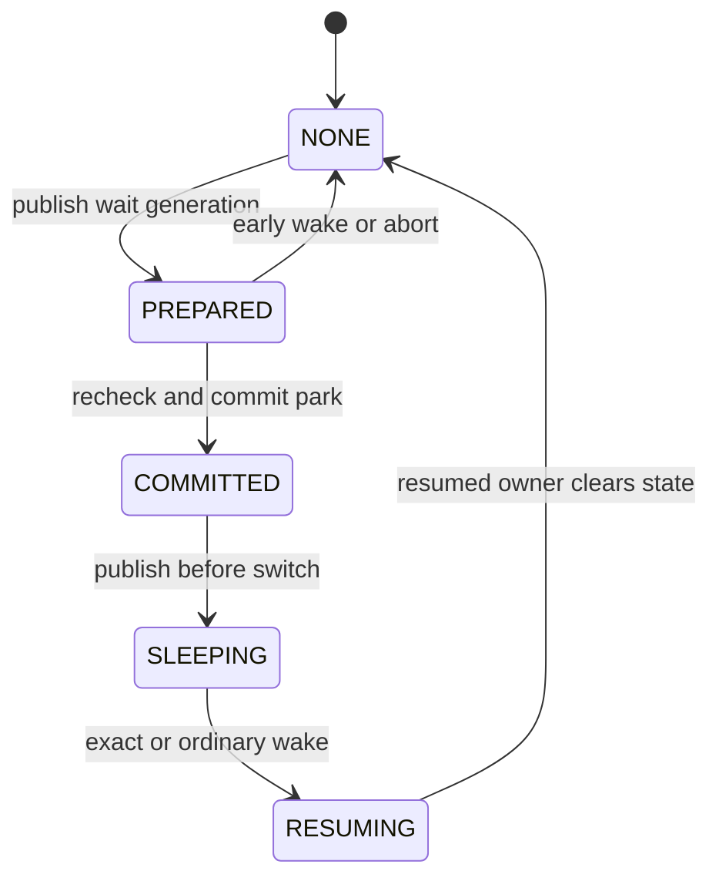
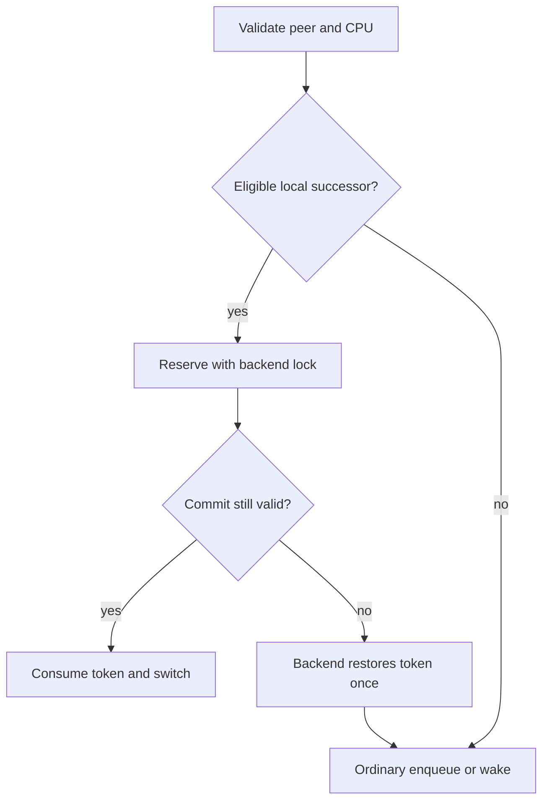
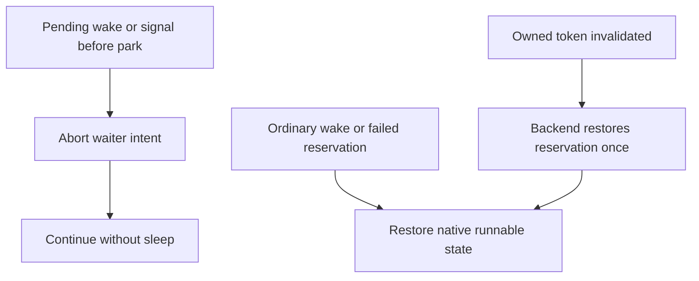
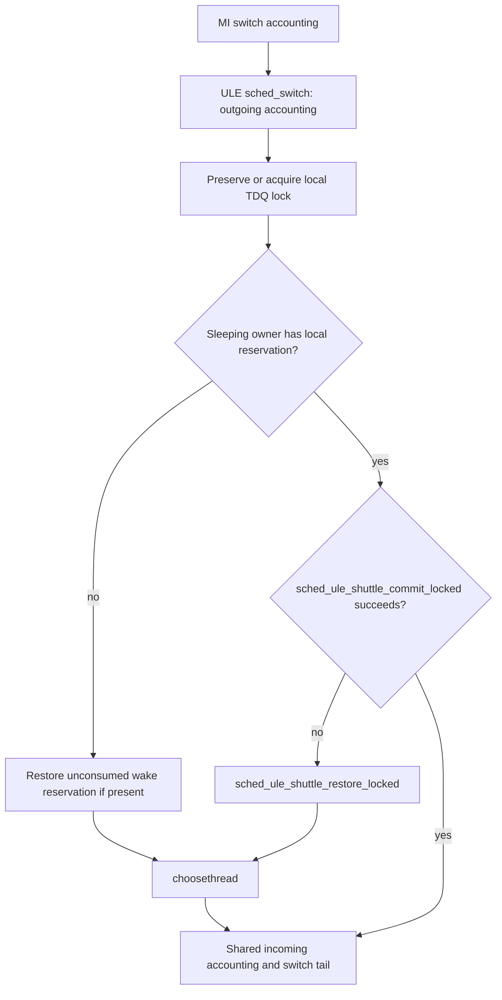

[Monograph index](../README.md) · [Full text](../door-ipc-implementation-for-freebsd_full.md)

<a id="chapter-7"></a>

<a id="contents-chapter-7-scheduler-shuttle-protocol"></a>

## Chapter 7. Scheduler shuttle protocol

The scheduler shuttle is an optional direct-handoff protocol used by Doors
when one participant is about to block and a particular peer is the most
useful thread to run next.  It connects the Door transaction state machine to
the native FreeBSD scheduler without changing Door RPC semantics or replacing
the scheduler's policy.

This chapter describes shuttle as a state and ownership protocol.  Function
names alone are insufficient: the difficult bugs occurred in the intervals
between “running”, “published as waiting”, “reserved”, “made runnable”, and
“actually selected”.

<a id="contents-7-1-motivation"></a>

### 7.1. Motivation

<a id="contents-ch7-the-conventional-wake-path"></a>

#### The conventional wake path

Without a handoff hint, a synchronous Door exchange follows the normal
sleep/wakeup pipeline:

```text
client enters CALL
→ request is queued
→ worker is removed from its sleep queue
→ worker becomes runnable
→ worker is inserted into a scheduler run queue
→ client prepares to sleep
→ scheduler chooses some runnable thread
→ worker eventually runs
→ worker returns the reply
→ client is made runnable and enqueued
→ scheduler later chooses the client
→ CALL returns
```

Every step is individually correct, but the generic scheduler knows only that
another thread became runnable.  It does not know that the current client is
about to wait specifically for that worker, or that the replying worker is
about to wait specifically after waking that client.

The unnecessary delay is not the system-call instruction itself.  It is the
combination of:

- sleepqueue publication and removal;
- run-queue insertion and removal;
- priority and topology selection;
- an idle CPU wake or IPI;
- waiting for the current quantum or an equal-priority reschedule point;
- a generic chooser pass even when the useful successor is already known.

For ordinary blocking APIs this separation is desirable.  For a two-party
Door transaction it can turn a short callback into a scheduler round trip that
costs much more than the payload processing.

<a id="contents-ch7-the-exact-successor-observation"></a>

#### The exact-successor observation

At two points the Door layer often knows a better successor than the generic
scheduler can infer:

1. the client has published a request and selected a concrete idle worker;
2. the worker has completed a reply and knows the concrete client waiting for
   that call.

Shuttle conveys that relationship as a one-shot hint:

```text
current will block
exact peer is eligible
peer is valid on this CPU
→ reserve peer
→ perform normal switch accounting
→ select the reserved peer
```

The reservation exists only until the switch is committed or rolled back.  It
does not permanently bind the threads, alter their priorities, or grant the
Door layer authority to bypass affinity.

<a id="contents-ch7-why-the-optimization-mattered-most-on-4bsd"></a>

#### Why the optimization mattered most on 4BSD

The effect was most visible on 4BSD when the useful worker was remote or an
equal-priority peer.  The ordinary wake was correct, but could leave the
transaction waiting for another reschedule event even though DoorFS already
knew the exact thread needed for progress.  Door-aware wake and exact idle
handoff removed that avoidable scheduling round trip; the largest affected
cases improved by nearly an order of magnitude.  Numerical results and their
measurement conditions belong to Appendix 2 rather than to this protocol
specification.

The remaining remote cost is architectural: source and target CPUs serialize
on 4BSD's single `sched_lock`.  Shuttle reduces unnecessary choice and wake
delay but does not pretend that 4BSD has ULE-style per-CPU lock ownership.

<a id="contents-ch7-local-and-remote-cases-are-different"></a>

#### Local and remote cases are different

<a id="contents-ch7-same-cpu"></a>

#### Same CPU

When current and peer are valid on the same CPU, the scheduler can reserve the
peer as the exact successor.  This is the strongest shuttle case:

- no cross-CPU migration is required;
- no IPI is required;
- affinity can be checked against the current CPU;
- the peer can be removed from its run queue or promoted directly from a
  private wait;
- the switch can commit that exact thread.

<a id="contents-ch7-different-cpu"></a>

#### Different CPU

A CPU cannot directly `cpu_switch()` to a thread owned by another CPU's
scheduler domain.  The remote case therefore uses:

- normal target-CPU ownership and run-queue rules;
- a Door-specific remote wake flag;
- an idle-target exact-handoff slot where safe;
- an IPI or idle wake chosen by the native scheduler;
- final validation and selection on the target CPU.

This is an exact **remote wake hint**, not a cross-CPU context switch.

<a id="contents-ch7-an-optimization-not-a-second-rpc-semantic"></a>

#### An optimization, not a second RPC semantic

The observable Door result must be identical with shuttle enabled, missed, or
unsupported:

- request and reply bytes are unchanged;
- descriptor transfer remains transactional;
- cancellation and signal errno are unchanged;
- credentials and jail policy are unchanged;
- revoke and owner exit remain authoritative;
- callback ordering is unchanged;
- the caller cannot detect which scheduler path selected the worker except by
  timing.

The central design rule is:

> A shuttle success may remove scheduling work.  A shuttle failure must remove
> no correctness state.

<a id="contents-7-2-state-protocol"></a>

### 7.2. State protocol

<a id="contents-ch7-two-related-state-machines"></a>

#### Two related state machines

There are two layers of state:

1. `struct sched_shuttle` describes the wait relationship owned by a thread;
2. `struct sched_shuttle_token` describes a scheduler-owned exact-successor
   reservation.

The protocol state values are:

```c
enum sched_shuttle_state {
        SCHED_SHUTTLE_NONE = 0,
        SCHED_SHUTTLE_PREPARED,
        SCHED_SHUTTLE_COMMITTED,
        SCHED_SHUTTLE_SLEEPING,
        SCHED_SHUTTLE_RESUMING
};
```

The visible thread states added for the scheduler boundary are:

```text
TDS_RUNNING       current is executing
TDS_SHUTTLE_WAIT  private blocked waiter, not on a sleepqueue
TDS_SHUTTLE       runnable peer held by exactly one reservation token
TDS_CAN_RUN       ordinary runnable transition state
TDS_RUNQ          ordinary run-queue membership
TDS_RUNNING       selected successor
```

`SCHED_SHUTTLE_*` and `TDS_*` are not interchangeable.  For example, a thread
may have `ss_state == SLEEPING` while its scheduler-visible state is
`TDS_SHUTTLE_WAIT`.  A reservation token may then move the peer to
`TDS_SHUTTLE` before it becomes `TDS_RUNNING`.

<a id="contents-ch7-waiter-state-and-reservation-ownership"></a>

#### Waiter state and reservation ownership



These are waiter states. RESERVED and RUNNING belong to scheduler reservation
and thread execution; they are not additional `sched_shuttle_state` values.
An early wake in PREPARED records pending completion under the thread lock.
The commit path checks it before sleeping. Generic wake, signal, cancellation,
and revoke must unwind any exact-successor reservation once.



ULE owns its TDQ locking and 4BSD owns its scheduler lock. The MI token carries
validated ownership rather than permission to manipulate backend queues.
A remote peer uses ordinary scheduling. Async wake does not own an exact successor.
Token acquisition and restoration in this diagram are backend-private actions;
there are no exported `take` or `rollback` methods.

<a id="contents-ch7-state-table"></a>

#### State table

| Protocol state | Actor entering it | Required lock | Visibility to wake/signal | Exit rule |
|---|---|---|---|---|
| `NONE` | initializer or resumed owner | thread lock while clearing | ordinary thread rules | prepare a new generation only from here |
| `PREPARED` | current waiter | wait interlock plus `thread_lock(current)` | early resume records `ss_pending`; signal AST is rechecked before park | commit, abort, or retry |
| `COMMITTED` | current waiter in park/commit | `thread_lock(current)` | waiter is on sleepqueue or `TDS_SHUTTLE_WAIT`; waker can now remove/unpark it | publish `SLEEPING` before switch |
| `SLEEPING` | current immediately before `mi_switch*()` | current thread lock, then scheduler switch contract | waker changes it to `RESUMING` or performs ordinary wake | reserve, enqueue, cancel, revoke, or signal |
| `RESUMING` | replying/dispatching peer | target thread lock, then scheduler-native lock | competing generic wake cancels reservation | exact reservation or ordinary enqueue |

<a id="contents-ch7-reservation-token-states"></a>

#### Reservation-token states

The token flags represent validation and ownership:

```c
#define SCHED_SHUTTLE_TOKEN_VALIDATED      0x00000001U
#define SCHED_SHUTTLE_TOKEN_LOCAL          0x00000002U
#define SCHED_SHUTTLE_TOKEN_RUNNABLE       0x00000004U
#define SCHED_SHUTTLE_TOKEN_RESERVED       0x00000008U
#define SCHED_SHUTTLE_TOKEN_WAKE_RESERVED  0x00000010U
```

| Token condition | Meaning |
|---|---|
| empty | no peer is removed from ordinary scheduler representation |
| `VALIDATED` | owner, peer, generation, CPU, and lock domain were checked |
| `RUNNABLE` | peer came from an ordinary run queue |
| `RESERVED` | token exclusively owns the peer; it must be committed or restored |
| `WAKE_RESERVED` | peer was promoted directly from a private wait and has not yet been ordinarily enqueued |

`sst_generation` prevents an old token or late wake from consuming a later
reuse of the same thread's shuttle structure.

<a id="contents-ch7-none-to-prepared"></a>

#### NONE to PREPARED

Actor: the thread that is about to block.

Required conditions:

- it is `curthread`;
- it is still `TDS_RUNNING`;
- the Door/CV interlock still protects the condition being waited for;
- the wait channel is non-null;
- an explicit peer, if present, is not the current thread;
- the previous shuttle generation is fully cleared.

Required lock: `thread_lock(curthread)` while setting `ss_peer`, `ss_wchan`,
flags, pending state, and generation.

Visibility: an early exact resume cannot enqueue the still-running waiter.
Instead it records `ss_pending`.  The waiter observes that marker before
switching and aborts the sleep.

Cancellation: clearing the state increments the generation.  This makes a
late resume stale rather than applicable to the next call.

<a id="contents-ch7-prepared-to-committed-tds-shuttle-wait"></a>

#### PREPARED to COMMITTED / `TDS_SHUTTLE_WAIT`

Actor: the current waiter after the Door interlock is ready to be released.

Required lock: `thread_lock(curthread)` continuously across the final pending
signal/suspend check and publication of the private state.

The crucial gate is:

```c
if ((flags & SCHED_SHUTTLE_F_INTERRUPTIBLE) != 0 &&
    ((td->td_pflags & TDP_WAKEUP) != 0 ||
    td_ast_pending(td, TDA_SIG) ||
    td_ast_pending(td, TDA_SUSPEND)))
        return (SCHED_SHUTTLE_ABORTED);

sched_sleep(td, 0);
td->td_flags |= TDF_SINTR;        /* for interruptible waits */
TD_SET_SHUTTLE_WAIT(td);
ss->ss_state = SCHED_SHUTTLE_COMMITTED;
```

Why the recheck is inside `thread_lock`: a signal can arrive after the earlier
Door-side check while the thread is still running.  At that time signal code
can only post an AST because there is no published waiter to unpark.  Once the
thread lock is held, either the waiter sees the pending AST and aborts, or a
later signal sees `TDS_SHUTTLE_WAIT` and unparks it.  No third interval exists.

<a id="contents-ch7-committed-to-sleeping"></a>

#### COMMITTED to SLEEPING

Actor: the current waiter.

Required lock: current thread lock on entry to the scheduler-specific switch.

Before switching, it checks `ss_pending` a final time.  If an early resume won:

```c
TD_SET_RUNNING(td);
sched_shuttle_abort(td);
return (SCHED_SHUTTLE_ABORTED);
```

Restoring `TDS_RUNNING` is mandatory because the thread is still executing.
Leaving it in `TDS_SHUTTLE_WAIT` while returning to C code creates an
impossible condition: a running thread exists on no runnable representation.
This exact class of bug caused later waits to hang or assert.

If no wake won, state becomes `SLEEPING` and the code enters `mi_switch()` or
`mi_switch_shuttle()` with normal context-switch accounting intact.

<a id="contents-ch7-sleeping-to-resuming"></a>

#### SLEEPING to RESUMING

Actor: the exact peer completing a Door reply or dispatching a worker.

Entry to `sched_shuttle_resume()` and `sched_shuttle_resume_to()` is lockless;
the function acquires `thread_lock(target)` internally.

Validation includes:

- target is still in the expected generation;
- target is `TDS_SHUTTLE_WAIT` or on its expected sleepqueue;
- `ss_peer` is empty for an idle worker or matches the current owner;
- async wake is not incorrectly treated as an exact synchronous successor;
- target has not already been resumed.

The waker changes the protocol state to `RESUMING`, makes the target eligible
for scheduler publication, and asks the active scheduler either to reserve it
or enqueue it normally.

<a id="contents-ch7-resuming-to-reserved"></a>

#### RESUMING to RESERVED

Actor: the scheduler-specific wake helper.

Required locks:

- target `thread_lock` on entry;
- then the native scheduler lock: local TDQ lock for ULE or global
  `sched_lock` for 4BSD;
- ownership of `thread_lock` is transferred to that scheduler lock as defined
  by the native wake path.

Validation includes CPU affinity, bound/pinned state, CPU ownership, token
availability, peer identity, and generation.  Success sets `TDS_SHUTTLE` and
publishes a `WAKE_RESERVED` token.  Failure clears the private relationship
and invokes the native ordinary wake routine.

<a id="contents-ch7-reserved-to-running"></a>

#### RESERVED to RUNNING

Actor: the scheduler switch path on the CPU owning the reservation.

Required lock: the same native scheduler lock that protects the token and
peer's runnable representation.

The final validation is intentionally repeated immediately before commit.
Only then may the scheduler:

- account the peer as awake/running;
- update current-thread and load fields;
- perform `TD_SET_RUNNING(peer)`;
- clear the token;
- pass the peer to `cpu_switch()` through the normal scheduler tail.

If any check fails, the scheduler restores the peer to its original run queue
or performs an ordinary wake before invoking the generic chooser.

<a id="contents-ch7-abort-and-fallback-transitions"></a>

#### Abort and fallback transitions



This diagram shows actions across waiter and scheduler domains, rather than
pretending that RUNQ and RESERVED are waiter-enum states.

The important transitions are:

```text
PREPARED → ABORTED → RUNNING/NONE
SHUTTLE_WAIT → ordinary wake → CAN_RUN/RUNQ
RESERVED → fallback → restored RUNQ
```

<a id="contents-ch7-peer-exit"></a>

#### Peer exit

If a waiting peer disappears before reservation, the resume fails validation
and the caller uses ordinary Door error handling.  If the current running
thread already owns a wake reservation and exits, the scheduler exit path must
resolve the reservation before the owner leaves the scheduler. ULE’s
`sched_throw()` explicitly calls `sched_ule_shuttle_owner_exit()` to restore
a wake-reserved peer. In 4BSD, abort restores a reservation under
`sched_lock`; the exit switch enters the ordinary chooser through
`sched_throw_tail()`, where the current owner’s token is consumed or restored
on failed validation.

Without this rule, the target remains `TDS_SHUTTLE` outside every run queue
forever.

<a id="contents-ch7-revoke"></a>

#### Revoke

Door revoke is an ordinary higher-priority wake source.  If the thread is:

- `PREPARED`: pending state aborts the upcoming sleep;
- `TDS_SHUTTLE_WAIT`: `sched_shuttle_unpark()` publishes it normally;
- `TDS_SHUTTLE`: `sched_shuttle_cancel()` destroys the reservation and
  enqueues it;
- already on a run queue: normal scheduler behavior applies.

Revoke never waits for the optimization to complete and never silently clears
a token without restoring its peer.

<a id="contents-7-3-scheduler-api-and-lock-ownership"></a>

### 7.3. Scheduler API and lock ownership

<a id="contents-ch7-result-contract"></a>

#### Result contract

```c
enum sched_shuttle_result {
        SCHED_SHUTTLE_OK = 0,
        SCHED_SHUTTLE_FALLBACK,
        SCHED_SHUTTLE_ABORTED,
        SCHED_SHUTTLE_RETRY
};
```

| Result | Meaning | Caller action |
|---|---|---|
| `OK` | scheduler owns the requested transition | do not repeat ordinary wake/switch work |
| `FALLBACK` | optimization unavailable and no indispensable state consumed | execute the ordinary correct path |
| `ABORTED` | a wake/signal/error won or arguments cannot describe a legal transition | do not sleep; unwind current generation |
| `RETRY` | concurrent state advanced or early wake was recorded | re-evaluate at the protocol boundary; never blindly enqueue twice |

There is no “unsupported but partially applied” result.  An unsupported
scheduler or configuration must return `FALLBACK` before removing a thread
from its normal representation.

<a id="contents-ch7-lock-ownership-convention"></a>

#### Lock-ownership convention

The precise implementation assertions are authoritative, but the MI contract
can be summarized as follows:

| API | Entry lock | Return lock on success | Return lock on fallback/abort |
|---|---|---|---|
| `sched_shuttle_prepare()` | `thread_lock(td)` held | still held | still held |
| `sched_shuttle_commit()` | `thread_lock(curthread)` held | still held | still held |
| `sched_shuttle_sleep()` | `thread_lock(curthread)` held | still held | still held |
| `sched_shuttle_swtch()` | `thread_lock(curthread)` held | consumed by context switch; caller resumes unlocked as documented | normally still owned until caller unwinds |
| `sched_shuttle_resume()` | none | target lock consumed/released internally | none |
| `sched_shuttle_resume_to()` | none | target lock consumed/released internally | none |
| `sched_shuttle_wakeup()` | target thread locked | success transfers/consumes lock through scheduler wake contract | target remains locked unless implementation explicitly performed normal wake |
| `sched_shuttle_unpark()` | target thread locked | consumes target lock through native wake | no normal return with lock assumed |
| `sched_shuttle_cancel()` | target thread locked | consumes lock through restore/enqueue | no normal return with lock assumed |
| `sched_shuttle_abort()` | current thread locked | returns with a valid current-thread lock domain | same |

Callers must not infer lock ownership solely from the result name.  The
scheduler implementation and assertions define whether a native wake routine
consumes the lock.

<a id="contents-ch7-sched-shuttle-sleep"></a>

#### `sched_shuttle_sleep()`

Purpose: publish current thread's intent to enter a private exact-peer wait.

Inputs:

- `td`: must be `curthread` and running;
- `peer`: exact peer or `NULL` for an idle-worker wait;
- `wchan`: stable wait identity;
- flags: interruptible, reply, dispatch, idle-wait, or async semantics.

It initializes a new generation in `PREPARED`.  It does not itself release the
Door mutex and does not choose the successor.

<a id="contents-ch7-sched-shuttle-swtch"></a>

#### `sched_shuttle_swtch()`

Purpose: complete park publication and enter the scheduler switch.

It:

1. validates current and prepared state;
2. calls the scheduler-specific park step;
3. handles pending wake/signal abort;
4. publishes `SLEEPING`;
5. performs normal MI switch accounting;
6. cleans the generation after current resumes.

It is spelled `swtch` to match the kernel's historical naming conventions.

<a id="contents-ch7-sched-shuttle-abort"></a>

#### `sched_shuttle_abort()`

Purpose: erase a generation that will not sleep and restore every reservation
owned by current.

It clears peer, wait channel, flags, pending state, increments generation, and
returns current to its native scheduler lock domain.  If current already
reserved another waiter, abort restores that target before clearing the token.

This final clause fixed a subtle hang: an early wake could reserve a peer and
then cause current's own sleep to abort.  Clearing only current's wait state
would strand the reserved peer outside every run queue.

<a id="contents-ch7-sched-shuttle-resume"></a>

#### `sched_shuttle_resume()`

Purpose: wake a private or generic shuttle waiter without requiring the caller
to own the intended successor relationship.

It is used for generic reply, revoke, and fallback wakeups.  During
`PREPARED/COMMITTED`, it records `ss_pending`; during `SLEEPING`, it either
reserves the target for current or publishes it through the ordinary scheduler
path.  `SCHED_SHUTTLE_F_ASYNC_WAKE` explicitly forbids exact-successor
ownership and uses a normal enqueue.

<a id="contents-ch7-sched-shuttle-resume-to"></a>

#### `sched_shuttle_resume_to()`

Purpose: resume one concrete waiter and attempt to reserve it as the current
thread's exact successor.

It accepts an idle worker whose `ss_peer` was previously null, or a client
whose recorded peer matches current.  A different peer, changed generation,
affinity mismatch, or non-sleeping target causes fallback.

<a id="contents-ch7-sched-shuttle-prepare-and-sched-shuttle-commit"></a>

#### `sched_shuttle_prepare()` and `sched_shuttle_commit()`

These support the generic sleepqueue-backed form:

- `prepare()` arms the relationship before entering the sleepqueue path;
- ordinary sleepqueue code publishes the waiter;
- `commit()` verifies that the same wait channel is still installed;
- an early resume produces `ABORTED` rather than a lost wake;
- the normal sleepqueue switch remains the fallback.

The newer private Door path uses `sleep()` / `swtch()` as the hot subset, but
the generic pair remains necessary for paths whose FreeBSD signal or locking
rules require normal sleepqueue membership.

<a id="contents-ch7-dispatch-helpers"></a>

#### Dispatch helpers

`sched_shuttle_dispatch()` connects an idle worker wait with the client that
has just selected it.  It may fill an initially null peer, mark pending during
prepare, or delegate to `resume_to()` after publication.

<a id="contents-ch7-backend-private-reservation-helpers"></a>

#### Backend-private reservation helpers

`sched_ule_shuttle_take()` reserves a runnable peer on the local ULE run
queue. It records the peer, generation, CPU, run-queue index, and transferability
and retains the TDQ lock through the switch. Final validation and commit run
inside ULE’s `sched_switch()`; `sched_ule_shuttle_restore_locked()` restores the
saved representation if commit fails.

4BSD reserves a local private waiter through its wake path. The ordinary
chooser consumes that token, and `sched_4bsd_shuttle_restore_locked()` restores
it when required. It has no separate runnable-peer take operation.

`sched_ule_shuttle_park()` and `sched_4bsd_shuttle_park()` are private helpers
called by their respective `shuttle_swtch()` implementations for the current
thread after the external interlock is released. The `resume_to()` paths act
on the target: they can record an early wake or attempt to reserve a parked
peer. The park helpers are not scheduler-interface methods. Reservation,
rollback, run queues, and CPU ownership remain with the backend.

<a id="contents-ch7-wake-cancel-and-unpark"></a>

#### Wake, cancel, and unpark

- `sched_shuttle_wakeup()` converts a just-woken target into an exact local
  reservation if legal;
- `sched_shuttle_cancel()` handles generic wake of `TDS_SHUTTLE`, restores the
  token, then enqueues normally;
- `sched_shuttle_unpark()` handles generic wake of `TDS_SHUTTLE_WAIT`;
- the resumed target, not the waker, clears interruptible-wait bookkeeping.

<a id="contents-ch7-flags"></a>

#### Flags

| Flag | Meaning |
|---|---|
| `SCHED_SHUTTLE_F_INTERRUPTIBLE` | wait participates in signal errno and abort rules |
| `SCHED_SHUTTLE_F_SAMECPU` | direct transition requires local CPU validity |
| `SCHED_SHUTTLE_F_DISPATCH` | client is dispatching a selected worker |
| `SCHED_SHUTTLE_F_REPLY` | worker is waking its waiting client |
| `SCHED_SHUTTLE_F_IDLE_WAIT` | server waits without a known peer until dispatch |
| `SCHED_SHUTTLE_F_ASYNC_WAKE` | waker continues and cannot own an exact-successor token |

<a id="contents-7-4-4bsd-implementation"></a>

### 7.4. 4BSD implementation

<a id="contents-ch7-architectural-constraint-one-global-scheduler-lock"></a>

#### Architectural constraint: one global scheduler lock

4BSD protects scheduler state with the global spin mutex `sched_lock`.  The
same lock serializes run-queue work performed by the source and target CPUs.
This is not an accidental implementation detail that Door code can remove; it
is a defining part of the 4BSD scheduler architecture.

For a remote Door wake, the sequence is approximately:

```text
CPU 0 holds sched_lock
→ makes worker runnable for CPU 1
→ publishes Door idle-handoff hint
→ wakes CPU 1
→ CPU 0 releases sched_lock
→ CPU 1 leaves idle
→ CPU 1 waits for sched_lock
→ CPU 1 enters mi_switch()/chooser
→ exact worker is selected
```

The target CPU can observe runnable work before it can acquire the global
scheduler lock and enter the chooser.  Consequently the residual remote delay
is lock and switch serialization, not merely hardware wake latency.  Making
remote 4BSD identical to local ULE would require replacing 4BSD's locking
architecture, which is outside the shuttle design.

<a id="contents-ch7-same-cpu-exact-successor"></a>

#### Same-CPU exact successor

4BSD stores a scheduler-private shuttle structure per thread and a reservation
token per CPU.  For a legal local handoff:

1. current publishes its private wait;
2. peer becomes `TDS_CAN_RUN` under its thread lock;
3. `sched_4bsd_shuttle_wakeup()` verifies `THREAD_CAN_SCHED(peer, cpu)` and
   bound/pinned placement;
4. peer's lock domain moves to `sched_lock`;
5. peer becomes `TDS_SHUTTLE`;
6. the local token records current, peer, generation, and CPU;
7. 4BSD’s ordinary `sched_switch()` accounts for the outgoing thread;
8. the normal chooser consumes the exact reservation before scanning run
   queues.

The final implementation deliberately lets the ordinary 4BSD switch/chooser
consume the reservation:

```c
static void
sched_4bsd_shuttle_sswitch(struct thread *td, int flags)
{
        sched_switch(td, flags);
}
```

This preserves 4BSD's established outgoing-thread accounting and lock
transitions while still avoiding an arbitrary successor choice.

<a id="contents-ch7-remote-run-queue-and-idle-handoff"></a>

#### Remote run queue and idle handoff

For remote placement, the worker is added through the normal 4BSD scheduler
with `SRQ_DOOR_WAKE`.  Door-specific per-CPU state records:

```c
DPCPU_DEFINE_STATIC(u_int, door_idle_hot);
DPCPU_DEFINE_STATIC(u_int, door_idle_spinning);
DPCPU_DEFINE_STATIC(u_char, door_remote_handoff);
DPCPU_DEFINE_STATIC(struct thread *, door_idle_handoff);
```

`door_idle_handoff` names a concrete worker for an idle target CPU.  It is only
a hint: removal, affinity change, cancellation, or another chooser clears or
invalidates it.  The idle CPU consumes it under `sched_lock` after checking
that the thread is still runnable and valid for that CPU.


<a id="contents-ch7-affinity-mismatch"></a>

#### Affinity mismatch

A client on CPU 0 cannot locally switch to a worker hard-bound to CPU 1 or CPU
6.  The scheduler checks:

- `THREAD_CAN_SCHED(worker, current_cpu)`;
- `TDF_BOUND`, pin count, and recorded run-queue CPU;
- whether the candidate is owned by the current scheduler domain.

Failure returns `FALLBACK` before a local reservation is published.  The worker
is then placed on its valid remote CPU normally.  Attempting a local reservation first would only add predictable affinity-fallback work, so the implementation proceeds directly to ordinary remote placement.

<a id="contents-ch7-equal-priority-remote-wake"></a>

#### Equal-priority remote wake

Stock 4BSD may decide that an equal-priority runnable thread does not require
immediate preemption.  That is normally a reasonable fairness decision, but a
Door worker may be the exact thread needed for the interrupted client to make
progress.

The Door wake marks `door_remote_handoff` for the target CPU.  The reschedule
path treats this as a request to give the exact worker an immediate scheduling
opportunity rather than resume the interrupted equal-priority thread first.
The mark is one-shot and is cleared when consumed.

Without this change, correctness remains, but an empty remote call can wait an
extra quantum/scheduling event—the source of the original tens-of-microseconds
cliff.

<a id="contents-ch7-idle-cpu-wake-and-ipi-behavior"></a>

#### Idle CPU wake and IPI behavior

If the target CPU is in the short Door-hot idle spin, publishing the handoff is
enough; sending an IPI would add overhead after the CPU is already polling for
work.  If the CPU is actually idle, the scheduler uses `cpu_idle_wakeup()` and
the safe native notification path.

A direct `IPI_PREEMPT` shortcut is not used for the idle case because its preemption assumptions do not hold for the idle thread and equal-priority handoff.  The implementation requests the native scheduler/idle wake and lets the target choose under its normal context.

<a id="contents-ch7-door-hot-idle-spin"></a>

#### Door-hot idle spin

4BSD did not have ULE's equivalent behavior for this workload.  A bounded
spin after recent Door activity avoids repeatedly entering a deep idle state
between ping-pong transactions:

```text
Door activity marks CPU hot
→ idle loop consumes the mark once
→ spin for at most door_idlespins
→ stop immediately when runnable work appears
→ otherwise enter normal idle
```

It is intentionally conditional and bounded.  It does not turn the general
idle loop into permanent polling.

<a id="contents-ch7-asynchronous-wake-fairness"></a>

#### Asynchronous wake fairness

ONEWAY and native async submit do not block for reply handoff. When 4BSD
publishes a shuttle waiter through `sched_4bsd_shuttle_wakeup_async()`, it
enqueues with `SRQ_HOLDTD | SRQ_DOOR_WAKE`. A worker on the local or global run
queue causes a scheduler AST on current; a remote worker uses the ordinary
Door-aware notification path. The target is selected under normal scheduler
control. There is no per-submitter burst counter or burst sysctl.

<a id="contents-ch7-practical-remote-limit"></a>

#### Practical remote limit

The remaining remote interval is fundamentally:

```text
source CPU publishes worker while holding sched_lock
→ target CPU wakes
→ target waits for the same sched_lock
→ target performs normal 4BSD switch accounting
```

Moving wake publication outside the lock introduces a new state race, while
per-CPU Door run queues would begin to replace 4BSD's architecture.  The final
implementation keeps publication and scheduler ownership within the native
locking model.

<a id="contents-7-5-ule-implementation"></a>

### 7.5. ULE implementation

<a id="contents-ch7-per-cpu-tdq-ownership"></a>

#### Per-CPU TDQ ownership

ULE protects each CPU's runnable state with its TDQ lock.  The shuttle token is
stored directly in the TDQ:

```c
struct tdq {
        /* native ULE fields */
        struct sched_shuttle_token tdq_shuttle;
};
```

A local reservation touches only the current TDQ.  A remote wake acquires the
target TDQ according to ULE's existing migration and notification rules.  The
source and target CPUs therefore do not always serialize on a single global
lock as they do in 4BSD.

<a id="contents-ch7-local-runnable-peer-reservation"></a>

#### Local runnable-peer reservation

For a peer already on the current CPU's run queue, ULE:

1. try-locks the local TDQ rather than acquiring an arbitrary peer sleepqueue
   lock;
2. verifies peer's `td_lock` is exactly that TDQ lock;
3. verifies run-queue membership, CPU, affinity, pinning, and chooser order;
4. records run-queue index and transferability;
5. removes the peer with `tdq_runq_rem()`;
6. retains the TDQ lock through `mi_switch_shuttle()`;
7. commits the peer or restores it to the exact bucket.

Try-lock failure is only an optimization miss.  Blocking on another
sleepqueue-chain lock while already holding one could recursively acquire the
same hashed spin lock, so the safe response is fallback.

<a id="contents-ch7-shuttle-commit-in-the-ordinary-ule-switch"></a>

#### Shuttle commit in the ordinary ULE switch

In `sched_ule.c`, `sched_switch()` handles ordinary and shuttle switches in
one body. After `mi_switch_common()` performs MI accounting, the shim
dispatches `sched_shuttle_sswitch()` to `sched_ule_shuttle_sswitch()`. That
backend callback delegates to `sched_switch()`. A sleeping owner with a
local reservation retains the take-reservation TDQ lock or acquires it for a
wake reservation.  The common outgoing-thread accounting runs before the
reservation commit helper.  The reservation path validates:

- token owner is current;
- token belongs to `TDQ_SELF()`;
- CPU and generation still match;
- peer's lock is the TDQ lock;
- wake-reserved peer is `TDS_SHUTTLE`;
- runnable-reserved peer still matches the relationship.

Because commit bypasses generic `choosethread()`, it explicitly performs the
terminal `TD_SET_RUNNING(peer)` after validation.  A failed commit restores
the peer before the ordinary chooser runs; SMP may attempt stealing after the
reservation has been restored.  Preemption and yield restore a wake
reservation instead of consuming it as a sleeping-owner handoff.  Migration,
switch accounting, tracing hooks, and `cpu_switch()` remain in the common body.



`sched_ule_shuttle_sswitch()` delegates to this same function. A take
reservation already holds the TDQ lock; a wake reservation follows the normal
sleeping-owner lock acquisition. A failed commit restores the peer before the
chooser runs. Preemption and yield restore a wake reservation rather than
consuming it as a sleeping-owner handoff.

<a id="contents-ch7-private-waiter-wake"></a>

#### Private waiter wake

An unbound private waiter can be localized to the waking owner's CPU through
ULE's native `sched_setcpu()` rules.  A bound or pinned waiter may only be
reserved if its required CPU matches.  The token then records a
`WAKE_RESERVED` peer that has never been inserted into the ordinary run queue.

Wake accounting and `tdq_load_add()` occur at commit.  Rollback converts the
peer to `TDS_CAN_RUN`, performs ordinary wake accounting, and calls `tdq_add()`.
Exactly one path accounts it.

<a id="contents-ch7-remote-enqueue-and-wake"></a>

#### Remote enqueue and wake

If direct localization is illegal or the target TDQ already owns a token, ULE
clears the private relationship and uses ULE’s `sched_wakeup()` and
`sched_add()` path.
ULE's existing topology, load balancing, and remote notification choose the
CPU.  Shuttle does not override TDQ migration rules.

<a id="contents-ch7-owner-exit"></a>

#### Owner exit

A running ULE thread may own a reservation for another thread when it exits.
ULE’s `sched_throw()` calls `sched_ule_shuttle_owner_exit()` under the
local TDQ lock, before the final `cpu_throw()`. The hook restores any matching
wake reservation owned by the exiting thread.

This hook exists because normal post-switch cleanup will never execute for an
exiting thread.

<a id="contents-ch7-same-public-semantics-different-internals"></a>

#### Same public semantics, different internals

| Property | ULE | 4BSD |
|---|---|---|
| scheduler lock domain | per-CPU TDQ | global `sched_lock` |
| local token | per TDQ | per CPU under global lock |
| local direct commit | ULE’s `sched_switch()` commits the token | 4BSD’s `sched_switch()` enters the chooser, which consumes the token |
| remote wake | target TDQ and ULE topology | global lock, target run queue, idle handoff |
| cross-CPU direct switch | forbidden | forbidden |
| affinity mismatch | ordinary enqueue | ordinary enqueue |
| ABI result on miss | unchanged | unchanged |

The MI Door/CV layer sees the same result codes and fallback guarantee.  It
does not depend on TDQ fields or the global 4BSD run queue.

<a id="contents-7-6-correctness-abort-and-fallback"></a>

### 7.6. Correctness, abort, and fallback

> Any failed or unavailable shuttle optimization must fall back to an ordinary
> correct scheduler path and must never lose a wakeup.

<a id="contents-ch7-core-invariants"></a>

#### Core invariants

1. A thread is represented in exactly one place: running, sleepqueue, private
   wait, reservation token, or ordinary run queue.
2. A `RESERVED` token is consumed exactly once by commit or rollback.
3. A wake that arrives before waiter publication is recorded as pending.
4. A wake after private publication observes `TDS_SHUTTLE_WAIT` under the same
   thread lock and unparks it.
5. A direct successor becomes `TDS_RUNNING` before it executes.
6. A generation mismatch cannot affect a later wait.
7. Affinity and scheduler ownership are checked before reservation and again
   before commit.
8. Door revoke, signal, suspension, and thread exit override the optimization.
9. Fallback never exposes a partial reservation to generic code.
10. No Door correctness rule depends on the scheduler accepting a shuttle.

<a id="contents-ch7-signal-before-park-publication"></a>

#### Signal before park publication

If the signal is pending before the final `thread_lock` gate, park returns
`ABORTED`.  Current remains running, clears the generation, releases the Door
interlock through the normal path, and processes the signal.

The decisive fix was the second AST check under `thread_lock`; checking only
before acquiring the lock left a window where signal delivery saw a running
thread and the waiter then went to sleep with no future wake.

<a id="contents-ch7-signal-during-publication"></a>

#### Signal during publication

Signal code needs the same target thread lock.  Therefore either:

- park holds the lock first and publishes `TDS_SHUTTLE_WAIT`, after which the
  signal unparks it; or
- signal state becomes visible first and park aborts.

There is no valid interleaving where both believe the other will perform the
wake.

<a id="contents-ch7-signal-after-park"></a>

#### Signal after park

`sig_sleepq_abort()` detects `TDS_SHUTTLE_WAIT`, stores the normal interrupt
result in `td_intrval`, and calls `sched_shuttle_unpark()` instead of
`sleepq_abort()`.  The waiter owns final cleanup of `TDF_SINTR` and
`td_intrval` after it resumes.

This fixed the observed `signals_test` hang where one thread remained in
`sched_4bsd_shuttle_switch()` and the controlling threads slept in `uwait` and
`pipe_read`.

<a id="contents-ch7-resume-before-commit"></a>

#### Resume before commit

If a reply arrives while state is `PREPARED` or `COMMITTED` but before current
has actually switched, resume sets `ss_pending`.  The waiter removes its own
pending sleep, restores `TDS_RUNNING`, aborts the generation, and does not
switch.

The waker must not enqueue the still-executing thread.  Doing so would place
the same thread both on CPU and on a run queue.

<a id="contents-ch7-revoke-before-switch"></a>

#### Revoke before switch

Revoke follows the same priority as a signal or generic wake.  It marks the
Door/call terminal under Door locks, then:

- records pending if current has not published the wait;
- unparks a private waiter;
- cancels/restores a reserved peer;
- wakes an ordinary sleeper normally.

The waiter returns to DoorFS, which reads the transaction's terminal state and
returns the ABI-defined error.  Scheduler code does not invent Door errno.

<a id="contents-ch7-missing-or-stale-reservation"></a>

#### Missing or stale reservation

The switch path validates token flags, owner, peer, CPU, generation, lock
domain, and state.  If any field is stale:

1. restore any peer removed from a run queue;
2. clear the token;
3. use the ordinary scheduler chooser;
4. keep the outgoing waiter correctly blocked;
5. ensure the chosen incoming thread is marked running.

It is unsafe merely to clear a stale token: `RESERVED` may mean the peer is no
longer represented anywhere else.

<a id="contents-ch7-affinity-mismatch-2"></a>

#### Affinity mismatch

Affinity is an expected optimization miss, not an exceptional Door error.
No local token is published.  The target is enqueued on an allowed CPU and
woken through the native remote path.  The calling thread sleeps normally.

This rule is why remote-bound `C0/W1` and `C0/W6` cannot use a local direct
`cpu_switch()` even though DoorFS knows the exact worker.

<a id="contents-ch7-peer-disappearance"></a>

#### Peer disappearance

Thread-exit cleanup invalidates the binding and shuttle relationship under the
relevant locks.  A later resume observes state/generation mismatch.  If the
peer was already reserved, scheduler exit restores or cancels that token
before thread memory can be reclaimed.

DoorFS separately resolves the active call as worker loss or owner death.

<a id="contents-ch7-duplicate-wake"></a>

#### Duplicate wake

Only the first wake may move a wait from sleeping to resuming or consume a
reservation.  Later wakeups see `NONE`, a changed generation, or an ordinary
runnable state and use no shuttle action.  They must not call the native add
routine a second time.

<a id="contents-ch7-unsupported-scheduler-or-configuration"></a>

#### Unsupported scheduler or configuration

A scheduler that does not implement the protocol returns `FALLBACK` without
changing thread representation.  UP builds omit remote state but retain local
correctness.  A panic path also avoids new reservations because panic
scheduling uses special chooser rules.

<a id="contents-ch7-fallback-must-restore-current-s-lock-domain"></a>

#### Fallback must restore current's lock domain

The generic sleep path may have changed `td_lock` to a sleepqueue-chain lock;
a scheduler reservation may have changed it to TDQ or `sched_lock`.  If the
switch is aborted, current must return with the lock expected for a running
thread.  ULE's abort path explicitly transfers back to the local TDQ without
holding the sleepqueue lock across TDQ acquisition.  4BSD transfers back to
`sched_lock` and restores any token owned by current.

Failure to restore the lock domain may not crash at the abort site.  It often
appears later as recursive spin-lock acquisition, an assertion in the next
sleep, or an unkillable process.

<a id="contents-ch7-failure-history-and-resulting-rules"></a>

#### Failure history and resulting rules

| Observed/experimental problem | Root cause | Final rule |
|---|---|---|
| wake-before-park hang | waiter became invisible between condition check and sleep publication | fuse publication with Door/CV interlock and record early wake |
| repeated signal test hung after many iterations | private waiter was not a sleepqueue member and signal used the wrong abort model | recognize `TDS_SHUTTLE_WAIT`, store errno, unpark through scheduler |
| signal arrived while thread still running, then wait hung | AST check occurred before final thread-lock boundary | recheck signal/suspend under `thread_lock` immediately before park |
| peer executed as `TDS_CAN_RUN` and later panicked | specialized chooser bypass omitted `TD_SET_RUNNING` | every direct commit performs the normal terminal state transition |
| reserved peer disappeared on abort/exit | owner cleared its wait without restoring owned token | abort and scheduler exit restore all owned reservations |
| 4BSD specialized sswitch added complexity without remote gain | global `sched_lock` remained the dominant remote serialization | retain minimal chooser-consumed reservation; do not emulate ULE |
| millions of affinity fallbacks | remote-bound worker could never be a local successor | treat affinity mismatch as immediate ordinary remote wake |
| same-CPU ONEWAY queue starvation | submitter continues while an equal-priority worker becomes runnable | async waiter enqueue requests a local scheduler AST |

<a id="contents-ch7-validation-strategy"></a>

#### Validation strategy

Correctness is tested at several scales:

- focused signal interruption and recovery loops;
- owner exit during a pending call;
- worker exit and endpoint revoke;
- same-CPU, different-core, and SMT-sibling placement;
- synchronous, no-return, and ONEWAY traffic;
- descriptor and SHM variants;
- full `lib/libdoor`, `sys/fs/doorfs`, and `sys/fs/namefs` suites;
- repeated runs under both 4BSD and ULE.


<a id="contents-ch7-review-checklist"></a>

#### Review checklist

Any future shuttle change must answer all of these questions:

1. Where is the waiter represented before and after the change?
2. Which lock makes that representation visible?
3. What happens if a signal arrives one instruction earlier or later?
4. What happens if revoke wins before the switch?
5. Who owns a reserved peer if current aborts or exits?
6. Is the peer allowed on this CPU right now?
7. Does fallback restore load, run-queue index, lock pointer, and thread state?
8. Does the selected peer become `TDS_RUNNING` exactly once?
9. Can an async waker incorrectly claim an exact-successor reservation?
10. Does the same Door call still work if every shuttle operation returns
    `FALLBACK`?

If the answer to the final question is no, the change has moved Door
correctness into an optimization and must not be accepted.

<a id="contents-ch7-7-6-1-asynchronous-wake-fairness"></a>

### 7.6.1. Asynchronous wake fairness

ONEWAY and native async submit complete without waiting for server callback
completion. A wake of a private waiter does not reserve an exact successor
when `SCHED_SHUTTLE_F_ASYNC_WAKE` is set. In 4BSD, the asynchronous wake helper
publishes the worker on a native queue and requests a local scheduler AST when
appropriate. Remote notification and idle spinning remain separate mechanisms.
See §7.4 and §14.16. No fairness hook runs once per accepted submission.

<a id="contents-7-7-rejected-experiments"></a>

### 7.7. Rejected experiments

The final protocol is intentionally smaller than the set of mechanisms tested
during development.  The rejected paths are recorded because each is tempting
when only a latency trace is considered, yet each either violates scheduler
ownership or adds permanent complexity without removing the architectural
bottleneck.

<a id="contents-ch7-specialized-4bsd-shuttle-sswitch"></a>

#### Specialized 4BSD shuttle `sswitch`

A prototype split 4BSD’s switch body into generic and shuttle-specific
tails and committed the reserved peer directly, resembling an earlier ULE
prototype with a separate switch tail.  The
first version bypassed `choosethread()`, which normally performs the final
`TD_SET_RUNNING(newtd)` transition.  The peer executed while still marked
`TDS_CAN_RUN`, and a later wait detected the invalid state.

Adding the missing transition repaired that immediate fault, but did not
remove remote serialization on global `sched_lock`.  The branch duplicated
outgoing-thread accounting, lock transitions, and context-switch hooks for a
benefit confined to the already-fast local case.  The retained design lets the
ordinary 4BSD `sswitch` and chooser consume the reservation.

<a id="contents-ch7-cross-cpu-direct-switch"></a>

#### Cross-CPU direct switch

A local CPU cannot commit `cpu_switch()` to a thread owned by another CPU.
Affinity, pinned and bound state, run-queue membership, target idle state, and
the target scheduler lock all belong to the destination CPU's domain.  A
remote Door successor is therefore an exact wake hint followed by native
remote enqueue and selection, never a cross-CPU context switch.

<a id="contents-ch7-remote-reservation-and-bypass-layers"></a>

#### Remote reservation and bypass layers

Prototypes attempted a local reservation before discovering an inevitable
affinity mismatch, and later added bypass paths to avoid those failures.
Removing the predictable attempts simplified the path, but an additional
remote shuttle state machine did not improve the interval after the target
became runnable.  The surviving mechanism is the smaller target-CPU idle
handoff hint plus the ordinary remote run queue.

<a id="contents-ch7-wake-outside-sched-lock-and-per-cpu-door-queues"></a>

#### Wake outside `sched_lock` and per-CPU Door queues

Moving `cpu_idle_wakeup()` after lock release appears to let the target acquire
`sched_lock` sooner, but it separates runnable publication from notification
and requires a new race protocol for a CPU entering or leaving idle.  A
separate per-CPU Door run queue would require new lock ordering, load
accounting, migration, affinity, and rollback rules.  That is a redesign of
4BSD toward ULE rather than a Door optimization.

<a id="contents-ch7-forced-preemption-from-the-idle-path"></a>

#### Forced preemption from the idle path

An `IPI_PREEMPT`-style shortcut was rejected because the idle thread and an
equal-priority exact handoff do not satisfy all assumptions of the ordinary
preemption path.  DoorFS requests the native idle wake or scheduler AST and
allows the target scheduler to switch in its established context.

<a id="contents-ch7-permanent-diagnostic-instrumentation"></a>

#### Permanent diagnostic instrumentation

Atomic transition counters and cycle timestamps inside scheduler locks changed
cache traffic and lock hold time, thereby perturbing the path they measured.
They were useful in diagnostic kernels for locating the residual interval but
are not part of the production protocol or its ABI.  Performance evidence is
reported separately in Appendix 2 and must identify instrumentation state.

These rejections lead to one general rule: optimize the information supplied
to each native scheduler, but do not reproduce one scheduler's architecture
inside another.
