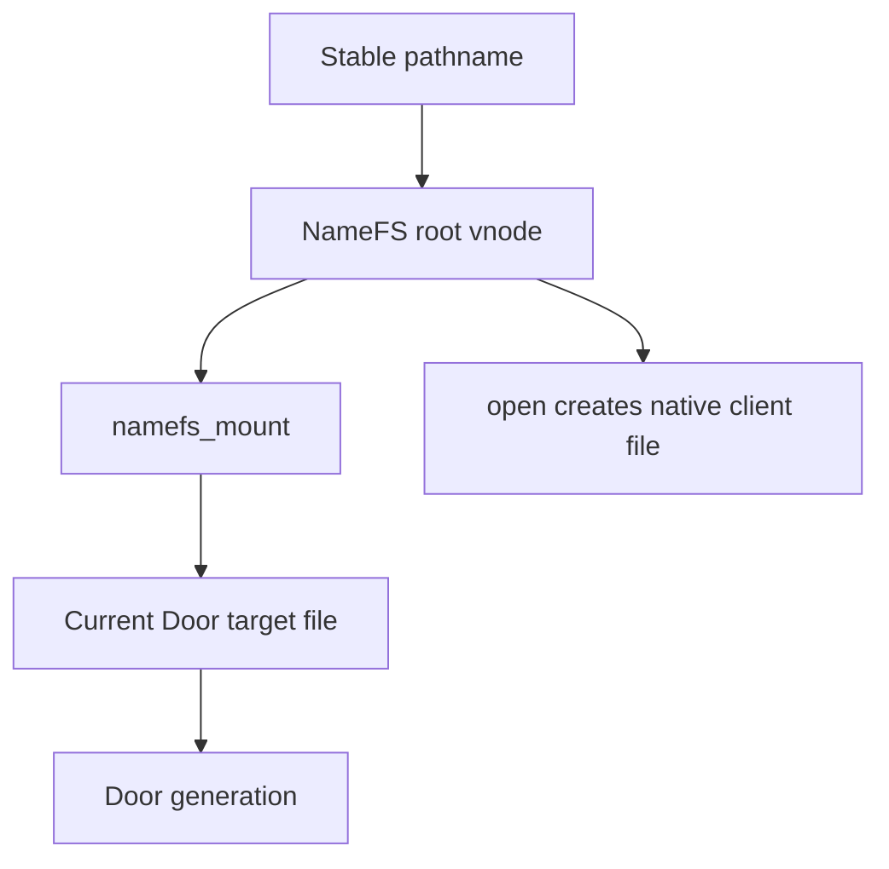

[Monograph index](../README.md) · [Full text](../door-ipc-implementation-for-freebsd_full.md)

<a id="chapter-8"></a>

<a id="contents-chapter-8-namefs-doorctl-and-service-discovery"></a>

## Chapter 8. NameFS, DoorCTL, and service discovery

NameFS publishes a live Door generation at an existing filesystem pathname.
It is a single-file mount whose root vnode is a stable service-publication
identity.  Opening that vnode creates a native Door client file for the
generation currently selected by the mount.

NameFS does not proxy Door RPC through vnode read/write operations.  The vnode
participates only in pathname lookup, access checks, open, mount lifetime, and
recovery.  After `open()`, the resulting file descriptor operates directly on
DoorFS.

This chapter also describes interaction with NullFS.  The two filesystems can
be stacked in either order, but they do not provide transparent recursive
mount propagation: “NullFS over NameFS” and “NameFS over NullFS” have different
namespace results.

<a id="contents-8-1-stable-pathname-identity"></a>

### 8.1. Stable pathname identity

<a id="contents-ch8-a-door-fd-is-process-local"></a>

#### A Door fd is process-local

A Door is naturally represented by a file descriptor.  The descriptor is a
strong capability and works well for inheritance, `dup()`, descriptor passing,
Capsicum, and direct brokered transfer.  It does not by itself provide a name
that an unrelated process can discover after startup.

A service commonly needs a stable path such as:

```text
/var/run/example.door
```

Clients must be able to resolve that path, obtain a Door capability, close the
path lookup state, and continue using the descriptor independently.

<a id="contents-ch8-stable-pathname-versus-replaceable-generation"></a>

#### Stable pathname versus replaceable generation

The public service identity and an individual server generation have different
lifetimes:

```text
stable pathname identity
    ├── generation N   (old server)
    ├── generation N+1 (replacement)
    └── generation N+2 (later restart)
```

An open descriptor must stay attached to the generation it acquired.  A later
rebind changes only future opens.  Mutating existing descriptors behind the
client's back would break capability identity and make replies, revoke,
credentials, and SHM generation checks ambiguous.

<a id="contents-ch8-why-a-symlink-is-insufficient"></a>

#### Why a symlink is insufficient

A symlink names another pathname.  It does not:

- convert `open()` into acquisition of a Door `struct file`;
- hold a Door generation reference;
- provide atomic generation replacement under a mount lock;
- prevent the target from being unlinked/recreated between lookup and open;
- preserve already opened capability identity;
- apply Door jail/Capsicum checks during file conversion;
- participate in VFS busy/unmount rules as a service publication.

A symlink to a numeric `/dev/fd/N`-style path also depends on the resolving
process's fd table, so it cannot publish another process's capability.

<a id="contents-ch8-why-copying-a-descriptor-is-insufficient"></a>

#### Why copying a descriptor is insufficient

Passing or duplicating an fd gives one known recipient the capability.  It
does not create a namespace object for later clients.  Storing the integer fd
in a file is meaningless because fd numbers are per-process and reusable.

NameFS uses the kernel-held `struct file`, not the user-visible integer, after
mount validation.

<a id="contents-ch8-vnode-backed-service-identity"></a>

#### Vnode-backed service identity

NameFS creates one synthetic `VREG` root vnode at the covered pathname.  That
vnode belongs to the NameFS mount and remains the lookup identity across
`MNT_UPDATE` rebinds.  The mutable generation is a held target Door file inside
the mount object.



This separation provides:

- stable VFS/namecache identity;
- atomic target replacement;
- generation pinning at open;
- VFS-controlled detach and forced unmount;
- a recovery interval in which the pathname remains mounted but cannot open a
  dead generation;
- normal filesystem permissions derived from the covered file.

<a id="contents-8-2-objects-and-references"></a>

### 8.2. Objects and references

<a id="contents-ch8-struct-namefs-mount"></a>

#### `struct namefs_mount`

```c
struct namefs_mount {
	struct mtx nm_lock;
	struct file *nm_target;
	struct vnode *nm_rootvp;
	struct ucred *nm_attach_cred;
	struct vattr nm_attr;

	LIST_ENTRY(namefs_mount) nm_registry_link;
	char *nm_attach_path;
	bool nm_registry_linked;

	enum namefs_state nm_state;
	u_int nm_internal_vrefs;
	struct namefs_gc *nm_gc;
};
```

| Object | Creator / owner | References | Protecting lock | Final destruction |
|---|---|---|---|---|
| `namefs_mount` | initial NameFS mount; stored in `mp->mnt_data` | VFS mount lifetime, global endpoint registry membership, root vnode `v_data`, optional GC task association | `nm_lock` protects target/state/GC; `namefs_endpoints_lock` protects registry membership; VFS mount locks protect mount lifetime | successful unmount after `vflush()` unregisters it, clears target/GC, releases credentials/path, destroys lock and frees object |

The mount object is the stable publication identity.  Rebind modifies
`nm_target` and `nm_state`; it does not allocate a replacement root vnode.

<a id="contents-ch8-namefs-state"></a>

#### NameFS state

```c
enum namefs_state {
        NAMEFS_LIVE = 0,
        NAMEFS_RECOVERY,
        NAMEFS_UNMOUNTING
};
```

| State | Meaning | `open()` behavior |
|---|---|---|
| `LIVE` | `nm_target` names a live Door file generation | may acquire and clone target |
| `RECOVERY` | old target is orphaned/dead; vnode may be retained for rebind because external references exist | fails with `ENXIO`/`EBADF`; no stale generation is cloned |
| `UNMOUNTING` | mount teardown claimed the object | new opens fail; target and root are being detached |

`RECOVERY` is deliberately not a new Door generation.  It is the absence of a
usable target while preserving the namespace anchor.

<a id="contents-ch8-root-vnode"></a>

#### Root vnode

`namefs_alloc_root()` creates a new vnode with:

```c
vp->v_type = VREG;
vp->v_data = nm;
vp->v_vflag |= VV_ROOT;
insmntque1(vp, mp);
vn_set_state(vp, VSTATE_CONSTRUCTED);
```

| Object | Creator / owner | References | Protecting lock | Final destruction |
|---|---|---|---|---|
| NameFS root vnode | `getnewvnode()` during mount | mount/root internal refs, namecache/path lookup refs, open/O_PATH/external vnode refs | vnode interlock/lock and mount locks; `nm_lock` protects data reached through mount | `vflush()` drives inactive/reclaim; reclaim clears `v_data`; mount object is freed only after root users are drained or forcibly closed |

The vnode is synthetic.  It is not the original placeholder vnode, a DoorFS
vnode, or a NullFS lower vnode.

<a id="contents-ch8-covered-vnode"></a>

#### Covered vnode

`mp->mnt_vnodecovered` is the pre-existing vnode on which the file mount is
placed.  NameFS validates that it exists, locks it long enough to obtain
attributes, and snapshots those attributes in `nm_attr`.

| Object | Creator / owner | References | Protecting lock | Final destruction |
|---|---|---|---|---|
| covered vnode | underlying filesystem; selected by VFS mount lookup | VFS mount infrastructure holds the covered relationship; NameFS does not create a second manual lower-vnode chain | underlying vnode lock plus mount topology locks | owned/reclaimed by underlying FS after the covering mount is removed and ordinary refs drain |

The covered vnode may belong to UFS, tmpfs, NullFS, or another filesystem that
permits the operation.  NameFS does not call its read/write operations after
mount; it uses the attribute snapshot for publication metadata.

<a id="contents-ch8-target-door-file"></a>

#### Target Door file

`nm_target` is a referenced `struct file *`, not a vnode pointer.  It must be a
live Door service/client file accepted by `door_file_is_door()` and
`door_file_is_live()`.

| Object | Creator / owner | References | Protecting lock | Final destruction |
|---|---|---|---|---|
| target Door file | obtained by `fget(doorfd)` during mount/update | one file reference owned by NameFS; each concurrent open temporarily takes another `fhold`; opened client files independently hold the Door object | `nm_lock` protects pointer replacement and state; file ref protects `f_data`; Door `d_lock` protects endpoint liveness | old target `fdrop()` after atomic swap or unmount; underlying file is freed by normal file refcount when all users release it |

Holding the file pins the exact Door generation through its `f_data` Door
reference.  The fd integer is used only for initial lookup.

<a id="contents-ch8-door-vnode-versus-door-file"></a>

#### Door vnode versus Door file

The current design intentionally has no persistent “Door vnode” below NameFS.
DoorFS endpoints are native `struct file` capabilities.  NameFS provides the
vnode required for namespace lookup and replaces the file allocated by
`openatfp()` with Door fileops during `VOP_OPEN`.

This distinction avoids inventing a lower Door vnode whose lifetime and mount
ownership would have to be synchronized with both DoorFS and NameFS.

<a id="contents-ch8-gc-object"></a>

#### GC object

```c
struct namefs_gc {
	struct timeout_task ng_task;
	struct mount *ng_mp;
	bool ng_queued;
	u_int ng_probe_budget;
};
```

| Object | Creator / owner | References | Protecting lock | Final destruction |
|---|---|---|---|---|
| `namefs_gc` | initial mount | associated with `nm`; queued task takes a VFS mount ref in `ng_mp`; global object count supports drain and lifetime assertions | `nm_lock` protects association/queued/budget; taskqueue owns execution | freed after successful automatic unmount, ordinary unmount when not queued, or detached terminal task completion |

The task does not hold a raw unprotected `namefs_mount *`.  It holds the mount,
then resolves `mp->mnt_data` when it runs.

<a id="contents-ch8-internal-and-external-vnode-references"></a>

#### Internal and external vnode references

After constructing the root, NameFS records:

```c
nm->nm_internal_vrefs = vrefcnt(nm->nm_rootvp);
```

Later it computes:

```c
external = max(vrefcnt(root) - nm_internal_vrefs, 0);
```

Internal refs are the baseline owned by the mount/vnode machinery.  External
refs come from clients such as `O_PATH`, lookup users, or other VFS activity.

The distinction decides recovery behavior:

- orphaned target and no external refs: automatic unmount may proceed;
- orphaned target with external refs: retain mount/root in `RECOVERY` so a
  replacement can rebind safely.

This is why an `O_PATH` anchor can deliberately preserve the vnode identity
across owner exit.

<a id="contents-ch8-generation-and-recovery-metadata"></a>

#### Generation and recovery metadata

NameFS does not duplicate Door's uniquifier in `namefs_mount`.  The held target
file itself pins the generation.  Recovery metadata consists of:

- `nm_state`;
- whether `nm_target` is live/orphaned;
- stable `nm_rootvp`;
- attachment path and credentials;
- external vnode ref count;
- GC probe budget and mount reference.

When a new target is installed, its Door uniquifier becomes the generation
returned by future opens.  Old opened fds still hold the former Door object.

<a id="contents-ch8-file-mount-ownership"></a>

#### File-mount ownership

NameFS is registered with:

```c
VFS_SET(namefs_vfsops, namefs, VFCF_FILEMOUNT);
```

It mounts on one covered file vnode rather than covering a directory tree.
The VFS mount owns the replacement relationship at that pathname; pathname
mutation of the covered mount point is rejected as busy until detach.

<a id="contents-8-3-mount-and-validation-protocol"></a>

### 8.3. Mount and validation protocol

<a id="contents-ch8-public-fattach-path"></a>

#### Public `fattach()` path

`libdoor` implements `fattach(fd, path)` by building an `nmount(2)` iovec:

```c
fstype = "namefs"
fspath = path
doorfd = fd
```

The user-facing argument is a path.  The actual FreeBSD VFS option is named
`fspath`, not `path`.  `doorfd` is binary `int` data, not a decimal string.

If the initial mount returns `EBUSY`, `fattach()` retries with `MNT_UPDATE`.
That is the rebind path for an existing NameFS publication.

<a id="contents-ch8-option-validation"></a>

#### Option validation

NameFS verifies:

- `doorfd` option exists and has exactly `sizeof(int)` bytes;
- fd is nonnegative;
- `fspath` exists, is nonempty and NUL-terminated within its option length;
- `fget()` succeeds;
- the file is an actual Door file with recognized fileops;
- the Door generation is live;
- initial mount has a non-null covered vnode.

Unknown/malformed values fail before mount state is published.

<a id="contents-ch8-target-acquisition"></a>

#### Target acquisition

`fget()` converts the process-local fd number into a referenced target file.
From that point the mount owns a kernel file reference.  Closing the original
server fd does not invalidate the target merely because the integer is gone;
Door owner/orphan/revoke policy still determines service liveness.

<a id="contents-ch8-initial-mount-sequence"></a>

#### Initial mount sequence

```text
parse doorfd and fspath
→ fget target file
→ validate Door type and liveness
→ acquire covered vnode attributes
→ allocate namefs_mount, lock, credential, path and GC
→ set mp->mnt_data
→ allocate/construct synthetic root vnode
→ register mount in NameFS endpoint list
→ assign fsid and mounted-from name
→ snapshot internal vnode references
→ return success
```

The mount becomes globally discoverable only after its root vnode is fully
constructed.

<a id="contents-ch8-rebind-with-mnt-update"></a>

#### Rebind with `MNT_UPDATE`

Update does not recreate the mount:

```c
mtx_lock(&nm->nm_lock);
old = nm->nm_target;
nm->nm_target = target;
nm->nm_state = NAMEFS_LIVE;
nm->nm_gc->ng_probe_budget = 0;
mtx_unlock(&nm->nm_lock);

if (old != NULL)
        fdrop(old, curthread);
```

The new target was validated and referenced before the lock.  The swap is
atomic to `open()`.  The old file is dropped outside `nm_lock` because final
file/door destruction may acquire other locks or sleep.

<a id="contents-ch8-anonymous-mount-rejection"></a>

#### Anonymous-mount rejection

NameFS is a file mount and requires `mp->mnt_vnodecovered`.  A request without
a real covered pathname returns `EINVAL`.  There is no anonymous root
namespace whose vnode could serve as the stable service identity.

This is stricter than simply requiring `fspath` text: the VFS must have
resolved the path and installed the covered-vnode relationship.

<a id="contents-ch8-vfcf-filemount-behavior"></a>

#### `VFCF_FILEMOUNT` behavior

The VFS treats the mount as covering one vnode.  Consequences include:

- the mounted path itself resolves to the NameFS root;
- unlink/rename of the active mount point is rejected as busy;
- `statfs(path)` reports `namefs`;
- unmount can address the mount by fsid even if pathname traversal is
  complicated by stacking;
- no child lookup implementation is required;
- the root vnode presents regular-file attributes.

<a id="contents-ch8-attribute-publication"></a>

#### Attribute publication

NameFS snapshots the covered vnode's `vattr` during the initial mount.
`VOP_GETATTR` returns this snapshot with `VREG` and the NameFS fsid.
`VOP_ACCESS` applies `vaccess()` using the snapshotted mode, uid and gid.

This retains the administrator-controlled permissions of the placeholder
without forwarding each access to a potentially changing lower vnode chain.

<a id="contents-ch8-error-rollback"></a>

#### Error rollback

| Failure point | Rollback |
|---|---|
| malformed option | return without acquiring objects |
| `fget()`/type/liveness failure | drop target if acquired |
| covered vnode getattr failure | free path, drop target |
| mount allocation setup failure | release credential/path/target/GC and destroy lock |
| root vnode construction failure | clear `mnt_data`, release every allocated object |
| rebind validation failure | retain old target and state unchanged |
| unmount `vflush()` failure | restore previous state if this caller claimed unmount |

No failure may leave `mp->mnt_data` pointing to freed storage or register a
mount whose root vnode was not constructed.

<a id="contents-8-4-vfs-and-vnode-lifecycle"></a>

### 8.4. VFS and vnode lifecycle

<a id="contents-ch8-lookup"></a>

#### Lookup

The parent filesystem and mount traversal resolve the covered path to the
NameFS mount root.  Since it is a one-vnode file mount, NameFS has no directory
children and no custom component lookup operation.

The namecache caches ordinary pathname-to-vnode relationships and mount
crossing.  It never caches a Door generation separately.  Generation
selection occurs later under `nm_lock` during `VOP_OPEN`.

<a id="contents-ch8-open-and-file-replacement"></a>

#### Open and file replacement

The key operation is:

```c
mtx_lock(&nm->nm_lock);
if (nm->nm_state != NAMEFS_LIVE || nm->nm_target == NULL)
        fail;
target = nm->nm_target;
if (!fhold(target))
        fail;
mtx_unlock(&nm->nm_lock);

error = door_file_clone(target, ap->a_fp, ap->a_mode, ap->a_cred);
fdrop(target, curthread);
return (error == 0 ? ENXIO : error);
```

The `ENXIO` success sentinel is part of the FreeBSD `openatfp()` replacement
contract used here: `door_file_clone()` has replaced the newly allocated
file's operations/data with a native Door client file, so the VFS must not
continue treating it as a vnode file.

`door_file_clone()` performs the Door jail check, increments logical client
open accounting, holds the exact Door generation and installs Door fileops.

<a id="contents-ch8-atomic-generation-selection"></a>

#### Atomic generation selection

`open()` holds `nm_lock` only long enough to check state and `fhold()` the
target.  Rebind holds the same lock while swapping the pointer.  Therefore an
open obtains either:

- a held old target before the swap; or
- a held new target after the swap.

It never observes a freed pointer or a half-installed generation.

<a id="contents-ch8-existing-descriptors-before-replacement"></a>

#### Existing descriptors before replacement

Once cloned, the fd owns a Door client file and no longer refers to the NameFS
vnode or `nm_target`.  Rebind, detach, NameFS unmount, NullFS unmount, or
namecache eviction cannot retarget that descriptor.

If the old Door is still live, it continues serving the fd.  If its owner
exited or it was revoked, calls fail according to DoorFS state.  They never
cross into the replacement generation.

<a id="contents-ch8-vnode-identity-and-replacement"></a>

#### Vnode identity and replacement

Rebind changes the target file, not `nm_rootvp`.  The same vnode remains root
of the same mount and continues to be the object referenced by `O_PATH`,
namecache entries, and VFS users.

This is what makes the pathname a service identity rather than a direct alias
of one Door object.

<a id="contents-ch8-inactive"></a>

#### `inactive`

When the root vnode becomes inactive, NameFS schedules a zero-budget GC check:

```c
if (nm != NULL)
        namefs_gc_kick(nm, 0);
```

It does not free `v_data` or unmount synchronously from `VOP_INACTIVE`, because
that context may hold vnode/VFS locks incompatible with `dounmount()`.

<a id="contents-ch8-reclaim"></a>

#### `reclaim`

`VOP_RECLAIM` only clears:

```c
ap->a_vp->v_data = NULL;
```

Mount teardown owns the `namefs_mount` allocation.  Reclaim must not free it
independently while `mp->mnt_data`, registry or GC task still references it.

<a id="contents-ch8-ordinary-unmount"></a>

#### Ordinary unmount

`fdetach(path)` verifies `statfs(path)` reports NameFS, formats the mount fsid,
and calls `unmount(..., MNT_BYFSID)`.  Addressing by fsid avoids accidentally
unmounting a different covering filesystem selected by a changed path walk.

The VFS unmount path:

1. claims `UNMOUNTING` under `nm_lock`;
2. calls `vflush(mp, 1, 0, ...)`;
3. restores the prior state if busy;
4. unregisters the mount after successful flush;
5. detaches target and GC under `nm_lock`;
6. clears `mp->mnt_data`;
7. drops target/credential/path and frees mount state.

<a id="contents-ch8-forced-unmount"></a>

#### Forced unmount

With `MNT_FORCE`, `vflush()` receives `FORCECLOSE`.  Forced unmount removes the
NameFS namespace publication even when vnode users would block an ordinary
unmount.

Already opened native Door client fds are not vnode files and retain their Door
generation references.  Force therefore removes discovery; it does not
rewrite or forcibly close unrelated process capabilities.

<a id="contents-ch8-reference-accounting-and-use-after-free-prevention"></a>

#### Reference accounting and use-after-free prevention

The safety chain is:

- `mp->mnt_data` points to `nm` while mount is live;
- root `v_data` points to `nm` until reclaim;
- endpoint registry membership is removed before freeing `nm`;
- queued GC holds `vfs_ref(mp)`, not a bare mount-private pointer;
- `nm_target` is swapped under `nm_lock` and held before unlock;
- old target is dropped outside the lock;
- `vflush()` drains root vnode users before mount state free;
- queued GC work retains a VFS reference until detached task storage is drained.

Violating any one of these rules creates a possible vnode, file, mount or task
use-after-free.

<a id="contents-ch8-interaction-with-the-namecache"></a>

#### Interaction with the namecache

Rebind does not require invalidating the pathname's cached vnode because the
vnode identity is intentionally unchanged.  The generation is not embedded in
the namecache entry.

Detach/unmount uses normal VFS mount crossing and cache invalidation rules.
Recreating a lower placeholder after detach creates ordinary underlying-FS
namespace behavior; it does not resurrect the old NameFS target.

<a id="contents-8-5-interaction-with-nullfs"></a>

### 8.5. Interaction with NullFS

<a id="contents-ch8-nullfs-over-namefs"></a>

#### NullFS over NameFS

Topology:

```text
source directory
└── placeholder covered by NameFS file mount

nullfs(source directory) → target directory
```

FreeBSD NullFS mirrors the lower directory/vnode namespace; it does not
recursively propagate subordinate mounts located inside that lower tree.  As a
result, opening `target/door` through the NullFS view reaches the underlying
placeholder vnode, not the hidden NameFS file mount.  It produces an ordinary
file and a Door call fails with `ENOTTY`.

The direct source path still crosses into NameFS and returns a Door client fd.
An already opened direct Door fd continues working after the upper NullFS mount
is unmounted.

This behavior is intentional and tested.  NameFS must not attempt to pierce
NullFS and discover hidden child mounts manually; doing so would violate VFS
mount namespace semantics.

<a id="contents-ch8-namefs-over-nullfs"></a>

#### NameFS over NullFS

Topology:

```text
source directory
→ nullfs target directory
   └── visible placeholder covered by NameFS
```

Here `fattach()` resolves the visible path through NullFS first.  The covered
vnode is therefore the NullFS upper vnode, and NameFS creates its synthetic
root above it.  Opens cross into NameFS normally and return Door capabilities.

`fdetach()` through the visible path removes NameFS, after which NullFS can be
unmounted.  NameFS does not retain an extra ad-hoc lower-vnode pointer that
would keep the NullFS stack busy after detach.

<a id="contents-ch8-covered-filesystem-unmount-notification"></a>

#### Covered-filesystem unmount notification

NameFS registers the global `vfs_unmounted` event.  When any filesystem,
including a relevant NullFS layer, is unmounted, the handler schedules a GC
check for registered NameFS mounts.

The handler does not synchronously tear them all down and does not assume the
event's mount is necessarily their covered FS.  Each task rechecks target
orphaning, state and external root refs under its own locks.  This conservative
design avoids dereferencing a lower vnode during an unrelated VFS teardown.

<a id="contents-8-6-doorctl-identities-and-operations"></a>

### 8.6. DoorCTL identities and operations

<a id="contents-ch8-two-discovery-mechanisms"></a>

#### Two discovery mechanisms

DoorCTL and NameFS solve related but distinct problems:

| Property | DoorCTL | NameFS |
|---|---|---|
| public identity | logical name in kernel registry | filesystem pathname/vnode/mount |
| acquisition | `door_named_connect()` installs client fd | `open()` clones target into client fd |
| scope | jail-local or global registry | VFS namespace plus Door jail check |
| replacement | registry entry swaps generation | `MNT_UPDATE` swaps target file |
| dead identity | retained DEAD entry with grace period | RECOVERY mount/vnode while externally referenced |
| detachment | unregister | unmount/fdetach |

Neither requires the other.  A service may use one, both, or direct fd
transfer.

<a id="contents-ch8-register"></a>

#### Register

DoorCTL validates the logical name, scope, credentials and live Door file,
then stores a reference to the exact generation and its uniquifier.  If the
same service identity is DEAD or replacement is allowed, the new generation is
installed atomically under `door_named_lock`.

Registering does not automatically mount NameFS.  A service using both must
publish each explicitly and handle rollback if the second publication fails.

<a id="contents-ch8-connect"></a>

#### Connect

Connect holds the current LIVE Door generation under the registry lock and
installs a native Door client file.  Like NameFS open, the returned descriptor
is independent of later registry replacement.

<a id="contents-ch8-unregister"></a>

#### Unregister

Unregister removes or transitions future logical discovery.  It drops the
registry's Door publication reference but does not close descriptors already
returned by connect or NameFS open.

<a id="contents-ch8-generation-replacement"></a>

#### Generation replacement

The stable DoorCTL name remains the same while `dne_uniquifier` and
`dne_door` change to the replacement generation.  NameFS similarly retains
its vnode while `nm_target` changes.

If both are used, service code should make the replacement visible in an
order consistent with its availability policy.  There is no single kernel
transaction spanning the DoorCTL registry and VFS mount update.

<a id="contents-ch8-recovery-and-rebind"></a>

#### Recovery and rebind

On revoke, DoorFS calls `doorctl_generation_revoked()`.  Matching LIVE entries
become DEAD and drop their Door references.  NameFS independently rejects
opening its dead target and may enter RECOVERY.

Replacement then performs:

```text
create new Door
→ ready worker pool
→ register/re-register DoorCTL name
→ rebind NameFS path with MNT_UPDATE
→ retire old publication metadata
```

If atomic visibility across both names is required, the service manager must
choose an order and expose readiness/version metadata to clients.

<a id="contents-ch8-atomicity-boundary"></a>

#### Atomicity boundary

Each subsystem provides atomic generation selection within itself:

- one DoorCTL connect sees one registry generation;
- one NameFS open sees one `nm_target` generation.

The kernel does not promise that simultaneous DoorCTL connect and NameFS open
during replacement choose the same generation unless userspace coordinates
the two publication operations.

<a id="contents-8-7-recovery-rebind-and-generation-replacement"></a>

### 8.7. Recovery, rebind, and generation replacement

<a id="contents-ch8-combined-service-lifecycle"></a>

#### Combined service lifecycle

The conceptual sequence across DoorFS, DoorCTL and NameFS is:

```text
LIVE Door generation
→ owner exit or revoke
→ DoorCTL identity becomes DEAD
→ NameFS target becomes unusable / RECOVERY
→ replacement server creates a new Door
→ MNT_UPDATE REBIND
→ NameFS LIVE with replacement generation
```

NameFS itself does not store the DoorCTL `DEAD` entry.  DoorCTL and NameFS are
independent discovery systems that observe the same Door generation death.

<a id="contents-ch8-detecting-an-orphaned-target"></a>

#### Detecting an orphaned target

GC checks the held target file's reference count:

```c
refs = atomic_load_acq_int(&fp->f_count);
orphaned = refs <= 1;
```

The single remaining ref is NameFS itself.  Process-exit events schedule a few
delayed probes because descriptor teardown may complete shortly after the
event.  Once orphaned:

- LIVE becomes RECOVERY;
- if no external root vnode refs exist, GC attempts ordinary unmount;
- if external refs exist, the stable vnode remains available for rebind.

Door liveness is also checked directly on mount/update/open, so reference
count is not used as an authorization decision.

<a id="contents-ch8-why-preserve-the-existing-vnode"></a>

#### Why preserve the existing vnode

An `O_PATH` reference, namecache entry, monitoring handle or service manager
may already refer to `nm_rootvp`.  Destroying it and mounting a new vnode would
make the service identity dependent on a race between final vnode release and
replacement attach.

Preserving it allows:

- the same mount/fsid and vnode to survive the recovery window;
- atomic target replacement under `nm_lock`;
- existing namespace anchors to remain valid;
- future opens to acquire the new generation;
- old native Door fds to remain isolated on the old generation.

<a id="contents-ch8-why-no-arbitrary-upper-lower-vnode-chain"></a>

#### Why no arbitrary upper/lower vnode chain

An earlier design direction could have represented every replacement as a new
upper vnode linked to an old/lower vnode.  This is rejected because:

- VFS may unmount or reclaim a lower layer independently;
- every generation adds another reference and lock-order relationship;
- lookup/reclaim would have to traverse stale endpoint generations;
- a forced unmount could bypass assumptions about lower/upper continuity;
- it duplicates stackable-filesystem machinery for an object that is already
  represented safely by a held `struct file`;
- chain traversal increases generation-confusion and use-after-free risk.

NameFS uses one stable synthetic vnode and one replaceable held file.  NullFS
continues to own its legitimate upper/lower vnode relation separately.

<a id="contents-ch8-installing-a-replacement"></a>

#### Installing a replacement

The replacement server:

1. creates and readies a new Door;
2. calls `fattach(newfd, same_path)`;
3. initial mount receives `EBUSY` because NameFS already covers the file;
4. `libdoor` retries `nmount()` with `MNT_UPDATE`;
5. NameFS validates/holds the new Door file;
6. under `nm_lock`, swaps `nm_target`, sets `LIVE`, and cancels probe budget;
7. drops the old target after unlocking.

The root vnode and mount do not change.

<a id="contents-ch8-old-capabilities"></a>

#### Old capabilities

Capabilities opened before replacement hold the old Door directly.  They:

- never call the replacement service;
- continue if the old generation remains live;
- fail with the old generation's revoke/owner-death result otherwise;
- retain old SHM and call-generation identity;
- cannot be upgraded by re-opening metadata through the old fd.

<a id="contents-ch8-new-connections"></a>

#### New connections

An open racing with rebind holds either the old or new target under `nm_lock`.
Every open after the completed swap clones the new target and therefore the
new `d_uniquifier`.

<a id="contents-ch8-generation-confusion-prevention"></a>

#### Generation-confusion prevention

The design prevents confusion through:

- target `struct file` references rather than numeric fd reuse;
- immutable Door object identity/uniquifier;
- atomic target swap;
- no mutation of existing client file `f_data`;
- SHM handles qualified by Door uniquifier;
- DoorCTL entry recording its generation separately;
- dead targets rejected at open and update;
- old target ref dropped only after concurrent opens have taken their holds.

<a id="contents-8-8-client-reconnection"></a>

### 8.8. Client reconnection

A client reconnects by acquiring a new capability; it never retargets an old
file descriptor.  DoorCTL and NameFS select a generation atomically within
their own discovery domains, then return a Door fd pinned to that generation.
The client must retain the returned uniquifier whenever later resources, such
as persistent SHM, are generation-qualified.

Connect and retain identity together:

```c
static int
connect_generation(const char *name, int *fdp, uint64_t *uniqp)
{
        door_named_info_t info;
        int fd;

        fd = door_named_connect(name, 0, &info);
        if (fd == -1)
                return (-1);
        *fdp = fd;
        *uniqp = info.dni_uniquifier;
        return (0);
}
```

Use installed `door.h` as authoritative for exact field names/layout. The
important sequence is:

```text
connect A
→ allocate/attach A resources
→ issue operation with application request id
→ success: commit local state
→ definite pre-execution failure: reconnect B and retry if policy permits
→ uncertain completion: query/deduplicate by request id
→ never transfer A SHM references to B
```

`EBADF`, `ECONNRESET` and `EINTR` have different completion implications.
Use the completion rules in Chapter 10; do not retry every error blindly.

<a id="contents-ch8-oneway-recovery"></a>

#### ONEWAY recovery

ONEWAY success is kernel submission, not callback completion. Unregistering,
revoking A or publishing B does not prove all A callbacks are done. Wait for an
application acknowledgement/consume event before reusing buffers, mappings,
ring slots or generation state.

<a id="contents-ch8-descriptor-move-recovery"></a>

#### Descriptor MOVE recovery

Kernel MOVE is transactional, but process/connection loss can still make
application-level remote completion uncertain. Use operation ids and
server-side deduplication for non-idempotent work; do not guess from fd numbers.

<a id="contents-ch8-error-oriented-recovery-table"></a>

#### Error-oriented recovery table

| Observation | Meaning | Recovery action |
|---|---|---|
| connect returns `ENOENT` | No visible live name in caller's scope | Follow supervisor/backoff policy |
| old call returns `EBADF` | Old capability/generation is revoked/stale | Reconnect explicitly; old fd stays old |
| active call returns `ECONNRESET` | Assigned worker disappeared | Establish commit/idempotence before retry |
| call returns `EINTR` | Interruptible wait ended under ABI rules | Apply documented retry policy |
| SHM operation returns `EXDEV` | Generation/region mismatch | Allocate/attach in new generation |
| `open(path)` fails during recovery | No permitted live target currently published | Retry discovery, never bypass VFS/jail checks |
| `fdetach()` succeeds | Future lookup no longer uses publication | Existing fds may remain; revoke/drain separately |
| unregister succeeds | Future logical lookup removed | Connected fds remain capabilities |

<a id="contents-ch8-reconnection-anti-patterns"></a>

#### Reconnection anti-patterns

Do not:

- retarget an old fd to a replacement Door;
- equate numeric SHM ids across generations;
- blindly retry MOVE or non-idempotent calls;
- use `usleep()` as proof of exit, callback completion or rebind;
- treat ONEWAY submission as permission to unmap SHM;
- equate unregister, detach, close and revoke;
- create arbitrary NameFS vnode chains;
- bypass kernel generation/Capsicum/prison checks in userspace;
- assume SIGKILL has already reached `door_process_exit()`.
