<a id="title-page"></a>

# DOOR IPC Implementation for FreeBSD

## DoorFS and NameFS

### Architecture, Kernel Integration, ABI, Concurrency, Security, and Validation

Technical Monograph

FreeBSD 16-CURRENT

Author: Eduard Siboshvili

Updated: 2026-11-10

© 2026 Eduard Siboshvili. The monograph text and diagrams are licensed under
[Creative Commons Attribution 4.0 International (CC BY 4.0)](https://creativecommons.org/licenses/by/4.0/).
Source-code excerpts retain their original software licenses; this grant does not relicense the implementation.

---

<a id="abstract"></a>

## Abstract

This monograph describes the FreeBSD Doors implementation: DoorFS request dispatch,
NameFS publication and recovery, DoorCTL discovery, scheduler-assisted synchronous
handoff, and libdoor. It specifies synchronous CALL, ONEWAY, native asynchronous
CALL, descriptor transfer, persistent SHM, SPSC rings, page-composite read-only
views, paired SHM events, and variable-length allocation chains. Fixed-width wire records and an explicit FreeBSD32 entry preserve the
32/64-bit interoperability contract. Deterministic phase tests, publication drain,
and live-resource counters complement stress tests; example programs illustrate
application ownership and shutdown. Appendix 2 records measured IPC and application workloads on a Core i5-10400,
with explicit timing semantics and comparison limits.

<a id="keywords"></a>

## Keywords

FreeBSD; Doors; DoorFS; NameFS; IPC; RPC; VFS; scheduler shuttle; shared
memory; descriptor passing; capabilities; concurrency; ABI.

<a id="document-status"></a>

## Document status and reproducibility

This document specifies the implemented mechanisms and their maintained
contracts. The current source inventory contains 349 libdoor ATF
cases in 47 programs, 5 DoorFS cases, 11 NameFS cases, and 26 example
directories. The new forwarding program reports 7/7 on FreeBSD. Appendix 3
documents the Pair client/server example; Appendix 4 covers the
nginx/application and PostgreSQL module architecture. Source
inventory is distinct from the retained historical runtime qualification.
ABI version, FreeBSD environment, kernel configuration, scheduler, matching
installed components, and retained result databases identify an actual check.
Appendix 1 distinguishes reported runtime evidence from this editorial/source
review; Appendix 2 contains the measurement methodology.

<a id="contents"></a>

## Contents

[Glossary and terminology](#glossary) · [Notation](#notation)

New material: [Pair mechanism](#pair-mechanism) · [Pair programming](#pair-programming) · [Pair test invariants](#pair-tests) · [Pair client/server example](#pair-examples)

**[Part I. Problem statement and requirements](#contents-part-i-problem-statement-and-requirements)**

**[1. Introduction](#contents-chapter-1-introduction)**

- [1.1. Problem and motivation](#contents-1-1-problem-and-motivation)
  - [1.1.1. The gap between byte transport and local invocation](#contents-ch1-1-1-1-the-gap-between-byte-transport-and-local-invocation)
  - [1.1.2. Capability-oriented invocation](#contents-ch1-1-1-2-capability-oriented-invocation)
  - [1.1.3. Why Door plus shared memory is a security mechanism](#contents-ch1-1-1-3-why-door-plus-shared-memory-is-a-security-mechanism)
    - [Composing disjoint pages without copying payload](#contents-ch1-composing-disjoint-pages-without-copying-payload)
  - [1.1.4. Transactional descriptor transfer](#contents-ch1-1-1-4-transactional-descriptor-transfer)
  - [1.1.5. ONEWAY submission and application completion](#contents-ch1-1-1-5-oneway-submission-and-application-completion)
  - [1.1.6. Async CALL for event-loop runtimes](#contents-ch1-1-1-6-async-call-for-event-loop-runtimes)
  - [1.1.7. Service discovery, NameFS, and DoorCTL](#contents-ch1-1-1-7-service-discovery-namefs-and-doorctl)
  - [1.1.8. Jail isolation and controlled cross-jail service](#contents-ch1-1-1-8-jail-isolation-and-controlled-cross-jail-service)
  - [1.1.9. Kernel enforcement and failure rollback](#contents-ch1-1-1-9-kernel-enforcement-and-failure-rollback)
  - [1.1.10. Why streaming needs Pair](#pair-motivation)
- [1.2. Objectives](#contents-1-2-objectives)
- [1.3. Scope and non-goals](#contents-1-3-scope-and-non-goals)
  - [1.3.1. Included subsystems](#contents-ch1-1-3-1-included-subsystems)
  - [1.3.2. Explicit non-goals](#contents-ch1-1-3-2-explicit-non-goals)
  - [1.3.3. Evidence boundaries](#contents-ch1-1-3-3-evidence-boundaries)
- [1.4. Contributions](#contents-1-4-contributions)
  - [1.4.1. A kernel-authoritative Doors ABI for FreeBSD](#contents-ch1-1-4-1-a-kernel-authoritative-doors-abi-for-freebsd)
  - [1.4.2. Explicit object, reference, and completion models](#contents-ch1-1-4-2-explicit-object-reference-and-completion-models)
  - [1.4.3. Generation-safe discovery and recovery](#contents-ch1-1-4-3-generation-safe-discovery-and-recovery)
  - [1.4.4. Secure persistent SHM integration](#contents-ch1-1-4-4-secure-persistent-shm-integration)
  - [1.4.5. Transactional capability transfer](#contents-ch1-1-4-5-transactional-capability-transfer)
  - [1.4.6. Native asynchronous request/reply and ONEWAY](#contents-ch1-1-4-6-native-asynchronous-request-reply-and-oneway)
  - [1.4.7. Scheduler-aware acceleration with architectural restraint](#contents-ch1-1-4-7-scheduler-aware-acceleration-with-architectural-restraint)
  - [1.4.8. Integrated race and security validation](#contents-ch1-1-4-8-integrated-race-and-security-validation)
- [1.5. Organization of the monograph](#contents-1-5-organization-of-the-monograph)

**[2. Doors model and FreeBSD context](#contents-chapter-2-doors-model-and-freebsd-context)**

- [2.1. The Doors IPC model](#contents-2-1-the-doors-ipc-model)
  - [2.1.1. Endpoint, capability, and invocation](#contents-ch2-2-1-1-endpoint-capability-and-invocation)
  - [2.1.2. Server procedure and callback runtime](#contents-ch2-2-1-2-server-procedure-and-callback-runtime)
  - [2.1.3. Worker pools](#contents-ch2-2-1-3-worker-pools)
  - [2.1.4. Data, descriptors, and credentials](#contents-ch2-2-1-4-data-descriptors-and-credentials)
  - [2.1.5. Endpoint attributes](#contents-ch2-2-1-5-endpoint-attributes)
  - [2.1.6. Synchronous and asynchronous completion](#contents-ch2-2-1-6-synchronous-and-asynchronous-completion)
  - [2.1.7. Revocation and generation lifetime](#contents-ch2-2-1-7-revocation-and-generation-lifetime)
- [2.2. Processes, threads, file descriptors, and VFS](#contents-2-2-processes-threads-file-descriptors-and-vfs)
  - [2.2.1. Process ownership](#contents-ch2-2-2-1-process-ownership)
  - [2.2.2. Thread bindings](#contents-ch2-2-2-2-thread-bindings)
  - [2.2.3. File descriptors and file objects](#contents-ch2-2-2-3-file-descriptors-and-file-objects)
  - [2.2.4. Descriptor installation](#contents-ch2-2-2-4-descriptor-installation)
  - [2.2.5. VFS and NameFS](#contents-ch2-2-2-5-vfs-and-namefs)
  - [2.2.6. Capsicum and jails](#contents-ch2-2-2-6-capsicum-and-jails)
- [2.3. The 4BSD and ULE schedulers](#contents-2-3-the-4bsd-and-ule-schedulers)
  - [2.3.1. Scheduler-neutral requirement](#contents-ch2-2-3-1-scheduler-neutral-requirement)
  - [2.3.2. 4BSD context](#contents-ch2-2-3-2-4bsd-context)
  - [2.3.3. ULE context](#contents-ch2-2-3-3-ule-context)
  - [2.3.4. Shared scheduler invariants](#contents-ch2-2-3-4-shared-scheduler-invariants)
- [2.4. Solaris and illumos compatibility](#contents-2-4-solaris-and-illumos-compatibility)
  - [2.4.1. Compatibility target](#contents-ch2-2-4-1-compatibility-target)
  - [2.4.2. Source compatibility versus semantic compatibility](#contents-ch2-2-4-2-source-compatibility-versus-semantic-compatibility)
  - [2.4.3. Public ABI and kernel ABI](#contents-ch2-2-4-3-public-abi-and-kernel-abi)
  - [2.4.4. Attribute treatment](#contents-ch2-2-4-4-attribute-treatment)
  - [2.4.5. Observable differences](#contents-ch2-2-4-5-observable-differences)
- [2.5. FreeBSD-specific extensions](#contents-2-5-freebsd-specific-extensions)
  - [2.5.1. Kernel ABI and fast selectors](#contents-ch2-2-5-1-kernel-abi-and-fast-selectors)
  - [2.5.2. ONEWAY and no-return operation](#contents-ch2-2-5-2-oneway-and-no-return-operation)
  - [2.5.3. Persistent SHM](#contents-ch2-2-5-3-persistent-shm)
  - [2.5.4. SHM ring](#contents-ch2-2-5-4-shm-ring)
  - [2.5.5. DoorCTL](#contents-ch2-2-5-5-doorctl)
  - [2.5.6. NameFS recovery and NullFS composition](#contents-ch2-2-5-6-namefs-recovery-and-nullfs-composition)
  - [2.5.7. Capsicum, jails, and extended credentials](#contents-ch2-2-5-7-capsicum-jails-and-extended-credentials)
  - [2.5.8. Scheduler shuttle](#contents-ch2-2-5-8-scheduler-shuttle)
  - [2.5.9. Native asynchronous CALL](#contents-ch2-2-5-9-native-asynchronous-call)
  - [2.5.10. Page-composite SHM views](#contents-ch2-2-5-10-page-composite-shm-views)
  - [2.5.11. Pair events for shared-memory streams](#pair-extension)
- [2.6. Architectural constraints](#contents-2-6-architectural-constraints)
  - [2.6.1. Kernel independence from libdoor](#contents-ch2-2-6-1-kernel-independence-from-libdoor)
  - [2.6.2. Stable capability identity](#contents-ch2-2-6-2-stable-capability-identity)
  - [2.6.3. Explicit lifetime rather than immediate destruction](#contents-ch2-2-6-3-explicit-lifetime-rather-than-immediate-destruction)
  - [2.6.4. VFS identity and mount topology](#contents-ch2-2-6-4-vfs-identity-and-mount-topology)
  - [2.6.5. Scheduler architecture is preserved](#contents-ch2-2-6-5-scheduler-architecture-is-preserved)
  - [2.6.6. Fallback is part of correctness](#contents-ch2-2-6-6-fallback-is-part-of-correctness)
  - [2.6.7. Transport completion and application protocol](#contents-ch2-2-6-7-transport-completion-and-application-protocol)
  - [2.6.8. Security takes precedence over compatibility shortcuts](#contents-ch2-2-6-8-security-takes-precedence-over-compatibility-shortcuts)

**[3. Requirements and threat model](#contents-chapter-3-requirements-and-threat-model)**

- [3.1. Functional requirements](#contents-3-1-functional-requirements)
  - [3.1.1. Endpoints and synchronous calls](#contents-ch3-3-1-1-endpoints-and-synchronous-calls)
  - [3.1.2. Lifecycle, cancellation, and transport](#contents-ch3-3-1-2-lifecycle-cancellation-and-transport)
  - [3.1.3. ONEWAY, SHM, and rings](#contents-ch3-3-1-3-oneway-shm-and-rings)
  - [3.1.4. Discovery and runtime](#contents-ch3-3-1-4-discovery-and-runtime)
  - [3.1.5. Native async and page-composite views](#contents-ch3-3-1-5-native-async-and-page-composite-views)
  - [3.1.6. Pair events and application streams](#contents-ch3-3-1-6-pair-events-and-application-streams)
- [3.2. Correctness requirements](#contents-3-2-correctness-requirements)
  - [3.2.1. Identity and state](#contents-ch3-3-2-1-identity-and-state)
  - [3.2.2. Scheduling and wakeup](#contents-ch3-3-2-2-scheduling-and-wakeup)
  - [3.2.3. References and rollback](#contents-ch3-3-2-3-references-and-rollback)
  - [3.2.4. Asynchronous, SHM, and namespace state](#contents-ch3-3-2-4-asynchronous-shm-and-namespace-state)
  - [3.2.5. Locking](#contents-ch3-3-2-5-locking)
  - [3.2.6. Pair and chain invariants](#contents-ch3-3-2-6-pair-and-chain-invariants)
- [3.3. Security requirements](#contents-3-3-security-requirements)
  - [3.3.1. Raw ABI and authority](#contents-ch3-3-3-1-raw-abi-and-authority)
  - [3.3.2. Jails, descriptors, and SHM](#contents-ch3-3-3-2-jails-descriptors-and-shm)
  - [3.3.3. Resource safety](#contents-ch3-3-3-3-resource-safety)
- [3.4. Non-functional requirements](#contents-3-4-non-functional-requirements)
  - [3.4.1. Compatibility and portability](#contents-ch3-3-4-1-compatibility-and-portability)
  - [3.4.2. Performance and maintainability](#contents-ch3-3-4-2-performance-and-maintainability)
  - [3.4.3. Verifiability](#contents-ch3-3-4-3-verifiability)
- [3.5. Trust boundaries and attacker model](#contents-3-5-trust-boundaries-and-attacker-model)
  - [3.5.1. Assets and hostile actors](#contents-ch3-3-5-1-assets-and-hostile-actors)
  - [3.5.2. Trusted computing base](#contents-ch3-3-5-2-trusted-computing-base)
  - [3.5.3. Boundary matrix](#contents-ch3-3-5-3-boundary-matrix)
  - [3.5.4. Attacker capabilities](#contents-ch3-3-5-4-attacker-capabilities)
  - [3.5.5. Assumptions and exclusions](#contents-ch3-3-5-5-assumptions-and-exclusions)
  - [3.5.6. Security failure criteria](#contents-ch3-3-5-6-security-failure-criteria)

**[Part II. Architecture and implementation](#contents-part-ii-architecture-and-implementation)**

**[4. System architecture](#contents-chapter-4-system-architecture)**

- [4.1. Components and boundaries](#contents-4-1-components-and-boundaries)
  - [4.1.1. Layered architecture](#contents-ch4-4-1-1-layered-architecture)
  - [4.1.2. Authority and identity domains](#contents-ch4-4-1-2-authority-and-identity-domains)
  - [4.1.3. Control plane and data plane](#contents-ch4-4-1-3-control-plane-and-data-plane)
  - [4.1.4. Optional components](#contents-ch4-4-1-4-optional-components)
- [4.2. End-to-end flows](#contents-4-2-end-to-end-flows)
  - [4.2.1. Creation and readiness](#contents-ch4-4-2-1-creation-and-readiness)
  - [4.2.2. Synchronous CALL/RETURN](#contents-ch4-4-2-2-synchronous-call-return)
  - [4.2.3. Fast-path convergence](#contents-ch4-4-2-3-fast-path-convergence)
  - [4.2.4. ONEWAY](#contents-ch4-4-2-4-oneway)
  - [4.2.5. Persistent SHM and rings](#contents-ch4-4-2-5-persistent-shm-and-rings)
  - [4.2.6. Descriptor COPY and MOVE](#contents-ch4-4-2-6-descriptor-copy-and-move)
  - [4.2.7. Signals and shuttle waits](#contents-ch4-4-2-7-signals-and-shuttle-waits)
  - [4.2.8. Revoke and owner exit](#contents-ch4-4-2-8-revoke-and-owner-exit)
  - [4.2.9. DoorCTL publication](#contents-ch4-4-2-9-doorctl-publication)
  - [4.2.10. NameFS open and rebind](#contents-ch4-4-2-10-namefs-open-and-rebind)
  - [4.2.11. Combined recovery](#contents-ch4-4-2-11-combined-recovery)
  - [4.2.12. Native asynchronous CALL and correlated completion](#contents-ch4-4-2-12-native-asynchronous-call-and-correlated-completion)
  - [4.2.13. Page-composite SHM view](#contents-ch4-4-2-13-page-composite-shm-view)
- [4.3. Object and ownership graph](#contents-4-3-object-and-ownership-graph)
  - [4.3.1. Principal kernel objects](#contents-ch4-4-3-1-principal-kernel-objects)
  - [4.3.2. Call ownership by state](#contents-ch4-4-3-2-call-ownership-by-state)
  - [4.3.3. Publication ownership](#contents-ch4-4-3-3-publication-ownership)
  - [4.3.4. Userspace ownership](#contents-ch4-4-3-4-userspace-ownership)
- [4.4. Source map](#contents-4-4-source-map)
  - [4.4.1. ABI declarations](#contents-ch4-4-4-1-abi-declarations)
  - [4.4.2. DoorFS implementation](#contents-ch4-4-4-2-doorfs-implementation)
  - [4.4.3. NameFS and kernel integration](#contents-ch4-4-4-3-namefs-and-kernel-integration)
  - [4.4.4. libdoor](#contents-ch4-4-4-4-libdoor)
  - [4.4.5. Verification and examples](#contents-ch4-4-4-5-verification-and-examples)
  - [4.4.6. Responsibility rule](#contents-ch4-4-4-6-responsibility-rule)

**[5. FreeBSD kernel integration](#contents-chapter-5-freebsd-kernel-integration)**

- [5.1. Kernel configuration and source integration](#contents-5-1-kernel-configuration-and-source-integration)
- [5.2. Process lifecycle integration](#contents-5-2-process-lifecycle-integration)
- [5.3. Thread lifecycle and server bindings](#contents-5-3-thread-lifecycle-and-server-bindings)
- [5.4. Signals and private park publication](#contents-5-4-signals-and-private-park-publication)
- [5.5. Scheduler-neutral interfaces](#contents-5-5-scheduler-neutral-interfaces)
- [5.6. VFS, filedesc, and Capsicum integration](#contents-5-6-vfs-filedesc-and-capsicum-integration)
- [5.7. Production observability](#contents-5-7-production-observability)

**[6. DoorFS architecture](#contents-chapter-6-doorfs-architecture)**

- [6.1. Core objects](#contents-6-1-core-objects)
  - [`struct door`](#contents-ch6-struct-door)
  - [`struct door_call`](#contents-ch6-struct-door-call)
  - [`struct door_server_binding`](#contents-ch6-struct-door-server-binding)
  - [`struct door_xfer`](#contents-ch6-struct-door-xfer)
  - [`struct door_reply_cache`](#contents-ch6-struct-door-reply-cache)
  - [Descriptor bundle](#contents-ch6-descriptor-bundle)
  - [Persistent SHM region](#contents-ch6-persistent-shm-region)
  - [DoorCTL service identity](#contents-ch6-doorctl-service-identity)
  - [Door file wrappers](#contents-ch6-door-file-wrappers)
  - [NameFS vnode and mount wrapper](#contents-ch6-namefs-vnode-and-mount-wrapper)
- [6.2. Endpoint lifecycle](#contents-6-2-endpoint-lifecycle)
  - [Creation](#contents-ch6-creation)
  - [Descriptor publication](#contents-ch6-descriptor-publication)
  - [Worker binding](#contents-ch6-worker-binding)
  - [Calls and publication](#contents-ch6-calls-and-publication)
  - [Revoke and orphan](#contents-ch6-revoke-and-orphan)
  - [Distinct lifetimes](#contents-ch6-distinct-lifetimes)
  - [Why last visible fd does not imply immediate destruction](#contents-ch6-why-last-visible-fd-does-not-imply-immediate-destruction)
- [6.3. Call lifecycle](#contents-6-3-call-lifecycle)
  - [States](#contents-ch6-states)
  - [Reference model](#contents-ch6-reference-model)
  - [PENDING](#contents-ch6-pending)
  - [Direct assignment](#contents-ch6-direct-assignment)
  - [Pending-queue activation](#contents-ch6-pending-queue-activation)
  - [Assigned but not delivered](#contents-ch6-assigned-but-not-delivered)
  - [DONE and client wake publication](#contents-ch6-done-and-client-wake-publication)
  - [CANCELLED](#contents-ch6-cancelled)
  - [REVOKED](#contents-ch6-revoked)
  - [Worker loss / `ECONNRESET`](#contents-ch6-worker-loss-econnreset)
  - [Final-reference rule](#contents-ch6-final-reference-rule)
- [6.4. Synchronous RPC](#contents-6-4-synchronous-rpc)
  - [1. Syscall entry and capability validation](#contents-ch6-1-syscall-entry-and-capability-validation)
  - [2. Call allocation and credential snapshot](#contents-ch6-2-call-allocation-and-credential-snapshot)
  - [3. Request data and descriptor capture](#contents-ch6-3-request-data-and-descriptor-capture)
  - [4. Early descriptor dispatch](#contents-ch6-4-early-descriptor-dispatch)
  - [5. Worker selection](#contents-ch6-5-worker-selection)
  - [6. Client wait and shuttle preparation](#contents-ch6-6-client-wait-and-shuttle-preparation)
  - [7. Request delivery](#contents-ch6-7-request-delivery)
  - [8. Callback execution](#contents-ch6-8-callback-execution)
  - [9. Reply capture](#contents-ch6-9-reply-capture)
  - [10. Reply publication and installation](#contents-ch6-10-reply-publication-and-installation)
  - [11. Completion and cleanup](#contents-ch6-11-completion-and-cleanup)
- [6.5. ONEWAY RPC](#contents-6-5-oneway-rpc)
  - [Acceptance semantics](#contents-ch6-acceptance-semantics)
  - [Why large ONEWAY requests use a snapshot](#contents-ch6-why-large-oneway-requests-use-a-snapshot)
  - [ONEWAY states and ownership](#contents-ch6-oneway-states-and-ownership)
  - [Delivery commitment and revoke](#contents-ch6-delivery-commitment-and-revoke)
  - [No reply channel](#contents-ch6-no-reply-channel)
  - [Application-level completion](#contents-ch6-application-level-completion)
  - [Storage and mapping reuse](#contents-ch6-storage-and-mapping-reuse)
- [6.6. Data transport](#contents-6-6-data-transport)
  - [Empty and scalar fast paths](#contents-ch6-empty-and-scalar-fast-paths)
  - [Buffered transfers](#contents-ch6-buffered-transfers)
  - [Page-backed transfers](#contents-ch6-page-backed-transfers)
  - [Separate request and reply thresholds](#contents-ch6-separate-request-and-reply-thresholds)
  - [Request readiness](#contents-ch6-request-readiness)
  - [Resizable receive buffers](#contents-ch6-resizable-receive-buffers)
  - [Copyout and rollback](#contents-ch6-copyout-and-rollback)
  - [Transport selection and asynchronous results](#contents-ch6-transport-selection-and-asynchronous-results)
- [6.7. Descriptor transfer](#contents-6-7-descriptor-transfer)
  - [Capture and validation](#contents-ch6-capture-and-validation)
  - [COPY](#contents-ch6-copy)
  - [Transactional MOVE](#contents-ch6-transactional-move)
  - [Install barrier](#contents-ch6-install-barrier)
  - [Rollback](#contents-ch6-rollback)
  - [Graphs and duplicates](#contents-ch6-graphs-and-duplicates)
  - [Capsicum and generation safety](#contents-ch6-capsicum-and-generation-safety)
  - [Double-close and replay protection](#contents-ch6-double-close-and-replay-protection)
- [6.8. Shared memory and persistent mappings](#contents-6-8-shared-memory-and-persistent-mappings)
  - [Region creation](#contents-ch6-region-creation)
  - [Handle and generation identity](#contents-ch6-handle-and-generation-identity)
  - [Owner/server attach](#contents-ch6-owner-server-attach)
  - [Bounds and overflow](#contents-ch6-bounds-and-overflow)
  - [Call-held references](#contents-ch6-call-held-references)
  - [Handle destruction versus object lifetime](#contents-ch6-handle-destruction-versus-object-lifetime)
  - [Persistent SHM protocol](#contents-ch6-persistent-shm-protocol)
  - [Ring protocol](#contents-ch6-ring-protocol)
  - [ONEWAY completion requirement](#contents-ch6-oneway-completion-requirement)
  - [Page-composite source loans](#contents-ch6-page-composite-source-loans)
  - [6.8.1. Paired SHM events and variable-length allocation chains](#pair-mechanism)
    - [Region layout, roles, and authority](#contents-ch6-region-layout-roles-and-authority)
    - [Atomic fast path and kernel wait registration](#contents-ch6-atomic-fast-path-and-kernel-wait-registration)
    - [Two different lost-wakeup obligations](#contents-ch6-two-different-lost-wakeup-obligations)
    - [Invalidation and retained mappings](#contents-ch6-invalidation-and-retained-mappings)
    - [Variable-length chains and private allocation metadata](#contents-ch6-variable-length-chains-and-private-allocation-metadata)
    - [Streaming, contiguity, and the earlier non-goal](#contents-ch6-streaming-contiguity-and-the-earlier-non-goal)
- [6.9. Credentials and authorization](#contents-6-9-credentials-and-authorization)
  - [Caller credential snapshot](#contents-ch6-caller-credential-snapshot)
  - [Lazy and no-credential modes](#contents-ch6-lazy-and-no-credential-modes)
  - [Jail checks](#contents-ch6-jail-checks)
  - [Owner-only operations](#contents-ch6-owner-only-operations)
  - [Capsicum rights](#contents-ch6-capsicum-rights)
  - [Raw syscall validation](#contents-ch6-raw-syscall-validation)
  - [Denial-of-service limits](#contents-ch6-denial-of-service-limits)
  - [Failure rollback as a security property](#contents-ch6-failure-rollback-as-a-security-property)
  - [6.9.1. Native async kernel completion ownership](#contents-ch6-6-9-1-native-async-kernel-completion-ownership)
- [6.10. Revoke and owner exit](#contents-6-10-revoke-and-owner-exit)
  - [Explicit revoke](#contents-ch6-explicit-revoke)
  - [Owner exit](#contents-ch6-owner-exit)
  - [Pending synchronous calls](#contents-ch6-pending-synchronous-calls)
  - [Active synchronous calls](#contents-ch6-active-synchronous-calls)
  - [Queued ONEWAY](#contents-ch6-queued-oneway)
  - [Assigned-undelivered ONEWAY](#contents-ch6-assigned-undelivered-oneway)
  - [Delivered ONEWAY](#contents-ch6-delivered-oneway)
  - [Sleeping workers](#contents-ch6-sleeping-workers)
  - [SHM revoke](#contents-ch6-shm-revoke)
  - [Named generation notification](#contents-ch6-named-generation-notification)
  - [Final object destruction](#contents-ch6-final-object-destruction)
  - [Teardown invariants](#contents-ch6-teardown-invariants)

**[7. Scheduler shuttle protocol](#contents-chapter-7-scheduler-shuttle-protocol)**

- [7.1. Motivation](#contents-7-1-motivation)
  - [The conventional wake path](#contents-ch7-the-conventional-wake-path)
  - [The exact-successor observation](#contents-ch7-the-exact-successor-observation)
  - [Why the optimization mattered most on 4BSD](#contents-ch7-why-the-optimization-mattered-most-on-4bsd)
  - [Local and remote cases are different](#contents-ch7-local-and-remote-cases-are-different)
  - [Same CPU](#contents-ch7-same-cpu)
  - [Different CPU](#contents-ch7-different-cpu)
  - [An optimization, not a second RPC semantic](#contents-ch7-an-optimization-not-a-second-rpc-semantic)
- [7.2. State protocol](#contents-7-2-state-protocol)
  - [Two related state machines](#contents-ch7-two-related-state-machines)
  - [Waiter state and reservation ownership](#contents-ch7-waiter-state-and-reservation-ownership)
  - [State table](#contents-ch7-state-table)
  - [Reservation-token states](#contents-ch7-reservation-token-states)
  - [NONE to PREPARED](#contents-ch7-none-to-prepared)
  - [PREPARED to COMMITTED / `TDS_SHUTTLE_WAIT`](#contents-ch7-prepared-to-committed-tds-shuttle-wait)
  - [COMMITTED to SLEEPING](#contents-ch7-committed-to-sleeping)
  - [SLEEPING to RESUMING](#contents-ch7-sleeping-to-resuming)
  - [RESUMING to RESERVED](#contents-ch7-resuming-to-reserved)
  - [RESERVED to RUNNING](#contents-ch7-reserved-to-running)
  - [Abort and fallback transitions](#contents-ch7-abort-and-fallback-transitions)
  - [Peer exit](#contents-ch7-peer-exit)
  - [Revoke](#contents-ch7-revoke)
- [7.3. Scheduler API and lock ownership](#contents-7-3-scheduler-api-and-lock-ownership)
  - [Result contract](#contents-ch7-result-contract)
  - [Lock-ownership convention](#contents-ch7-lock-ownership-convention)
  - [`sched_shuttle_sleep()`](#contents-ch7-sched-shuttle-sleep)
  - [`sched_shuttle_swtch()`](#contents-ch7-sched-shuttle-swtch)
  - [`sched_shuttle_abort()`](#contents-ch7-sched-shuttle-abort)
  - [`sched_shuttle_resume()`](#contents-ch7-sched-shuttle-resume)
  - [`sched_shuttle_resume_to()`](#contents-ch7-sched-shuttle-resume-to)
  - [`sched_shuttle_prepare()` and `sched_shuttle_commit()`](#contents-ch7-sched-shuttle-prepare-and-sched-shuttle-commit)
  - [Dispatch helpers](#contents-ch7-dispatch-helpers)
  - [Backend-private reservation helpers](#contents-ch7-backend-private-reservation-helpers)
  - [Wake, cancel, and unpark](#contents-ch7-wake-cancel-and-unpark)
  - [Flags](#contents-ch7-flags)
- [7.4. 4BSD implementation](#contents-7-4-4bsd-implementation)
  - [Architectural constraint: one global scheduler lock](#contents-ch7-architectural-constraint-one-global-scheduler-lock)
  - [Same-CPU exact successor](#contents-ch7-same-cpu-exact-successor)
  - [Remote run queue and idle handoff](#contents-ch7-remote-run-queue-and-idle-handoff)
  - [Affinity mismatch](#contents-ch7-affinity-mismatch)
  - [Equal-priority remote wake](#contents-ch7-equal-priority-remote-wake)
  - [Idle CPU wake and IPI behavior](#contents-ch7-idle-cpu-wake-and-ipi-behavior)
  - [Door-hot idle spin](#contents-ch7-door-hot-idle-spin)
  - [Asynchronous wake fairness](#contents-ch7-asynchronous-wake-fairness)
  - [Practical remote limit](#contents-ch7-practical-remote-limit)
- [7.5. ULE implementation](#contents-7-5-ule-implementation)
  - [Per-CPU TDQ ownership](#contents-ch7-per-cpu-tdq-ownership)
  - [Local runnable-peer reservation](#contents-ch7-local-runnable-peer-reservation)
  - [Shuttle commit in the ordinary ULE switch](#contents-ch7-shuttle-commit-in-the-ordinary-ule-switch)
  - [Private waiter wake](#contents-ch7-private-waiter-wake)
  - [Remote enqueue and wake](#contents-ch7-remote-enqueue-and-wake)
  - [Owner exit](#contents-ch7-owner-exit)
  - [Same public semantics, different internals](#contents-ch7-same-public-semantics-different-internals)
- [7.6. Correctness, abort, and fallback](#contents-7-6-correctness-abort-and-fallback)
  - [Core invariants](#contents-ch7-core-invariants)
  - [Signal before park publication](#contents-ch7-signal-before-park-publication)
  - [Signal during publication](#contents-ch7-signal-during-publication)
  - [Signal after park](#contents-ch7-signal-after-park)
  - [Resume before commit](#contents-ch7-resume-before-commit)
  - [Revoke before switch](#contents-ch7-revoke-before-switch)
  - [Missing or stale reservation](#contents-ch7-missing-or-stale-reservation)
  - [Affinity mismatch](#contents-ch7-affinity-mismatch-2)
  - [Peer disappearance](#contents-ch7-peer-disappearance)
  - [Duplicate wake](#contents-ch7-duplicate-wake)
  - [Unsupported scheduler or configuration](#contents-ch7-unsupported-scheduler-or-configuration)
  - [Fallback must restore current's lock domain](#contents-ch7-fallback-must-restore-current-s-lock-domain)
  - [Failure history and resulting rules](#contents-ch7-failure-history-and-resulting-rules)
  - [Validation strategy](#contents-ch7-validation-strategy)
  - [Review checklist](#contents-ch7-review-checklist)
  - [7.6.1. Asynchronous wake fairness](#contents-ch7-7-6-1-asynchronous-wake-fairness)
- [7.7. Rejected experiments](#contents-7-7-rejected-experiments)
  - [Specialized 4BSD shuttle `sswitch`](#contents-ch7-specialized-4bsd-shuttle-sswitch)
  - [Cross-CPU direct switch](#contents-ch7-cross-cpu-direct-switch)
  - [Remote reservation and bypass layers](#contents-ch7-remote-reservation-and-bypass-layers)
  - [Wake outside `sched_lock` and per-CPU Door queues](#contents-ch7-wake-outside-sched-lock-and-per-cpu-door-queues)
  - [Forced preemption from the idle path](#contents-ch7-forced-preemption-from-the-idle-path)
  - [Permanent diagnostic instrumentation](#contents-ch7-permanent-diagnostic-instrumentation)

**[8. NameFS, DoorCTL, and service discovery](#contents-chapter-8-namefs-doorctl-and-service-discovery)**

- [8.1. Stable pathname identity](#contents-8-1-stable-pathname-identity)
  - [A Door fd is process-local](#contents-ch8-a-door-fd-is-process-local)
  - [Stable pathname versus replaceable generation](#contents-ch8-stable-pathname-versus-replaceable-generation)
  - [Why a symlink is insufficient](#contents-ch8-why-a-symlink-is-insufficient)
  - [Why copying a descriptor is insufficient](#contents-ch8-why-copying-a-descriptor-is-insufficient)
  - [Vnode-backed service identity](#contents-ch8-vnode-backed-service-identity)
- [8.2. Objects and references](#contents-8-2-objects-and-references)
  - [`struct namefs_mount`](#contents-ch8-struct-namefs-mount)
  - [NameFS state](#contents-ch8-namefs-state)
  - [Root vnode](#contents-ch8-root-vnode)
  - [Covered vnode](#contents-ch8-covered-vnode)
  - [Target Door file](#contents-ch8-target-door-file)
  - [Door vnode versus Door file](#contents-ch8-door-vnode-versus-door-file)
  - [GC object](#contents-ch8-gc-object)
  - [Internal and external vnode references](#contents-ch8-internal-and-external-vnode-references)
  - [Generation and recovery metadata](#contents-ch8-generation-and-recovery-metadata)
  - [File-mount ownership](#contents-ch8-file-mount-ownership)
- [8.3. Mount and validation protocol](#contents-8-3-mount-and-validation-protocol)
  - [Public `fattach()` path](#contents-ch8-public-fattach-path)
  - [Option validation](#contents-ch8-option-validation)
  - [Target acquisition](#contents-ch8-target-acquisition)
  - [Initial mount sequence](#contents-ch8-initial-mount-sequence)
  - [Rebind with `MNT_UPDATE`](#contents-ch8-rebind-with-mnt-update)
  - [Anonymous-mount rejection](#contents-ch8-anonymous-mount-rejection)
  - [`VFCF_FILEMOUNT` behavior](#contents-ch8-vfcf-filemount-behavior)
  - [Attribute publication](#contents-ch8-attribute-publication)
  - [Error rollback](#contents-ch8-error-rollback)
- [8.4. VFS and vnode lifecycle](#contents-8-4-vfs-and-vnode-lifecycle)
  - [Lookup](#contents-ch8-lookup)
  - [Open and file replacement](#contents-ch8-open-and-file-replacement)
  - [Atomic generation selection](#contents-ch8-atomic-generation-selection)
  - [Existing descriptors before replacement](#contents-ch8-existing-descriptors-before-replacement)
  - [Vnode identity and replacement](#contents-ch8-vnode-identity-and-replacement)
  - [`inactive`](#contents-ch8-inactive)
  - [`reclaim`](#contents-ch8-reclaim)
  - [Ordinary unmount](#contents-ch8-ordinary-unmount)
  - [Forced unmount](#contents-ch8-forced-unmount)
  - [Reference accounting and use-after-free prevention](#contents-ch8-reference-accounting-and-use-after-free-prevention)
  - [Interaction with the namecache](#contents-ch8-interaction-with-the-namecache)
- [8.5. Interaction with NullFS](#contents-8-5-interaction-with-nullfs)
  - [NullFS over NameFS](#contents-ch8-nullfs-over-namefs)
  - [NameFS over NullFS](#contents-ch8-namefs-over-nullfs)
  - [Covered-filesystem unmount notification](#contents-ch8-covered-filesystem-unmount-notification)
- [8.6. DoorCTL identities and operations](#contents-8-6-doorctl-identities-and-operations)
  - [Two discovery mechanisms](#contents-ch8-two-discovery-mechanisms)
  - [Register](#contents-ch8-register)
  - [Connect](#contents-ch8-connect)
  - [Unregister](#contents-ch8-unregister)
  - [Generation replacement](#contents-ch8-generation-replacement)
  - [Recovery and rebind](#contents-ch8-recovery-and-rebind)
  - [Atomicity boundary](#contents-ch8-atomicity-boundary)
- [8.7. Recovery, rebind, and generation replacement](#contents-8-7-recovery-rebind-and-generation-replacement)
  - [Combined service lifecycle](#contents-ch8-combined-service-lifecycle)
  - [Detecting an orphaned target](#contents-ch8-detecting-an-orphaned-target)
  - [Why preserve the existing vnode](#contents-ch8-why-preserve-the-existing-vnode)
  - [Why no arbitrary upper/lower vnode chain](#contents-ch8-why-no-arbitrary-upper-lower-vnode-chain)
  - [Installing a replacement](#contents-ch8-installing-a-replacement)
  - [Old capabilities](#contents-ch8-old-capabilities)
  - [New connections](#contents-ch8-new-connections)
  - [Generation-confusion prevention](#contents-ch8-generation-confusion-prevention)
- [8.8. Client reconnection](#contents-8-8-client-reconnection)
  - [ONEWAY recovery](#contents-ch8-oneway-recovery)
  - [Descriptor MOVE recovery](#contents-ch8-descriptor-move-recovery)
  - [Error-oriented recovery table](#contents-ch8-error-oriented-recovery-table)
  - [Reconnection anti-patterns](#contents-ch8-reconnection-anti-patterns)

**[9. libdoor architecture](#contents-chapter-9-libdoor-architecture)**

- [9.1. Library role and trust boundary](#contents-9-1-library-role-and-trust-boundary)
- [9.2. Public library ABI](#contents-9-2-public-library-abi)
  - [Shared-library and symbol ABI](#contents-ch9-shared-library-and-symbol-abi)
  - [Layout rules](#contents-ch9-layout-rules)
  - [Compatibility policy](#contents-ch9-compatibility-policy)
- [9.3. Source-file map](#contents-9-3-source-file-map)
  - [Overview](#contents-ch9-overview)
  - [`door_create.c`](#contents-ch9-door-create-c)
  - [`door_call.c`](#contents-ch9-door-call-c)
  - [`door_server.c`](#contents-ch9-door-server-c)
  - [`door_registry.c`](#contents-ch9-door-registry-c)
  - [`door_misc.c`](#contents-ch9-door-misc-c)
  - [`door_desc.c`](#contents-ch9-door-desc-c)
  - [`door_shm.c`](#contents-ch9-door-shm-c)
  - [`door_shm_ring.c`](#contents-ch9-door-shm-ring-c)
  - [`door_named.c`](#contents-ch9-door-named-c)
  - [`door_oneway.c`](#contents-ch9-door-oneway-c)
  - [`door_safe.c`](#contents-ch9-door-safe-c)
  - [`door_iov.c`](#contents-ch9-door-iov-c)
  - [`door_attach.c`](#contents-ch9-door-attach-c)
  - [`libdoor_impl.h`](#contents-ch9-libdoor-impl-h)
- [9.4. Process-local registry and fork](#contents-9-4-process-local-registry-and-fork)
  - [`door_entry` ownership](#contents-ch9-door-entry-ownership)
  - [`fork`, `vfork`, and `exec`](#contents-ch9-fork-vfork-and-exec)
- [9.5. Worker pools](#contents-9-5-worker-pools)
  - [Pool policies](#contents-ch9-pool-policies)
  - [Readiness and depletion](#contents-ch9-readiness-and-depletion)
- [9.6. Worker TLS and fused return](#contents-9-6-worker-tls-and-fused-return)
  - [Fused `RETURN + wait-next`](#contents-ch9-fused-return-wait-next)
- [9.7. Fast paths and generic fallback](#contents-9-7-fast-paths-and-generic-fallback)
  - [Selection matrix](#contents-ch9-selection-matrix)
- [9.8. Persistent SHM and ring API](#contents-9-8-persistent-shm-and-ring-api)
  - [SPSC ring model](#contents-ch9-spsc-ring-model)
  - [Page-view handles](#contents-ch9-page-view-handles)
- [9.9. Named-service helpers](#contents-9-9-named-service-helpers)
- [9.10. Thread safety, ownership, and errors](#contents-9-10-thread-safety-ownership-and-errors)
  - [Error translation](#contents-ch9-error-translation)
  - [General rules](#contents-ch9-general-rules)
  - [Per-function contract](#contents-ch9-per-function-contract)
  - [Shutdown checklist for applications](#contents-ch9-shutdown-checklist-for-applications)
- [9.11. Async runtime and error handling](#contents-9-11-native-async-runtime-and-error-handling)
  - [9.11.1. Native kernel mode](#contents-ch9-9-11-1-native-kernel-mode)
  - [9.11.2. Library protocol over ONEWAY](#contents-ch9-9-11-2-library-protocol-over-oneway)
  - [9.11.3. Pending admission and callback execution](#contents-ch9-9-11-3-pending-admission-and-callback-execution)

**[Part III. Observable semantics and correctness](#contents-part-iii-observable-semantics-and-correctness)**

**[10. ABI and operation semantics](#contents-chapter-10-abi-and-operation-semantics)**

- [10.1. Version negotiation and structure validation](#contents-10-1-version-negotiation-and-structure-validation)
  - [Version domains](#contents-ch10-version-domains)
  - [Negotiation rule](#contents-ch10-negotiation-rule)
  - [Validation order](#contents-ch10-validation-order)
  - [Reserved-field rules](#contents-ch10-reserved-field-rules)
  - [Pointer and size rules](#contents-ch10-pointer-and-size-rules)
  - [Compatibility policy](#contents-ch10-compatibility-policy)
  - [Compatible changes](#contents-ch10-compatible-changes)
  - [Incompatible changes](#contents-ch10-incompatible-changes)
  - [Required invariants for all future versions](#contents-ch10-required-invariants-for-all-future-versions)
  - [10.1.1. FreeBSD32 and fixed-width records](#contents-ch10-10-1-1-freebsd32-and-fixed-width-records)
    - [10.1.2. Full-width native async cancellation](#contents-ch10-10-1-2-full-width-native-async-cancellation)
- [10.2. Linearization and completion points](#contents-10-2-linearization-and-completion-points)
  - [Invocation, acceptance, and API completion](#contents-ch10-invocation-acceptance-and-api-completion)
  - [Generation and capability](#contents-ch10-generation-and-capability)
  - [Linearization under `d_lock`](#contents-ch10-linearization-under-d-lock)
  - [Completion-point summary](#contents-ch10-completion-point-summary)
  - [Endpoint and capability operations](#contents-ch10-endpoint-and-capability-operations)
  - [CREATE](#contents-ch10-create)
  - [BIND and UNBIND](#contents-ch10-bind-and-unbind)
  - [INFO and parameters](#contents-ch10-info-and-parameters)
  - [CALL and RETURN semantics](#contents-ch10-call-and-return-semantics)
  - [CALL acceptance](#contents-ch10-call-acceptance)
  - [Synchronous CALL completion](#contents-ch10-synchronous-call-completion)
  - [RETURN publication](#contents-ch10-return-publication)
  - [Fused RETURN and wait-next](#contents-ch10-fused-return-and-wait-next)
  - [Descriptor MOVE](#contents-ch10-descriptor-move)
  - [CANCEL, signals, and restart](#contents-ch10-cancel-signals-and-restart)
  - [Explicit CANCEL](#contents-ch10-explicit-cancel)
  - [Signal interruption](#contents-ch10-signal-interruption)
- [10.3. Close, revoke, unregister, and owner exit](#contents-10-3-close-revoke-unregister-and-owner-exit)
  - [CLOSE is not generally REVOKE](#contents-ch10-close-is-not-generally-revoke)
  - [REVOKE and owner exit](#contents-ch10-revoke-and-owner-exit)
  - [REVOKE](#contents-ch10-revoke)
  - [Owner exit](#contents-ch10-owner-exit)
  - [Register and unregister](#contents-ch10-register-and-unregister)
- [10.4. ONEWAY submission and callback completion](#contents-10-4-oneway-submission-and-callback-completion)
  - [Submit completion](#contents-ch10-submit-completion)
  - [Assigned versus delivered](#contents-ch10-assigned-versus-delivered)
  - [Application completion protocols](#contents-ch10-application-completion-protocols)
- [10.5. Generation and SHM identity](#contents-10-5-generation-and-shm-identity)
  - [Region identity](#contents-ch10-region-identity)
  - [SHM CREATE](#contents-ch10-shm-create)
  - [SHM ATTACH](#contents-ch10-shm-attach)
  - [SHM DESTROY](#contents-ch10-shm-destroy)
  - [Named generation selection](#contents-ch10-named-generation-selection)
  - [Replacement](#contents-ch10-replacement)
  - [CONNECT and LOOKUP](#contents-ch10-connect-and-lookup)
  - [NameFS generation selection](#contents-ch10-namefs-generation-selection)
- [10.6. Error stability and fast-path equivalence](#contents-10-6-error-stability-and-fast-path-equivalence)
  - [Stable semantic classes](#contents-ch10-stable-semantic-classes)
  - [Error does not always mean “not executed”](#contents-ch10-error-does-not-always-mean-not-executed)
  - [No semantic drift between wrappers](#contents-ch10-no-semantic-drift-between-wrappers)
  - [Fast-path equivalence](#contents-ch10-fast-path-equivalence)
- [10.7. Async observable contract](#contents-10-7-native-async-observable-contract)
  - [Scope and rationale of native async limits](#contents-ch10-scope-and-rationale-of-native-async-limits)
  - [10.7.1. Close and callback thread context](#contents-ch10-10-7-1-close-and-callback-thread-context)
  - [10.7.2. Native capability checks and cancellation](#contents-ch10-10-7-2-native-capability-checks-and-cancellation)
- [10.8. Page-view ownership contract](#contents-10-8-page-view-ownership-contract)
  - [10.8.1. Public operations and authority](#contents-ch10-10-8-1-public-operations-and-authority)

**[11. Locks, references, and lifetime](#contents-chapter-11-locks-references-and-lifetime)**

- [11.1. Lock inventory](#contents-11-1-lock-inventory)
  - [Door object lists: `door_list_lock`](#contents-ch11-door-object-lists-door-list-lock)
  - [Per-Door state: `door->d_lock`](#contents-ch11-per-door-state-door-d-lock)
  - [Binding registry: `door_binding_registry_lock`](#contents-ch11-binding-registry-door-binding-registry-lock)
  - [DoorCTL registry: `door_named_lock`](#contents-ch11-doorctl-registry-door-named-lock)
  - [NameFS locks](#contents-ch11-namefs-locks)
  - [Process and thread-list protection](#contents-ch11-process-and-thread-list-protection)
  - [Filedesc locks and file references](#contents-ch11-filedesc-locks-and-file-references)
  - [Scheduler locks](#contents-ch11-scheduler-locks)
  - [VM and SHM locks](#contents-ch11-vm-and-shm-locks)
  - [Library mutexes and condition variables](#contents-ch11-library-mutexes-and-condition-variables)
- [11.2. Lock-order contract](#contents-11-2-lock-order-contract)
  - [Mandatory negative rules](#contents-ch11-mandatory-negative-rules)
- [11.3. Reference classes and ownership transfer](#contents-11-3-reference-classes-and-ownership-transfer)
  - [Reference table](#contents-ch11-reference-table)
  - [Door destruction is the last consequence, not the first action](#contents-ch11-door-destruction-is-the-last-consequence-not-the-first-action)
  - [Call-reference state model](#contents-ch11-call-reference-state-model)
  - [Binding ownership and thread teardown](#contents-ch11-binding-ownership-and-thread-teardown)
- [11.4. Destructor and rollback contexts](#contents-11-4-destructor-and-rollback-contexts)
  - [Canonical detach-and-drop pattern](#contents-ch11-canonical-detach-and-drop-pattern)
  - [Reference-drop audit questions](#contents-ch11-reference-drop-audit-questions)
- [11.5. Userspace lifetime](#contents-11-5-userspace-lifetime)
  - [Registry references](#contents-ch11-registry-references)
  - [Worker context and TLS](#contents-ch11-worker-context-and-tls)
  - [Callback state and fused RETURN](#contents-ch11-callback-state-and-fused-return)
  - [Detached-thread lifetime](#contents-ch11-detached-thread-lifetime)
  - [Application-owned callback data](#contents-ch11-application-owned-callback-data)
  - [Explicit shutdown barriers](#contents-ch11-explicit-shutdown-barriers)
- [11.6. Consolidated invariants](#contents-11-6-consolidated-invariants)
  - [Locking checklist for new code](#contents-ch11-locking-checklist-for-new-code)
  - [SHM view attach lock order and final destruction](#contents-ch11-shm-view-attach-lock-order-and-final-destruction)
  - [Native async and page-view lifetime summary](#contents-ch11-native-async-and-page-view-lifetime-summary)

**[12. Race safety and failure protocols](#contents-chapter-12-race-safety-and-failure-protocols)**

- [12.1. Lost wake before private park](#contents-12-1-lost-wake-before-private-park)
  - [The race](#contents-ch12-the-race)
  - [Required publication protocol](#contents-ch12-required-publication-protocol)
  - [Kernel review checklist](#contents-ch12-kernel-review-checklist)
- [12.2. Owner exit](#contents-12-2-owner-exit)
  - [Signal delivery is not process exit](#contents-ch12-signal-delivery-is-not-process-exit)
  - [Call state matters](#contents-ch12-call-state-matters)
  - [Deterministic pending-call test pattern](#contents-ch12-deterministic-pending-call-test-pattern)
- [12.3. ONEWAY and premature resource reuse](#contents-12-3-oneway-and-premature-resource-reuse)
  - [Acceptance is not callback completion](#contents-ch12-acceptance-is-not-callback-completion)
  - [Safe completion designs](#contents-ch12-safe-completion-designs)
  - [Revoke and SHM destruction are not drains](#contents-ch12-revoke-and-shm-destruction-are-not-drains)
- [12.4. Generation replacement](#contents-12-4-generation-replacement)
  - [Stable service name, changing object identity](#contents-ch12-stable-service-name-changing-object-identity)
  - [Safe reconnect order](#contents-ch12-safe-reconnect-order)
- [12.5. Descriptor MOVE](#contents-12-5-descriptor-move)
  - [MOVE is a transaction](#contents-ch12-move-is-a-transaction)
  - [Reply MOVE commit across revoke](#contents-ch12-reply-move-commit-across-revoke)
  - [Failure rules](#contents-ch12-failure-rules)
- [12.6. Callback and pool teardown](#contents-12-6-callback-and-pool-teardown)
  - [Library workers are not owned by `close()`](#contents-ch12-library-workers-are-not-owned-by-close)
  - [Safe shutdown sequence](#contents-ch12-safe-shutdown-sequence)
- [12.7. Vnode and namespace races](#contents-12-7-vnode-and-namespace-races)
  - [Rebind versus open](#contents-ch12-rebind-versus-open)
  - [Unmount versus recovery](#contents-ch12-unmount-versus-recovery)
  - [`inactive`, `reclaim`, and cached vnode users](#contents-ch12-inactive-reclaim-and-cached-vnode-users)
  - [Race matrix](#contents-ch12-race-matrix)
- [12.8. Critical regression record](#contents-12-8-critical-regression-record)
  - [Regression inventory](#contents-ch12-regression-inventory)
  - [Scheduler and shuttle regressions](#contents-ch12-scheduler-and-shuttle-regressions)
    - [`REG-SCHED-001`: signal lost before private park](#contents-ch12-reg-sched-001-signal-lost-before-private-park)
    - [`REG-SCHED-002`: selected successor is not marked running](#contents-ch12-reg-sched-002-selected-successor-is-not-marked-running)
    - [`REG-SCHED-003`: cross-CPU direct successor switch](#contents-ch12-reg-sched-003-cross-cpu-direct-successor-switch)
  - [Owner, binding, and call lifetime regressions](#contents-ch12-owner-binding-and-call-lifetime-regressions)
    - [`REG-LIFE-001`: false owner-exit result caused by timing-only setup](#contents-ch12-reg-life-001-false-owner-exit-result-caused-by-timing-only-setup)
    - [`REG-LIFE-002`: `PROC_LOCK` held across Door owner cleanup](#contents-ch12-reg-life-002-proc-lock-held-across-door-owner-cleanup)
    - [`REG-LIFE-003`: owner exit frees another thread's binding](#contents-ch12-reg-life-003-owner-exit-frees-another-thread-s-binding)
    - [`REG-CALL-001`: assigned-undelivered ONEWAY leaks server ownership](#contents-ch12-reg-call-001-assigned-undelivered-oneway-leaks-server-ownership)
    - [`REG-CALL-002`: active client hangs after worker exit](#contents-ch12-reg-call-002-active-client-hangs-after-worker-exit)
    - [`REG-CALL-003`: terminal assigned call delivered after revoke/cancel](#contents-ch12-reg-call-003-terminal-assigned-call-delivered-after-revoke-cancel)
    - [`REG-CALL-004`: ambiguous ownership of the worker wake](#contents-ch12-reg-call-004-ambiguous-ownership-of-the-worker-wake)
    - [`REG-CALL-005`: reply cache extends a call indefinitely](#contents-ch12-reg-call-005-reply-cache-extends-a-call-indefinitely)
  - [SHM, descriptor, and ring regressions](#contents-ch12-shm-descriptor-and-ring-regressions)
    - [`REG-SHM-001`: ONEWAY SHM unmapped before callback completion](#contents-ch12-reg-shm-001-oneway-shm-unmapped-before-callback-completion)
    - [`REG-SHM-002`: numeric SHM id crosses Door generation](#contents-ch12-reg-shm-002-numeric-shm-id-crosses-door-generation)
    - [`REG-DESC-001`: failed MOVE destroys the source descriptor](#contents-ch12-reg-desc-001-failed-move-destroys-the-source-descriptor)
    - [`REG-DESC-002`: partial descriptor installation escapes rollback](#contents-ch12-reg-desc-002-partial-descriptor-installation-escapes-rollback)
    - [`REG-RING-001`: stale writer commits a reused slot](#contents-ch12-reg-ring-001-stale-writer-commits-a-reused-slot)
    - [`REG-RING-002`: mutable metadata expands a published ring view](#contents-ch12-reg-ring-002-mutable-metadata-expands-a-published-ring-view)
  - [Process, revoke, and namespace regressions](#contents-ch12-process-revoke-and-namespace-regressions)
    - [`REG-FORK-001`: fork child unbinds a parent worker](#contents-ch12-reg-fork-001-fork-child-unbinds-a-parent-worker)
    - [`REG-REVOKE-001`: revoke races the last descriptor close](#contents-ch12-reg-revoke-001-revoke-races-the-last-descriptor-close)
    - [`REG-CTRL-001`: process-control stop becomes Door cancellation](#contents-ch12-reg-ctrl-001-process-control-stop-becomes-door-cancellation)
    - [`REG-NAME-001`: replacement changes an already opened capability](#contents-ch12-reg-name-001-replacement-changes-an-already-opened-capability)
    - [`REG-NAME-002`: vnode reclaimed while recovery or open still uses it](#contents-ch12-reg-name-002-vnode-reclaimed-while-recovery-or-open-still-uses-it)
  - [Fast-path semantic regression](#contents-ch12-fast-path-semantic-regression)
    - [`REG-FAST-001`: optimized selector diverges from generic ABI](#contents-ch12-reg-fast-001-optimized-selector-diverges-from-generic-abi)
  - [Review rules for future changes](#contents-ch12-review-rules-for-future-changes)

**[13. Security model](#contents-chapter-13-security-model)**

- [13.1. Raw ABI as an untrusted boundary](#contents-13-1-raw-abi-as-an-untrusted-boundary)
  - [Kernel validation pipeline](#contents-ch13-kernel-validation-pipeline)
- [13.2. Capsicum rights](#contents-13-2-capsicum-rights)
- [13.3. Jail and credential boundaries](#contents-13-3-jail-and-credential-boundaries)
- [13.4. Pointer, size, range, and overflow validation](#contents-13-4-pointer-size-range-and-overflow-validation)
- [13.5. Descriptor and SHM isolation](#contents-13-5-descriptor-and-shm-isolation)
  - [Descriptor transactions](#contents-ch13-descriptor-transactions)
  - [SHM identity and mapping isolation](#contents-ch13-shm-identity-and-mapping-isolation)
- [13.6. Resource limits and denial of service](#contents-13-6-resource-limits-and-denial-of-service)
- [13.7. Security invariants and coverage](#contents-13-7-security-invariants-and-coverage)
  - [Native async and page-view authority](#contents-ch13-native-async-and-page-view-authority)

**[Part IV. Programming and verification](#contents-part-iv-programming-and-verification)**

**[14. Programming guide](#contents-chapter-14-programming-guide)**

- [14.1. Minimal server and synchronous client](#contents-14-1-minimal-server-and-synchronous-client)
- [14.2. Multithreaded server and worker pools](#contents-14-2-multithreaded-server-and-worker-pools)
  - [Which server model to choose](#contents-ch14-which-server-model-to-choose)
  - [Complete `door_xcreate()` multithreaded pattern](#contents-ch14-complete-door-xcreate-multithreaded-pattern)
  - [Legacy `door_server_create()` notification](#contents-ch14-legacy-door-server-create-notification)
  - [Explicit `door_bind()` and `door_unbind()`](#contents-ch14-explicit-door-bind-and-door-unbind)
- [14.3. Callback contract and `door_return()`](#contents-14-3-callback-contract-and-door-return)
  - [Inspecting identity with `door_info()`](#contents-ch14-inspecting-identity-with-door-info)
  - [Caller credentials](#contents-ch14-caller-credentials)
  - [Per-Door limits](#contents-ch14-per-door-limits)
- [14.4. ONEWAY and explicit completion](#contents-14-4-oneway-and-explicit-completion)
  - [Calling an ONEWAY endpoint through generic `door_call()`](#contents-ch14-calling-an-oneway-endpoint-through-generic-door-call)
- [14.5. Persistent SHM](#contents-14-5-persistent-shm)
  - [Complete persistent SHM exchange](#contents-ch14-complete-persistent-shm-exchange)
  - [Raw SHM helpers versus generation-pinned helpers](#contents-ch14-raw-shm-helpers-versus-generation-pinned-helpers)
  - [When to use a page view instead of a region slice](#contents-ch14-when-to-use-a-page-view-instead-of-a-region-slice)
- [14.6. SHM ring API](#contents-14-6-shm-ring-api)
  - [What the SHM ring does—and does not do](#contents-ch14-what-the-shm-ring-does-and-does-not-do)
  - [Ring control protocol](#contents-ch14-ring-control-protocol)
  - [`door_shm_ring_create()` and `door_shm_ring_attach()`](#contents-ch14-door-shm-ring-create-and-door-shm-ring-attach)
  - [Zero-copy producer: `reserve()`, `commit()`, and `abort()`](#contents-ch14-zero-copy-producer-reserve-commit-and-abort)
  - [Copying producer: `door_shm_ring_push()`](#contents-ch14-copying-producer-door-shm-ring-push)
  - [Zero-copy consumer: `acquire()` and `consume()`](#contents-ch14-zero-copy-consumer-acquire-and-consume)
  - [Copying consumer: `door_shm_ring_pop()`](#contents-ch14-copying-consumer-door-shm-ring-pop)
  - [Complete server callback](#contents-ch14-complete-server-callback)
  - [Teardown and `door_shm_ring_unmap()`](#contents-ch14-teardown-and-door-shm-ring-unmap)
- [14.7. Descriptor COPY and MOVE](#contents-14-7-descriptor-copy-and-move)
- [14.8. DoorCTL and NameFS publication](#contents-14-8-doorctl-and-namefs-publication)
  - [Complete DoorCTL lifecycle](#contents-ch14-complete-doorctl-lifecycle)
  - [NameFS publication and DoorCTL publication together](#contents-ch14-namefs-publication-and-doorctl-publication-together)
- [14.9. Recovery and generation replacement](#contents-14-9-recovery-and-generation-replacement)
- [14.10. Signals, cancellation, and recursive calls](#contents-14-10-signals-cancellation-and-recursive-calls)
- [14.11. Graceful shutdown](#contents-14-11-graceful-shutdown)
  - [Endpoint revoke and fd close](#contents-ch14-endpoint-revoke-and-fd-close)
  - [14.11.1. Async fixtures and page-view shutdown](#contents-ch14-14-11-1-async-fixtures-and-page-view-shutdown)
- [14.12. Successful-return guarantees](#contents-14-12-successful-return-guarantees)
- [14.13. Security and race checklist](#contents-14-13-security-and-race-checklist)
  - [Waiting and cancellation](#contents-ch14-waiting-and-cancellation)
  - [ONEWAY and SHM](#contents-ch14-oneway-and-shm)
  - [Generations and discovery](#contents-ch14-generations-and-discovery)
  - [Descriptors](#contents-ch14-descriptors)
  - [Callback and teardown](#contents-ch14-callback-and-teardown)
  - [Recursive and multithreaded calls](#contents-ch14-recursive-and-multithreaded-calls)
  - [Filesystem publication](#contents-ch14-filesystem-publication)
- [14.14. Native async application pattern](#contents-14-14-native-async-application-pattern)
- [14.15. Page-view programming guide](#contents-14-15-page-view-application-pattern)
  - [14.15.1. Choose the transport and assign roles](#contents-ch14-14-15-1-choose-the-transport-and-assign-roles)
  - [14.15.2. Prepare and publish source ranges](#contents-ch14-14-15-2-prepare-and-publish-source-ranges)
  - [14.15.3. Send identity through the request Door](#contents-ch14-14-15-3-send-identity-through-the-request-door)
  - [14.15.4. Attach, finish readers, release, and close](#contents-ch14-14-15-4-attach-finish-readers-release-and-close)
  - [14.15.5. Acknowledge and recycle at the producer](#contents-ch14-14-15-5-acknowledge-and-recycle-at-the-producer)
  - [14.15.6. Failure, revoke, and shutdown](#contents-ch14-14-15-6-failure-revoke-and-shutdown)
  - [14.15.7. Complete client/server example and tests](#contents-ch14-14-15-7-complete-client-server-example-and-tests)
- [14.16. Runtime controls and manuals](#contents-14-16-runtime-controls-and-manuals)
- [14.17. Pair sessions, pooling, and streaming applications](#pair-programming)
- [14.18. Choosing a transport and defining a session protocol](#programming-14-18)
- [14.19. Integrating completion into an event loop](#programming-14-19)
- [14.20. Registering a destination arena and using typed SQL parameters](#programming-14-20)
- [14.21. Configuration ownership, startup, and failure handling](#programming-14-21)
- [14.22. Example 26: independent SHM and SPSC ring peers with Pair](#programming-14-22)

**[15. Verification methodology](#contents-chapter-15-verification-methodology)**

- [15.1. Verification objectives](#contents-15-1-verification-objectives)
- [15.2. Verification layers](#contents-15-2-verification-layers)
- [15.3. Requirements traceability](#contents-15-3-requirements-traceability)
- [15.4. Scheduler and configuration matrix](#contents-15-4-scheduler-and-configuration-matrix)
- [15.5. Failure classification](#contents-15-5-failure-classification)
- [15.6. Correctness and performance evidence](#contents-15-6-correctness-and-performance-evidence)
- [15.7. Release qualification](#contents-15-7-release-qualification)

**[Part V. Discussion and conclusions](#contents-part-v-discussion-and-conclusions)**

**[16. Design decisions and limitations](#contents-chapter-16-design-decisions-and-limitations)**

- [16.1. Decision-record format](#contents-16-1-decision-record-format)
- [16.2. Accepted decisions](#contents-16-2-accepted-decisions)
  - [`DEC-SCHED-001`: preserve native scheduler architecture](#contents-ch16-dec-sched-001-preserve-native-scheduler-architecture)
  - [`DEC-SCHED-002`: prohibit cross-CPU direct switching](#contents-ch16-dec-sched-002-prohibit-cross-cpu-direct-switching)
  - [`DEC-SCHED-003`: preserve the generic fallback](#contents-ch16-dec-sched-003-preserve-the-generic-fallback)
  - [`DEC-SCHED-004`: prefer minimal, expiring hints](#contents-ch16-dec-sched-004-prefer-minimal-expiring-hints)
  - [`DEC-ABI-001`: keep ONEWAY asynchronous](#contents-ch16-dec-abi-001-keep-oneway-asynchronous)
  - [`DEC-LIFE-001`: keep lifecycle operations distinct](#contents-ch16-dec-life-001-keep-lifecycle-operations-distinct)
  - [`DEC-GEN-001`: preserve generation-specific capabilities](#contents-ch16-dec-gen-001-preserve-generation-specific-capabilities)
  - [`DEC-NAME-001`: preserve a stable NameFS vnode without arbitrary chains](#contents-ch16-dec-name-001-preserve-a-stable-namefs-vnode-without-arbitrary-chains)
  - [`DEC-BIND-001`: reclaim worker bindings in their owning context](#contents-ch16-dec-bind-001-reclaim-worker-bindings-in-their-owning-context)
  - [`DEC-SEC-001`: retain complete kernel validation](#contents-ch16-dec-sec-001-retain-complete-kernel-validation)
  - [`DEC-DESC-001`: make descriptor MOVE transactional](#contents-ch16-dec-desc-001-make-descriptor-move-transactional)
  - [`DEC-SHM-001`: bind SHM identity to a Door generation](#contents-ch16-dec-shm-001-bind-shm-identity-to-a-door-generation)
  - [`DEC-PERF-001`: bound latency optimizations and expose backpressure](#contents-ch16-dec-perf-001-bound-latency-optimizations-and-expose-backpressure)
  - [`DEC-CLEAN-001`: remove temporary and abandoned production paths](#contents-ch16-dec-clean-001-remove-temporary-and-abandoned-production-paths)
- [16.3. Rejected alternatives](#contents-16-3-rejected-alternatives)
  - [Async payload scope and page-view constraints](#contents-ch16-async-payload-scope-and-page-view-constraints)
- [16.4. Known limitations](#contents-16-4-known-limitations)
  - [Pair stream scope](#contents-ch16-pair-stream-scope)
  - [Local IPC scope](#contents-ch16-local-ipc-scope)
  - [4BSD remote-handoff floor](#contents-ch16-4bsd-remote-handoff-floor)
  - [Explicit recovery](#contents-ch16-explicit-recovery)
  - [Application-defined ONEWAY completion](#contents-ch16-application-defined-oneway-completion)
  - [SHM consistency is not business-transaction consistency](#contents-ch16-shm-consistency-is-not-business-transaction-consistency)
  - [Ring API concurrency model](#contents-ch16-ring-api-concurrency-model)
  - [Callback and worker lifetime remains asynchronous](#contents-ch16-callback-and-worker-lifetime-remains-asynchronous)
  - [Compatibility boundary](#contents-ch16-compatibility-boundary)
  - [Verification boundary](#contents-ch16-verification-boundary)
  - [Revision and benchmark provenance](#contents-ch16-revision-and-benchmark-provenance)

**[17. FreeBSD and illumos implementation differences](#contents-chapter-17-freebsd-and-illumos-implementation-differences)**

- [17.1. Compatibility boundary](#contents-17-1-compatibility-boundary)
- [17.2. Kernel object and syscall architecture](#contents-17-2-kernel-object-and-syscall-architecture)
- [17.3. Server threads and worker pools](#contents-17-3-server-threads-and-worker-pools)
- [17.4. Scheduler integration](#contents-17-4-scheduler-integration)
- [17.5. Data and descriptor transport](#contents-17-5-data-and-descriptor-transport)
- [17.6. ONEWAY and completion](#contents-17-6-oneway-and-completion)
- [17.7. Publication, discovery, and replacement](#contents-17-7-publication-discovery-and-replacement)
- [17.8. Security model](#contents-17-8-security-model)
- [17.9. Lifecycle and failure semantics](#contents-17-9-lifecycle-and-failure-semantics)
- [17.10. Deliberate non-compatibilities and extensions](#contents-17-10-deliberate-non-compatibilities-and-extensions)

**[18. Conclusions](#contents-chapter-18-conclusions)**

- [18.1. Completed objectives](#contents-18-1-completed-objectives)
  - [Native endpoint and synchronous invocation model](#contents-ch18-native-endpoint-and-synchronous-invocation-model)
  - [Defined asynchronous operation](#contents-ch18-defined-asynchronous-operation)
  - [Capability and descriptor semantics](#contents-ch18-capability-and-descriptor-semantics)
  - [Generation-qualified shared memory](#contents-ch18-generation-qualified-shared-memory)
  - [Service discovery and recoverable naming](#contents-ch18-service-discovery-and-recoverable-naming)
  - [Scheduler integration without scheduler replacement](#contents-ch18-scheduler-integration-without-scheduler-replacement)
  - [Lifetime and race hardening](#contents-ch18-lifetime-and-race-hardening)
  - [Public runtime and programming model](#contents-ch18-public-runtime-and-programming-model)
  - [Native async and page-composite views](#contents-ch18-native-async-and-page-composite-views)
- [18.2. Implementation and validation summary](#contents-18-2-implementation-and-validation-summary)
- [18.3. Scope and limitations](#contents-18-3-scope-and-limitations)
- [18.4. Maintenance and further validation](#contents-18-4-maintenance-and-further-validation)
- [18.5. Application directions](#contents-18-5-application-directions)

**[References and normative sources](#references)**

**[Appendix 1. Test specification and qualification](#contents-appendix-1-test-specification-and-qualification)**

- [A1.1. Test environment and execution rules](#contents-a1-1-test-environment-and-execution-rules)
- [A1.2. Test-case description template](#contents-a1-2-test-case-description-template)
- [A1.3. libdoor API tests](#contents-a1-3-libdoor-api-tests)
  - [A1.3.18. Synchronous forwarding and process failure](#forwarding-tests)
- [A1.4. DoorFS raw-kernel tests](#contents-a1-4-doorfs-raw-kernel-tests)
- [A1.5. NameFS VFS tests](#contents-a1-5-namefs-vfs-tests)
- [A1.6. Scheduler and race qualification](#contents-a1-6-scheduler-and-race-qualification)
- [A1.7. Requirements coverage matrix](#contents-a1-7-requirements-coverage-matrix)
- [A1.8. Failure classification and diagnostics](#contents-a1-8-failure-classification-and-diagnostics)
- [A1.9. Verified qualification record](#contents-a1-9-verified-qualification-record)
- [A1.10. Known coverage gaps](#contents-a1-10-known-coverage-gaps)

**[Appendix 2. Benchmark methodology and results](#contents-appendix-2-benchmark-methodology-and-results)**

- [Follow-up HTTP RAM campaign](#http-ram-follow-up)

**[Appendix 3. Example programs and application patterns](#contents-appendix-3-example-programs-and-application-patterns)**

- [A3.1. Reading and execution rules](#contents-a3-1-reading-and-execution-rules)
- [A3.2. Master example matrix](#contents-a3-2-master-example-matrix)
- [A3.3. Foundational examples](#contents-a3-3-foundational-examples)
- [A3.4. Asynchronous composition and service operation](#contents-a3-4-asynchronous-composition-and-service-operation)
- [A3.5. Advanced compositions](#contents-a3-5-advanced-compositions)
- [A3.6. Cross-example coverage matrices](#contents-a3-6-cross-example-coverage-matrices)
- [A3.7. Example qualification record](#contents-a3-7-example-qualification-record)
- [A3.8. Example 26: Pair client and server](#pair-examples)

**[Appendix 4. Real nginx and PostgreSQL modules](#appendix-4)**

- [A4.1. Scope, components, and source map](#appendix4-1)
- [A4.2. nginx module: process and session architecture](#appendix4-2)
- [A4.3. Application backend: queued and direct dispatch](#appendix4-3)
- [A4.4. Independent builds and configuration](#appendix4-4)
- [A4.5. PGDoor extension: PostgreSQL main-thread execution](#appendix4-5)
- [A4.6. How the HTTP application uses PostgreSQL](#appendix4-6)
- [A4.7. Validation, observations, and remaining boundaries](#appendix4-7)
- [A4.8. Source provenance](#appendix4-8)
- [A4.9. Local demo installation and application routes](#appendix4-9)
- [A4.10. Benchmark control, reproducibility and validation](#appendix4-10)


| Part | Navigation |
|---|---|
| Preliminary material | [Glossary and terminology](#glossary); [notation and cross-reference conventions](#notation) |
| Part I — Problem statement and requirements | [1. Introduction](#chapter-1); [2. Doors model and FreeBSD context](#chapter-2); [3. Requirements and threat model](#chapter-3) |
| Part II — Architecture and implementation | [4. System architecture](#chapter-4); [5. FreeBSD kernel integration](#chapter-5); [6. DoorFS architecture](#chapter-6); [7. Scheduler shuttle protocol](#chapter-7); [8. NameFS, DoorCTL, and service discovery](#chapter-8); [9. libdoor architecture](#chapter-9) |
| Part III — Observable semantics and correctness | [10. ABI and operation semantics](#chapter-10); [11. Locks, references, and lifetime](#chapter-11); [12. Race safety and failure protocols](#chapter-12); [13. Security model](#chapter-13) |
| Part IV — Programming and verification | [14. Programming guide](#chapter-14); [15. Verification methodology](#contents-chapter-15-verification-methodology) |
| Part V — Discussion and conclusions | [16. Design decisions and limitations](#chapter-16); [17. FreeBSD and illumos implementation differences](#chapter-17); [18. Conclusions](#chapter-18) |
| Supporting material | [References and normative sources](#references); [Appendix 1 — Test specification and qualification](#appendix-1); [Appendix 2 — Benchmark methodology and results](#appendix-2); [Appendix 3 — Example programs and application patterns](#appendix-3); [Appendix 4 — Real modules](#appendix-4) |

---

<a id="glossary"></a>

# Glossary and terminology

The following terms distinguish endpoint identity, discovery, transport, and
application ownership throughout the monograph.

| Term | Definition |
|---|---|
| Door | Kernel-managed IPC endpoint and its identity |
| DoorFS | Kernel subsystem implementing Door endpoint and call semantics |
| NameFS | VFS subsystem publishing a stable pathname identity for a Door service |
| DoorCTL | Named-service registry and generation-control interface |
| Endpoint | Publicly addressable Door capability, distinct from a pathname |
| Generation | One concrete service identity behind a stable service name |
| Shuttle | Scheduler optimization for direct successor handoff |
| ONEWAY | Call mode in which submission does not imply callback completion |
| Strong SHM reference | Region reference bound to an owning Door generation |
| Pair | Two independent SHM event sequences with participant-authorized kernel wait/wake |
| Lane | One event sequence in a Pair; not a thread or payload-buffer slot |
| Allocation chain | Generation-qualified lease descriptor containing bounded offset/length segments |
| Application stream | Bounded sequence of SHM records or chains with explicit publication, credits and final-access ACK |
| Linearization point | Operation event at which its public effect becomes observable |

<a id="notation"></a>

## Notation and cross-reference conventions

Functional requirements use REQ-F-nnn, security requirements REQ-S-nnn,
non-functional requirements REQ-N-nnn, and correctness invariants INV-nnn.
The Pair extension uses REQ-PAIR-nn and INV-PAIR-nn for its focused additions.
ABI rules use ABI-nnn, race hazards RACE-nnn, design decisions DEC-nnn,
library tests TEST-LIB-nnn, kernel tests TEST-KERN-nnn, and measurements
BENCH-nnn.

---

<a id="part-i"></a>

<a id="contents-part-i-problem-statement-and-requirements"></a>

# Part I. Problem statement and requirements

<a id="chapter-1"></a>

<a id="contents-chapter-1-introduction"></a>

## Chapter 1. Introduction

FreeBSD already provides mature local IPC mechanisms: pipes, local-domain
sockets, shared memory, event notification, descriptor passing, and kernel
objects exposed through file descriptors. DoorFS provides a local
procedure-call abstraction in which invocation,
server dispatch, caller identity, capability transfer, cancellation, service
replacement, and object lifetime share one kernel-enforced transaction model.

The implementation described here consists of DoorFS, the public libdoor
runtime, scheduler shuttle support, DoorCTL, and NameFS. Together they provide
a Solaris-style Doors programming model adapted to FreeBSD process, VFS,
Capsicum, jail, VM, and scheduler architecture. DoorFS supplies the kernel ABI for local invocation, capability transfer,
completion, and endpoint lifetime.

<a id="contents-1-1-problem-and-motivation"></a>

### 1.1. Problem and motivation

<a id="contents-ch1-1-1-1-the-gap-between-byte-transport-and-local-invocation"></a>

#### 1.1.1. The gap between byte transport and local invocation

A pipe is an ordered byte stream. A local-domain socket can provide a byte
stream or datagrams and can carry credentials and file descriptors. Shared
memory can avoid repeated copying. These are powerful primitives, but a
procedure-call service built from them must still design and audit:

- message framing and version negotiation;
- request identifiers and reply correlation;
- server-worker selection and queue ownership;
- caller credential acquisition and lifetime;
- cancellation and signal interruption;
- behavior when a client, worker, or owner exits;
- descriptor-transfer commit and rollback;
- shared-memory bounds, access, and reuse protocols;
- service discovery and replacement;
- capability and jail policy;
- cleanup of every partially completed operation.

DoorFS preserves call association and resource ownership when invocation races
with revoke, process exit, signal delivery, descriptor reuse, service
replacement, or memory teardown.

A Door endpoint represents an invocation capability. A client performs a
CALL; one server worker receives the corresponding transaction; RETURN
completes that exact call. The kernel tracks the call independently of user
addresses and numeric file-descriptor reuse. Server bindings, request state,
captured credentials, transferred capabilities, cancellation, and terminal
errors are therefore parts of one state machine rather than conventions
distributed across unrelated application queues.

This changes the abstraction presented to applications:

| Mechanism | Native abstraction | Work normally left to the application |
|---|---|---|
| Pipe | Ordered byte stream | Framing, identity, dispatch, replies, cancellation |
| Local-domain socket | Stream or datagram connection | RPC correlation, worker lifecycle, replacement policy |
| POSIX shared memory | Shared VM object | Invocation, authorization, bounds protocol, completion |
| Event mechanism | Notification | Request storage, ownership, result transport |
| Door | Kernel-tracked local transaction | Application method semantics and business-level commit |
| Door SHM + Pair | Shared region with two generation-scoped event lanes | Queue layout, backpressure, final access, and reuse |

Doors do not replace these mechanisms universally. Pipes remain appropriate
for streaming; local-domain sockets remain appropriate for bidirectional
protocols and portable designs; shared memory remains appropriate for
application-managed data structures. Doors are useful where the primary
operation is a local invocation against a capability and where exceptional
lifetime behavior must be defined centrally.

<a id="contents-ch1-1-1-2-capability-oriented-invocation"></a>

#### 1.1.2. Capability-oriented invocation

Possession of a Door file descriptor is the starting authority to address one
exact endpoint generation. The descriptor participates in ordinary FreeBSD
file lifetime, duplication, inheritance, and descriptor-passing rules. It is
not sufficient by itself for every operation: the kernel additionally checks
operation-specific Capsicum rights such as CALL, SERVICE, ADMIN, INFO, and SHM.

This separation is important for least-privilege service design. A process may
be allowed to invoke a service without receiving authority to bind a worker,
revoke the endpoint, change limits, inspect administrative information, or
manage shared-memory regions. Transferring a descriptor cannot manufacture
rights absent from the source capability.

The public pathname or registry name is only a discovery mechanism. Once a
client has acquired a descriptor, that descriptor remains tied to the selected
Door generation. Replacing the service behind the same public name affects
future connections but never silently retargets an existing capability.

<a id="contents-ch1-1-1-3-why-door-plus-shared-memory-is-a-security-mechanism"></a>

#### 1.1.3. Why Door plus shared memory is a security mechanism

Raw shared memory improves data movement but does not define who may invoke an
operation, which part of a mapping is authorized, whether the producer may
reuse it, or which server generation owns it. A protocol that exchanges only
numeric region identifiers or process-local pointers is vulnerable to stale
handles, range errors, confused generations, and premature reuse.

Door-backed SHM combines two different kinds of authority:

1. the Door descriptor authorizes an operation against one endpoint
   generation;
2. a kernel-managed SHM reference identifies a region belonging to that same
   generation and restricts the permitted offset, length, and direction.

The kernel validates the conceptual identity

    (Door uniquifier, SHM region id)

rather than trusting a numeric region id globally. It checks integer overflow,
the exact usable size rather than only page-rounded storage, permissions,
endpoint state, and generation consistency. Active calls hold strong region
references, so removing a handle does not free backing state while a call
still uses it. Mapping lifetime remains governed by VM references and explicit
unmap or process teardown.

These rules address several security failures that an informal mmap protocol
can introduce:

- a stale client cannot use an old region id against a replacement server;
- an offset/length pair cannot expand authority through overflow or page
  rounding;
- destroying a public handle cannot create a kernel use-after-free in an
  active call;
- a library-side validation omission cannot bypass kernel checks;
- revoke prevents new region lookup while existing strong references unwind
  according to defined lifetime rules;
- a server cannot treat an arbitrary client pointer as a trusted address in
  its own address space.

The kernel protects region identity and storage lifetime, but it cannot infer
application-level ownership of mutable contents. For synchronous CALL the
client remains blocked through reply delivery. For ONEWAY SHM, the producer
must wait for an explicit application completion event before overwriting a
referenced range, reusing a ring slot, or unmapping the region. The libdoor
SPSC ring API supplies a stricter producer/consumer ownership protocol on top
of the kernel region, including reservation and consumption tokens, but it
does not turn submission into completion.

Door plus SHM therefore provides both an efficient data path and a narrower
security boundary: invocation, generation, range, permission, and object
lifetime are enforced by the kernel, while mutable-data semantics remain an
explicit application protocol.

<a id="contents-ch1-composing-disjoint-pages-without-copying-payload"></a>

##### Composing disjoint pages without copying payload

A high-throughput service can reserve page ranges for independent requests
from different SHM regions. Passing a list of ranges requires scatter/gather
processing; copying them into a compact buffer adds memory traffic and a
second payload allocation. A page-composite view instead maps the selected
source pages consecutively in the consumer's virtual address space.

The view supplies a contiguous read-only range without copying payload bytes.
Segments must contain full pages and satisfy exact source bounds; unaligned
records still require packing or a deliberate copy. The producer loans those
pages until consumer release and must not write, DMA into, or recycle them.
Read-only consumer protection does not revoke the producer's writable alias.
This ownership contract is essential when source pages are reused rapidly.
Example 25 demonstrates publish, attach, release, and reuse (§10.8).

<a id="contents-ch1-1-1-4-transactional-descriptor-transfer"></a>

#### 1.1.4. Transactional descriptor transfer

Local-domain sockets demonstrate that file descriptors are useful IPC
payloads, but correct move semantics require more than copying an integer.
Descriptor numbers are process-local and may be reused immediately.

The Door transfer path treats a descriptor bundle as a transaction. It
validates and holds the complete source set, reserves destination slots,
installs the destination capabilities, completes required copyout, and only
then acknowledges closing MOVE sources. A failure during capture, install, or
copyout rolls back the destination and preserves source ownership.

This prevents partial capability installation, double close, closing an
unrelated descriptor that reused the same number, and uncertainty about which
process owns a moved capability. Fast CALL and RETURN encodings use the same
transfer and rollback semantics as the generic ABI.

<a id="contents-ch1-1-1-5-oneway-submission-and-application-completion"></a>

#### 1.1.5. ONEWAY submission and application completion

The synchronous Door model deliberately blocks the client until the reply is
delivered. Some workloads instead need low-overhead submission without a reply
channel. The ONEWAY mode provides that operation, but defines its completion
point narrowly.

A successful ONEWAY return means that the kernel has:

- validated the endpoint, rights, flags, limits, and request;
- detached ordinary request bytes from mutable caller storage;
- acquired required object or SHM references;
- established an asynchronous call reference;
- queued the request or assigned it to a worker.

It does not mean that a worker has entered the callback, that the callback has
completed, or that application state has been committed. The call can be:

    queued → assigned but undelivered → delivered → completed

These phases matter during revoke and worker exit. A queued request may be
removed without application visibility. An assigned but undelivered request
can be detached according to its ownership protocol. Once delivered, the
kernel cannot pretend the callback never observed it; the worker completion
path must release the final resources.

Ordinary ONEWAY request bytes are snapshotted before successful submission
returns, including large requests that cannot safely depend on mutable caller
pages afterward. SHM contents remain shared and require an application
completion protocol. Supported designs include a completion counter, an
acknowledgement Door, a pipe or kqueue-visible event, a later status query, or
the consume transition of an SHM ring.

ONEWAY returns after acceptance. Applications establish a separate completion
event before reusing mutable storage. The service protocol defines
backpressure, retry policy, and durable commit.

<a id="contents-ch1-1-1-6-async-call-for-event-loop-runtimes"></a>

#### 1.1.6. Async CALL for event-loop runtimes

Event-loop languages and services need to issue requests whose results arrive
later. Blocking the loop in a synchronous `door_call()` prevents it from
processing other connections, timers, and ready tasks until the reply arrives.
A dedicated blocking thread can isolate that wait, but the runtime must then
manage its request queue, outstanding operations, and result delivery.

Native async CALL separates request submission from result delivery while
retaining the ordinary request/reply service model. The client submits to an
ordinary Door and receives a call ID. The server runs the same callback used
for synchronous CALL and returns its result with `door_return()`. DoorFS sends
a correlated terminal completion, containing reply bytes or an error status,
to the client's private completion Door. The client can keep several requests
outstanding and resolve the corresponding futures, promises, or continuations
as completions arrive.

The difference from synchronous CALL is where the client waits for the result.
Synchronous CALL returns the reply to the invoking thread. Native async submit
returns after acceptance, and the result is delivered independently. Submission
still performs validation, capture, and admission work; it is not a guarantee
that the syscall cannot sleep or that it has a fixed execution time.

ONEWAY has a different purpose: submit work without a built-in reply transaction.
An acknowledgement for ONEWAY is a separate application protocol. Native async
CALL retains the request/result association and arbitrates RETURN, cancellation,
revoke, and worker exit in the kernel. The ONEWAY transport used internally for
completion delivery does not make the original request a reply-free operation.

| Operation | Request endpoint | Result delivery | Server behavior |
|---|---|---|---|
| Synchronous CALL | Ordinary Door | Reply or error returns to the invoking thread | Ordinary callback and RETURN |
| Native async CALL | Ordinary Door | Correlated completion arrives independently | Same ordinary callback and RETURN |
| ONEWAY | ONEWAY Door | Application defines any acknowledgement | Callback handles accepted work |
| Library async protocol over ONEWAY | ONEWAY request Door plus registered reply capability | Framed response matched by ID/token | Parse request and explicitly send response |

`door_async_open()` selects native mode for an ordinary request Door and the
library protocol for a DOOR_ONEWAY endpoint. The latter requires authenticated
reply registration and has no remote cancellation or timeout (§9.11). It is
separate from native kernel request/reply completion.

libdoor invokes received completions on its reply workers; close can invoke
remaining callbacks on the closing thread. It does not automatically execute
callbacks on a language's event-loop thread. A binding queues completion state
and notifies its loop, then resolves the language-level operation on the
runtime's required thread. Bounded admission supplies backpressure: EAGAIN
requires the application to defer or reject new work, not grow an unbounded
pending queue. Callback thread context and lifetime are specified in §10.7.

<a id="contents-ch1-1-1-7-service-discovery-namefs-and-doorctl"></a>

#### 1.1.7. Service discovery, NameFS, and DoorCTL

An anonymous Door descriptor is sufficient when a parent, broker, inherited
fd, or Unix socket can distribute the capability. Unrelated clients often need
a stable discovery identity. This implementation provides two optional and
complementary mechanisms.

NameFS publishes a live Door generation at an existing filesystem pathname.
The pathname resolves to a stable synthetic vnode; opening it produces a
native Door client file for the generation selected at that open operation.
RPC does not flow through vnode read or write methods. After open, calls go
directly through DoorFS and do not depend on continued namespace presence.

The stable vnode and mutable target generation are intentionally separate.
Recovery can replace the target file while preserving pathname identity.
Descriptors opened before replacement remain capabilities to the old
generation; later opens acquire the replacement. This avoids privilege and
integrity problems that would arise if a new owner could silently inherit all
old client capabilities.

DoorCTL instead maps a logical service name to a referenced Door generation in
a kernel registry. Connect atomically selects the current LIVE generation and
returns a client descriptor. A DEAD identity may retain recovery metadata
without keeping the revoked Door object live. DoorCTL is appropriate when a
path-independent registry and explicit generation metadata are preferable.

The two mechanisms have different namespace and atomicity boundaries:

| Property | NameFS | DoorCTL |
|---|---|---|
| Stable key | VFS pathname and vnode | Logical registry name |
| Acquisition | open | named connect |
| Namespace control | VFS lookup, mount, and file permissions | Registry scope and registration policy |
| Replacement | Atomic target swap within one NameFS mount | Atomic generation swap within one registry entry |
| Existing descriptor | Remains on old generation | Remains on old generation |
| Typical use | Filesystem-visible local service | Path-independent discovery and recovery |

A service may publish through either mechanism or both. Publication through
both is not one cross-subsystem atomic transaction; a supervisor must choose
an order and, where necessary, expose readiness or version metadata.

<a id="contents-ch1-1-1-8-jail-isolation-and-controlled-cross-jail-service"></a>

#### 1.1.8. Jail isolation and controlled cross-jail service

Filesystem visibility alone does not grant access to a Door. A pathname may be
visible inside a jail, but NameFS rechecks Door prison policy before converting
the opened file into a client capability. Both ordinary VFS access and the Door
jail check must succeed.

By default, capability acquisition across prison boundaries is denied.
DOOR_CROSS_JAIL enables only the documented cross-jail relationship when the
creator and operation have sufficient authority. It does not grant ADMIN,
SERVICE, INFO, SHM ownership, host credentials, or broader Capsicum rights.

DoorCTL names are prison-scoped by default. A global name requires explicit
policy and authorization, and global discovery still does not bypass the
operation-specific rights or jail checks of the selected Door. NameFS, by
contrast, follows the VFS namespace visible to the caller and then applies the
same Door prison policy during capability creation.

This layered model prevents two common confused-deputy errors:

- making a host service reachable merely because its placeholder path is
  visible in a jail;
- interpreting a globally discoverable logical name as unrestricted authority
  over the endpoint.

The server receives a kernel-captured credential snapshot for the caller
unless the endpoint explicitly disables credential capture. Payload fields
claiming a pid, uid, or jail identity are not authoritative.

<a id="contents-ch1-1-1-9-kernel-enforcement-and-failure-rollback"></a>

#### 1.1.9. Kernel enforcement and failure rollback

libdoor improves usability, performs early validation, manages callbacks, and
provides worker pools. It is not a security boundary. Any process can bypass it
and invoke the raw syscall ABI. The kernel therefore validates ABI versions,
structure sizes, reserved fields, pointer/count pairs, limits, integer
arithmetic, file type and fileops, Capsicum rights, endpoint state, server
binding, active call identity, SHM access, and jail policy.

Validation is repeated after operations that can sleep or temporarily release
locks. Resource reservations are charged before allocation and uncharged on
every failure path. Destructors that may sleep or acquire unrelated locks run
after detachment from the Door lock domain.

Rollback is a security property, not merely memory hygiene. It prevents a
partial capability bundle from escaping, stale mappings from crossing
generations, credentials from leaking between calls, workers from retaining
freed bindings, and late replies from resurrecting revoked transactions.

<a id="pair-motivation"></a>

#### 1.1.10. Why streaming needs Pair

A short local invocation benefits from an explicit CALL/RETURN boundary: the
caller wants the result of one operation, and the kernel tracks that operation
through dispatch, completion, and failure. A sustained stream has a different
shape. The producer may have several records ready before the consumer runs,
and the consumer can process a batch. Turning each record into a Door call
puts call admission, dispatch, and completion back on the per-record path.
Using persistent SHM for the payload removes an intermediate copy but does not
remove those costs if every record still needs a call. Asynchronous submission
lets a producer overlap work; it still creates a kernel invocation for each
submission. Sending batches with CALL amortizes the cost, but the batch still
has a call boundary.

Consequently, a low round-trip cost for one CALL does not imply higher
streaming throughput. A Unix-domain stream socket buffers bytes and permits
framing and pipelining without creating an RPC transaction for every record.
For 64-byte records in the original IPC matrix (Appendix 2, §A2.8), the
one-client, one-server configuration at window 1 delivered about
296,425 operations/s for Door CALL and 128,039 for Unix stream. At configured
window 32 the same engines delivered about 507,621 and 597,635 operations/s,
respectively. The CALL engine uses multiple synchronous caller threads for the
larger window, while the socket engine pipelines over its connection. These
five-run medians describe the benchmark implementations; the reversal shows
why per-record CALL has no inherent throughput advantage for a stream.

Pair separates the Door control plane from a bounded shared-memory data plane.
The client can use CALL to register a region and the server can attach it as
the Door owner. During transfer, peers publish records or completions in the
mapped region and notify each other through two event lanes. One notification
can cover a batch. When data is already available, the consumer can keep
draining the queue without parking in the kernel for each record. A single
slot is enough for a one-record exchange; a ring or a pool of reusable buffers
allows multiple records in flight. The application defines record boundaries,
ownership, backpressure, and when a buffer is safe to reuse.

Ordinary SHM supplies shared pages. It does not by itself say who may attach
to a service generation, how a consumer waits for work, or what wakes the
consumer when that generation is revoked. A separate synchronization and
lifetime protocol can provide those properties. Pair supplies these pieces
together: a Door generation anchors attachment and kernel wait/wake authority,
and invalidation wakes parked peers. This is an advantage in coordination and
lifetime management, rather than a guarantee of higher throughput than SHM
with its own futex-like synchronization. The corrected comparisons in
Appendix 2 (§§A2.3–A2.4) show both substantial gains over the tested socket
path and configurations where plain SHM with futex/umtx matches or exceeds
Pair. The Pair contract is introduced in §2.5.11 and specified in §6.8.1.

<a id="contents-1-2-objectives"></a>

### 1.2. Objectives

The work has the following primary objectives.

1. Implement a complete local Door endpoint and transaction model in the
   FreeBSD kernel, with an ABI usable independently of libdoor.
2. Provide synchronous and native asynchronous request/reply calls, ONEWAY
   submission, descriptor transfer, credentials, cancellation, and endpoint
   administration under one lifecycle model.
3. Preserve kernel-enforced safety for malformed or hostile raw ABI callers,
   including Capsicum, jail, bounds, overflow, and rollback checks.
4. Support generation-qualified persistent SHM and contiguous read-only views
   of disjoint source pages, with explicit loans and release before page reuse.
   Support bounded shared-memory streams with Pair notifications that do not
   require a CALL per record.
5. Support bounded outstanding request/reply operations for event-loop runtimes
   and distinguish native completion from ONEWAY application acknowledgement
   and mutable-SHM reuse.
6. Provide a Solaris/illumos-compatible public library where practical while
   documenting FreeBSD-specific extensions and behavior.
7. Support server worker pools, callback dispatch, recursive calls, and
   multithreaded service construction in libdoor.
8. Provide direct descriptor distribution, DoorCTL logical names, and NameFS
   pathname publication without changing the identity of capabilities already
   issued.
9. Support recovery through generation replacement while preventing descriptor
   and SHM confusion between old and new servers.
10. Integrate with both 4BSD and ULE without redesigning either scheduler.
    Shuttle remains an optional latency optimization with a correct generic
    fallback.
11. Define lock order, reference ownership, linearization points, and teardown
    rules precisely enough to audit races involving signals, exit, revoke,
    vnode reclamation, and worker loss.
12. Treat tests as executable ABI specifications and maintain traceability
    from requirements and invariants to implementation and regression cases.

Performance is an engineering objective only after correctness and provenance
requirements are satisfied. No performance number is used as proof of safety
or semantic correctness.

<a id="contents-1-3-scope-and-non-goals"></a>

### 1.3. Scope and non-goals

<a id="contents-ch1-1-3-1-included-subsystems"></a>

#### 1.3.1. Included subsystems

This monograph covers:

- DoorFS endpoint, call, binding, transport, descriptor, credential, SHM, and
  lifetime implementation;
- public and raw kernel ABI semantics;
- libdoor callback runtime, registries, worker pools, TLS, and helpers;
- native async request/reply and the separate library async protocol over ONEWAY;
- Pair event lanes and their use with slots, rings, and allocation chains;
- scheduler shuttle integration for 4BSD and ULE;
- NameFS vnode-backed pathname publication and interaction with NullFS;
- DoorCTL logical names, generation metadata, and recovery;
- Capsicum, jail, credential, validation, and denial-of-service boundaries;
- building, programming, testing, and release qualification;
- the invariants and regression scenarios supporting the design.

DoorFS and NameFS are deeply integrated kernel subsystems in the described
system. Runtime unloading is outside the supported system model and is not a
feature, test requirement, recovery mechanism, or release criterion.

<a id="contents-ch1-1-3-2-explicit-non-goals"></a>

#### 1.3.2. Explicit non-goals

The implementation does not attempt to provide:

- network-transparent or distributed RPC;
- durable messaging across system failure;
- a general `read()`/`write()` byte-stream ABI for Door descriptors; bounded
  application streams over SHM and Pair events are supported (§6.8.1);
- exactly-once execution across process or machine failure;
- automatic service restart without a supervisor;
- automatic replay of interrupted or non-idempotent calls;
- implicit application completion for ONEWAY;
- arbitrary multi-producer/multi-consumer semantics for the SPSC SHM ring;
- transparent retargeting of an old descriptor to a replacement generation;
- global identity for a numeric SHM region id;
- security enforcement that depends only on libdoor;
- a redesign of 4BSD around ULE-style per-CPU run-queue locks;
- cross-CPU direct context switching outside scheduler architecture.

The kernel guarantees object and transaction safety. It does not validate the
business meaning of callback payload fields, provide application-level commit,
or decide whether retrying a failed operation is idempotent.

<a id="contents-ch1-1-3-3-evidence-boundaries"></a>

#### 1.3.3. Evidence boundaries

The architecture describes the implemented contracts. Appendix 1 records
executed tests, their environment, and remaining coverage gaps. Performance claims are admitted only under the methodology and
provenance rules of Appendix 2.

Historical debug-kernel measurements and results from removed experimental
branches are not part of the performance baseline. Qualitative scheduler
constraints may be discussed where they follow from locking architecture, but
new numerical conclusions require a clean production-kernel campaign.

<a id="contents-1-4-contributions"></a>

### 1.4. Contributions

The principal contributions of the implementation are as follows.

<a id="contents-ch1-1-4-1-a-kernel-authoritative-doors-abi-for-freebsd"></a>

#### 1.4.1. A kernel-authoritative Doors ABI for FreeBSD

The raw ABI defines endpoint identity, exact call association, worker binding,
completion, cancellation, revoke, credentials, descriptors, SHM, and errors.
All fast selectors preserve the semantics and checks of their generic
counterparts.

<a id="contents-ch1-1-4-2-explicit-object-reference-and-completion-models"></a>

#### 1.4.2. Explicit object, reference, and completion models

Descriptor lifetime, owner lifetime, publication lifetime, call lifetime,
worker-binding lifetime, vnode lifetime, SHM lifetime, and generation identity
are separated. Operations define their linearization points and state what may
still be running after successful return.

<a id="contents-ch1-1-4-3-generation-safe-discovery-and-recovery"></a>

#### 1.4.3. Generation-safe discovery and recovery

DoorCTL and NameFS preserve a stable public service identity while ensuring
that opened capabilities remain bound to one immutable Door generation.
Recovery replaces future discovery targets without transferring old authority
or SHM identity to a new server.

<a id="contents-ch1-1-4-4-secure-persistent-shm-integration"></a>

#### 1.4.4. Secure persistent SHM integration

Persistent regions are kernel objects associated with a Door generation.
Calls use checked region slices and strong references. The design separates
kernel storage safety from application completion and supplies an SPSC ring
protocol for disciplined shared ownership. Page-composite views add contiguous
read-only consumer VA over disjoint full-page segments, with explicit source
loans and release before reuse.

<a id="contents-ch1-1-4-5-transactional-capability-transfer"></a>

#### 1.4.5. Transactional capability transfer

COPY and MOVE use complete validation, destination reservation, commit
barriers, acknowledgement, and rollback. Failure cannot silently destroy a
MOVE source or expose a partially installed destination graph.

<a id="contents-ch1-1-4-6-native-asynchronous-request-reply-and-oneway"></a>

#### 1.4.6. Native asynchronous request/reply and ONEWAY

Native async CALL preserves the ordinary server callback and RETURN contract
while delivering correlated results independently of the submitting thread.
It supports multiple outstanding requests and kernel arbitration of terminal
outcomes for event-loop clients. libdoor provides bounded pending accounting
and callbacks that language bindings can marshal to their runtime thread.

ONEWAY captures ordinary bytes before acceptance and tracks queued, assigned,
delivered, and completed ownership. Its application acknowledgement remains
separate from native async completion. libdoor also supplies a framed
request/reply protocol over ONEWAY for services that explicitly use that mode.

<a id="contents-ch1-1-4-7-scheduler-aware-acceleration-with-architectural-restraint"></a>

#### 1.4.7. Scheduler-aware acceleration with architectural restraint

The shuttle protocol can hand execution to a suitable peer while retaining
ordinary scheduling as the correctness path. 4BSD and ULE keep their native
locking and run-queue models; unsupported affinity or stale reservation
conditions fall back rather than weakening scheduler invariants.

<a id="contents-ch1-1-4-8-integrated-race-and-security-validation"></a>

#### 1.4.8. Integrated race and security validation

The project records dangerous interleavings involving private park, owner
exit, worker teardown, ONEWAY SHM, MOVE, generation replacement, and vnode
reclamation. Requirements, invariants, implementation sites, and tests are
linked through stable identifiers.

<a id="contents-1-5-organization-of-the-monograph"></a>

### 1.5. Organization of the monograph

Part I defines the problem, the FreeBSD context, requirements, and threat
model. Part II presents the system architecture and implementation: kernel
integration, DoorFS, scheduler shuttle, NameFS/DoorCTL, and libdoor. Part III
defines the observable ABI, lock and reference contracts, race protocols, and
security model.

Part IV is application- and system-facing. It contains complete programming
patterns and the verification methodology. Part V records design decisions,
rejected alternatives, implementation differences from illumos, limitations,
conclusions, maintenance, and application directions.

Appendix 1 is the executable-specification companion: it describes every
test program and case, qualification procedure, coverage link, and verified
run. Appendix 2 records the IPC matrix, corrected Pair/futex comparisons,
application experiments and their reproducibility limits. The glossary preceding this chapter is authoritative for
terms used throughout the work.

Appendix 3 documents 26 examples, their endpoint topologies, public APIs,
ownership and completion contracts, and related tests. Example 26 (§A3.8)
demonstrates Pair between separate client and server processes, using a shared
slot or a ring.
Appendix 4 describes the independently built real nginx and PostgreSQL modules,
their application integration, authority boundaries and operational contracts.

<a id="chapter-2"></a>

<a id="contents-chapter-2-doors-model-and-freebsd-context"></a>

## Chapter 2. Doors model and FreeBSD context

The public Doors programming model originated on Solaris and continues in
illumos, but its implementation assumptions cannot simply be copied into
FreeBSD. The two systems expose different process, thread, file, vnode,
capability, jail, VM, and scheduler internals. This chapter establishes the
common model visible to applications and then explains the FreeBSD mechanisms
on which the implementation is built.

It is deliberately contextual. Detailed call states belong to Chapter 6,
shuttle states to Chapter 7, ABI completion points to Chapter 10, and lock
orders to Chapter 11.

<a id="contents-2-1-the-doors-ipc-model"></a>

### 2.1. The Doors IPC model

<a id="contents-ch2-2-1-1-endpoint-capability-and-invocation"></a>

#### 2.1.1. Endpoint, capability, and invocation

A Door is a kernel-managed local IPC endpoint. Its public representation is a
file descriptor. The server process creates the endpoint and associates it
with a procedure and an opaque cookie in its local libdoor registry. A client
that obtains a descriptor can invoke the endpoint if the descriptor rights,
endpoint policy, and jail relationship permit the operation.

The descriptor names one immutable Door generation. The endpoint may also be
published under a logical name or a filesystem path, but those names are
discovery mechanisms rather than mutable proxies. Once acquired, the
descriptor continues to address the same generation until it is closed,
revoked, or becomes unusable under the defined lifecycle rules.

The basic synchronous transaction is:

1. the client supplies request data and optional descriptors;
2. the kernel validates and captures the request;
3. the call is queued or assigned directly to a bound worker;
4. libdoor invokes the registered server procedure;
5. the procedure supplies reply data and optional descriptors through
   door_return;
6. the kernel publishes completion to the exact waiting client;
7. the client receives the reply and completes descriptor installation.

The CALL interface is a transaction model, not a byte-stream file interface.
Pair adds a separate application-managed SHM streaming data plane (§6.8.1).
Request boundaries,
call identity, caller credentials, the bound worker, and the matching reply
are explicit kernel state.

<a id="contents-ch2-2-1-2-server-procedure-and-callback-runtime"></a>

#### 2.1.2. Server procedure and callback runtime

The kernel does not execute an application callback. It manages endpoints,
bindings, calls, transport objects, and wakeups. libdoor maintains the
process-local association between a Door generation and:

- the server procedure;
- the creation cookie;
- creation attributes;
- the selected worker-pool policy;
- callback and depletion accounting;
- worker-local receive and return state.

A managed worker binds to an endpoint and waits in the return/wait ABI. After
the kernel exports a request, libdoor enters the registered procedure with the
cookie, request buffer, and descriptors. The procedure normally calls
door_return. RETURN publishes the current result and may keep the same worker
inside the kernel waiting for the next request.

The procedure pointer and cookie are meaningful only in the process that
created and registered them. Passing a Door descriptor to another process
passes an invocation capability; it does not pass executable callback state or
make the receiver a server owner.

<a id="contents-ch2-2-1-3-worker-pools"></a>

#### 2.1.3. Worker pools

The public model supports several server-thread policies:

- the legacy process-wide pool and door_server_create notification;
- a private pool selected by DOOR_PRIVATE;
- a door_xcreate factory that creates workers according to application policy;
- explicit door_bind and door_unbind for advanced worker management.

The pool is a userspace runtime facility, but each active worker has a
kernel-visible binding. This division permits flexible thread creation while
preventing an arbitrary thread from returning a result for a call it does not
own.

door_create adds a library-level readiness guarantee: the supported libdoor
entry point waits until an initial managed worker has allocated receive state
and bound successfully. The raw kernel CREATE operation only creates and
publishes the endpoint; a raw ABI server is responsible for binding workers.

<a id="contents-ch2-2-1-4-data-descriptors-and-credentials"></a>

#### 2.1.4. Data, descriptors, and credentials

A call can carry:

- ordinary request and reply bytes;
- descriptors copied or transactionally moved;
- a persistent SHM region reference;
- kernel-captured caller credentials;
- empty or scalar data encoded through a compatible fast selector.

Ordinary data transport may use different internal strategies according to
size, but those choices are not visible as different call semantics.
Descriptors are capabilities, not integers to be interpreted in the peer's fd
table. Credentials are captured from the calling thread and are not taken from
payload claims.

door_cred exposes the compact compatible credential view. The FreeBSD
door_ucred extension adds saved IDs, jail ID, and a bounded supplementary-group
set. An endpoint created with DOOR_NO_CRED deliberately omits credential
capture; callers must not receive stale credentials from another transaction.

<a id="contents-ch2-2-1-5-endpoint-attributes"></a>

#### 2.1.5. Endpoint attributes

Creation attributes alter endpoint policy while preserving the same basic
object model:

| Attribute | Model-level effect |
|---|---|
| DOOR_PRIVATE | Select a private worker pool |
| DOOR_UNREF | Request notification when the client-reference condition is reached |
| DOOR_UNREF_MULTI | Rearm unreferenced notification; implies DOOR_UNREF |
| DOOR_REFUSE_DESC | Reject descriptor-bearing calls |
| DOOR_NO_CANCEL | Suppress ordinary cancellation without suppressing revoke or lifecycle termination |
| DOOR_NO_DEPLETION_CB | Disable depletion callback behavior |
| DOOR_ONEWAY | Accept asynchronous data submissions without a reply channel |
| DOOR_NO_RETURN | Optimize procedures that return no application payload |
| DOOR_CROSS_JAIL | Permit the explicitly authorized cross-prison acquisition policy |
| DOOR_NO_CRED | Omit client credential capture |

DOOR_PRIVCREATE remains represented for source and attribute-mask
compatibility, but it is output-only and is rejected as an input creation
attribute.

<a id="contents-ch2-2-1-6-synchronous-and-asynchronous-completion"></a>

#### 2.1.6. Synchronous and asynchronous completion

For a synchronous call, successful return to the client means that the reply
has been published and installed according to the ABI, including descriptor
transaction barriers. A call error does not always prove that the server
procedure never ran; for example, output capacity may be insufficient after
the operation has executed.

For ONEWAY, successful return means kernel acceptance rather than procedure
completion. ONEWAY has no client reply buffer or client completion wake. The
request owns an asynchronous lifetime reference until it is removed, assigned,
delivered, or completed. Applications that require proof of processing use a
separate acknowledgement or shared completion protocol.

Native async CALL retains the synchronous request/reply association. Submit
returns after acceptance; a separate completion identifies that request and
delivers its result or terminal error. The ordinary server callback still
uses RETURN. libdoor callbacks require explicit dispatch to a language event
loop when the runtime has thread affinity (§1.1.6, §10.7).

Storage transport is a separate choice. Persistent SHM exposes a checked
region slice; a page view composes full-page segments into contiguous consumer
VA. Neither mapping nor a retained VM reference proves application processing
has completed. Release of a view is a distinct ownership event (§10.8).

<a id="contents-ch2-2-1-7-revocation-and-generation-lifetime"></a>

#### 2.1.7. Revocation and generation lifetime

door_revoke publishes a terminal endpoint state, rejects new acquisitions, and
resolves pending or active participants according to their state. Revocation
does not mean that every delivered callback has already unwound or that every
object reference has disappeared.

The following lifetimes are distinct:

- the lifetime of one numeric descriptor slot;
- the lifetime of the underlying file;
- the lifetime of the Door generation;
- the lifetime of a server binding;
- the lifetime of an individual call;
- the lifetime of a NameFS or DoorCTL publication;
- the lifetime of an SHM handle, region, mapping, and active-call reference.

Object storage is released only after the endpoint is terminal, no new
references can be created, and every actor has dropped the reference it owns.

<a id="contents-2-2-processes-threads-file-descriptors-and-vfs"></a>

### 2.2. Processes, threads, file descriptors, and VFS

<a id="contents-ch2-2-2-1-process-ownership"></a>

#### 2.2.1. Process ownership

Every Door generation has an owner process and immutable uniquifier. Creation
is rejected once process exit has been published. Owner exit invokes Door
cleanup before generic single-thread exit waits can deadlock on sleeping Door
workers.

The process owns the service identity, but individual resources are not
therefore protected merely by the process pointer. Door objects, files,
bindings, calls, publications, credentials, and SHM regions hold explicit
references and have separate destruction paths.

The owner-exit hook cannot keep PROC_LOCK while running Door teardown because
wake, scheduler, file, and VM paths follow different lock orders. It first
publishes the process exit condition, detaches the relevant ownership state,
and performs Door-specific revoke and wake processing under the documented
interlocks.

<a id="contents-ch2-2-2-2-thread-bindings"></a>

#### 2.2.2. Thread bindings

A FreeBSD process can contain many kernel threads. A libdoor worker is
represented by a thread that has a door_server_binding published in its thread
state and in the Door's server set. The binding establishes:

- the endpoint for which the thread may receive work;
- the exact active call, if any;
- the structural reference keeping the endpoint alive;
- the state needed for worker exit, cancellation, and wakeup.

Thread exit must remove its own binding. An exit path must not free another
thread's binding merely because the process is terminating. If a worker
disappears while owning an active call, the call is completed with the
documented worker-loss error rather than left indefinitely assigned.

<a id="contents-ch2-2-2-3-file-descriptors-and-file-objects"></a>

#### 2.2.3. File descriptors and file objects

A user-visible fd is an index in one process's descriptor table. It can be
duplicated, inherited, transferred, closed, and reused. Door identity
therefore cannot be based on the numeric fd.

Door service and client files use native FreeBSD struct file objects with
Door-specific fileops and a referenced Door pointer in f_data. The kernel
validates both the file type and exact operations before interpreting f_data.
This prevents an fd reused for another kernel object from being mistaken for a
Door.

The service and client wrappers express different authority and accounting:

- a service file participates in owner, administration, and binding paths;
- a client file represents invocation capability and client-open accounting;
- Capsicum rights further restrict allowed operations on either file.

Closing one fd drops one file-table reference. It is not synonymous with
revocation because duplicates, bindings, clients, publications, calls, and
SHM state may still refer to the same generation.

<a id="contents-ch2-2-2-4-descriptor-installation"></a>

#### 2.2.4. Descriptor installation

Receiving a descriptor requires FreeBSD filedesc operations to allocate a
destination slot and install a held struct file. MOVE additionally requires
source identity revalidation and an acknowledgement barrier before the source
slot may be closed.

The implementation must not call potentially sleeping close or destruction
paths while holding a Door interlock. It detaches transaction state first and
performs final drops in a permitted lock context.

<a id="contents-ch2-2-2-5-vfs-and-namefs"></a>

#### 2.2.5. VFS and NameFS

Door invocation itself uses struct file capabilities and does not require a
Door vnode. NameFS supplies the vnode required for pathname discovery.

At mount time, NameFS validates an existing covered vnode and a live Door fd.
Its synthetic root vnode is the stable namespace identity. The mount holds a
referenced target Door file. Opening the NameFS vnode atomically holds the
current target and converts the newly allocated open file into a native Door
client file.

This design has several consequences:

- read and write on the vnode are not RPC operations;
- the fd produced by open no longer depends on NameFS for invocation;
- removing or rebinding the publication does not retarget existing fds;
- namecache entries identify the stable vnode rather than a Door generation;
- vnode inactive and reclaim cannot free mount state still used by another
  lookup, open, or recovery path.

NameFS may cover a vnode supplied by UFS, tmpfs, NullFS, or another suitable
filesystem. It does not build an additional private lower-vnode chain after
mount validation. NullFS and NameFS remain independent layers with normal VFS
mount-boundary behavior.

<a id="contents-ch2-2-2-6-capsicum-and-jails"></a>

#### 2.2.6. Capsicum and jails

The FreeBSD context adds two authority systems that are not optional library
conventions.

Capsicum rights divide CALL, SERVICE, ADMIN, INFO, and SHM authority. Rights
are checked while acquiring the file for each syscall selector, including raw
ABI use. A limited descriptor cannot regain removed authority by being passed
through another process.

Prison checks control which process may acquire or operate on a generation.
NameFS path visibility is necessary but not sufficient: Door policy is checked
again during file conversion. DoorCTL names are prison-local unless explicitly
global and authorized. DOOR_CROSS_JAIL permits only its defined relationship;
it does not grant unrelated administrative rights.

<a id="contents-2-3-the-4bsd-and-ule-schedulers"></a>

### 2.3. The 4BSD and ULE schedulers

<a id="contents-ch2-2-3-1-scheduler-neutral-requirement"></a>

#### 2.3.1. Scheduler-neutral requirement

Door correctness cannot depend on a particular scheduler selecting a specific
peer next. The base protocol is ordinary:

    publish call state
    → make the peer runnable
    → block the current thread
    → let the scheduler choose

The shuttle API adds a hint that a particular peer is the desirable successor.
If state, affinity, locking, or scheduler policy prevents exact handoff, the
operation falls back to the ordinary wake and switch path without losing the
wakeup or changing RPC semantics.

The machine-independent API owns only shuttle state transitions and result
codes. Each scheduler remains responsible for its run queues, lock domain,
CPU selection, preemption, and context switch.

<a id="contents-ch2-2-3-2-4bsd-context"></a>

#### 2.3.2. 4BSD context

The 4BSD scheduler serializes core scheduling operations with one global
sched_lock. Runnable threads use scheduler queues governed by that shared lock.
The same lock domain simplifies some local state validation but creates
contention between source and target CPUs in remote wake paths.

For a same-CPU eligible peer, a per-CPU reservation token can identify an
exact successor under sched_lock. For a worker whose affinity excludes the
current CPU, a direct local context switch would be invalid. The worker must
be enqueued for its permitted CPU and that CPU must be awakened through the
ordinary architecture.

The Door-specific remote idle handoff is a selection hint consumed under
sched_lock; it does not create a second run queue and does not replace the
global locking model. Equal-priority wake, idle CPU notification, AST/IPI
selection, and fallback remain 4BSD scheduler decisions.

The global lock is therefore an architectural constraint on remote latency.
The implementation may shorten Door-specific work and avoid redundant
selection, but it must not turn 4BSD into a ULE-like per-CPU-lock scheduler.

<a id="contents-ch2-2-3-3-ule-context"></a>

#### 2.3.3. ULE context

ULE maintains per-CPU thread queues protected by TDQ locks and has explicit
topology and load-balancing machinery. A local shuttle reservation can be
validated and consumed in the target TDQ lock domain. A remote peer is
enqueued and awakened using ULE's existing CPU-selection and lock-pair rules.

ULE can therefore implement the same public shuttle protocol with different
internal ownership:

- the reservation belongs to the relevant per-CPU queue;
- local switch code can consume a validated exact successor;
- remote dispatch respects TDQ ordering and topology;
- lock migration must leave each thread associated with the correct TDQ lock.

ULE commits its local reservation inside `sched_switch()` in `sched_ule.c`.
4BSD consumes its reservation in the ordinary chooser under `sched_lock`.
Each backend preserves its native switch body and lock handoff. Both source
files use the name `sched_switch()`; generated namespace headers retain the
scheduler prefix on the implementation symbols (§5.5).

<a id="contents-ch2-2-3-4-shared-scheduler-invariants"></a>

#### 2.3.4. Shared scheduler invariants

Both implementations must preserve:

- a waiter cannot become invisible between signal check and sleep publication;
- a wakeup cannot be lost if shuttle preparation aborts;
- an affinity-ineligible peer cannot be switched onto the current CPU;
- a stale or missing reservation must fall back safely;
- the selected thread must enter the scheduler's normal running state;
- thread_lock must name the correct scheduler lock on every return path;
- revoke, signal, and peer exit can cancel or unwind a prepared wait;
- unsupported builds remain correct through ordinary scheduling.

Chapter 7 specifies the complete state protocol and scheduler-specific
implementation.

<a id="contents-2-4-solaris-and-illumos-compatibility"></a>

### 2.4. Solaris and illumos compatibility

<a id="contents-ch2-2-4-1-compatibility-target"></a>

#### 2.4.1. Compatibility target

The compatibility target is the public C programming model and stable public
data layout where practical, not duplication of illumos kernel internals.
Applications include door.h and link against libdoor.so.1. Public symbols are
exported under LIBDOOR_1.0.

The implementation preserves familiar entry points including:

- door_create, door_call, door_return, door_revoke, and door_info;
- door_bind and door_unbind;
- door_cred and door_ucred;
- door_getparam and door_setparam;
- door_server_create and door_xcreate;
- fattach and fdetach;
- descriptor metadata and DOOR_RELEASE semantics;
- private pools, unreferenced notification, cancellation policy, and
  descriptor-refusal attributes.

door_desc_t and door_info_t use the required four-byte packing for the target
ABI. Pointer-like public fields are fixed-width handles so their layout does
not depend on native C pointer width. Reserved fields remain part of the
versioned layout and have defined validation or ignore rules.

<a id="contents-ch2-2-4-2-source-compatibility-versus-semantic-compatibility"></a>

#### 2.4.2. Source compatibility versus semantic compatibility

Source compatibility means that supported applications can use the familiar
types, callback shape, functions, and attributes. Semantic compatibility means
that operations retain the expected concepts of endpoint generation,
synchronous invocation, callback RETURN, revoke, unreferenced notification,
descriptor transfer, and service publication.

It does not mean that:

- a Solaris kernel implementation detail is reproduced;
- an illumos private structure is part of the FreeBSD ABI;
- native pointers can be exchanged between data models;
- every undocumented errno or timing property is guaranteed;
- a FreeBSD extension exists on Solaris or illumos;
- scheduler handoff uses the same implementation.

Where a public name is retained but the FreeBSD environment requires stricter
validation, the documented FreeBSD contract is authoritative.

<a id="contents-ch2-2-4-3-public-abi-and-kernel-abi"></a>

#### 2.4.3. Public ABI and kernel ABI

Two version domains must remain distinct:

1. libdoor.so.1 and LIBDOOR_1.0 define the public library ABI;
2. DOOR_ABI_VERSION defines the private user/kernel request structures and
   syscall selector contract.

libdoor converts public structures into fixed kernel ABI structures. It may
select an empty or scalar fast encoding, resize receive storage, and translate
descriptor metadata, but its successful result must equal the generic public
operation.

The raw kernel ABI is FreeBSD-specific and may not be inferred from the
Solaris public header. Direct raw callers must provide the exact ABI version,
reserved values, sizes, and selector blocks defined by FreeBSD.

<a id="contents-ch2-2-4-4-attribute-treatment"></a>

#### 2.4.4. Attribute treatment

Compatible attributes are accepted only where their semantics are implemented.
Unsupported or invalid combinations fail rather than silently degrading.
DOOR_UNREF_MULTI is normalized to include DOOR_UNREF. DOOR_PRIVCREATE is
retained for mask and information compatibility but cannot be supplied to
ordinary creation.

FreeBSD-specific attributes occupy documented values in the versioned
interface. An application intended to build on multiple systems must isolate
their use through feature detection rather than assuming their availability.

<a id="contents-ch2-2-4-5-observable-differences"></a>

#### 2.4.5. Observable differences

The following FreeBSD properties are intentional:

- endpoint operations participate in Capsicum rights;
- prison policy controls capability acquisition;
- NameFS is implemented through FreeBSD VFS file-mount behavior;
- callback and worker management uses pthread and FreeBSD thread semantics;
- source and reply buffers follow the FreeBSD transport and resize rules;
- extended credentials include jail identity;
- scheduler acceleration supports both 4BSD and ULE through a FreeBSD-specific
  shuttle API.

These differences are documented extensions or adaptations, not reasons to
weaken the common CALL/RETURN, descriptor, revoke, and generation semantics.

<a id="contents-2-5-freebsd-specific-extensions"></a>

### 2.5. FreeBSD-specific extensions

<a id="contents-ch2-2-5-1-kernel-abi-and-fast-selectors"></a>

#### 2.5.1. Kernel ABI and fast selectors

FreeBSD provides a versioned multiplexed Door syscall ABI and compact selectors
for common empty, scalar, return, and ONEWAY cases. These selectors reduce
marshalling when their preconditions hold. They are alternate encodings, not
alternate security models.

Every fast path must perform the same endpoint, rights, jail, state,
cancellation, result, and lifetime checks as the generic path. libdoor falls
back when a fast selector is unavailable or the request does not satisfy its
encoding constraints.

<a id="contents-ch2-2-5-2-oneway-and-no-return-operation"></a>

#### 2.5.2. ONEWAY and no-return operation

DOOR_ONEWAY creates an asynchronous data endpoint and implies descriptor
refusal for its direct submission path. door_oneway and compatible generic
calls return after kernel acceptance. DOOR_NO_RETURN allows procedures whose
application protocol has no reply payload to avoid constructing an ordinary
result while retaining defined completion and cleanup.

Capability setup for an asynchronous service is performed through a
synchronous control Door or another authenticated channel. An application can
then reference the established capability or SHM slot from ONEWAY messages.

<a id="contents-ch2-2-5-3-persistent-shm"></a>

#### 2.5.3. Persistent SHM

The persistent SHM API creates and maps a kernel-managed VM object once and
uses checked region references in subsequent calls. It includes:

- region creation and owner mapping;
- authorized consumer attach;
- explicit unmap;
- handle destruction distinct from object lifetime;
- synchronous or ONEWAY call by region, offset, and size;
- a generation-pinned library handle with a private duplicate fd.

This is an extension to the compatible ordinary-buffer API. It does not change
the semantics of door_call for applications that do not use SHM.

Page-composite views extend persistent SHM by mapping up to 64 checked
full-page segments in a chosen order. They borrow existing source pages and
provide contiguous read-only consumer VA. The source creator publishes; the
Door owner attaches; consumer release returns the loans (§2.5.10, §10.8).

<a id="contents-ch2-2-5-4-shm-ring"></a>

#### 2.5.4. SHM ring

libdoor supplies a checked single-producer/single-consumer ring over a
persistent region. The shared layout contains offsets, sequence values, and
control state rather than process-local pointers. Producer reserve/commit or
push and consumer acquire/consume or pop operations enforce local token and
sequence validation.

The ring is a userspace protocol supported by kernel region identity and
lifetime. It is not a new scheduler or a durable kernel message queue.
Pair can notify a peer that records are available without changing the ring
ownership protocol (§2.5.11).

<a id="contents-ch2-2-5-5-doorctl"></a>

#### 2.5.5. DoorCTL

DoorCTL adds logical service registration, lookup, connect, unregister, dead
generation metadata, replacement, and prison-local or explicitly global
scope. Connect returns an ordinary Door fd pinned to the chosen generation.

DoorCTL complements rather than replaces NameFS. It can provide discovery to
services that do not require a pathname and can expose generation metadata
directly to recovery logic.

<a id="contents-ch2-2-5-6-namefs-recovery-and-nullfs-composition"></a>

#### 2.5.6. NameFS recovery and NullFS composition

FreeBSD NameFS uses a stable synthetic vnode and a held Door file target.
Rebind replaces the target under the mount lock while preserving vnode
identity. Existing Door fds remain independent.

The subsystem composes with NullFS through standard VFS references and mount
boundaries. It deliberately avoids a private arbitrary upper/lower vnode
chain, which would complicate ownership and could be invalidated by unrelated
mount teardown.

<a id="contents-ch2-2-5-7-capsicum-jails-and-extended-credentials"></a>

#### 2.5.7. Capsicum, jails, and extended credentials

Operation-specific Capsicum rights, DOOR_CROSS_JAIL, prison-scoped DoorCTL
names, NameFS jail checks, and door_ucred are native FreeBSD extensions.
Together they let a service distinguish discovery visibility from actual
capability authority.

<a id="contents-ch2-2-5-8-scheduler-shuttle"></a>

#### 2.5.8. Scheduler shuttle

The scheduler shuttle is a FreeBSD kernel extension used by Door wait and wake
paths. It exposes prepare, commit, sleep, switch, resume, abort, and fallback
operations without making DoorFS depend on 4BSD or ULE private structures.

Shuttle is not part of the public libdoor ABI. Disabling or rejecting the
optimization must affect latency only, never the observable RPC result.

<a id="contents-ch2-2-5-9-native-asynchronous-call"></a>

#### 2.5.9. Native asynchronous CALL

Native async CALL extends the ordinary request/reply operation with independent
completion delivery. `door_async_submit()` sends copied request bytes to an
ordinary request Door using DOOR_SC_ASYNC_CALL. The server uses its existing
callback and `door_return()`; it requires neither a separate async handler
nor registration of an application reply token.

The client runtime publishes a pending ID before submission and owns a private
ONEWAY completion Door. DoorFS associates the accepted request with that
endpoint and ID. RETURN, cancellation, revoke, and worker exit compete for one
terminal completion carrying reply bytes or an error status. Revoking or
closing the completion endpoint can prevent userspace delivery; terminal
publication does not guarantee execution of a user callback after teardown.

This preserves the request/result association of synchronous CALL while
allowing the submitting thread to continue after acceptance. Event-loop
bindings can keep several operations outstanding and dispatch received results
to their futures, promises, or continuations. libdoor completion callbacks
execute on reply workers or, during close, on the closing thread; the binding
must marshal them to its runtime thread where required (§10.7).

Native async is data-only: requests are bounded at 1 MiB and replies at 64 KiB.
Reply descriptors and native async CALL_SHM are unsupported. A copied command
can carry an application SHM/ring reference, whose mutable storage remains
subject to the application's completion and reuse protocol. Admission is
bounded by library pending limits and kernel completion reservations (§9.11).

`door_async_cancel()` selects a cancellation completion if it wins; it does
not terminate an executing server callback. FreeBSD32 passes full-width call
IDs through DOOR_SC_ASYNC_CANCEL_FULL (§10.1.2). Native submit and cancel
validate both request and caller-owned completion capabilities (§10.7.2).

For a DOOR_ONEWAY request endpoint, `door_async_open()` instead selects the
library's framed request/reply protocol. That mode requires authenticated
control registration and explicit server response helpers, and supplies no
remote cancellation or timeout. Its implementation and ownership rules are
described separately in §9.11.2. Neither mode changes the acceptance-only
contract of ordinary ONEWAY submission.

<a id="contents-ch2-2-5-10-page-composite-shm-views"></a>

#### 2.5.10. Page-composite SHM views

A view aliases generation-owned source VM objects instead of allocating a
second compact payload. Disjoint loans may coexist; overlapping loans and
conflicting legacy acquisitions are rejected. Release removes consumer VA
before source leases become reusable. Active views retain their source pages
through revoke or producer exit; pending publications and new acquisitions
have different teardown rules (§10.8).

This is a cooperative ownership interface. Source pages remain writable in
the producer, and consumers must finish readers before release. It does not
turn arbitrary DMA buffers or partial-page records into safely loanable
DoorFS regions. Example 25 exercises the supported protocol.

<a id="pair-extension"></a>

#### 2.5.11. Pair events for shared-memory streams

Pair is a FreeBSD extension of persistent Door SHM. The first VM page is
reserved for control and contains two independent 32-bit event sequences.
The rest of the mapping can hold application data. A common convention uses
lane 0 for newly published requests and lane 1 for completed requests or
returned capacity. Lanes are event channels; they do not allocate buffers,
identify threads, or determine record order.

The creator calls `door_shm_pair_create()`; the Door owner's process attaches
with `door_shm_pair_attach()`. The creator and the registered consumer VM
space are authorized to use the kernel wait/wake operations for that region.
A region number or a copy of the Door descriptor alone does not authorize
another process. Example 26 (§A3.8) uses synchronous REGISTER and DETACH
calls to manage this session, with either a single slot or a batched SPSC
ring as the data plane.

After writing the payload, the publisher release-publishes the application
queue state and calls `door_shm_pair_notify()`. The library release-increments
the lane sequence and enters the kernel to wake waiters. A consumer first
takes an acquire snapshot of the sequence with `door_shm_pair_load()` and
then rechecks the queue predicate with acquire ordering. If it still needs to
wait, it passes that snapshot to `door_shm_pair_wait()`. A changed sequence
can return in userspace; otherwise the kernel rechecks it while registering
an interruptible wait under the lock shared by wake and invalidation. There
is no adaptive spin stage in this wait path. After return the consumer checks
the queue again. An event change does not establish record completion or
permission to overwrite a buffer.

Region destruction, Door revocation, and participant exit or exec invalidate
the Pair and wake registered waiters. Invalidation does not forcibly remove
existing mappings or prove that the peer has finished accessing a record.
The application must coordinate final access and local unmap, and treat
interruption and timeout separately from completion. Pair carries no payload
and defines no byte-stream API; its event sequences can accompany a slot,
ring, or application queue. See §3.2.6 for invariants, §6.8.1 for detailed
semantics, and Chapter 14 for the programming protocol.

<a id="contents-2-6-architectural-constraints"></a>

### 2.6. Architectural constraints

<a id="contents-ch2-2-6-1-kernel-independence-from-libdoor"></a>

#### 2.6.1. Kernel independence from libdoor

The kernel must remain safe when libdoor is absent, obsolete, replaced, or
deliberately bypassed. Public wrappers may reject an error early, but all
security-relevant validation is repeated at the raw ABI boundary.

Callback pointers and cookies never grant kernel authority. They are
process-local library state. The kernel identifies calls through endpoint,
binding, call, file, credential, and generation objects.

<a id="contents-ch2-2-6-2-stable-capability-identity"></a>

#### 2.6.2. Stable capability identity

An issued fd cannot silently follow service replacement. NameFS rebind and
DoorCTL replacement change future acquisition only. Old descriptors, SHM
references, active calls, and transferred capabilities retain their original
generation identity.

This constraint may require clients to reconnect explicitly, but it prevents a
new process from inheriting authority and protocol state intended for the old
server.

<a id="contents-ch2-2-6-3-explicit-lifetime-rather-than-immediate-destruction"></a>

#### 2.6.3. Explicit lifetime rather than immediate destruction

Close, unregister, detach, revoke, process exit, SHM handle destruction, and
callback completion are distinct events. None can be treated as a universal
destructor.

Every queued, active, delivered, mapped, opened, or published object has an
owner and reference class. Final destruction occurs only after detachment and
the final permitted reference drop.

<a id="contents-ch2-2-6-4-vfs-identity-and-mount-topology"></a>

#### 2.6.4. VFS identity and mount topology

NameFS must obey FreeBSD vnode, namecache, mount busy, inactive, and reclaim
rules. Stable publication identity cannot be implemented by mutating arbitrary
lower vnode pointers or assuming that a pathname still resolves to the vnode
previously examined.

The vnode is the namespace anchor; the referenced Door file is the mutable
generation target; the opened client file is the lasting capability.

<a id="contents-ch2-2-6-5-scheduler-architecture-is-preserved"></a>

#### 2.6.5. Scheduler architecture is preserved

4BSD retains one global scheduler lock. ULE retains per-CPU TDQ locks and its
topology machinery. Door-specific hints cannot introduce a cross-CPU direct
switch, bypass affinity, or change a thread's lock domain inconsistently.

The implementation accepts the resulting difference in remote behavior rather
than embedding one scheduler inside the other.

<a id="contents-ch2-2-6-6-fallback-is-part-of-correctness"></a>

#### 2.6.6. Fallback is part of correctness

Fast syscalls, scalar transport, early descriptor dispatch, shuttle
reservation, direct worker assignment, and idle handoff are optimizations. A
failed precondition, unsupported configuration, stale state, or allocation
failure must reach a correct generic path or return a defined error after
complete rollback.

Fallback must never:

- lose a wakeup;
- leave a thread in a non-running scheduler state;
- publish a partial descriptor transaction;
- weaken rights or jail validation;
- associate a reply with the wrong call;
- retarget a generation;
- abandon a reference with no owner.

<a id="contents-ch2-2-6-7-transport-completion-and-application-protocol"></a>

#### 2.6.7. Transport completion and application protocol

Native async provides a correlated reply or terminal error; ONEWAY provides
acceptance. Page-view release returns source loans after removing consumer VA.
These events have distinct meanings. The kernel cannot guarantee that callback business logic committed,
that a mutable SHM record has been consumed, or that a non-idempotent operation
is safe to retry.

Services requiring those properties must define acknowledgement, sequencing,
deduplication, backpressure, and shutdown barriers above the Door ABI.

<a id="contents-ch2-2-6-8-security-takes-precedence-over-compatibility-shortcuts"></a>

#### 2.6.8. Security takes precedence over compatibility shortcuts

Compatibility does not justify accepting invalid reserved fields, unchecked
sizes, forged credentials, stale generations, rights escalation, or ambiguous
MOVE ownership. Unsupported combinations fail explicitly. Extensions are
versioned and documented.

The resulting rule for subsequent chapters is:

> Preserve the familiar Doors programming model where it is compatible with
> FreeBSD invariants; preserve FreeBSD safety and identity rules where an
> implementation detail cannot be shared.

<a id="chapter-3"></a>

<a id="contents-chapter-3-requirements-and-threat-model"></a>

## Chapter 3. Requirements and threat model

The requirements below define operation results, resource ownership, and
kernel validation. Appendix 1 links them to implementation sites and tests.

<a id="contents-3-1-functional-requirements"></a>

### 3.1. Functional requirements

<a id="contents-ch3-3-1-1-endpoints-and-synchronous-calls"></a>

#### 3.1.1. Endpoints and synchronous calls

| ID | Requirement |
|---|---|
| REQ-F-001 | CREATE shall publish one Door generation with an immutable uniquifier, owner, attributes, limits, and usable service descriptor. Failed fd installation shall leave no visible endpoint. |
| REQ-F-002 | door_create shall report success only after its initial managed worker is ready. Raw ABI users shall be able to bind workers explicitly. |
| REQ-F-003 | INFO shall return a snapshot of the addressed generation. GETPARAM and SETPARAM shall validate and atomically access supported limits. |
| REQ-F-004 | BIND shall associate the calling thread with one authorized generation; UNBIND shall remove an idle binding. |
| REQ-F-005 | CALL shall validate and capture a request, then publish it by pending-queue insertion or direct assignment with identical public semantics. |
| REQ-F-006 | A bound worker shall receive the exact request, descriptors, captured credentials, and process-local callback metadata for its endpoint. |
| REQ-F-007 | RETURN shall publish at most one result for the worker's exact active call. |
| REQ-F-008 | Successful synchronous CALL shall return only after reply data and descriptors are installed and required MOVE acknowledgement is complete. |
| REQ-F-009 | Fused RETURN plus wait-next shall complete call N independently of the worker's continued wait for call N+1. |
| REQ-F-010 | Receive storage shall resize without losing, duplicating, or reordering a staged request. |
| REQ-F-011 | Empty and scalar fast selectors shall be observationally equivalent to generic CALL and RETURN. |

<a id="contents-ch3-3-1-2-lifecycle-cancellation-and-transport"></a>

#### 3.1.2. Lifecycle, cancellation, and transport

| ID | Requirement |
|---|---|
| REQ-F-012 | CANCEL shall address only one live call owned by the requesting client and publish one terminal cancellation. |
| REQ-F-013 | DOOR_NO_CANCEL shall suppress ordinary cancellation without suppressing revoke, owner exit, or required lifecycle termination. |
| REQ-F-014 | Owner exit shall revoke owned generations before generic thread teardown can strand callers or workers. |
| REQ-F-015 | Worker exit with an active call shall wake the client with the documented connection-loss result without damaging other bindings. |
| REQ-F-016 | REVOKE shall publish terminal state, reject new work, resolve participants, and remain safe when repeated or raced with close. |
| REQ-F-017 | Close shall drop one descriptor/file reference and shall not be redefined as universal revoke. |
| REQ-F-018 | Ordinary data shall support empty, buffered, and large transports behind one bounded byte-sequence abstraction. |
| REQ-F-019 | Request data and descriptor state shall be complete before callback visibility. |
| REQ-F-020 | Descriptor COPY shall install an independent receiver fd while retaining the source. |
| REQ-F-021 | Descriptor MOVE shall retain the source until the complete destination transaction commits. |
| REQ-F-022 | Descriptor bundles shall validate tags, types, graphs, duplicates, counts, and rights atomically. |

<a id="contents-ch3-3-1-3-oneway-shm-and-rings"></a>

#### 3.1.3. ONEWAY, SHM, and rings

| ID | Requirement |
|---|---|
| REQ-F-023 | ONEWAY shall provide data-only submission without a synchronous reply channel. |
| REQ-F-024 | Successful ONEWAY return shall mean kernel acceptance after snapshot and lifetime transfer, not callback completion. |
| REQ-F-025 | The kernel shall distinguish queued, assigned-undelivered, delivered, and completed asynchronous ownership. |
| REQ-F-026 | Applications shall be able to add completion and backpressure through acknowledgement, event, query, counter, or ring consumption. |
| REQ-F-027 | SHM CREATE shall create one generation-owned region and creator mapping with exact usable size and permissions. |
| REQ-F-028 | SHM ATTACH shall map a live region only for an authorized owner/server and shall not expand its permissions. |
| REQ-F-029 | CALL_SHM shall use a checked generation, region, offset, length, and access mode rather than a peer pointer. |
| REQ-F-030 | Handle destruction shall prevent future lookup while mappings and active strong references finish safely. |
| REQ-F-031 | Replacement shall require a new generation-qualified SHM session; old references shall never be retargeted. |
| REQ-F-032 | libdoor shall provide all ten checked SPSC ring operations with explicit producer reservation and consumer acquisition lifetimes. |

<a id="contents-ch3-3-1-4-discovery-and-runtime"></a>

#### 3.1.4. Discovery and runtime

| ID | Requirement |
|---|---|
| REQ-F-033 | Door capabilities shall support direct inheritance or descriptor transfer without named publication. |
| REQ-F-034 | DoorCTL shall support scoped register, lookup, connect, unregister, dead identity, and generation replacement. |
| REQ-F-035 | DoorCTL CONNECT shall atomically select a live generation; UNREGISTER shall remove future discovery without revoking issued fds. |
| REQ-F-036 | NameFS shall publish a Door at an existing pathname through a stable vnode-backed identity. |
| REQ-F-037 | NameFS open shall return a native Door client fd pinned to the generation selected by that open. |
| REQ-F-038 | NameFS rebind shall change future opens while preserving the controlled vnode identity and old fd semantics. |
| REQ-F-039 | NameFS shall compose with NullFS through ordinary VFS references and mount boundaries. |
| REQ-F-040 | libdoor.so.1 shall expose the supported compatible API, process-local registry, worker pools, TLS, error translation, NameFS helpers, DoorCTL helpers, SHM, and rings. |
| REQ-F-041 | Legacy, private, xcreate, and explicit-binding worker policies shall share the same kernel binding and call-authority model. |

<a id="contents-ch3-3-1-5-native-async-and-page-composite-views"></a>

#### 3.1.5. Native async and page-composite views

| ID | Requirement |
|---|---|
| REQ-F-042 | Native async shall accept requests on an ordinary Door and use the ordinary server callback and RETURN. |
| REQ-F-043 | Each accepted native async request shall select one terminal completion, correlated by ID; delivery requires a live completion endpoint. |
| REQ-F-044 | Async admission shall be bounded independently at the context, library process, and kernel completion-endpoint levels. |
| REQ-F-045 | Async close shall drain reply workers and active completion callbacks, then cancel remaining pending callbacks on the closing thread; request callbacks require a separate barrier. |
| REQ-F-046 | Page-view publication shall validate generation, source authority, full-page bounds, segment count, and exclusive loans. |
| REQ-F-047 | Authorized attach shall map segments consecutively with read-only maximum protection and no normal fork inheritance. |
| REQ-F-048 | Release shall remove consumer mappings before returning source loans; active view references shall protect pages through producer exit and revoke. |
| REQ-F-049 | Query, release, close, and destroy shall preserve their distinct state, role, and private-capability contracts. |

<a id="contents-ch3-3-1-6-pair-events-and-application-streams"></a>

#### 3.1.6. Pair events and application streams

The Pair extension (§2.5.11) specifies wake and lifetime semantics. The
stream protocol and its ownership rules are separate requirements.

| ID | Requirement |
|---|---|
| REQ-PAIR-01 | A region shall expose two independent bounded event lanes, with participant authorization on kernel wait/wake. |
| REQ-PAIR-02 | Wait shall compare shared sequence state before parking and share registration serialization with wake/invalidation. |
| REQ-PAIR-03 | Stream ordering, queue predicates and final-access acknowledgement shall remain application-defined. |
| REQ-PAIR-04 | A variable-length lease shall identify its generation and checked segments without process-local pointers. |
| REQ-PAIR-05 | Failed reserve and stale release shall not consume or free another live allocation. |

<a id="contents-3-2-correctness-requirements"></a>

### 3.2. Correctness requirements

Correctness is expressed as invariants that hold on success, error, signal,
cancellation, revoke, and concurrent teardown.

<a id="contents-ch3-3-2-1-identity-and-state"></a>

#### 3.2.1. Identity and state

| ID | Invariant |
|---|---|
| INV-001 | A Door uniquifier is immutable from publication through final destruction. |
| INV-002 | An installed fd remains bound to the acquired generation; public-name replacement never retargets it. |
| INV-003 | Call transitions linearize under the protecting Door lock; authoritative state is published before wakeup. |
| INV-004 | A call reaches at most one terminal state and publishes at most one result. |
| INV-005 | RETURN is accepted only from the binding owning the active call and cannot resurrect cancelled or revoked work. |
| INV-006 | A numeric SHM id is meaningful only within its Door generation. |
| INV-007 | Stable NameFS or DoorCTL identity may outlive a generation without changing old capabilities. |

<a id="contents-ch3-3-2-2-scheduling-and-wakeup"></a>

#### 3.2.2. Scheduling and wakeup

| ID | Invariant |
|---|---|
| INV-008 | Signal or cancellation cannot be lost between final recheck and private-wait publication. |
| INV-009 | Failed, stale, unsupported, or affinity-ineligible shuttle operation falls back without losing a wakeup. |
| INV-010 | No cross-CPU direct switch runs an affinity-ineligible peer on the current CPU. |
| INV-011 | Every scheduler return leaves valid thread state and the correct thread_lock domain. |
| INV-012 | 4BSD retains global sched_lock; ULE retains per-CPU TDQ ownership and lock ordering. |
| INV-013 | Scheduler hints may affect latency but not runnable visibility, affinity, or RPC result. |

<a id="contents-ch3-3-2-3-references-and-rollback"></a>

#### 3.2.3. References and rollback

| ID | Invariant |
|---|---|
| INV-014 | Every Door, file, call, binding, bundle, region, mapping, vnode, mount, and generation reference has one identifiable owner. |
| INV-015 | Ownership transfer acquires the new reference before releasing the old one. |
| INV-016 | Each queue, binding, client, server, publication, mapping, and worker drops only its own reference class. |
| INV-017 | Final destruction occurs only after new acquisition is prevented and the final reference is dropped in a permitted lock context. |
| INV-018 | Thread exit removes its own binding and never frees another executing worker's binding. |
| INV-019 | Potentially sleeping file, VM, vnode, or credential drops occur after detachment from incompatible Door locks. |
| INV-020 | No callback sees an incomplete request. |
| INV-021 | Partial descriptor installation is never reported as a successful bundle. |
| INV-022 | MOVE failure before commit preserves every proposed source. |
| INV-023 | MOVE closes a source only if its fd still denotes the captured file object. |
| INV-024 | Allocation, copy, mapping, cancellation, and installation failures release provisional resources exactly once. |
| INV-025 | Fast paths preserve generic validation, ownership, side effects, result, and error class. |

<a id="contents-ch3-3-2-4-asynchronous-shm-and-namespace-state"></a>

#### 3.2.4. Asynchronous, SHM, and namespace state

| ID | Invariant |
|---|---|
| INV-026 | Successful ordinary ONEWAY submission no longer depends on mutable caller request bytes. |
| INV-027 | Every ONEWAY phase has a recorded owner; revoke cannot drop one asynchronous or server reference twice. |
| INV-028 | Dead SHM handles reject new acquisition while active calls retain strong region references. |
| INV-029 | SHM bounds use exact usable size and overflow-safe arithmetic; page rounding never enlarges authority. |
| INV-030 | Kernel SHM lifetime does not imply application completion or permission to reuse mutable contents. |
| INV-031 | A ring token is bound to one ring, role, sequence, and local reservation/view. |
| INV-032 | NameFS target selection and file-reference acquisition are atomic with rebind. |
| INV-033 | Deferred NameFS work holds a stable mount reference; inactive and reclaim respect external vnode users. |
| INV-034 | DoorCTL CONNECT and NameFS open each select one complete generation in their own atomicity domain. |
| INV-035 | Publishing through DoorCTL and NameFS does not imply a cross-subsystem atomic replacement. |

<a id="contents-ch3-3-2-5-locking"></a>

#### 3.2.5. Locking

| ID | Invariant |
|---|---|
| INV-036 | PROC_LOCK is not held across Door owner cleanup and incompatible wake paths. |
| INV-037 | The binding registry lock is not held while acquiring a Door lock where reverse acquisition is possible. |
| INV-038 | fdclose or equivalent final file close does not run under a Door lock. |
| INV-039 | VM teardown does not run under an incompatible Door interlock. |
| INV-040 | Application locks never substitute for kernel references or call-state ownership. |

<a id="contents-ch3-3-2-6-pair-and-chain-invariants"></a>

#### 3.2.6. Pair and chain invariants

| ID | Invariant | Evidence link |
|---|---|---|
| INV-PAIR-01 | A shared word never grants or selects kernel authority. | §6.8.1; §A1.3.17 |
| INV-PAIR-02 | Registration/recheck and wake/invalidation use one protected region lifetime. | §6.8.1; §A1.3.17 |
| INV-PAIR-03 | Event sequence progress is distinct from record completion and lease release. | §14.17; §A3.8 |
| INV-PAIR-04 | Allocation metadata stays private; reserve commits only a complete plan. | §6.8.1; allocator model in §A1.3.17 |
| INV-PAIR-05 | Exact issued lease identity is required for release; old generations cannot free new leases. | §A1.3.17 |
| INV-PAIR-06 | Joining and final peer access precede mapping reuse and teardown. | §14.17; §A3.8 |

<a id="contents-3-3-security-requirements"></a>

### 3.3. Security requirements

<a id="contents-ch3-3-3-1-raw-abi-and-authority"></a>

#### 3.3.1. Raw ABI and authority

| ID | Requirement |
|---|---|
| REQ-S-001 | The kernel shall enforce security independently of libdoor. |
| REQ-S-002 | Every selector shall validate ABI version, structure size, reserved fields, flags, enums, pointers, counts, and combinations. |
| REQ-S-003 | Size, count, offset, addition, multiplication, and page-rounding arithmetic shall be overflow-safe before allocation or access. |
| REQ-S-004 | File lookup shall validate fd, exact type/fileops, private state, required Capsicum rights, and endpoint liveness. |
| REQ-S-005 | State affected by sleep or lock release shall be revalidated before publication or commit. |
| REQ-S-006 | CALL, SERVICE, ADMIN, INFO, and SHM shall require their operation-specific rights. |
| REQ-S-007 | Owner operations shall verify both rights and process/generation ownership. |
| REQ-S-008 | RETURN authority shall derive from the kernel binding and call id, never a callback pointer, cookie, payload claim, or pid alone. |
| REQ-S-009 | Caller credentials shall be kernel snapshots; DOOR_NO_CRED shall never expose stale credential storage. |

<a id="contents-ch3-3-3-2-jails-descriptors-and-shm"></a>

#### 3.3.2. Jails, descriptors, and SHM

| ID | Requirement |
|---|---|
| REQ-S-010 | Cross-prison acquisition shall be denied by default. DOOR_CROSS_JAIL shall grant only its documented relationship, not broader rights. |
| REQ-S-011 | NameFS shall require both VFS access and Door prison policy; visible pathname shall not imply Door authority. |
| REQ-S-012 | DoorCTL names shall be prison-scoped unless explicitly global and authorized; global discovery shall not bypass endpoint checks. |
| REQ-S-013 | Replacement shall not transfer old capabilities, calls, credentials, or SHM identity to a new owner. |
| REQ-S-014 | Descriptor transfer shall preserve or reduce source rights and validate the complete bundle before commit. |
| REQ-S-015 | Failed MOVE shall not lose the source, close a reused unrelated fd, or expose partial installation. |
| REQ-S-016 | SHM operations shall validate generation, liveness, ownership, permissions, exact range, and operation rights. |
| REQ-S-017 | Numeric region ids shall not be global capabilities; strong references shall verify the Door uniquifier. |
| REQ-S-018 | Mutable SHM and ring metadata shall be validated at use rather than trusted because it lies inside a valid mapping. |

<a id="contents-ch3-3-3-3-resource-safety"></a>

#### 3.3.3. Resource safety

| ID | Requirement |
|---|---|
| REQ-S-019 | Data, descriptors, servers, calls, SHM, names, credentials, and ring-related allocations shall have enforceable limits. |
| REQ-S-020 | Reservations shall be charged before irreversible publication and uncharged on every rollback path. |
| REQ-S-021 | Racing limit changes shall be caught by an authoritative validation point before commit. |
| REQ-S-022 | Revoke, cancel, exit, and failed copy/map shall not leak credentials, pages, fds, calls, bindings, regions, or vnode references. |
| REQ-S-023 | Copyout failure shall not reveal uninitialized kernel memory or leave an undocumented partial capability transaction. |
| REQ-S-024 | Diagnostics and fast paths shall not expose kernel addresses or create a weaker alternate ABI. |

<a id="contents-3-4-non-functional-requirements"></a>

### 3.4. Non-functional requirements

<a id="contents-ch3-3-4-1-compatibility-and-portability"></a>

#### 3.4.1. Compatibility and portability

| ID | Requirement |
|---|---|
| REQ-N-001 | The public API shall preserve the documented Solaris/illumos-style source model where compatible with FreeBSD invariants. |
| REQ-N-002 | libdoor.so.1 and LIBDOOR_1.0 layouts and symbols shall remain stable; incompatible changes require an explicit ABI transition. |
| REQ-N-003 | The kernel ABI shall be versioned and reject unknown incompatible versions. |
| REQ-N-004 | Fixed-width identity fields, packing, and reserved fields shall not depend silently on private kernel layout. |
| REQ-N-005 | FreeBSD extensions shall be documented as extensions and be feature-detectable. |
| REQ-N-006 | Public semantics shall be identical under 4BSD and ULE; ordinary fallback shall remain correct on unsupported paths and build variants. |

<a id="contents-ch3-3-4-2-performance-and-maintainability"></a>

#### 3.4.2. Performance and maintainability

| ID | Requirement |
|---|---|
| REQ-N-007 | Fast paths may reduce overhead only while preserving generic semantics and security. |
| REQ-N-008 | Spin, Door wake preference, and batching shall be bounded and preserve ordinary scheduling fairness. |
| REQ-N-009 | Latency, submit throughput, and completion throughput shall be reported separately. |
| REQ-N-010 | Benchmarks shall identify revision, kernel configuration, scheduler, topology, placement, build flags, samples, and statistics. |
| REQ-N-011 | Temporary diagnostics and removed experimental branches shall not enter the production baseline. |
| REQ-N-012 | Every nontrivial transition shall have an identifiable lock, reference owner, rollback, and terminal cleanup owner. |
| REQ-N-013 | Normative rules shall have one authoritative location and use cross-references instead of conflicting duplication. |
| REQ-N-014 | Removed experiments shall survive as rationale and regression protection, not dead production code. |

<a id="contents-ch3-3-4-3-verifiability"></a>

#### 3.4.3. Verifiability

| ID | Requirement |
|---|---|
| REQ-N-015 | Requirements and invariants shall trace to implementation, normative text, and tests. |
| REQ-N-016 | libdoor, raw DoorFS, and NameFS VFS tests shall remain mandatory distinct layers. |
| REQ-N-017 | Race tests shall use observable state or explicit barriers rather than arbitrary delay as proof. |
| REQ-N-018 | Scheduler qualification shall cover 4BSD and ULE and record relevant CPU placement. |
| REQ-N-019 | Stress repetition supplements deterministic assertions; iteration count alone does not define correctness. |
| REQ-N-020 | Correctness qualification and performance measurement shall use separate records and acceptance criteria. |

<a id="contents-3-5-trust-boundaries-and-attacker-model"></a>

### 3.5. Trust boundaries and attacker model

<a id="contents-ch3-3-5-1-assets-and-hostile-actors"></a>

#### 3.5.1. Assets and hostile actors

Protected assets include kernel memory and control flow; process address
spaces; file capabilities and Capsicum rights; credentials and prison
identity; Door, call, binding, generation, descriptor, SHM, vnode, and mount
lifetime; request/reply association; and availability within configured
limits.

Potentially hostile actors include:

1. an unprivileged raw syscall caller using malformed structures and pointers;
2. a client bypassing or replacing libdoor;
3. a client racing call, cancel, close, signal, fork, exec, SHM destroy, and
   exit;
4. a malicious or defective server returning stale calls, oversized data, or
   invalid descriptors;
5. a worker exiting or violating callback rules;
6. a process forcing fd-number reuse;
7. a stale client retaining capabilities across generation replacement;
8. a jailed process that sees a path or guesses a logical name;
9. a process holding deliberately reduced Capsicum rights;
10. concurrent NameFS open, rebind, namespace teardown, inactive, and reclaim;
11. a resource-exhaustion attacker;
12. scheduler races involving signals, affinity, wakeup, and stale reservation.

A hostile client and server may cooperate. The kernel must not assume that one
peer validates the other.

<a id="contents-ch3-3-5-2-trusted-computing-base"></a>

#### 3.5.2. Trusted computing base

The trusted computing base comprises the FreeBSD kernel and the integrated
DoorFS, NameFS, VFS, filedesc, VM, Capsicum, jail, signal, process, and
scheduler mechanisms, together with CPU context switching and memory
protection.

libdoor is trusted only to provide its documented convenience behavior to an
application that chooses it. It is not trusted for kernel memory safety or
authorization. Callbacks, cookies, protocol payloads, mutable SHM/ring
metadata, and application completion counters remain outside the kernel trust
boundary.

<a id="contents-ch3-3-5-3-boundary-matrix"></a>

#### 3.5.3. Boundary matrix

| Boundary | Threat | Required enforcement |
|---|---|---|
| Userspace to syscall | Malformed selector, pointers, sizes, flags, ids | Copyin, ABI, reserved-field, overflow, and state validation |
| fd table to Door | Reuse, wrong type, reduced rights, stale file | Exact type/fileops, file hold, rights, liveness |
| Client to server | Forged identity, descriptors, cancel/exit race | Kernel call identity, credential snapshot, capture, terminal state |
| Server to client | Forged/late RETURN, bad reply or descriptors | Binding/call match, bounds, transactional installation |
| Door to scheduler | Lost signal, stale peer, affinity mismatch | Locked revalidation and ordinary fallback |
| Process to SHM | Forged id, overflow, stale generation, mutable metadata | Generation lookup, permissions, bounds, strong references |
| DoorCTL to capability | Guessed/global name, replacement race | Scope credentials, authorization, atomic generation hold |
| NameFS to capability | Visible path, stale target, reclaim race | VFS checks, target hold, mount lock, jail policy |
| Old to new generation | Reused name or numeric id | Immutable fd, new uniquifier, explicit reconnect |
| Teardown to live user | Revoke, exit, close, unmap, reclaim | Terminal publication, detach, wake, owned reference drop |

<a id="contents-ch3-3-5-4-attacker-capabilities"></a>

#### 3.5.4. Attacker capabilities

Subject to ordinary FreeBSD policy, an attacker may issue arbitrary raw ABI
bit patterns; use invalid, aliased, unmapped, or concurrently modified memory;
race fd close and reuse; fork, exec, create threads, signal, and exit; submit
boundary-sized data and descriptor arrays; retain stale capabilities; attempt
lookup during replacement; modify every SHM byte it may map; exhaust resources
up to enforced limits; and influence permitted scheduling and CPU placement.

The required outcome is kernel memory safety, preserved authority, bounded
resource behavior, and a defined ABI result.

<a id="contents-ch3-3-5-5-assumptions-and-exclusions"></a>

#### 3.5.5. Assumptions and exclusions

The model assumes that the kernel, CPU, MMU, credential, Capsicum, jail, VFS,
VM, and synchronization primitives are not independently compromised.
Applications must validate service-specific payloads and protect data from
peers to which they intentionally grant access.

Out of scope are malicious root modifying the kernel, unrelated kernel-memory
corruption, physical and hardware side-channel attacks, network
authentication, durable exactly-once execution across crashes, and protection
from the legitimate effects of an authorized malicious callback.

These exclusions do not permit trust in userspace ABI structures, library
behavior, callback payloads, or mutable shared metadata.

<a id="contents-ch3-3-5-6-security-failure-criteria"></a>

#### 3.5.6. Security failure criteria

The following are security failures even if an ordinary call appears to work:

- privilege or Capsicum-right amplification;
- unauthorized cross-jail capability acquisition;
- kernel-memory or stale-credential disclosure;
- cross-generation descriptor or SHM access;
- out-of-bounds mapping or data access;
- closing an unrelated reused fd;
- partial capability installation after reported failure;
- use-after-free, double free, refcount underflow, or unbounded leak;
- forged or late RETURN accepted for another call;
- silent retargeting of an issued descriptor;
- a fast path accepting input rejected by the generic path;
- lost signal or wakeup leaving a permanent wait.

Parts II and III define the mechanisms preventing these failures. Appendix 1
records their deterministic and stress-test coverage.

---

<a id="part-ii"></a>

<a id="contents-part-ii-architecture-and-implementation"></a>

# Part II. Architecture and implementation

<a id="chapter-4"></a>

<a id="contents-chapter-4-system-architecture"></a>

## Chapter 4. System architecture

The implementation is a set of cooperating subsystems. DoorFS owns kernel
transaction and lifetime semantics. libdoor owns the compatible callback
runtime. Scheduler support can shorten a handoff but does not own RPC state.
DoorCTL and NameFS publish capabilities without becoming data transports.

<a id="contents-4-1-components-and-boundaries"></a>

### 4.1. Components and boundaries

<a id="contents-ch4-4-1-1-layered-architecture"></a>

#### 4.1.1. Layered architecture

Applications normally call libdoor, which converts public structures into the
versioned FreeBSD Door ABI. Applications may also invoke that ABI directly.
The ABI enters DoorFS, which in turn uses process/thread lifecycle, filedesc,
Capsicum, VM, VFS, jail, sleepqueue, and scheduler services.

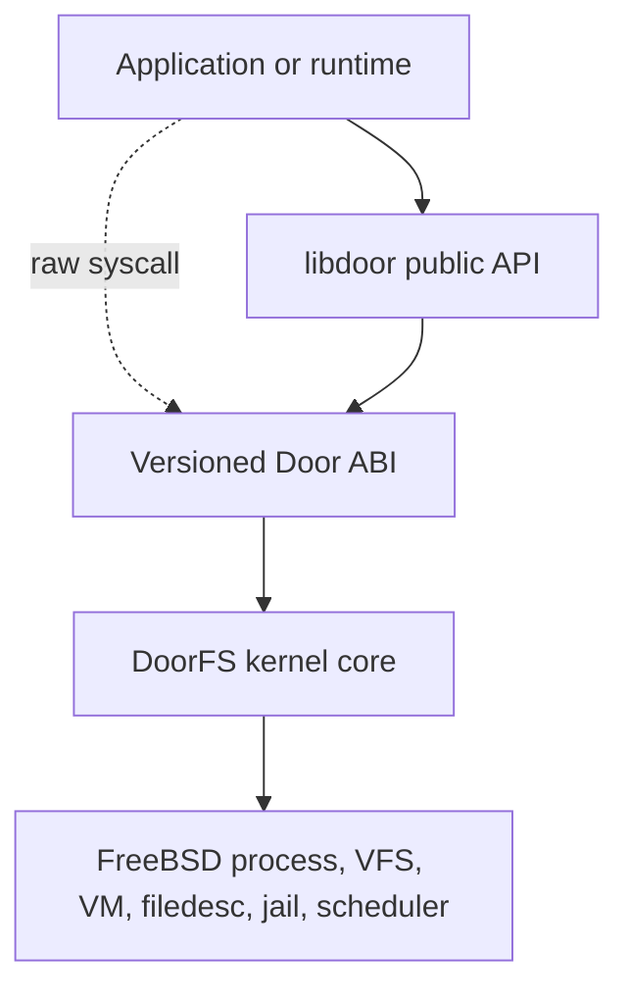

Because libdoor is bypassable, it can improve diagnostics but cannot establish
a kernel security property. DoorFS validates every untrusted argument and
authorizes every operation independently.

| Component | Owns | Does not own |
|---|---|---|
| DoorFS | Door identity, references, calls, bindings, revoke, descriptors, credentials, SHM | Callback code, public-name policy, scheduler queues |
| Door ABI | Selector decoding, copyin/copyout, fd-right selection, ABI dispatch | Callback registry |
| libdoor | Public API conversion, registry, workers, pools, TLS, buffers | Kernel authorization and raw-caller safety |
| Shuttle API | Optional wait/resume/reservation and fallback | Door identity, payloads, RPC policy |
| 4BSD/ULE | Runnable state, affinity, run queues, context switch | Endpoint and application semantics |
| DoorCTL | Logical names, scope, LIVE/DEAD generation, connect | Filesystem identity and RPC transport |
| NameFS | Pathname vnode, target Door file, open/rebind lifetime | Request processing and worker selection |
| VM support | Mapping and VM-object lifetime | Application record completion |

<a id="contents-ch4-4-1-2-authority-and-identity-domains"></a>

#### 4.1.2. Authority and identity domains

The design separates discovery authority, an installed file capability,
immutable generation identity, and operation-specific authority. Discovery of
a path or logical name never substitutes for CALL, SERVICE, ADMIN, INFO, or
SHM rights.

| Identity | Scope | Stability |
|---|---|---|
| Numeric fd | One process table | Reusable after close |
| struct file | Kernel object | Stable while referenced |
| Door uniquifier | One generation | Immutable |
| DoorCTL name | Registry scope | May survive replacement |
| NameFS vnode/path | VFS namespace | Stable during publication |
| SHM region id | One generation | Not globally unique |
| Strong SHM identity | Uniquifier plus region id | Never retargeted |
| Call id | Accepted transaction | Valid through call lifetime |

Kernel code holds referenced objects after lookup instead of trusting numeric
handles. An old fd, call, or SHM reference never follows a replacement name.

<a id="contents-ch4-4-1-3-control-plane-and-data-plane"></a>

#### 4.1.3. Control plane and data plane

The control plane comprises CREATE, INFO, parameters, bind/unbind, revoke,
DoorCTL, NameFS publication, SHM management, and generation replacement. The
data plane comprises CALL/RETURN, fast selectors, ONEWAY, descriptor transfer,
and SHM-referenced calls.

Control-plane state establishes identity and authority consumed by the data
plane. Hot paths still validate file capability, endpoint state, rights, jail
policy, call identity, and transport limits.

<a id="contents-ch4-4-1-4-optional-components"></a>

#### 4.1.4. Optional components

Anonymous CALL/RETURN requires DoorFS and a worker implementation. Other
features are optional per service:

- direct fd transfer can replace named discovery;
- ordinary buffers can replace persistent SHM;
- generic wake/switch can replace shuttle;
- a conforming raw runtime can replace libdoor;
- DoorCTL and NameFS can be used independently or together.

Optional means unnecessary for basic operation, not weakly specified. Once
selected, each extension retains its full lifetime and security contract.

<a id="contents-4-2-end-to-end-flows"></a>

### 4.2. End-to-end flows

<a id="contents-ch4-4-2-1-creation-and-readiness"></a>

#### 4.2.1. Creation and readiness

1. libdoor validates callback, cookie, attributes, and pool policy and creates
   provisional registry state.
2. CREATE validates the kernel ABI.
3. DoorFS allocates generation identity, owner credential, lock, queues,
   limits, reference state, and uniquifier.
4. The file layer installs a service file and descriptor.
5. libdoor commits its registry entry and creates or obtains a worker.
6. BIND publishes a server binding.
7. The worker enters RETURN/wait-next.
8. door_create reports success after initial worker readiness.

Failure before fd installation leaves no visible endpoint. Failure after
installation but before library readiness revokes/closes the endpoint and
rolls back registry state. Raw CREATE ends at kernel endpoint publication; a
raw runtime binds workers itself.

<a id="contents-ch4-4-2-2-synchronous-call-return"></a>

#### 4.2.2. Synchronous CALL/RETURN

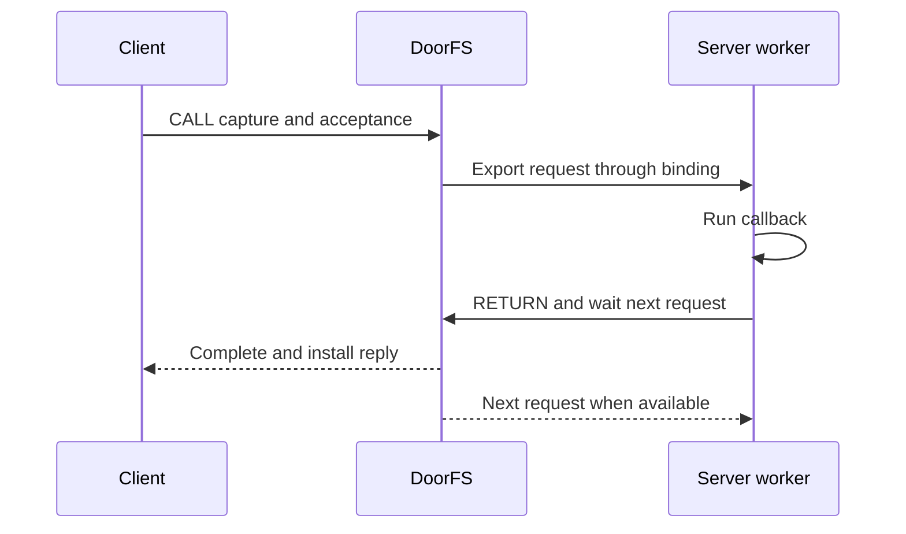

1. libdoor converts door_arg_t and selects a compatible generic or fast form.
2. The syscall layer acquires the file with CALL rights and validates ABI
   structures.
3. DoorFS checks liveness, jail policy, attributes, limits, and cancellation
   mode.
4. Data, credentials, and descriptor references are captured in a call object.
5. Under the Door lock, the call is assigned directly or queued. This is CALL
   acceptance.
6. The client waits on that exact call.
7. The worker receives the request through its binding and libdoor invokes the
   registered callback.
8. RETURN authorization derives from the worker binding and active call.
9. DoorFS captures the reply, publishes terminal DONE state, and wakes the
   client.
10. The client installs data and descriptors; MOVE acknowledgement precedes
    successful return.
11. Each side drops its own reference and the worker normally waits for the
    next call in the fused operation.

Signal, cancel, revoke, worker exit, owner exit, and copyout error compete for
one terminal transition. Only the actor publishing that transition owns its
wake and detach actions.

<a id="contents-ch4-4-2-3-fast-path-convergence"></a>

#### 4.2.3. Fast-path convergence

Empty and scalar selectors reduce marshalling when payload and capacity
constraints permit. They converge on the same file authorization and call
state machine. Failed eligibility uses the generic path before incompatible
partial publication.

<a id="contents-ch4-4-2-4-oneway"></a>

#### 4.2.4. ONEWAY

ONEWAY progresses through accepted, queued or assigned, delivered, and
completed states. Ordinary bytes are snapshotted before successful submission.
An asynchronous queue reference initially owns the request. Activation
explicitly transfers ownership to the server binding.

Revoke may remove queued or assigned-undelivered work. Delivery commitment
is recorded under d_lock before export unlock; from that point SERVER remains
owned through worker cleanup, including copyout failure. Worker
completion releases the final server resources without a client reply.
Application completion uses a separate acknowledgement, event, query, counter,
or ring-consume protocol.

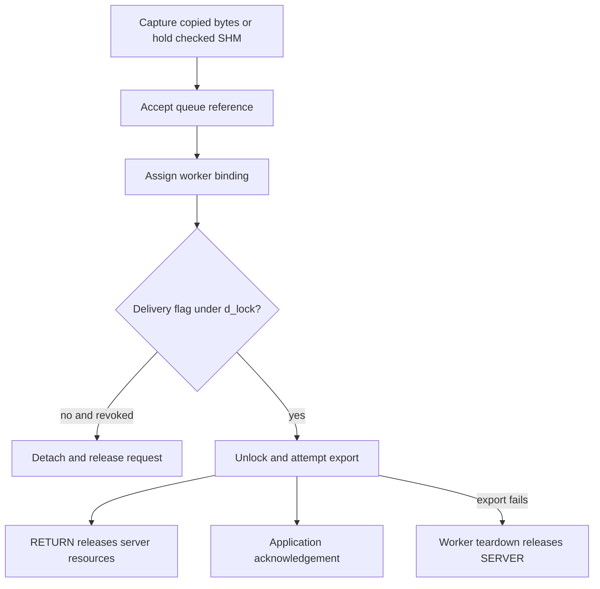

The delivery flag commits reference ownership before potentially observable
export. It is not a callback-entry acknowledgement. Submit can return before
or after callback execution; success guarantees acceptance, not its ordering
relative to application completion. Reusing
mutable SHM requires the acknowledgement protocol, not submit success.

<a id="contents-ch4-4-2-5-persistent-shm-and-rings"></a>

#### 4.2.5. Persistent SHM and rings

The invocation path for an SHM payload is as follows.

1. SHM CREATE allocates a generation-owned region and creator mapping.
2. SHM ATTACH authorizes and maps a consumer view.
3. The producer writes under an application or ring ownership protocol.
4. CALL_SHM submits generation, region, offset, length, and permissions.
5. DoorFS validates the exact usable range and holds the region.
6. The worker receives only the checked view.
7. Call cleanup drops its strong reference.

Handle destruction prevents future lookup but does not invalidate existing
mappings or active-call holds. Synchronous completion may be an application
barrier; ONEWAY requires explicit acknowledgement before mutable reuse.

The ring adds the state sequence free, reserved, committed, acquired,
consumed/free. Local tokens and shared sequence numbers prevent stale writer
or consumer actions. No process-local pointer is stored in shared memory.

A Pair session follows a separate data path (§2.5.11). CALL can establish
or tear down the session. While it is active, peers publish records and
completions in the mapping and notify by event lane. The consumer validates
shared metadata and observes the ring or application ownership rules. It
does not receive a kernel-validated CALL_SHM range for each record.

<a id="contents-ch4-4-2-6-descriptor-copy-and-move"></a>

#### 4.2.6. Descriptor COPY and MOVE

The transfer layer holds and validates all source files, constructs one bundle,
reserves the complete destination set, installs files, copies metadata, and
then commits. MOVE closes only source slots still matching the captured files.
Any pre-commit failure removes destination installation and preserves sources.

For reply MOVE, successful receiver installation commits the transfer. Revoke
after reply publication cannot bypass install acknowledgement: SERVER waits
for its result, closes the matching source outside d_lock, and publishes
MOVE acknowledgement. The client waits for acknowledgement before success
even if the Door is now revoked (§12.5).

<a id="contents-ch4-4-2-7-signals-and-shuttle-waits"></a>

#### 4.2.7. Signals and shuttle waits

The wait path prepares call and shuttle state, acquires the required
thread/scheduler interlock, rechecks signal/cancellation, and only then
publishes sleep. If commit fails, it aborts the shuttle state and continues
through ordinary cancellation or scheduling. State publication always
precedes wakeup.

<a id="contents-ch4-4-2-8-revoke-and-owner-exit"></a>

#### 4.2.8. Revoke and owner exit

Revoke first publishes terminal state and prevents new acquisition. It then
detaches pending work, resolves active state, wakes participants, removes
publication and SHM-list ownership, and lets every actor drop its own
reference. Final Door destruction follows the final reference.

Owner exit publishes the process-exit condition, drops PROC_LOCK, and invokes
Door teardown before generic thread-exit synchronization can strand workers.

<a id="contents-ch4-4-2-9-doorctl-publication"></a>

#### 4.2.9. DoorCTL publication

REGISTER validates name, flags, scope credential, live Door file, owner
authority, and generation before installing a LIVE entry and publication
reference. CONNECT holds the selected generation under registry protection,
then installs a client file. UNREGISTER removes future discovery without
changing connected fds.

Revoke converts a matching LIVE identity to DEAD and releases its Door
reference. Replacement atomically publishes a new generation inside the
DoorCTL lock domain.

<a id="contents-ch4-4-2-10-namefs-open-and-rebind"></a>

#### 4.2.10. NameFS open and rebind

Initial publication validates the covered vnode and live Door file, creates
mount state, and publishes one synthetic root vnode.

OPEN locks mount state, verifies LIVE target, takes its file reference, releases
the interlock, revalidates Door/jail state, and converts the open file into a
native Door client file.

REBIND swaps the referenced target under the mount lock. Opens linearized
before the swap receive the old generation; later opens receive the new one.
Existing client files are untouched.

<a id="contents-ch4-4-2-11-combined-recovery"></a>

#### 4.2.11. Combined recovery

A replacement creates generation B and readies its worker pool before
publication. DoorCTL registration and NameFS rebind are individually atomic
but do not form one cross-subsystem transaction. A supervisor chooses their
order and may expose readiness/version metadata.

Old A descriptors and SHM references remain A. New clients acquire B and
establish new generation-bound resources. Retrying application work requires
idempotence or reconciliation above the Door ABI.

<a id="contents-ch4-4-2-12-native-asynchronous-call-and-correlated-completion"></a>

#### 4.2.12. Native asynchronous CALL and correlated completion

Native async invokes an ordinary request Door. The same callback handles sync
and async requests and calls `door_return()`. The client runtime owns a private
ONEWAY completion Door and publishes its pending ID before submission.

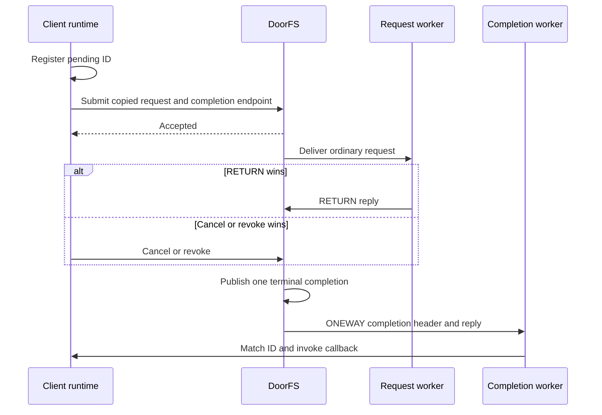

RETURN, cancellation, revoke, and worker exit compete for terminal publication.
Acceptance and callback delivery are separate boundaries. Library deduplication
is useful but cannot prove unique kernel publication; raw tests inspect headers
and use an accounted publication drain.

<a id="contents-ch4-4-2-13-page-composite-shm-view"></a>

#### 4.2.13. Page-composite SHM view

A producer publishes full-page segments of generation-owned SHM. The consumer
attaches a contiguous read-only VA view of the original VM-object pages. There
is no payload compaction copy and no kernel async CALL_SHM operation.

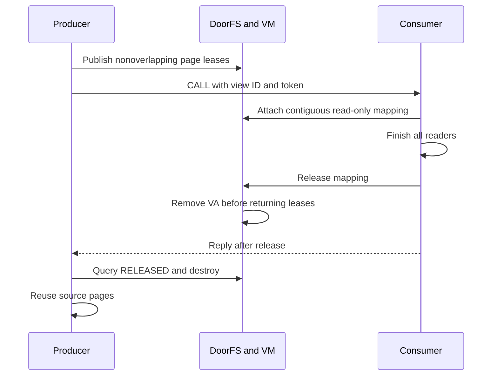

<a id="contents-4-3-object-and-ownership-graph"></a>

### 4.3. Object and ownership graph

<a id="contents-ch4-4-3-1-principal-kernel-objects"></a>

#### 4.3.1. Principal kernel objects

One owner process anchors a Door generation. Files, calls, bindings,
publications, and SHM state independently hold references to it. A server
binding can own an active call; a call can own credentials, transfers,
descriptor bundles, and a strong SHM region reference.

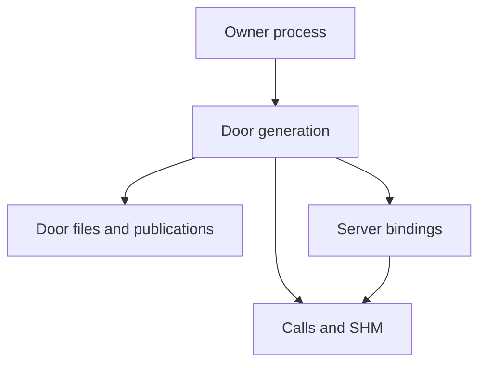

| Object | Created by | Live owner | Protection | Terminal event |
|---|---|---|---|---|
| Door generation | CREATE | Owner registry and explicit refs | Door lock and registries | Final Door ref |
| Service/client file | CREATE/connect/open/transfer | File reference | Filedesc locks; Door counters | Final file close |
| Door call | Sync CALL/native async/ONEWAY | Client, async queue, or binding | Door lock and call refs | Final call ref |
| Server binding | BIND/worker | Exact worker and server list | Door lock and registry | Worker cleanup |
| Transfer/bundle | Capture | Exact request or reply side | Call state and held files/pages | Commit or rollback |
| SHM region | SHM CREATE | Door list, maps, and calls | Door/VM locks and refs | Final region/map/call ref |
| DoorCTL entry | REGISTER | Registry | Registry lock | Unregister or DEAD GC |
| NameFS mount/vnode | Publication | VFS mount and controlled refs | Mount and VFS locks | VFS teardown |
| libdoor entry | create/xcreate | Registry, workers, callbacks | Library mutexes | All runtime refs drain |

<a id="contents-ch4-4-3-2-call-ownership-by-state"></a>

#### 4.3.2. Call ownership by state

| State | Required reference owner |
|---|---|
| Constructing synchronous | Client/local reference |
| Pending synchronous | Client plus queue relationship |
| Active synchronous | Client plus server/binding reference |
| Pending ONEWAY | Asynchronous queue reference |
| Assigned ONEWAY | Server/binding after explicit transfer |
| Delivered ONEWAY | Server until callback completion |
| Terminal synchronous | Client until result unwind; server until detach |
| Terminal ONEWAY | Remaining server/local cleanup only |

Queue removal is not itself a reference drop unless that queue owns the
recorded reference. Terminal state likewise does not authorize an exit thread
to free storage still owned by a worker.

<a id="contents-ch4-4-3-3-publication-ownership"></a>

#### 4.3.3. Publication ownership

A LIVE DoorCTL entry holds a Door reference and scope credential; a DEAD entry
retains identity but no Door pointer. NameFS holds a target struct file, and a
concurrent open temporarily holds the selected file. The resulting client file
then owns an independent Door reference.

This permits replacement without capability mutation and prevents endpoint
destruction until legitimate users release their references.

<a id="contents-ch4-4-3-4-userspace-ownership"></a>

#### 4.3.4. Userspace ownership

The process-local chain is door_entry, worker pool, worker TLS, active callback,
and application state. Kernel references cannot protect callback cookies,
mutexes, maps, or application queues. A service therefore needs its own
active-callback reference and shutdown barrier. Revoke, unregister, fdetach,
and close are not thread joins.

<a id="contents-4-4-source-map"></a>

### 4.4. Source map

Paths are relative to the project FreeBSD tree.

<a id="contents-ch4-4-4-1-abi-declarations"></a>

#### 4.4.1. ABI declarations

| Path | Responsibility |
|---|---|
| include/door.h | Public types, functions, attributes, descriptors, credentials, SHM/ring and named APIs |
| sys/sys/door_core.h | Versioned raw ABI, selectors, wire structures, limits, DoorCTL ABI |
| sys/sys/door_impl.h | Kernel-private Door, call, binding, transfer and SHM declarations |
| sys/sys/sched.h | Scheduler interface declarations, shuttle state, tokens, flags and results |
| lib/libdoor/Symbol.map | libdoor.so.1 exported symbol version |

door_core.h is a user/kernel compatibility boundary. door_impl.h is private,
but its lock and ownership contracts are cross-file invariants.

<a id="contents-ch4-4-4-2-doorfs-implementation"></a>

#### 4.4.2. DoorFS implementation

| Path | Primary responsibility |
|---|---|
| sys/fs/doorfs/door_syscall.c | Raw entry, ABI validation, rights, copyin/copyout, selector dispatch |
| sys/fs/doorfs/door_core.c | Allocation, refs, owner/publication state, revoke, jail and exit hooks |
| sys/fs/doorfs/door_rpc.c | Calls, queues, bindings, RETURN, cancel, credentials, ONEWAY, wakes |
| sys/fs/doorfs/door_file.c | Fileops, service/client installation, cloning, close, stat/kinfo |
| sys/fs/doorfs/door_xfer.c | Data/page capture, descriptor bundles, reply cache, commit/rollback |
| sys/fs/doorfs/door_shm.c | Regions, mappings, permissions, call holds, bounds and destroy |
| sys/fs/doorfs/door_ctl.c | Logical names, scopes, generations, connect and replacement |

Trace a raw call from door_syscall.c to door_rpc.c, then into door_xfer.c or
door_shm.c and door_file.c. Trace teardown from door_core.c through every
subsystem holding a Door reference.

<a id="contents-ch4-4-4-3-namefs-and-kernel-integration"></a>

#### 4.4.3. NameFS and kernel integration

| Path or area | Responsibility |
|---|---|
| sys/fs/namefs/namefs_impl.h | Mount state, locks, references and deferred-work contracts |
| namefs_vfsops.c | Mount/rebind, root, VFS lifecycle, recovery and events |
| namefs_vnops.c | Open conversion, attributes/access, inactive and reclaim |
| sys/sys/proc.h and kern_exit.c | Owner exit and thread/binding state |
| signal, condvar and sleepqueue paths | Interruptible private wait publication |
| sys/kern/sched_4bsd.c | Global-lock reservation, remote enqueue, idle handoff, fallback |
| sys/kern/sched_ule.c | TDQ reservation, switch, remote enqueue, fallback |
| sys/kern/sched_shim.c | Boot selection and IFUNC dispatch to the active scheduler |
| sys/conf/files (scheduler rules) | Generate the per-scheduler namespace headers in the build directory |
| filedesc/Capsicum code | File type, rights and transactional descriptor install |
| sys/conf and base makefiles | Kernel/user ABI build integration |

NameFS depends on Door file APIs; Door RPC does not depend on NameFS.
Scheduler code manipulates thread state but never interprets Door payload or
application policy.

<a id="contents-ch4-4-4-4-libdoor"></a>

#### 4.4.4. libdoor

| File | Primary responsibility |
|---|---|
| libdoor_impl.h | Registry, TLS, pools, locks and internal contracts |
| door_create.c | Creation and initial worker readiness |
| door_call.c / door_oneway.c | Synchronous and asynchronous public calls |
| door_server.c | Bind/return/wait, callbacks, pools and xcreate |
| door_registry.c | Registry, TLS destructor and atfork handling |
| door_misc.c | Revoke, info, parameters, credentials, bind/unbind |
| door_desc.c / door_iov.c | Descriptor conversion and vector validation |
| door_shm.c / door_shm_ring.c / door_shm_view.c | Persistent SHM, SPSC ring, and page-view handles |
| door_async.c / door_async_server.c | Native async and framed ONEWAY protocol with authenticated session routing |
| door_named.c | DoorCTL helpers |
| door_attach.c | NameFS fattach/fdetach |
| door_safe.c | Fault-safe convenience operations |

<a id="contents-ch4-4-4-5-verification-and-examples"></a>

#### 4.4.5. Verification and examples

| Tree | Role |
|---|---|
| lib/libdoor/tests | Public API, ABI, lifetime, race, descriptor, SHM and stress specification |
| tests/sys/fs/doorfs | Raw ABI and Door file behavior |
| tests/sys/fs/namefs | VFS, recovery, NullFS and jail behavior |
| freebsd-doors-guide/examples | Complete application patterns |
| freebsd-doors-guide/docs | Monograph and retained source material |

Library tests do not replace raw ABI tests, and DoorFS tests do not replace
NameFS VFS tests.

<a id="contents-ch4-4-4-6-responsibility-rule"></a>

#### 4.4.6. Responsibility rule

A property belongs in the lowest layer able to enforce it for all callers:

- ABI and authority validation in the kernel;
- callback selection and pool policy in libdoor;
- run-queue and affinity decisions in the scheduler;
- pathname identity in VFS/NameFS;
- logical registry scope in DoorCTL;
- application completion and idempotence in the service protocol.

Higher layers may add convenience or early rejection, but cannot become the
only implementation of a Chapter 3 requirement.

<a id="chapter-5"></a>

<a id="contents-chapter-5-freebsd-kernel-integration"></a>

## Chapter 5. FreeBSD kernel integration

<a id="contents-5-1-kernel-configuration-and-source-integration"></a>

### 5.1. Kernel configuration and source integration

DoorFS, DoorCTL, and NameFS are kernel facilities, not functions that can be
implemented solely by `libdoor`.  Process-exit ordering, descriptor
transactions, vnode identity, signal-safe parking, and scheduler handoff all
belong to the subsystems that own those states.  The integration is divided
into three configuration features:

| Option | Responsibility | Dependency |
|---|---|---|
| `DOORFS` | Endpoints, calls, transfers, SHM, file operations, and syscall ABI | Base facility |
| `DOORCTL` | Named-service registry and generation replacement | `DOORFS` |
| `NAMEFS` | Vnode-backed publication and stable pathname identity | `DOORFS` |

The facilities are built into the kernel.  Runtime unload is not part of the
architecture or supported lifecycle.  `sys/conf/options` declares the three
features, while `sys/conf/files` selects `door_syscall.c`, `door_core.c`,
`door_rpc.c`, `door_xfer.c`, `door_shm.c`, `door_file.c`, `door_ctl.c`, and the
two NameFS VFS/vnode implementation units.  The syscall entry remains a
standard source so a disabled configuration has a defined result; the
substantive implementation is selected by `DOORFS`.

The multiplexed `door(2)` entry is declared in `sys/kern/syscalls.master`.
FreeBSD's generator produces its number, argument structure, names, audit
metadata, and userspace declarations.  Generated files must not be edited
independently: doing so can create a kernel/libc ABI disagreement even when
both sides compile.  Every operation selector has a fixed structure version,
size and reserved-field policy, overflow checks, and Capsicum requirements.

Source integration also installs public headers, `libdoor.so.1`, manual pages,
and ATF tests under `/usr/tests`.  Both ULE and 4BSD, and relevant SMP and
non-SMP configurations, are build targets. The scheduler namespace headers
are generated during the kernel build; their rules in `sys/conf/files` use
the matching base tree’s `sys/kern/sched_ns.h`, `sys/sys/sched.h`, and
`sys/tools/sched_impl_ns.awk`. After merging changes to the scheduler
interface, rebuild from those inputs. Changes outside the DoorFS and
NameFS directories are deliberately narrow: they establish an interlock or a
scheduler-neutral service, while Door policy remains in DoorFS.

<a id="contents-5-2-process-lifecycle-integration"></a>

### 5.2. Process lifecycle integration

Door workers can sleep indefinitely in `door_return(2)`.  Generic process
single-threading therefore cannot wait for workers first and revoke their
endpoints later: the revoke wakeup is what permits those workers to leave the
kernel.  `exit1()` publishes exit and invokes Door cleanup before the generic
thread-termination pass:

```c
PROC_LOCK(p);
proc_set_p2_wexit(p);
#ifdef DOORFS
PROC_UNLOCK(p);
door_process_exit(p);
PROC_LOCK(p);
#endif
```

`P2_WEXIT` prevents concurrent `CREATE` from publishing an endpoint after the
cleanup scan begins.  `PROC_LOCK` is dropped because revocation acquires Door,
binding, and scheduler locks in an order incompatible with retaining the
process lock.  Sending `SIGKILL` is only a request; owner exit linearizes when
this hook publishes revocation under the Door lock.

For each owned Door, `door_process_exit()` locks the owner list and Door,
publishes `d_orphaning`, removes the owner-list anchor, clears `d_owner`, and
takes a temporary reference.  It then drops both locks, calls `door_revoke()`,
and releases the former owner-list and temporary references.  Publication
before list removal closes a window in which an inherited client fd could
acquire new state while cleanup was already in progress; the temporary
reference prevents destruction before revoke completes.

Owner exit never frees another thread's binding.  A worker may be returning
from a CV or shuttle wait with a local binding pointer.  Revocation marks the
Door dead, resolves calls, and wakes workers; the binding owner removes its own
binding on return, or its thread destructor does so.  Each binding holds an
independent Door reference.  Without this ordering the failures include exit
deadlock, a call published after owner disappearance, and use-after-free of a
worker binding.

Fork and exec retain ordinary fd semantics, but kernel ownership does not
migrate merely because an fd is inherited.  Library callback pointers are
process-local and are never reconstructed from an fd.  Kernel cleanup is thus
correct even when `libdoor` is absent or bypassed.

The early revoke hook must not unmap pages while another thread can still
read them. View cleanup also registers late process-exit and exec handlers.
Those release consumer mappings after sibling threads have stopped; producer
exit retires source ownership while attached consumer references keep pages
alive. Exec releases the old VM view before its eventual process exit.

<a id="contents-5-3-thread-lifecycle-and-server-bindings"></a>

### 5.3. Thread lifecycle and server bindings

A binding associates one kernel thread with a Door worker role; it is not an
fd reference and cannot safely be recovered by scanning the descriptor table.
`struct thread` therefore contains the narrow identity field:

```c
struct door_server_binding *td_door_server;
```

In the current `sys/sys/proc.h`, the pointer sits between `td_turnstile` and
`td_umtxq`, in the slot used for `td_pad1` in the base layout. Shuttle state
itself remains in scheduler-private storage.

The constructor initializes the pointer to `NULL`, and destruction asserts that Door
cleanup detached it.  The binding registry is independent of the owner list,
because owner exit can remove a Door before all workers are reaped.  Cleanup
acquires a temporary binding reference under the registry lock, releases that
lock, enters `d_lock`, resolves any active call, removes the structural
binding, and drops references outside incompatible locks.  The registry lock
must not be held while acquiring `d_lock`.

`door_thread_exit(td)` runs from every thread-destruction route.  An idle
worker is detached; a worker with an active synchronous call publishes
`ECONNRESET` to its client before detach; a revoked worker completes existing
cleanup without resurrecting the Door; a non-worker is unchanged.  Reply
publication and disappearance serialize under `d_lock`, so a client observes
one outcome rather than a false success followed by lost state.

Private handoff uses generic thread states `TDS_SHUTTLE_WAIT` (published private
waiter) and `TDS_SHUTTLE` (same-CPU reserved successor).  Peer, wait channel,
generation, pending wake, and token data live in each scheduler's private
`td_sched`, not the public `struct thread` layout.  Generations prevent an ABA
error in which a reservation from an earlier call is accepted after the same
thread address and wait channel have been reused.

<a id="contents-5-4-signals-and-private-park-publication"></a>

### 5.4. Signals and private park publication

A private wait creates a classic lost-wakeup hazard if signal state is checked
before the wait becomes visible:

```text
check signal → signal/revoke wakes nothing → publish sleep → block forever
```

The direct Door path uses `door_shuttle_wait_locked()` in `door_rpc.c`.
It separates publication of the wait intent from publication of the blocked
thread state:

1. While holding `d_lock`, take the thread lock and call
   `sched_shuttle_sleep()`. This records `PREPARED`; current remains
   `TDS_RUNNING`. An initial CALL can wake or reserve its selected worker
   before dropping the Door mutex.
2. Release `d_lock` before the park. FreeBSD turnstile priority propagation
   must not observe a blocked thread still owning that mutex. A reply or
   revoke racing this interval can record `ss_pending` on the prepared wait.
3. With the thread lock held, `sched_shuttle_swtch()` reaches the backend's
   park helper. It checks pending wake and, for interruptible waits, signal
   and suspend state before publishing `TDS_SHUTTLE_WAIT` and `COMMITTED`.
   The switch path checks pending wake before publishing `SLEEPING`.
   An early wake or interrupt can abort without switching.

If the direct Door path is unavailable, the call sites can use the
shuttle-aware CV helpers in `kern_condvar.c`. The noninterruptible CV path
can also prepare before dropping its interlock and park afterward. The
ordinary sleepqueue-backed CV path handles the remaining cases, including
interruptible CV waits.

Signal, suspension, and tracing paths recognize private states and call
`sched_shuttle_unpark()` under the target thread lock.  A pending marker records
a wake before scheduler commit, while the generation proves it belongs to the
current wait.  The ordinary sleepqueue remains the correctness fallback for an
unsuitable lock class, pending interrupt, rejected reservation, or unsupported
direct handoff.  Thus optimization failure changes the route, never CALL
semantics.

The invariant is: once a signal, revoke, cancellation, or peer wake is visible
under `thread_lock`, the target cannot subsequently publish an older wait and
sleep past it.  Omitting the recheck produces rare permanent hangs that often
appear only after hundreds of repeated race tests.

<a id="contents-5-5-scheduler-neutral-interfaces"></a>

### 5.5. Scheduler-neutral interfaces

Machine-independent code calls the `sched_*()` interface declared in
`sys/sys/sched.h`; it never manipulates a ULE TDQ, 4BSD run queue, or private
token. `sched_shim.c` selects a compiled scheduler at boot using
`kern.sched.name` and resolves the dispatch entry points to that instance
through IFUNCs. If the requested instance is unavailable, the shim selects
the first compiled instance from the linker set. This is a boot-time
selection; a wake or switch does not choose a scheduler anew.

The interface name, the implementation spelling in C, and the resulting
kernel symbol are different views of the same entry:

| Operation | Machine-independent entry | In `sched_ule.c` / `sched_4bsd.c` | Backend symbols |
|---|---|---|---|
| Ordinary context switch | `sched_switch()` | `sched_switch()` in each file | `sched_ule_switch`, `sched_4bsd_switch` |
| Ordinary scheduler wake | `sched_wakeup()` | `sched_wakeup()` in each file | `sched_ule_wakeup`, `sched_4bsd_wakeup` |
| Shuttle switch callback | `sched_shuttle_sswitch()` | `sched_ule_shuttle_sswitch()` / `sched_4bsd_shuttle_sswitch()` | Same names as the backend definitions |

The generated `sched_ule_ns.h` and `sched_4bsd_ns.h` rename ordinary
implementation functions when compiling each backend. Thus a backtrace can
still show `sched_ule_switch` even though the source defines `sched_switch()`.
Door-specific backend functions and helpers retain explicit prefixes where
they appear in the source. The namespace headers do not merge the schedulers
or change their run queues.

The common shuttle model is
`NONE → PREPARED → COMMITTED → SLEEPING → RESUMING → NONE`. In the private
Door path only `PREPARED` is published before releasing the Door interlock.

| Result | Meaning |
|---|---|
| `SCHED_SHUTTLE_OK` | Transition completed |
| `SCHED_SHUTTLE_FALLBACK` | Use the ordinary scheduler/CV path |
| `SCHED_SHUTTLE_ABORTED` | A wake, signal, cancellation, or stale generation invalidated it |
| `SCHED_SHUTTLE_RETRY` | A concurrent transition already guarantees progress |

| Interface | Contract |
|---|---|
| `sched_shuttle_sleep()` | Record private wait intent under the thread lock while current remains running |
| `sched_shuttle_resume_to()` | Attempt exact-successor reservation after affinity and generation validation |
| `sched_shuttle_resume()` / `wakeup()` | Publish an ordinary runnable wake if exact handoff is unavailable |
| `sched_shuttle_swtch()` | Commit private sleep after the external interlock is released and state rechecked |
| `prepare()` / `commit()` | Integrate the ordinary sleepqueue fallback |
| `sched_shuttle_dispatch()` | Connect a selected idle worker to the dispatching peer |
| `cancel()` / `unpark()` / `abort()` | Resolve signal, cancellation, and rollback races once |
| `sched_shuttle_switch()` | Recheck committed wait state and enter `mi_switch_shuttle()` when eligible |
| `sched_shuttle_sswitch()` | Dispatch after MI accounting to the active backend callback, which calls its native `sched_switch()` |

Context switching still passes through `mi_switch_common()` accounting and
locking.  A shuttle is a successor hint, not permission for DoorFS to call
`cpu_switch()` directly.  ULE can reserve a local peer under a per-CPU TDQ
lock; 4BSD obeys its global `sched_lock`.  A peer restricted to another CPU is
placed on the normal remote run queue and the target CPU is awakened.  A local
cross-CPU `cpu_switch()` would violate affinity, run-queue ownership, and CPU
state.

Reservations are transactional.  If late validation fails after a runnable
peer was removed from its normal representation, rollback restores it before
fallback.  The central contract is that a declined or interrupted optimization
is observationally equivalent to the ordinary path and never loses a waiter
or wakeup.  Chapter 7 specifies the full protocol and scheduler-specific
implementations. `SCHED_ITF_DOOR` registers 13 methods in each scheduler;
`sched_shim.c` generates their dispatchers only when DOORFS is enabled.
Runnable-peer acquisition and restoration are backend-private operations.

<a id="contents-5-6-vfs-filedesc-and-capsicum-integration"></a>

### 5.6. VFS, filedesc, and Capsicum integration

Doors participate in the native file model through `DTYPE_DOOR`.  Lookup
validates both `f_type` and the precise `f_ops` table; a numeric fd or matching
data pointer cannot impersonate a Door.  Successful lookup takes file and Door
references before filedesc protection is dropped.

Descriptor bundles require a transaction: reserve destination slots, capture
source files and rights, install every destination, copy out the result, and
only then acknowledge MOVE by closing the sources.  Failure before
acknowledgement rolls back destinations and preserves source ownership.
Potentially final `fdclose()` operations are not executed under `d_lock`.

Capsicum separates authority into `CAP_DOOR_CALL`, `CAP_DOOR_SERVICE`,
`CAP_DOOR_ADMIN`, `CAP_DOOR_INFO`, and `CAP_DOOR_SHM`.  The kernel checks these
rights on every raw syscall and ioctl; library prevalidation is never the
security boundary.  Transfer preserves the rights on the file and cannot
restore authority removed by `cap_rights_limit()`.

NameFS uses normal VFS rather than library pathname emulation.  Mount validates
`path=` and `doorfd=`, acquires target and Door vnode references, and publishes
a file-mounted root vnode.  Lookup, open, inactive, reclaim, and unmount obey
vnode and namecache locks.  Recovery replaces the generation behind a stable
namespace vnode, while already-open descriptors remain tied to the old
generation.  Reclaim detaches vnode-private state and defers destruction that
would acquire incompatible Door or VM locks.

Jail checks use kernel credential snapshots.  A Door is normally confined to
the owner's prison; `DOOR_CROSS_JAIL` is the explicit exception.  Neither a
NameFS path nor a DoorCTL name bypasses authorization.  These integrations
prevent partial MOVE loss, raw-ABI validation bypass, stale-vnode generation
confusion, and capability-rights escalation.

<a id="contents-5-7-production-observability"></a>

### 5.7. Production observability

Production observability exposes stable identities and bounded resource state
without retaining experimental instrumentation in hot paths.  Door file
operations implement `fo_fill_kinfo()` and export `KF_TYPE_DOOR`, allowing
`procstat -f`, `fstat`, and `KERN_PROC_FILEDESC` to identify Door fds without
reading private structures.  Thread formatting recognizes shuttle states, so
`procstat -kk`, `procstat -t`, `ps`, and kernel stack inspection distinguish a
Door waiter, ordinary sleepqueue sleeper, and runnable handoff participant.

| Namespace | Stable production purpose |
|---|---|
| `kern.doorfs.*` | Resource limits, live calls, and bounded client-spin policy |
| `kern.doorctl.*` | Registry limits, recovery grace, live and dead identities |
| `kern.sched.4bsd.door_idlespins` | Bound on Door-hot idle polling |

Live-object counters are not completion barriers: a removed SHM handle can
still have mapping/call references, and a DEAD name can remain for its recovery
grace interval.  Temporary cycle counters, transition histograms, and debug
branches are excluded from the production interface.  They change cache
traffic and lock hold time, distort the latency under study, and create an
accidental ABI if exposed as permanent sysctls.

| Integration | Protection | Failure if omitted |
|---|---|---|
| Exit hook after `P2_WEXIT` | Ordered owner shutdown and worker wake | Exit hang or late publication |
| Thread binding cleanup | Worker-owned detach and client failure | Leak, UAF, or sleeping client |
| Private state under `thread_lock` | Wake cannot pass unpublished sleep | Lost-wakeup hang |
| Scheduler-neutral API | Safe optimization with fallback | Run-queue corruption or scheduler coupling |
| Filedesc transaction and Capsicum | Atomic ownership and least authority | Descriptor loss or privilege retention |
| VFS/NameFS hooks | Stable pathname with generation isolation | Stale-vnode generation confusion |
| kinfo, thread states, bounded sysctls | Diagnosable production state | Unclassifiable failures |

These hooks are the platform substrate.  Chapter 6 defines Door objects and
calls, Chapter 7 the shuttle protocol, and Chapter 8 NameFS recovery.

<a id="chapter-6"></a>

<a id="contents-chapter-6-doorfs-architecture"></a>

## Chapter 6. DoorFS architecture

This chapter describes the internal object, reference, and transaction model
of DoorFS.  It covers the kernel implementation in `sys/fs/doorfs`, the wire
ABI in `sys/sys/door_core.h`, and the private structures in
`sys/sys/door_impl.h`.  The public `libdoor` runtime is a consumer of this ABI;
it is not trusted to enforce the invariants described here.

The central architectural rule is that state and lifetime are separate:

- a Door may be revoked while references still keep its storage alive;
- a call may be terminal while a client or server still owns cleanup work;
- a named identity may survive after its Door generation is dead;
- an SHM handle may be destroyed while mappings and active calls retain the
  underlying VM object;
- a file descriptor may disappear while another file, binding, publication,
  or call still owns the endpoint.

<a id="contents-6-1-core-objects"></a>

### 6.1. Core objects

<a id="contents-ch6-struct-door"></a>

#### `struct door`

`struct door` is the endpoint-generation object.  It contains identity,
owner, policy, queues, workers, SHM regions, reference counts, publication
state, limits, and the lock that serializes the endpoint state machine.

Important groups of fields are:

```c
struct door {
	struct mtx d_lock;
	u_int d_refs;
	u_int d_file_count;
	uint64_t d_unref_generation;
	bool d_unref_once_fired;

	struct proc *d_owner;
	pid_t d_owner_pid;
	struct ucred *d_owner_cred;
	TAILQ_ENTRY(door) d_owner_link;
	bool d_owner_linked;

	/*
	 * Every allocated Door remains on the all-object list until its final
	 * reference is released.  Unlike d_owner_link this membership survives
	 * owner exit/orphaning and is used to prevent module unload while an
	 * unlinked Door is still referenced by a file, client, publication or
	 * server binding.
	 */
	TAILQ_ENTRY(door) d_all_link;
	bool d_all_linked;

	/*
	 * doorctl LIVE entries own a publication count and a Door ref. namefs
	 * instead holds its target struct file; each open clones an independent
	 * native Door capability pinned to that generation.
	 */
	u_int d_publications;
	u_int d_client_count;
	u_int d_async_reserved; /* accepted completions not yet enqueued */
	/*
	 * Set while the owner-list anchor is being removed.  This closes the
	 * small lifetime window between unlinking the Door from door_list and
	 * the later revoke pass: no new client/publication may attach there.
	 */
	bool d_orphaning;
	bool d_revoked;

	/*
	 * Lockless CALL precheck state.
	 *
	 * d_revoked remains the authoritative value under d_lock.  These bits
	 * only allow the overwhelmingly common default-policy path to reject
	 * cheaply or skip the first d_lock acquisition.  The post-capture check
	 * under d_lock remains authoritative for races with SETPARAM/REVOKE.
	 */
	volatile u_int d_hot_flags;
#define DOOR_HOT_REVOKED 0x00000001u
#define DOOR_HOT_CUSTOM_LIMITS 0x00000002u

	struct door_call_head d_pending;
	struct door_call_head d_active;
	struct door_server_head d_servers;
	struct door_shm_region_head d_shm_regions;
	uint64_t d_next_shm_region;
	u_int d_shm_region_count;
	vm_size_t d_shm_bytes;

	/*
	 * The idle-server hint is protected by d_lock and extends no lifetime.
	 * A miss falls back to d_servers; td_door_server is the separate worker binding.
	 */
	struct door_server_binding *d_idle_server_hint;

	uint64_t d_next_call_id;
	u_int d_pending_count;
	u_int d_active_count;
	u_int d_server_count;

	uint64_t d_cookie;
	uint64_t d_uniquifier;
	uint32_t d_attributes;

	/* Per-door invocation limits, matching illumos door_node_t. */
	size_t d_data_min;
	size_t d_data_max;
	u_int d_desc_max;
};
```

| Object | Creator / owner | References | Protecting lock | Final destruction |
|---|---|---|---|---|
| `struct door` | `door_alloc()`; initially owned by the creating process | owner-list anchor, service/client files, server bindings, DoorCTL/NameFS publications, temporary syscall holds | `d_lock` for endpoint state; global registry locks for registry membership; atomic refcount operations for `d_refs` | `door_drop()` releases the final reference only after the object is unlinked, revoked/orphaned, queues and bindings are empty, and SHM list references are gone |

`d_uniquifier` identifies one endpoint generation.  `d_cookie` is the
application-visible callback cookie; it is not a security identity.

`d_hot_flags` is a lockless rejection/precheck cache.  `d_revoked` under
`d_lock` remains authoritative.  After potentially sleeping capture work, the
call path reacquires `d_lock` and rechecks revoke and custom limits.

<a id="contents-ch6-struct-door-call"></a>

#### `struct door_call`

`struct door_call` is one invocation and all kernel-owned resources required
to carry it from the client to the server and, for synchronous RPC, back to
the client.

```c
struct door_call {
	TAILQ_ENTRY(door_call) dc_link;
	struct cv dc_cv;
	u_int dc_refs;
	enum door_call_state dc_state;
	enum door_call_type dc_type;
	uint64_t dc_id;
	uint64_t dc_unref_generation;
	int dc_error;
	struct ucred *dc_cred;
	struct proc *dc_client;
	struct thread *dc_client_td;
	struct thread *dc_server_td;
	bool dc_client_shuttle_armed;
	/*
	 * Allocation class.  Every normal RPC call object comes from
	 * one of the UMA zones below; the class selects the matching zfree path.
	 */
	uint8_t dc_alloc_class;
#define DOOR_CALL_ALLOC_FIXED 1
#define DOOR_CALL_ALLOC_INLINE_256 2
#define DOOR_CALL_ALLOC_INLINE_1K 3
#define DOOR_CALL_ALLOC_INLINE_4K 4
#define DOOR_CALL_ALLOC_INLINE_8K 5
#define DOOR_CALL_ALLOC_MALLOC 6
	struct door_fd_bundle dc_request_fds;
	struct door_fd_bundle dc_reply_fds;
	pid_t dc_pid;
	struct door_xfer dc_request;
	struct door_xfer dc_reply;

	/* Kernel-managed persistent SHM reference for this invocation. */
	struct door_shm_region *dc_shm_region;
	size_t dc_shm_offset;
	size_t dc_shm_size;

	/*
	 * Descriptor-only early-dispatch state.
	 * dc_early_dispatch is immutable after call publication.
	 */
	volatile u_int dc_request_ready;
	bool dc_early_dispatch;
	bool dc_oneway;
	/* Kernel async: one terminal schedule; endpoint loss can prevent delivery. */
	bool dc_async;
	bool dc_async_scheduled; /* protected by the request Door's d_lock */
	bool dc_async_reserved;
	struct door *dc_async_target; /* held through completion task */
	struct task dc_async_task;
	struct door_call *dc_async_enqueue_next; /* temporary post-unlock batch */
	uint8_t *dc_async_result;
	size_t dc_async_result_size;
	int dc_async_status;
	/* Lockless release/acquire publication for bounded client spinning. */
	volatile u_int dc_client_ready;

	/*
	 * Protected by d_lock.  Distinguishes an ONEWAY request merely assigned
	 * to a worker from one already committed for export to server userspace.
	 */
	bool dc_server_delivered;

	bool dc_reply_install_done;
	int dc_reply_install_error;

	/*
	 * A successful reply descriptor MOVE is not complete until the server
	 * thread has removed the source descriptor from its own file table.
	 * install_done first authorizes the sender to close its source fd;
	 * move_done then acknowledges that close to the client before CALL returns.
	 */
	bool dc_reply_move_required;
	bool dc_reply_move_done;
};
```

| Object | Creator / owner | References | Protecting lock | Final destruction |
|---|---|---|---|---|
| `struct door_call` | client syscall or kernel UNREF producer; ownership changes with queue/activation | submitter/client reference, pending asynchronous reference for ONEWAY, server reference after activation, temporary local completion holds | endpoint `d_lock` protects state, queue membership, binding association, delivered/install flags; `dc_refs` is atomic; release/acquire fields publish readiness | `door_call_drop()` destroys request/reply transfer state, SHM hold, fd bundles, credential snapshot and CV, then frees through the correct UMA allocation class when `dc_refs` reaches zero |

Normal RPC begins with one client/local reference.  Activation adds a server
reference.  ONEWAY adds an asynchronous reference before returning to the
submitter; activation transfers that ownership to the server.

The call object may be allocated from fixed, inline-256, inline-1K,
inline-4K, inline-8K, or malloc storage.  The allocation class is part of the
destruction contract, not an ABI field.

<a id="contents-ch6-struct-door-server-binding"></a>

#### `struct door_server_binding`

A binding is the kernel relationship between one server thread and one Door.
It prevents an arbitrary thread from returning a reply for a call it does not
own.

```c
struct door_server_binding {
	LIST_ENTRY(door_server_binding) ds_link;
	LIST_ENTRY(door_server_binding) ds_global_link;
	struct door *ds_door;
	struct thread *ds_td;
	struct proc *ds_proc;
	struct door_call *ds_call;
	struct door_reply_cache *ds_reply_cache;
	struct cv ds_cv;
	u_int ds_refs;
	bool ds_waiting;
	bool ds_door_ref;
	bool ds_linked;
	bool ds_global_linked;
};
```

| Object | Creator / owner | References | Protecting lock | Final destruction |
|---|---|---|---|---|
| `struct door_server_binding` | `door_server_bind()` for the calling server thread | thread pointer `td_door_server`, Door server list, global binding registry, transient cleanup/return holds; optionally one Door ref and reply-cache ref | `d_lock` protects Door membership, waiting state and `ds_call`; global binding lock protects independent cleanup registry; refcount protects storage | worker unbind/exit detaches call and lists, clears `td_door_server`, drops Door/cache refs, and frees only after the last independent binding ref |

The binding registry has a lifetime independent of the endpoint list so thread
destruction can find and clean a live binding even during owner teardown.

<a id="contents-ch6-struct-door-xfer"></a>

#### `struct door_xfer`

`door_xfer` owns an ordinary byte payload in one of three modes:

```c
enum door_xfer_mode {
        DOOR_XFER_NONE,
        DOOR_XFER_BUFFER,
        DOOR_XFER_PAGES
};

struct door_xfer {
        enum door_xfer_mode dx_mode;
        size_t dx_size;
        uint8_t *dx_buffer;
        vm_page_t *dx_pages;
        int dx_npages;
        vm_offset_t dx_page_offset;
        bool dx_buffer_owned;
        struct door_reply_cache *dx_reply_cache;
};
```

| Object | Creator / owner | References | Protecting lock | Final destruction |
|---|---|---|---|---|
| `struct door_xfer` | request/reply capture helpers; embedded in `door_call` | owned exclusively by its call; page mode holds each user page; cached buffer holds reply-cache reference | constructed before publication or while call owner is exclusive; call state under `d_lock` controls visibility | `door_xfer_destroy()` frees owned buffer or drops cache, unholds pages and page array, then resets mode to `NONE` |

`BUFFER` can refer to inline call storage, an allocated buffer, or a claimed
per-worker reply cache.  Ownership flags distinguish them so cleanup never
frees embedded memory or releases a cache twice.

<a id="contents-ch6-struct-door-reply-cache"></a>

#### `struct door_reply_cache`

Each binding may keep reusable response storage.  A reply atomically claims
the cache; a busy cache falls back to allocation rather than blocking a worker.

| Object | Creator / owner | References | Protecting lock | Final destruction |
|---|---|---|---|---|
| reply cache | binding creation / server runtime | binding reference plus a temporary xfer reference while client copyout may still use it | atomic `drc_refs` and `drc_busy`; no endpoint lock required for payload ownership | freed after binding and all claimed replies drop their references |

<a id="contents-ch6-descriptor-bundle"></a>

#### Descriptor bundle

`struct door_fd_bundle` is the kernel staging area for transactional
descriptor transfer:

```c
struct door_fd_bundle {
	struct file **df_files;
	struct filecaps *df_caps;
	int *df_source_fds;
	uint32_t *df_flags;
	uint32_t df_count;
};
```

| Object | Creator / owner | References | Protecting lock | Final destruction |
|---|---|---|---|---|
| `door_fd_bundle` | capture of request or reply descriptor vector | one held `struct file` per entry; copied Capsicum rights; source fd numbers and MOVE flags | source fd table during capture/move acknowledgement; destination fd table during atomic install; call `d_lock` controls transaction phase | bundle drop releases every held file/caps allocation; successful install transfers appropriate file refs; MOVE closes sources only after acknowledgement barrier |

The bundle is all-or-nothing.  A partially captured or installed array is
rolled back before userspace is told the operation failed.

<a id="contents-ch6-persistent-shm-region"></a>

#### Persistent SHM region

```c
struct door_shm_region {
	TAILQ_ENTRY(door_shm_region) dr_link;
	u_int dr_refs;
	bool dr_dead;
	uint64_t dr_id;
	vm_size_t dr_size;       /* Page-rounded VM object and mapping size. */
	vm_size_t dr_usable_size; /* Exact caller-visible bounds. */
	uint32_t dr_flags;
	vm_object_t dr_object;

	struct vmspace *dr_creator_vm;
	vm_offset_t dr_creator_addr;

	struct vmspace *dr_consumer_vm;
	vm_offset_t dr_consumer_addr;
	uint32_t dr_consumer_flags;

    /* Non-NULL parts distinguish a borrowed page view from an owning region. */
    struct door_shm_view_part *dr_view_parts;
    struct door *dr_view_door;
    struct door *dr_view_budget_door; /* dead source still charged while lent */
    unsigned int dr_view_count, dr_view_state, dr_view_loans;
    unsigned int dr_attach_pending; /* legacy mapping outside d_lock */
    uint64_t dr_view_token;
    pid_t dr_view_creator_pid, dr_view_consumer_pid;
    bool dr_view_creator_gone, dr_view_used;
    pid_t dr_creator_pid;
};
```

| Object | Creator / owner | References | Protecting lock | Final destruction |
|---|---|---|---|---|
| `door_shm_region` | `door_shm_create()`; listed by one Door generation | Door-list reference, active-call references, VM map/object references, creator/consumer vmspace references | Door `d_lock` protects region list, `dr_dead`, identifiers and accounting; atomic `dr_refs` protects storage; VM locks protect mappings | destroy/revoke removes list reference and marks dead; final `door_shm_region_drop()` frees vmspaces and private VM object reference after all active calls are gone; user mappings live until `munmap()`/process teardown |

`dr_size` is page-rounded storage size; `dr_usable_size` is the exact
caller-visible bound.  Validation always uses the usable size.

<a id="contents-ch6-doorctl-service-identity"></a>

#### DoorCTL service identity

DoorCTL separates a logical service identity from a live endpoint generation:

```c
struct door_named_entry {
	LIST_ENTRY(door_named_entry) dne_link;
	TAILQ_ENTRY(door_named_entry) dne_dead_link;

	/*
	 * Service identity outlives one Door generation.  DEAD entries have no
	 * Door pointer and therefore cannot pin a revoked generation in memory.
	 */
	struct door *dne_door;
	struct ucred *dne_scope_cred;
	uint64_t dne_uniquifier;
	time_t dne_dead_since;
	enum door_named_state dne_state;
	bool dne_global;
	bool dne_dead_linked;
	char dne_name[DOOR_NAME_MAX];
};
```

| Object | Creator / owner | References | Protecting lock | Final destruction |
|---|---|---|---|---|
| `door_named_entry` | DoorCTL register/replacement operation | LIVE entry holds one Door publication/generation reference and one scope credential; DEAD entry holds identity/credential but no Door pointer | global `door_named_lock`; Door state is separately checked under `d_lock` | unregister or generation revoke changes LIVE to DEAD and drops Door ref; grace-period GC removes DEAD identity and frees credential/name storage |

`dne_uniquifier` records the generation last associated with the identity.
DEAD entries allow controlled restart/replacement without pinning revoked Door
objects forever.

<a id="contents-ch6-door-file-wrappers"></a>

#### Door file wrappers

DoorFS uses two `struct fileops` sets:

- service files can perform owner/admin/service operations;
- client files expose the call capability and logical client-open accounting.

Both use `DTYPE_DOOR`, store `struct door *` in `f_data`, are passable between
processes, and provide `fo_stat`, `fo_close`, and `fo_fill_kinfo`.

| Object | Creator / owner | References | Protecting lock | Final destruction |
|---|---|---|---|---|
| service `struct file` | create/install path | one Door ref plus `d_file_count` participation | fd-table locks protect descriptor; live file ref protects `f_data`; `d_lock` protects Door counters/state | `door_file_close()` clears `f_data`, updates last-file/orphan state, drops Door ref; kernel frees file normally |
| client `struct file` | DoorCTL connect, NameFS open clone, fd transfer or client install | one Door ref plus `d_client_count` | same file/fd locks; `d_lock` for client-open accounting | `door_client_file_close()` decrements client count and drops Door ref |

The type and exact fileops are both validated.  This prevents a reused fd or a
different `DTYPE_*` object from being interpreted through an incompatible
`f_data` pointer.

<a id="contents-ch6-namefs-vnode-and-mount-wrapper"></a>

#### NameFS vnode and mount wrapper

NameFS is not part of the call transport, but it holds a Door file generation
for pathname publication:

```c
struct namefs_mount {
	struct mtx nm_lock;
	struct file *nm_target;
	struct vnode *nm_rootvp;
	struct ucred *nm_attach_cred;
	struct vattr nm_attr;

	LIST_ENTRY(namefs_mount) nm_registry_link;
	char *nm_attach_path;
	bool nm_registry_linked;

	enum namefs_state nm_state;
	u_int nm_internal_vrefs;
	struct namefs_gc *nm_gc;
};
```

| Object | Creator / owner | References | Protecting lock | Final destruction |
|---|---|---|---|---|
| `namefs_mount` / root vnode | NameFS mount or rebind | held target Door file, root vnode refs, attach credential, VFS mount reference, optional GC task hold | `nm_lock` for state/target/GC; VFS vnode and mount locks for namespace lifetime; global NameFS registry lock | unmount/recovery detaches target, drains GC, releases vnode/file/credential refs and destroys `nm_lock` only after external vnode users are gone |

Opening the vnode clones the currently selected target file into a native Door
client file.  The resulting fd no longer requires NameFS for calls.

<a id="contents-6-2-endpoint-lifecycle"></a>

### 6.2. Endpoint lifecycle

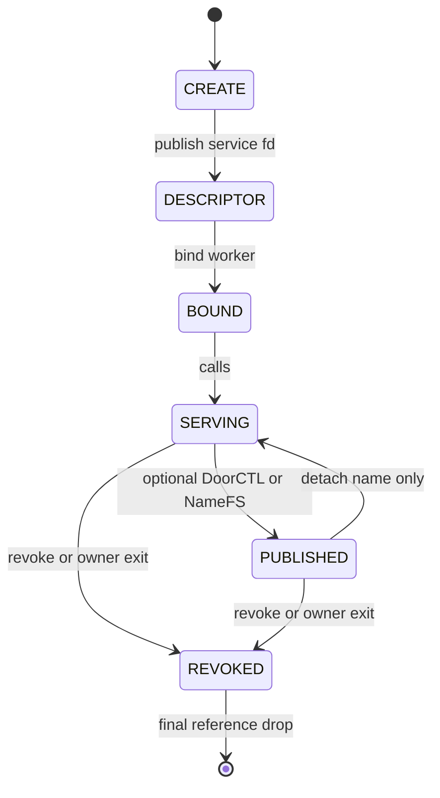

The conceptual sequence is:

```text
CREATE
→ descriptor publication
→ worker binding
→ calls
→ optional named publication
→ revoke/orphan
→ final reference drop
```

Not every endpoint uses every phase, and phases overlap.  A Door may be
published before a worker is ready; multiple workers and clients may coexist;
publication may be replaced while older descriptors remain live.

<a id="contents-ch6-creation"></a>

#### Creation

`door_alloc()` validates attributes, rejects creation by a process already in
`P2_WEXIT`, allocates identity and credentials, initializes lock/queues/limits,
links the object to the owner and live-object registries, and establishes the
initial references.

<a id="contents-ch6-descriptor-publication"></a>

#### Descriptor publication

The create syscall installs a service `struct file`.  Installation takes a
Door reference before exposing the fd.  If fd allocation or copyout fails, the
file and endpoint references unwind without leaving a descriptor the caller
does not know about.

`d_file_count` tracks visible service-file participation separately from
`d_refs`.  The last service close may trigger orphan/revoke decisions, but it
does not by itself prove the object has no other references.

<a id="contents-ch6-worker-binding"></a>

#### Worker binding

An owner-authorized thread binds to the endpoint.  Binding:

- creates a `door_server_binding`;
- publishes it on the Door server list and global cleanup registry;
- stores it in `td_door_server`;
- holds the Door independently of the service descriptor;
- prepares reusable reply storage;
- waits for assignment through the return/wait protocol.

A worker unbinds itself, exits, or is detached during revoke.  An unrelated
thread cannot reply through that binding.

<a id="contents-ch6-calls-and-publication"></a>

#### Calls and publication

Calls add call-object/resource references but do not normally add a separate
Door reference for each call because queue and binding lifetime is nested in
the live endpoint state.  File/syscall entry holds protect the Door while the
operation locates or creates call state.

DoorCTL and NameFS each hold the exact published generation.  They do not
replace `d_uniquifier` inside an existing Door.

<a id="contents-ch6-revoke-and-orphan"></a>

#### Revoke and orphan

Explicit revoke and owner exit mark `d_revoked`, publish the hot revoked bit,
prevent new calls/bindings/SHM, detach queued work, resolve active work, wake
clients and workers, revoke regions, and notify DoorCTL generation state.

`d_orphaning` closes the narrow interval while the owner-list anchor is being
removed: no new client/publication may attach between unlink and the revoke
pass.

Revoke is not destruction.  It is a terminal service-state transition.

<a id="contents-ch6-distinct-lifetimes"></a>

#### Distinct lifetimes

| Lifetime | Begins | Ends | What may outlive it |
|---|---|---|---|
| descriptor | file installation/open | close/exec/fd-table teardown | endpoint through other files, publications or bindings |
| owner process | successful create link | owner exit/unlink | revoked endpoint storage and old client fds |
| publication | DoorCTL register or NameFS attach | unregister, detach, replacement, revoke notification | descriptors opened from that generation |
| server binding | bind | unbind/thread exit/revoke cleanup | endpoint and calls held by other actors |
| NameFS vnode | mount/root vnode publication | unmount/recovery after external vrefs drain | already opened native Door fds |
| named identity | first DoorCTL register | explicit deletion/DEAD GC | no live Door is required during DEAD grace period |
| endpoint storage | allocation | last `d_refs` release | nothing |

<a id="contents-ch6-why-last-visible-fd-does-not-imply-immediate-destruction"></a>

#### Why last visible fd does not imply immediate destruction

The kernel cannot equate “no descriptor found in this process” with “no
references” because any of the following may still exist:

- a duplicated or passed descriptor in another process;
- a client file opened through NameFS or DoorCTL;
- a bound worker;
- a DoorCTL LIVE entry;
- a NameFS target file;
- a temporary syscall/file reference;
- a live-object registry reference;
- SHM region list state;
- teardown or GC work retaining the object.

Conversely, storage survival does not mean service survival: revoked Door fds
remain type-safe references that return the terminal error.

<a id="contents-6-3-call-lifecycle"></a>

### 6.3. Call lifecycle

<a id="contents-ch6-states"></a>

#### States

```text
PENDING → ACTIVE → DONE
```

Exceptional transitions are:

```text
PENDING/ACTIVE → CANCELLED
PENDING/ACTIVE → REVOKED
ACTIVE → worker loss / ECONNRESET
```

`dc_error` carries the terminal cause.  For owner revoke, `REVOKED` is
authoritative and the client observes `EBADF` even if a late worker attempted
to publish success.

<a id="contents-ch6-reference-model"></a>

#### Reference model

| Reference | Created | Transferred/dropped |
|---|---|---|
| client/local | call allocation | after result copyout/install or failure unwind |
| pending async | ONEWAY or native async accepted before submit returns | transferred to server ownership on activation; dropped if pending call is revoked |
| server | activation of sync RPC/native async/ONEWAY | after reply/completion, requeue, cancellation cleanup, worker exit or revoke |
| temporary completion | paths that must operate after detaching from queues | dropped after copyout/install/wakeup work |
| embedded resource holds | credential, xfers, fd bundles, SHM region | released by final `door_call_drop()` |

The call refcount protects storage.  `d_lock` protects who owns the call's
state and which queue/binding contains it.

<a id="contents-ch6-pending"></a>

#### PENDING

The call is linked in `d_pending` when no idle worker exists.  A synchronous
client still holds its reference and waits.  ONEWAY has an asynchronous queue
reference because the submitting thread may already have returned.

Pending calls have no `dc_server_td` and no binding `ds_call`.

<a id="contents-ch6-direct-assignment"></a>

#### Direct assignment

If an idle binding exists, `door_call_activate_locked()` performs one atomic
ownership transition under `d_lock`:

```c
door_server_set_waiting_locked(door, ds, false);
door_call_hold(call);              /* server reference */
call->dc_state = DOOR_CALL_ACTIVE;
TAILQ_INSERT_TAIL(&door->d_active, call, dc_link);
ds->ds_call = call;
call->dc_server_td = ds->ds_td;

if (call->dc_oneway)
        door_call_drop(call);      /* transfer async ownership */
```

The actual source includes special UNREF rules, but the invariant is the same:
after activation the binding, active list, server thread pointer, state, and
reference ownership agree before the lock is released.

<a id="contents-ch6-pending-queue-activation"></a>

#### Pending-queue activation

When a worker returns to wait, it takes the head eligible call from
`d_pending`, removes the pending ownership/list entry, and activates it using
the same helper.  There is no distinct weaker lifecycle for queued calls.

<a id="contents-ch6-assigned-but-not-delivered"></a>

#### Assigned but not delivered

`ACTIVE` initially means assigned, not necessarily copied to server userspace.
`dc_server_delivered` distinguishes these phases.  If the receive buffer is
too small or export copyout fails before delivery, the call can be requeued:

- remove from active list;
- clear `ds_call` and `dc_server_td`;
- return to `PENDING`;
- restore ONEWAY async queue ownership;
- drop server ownership;
- insert at the pending queue head.

Once delivery is committed, requeue would replay an operation already visible
to the callback and is forbidden.

<a id="contents-ch6-done-and-client-wake-publication"></a>

#### DONE and client wake publication

The server captures a reply in private kernel state, then under `d_lock` sets
`DONE`, records error/size/descriptor metadata, and calls
`door_call_wake_client_locked()`.

Wake publication uses the shuttle protocol when legal and CV/scheduler
fallback otherwise.  The state transition precedes the wake, so a client that
runs immediately observes the terminal state.

For simple buffer/no-descriptor replies, the server can release immediately
after publishing the private reply.  For page-backed or descriptor replies, an
installation barrier keeps the necessary ownership until client copyout and
fd installation report completion.

<a id="contents-ch6-cancelled"></a>

#### CANCELLED

For a pending call, cancellation removes it from the queue and wakes the
client.  For an active call, the state becomes `CANCELLED`; the worker still
owns the server reference until it notices/discards the call.  The client must
not free storage still reachable through `ds_call`.

`DOOR_NO_CANCEL` suppresses ordinary client signal cancellation according to
the ABI, but revoke and owner exit remain terminal operations.

<a id="contents-ch6-revoked"></a>

#### REVOKED

Pending calls are detached and woken.  Active calls are marked revoked, their
worker is awakened, and cleanup is divided between revoke and the worker so
neither frees the other's live reference.

For ONEWAY, revoke treats queued, assigned-undelivered, and delivered calls
differently because only the last may already have affected application state.

<a id="contents-ch6-worker-loss-econnreset"></a>

#### Worker loss / `ECONNRESET`

If an individual worker disappears while the owner endpoint remains live, its
active call cannot receive a reply.  Binding cleanup clears assignment and
publishes worker loss to the synchronous client, normally as `ECONNRESET`.
Owner-process exit instead revokes the endpoint and dominates with `EBADF`.

<a id="contents-ch6-final-reference-rule"></a>

#### Final-reference rule

The final drop asserts that no client shuttle remains armed, then destroys:

- request and reply transfer storage;
- held pages or reply cache;
- persistent SHM region hold;
- request and reply file bundles;
- caller credential snapshot;
- call CV and allocation-class storage.

No code may dereference the call after the class-specific free.

<a id="contents-6-4-synchronous-rpc"></a>

### 6.4. Synchronous RPC

<a id="contents-ch6-1-syscall-entry-and-capability-validation"></a>

#### 1. Syscall entry and capability validation

`door_syscall.c` decodes the selector and fd, obtains the file with
`CAP_DOOR_CALL`, validates `DTYPE_DOOR` and fileops, checks jail policy, and
holds the file across the operation.  Service/admin selectors request their
own rights rather than inheriting call authority.

All ABI versions, reserved flags, pointer/length pairs, counts, signed fd
fields and packed fast-call fields are validated before use.

<a id="contents-ch6-2-call-allocation-and-credential-snapshot"></a>

#### 2. Call allocation and credential snapshot

The request size selects an inline UMA class or a fixed call object.  The call
starts `PENDING` with one client/local reference.  Unless `DOOR_NO_CRED` is
set, the kernel holds the caller's `ucred` and records its pid at call creation.

The snapshot cannot be replaced by request bytes supplied by the client.

<a id="contents-ch6-3-request-data-and-descriptor-capture"></a>

#### 3. Request data and descriptor capture

For the normal capture-before-dispatch path:

1. capture and validate all descriptors;
2. copy small request bytes into inline/owned buffer or hold page-backed
   storage according to policy;
3. publish `dc_request_ready` with release semantics;
4. acquire `d_lock`;
5. recheck revoke and limits;
6. capture an SHM region reference if applicable;
7. assign a unique call id;
8. dispatch or queue.

Capture failure destroys the unexposed call and all partial resources.

<a id="contents-ch6-4-early-descriptor-dispatch"></a>

#### 4. Early descriptor dispatch

For expensive requests the worker may be assigned before capture completes.
This overlaps wake latency with copyin/descriptor work.  It does not allow the
worker to consume incomplete state.

`dc_request_ready` is a release/acquire publication point.  The worker spins
for a bounded interval and then waits on the CV while state is still active.
Capture error cancels the call and wakes both sides.  `d_lock` remains the
authority for revoke and terminal state.

<a id="contents-ch6-5-worker-selection"></a>

#### 5. Worker selection

Under `d_lock`, `door_idle_server_find_locked()` first checks the non-owning
idle hint and then the authoritative binding list.  A valid worker is changed
from waiting to active and linked to the call atomically.  Otherwise the call
enters `d_pending`.

The hint never extends a binding lifetime.  A stale hint is discarded and a
list scan supplies the authoritative result.

<a id="contents-ch6-6-client-wait-and-shuttle-preparation"></a>

#### 6. Client wait and shuttle preparation

The client tests terminal state under `d_lock`. The private Door path
publishes `PREPARED` while the mutex is held, can wake or reserve the selected
worker, and drops the mutex before publishing a blocked thread state. An
early wake is recorded for the final park check; a pending interrupt can
abort the park (§5.4).

A worker that cannot be reserved as the exact successor can still be made
runnable through the ordinary scheduler. When private waiting is unavailable,
the client can use the CV/sleepqueue fallback.

<a id="contents-ch6-7-request-delivery"></a>

#### 7. Request delivery

The worker's return/wait syscall validates the existing binding.  DoorFS waits
for early capture readiness if necessary, checks that the call is not
cancelled/revoked, validates receive capacity, exports request bytes, installs
request descriptors, and only then sets `dc_server_delivered`.

If capacity is insufficient before delivery, the call returns to `PENDING`
instead of remaining attached to a worker that is leaving the syscall with an
error.  Resizable receive mode reports required sizes and lets the library
retry without replaying a delivered callback.

<a id="contents-ch6-8-callback-execution"></a>

#### 8. Callback execution

After successful copyout/install, the kernel returns to the bound server
thread.  `libdoor` invokes the registered callback, but the kernel still owns
the call identity and binding.  A raw server must obey the same return ABI.

<a id="contents-ch6-9-reply-capture"></a>

#### 9. Reply capture

On `door_return()` the kernel verifies that `td_door_server`, `ds_door`, and
`ds_call` agree.  It captures reply bytes and reply descriptors into private
kernel state before marking the call done.  A cancelled or revoked call
discards the late reply safely.

Small replies may claim per-worker cached storage; busy cache falls back to an
allocation instead of blocking another call.

<a id="contents-ch6-10-reply-publication-and-installation"></a>

#### 10. Reply publication and installation

The server sets `DONE` and wakes the exact client.  The client then:

- checks terminal error and required capacities;
- copies reply bytes to its buffer;
- atomically installs the reply descriptor bundle;
- reports installation outcome through `dc_reply_install_done`;
- waits for required reply-MOVE source-close acknowledgement;
- acknowledges successful request-MOVE sources in the client table.

MOVE acknowledgement is delayed until the destination installation succeeds.
This prevents both endpoints from believing they own the same moved
capability or neither endpoint owning it after a copyout error.

<a id="contents-ch6-11-completion-and-cleanup"></a>

#### 11. Completion and cleanup

The worker drops its server reference when the protocol barrier permits.  The
client drops its local reference after copyout/install and MOVE completion.
Whichever side releases the last reference performs final resource cleanup.

<a id="contents-6-5-oneway-rpc"></a>

### 6.5. ONEWAY RPC

<a id="contents-ch6-acceptance-semantics"></a>

#### Acceptance semantics

Successful ONEWAY submit means:

- the kernel validated the endpoint and limits;
- all request bytes are detached from mutable caller storage;
- the permitted request transport is captured or its SHM reference held;
- the call has an asynchronous lifetime reference;
- it is queued or assigned to a worker.

It does **not** mean:

- a worker entered the callback;
- callback execution completed;
- application state was committed;
- SHM contents were consumed;
- the service will survive immediately after acceptance.

<a id="contents-ch6-why-large-oneway-requests-use-a-snapshot"></a>

#### Why large ONEWAY requests use a snapshot

Ordinary synchronous page-backed requests may hold caller pages because the
caller remains blocked until completion.  ONEWAY returns immediately.  A
large ONEWAY request therefore uses a detached snapshot path rather than
leaving the server dependent on caller memory that may be modified, unmapped,
or reused after submit.

<a id="contents-ch6-oneway-states-and-ownership"></a>

#### ONEWAY states and ownership

| Phase | Call state | Reference owner | Revocation behavior |
|---|---|---|---|
| queued | `PENDING` | async pending reference | remove queue entry and drop async ref |
| assigned, not delivered | `ACTIVE`, `dc_server_delivered == false` | server reference | revoke detaches the binding and drops SERVER; requeue is only for a live endpoint |
| delivery committed | `ACTIVE`, `dc_server_delivered == true` | server reference | retain SERVER through RETURN/worker teardown, including export failure |
| completed | `DONE`/detached | final server/local cleanup | drop last reference, no client wake |

Activation transfers ownership explicitly:

```text
async pending reference
→ add server reference
→ link ds_call / active list
→ drop async pending reference
```

Requeue of an undelivered call reverses the transfer before dropping server
ownership.

<a id="contents-ch6-delivery-commitment-and-revoke"></a>

#### Delivery commitment and revoke

Under `d_lock`, the worker checks assignment, terminal state, and receive
capacity before setting `dc_server_delivered`. It sets this flag before
unlocking for request copyout/install. The flag commits SERVER lifetime;
it does not certify completed copyout or entry into the userspace callback.
If export later fails, RETURN/worker teardown still owns that reference.

Before commitment, revoke can detach `ds_call`, clear server association, and
drop SERVER after unlocking. Export resumes through assignment/state checks.
The EXPORT test gate holds a temporary call reference across its unlock and
rechecks `ds_call` before using the pointer. A stale local pointer is not
authority to export a revoked request.

The internal `dc_oneway` flag also covers native kernel async ownership.
Native async still has correlated reply/error completion; public ONEWAY does
not. Revoke can publish an async error completion while a delivered request
callback continues to hold SERVER. Cancellation/completion is not a reader
quiescence barrier for SHM or page-view source reuse (§10.7–10.8).

<a id="contents-ch6-no-reply-channel"></a>

#### No reply channel

ONEWAY has no client thread pointer, reply buffer, reply descriptor capacity,
or synchronous completion wake.  The server completion path releases the
request resources directly.  Attempting to return a normal reply is rejected
or treated according to the no-return ABI, never delivered to an unrelated
future call.

<a id="contents-ch6-application-level-completion"></a>

#### Application-level completion

Applications needing proof of execution must build it explicitly, for example:

- a second Door callback carrying an acknowledgement id;
- a shared-memory completion sequence;
- an event capability established beforehand through synchronous control;
- a later query operation;
- a durable application queue and idempotency key.

The Door kernel acceptance point is not an application transaction commit.

<a id="contents-ch6-storage-and-mapping-reuse"></a>

#### Storage and mapping reuse

Copied/snapshotted request buffers may be reused after submit returns because
the kernel detached their contents.  Persistent SHM is different: submit holds
a region object, but the payload itself remains shared.  The producer must not
overwrite, unmap as a synchronization substitute, or recycle the referenced
ring slot until the application protocol reports consumption.

The kernel prevents use-after-free of the region object; it does not infer
when application data is semantically safe to overwrite.

<a id="contents-6-6-data-transport"></a>

### 6.6. Data transport

<a id="contents-ch6-empty-and-scalar-fast-paths"></a>

#### Empty and scalar fast paths

Empty and scalar selectors reduce structure copyin/copyout and avoid general
marshalling for common small calls.  Packed fields carry reply capacity,
descriptor count, call id, and ONEWAY flags within checked masks.

Fast paths retain the same checks for file type, Capsicum rights, endpoint
state, jail policy, limits, binding identity, cancellation, descriptor
capacity, and teardown.  If an assumption does not hold, they fall back to the
full path or return the same ABI error.

<a id="contents-ch6-buffered-transfers"></a>

#### Buffered transfers

Requests below `DOOR_REQUEST_PAGE_THRESHOLD` use buffer storage, preferably an
inline allocation adjoining `struct door_call`.  Replies below the reply
threshold use an owned buffer or worker reply cache.

Benefits include:

- no per-page hold array;
- predictable cleanup;
- detached ONEWAY contents;
- cache-local call metadata and payload;
- simple reply completion without an install barrier when no descriptors are
  present.

<a id="contents-ch6-page-backed-transfers"></a>

#### Page-backed transfers

Large synchronous data may hold user pages and record page offset/count.  Copy
to the destination uses a UIO over the held pages.  The call owns page holds
until final transfer destruction.

All page holds are rolled back if a later page cannot be held.  Page-backed
reply lifetime extends through client copyout, so the server cannot release
the call as early as for a private buffer reply.

<a id="contents-ch6-separate-request-and-reply-thresholds"></a>

#### Separate request and reply thresholds

The ABI defines:

```c
#define DOOR_REQUEST_PAGE_THRESHOLD (8 * 1024)
#define DOOR_REPLY_PAGE_THRESHOLD   (8 * 1024)
```

They are separate policy constants even when currently equal.  Request and
reply lifetimes differ: request capture may overlap dispatch, while reply
storage may be cached and must survive client copyout.  Future tuning can
change one without silently changing the other ABI path.

<a id="contents-ch6-request-readiness"></a>

#### Request readiness

`dc_request_ready` uses release/acquire ordering.  The producer initializes all
request xfer and fd-bundle fields, then publishes readiness.  The worker reads
the flag before accessing them.  A bounded spin avoids a sleep for short
captures; CV wait handles longer captures without unbounded polling.

<a id="contents-ch6-resizable-receive-buffers"></a>

#### Resizable receive buffers

The server can advertise receive capacity.  If a pending/assigned request does
not fit and has not been delivered, the kernel reports required sizes and
requeues it.  The library grows its buffers and re-enters wait.

This mechanism must not execute the callback twice.  `dc_server_delivered` is
the barrier separating safe requeue from visible delivery.

<a id="contents-ch6-copyout-and-rollback"></a>

#### Copyout and rollback

No userspace copyout is assumed infallible.  On failure:

- uninstalled fd slots are released;
- captured file references are dropped or remain with the original owner;
- MOVE sources are not closed without destination acknowledgement;
- page and buffer resources remain owned by the call until cleanup;
- call state records an error before wakeup where another actor can observe it;
- a delivered request is not silently replayed.

<a id="contents-ch6-transport-selection-and-asynchronous-results"></a>

#### Transport selection and asynchronous results

Sync CALL and native async both associate a request with RETURN. Native async
uses copied data and deferred completion delivery; it does not expose the
synchronous descriptor or CALL_SHM transport. ONEWAY captures input without
a built-in result transaction. Page views are separately published page loans
whose ID/token can be carried in a copied application command. Their mapping
and release protocol does not change the selected call mode (§10.8).

<a id="contents-6-7-descriptor-transfer"></a>

### 6.7. Descriptor transfer

<a id="contents-ch6-capture-and-validation"></a>

#### Capture and validation

The kernel validates the entire vector before publication:

- count against ABI and per-Door limits;
- pointer/count consistency and overflow;
- descriptor flags and reserved bits;
- every source fd and underlying file;
- transferable/passable file semantics;
- Capsicum rights snapshot;
- `DOOR_REFUSE_DESC` endpoint policy;
- duplicate descriptors and MOVE combinations.

Each accepted entry holds its `struct file`, copies its `filecaps`, and records
the source fd and requested transfer flags.

<a id="contents-ch6-copy"></a>

#### COPY

COPY leaves the source descriptor installed.  The held file reference is
installed in a newly reserved destination slot with the copied rights.  After
commit, source and destination descriptors refer to the same open file
description under normal FreeBSD semantics.

<a id="contents-ch6-transactional-move"></a>

#### Transactional MOVE

MOVE is not implemented as “close source, then try to install destination”.
That would lose the capability on destination failure.

The protocol is:

```text
capture and hold source
→ reserve every destination fd
→ install complete destination bundle
→ copy destination fd numbers to receiver
→ acknowledge successful installation
→ close matching source descriptors
```

The source close checks that the fd still identifies the captured file.  If
another thread closed and reused the numeric fd, MOVE must not close the new
unrelated file.

<a id="contents-ch6-install-barrier"></a>

#### Install barrier

Reply descriptors require the server to retain enough call/bundle state until
the client reports `dc_reply_install_done`.  If any descriptor has MOVE
semantics, the client may wait for `dc_reply_move_done` before returning
success.

Request descriptors use the symmetric acknowledgement: the client closes MOVE
sources only after the server-side installation completed successfully.

<a id="contents-ch6-rollback"></a>

#### Rollback

| Failure point | Rollback |
|---|---|
| capture entry N | drop holds/caps for entries `0..N-1`; expose nothing |
| destination reservation | release every reserved fd; retain sources |
| file installation | remove installed prefix and close transferred holds |
| fd-number copyout | undo destination bundle when ABI still permits; do not acknowledge MOVE |
| call cancel/revoke before delivery | drop captured bundle; sources remain unless successful acknowledgement already occurred |
| receiver capacity too small | report required count and keep/requeue undelivered request safely |

<a id="contents-ch6-graphs-and-duplicates"></a>

#### Graphs and duplicates

A Door descriptor may itself be transferred, creating a graph of endpoint
capabilities.  Reference counting, not tree ownership, handles these graphs.
Cycles do not grant service after revoke and cannot bypass generation
identity.

Duplicate source fds or multiple entries naming the same `struct file` are
processed as distinct descriptor operations but MOVE close acknowledgement
must avoid double-closing a numeric source.  Limits bound memory and fd-table
work even for hostile graphs.

<a id="contents-ch6-capsicum-and-generation-safety"></a>

#### Capsicum and generation safety

Destination descriptors receive the captured rights, never an implicit full
rights reset.  A call-only Door capability cannot become an admin/service
capability merely by transfer.

The transferred file holds the exact endpoint object.  Rebinding a DoorCTL or
NameFS name cannot redirect it to a new generation.  Revoke state remains on
the old object and is observed by calls through the transferred fd.

<a id="contents-ch6-double-close-and-replay-protection"></a>

#### Double-close and replay protection

Protection comes from:

- held `struct file` identity, not numeric fd alone;
- destination all-or-nothing reservation;
- MOVE acknowledgement flags in the call;
- source identity revalidation before close;
- `dc_server_delivered` preventing replay after callback visibility;
- generation-qualified call/endpoint identity;
- one terminal owner for each bundle cleanup path.

<a id="contents-6-8-shared-memory-and-persistent-mappings"></a>

### 6.8. Shared memory and persistent mappings

<a id="contents-ch6-region-creation"></a>

#### Region creation

`door_shm_create()` validates version, nonzero size, allowed flags and integer
rounding.  Under `d_lock` it reserves per-Door region/byte quotas, then creates
a VM object and maps it into the creator.  It reacquires `d_lock` before list
publication to catch concurrent revoke.

Only after successful mapping and the second revoke check does it assign a
nonzero `dr_id`, insert the region, and return address, id and Door
`uniquifier`.

<a id="contents-ch6-handle-and-generation-identity"></a>

#### Handle and generation identity

A region id is meaningful only within one Door generation.  Userspace handles
carry the endpoint uniquifier so a stale handle cannot be applied to a
replacement service that happens to reuse a small numeric region id.

Lookup requires:

- live Door generation;
- matching region id;
- `!dr_dead`;
- requested access permitted by region flags;
- correct creator/consumer role;
- exact offset/length bounds.

<a id="contents-ch6-owner-server-attach"></a>

#### Owner/server attach

Attach maps the same VM object into the consumer/server vmspace with checked
protections.  `DOOR_SHM_F_CONSUMER_RO` can prevent a consumer from obtaining
write access even if the creator mapping is writable.

The region records vmspace/address for each participant and rejects invalid
duplicate/conflicting attachment according to the ABI.

<a id="contents-ch6-bounds-and-overflow"></a>

#### Bounds and overflow

For a reference `(offset, length)`, validation is subtraction-based or uses
checked arithmetic:

```text
offset <= usable_size
length <= usable_size - offset
```

Page-rounded `dr_size` is never used to authorize access beyond
`dr_usable_size`.  Zero, wraparound, out-of-range and permission-inconsistent
references fail before a call holds the region.

<a id="contents-ch6-call-held-references"></a>

#### Call-held references

`door_shm_call_capture_locked()` finds the live region under `d_lock`, checks
the reference, increments `dr_refs`, and stores region/offset/size in the call.
Final call destruction drops that reference.

Destroy or revoke removes the handle from future lookup but cannot free the
region while an active call still dereferences it.

<a id="contents-ch6-handle-destruction-versus-object-lifetime"></a>

#### Handle destruction versus object lifetime

Destroy marks the region dead, removes it from the Door list and quota
accounting, and drops the list reference.  Existing VM mappings own their own
VM object references and are not torn out from underneath either process.

Thus:

```text
destroy handle ≠ forced munmap
destroy handle ≠ immediate region free
```

The library/user process unmaps addresses during channel teardown; process
exit also removes mappings normally.

<a id="contents-ch6-persistent-shm-protocol"></a>

#### Persistent SHM protocol

Persistent SHM eliminates repeated mapping/copy setup.  Door calls carry a
checked reference to already mapped storage.  The kernel guarantees identity,
bounds, permissions and object lifetime; the application guarantees
publication and reuse ordering.

<a id="contents-ch6-ring-protocol"></a>

#### Ring protocol

`door_shm_ring_*()` adds a userspace SPSC record protocol:

- producer reserves a sequence/slot;
- producer writes payload;
- commit publishes length and sequence with release ordering;
- consumer acquires with acquire ordering;
- consumer reads payload;
- consume releases the slot for reuse.

Abort cancels an uncommitted producer reservation.  A view or writer token is
valid only for its sequence and ring instance.  The ring is not automatically
MPMC.

<a id="contents-ch6-oneway-completion-requirement"></a>

#### ONEWAY completion requirement

ONEWAY acceptance only ensures the kernel holds the region object and queued
reference.  It does not ensure the server copied or consumed the shared bytes.
The producer must wait for ring consumption or another application
acknowledgement before:

- overwriting the referenced range;
- reusing the slot;
- destroying logical contents;
- treating `munmap()` as completion.

<a id="contents-ch6-page-composite-source-loans"></a>

#### Page-composite source loans

Page-view metadata holds the exact source VM objects and offsets. Attach
reserves a contiguous VA range and installs source segments consecutively.
PUBLISHED, MAPPING, ATTACHED, RELEASING, and RELEASED distinguish metadata,
in-flight mapping, active readers, and returned loans. Retired sources remain
charged while views retain their pages; aliased payload bytes are not charged
as a second allocation. The mapping/loan transition and authority checks are
specified in §10.8; mapping success alone permits no producer reuse.

<a id="pair-mechanism"></a>

### 6.8.1. Paired SHM events and variable-length allocation chains

Persistent SHM now supports a second communication pattern beside invocation:
a bounded application-defined data stream with independent notification. The
Door remains the capability and generation anchor. The kernel validates and
parks participants; the application defines queue entries, ordering, payload
ownership, completion and backpressure. This is an extension of the data plane,
not a change to the CALL/RETURN transaction or to Door file operations.

<a id="contents-ch6-region-layout-roles-and-authority"></a>

#### Region layout, roles, and authority

`door_shm_pair_create(fd, size, &shm)` creates read/write persistent SHM with
`DOOR_SHM_PAIR`. At least one VM page is required. The entire first page is
reserved for control; two aligned 32-bit sequence words occupy offsets 0 and
64. `DOOR_SHM_PAIR_CONTROL_SIZE` is 128 bytes, the span containing those words,
not permission to place application payload at offset 128: payload starts at
`getpagesize()`. Lane 0 and lane 1 are independent event sequences. Neither is
a buffer, a thread identifier, a queue index, or a reservation slot.

A conventional session assigns lane 0 to request availability and lane 1 to
response availability or returned capacity. These meanings are application
policy; both registered participants may notify either lane. Multiple threads
inside either participant can use the same region. There is no kernel rule
that binds one lane or one region to one worker at pool startup.

The creating process owns the region handle. Only the owning process of the
associated Door may attach the peer mapping with
`door_shm_pair_attach(fd, region_id, &peer)`. Attachment registers the consumer
VM space. WAIT and WAKE authorize the creator or registered consumer VM space;
a known region id plus an inherited or received Door fd is insufficient.
A third process cannot obtain a new mapping through this API simply by
knowing the id. Explicitly fork-inherited mappings remain inherited memory;
Pair does not erase that access or make their holder a registered waiter.

Isolation is at the region/process boundary, not between threads or leases in
a mapping. A server attached to several client regions can read all of those
regions; two threads in the same address space are not mutually isolated.
Private sessions use distinct regions. A process-wide pool mapped into several
untrusted clients would not acquire per-lease memory protection merely from
its descriptors. The current pool API does not implement such a global allocator.

<a id="contents-ch6-atomic-fast-path-and-kernel-wait-registration"></a>

#### Atomic fast path and kernel wait registration

| Operation | Userspace work | Kernel work | Successful-return meaning |
|---|---|---|---|
| `door_shm_pair_load` | Acquire load of the selected sequence | None | Observed event value only |
| `door_shm_pair_notify` | Release increment of the sequence | Authorize region/participant, broadcast lane CV | Wake operation accepted; not application completion |
| `door_shm_pair_wait` | Acquire comparison with `expected`; return on mismatch | If unchanged: authorize, hold region, recheck and interruptibly wait | Sequence changed; recheck the application predicate |

`DOOR_SC_SHM_PAIR_WAIT` and `DOOR_SC_SHM_PAIR_WAKE` use the fixed-width
`door_ioc_shm_pair` record, including ABI version, region, lane, expected value,
relative timeout, and reserved field. The kernel validates raw callers as well
as libdoor callers. A shared word never chooses a kernel object, pointer,
allocation or condition variable: the validated region and lane do.

The control page is mapped and wired into kernel virtual address space. WAIT
reads the VM-object-backed word while holding the same `door->d_lock` used by
WAKE and invalidation. It takes a region reference before sleeping. The
condition-variable wait atomically registers the sleeper and drops that lock.
A notification either changes the word before registration, so the recheck
observes it, or broadcasts after registration. The reference keeps the CV and
wired mapping alive until the waiter has left the kernel wait path.

The implementation does not contain an adaptive spin phase before
`cv_wait_sig()` or `cv_timedwait_sig_sbt()`. It tests the predicate and sleeps
if necessary. Application polling, batching, or an optional bounded spin is a
separate policy. Pair is futex-like in its userspace comparison/kernel parking
split; it is not an arbitrary-address futex, a direct context handoff, or a
lock-free replacement for all kernel and allocator locking. Pair operations
on one Door use that Door's lock.

Zero timeout polls; `DOOR_SHM_PAIR_FOREVER` has no timeout; finite timeouts are
relative nanoseconds up to one day. The kernel computes one absolute deadline,
so spurious wakes do not restart it. Signal interruption is reported as
`EINTR`; an unchanged sequence at the deadline yields `ETIMEDOUT`. Sequence
words must not be reset while active. A complete 32-bit wrap between observation
and wait is an ABA boundary that the application must bound or cover with its
own generation protocol.

<a id="contents-ch6-two-different-lost-wakeup-obligations"></a>

#### Two different lost-wakeup obligations

The basic application wait pattern is:

```c
for (;;) {
        uint32_t observed;
        if (door_shm_pair_load(shm, lane, &observed) == -1)
                return (-1);
        if (queue_predicate_is_ready()) /* acquire reads */
                return (0);
        if (door_shm_pair_wait(shm, lane, observed, timeout_ns) == -1)
                return (-1);
}
```

`queue_predicate_is_ready()` is application pseudocode, not a libdoor entry
point. Producers write payload, release-publish the actual queue predicate,
then notify. Loading the event before rechecking the predicate closes the
empty-check/registration gap. A wake is a hint to examine queue state, never a
substitute for that state. One notification can cover a published batch.

A second obligation appears when an application suppresses notifications
using a separate `waiting` hint. The consumer publishes its waiting flag and
rechecks completion before parking; the producer publishes completion and
checks that flag before deciding whether to notify. Those two sides need a
StoreLoad ordering argument. The corrected M:N benchmark uses sequentially
consistent publication/checks in that handshake, including completion
publication before the waiting-hint load. A release store alone did not close
that race. This correction is in the benchmark protocol, not a new kernel
Pair operation. A timeout must not be the normal mechanism that makes a
missed wake eventually progress.

<a id="contents-ch6-invalidation-and-retained-mappings"></a>

#### Invalidation and retained mappings

Destroy, Door revoke, and participant exit/exec invalidate the region and wake
registered waiters. The expected errors are `ENOENT` for an absent/dead region
and `EBADF` for a revoked Door. A memory-only libdoor mismatch can still return
success after invalidation because that fast path does not inspect kernel
state. It proves no liveness or completed request.

Invalidation does not forcibly remove retained userspace mappings. Threads
must stop and join before local unmap. Destroying the creator-owned handle,
unmapping either participant, detaching the peer from the application session,
and acknowledging final payload access remain distinct operations.

The implementation limits live Pair control pages globally to 1024, in addition
to existing per-Door SHM count/byte quotas. Creation rollback returns reserved
quota on failure. These bounds are resource controls, not a promise of unlimited
queue length or address space.

<a id="contents-ch6-variable-length-chains-and-private-allocation-metadata"></a>

#### Variable-length chains and private allocation metadata

`door_shm_pool_create(fd, bytes, max_leases, &pool)` creates a Pair region with
at least the requested payload capacity rounded to 64 bytes, plus the control
page. The process-local allocator stores its mutex, free extents and lease
table in private memory, outside peer-writable SHM. It supports concurrent
threads in its creating process and rejects use of the copied allocator after
fork. The pool-region accessor returns a borrowed handle; it must not be
destroyed or unmapped independently of its pool.

A reservation returns a `door_shm_chain_t` with region, Door uniquifier, lease,
logical byte length, count, reserved field, and up to 64 offset/length segments.
The 1064-byte descriptor contains no process-local pointers; its segment array
begins at offset 40. Allocation first plans all extents and only then commits:
insufficient space, lease exhaustion or excessive fragmentation does not
consume a partial reservation. At most 4096 leases are simultaneously allowed.
The indexed lease includes a monotonically advancing allocation generation;
exhaustion fails instead of silently wrapping into an old identity.

`door_shm_chain_map()` validates a bounded local descriptor snapshot: region
and generation, nonzero lease, segment count, reserved field, 64-byte aligned
offsets beyond the control page, positive lengths, bounds, overlap, overflow,
and exact total length. It produces local `iovec` entries without payload
copying. It does not validate a live lease against the producer's private
table; the publication protocol must keep the lease live and prevent descriptor
mutation until readers finish.

`door_shm_pool_release()` requires the exact issued descriptor, including unused
fields, rejects stale or altered descriptors, clears rounded payload extents,
and coalesces adjacent free ranges. Zero-copy therefore still includes stores
and a bandwidth cost on release. Pool destroy returns `EBUSY` while leases
remain and requires exclusive local access after joining users. Timeout and
cancellation do not automatically release a lease: the peer may still access it.

<a id="contents-ch6-streaming-contiguity-and-the-earlier-non-goal"></a>

#### Streaming, contiguity, and the earlier non-goal

The earlier exclusion of a general byte-stream Door ABI still applies to
`read()`, `write()` and implicit socket-style framing. It does not exclude a
streaming application protocol. The implemented alternative is a bounded
stream of published records or allocation-chain descriptors: payload stays in
persistent SHM, Pair supplies request/response events, and the application
supplies sequencing, free-space credit, end-of-stream and final-access ACKs.
A fixed ring is one possible queue; variable-length chains avoid requiring
identical payload slots for every message.

There is no infinite tape or unbounded allocation. Logical counters can span
many physical-ring wraps only while finite slots are acknowledged and reused.
Chains provide scatter/gather, not one contiguous virtual buffer. The existing
page-view API can compose eligible page-aligned source ranges, but rejects Pair
regions as sources and does not implement automatic first/last ring mirroring.
Mirrored VA mappings and a global cross-channel allocator remain unimplemented.


<a id="contents-6-9-credentials-and-authorization"></a>

### 6.9. Credentials and authorization

<a id="contents-ch6-caller-credential-snapshot"></a>

#### Caller credential snapshot

Unless `DOOR_NO_CRED` is set, call creation performs `crhold(td->td_ucred)` and
records caller pid.  The server reads credentials from the active bound call,
not from client-controlled payload fields.

The snapshot remains stable if the client later changes credentials or exits.
Groups are copied to the bounded ABI representation with explicit count
validation.

<a id="contents-ch6-lazy-and-no-credential-modes"></a>

#### Lazy and no-credential modes

The return ABI may request lazy credential export so ordinary callbacks that
never inspect credentials avoid unnecessary copyout.  Lazy means “captured in
kernel, exported on demand”, not “look up whatever credentials the process has
later”.

`DOOR_NO_CRED` is an explicit endpoint policy that omits the snapshot.  A
server must treat credentials as unavailable; the kernel must not expose stale
storage from a prior call.

<a id="contents-ch6-jail-checks"></a>

#### Jail checks

By default, caller and endpoint owner must satisfy prison policy.  The
`DOOR_CROSS_JAIL` attribute permits the documented cross-jail relationship
only when creation/operation authority allows it.  DoorCTL local names are
scoped by prison credentials; global names require their stronger policy.

The check is repeated when a Door capability is acquired through NameFS,
DoorCTL or file cloning.  Publication does not bypass jail policy.

<a id="contents-ch6-owner-only-operations"></a>

#### Owner-only operations

Create-time attributes, revoke, parameter mutation, worker bind/service
operations, publication ownership and SHM administration use owner/process
checks plus their required descriptor rights.  Possession of a client Door fd
does not imply owner identity.

<a id="contents-ch6-capsicum-rights"></a>

#### Capsicum rights

| Right | Authority |
|---|---|
| `CAP_DOOR_CALL` | invoke synchronous/native async/ONEWAY calls and permitted cancellation; native async additionally checks completion SERVICE authority |
| `CAP_DOOR_SERVICE` | bind/return as server worker |
| `CAP_DOOR_ADMIN` | revoke and owner administration |
| `CAP_DOOR_INFO` | query information/parameters without broader authority |
| `CAP_DOOR_SHM` | create, attach, destroy and reference persistent SHM as allowed |

Combined selectors, such as SHM call, require both call and SHM rights.  Rights
are checked by `fget()` at syscall entry so capability mode cannot be bypassed
by passing a valid integer fd to the raw syscall.

<a id="contents-ch6-raw-syscall-validation"></a>

#### Raw syscall validation

The kernel validates independently of `libdoor`:

- selector and ABI version;
- fd encoding and sign/range;
- file type, exact fileops and non-null `f_data`;
- all pointer/length and pointer/count pairs;
- maximum data and descriptor counts;
- reserved flags and fields;
- call-id uniqueness where supplied;
- addition, multiplication, page rounding and offset overflow;
- enum values, SHM permissions and packed fast-call masks;
- server binding and active-call identity on return;
- endpoint state again after sleeping allocations/copyin.

This is mandatory because an application can omit, replace, or deliberately
bypass `libdoor`.

<a id="contents-ch6-denial-of-service-limits"></a>

#### Denial-of-service limits

Limits include:

- per-Door `d_data_min`, `d_data_max`, and `d_desc_max`;
- maximum servers per Door;
- maximum pending/active resource allocation through global kernel limits;
- maximum SHM region count and total bytes per Door;
- bounded DoorCTL identities and DEAD grace time;
- bounded descriptor vectors and credential group export;
- bounded Door-hot idle spin.

Every reservation is charged before allocation and uncharged on all failure
paths.  A racing parameter change is caught by the authoritative post-capture
check under `d_lock`.

<a id="contents-ch6-failure-rollback-as-a-security-property"></a>

#### Failure rollback as a security property

Rollback is not only memory hygiene.  It prevents:

- installing a partial capability bundle;
- closing the wrong reused fd;
- making a stale SHM generation accessible;
- accepting a late reply from a dead owner;
- leaving a worker bound to freed endpoint state;
- leaking credentials across calls;
- exposing kernel allocation contents after copyout failure;
- pinning arbitrary pages or kernel memory indefinitely.

<a id="contents-ch6-6-9-1-native-async-kernel-completion-ownership"></a>

### 6.9.1. Native async kernel completion ownership

Admission reserves capacity on the completion endpoint before accepting the
request. The bound is 256 outstanding requests per completion endpoint; it is
not a per-client callback count. An accepted request can be queued, assigned,
or running before a terminal actor wins. Deferred publication jobs retain
accounted ownership through enqueue and completion. A test drain must include
the selected-but-not-yet-enqueued interval, not merely inspect an empty taskqueue.

Native async accepts copied requests up to 1 MiB and copied replies up to
64 KiB. Reply descriptors and native async CALL_SHM are unsupported.
Cancellation yields ECANCELED, revoke yields EBADF, and worker exit yields
ECONNRESET with the corresponding completion status. Invalid replies become
error completions instead of leaving the reservation permanently charged.

The strict raw race joins RETURN/cancel/revoke participants, drains publication,
and checks actual completion headers. Separate ordered tests guarantee RETURN-,
cancel-, and revoke-first outcomes; barrier stress alone cannot ensure each order.

<a id="contents-6-10-revoke-and-owner-exit"></a>

### 6.10. Revoke and owner exit

<a id="contents-ch6-explicit-revoke"></a>

#### Explicit revoke

An authorized revoke performs one terminal transition under `d_lock`:

1. set `d_revoked` and publish `DOOR_HOT_REVOKED`;
2. reject new calls, bindings, publications, and new SHM acquisitions;
   existing page views remain queryable and releasable through retained
   capabilities, and permitted view destruction remains available;
3. detach pending calls;
4. mark/resolve active calls;
5. wake synchronous clients;
6. wake or detach sleeping workers;
7. revoke SHM handles;
8. notify DoorCTL that the generation is dead;
9. drop references outside locks where destructors may sleep.

Repeated revoke is idempotent from the caller's perspective.

<a id="contents-ch6-owner-exit"></a>

#### Owner exit

The process-exit hook publishes `P2_WEXIT` before calling
`door_process_exit()`.  This prevents concurrent creation from adding an
endpoint after the exit scan.  Door teardown runs before generic
`thread_single(SINGLE_EXIT)` so workers blocked in `door_return()` are awakened
before exit waits for them.

The hook drops `PROC_LOCK` because Door/scheduler wake paths acquire locks in a
different established order.

<a id="contents-ch6-pending-synchronous-calls"></a>

#### Pending synchronous calls

Pending calls are removed from `d_pending`, changed to `REVOKED`, assigned
`EBADF`, and woken.  The client retains its local reference until it observes
state and unwinds request resources.

<a id="contents-ch6-active-synchronous-calls"></a>

#### Active synchronous calls

Active calls are marked `REVOKED` before any late reply can commit `DONE`.
Clients and workers are awakened.  The server reference remains until the
binding/worker path detaches `ds_call`; the client reference remains through
its return path.

This ordering fixed the rare `owner_exit_during_pending_call` failure where a
late callback once reported success after the owner had exited.

<a id="contents-ch6-queued-oneway"></a>

#### Queued ONEWAY

Queued ONEWAY has not reached userspace.  Revoke removes it, marks terminal and
drops the asynchronous queue reference.  No client exists to wake.

<a id="contents-ch6-assigned-undelivered-oneway"></a>

#### Assigned-undelivered ONEWAY

The binding owns the call but `dc_server_delivered` is false.  Revoke can
detach it from the binding and drop the server lifetime without claiming that
an application callback ran.

<a id="contents-ch6-delivered-oneway"></a>

#### Delivered ONEWAY

The request may already have affected server/application state.  Revoke marks
the call terminal and wakes the worker as needed, but cannot roll back the
callback.  The worker completion path drops the remaining reference.  The ABI
still provides no submitter completion notification.

<a id="contents-ch6-sleeping-workers"></a>

#### Sleeping workers

Workers may sleep on a normal CV/sleepqueue or a scheduler private shuttle
wait.  Teardown uses the appropriate wake operation:

- CV/sleepqueue wake for ordinary waits;
- pending abort before shuttle park;
- `sched_shuttle_unpark()` for `TDS_SHUTTLE_WAIT`;
- reservation cancel/rollback for `TDS_SHUTTLE`.

No binding storage is freed until the actual worker/thread cleanup has removed
its pointer.

<a id="contents-ch6-shm-revoke"></a>

#### SHM revoke

Revoke retires ordinary live-region lookup and rejects new acquisitions.
Active calls and loaned views retain the exact backing objects they need;
retired source bytes remain charged while view holds exist. Pending view
publications can be cancelled, while MAPPING/ATTACHED/RELEASING views retain
their release path. QUERY, RELEASE, and permissible DESTROY remain available
through retained capabilities (§10.8). VM removal runs outside d_lock.

<a id="contents-ch6-named-generation-notification"></a>

#### Named generation notification

DoorCTL changes matching LIVE entries to DEAD, clears `dne_door`, records the
dead timestamp/uniquifier and drops the publication reference.  The logical
identity can remain through its grace period for replacement.

NameFS independently detects an orphaned/revoked target and moves through its
recovery/unmount state machine.  Existing opened client files still refer to
the old revoked generation; a later rebind affects future opens only.

<a id="contents-ch6-final-object-destruction"></a>

#### Final object destruction

The order is not “revoke then free everything”.  It is:

```text
make endpoint terminal
→ prevent new references
→ detach queues/publications/bindings/regions
→ wake owners of outstanding references
→ each actor drops its own reference
→ final refcount releases storage
```

Destructors that may sleep or acquire unrelated locks run after dropping
`d_lock`, often through temporary detached lists.

<a id="contents-ch6-teardown-invariants"></a>

#### Teardown invariants

| Invariant | Failure prevented |
|---|---|
| terminal state published before wake | late success after revoke/owner exit |
| each queue/binding removes only its own reference | double free and refcount underflow |
| worker binding survives until worker cleanup | `td_door_server` use-after-free |
| active calls retain payload/fd/SHM resources | server/client use-after-free |
| ONEWAY delivery barrier distinguishes replayable assignment | duplicate callback or silent loss |
| SHM mappings own VM references independently | forced-unmap race |
| named identities drop generation reference on DEAD | revoked-generation leak |
| old fds remain pinned to old uniquifier | cross-generation confused deputy |

The architecture is correct only if every exceptional path preserves these
same invariants.  Fast calls, empty calls, ONEWAY, SHM and descriptor transfer
are transport variants; none receives a weaker lifetime or security model.


<a id="chapter-7"></a>

<a id="contents-chapter-7-scheduler-shuttle-protocol"></a>

## Chapter 7. Scheduler shuttle protocol

The scheduler shuttle is an optional direct-handoff protocol used by Doors
when one participant is about to block and a particular peer is the most
useful thread to run next.  It connects the Door transaction state machine to
the native FreeBSD scheduler without changing Door RPC semantics or replacing
the scheduler's policy.

This chapter describes shuttle as a state and ownership protocol.  Function
names alone are insufficient: the difficult bugs occurred in the intervals
between “running”, “published as waiting”, “reserved”, “made runnable”, and
“actually selected”.

<a id="contents-7-1-motivation"></a>

### 7.1. Motivation

<a id="contents-ch7-the-conventional-wake-path"></a>

#### The conventional wake path

Without a handoff hint, a synchronous Door exchange follows the normal
sleep/wakeup pipeline:

```text
client enters CALL
→ request is queued
→ worker is removed from its sleep queue
→ worker becomes runnable
→ worker is inserted into a scheduler run queue
→ client prepares to sleep
→ scheduler chooses some runnable thread
→ worker eventually runs
→ worker returns the reply
→ client is made runnable and enqueued
→ scheduler later chooses the client
→ CALL returns
```

Every step is individually correct, but the generic scheduler knows only that
another thread became runnable.  It does not know that the current client is
about to wait specifically for that worker, or that the replying worker is
about to wait specifically after waking that client.

The unnecessary delay is not the system-call instruction itself.  It is the
combination of:

- sleepqueue publication and removal;
- run-queue insertion and removal;
- priority and topology selection;
- an idle CPU wake or IPI;
- waiting for the current quantum or an equal-priority reschedule point;
- a generic chooser pass even when the useful successor is already known.

For ordinary blocking APIs this separation is desirable.  For a two-party
Door transaction it can turn a short callback into a scheduler round trip that
costs much more than the payload processing.

<a id="contents-ch7-the-exact-successor-observation"></a>

#### The exact-successor observation

At two points the Door layer often knows a better successor than the generic
scheduler can infer:

1. the client has published a request and selected a concrete idle worker;
2. the worker has completed a reply and knows the concrete client waiting for
   that call.

Shuttle conveys that relationship as a one-shot hint:

```text
current will block
exact peer is eligible
peer is valid on this CPU
→ reserve peer
→ perform normal switch accounting
→ select the reserved peer
```

The reservation exists only until the switch is committed or rolled back.  It
does not permanently bind the threads, alter their priorities, or grant the
Door layer authority to bypass affinity.

<a id="contents-ch7-why-the-optimization-mattered-most-on-4bsd"></a>

#### Why the optimization mattered most on 4BSD

The effect was most visible on 4BSD when the useful worker was remote or an
equal-priority peer.  The ordinary wake was correct, but could leave the
transaction waiting for another reschedule event even though DoorFS already
knew the exact thread needed for progress.  Door-aware wake and exact idle
handoff removed that avoidable scheduling round trip; the largest affected
cases improved by nearly an order of magnitude.  Numerical results and their
measurement conditions belong to Appendix 2 rather than to this protocol
specification.

The remaining remote cost is architectural: source and target CPUs serialize
on 4BSD's single `sched_lock`.  Shuttle reduces unnecessary choice and wake
delay but does not pretend that 4BSD has ULE-style per-CPU lock ownership.

<a id="contents-ch7-local-and-remote-cases-are-different"></a>

#### Local and remote cases are different

<a id="contents-ch7-same-cpu"></a>

#### Same CPU

When current and peer are valid on the same CPU, the scheduler can reserve the
peer as the exact successor.  This is the strongest shuttle case:

- no cross-CPU migration is required;
- no IPI is required;
- affinity can be checked against the current CPU;
- the peer can be removed from its run queue or promoted directly from a
  private wait;
- the switch can commit that exact thread.

<a id="contents-ch7-different-cpu"></a>

#### Different CPU

A CPU cannot directly `cpu_switch()` to a thread owned by another CPU's
scheduler domain.  The remote case therefore uses:

- normal target-CPU ownership and run-queue rules;
- a Door-specific remote wake flag;
- an idle-target exact-handoff slot where safe;
- an IPI or idle wake chosen by the native scheduler;
- final validation and selection on the target CPU.

This is an exact **remote wake hint**, not a cross-CPU context switch.

<a id="contents-ch7-an-optimization-not-a-second-rpc-semantic"></a>

#### An optimization, not a second RPC semantic

The observable Door result must be identical with shuttle enabled, missed, or
unsupported:

- request and reply bytes are unchanged;
- descriptor transfer remains transactional;
- cancellation and signal errno are unchanged;
- credentials and jail policy are unchanged;
- revoke and owner exit remain authoritative;
- callback ordering is unchanged;
- the caller cannot detect which scheduler path selected the worker except by
  timing.

The central design rule is:

> A shuttle success may remove scheduling work.  A shuttle failure must remove
> no correctness state.

<a id="contents-7-2-state-protocol"></a>

### 7.2. State protocol

<a id="contents-ch7-two-related-state-machines"></a>

#### Two related state machines

There are two layers of state:

1. `struct sched_shuttle` describes the wait relationship owned by a thread;
2. `struct sched_shuttle_token` describes a scheduler-owned exact-successor
   reservation.

The protocol state values are:

```c
enum sched_shuttle_state {
        SCHED_SHUTTLE_NONE = 0,
        SCHED_SHUTTLE_PREPARED,
        SCHED_SHUTTLE_COMMITTED,
        SCHED_SHUTTLE_SLEEPING,
        SCHED_SHUTTLE_RESUMING
};
```

The visible thread states added for the scheduler boundary are:

```text
TDS_RUNNING       current is executing
TDS_SHUTTLE_WAIT  private blocked waiter, not on a sleepqueue
TDS_SHUTTLE       runnable peer held by exactly one reservation token
TDS_CAN_RUN       ordinary runnable transition state
TDS_RUNQ          ordinary run-queue membership
TDS_RUNNING       selected successor
```

`SCHED_SHUTTLE_*` and `TDS_*` are not interchangeable.  For example, a thread
may have `ss_state == SLEEPING` while its scheduler-visible state is
`TDS_SHUTTLE_WAIT`.  A reservation token may then move the peer to
`TDS_SHUTTLE` before it becomes `TDS_RUNNING`.

<a id="contents-ch7-waiter-state-and-reservation-ownership"></a>

#### Waiter state and reservation ownership

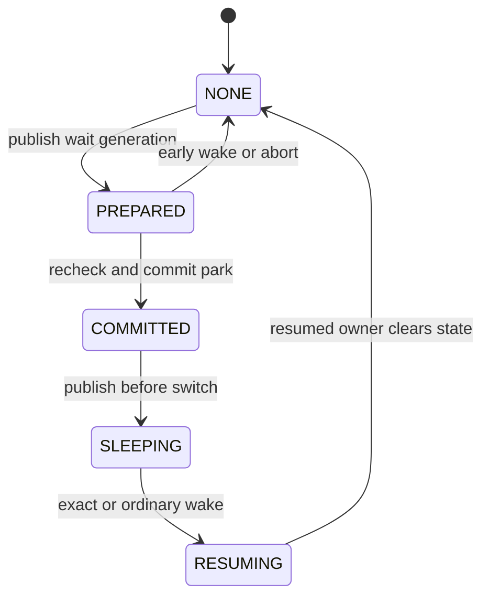

These are waiter states. RESERVED and RUNNING belong to scheduler reservation
and thread execution; they are not additional `sched_shuttle_state` values.
An early wake in PREPARED records pending completion under the thread lock.
The commit path checks it before sleeping. Generic wake, signal, cancellation,
and revoke must unwind any exact-successor reservation once.

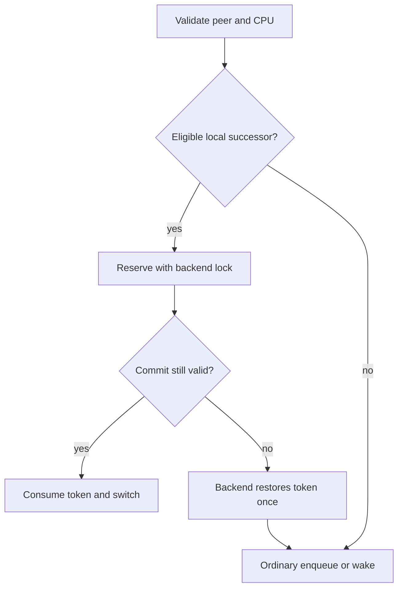

ULE owns its TDQ locking and 4BSD owns its scheduler lock. The MI token carries
validated ownership rather than permission to manipulate backend queues.
A remote peer uses ordinary scheduling. Async wake does not own an exact successor.
Token acquisition and restoration in this diagram are backend-private actions;
there are no exported `take` or `rollback` methods.

<a id="contents-ch7-state-table"></a>

#### State table

| Protocol state | Actor entering it | Required lock | Visibility to wake/signal | Exit rule |
|---|---|---|---|---|
| `NONE` | initializer or resumed owner | thread lock while clearing | ordinary thread rules | prepare a new generation only from here |
| `PREPARED` | current waiter | wait interlock plus `thread_lock(current)` | early resume records `ss_pending`; signal AST is rechecked before park | commit, abort, or retry |
| `COMMITTED` | current waiter in park/commit | `thread_lock(current)` | waiter is on sleepqueue or `TDS_SHUTTLE_WAIT`; waker can now remove/unpark it | publish `SLEEPING` before switch |
| `SLEEPING` | current immediately before `mi_switch*()` | current thread lock, then scheduler switch contract | waker changes it to `RESUMING` or performs ordinary wake | reserve, enqueue, cancel, revoke, or signal |
| `RESUMING` | replying/dispatching peer | target thread lock, then scheduler-native lock | competing generic wake cancels reservation | exact reservation or ordinary enqueue |

<a id="contents-ch7-reservation-token-states"></a>

#### Reservation-token states

The token flags represent validation and ownership:

```c
#define SCHED_SHUTTLE_TOKEN_VALIDATED      0x00000001U
#define SCHED_SHUTTLE_TOKEN_LOCAL          0x00000002U
#define SCHED_SHUTTLE_TOKEN_RUNNABLE       0x00000004U
#define SCHED_SHUTTLE_TOKEN_RESERVED       0x00000008U
#define SCHED_SHUTTLE_TOKEN_WAKE_RESERVED  0x00000010U
```

| Token condition | Meaning |
|---|---|
| empty | no peer is removed from ordinary scheduler representation |
| `VALIDATED` | owner, peer, generation, CPU, and lock domain were checked |
| `RUNNABLE` | peer came from an ordinary run queue |
| `RESERVED` | token exclusively owns the peer; it must be committed or restored |
| `WAKE_RESERVED` | peer was promoted directly from a private wait and has not yet been ordinarily enqueued |

`sst_generation` prevents an old token or late wake from consuming a later
reuse of the same thread's shuttle structure.

<a id="contents-ch7-none-to-prepared"></a>

#### NONE to PREPARED

Actor: the thread that is about to block.

Required conditions:

- it is `curthread`;
- it is still `TDS_RUNNING`;
- the Door/CV interlock still protects the condition being waited for;
- the wait channel is non-null;
- an explicit peer, if present, is not the current thread;
- the previous shuttle generation is fully cleared.

Required lock: `thread_lock(curthread)` while setting `ss_peer`, `ss_wchan`,
flags, pending state, and generation.

Visibility: an early exact resume cannot enqueue the still-running waiter.
Instead it records `ss_pending`.  The waiter observes that marker before
switching and aborts the sleep.

Cancellation: clearing the state increments the generation.  This makes a
late resume stale rather than applicable to the next call.

<a id="contents-ch7-prepared-to-committed-tds-shuttle-wait"></a>

#### PREPARED to COMMITTED / `TDS_SHUTTLE_WAIT`

Actor: the current waiter after the Door interlock is ready to be released.

Required lock: `thread_lock(curthread)` continuously across the final pending
signal/suspend check and publication of the private state.

The crucial gate is:

```c
if ((flags & SCHED_SHUTTLE_F_INTERRUPTIBLE) != 0 &&
    ((td->td_pflags & TDP_WAKEUP) != 0 ||
    td_ast_pending(td, TDA_SIG) ||
    td_ast_pending(td, TDA_SUSPEND)))
        return (SCHED_SHUTTLE_ABORTED);

sched_sleep(td, 0);
td->td_flags |= TDF_SINTR;        /* for interruptible waits */
TD_SET_SHUTTLE_WAIT(td);
ss->ss_state = SCHED_SHUTTLE_COMMITTED;
```

Why the recheck is inside `thread_lock`: a signal can arrive after the earlier
Door-side check while the thread is still running.  At that time signal code
can only post an AST because there is no published waiter to unpark.  Once the
thread lock is held, either the waiter sees the pending AST and aborts, or a
later signal sees `TDS_SHUTTLE_WAIT` and unparks it.  No third interval exists.

<a id="contents-ch7-committed-to-sleeping"></a>

#### COMMITTED to SLEEPING

Actor: the current waiter.

Required lock: current thread lock on entry to the scheduler-specific switch.

Before switching, it checks `ss_pending` a final time.  If an early resume won:

```c
TD_SET_RUNNING(td);
sched_shuttle_abort(td);
return (SCHED_SHUTTLE_ABORTED);
```

Restoring `TDS_RUNNING` is mandatory because the thread is still executing.
Leaving it in `TDS_SHUTTLE_WAIT` while returning to C code creates an
impossible condition: a running thread exists on no runnable representation.
This exact class of bug caused later waits to hang or assert.

If no wake won, state becomes `SLEEPING` and the code enters `mi_switch()` or
`mi_switch_shuttle()` with normal context-switch accounting intact.

<a id="contents-ch7-sleeping-to-resuming"></a>

#### SLEEPING to RESUMING

Actor: the exact peer completing a Door reply or dispatching a worker.

Entry to `sched_shuttle_resume()` and `sched_shuttle_resume_to()` is lockless;
the function acquires `thread_lock(target)` internally.

Validation includes:

- target is still in the expected generation;
- target is `TDS_SHUTTLE_WAIT` or on its expected sleepqueue;
- `ss_peer` is empty for an idle worker or matches the current owner;
- async wake is not incorrectly treated as an exact synchronous successor;
- target has not already been resumed.

The waker changes the protocol state to `RESUMING`, makes the target eligible
for scheduler publication, and asks the active scheduler either to reserve it
or enqueue it normally.

<a id="contents-ch7-resuming-to-reserved"></a>

#### RESUMING to RESERVED

Actor: the scheduler-specific wake helper.

Required locks:

- target `thread_lock` on entry;
- then the native scheduler lock: local TDQ lock for ULE or global
  `sched_lock` for 4BSD;
- ownership of `thread_lock` is transferred to that scheduler lock as defined
  by the native wake path.

Validation includes CPU affinity, bound/pinned state, CPU ownership, token
availability, peer identity, and generation.  Success sets `TDS_SHUTTLE` and
publishes a `WAKE_RESERVED` token.  Failure clears the private relationship
and invokes the native ordinary wake routine.

<a id="contents-ch7-reserved-to-running"></a>

#### RESERVED to RUNNING

Actor: the scheduler switch path on the CPU owning the reservation.

Required lock: the same native scheduler lock that protects the token and
peer's runnable representation.

The final validation is intentionally repeated immediately before commit.
Only then may the scheduler:

- account the peer as awake/running;
- update current-thread and load fields;
- perform `TD_SET_RUNNING(peer)`;
- clear the token;
- pass the peer to `cpu_switch()` through the normal scheduler tail.

If any check fails, the scheduler restores the peer to its original run queue
or performs an ordinary wake before invoking the generic chooser.

<a id="contents-ch7-abort-and-fallback-transitions"></a>

#### Abort and fallback transitions

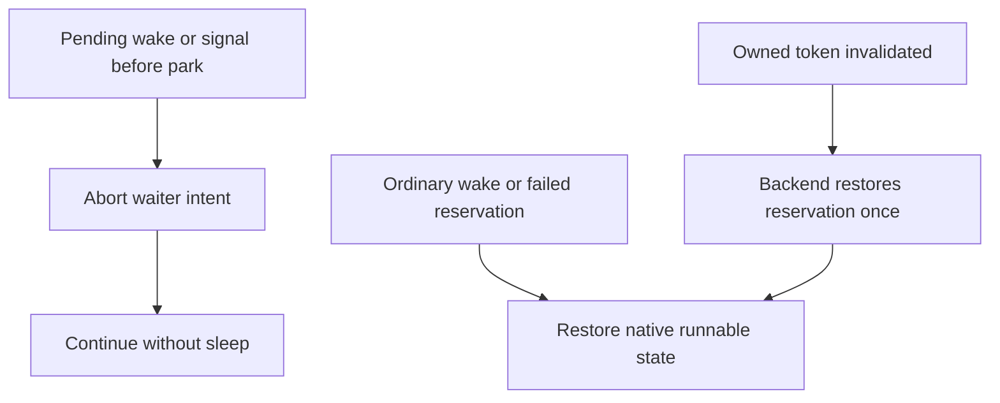

This diagram shows actions across waiter and scheduler domains, rather than
pretending that RUNQ and RESERVED are waiter-enum states.

The important transitions are:

```text
PREPARED → ABORTED → RUNNING/NONE
SHUTTLE_WAIT → ordinary wake → CAN_RUN/RUNQ
RESERVED → fallback → restored RUNQ
```

<a id="contents-ch7-peer-exit"></a>

#### Peer exit

If a waiting peer disappears before reservation, the resume fails validation
and the caller uses ordinary Door error handling.  If the current running
thread already owns a wake reservation and exits, the scheduler exit path must
resolve the reservation before the owner leaves the scheduler. ULE’s
`sched_throw()` explicitly calls `sched_ule_shuttle_owner_exit()` to restore
a wake-reserved peer. In 4BSD, abort restores a reservation under
`sched_lock`; the exit switch enters the ordinary chooser through
`sched_throw_tail()`, where the current owner’s token is consumed or restored
on failed validation.

Without this rule, the target remains `TDS_SHUTTLE` outside every run queue
forever.

<a id="contents-ch7-revoke"></a>

#### Revoke

Door revoke is an ordinary higher-priority wake source.  If the thread is:

- `PREPARED`: pending state aborts the upcoming sleep;
- `TDS_SHUTTLE_WAIT`: `sched_shuttle_unpark()` publishes it normally;
- `TDS_SHUTTLE`: `sched_shuttle_cancel()` destroys the reservation and
  enqueues it;
- already on a run queue: normal scheduler behavior applies.

Revoke never waits for the optimization to complete and never silently clears
a token without restoring its peer.

<a id="contents-7-3-scheduler-api-and-lock-ownership"></a>

### 7.3. Scheduler API and lock ownership

<a id="contents-ch7-result-contract"></a>

#### Result contract

```c
enum sched_shuttle_result {
        SCHED_SHUTTLE_OK = 0,
        SCHED_SHUTTLE_FALLBACK,
        SCHED_SHUTTLE_ABORTED,
        SCHED_SHUTTLE_RETRY
};
```

| Result | Meaning | Caller action |
|---|---|---|
| `OK` | scheduler owns the requested transition | do not repeat ordinary wake/switch work |
| `FALLBACK` | optimization unavailable and no indispensable state consumed | execute the ordinary correct path |
| `ABORTED` | a wake/signal/error won or arguments cannot describe a legal transition | do not sleep; unwind current generation |
| `RETRY` | concurrent state advanced or early wake was recorded | re-evaluate at the protocol boundary; never blindly enqueue twice |

There is no “unsupported but partially applied” result.  An unsupported
scheduler or configuration must return `FALLBACK` before removing a thread
from its normal representation.

<a id="contents-ch7-lock-ownership-convention"></a>

#### Lock-ownership convention

The precise implementation assertions are authoritative, but the MI contract
can be summarized as follows:

| API | Entry lock | Return lock on success | Return lock on fallback/abort |
|---|---|---|---|
| `sched_shuttle_prepare()` | `thread_lock(td)` held | still held | still held |
| `sched_shuttle_commit()` | `thread_lock(curthread)` held | still held | still held |
| `sched_shuttle_sleep()` | `thread_lock(curthread)` held | still held | still held |
| `sched_shuttle_swtch()` | `thread_lock(curthread)` held | consumed by context switch; caller resumes unlocked as documented | normally still owned until caller unwinds |
| `sched_shuttle_resume()` | none | target lock consumed/released internally | none |
| `sched_shuttle_resume_to()` | none | target lock consumed/released internally | none |
| `sched_shuttle_wakeup()` | target thread locked | success transfers/consumes lock through scheduler wake contract | target remains locked unless implementation explicitly performed normal wake |
| `sched_shuttle_unpark()` | target thread locked | consumes target lock through native wake | no normal return with lock assumed |
| `sched_shuttle_cancel()` | target thread locked | consumes lock through restore/enqueue | no normal return with lock assumed |
| `sched_shuttle_abort()` | current thread locked | returns with a valid current-thread lock domain | same |

Callers must not infer lock ownership solely from the result name.  The
scheduler implementation and assertions define whether a native wake routine
consumes the lock.

<a id="contents-ch7-sched-shuttle-sleep"></a>

#### `sched_shuttle_sleep()`

Purpose: publish current thread's intent to enter a private exact-peer wait.

Inputs:

- `td`: must be `curthread` and running;
- `peer`: exact peer or `NULL` for an idle-worker wait;
- `wchan`: stable wait identity;
- flags: interruptible, reply, dispatch, idle-wait, or async semantics.

It initializes a new generation in `PREPARED`.  It does not itself release the
Door mutex and does not choose the successor.

<a id="contents-ch7-sched-shuttle-swtch"></a>

#### `sched_shuttle_swtch()`

Purpose: complete park publication and enter the scheduler switch.

It:

1. validates current and prepared state;
2. calls the scheduler-specific park step;
3. handles pending wake/signal abort;
4. publishes `SLEEPING`;
5. performs normal MI switch accounting;
6. cleans the generation after current resumes.

It is spelled `swtch` to match the kernel's historical naming conventions.

<a id="contents-ch7-sched-shuttle-abort"></a>

#### `sched_shuttle_abort()`

Purpose: erase a generation that will not sleep and restore every reservation
owned by current.

It clears peer, wait channel, flags, pending state, increments generation, and
returns current to its native scheduler lock domain.  If current already
reserved another waiter, abort restores that target before clearing the token.

This final clause fixed a subtle hang: an early wake could reserve a peer and
then cause current's own sleep to abort.  Clearing only current's wait state
would strand the reserved peer outside every run queue.

<a id="contents-ch7-sched-shuttle-resume"></a>

#### `sched_shuttle_resume()`

Purpose: wake a private or generic shuttle waiter without requiring the caller
to own the intended successor relationship.

It is used for generic reply, revoke, and fallback wakeups.  During
`PREPARED/COMMITTED`, it records `ss_pending`; during `SLEEPING`, it either
reserves the target for current or publishes it through the ordinary scheduler
path.  `SCHED_SHUTTLE_F_ASYNC_WAKE` explicitly forbids exact-successor
ownership and uses a normal enqueue.

<a id="contents-ch7-sched-shuttle-resume-to"></a>

#### `sched_shuttle_resume_to()`

Purpose: resume one concrete waiter and attempt to reserve it as the current
thread's exact successor.

It accepts an idle worker whose `ss_peer` was previously null, or a client
whose recorded peer matches current.  A different peer, changed generation,
affinity mismatch, or non-sleeping target causes fallback.

<a id="contents-ch7-sched-shuttle-prepare-and-sched-shuttle-commit"></a>

#### `sched_shuttle_prepare()` and `sched_shuttle_commit()`

These support the generic sleepqueue-backed form:

- `prepare()` arms the relationship before entering the sleepqueue path;
- ordinary sleepqueue code publishes the waiter;
- `commit()` verifies that the same wait channel is still installed;
- an early resume produces `ABORTED` rather than a lost wake;
- the normal sleepqueue switch remains the fallback.

The newer private Door path uses `sleep()` / `swtch()` as the hot subset, but
the generic pair remains necessary for paths whose FreeBSD signal or locking
rules require normal sleepqueue membership.

<a id="contents-ch7-dispatch-helpers"></a>

#### Dispatch helpers

`sched_shuttle_dispatch()` connects an idle worker wait with the client that
has just selected it.  It may fill an initially null peer, mark pending during
prepare, or delegate to `resume_to()` after publication.

<a id="contents-ch7-backend-private-reservation-helpers"></a>

#### Backend-private reservation helpers

`sched_ule_shuttle_take()` reserves a runnable peer on the local ULE run
queue. It records the peer, generation, CPU, run-queue index, and transferability
and retains the TDQ lock through the switch. Final validation and commit run
inside ULE’s `sched_switch()`; `sched_ule_shuttle_restore_locked()` restores the
saved representation if commit fails.

4BSD reserves a local private waiter through its wake path. The ordinary
chooser consumes that token, and `sched_4bsd_shuttle_restore_locked()` restores
it when required. It has no separate runnable-peer take operation.

`sched_ule_shuttle_park()` and `sched_4bsd_shuttle_park()` are private helpers
called by their respective `shuttle_swtch()` implementations for the current
thread after the external interlock is released. The `resume_to()` paths act
on the target: they can record an early wake or attempt to reserve a parked
peer. The park helpers are not scheduler-interface methods. Reservation,
rollback, run queues, and CPU ownership remain with the backend.

<a id="contents-ch7-wake-cancel-and-unpark"></a>

#### Wake, cancel, and unpark

- `sched_shuttle_wakeup()` converts a just-woken target into an exact local
  reservation if legal;
- `sched_shuttle_cancel()` handles generic wake of `TDS_SHUTTLE`, restores the
  token, then enqueues normally;
- `sched_shuttle_unpark()` handles generic wake of `TDS_SHUTTLE_WAIT`;
- the resumed target, not the waker, clears interruptible-wait bookkeeping.

<a id="contents-ch7-flags"></a>

#### Flags

| Flag | Meaning |
|---|---|
| `SCHED_SHUTTLE_F_INTERRUPTIBLE` | wait participates in signal errno and abort rules |
| `SCHED_SHUTTLE_F_SAMECPU` | direct transition requires local CPU validity |
| `SCHED_SHUTTLE_F_DISPATCH` | client is dispatching a selected worker |
| `SCHED_SHUTTLE_F_REPLY` | worker is waking its waiting client |
| `SCHED_SHUTTLE_F_IDLE_WAIT` | server waits without a known peer until dispatch |
| `SCHED_SHUTTLE_F_ASYNC_WAKE` | waker continues and cannot own an exact-successor token |

<a id="contents-7-4-4bsd-implementation"></a>

### 7.4. 4BSD implementation

<a id="contents-ch7-architectural-constraint-one-global-scheduler-lock"></a>

#### Architectural constraint: one global scheduler lock

4BSD protects scheduler state with the global spin mutex `sched_lock`.  The
same lock serializes run-queue work performed by the source and target CPUs.
This is not an accidental implementation detail that Door code can remove; it
is a defining part of the 4BSD scheduler architecture.

For a remote Door wake, the sequence is approximately:

```text
CPU 0 holds sched_lock
→ makes worker runnable for CPU 1
→ publishes Door idle-handoff hint
→ wakes CPU 1
→ CPU 0 releases sched_lock
→ CPU 1 leaves idle
→ CPU 1 waits for sched_lock
→ CPU 1 enters mi_switch()/chooser
→ exact worker is selected
```

The target CPU can observe runnable work before it can acquire the global
scheduler lock and enter the chooser.  Consequently the residual remote delay
is lock and switch serialization, not merely hardware wake latency.  Making
remote 4BSD identical to local ULE would require replacing 4BSD's locking
architecture, which is outside the shuttle design.

<a id="contents-ch7-same-cpu-exact-successor"></a>

#### Same-CPU exact successor

4BSD stores a scheduler-private shuttle structure per thread and a reservation
token per CPU.  For a legal local handoff:

1. current publishes its private wait;
2. peer becomes `TDS_CAN_RUN` under its thread lock;
3. `sched_4bsd_shuttle_wakeup()` verifies `THREAD_CAN_SCHED(peer, cpu)` and
   bound/pinned placement;
4. peer's lock domain moves to `sched_lock`;
5. peer becomes `TDS_SHUTTLE`;
6. the local token records current, peer, generation, and CPU;
7. 4BSD’s ordinary `sched_switch()` accounts for the outgoing thread;
8. the normal chooser consumes the exact reservation before scanning run
   queues.

The final implementation deliberately lets the ordinary 4BSD switch/chooser
consume the reservation:

```c
static void
sched_4bsd_shuttle_sswitch(struct thread *td, int flags)
{
        sched_switch(td, flags);
}
```

This preserves 4BSD's established outgoing-thread accounting and lock
transitions while still avoiding an arbitrary successor choice.

<a id="contents-ch7-remote-run-queue-and-idle-handoff"></a>

#### Remote run queue and idle handoff

For remote placement, the worker is added through the normal 4BSD scheduler
with `SRQ_DOOR_WAKE`.  Door-specific per-CPU state records:

```c
DPCPU_DEFINE_STATIC(u_int, door_idle_hot);
DPCPU_DEFINE_STATIC(u_int, door_idle_spinning);
DPCPU_DEFINE_STATIC(u_char, door_remote_handoff);
DPCPU_DEFINE_STATIC(struct thread *, door_idle_handoff);
```

`door_idle_handoff` names a concrete worker for an idle target CPU.  It is only
a hint: removal, affinity change, cancellation, or another chooser clears or
invalidates it.  The idle CPU consumes it under `sched_lock` after checking
that the thread is still runnable and valid for that CPU.


<a id="contents-ch7-affinity-mismatch"></a>

#### Affinity mismatch

A client on CPU 0 cannot locally switch to a worker hard-bound to CPU 1 or CPU
6.  The scheduler checks:

- `THREAD_CAN_SCHED(worker, current_cpu)`;
- `TDF_BOUND`, pin count, and recorded run-queue CPU;
- whether the candidate is owned by the current scheduler domain.

Failure returns `FALLBACK` before a local reservation is published.  The worker
is then placed on its valid remote CPU normally.  Attempting a local reservation first would only add predictable affinity-fallback work, so the implementation proceeds directly to ordinary remote placement.

<a id="contents-ch7-equal-priority-remote-wake"></a>

#### Equal-priority remote wake

Stock 4BSD may decide that an equal-priority runnable thread does not require
immediate preemption.  That is normally a reasonable fairness decision, but a
Door worker may be the exact thread needed for the interrupted client to make
progress.

The Door wake marks `door_remote_handoff` for the target CPU.  The reschedule
path treats this as a request to give the exact worker an immediate scheduling
opportunity rather than resume the interrupted equal-priority thread first.
The mark is one-shot and is cleared when consumed.

Without this change, correctness remains, but an empty remote call can wait an
extra quantum/scheduling event—the source of the original tens-of-microseconds
cliff.

<a id="contents-ch7-idle-cpu-wake-and-ipi-behavior"></a>

#### Idle CPU wake and IPI behavior

If the target CPU is in the short Door-hot idle spin, publishing the handoff is
enough; sending an IPI would add overhead after the CPU is already polling for
work.  If the CPU is actually idle, the scheduler uses `cpu_idle_wakeup()` and
the safe native notification path.

A direct `IPI_PREEMPT` shortcut is not used for the idle case because its preemption assumptions do not hold for the idle thread and equal-priority handoff.  The implementation requests the native scheduler/idle wake and lets the target choose under its normal context.

<a id="contents-ch7-door-hot-idle-spin"></a>

#### Door-hot idle spin

4BSD did not have ULE's equivalent behavior for this workload.  A bounded
spin after recent Door activity avoids repeatedly entering a deep idle state
between ping-pong transactions:

```text
Door activity marks CPU hot
→ idle loop consumes the mark once
→ spin for at most door_idlespins
→ stop immediately when runnable work appears
→ otherwise enter normal idle
```

It is intentionally conditional and bounded.  It does not turn the general
idle loop into permanent polling.

<a id="contents-ch7-asynchronous-wake-fairness"></a>

#### Asynchronous wake fairness

ONEWAY and native async submit do not block for reply handoff. When 4BSD
publishes a shuttle waiter through `sched_4bsd_shuttle_wakeup_async()`, it
enqueues with `SRQ_HOLDTD | SRQ_DOOR_WAKE`. A worker on the local or global run
queue causes a scheduler AST on current; a remote worker uses the ordinary
Door-aware notification path. The target is selected under normal scheduler
control. There is no per-submitter burst counter or burst sysctl.

<a id="contents-ch7-practical-remote-limit"></a>

#### Practical remote limit

The remaining remote interval is fundamentally:

```text
source CPU publishes worker while holding sched_lock
→ target CPU wakes
→ target waits for the same sched_lock
→ target performs normal 4BSD switch accounting
```

Moving wake publication outside the lock introduces a new state race, while
per-CPU Door run queues would begin to replace 4BSD's architecture.  The final
implementation keeps publication and scheduler ownership within the native
locking model.

<a id="contents-7-5-ule-implementation"></a>

### 7.5. ULE implementation

<a id="contents-ch7-per-cpu-tdq-ownership"></a>

#### Per-CPU TDQ ownership

ULE protects each CPU's runnable state with its TDQ lock.  The shuttle token is
stored directly in the TDQ:

```c
struct tdq {
        /* native ULE fields */
        struct sched_shuttle_token tdq_shuttle;
};
```

A local reservation touches only the current TDQ.  A remote wake acquires the
target TDQ according to ULE's existing migration and notification rules.  The
source and target CPUs therefore do not always serialize on a single global
lock as they do in 4BSD.

<a id="contents-ch7-local-runnable-peer-reservation"></a>

#### Local runnable-peer reservation

For a peer already on the current CPU's run queue, ULE:

1. try-locks the local TDQ rather than acquiring an arbitrary peer sleepqueue
   lock;
2. verifies peer's `td_lock` is exactly that TDQ lock;
3. verifies run-queue membership, CPU, affinity, pinning, and chooser order;
4. records run-queue index and transferability;
5. removes the peer with `tdq_runq_rem()`;
6. retains the TDQ lock through `mi_switch_shuttle()`;
7. commits the peer or restores it to the exact bucket.

Try-lock failure is only an optimization miss.  Blocking on another
sleepqueue-chain lock while already holding one could recursively acquire the
same hashed spin lock, so the safe response is fallback.

<a id="contents-ch7-shuttle-commit-in-the-ordinary-ule-switch"></a>

#### Shuttle commit in the ordinary ULE switch

In `sched_ule.c`, `sched_switch()` handles ordinary and shuttle switches in
one body. After `mi_switch_common()` performs MI accounting, the shim
dispatches `sched_shuttle_sswitch()` to `sched_ule_shuttle_sswitch()`. That
backend callback delegates to `sched_switch()`. A sleeping owner with a
local reservation retains the take-reservation TDQ lock or acquires it for a
wake reservation.  The common outgoing-thread accounting runs before the
reservation commit helper.  The reservation path validates:

- token owner is current;
- token belongs to `TDQ_SELF()`;
- CPU and generation still match;
- peer's lock is the TDQ lock;
- wake-reserved peer is `TDS_SHUTTLE`;
- runnable-reserved peer still matches the relationship.

Because commit bypasses generic `choosethread()`, it explicitly performs the
terminal `TD_SET_RUNNING(peer)` after validation.  A failed commit restores
the peer before the ordinary chooser runs; SMP may attempt stealing after the
reservation has been restored.  Preemption and yield restore a wake
reservation instead of consuming it as a sleeping-owner handoff.  Migration,
switch accounting, tracing hooks, and `cpu_switch()` remain in the common body.

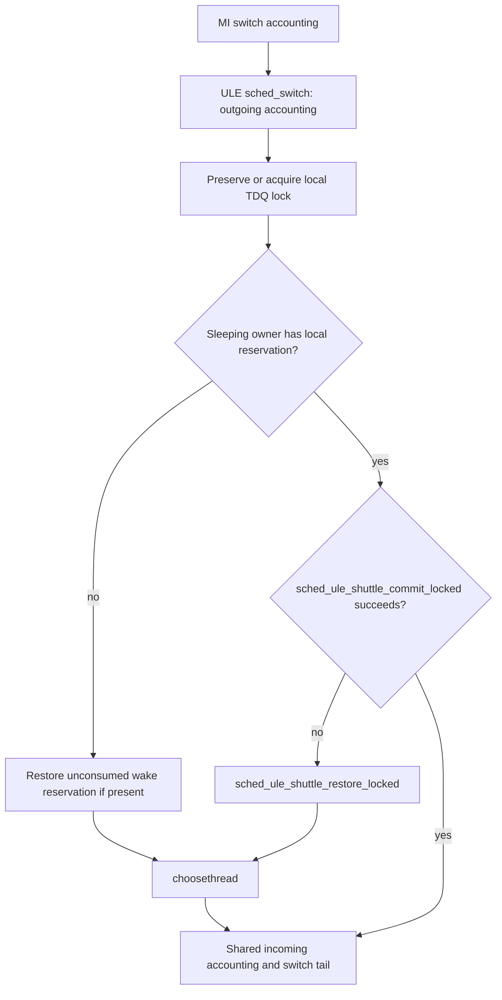

`sched_ule_shuttle_sswitch()` delegates to this same function. A take
reservation already holds the TDQ lock; a wake reservation follows the normal
sleeping-owner lock acquisition. A failed commit restores the peer before the
chooser runs. Preemption and yield restore a wake reservation rather than
consuming it as a sleeping-owner handoff.

<a id="contents-ch7-private-waiter-wake"></a>

#### Private waiter wake

An unbound private waiter can be localized to the waking owner's CPU through
ULE's native `sched_setcpu()` rules.  A bound or pinned waiter may only be
reserved if its required CPU matches.  The token then records a
`WAKE_RESERVED` peer that has never been inserted into the ordinary run queue.

Wake accounting and `tdq_load_add()` occur at commit.  Rollback converts the
peer to `TDS_CAN_RUN`, performs ordinary wake accounting, and calls `tdq_add()`.
Exactly one path accounts it.

<a id="contents-ch7-remote-enqueue-and-wake"></a>

#### Remote enqueue and wake

If direct localization is illegal or the target TDQ already owns a token, ULE
clears the private relationship and uses ULE’s `sched_wakeup()` and
`sched_add()` path.
ULE's existing topology, load balancing, and remote notification choose the
CPU.  Shuttle does not override TDQ migration rules.

<a id="contents-ch7-owner-exit"></a>

#### Owner exit

A running ULE thread may own a reservation for another thread when it exits.
ULE’s `sched_throw()` calls `sched_ule_shuttle_owner_exit()` under the
local TDQ lock, before the final `cpu_throw()`. The hook restores any matching
wake reservation owned by the exiting thread.

This hook exists because normal post-switch cleanup will never execute for an
exiting thread.

<a id="contents-ch7-same-public-semantics-different-internals"></a>

#### Same public semantics, different internals

| Property | ULE | 4BSD |
|---|---|---|
| scheduler lock domain | per-CPU TDQ | global `sched_lock` |
| local token | per TDQ | per CPU under global lock |
| local direct commit | ULE’s `sched_switch()` commits the token | 4BSD’s `sched_switch()` enters the chooser, which consumes the token |
| remote wake | target TDQ and ULE topology | global lock, target run queue, idle handoff |
| cross-CPU direct switch | forbidden | forbidden |
| affinity mismatch | ordinary enqueue | ordinary enqueue |
| ABI result on miss | unchanged | unchanged |

The MI Door/CV layer sees the same result codes and fallback guarantee.  It
does not depend on TDQ fields or the global 4BSD run queue.

<a id="contents-7-6-correctness-abort-and-fallback"></a>

### 7.6. Correctness, abort, and fallback

> Any failed or unavailable shuttle optimization must fall back to an ordinary
> correct scheduler path and must never lose a wakeup.

<a id="contents-ch7-core-invariants"></a>

#### Core invariants

1. A thread is represented in exactly one place: running, sleepqueue, private
   wait, reservation token, or ordinary run queue.
2. A `RESERVED` token is consumed exactly once by commit or rollback.
3. A wake that arrives before waiter publication is recorded as pending.
4. A wake after private publication observes `TDS_SHUTTLE_WAIT` under the same
   thread lock and unparks it.
5. A direct successor becomes `TDS_RUNNING` before it executes.
6. A generation mismatch cannot affect a later wait.
7. Affinity and scheduler ownership are checked before reservation and again
   before commit.
8. Door revoke, signal, suspension, and thread exit override the optimization.
9. Fallback never exposes a partial reservation to generic code.
10. No Door correctness rule depends on the scheduler accepting a shuttle.

<a id="contents-ch7-signal-before-park-publication"></a>

#### Signal before park publication

If the signal is pending before the final `thread_lock` gate, park returns
`ABORTED`.  Current remains running, clears the generation, releases the Door
interlock through the normal path, and processes the signal.

The decisive fix was the second AST check under `thread_lock`; checking only
before acquiring the lock left a window where signal delivery saw a running
thread and the waiter then went to sleep with no future wake.

<a id="contents-ch7-signal-during-publication"></a>

#### Signal during publication

Signal code needs the same target thread lock.  Therefore either:

- park holds the lock first and publishes `TDS_SHUTTLE_WAIT`, after which the
  signal unparks it; or
- signal state becomes visible first and park aborts.

There is no valid interleaving where both believe the other will perform the
wake.

<a id="contents-ch7-signal-after-park"></a>

#### Signal after park

`sig_sleepq_abort()` detects `TDS_SHUTTLE_WAIT`, stores the normal interrupt
result in `td_intrval`, and calls `sched_shuttle_unpark()` instead of
`sleepq_abort()`.  The waiter owns final cleanup of `TDF_SINTR` and
`td_intrval` after it resumes.

This fixed the observed `signals_test` hang where one thread remained in
`sched_4bsd_shuttle_switch()` and the controlling threads slept in `uwait` and
`pipe_read`.

<a id="contents-ch7-resume-before-commit"></a>

#### Resume before commit

If a reply arrives while state is `PREPARED` or `COMMITTED` but before current
has actually switched, resume sets `ss_pending`.  The waiter removes its own
pending sleep, restores `TDS_RUNNING`, aborts the generation, and does not
switch.

The waker must not enqueue the still-executing thread.  Doing so would place
the same thread both on CPU and on a run queue.

<a id="contents-ch7-revoke-before-switch"></a>

#### Revoke before switch

Revoke follows the same priority as a signal or generic wake.  It marks the
Door/call terminal under Door locks, then:

- records pending if current has not published the wait;
- unparks a private waiter;
- cancels/restores a reserved peer;
- wakes an ordinary sleeper normally.

The waiter returns to DoorFS, which reads the transaction's terminal state and
returns the ABI-defined error.  Scheduler code does not invent Door errno.

<a id="contents-ch7-missing-or-stale-reservation"></a>

#### Missing or stale reservation

The switch path validates token flags, owner, peer, CPU, generation, lock
domain, and state.  If any field is stale:

1. restore any peer removed from a run queue;
2. clear the token;
3. use the ordinary scheduler chooser;
4. keep the outgoing waiter correctly blocked;
5. ensure the chosen incoming thread is marked running.

It is unsafe merely to clear a stale token: `RESERVED` may mean the peer is no
longer represented anywhere else.

<a id="contents-ch7-affinity-mismatch-2"></a>

#### Affinity mismatch

Affinity is an expected optimization miss, not an exceptional Door error.
No local token is published.  The target is enqueued on an allowed CPU and
woken through the native remote path.  The calling thread sleeps normally.

This rule is why remote-bound `C0/W1` and `C0/W6` cannot use a local direct
`cpu_switch()` even though DoorFS knows the exact worker.

<a id="contents-ch7-peer-disappearance"></a>

#### Peer disappearance

Thread-exit cleanup invalidates the binding and shuttle relationship under the
relevant locks.  A later resume observes state/generation mismatch.  If the
peer was already reserved, scheduler exit restores or cancels that token
before thread memory can be reclaimed.

DoorFS separately resolves the active call as worker loss or owner death.

<a id="contents-ch7-duplicate-wake"></a>

#### Duplicate wake

Only the first wake may move a wait from sleeping to resuming or consume a
reservation.  Later wakeups see `NONE`, a changed generation, or an ordinary
runnable state and use no shuttle action.  They must not call the native add
routine a second time.

<a id="contents-ch7-unsupported-scheduler-or-configuration"></a>

#### Unsupported scheduler or configuration

A scheduler that does not implement the protocol returns `FALLBACK` without
changing thread representation.  UP builds omit remote state but retain local
correctness.  A panic path also avoids new reservations because panic
scheduling uses special chooser rules.

<a id="contents-ch7-fallback-must-restore-current-s-lock-domain"></a>

#### Fallback must restore current's lock domain

The generic sleep path may have changed `td_lock` to a sleepqueue-chain lock;
a scheduler reservation may have changed it to TDQ or `sched_lock`.  If the
switch is aborted, current must return with the lock expected for a running
thread.  ULE's abort path explicitly transfers back to the local TDQ without
holding the sleepqueue lock across TDQ acquisition.  4BSD transfers back to
`sched_lock` and restores any token owned by current.

Failure to restore the lock domain may not crash at the abort site.  It often
appears later as recursive spin-lock acquisition, an assertion in the next
sleep, or an unkillable process.

<a id="contents-ch7-failure-history-and-resulting-rules"></a>

#### Failure history and resulting rules

| Observed/experimental problem | Root cause | Final rule |
|---|---|---|
| wake-before-park hang | waiter became invisible between condition check and sleep publication | fuse publication with Door/CV interlock and record early wake |
| repeated signal test hung after many iterations | private waiter was not a sleepqueue member and signal used the wrong abort model | recognize `TDS_SHUTTLE_WAIT`, store errno, unpark through scheduler |
| signal arrived while thread still running, then wait hung | AST check occurred before final thread-lock boundary | recheck signal/suspend under `thread_lock` immediately before park |
| peer executed as `TDS_CAN_RUN` and later panicked | specialized chooser bypass omitted `TD_SET_RUNNING` | every direct commit performs the normal terminal state transition |
| reserved peer disappeared on abort/exit | owner cleared its wait without restoring owned token | abort and scheduler exit restore all owned reservations |
| 4BSD specialized sswitch added complexity without remote gain | global `sched_lock` remained the dominant remote serialization | retain minimal chooser-consumed reservation; do not emulate ULE |
| millions of affinity fallbacks | remote-bound worker could never be a local successor | treat affinity mismatch as immediate ordinary remote wake |
| same-CPU ONEWAY queue starvation | submitter continues while an equal-priority worker becomes runnable | async waiter enqueue requests a local scheduler AST |

<a id="contents-ch7-validation-strategy"></a>

#### Validation strategy

Correctness is tested at several scales:

- focused signal interruption and recovery loops;
- owner exit during a pending call;
- worker exit and endpoint revoke;
- same-CPU, different-core, and SMT-sibling placement;
- synchronous, no-return, and ONEWAY traffic;
- descriptor and SHM variants;
- full `lib/libdoor`, `sys/fs/doorfs`, and `sys/fs/namefs` suites;
- repeated runs under both 4BSD and ULE.


<a id="contents-ch7-review-checklist"></a>

#### Review checklist

Any future shuttle change must answer all of these questions:

1. Where is the waiter represented before and after the change?
2. Which lock makes that representation visible?
3. What happens if a signal arrives one instruction earlier or later?
4. What happens if revoke wins before the switch?
5. Who owns a reserved peer if current aborts or exits?
6. Is the peer allowed on this CPU right now?
7. Does fallback restore load, run-queue index, lock pointer, and thread state?
8. Does the selected peer become `TDS_RUNNING` exactly once?
9. Can an async waker incorrectly claim an exact-successor reservation?
10. Does the same Door call still work if every shuttle operation returns
    `FALLBACK`?

If the answer to the final question is no, the change has moved Door
correctness into an optimization and must not be accepted.

<a id="contents-ch7-7-6-1-asynchronous-wake-fairness"></a>

### 7.6.1. Asynchronous wake fairness

ONEWAY and native async submit complete without waiting for server callback
completion. A wake of a private waiter does not reserve an exact successor
when `SCHED_SHUTTLE_F_ASYNC_WAKE` is set. In 4BSD, the asynchronous wake helper
publishes the worker on a native queue and requests a local scheduler AST when
appropriate. Remote notification and idle spinning remain separate mechanisms.
See §7.4 and §14.16. No fairness hook runs once per accepted submission.

<a id="contents-7-7-rejected-experiments"></a>

### 7.7. Rejected experiments

The final protocol is intentionally smaller than the set of mechanisms tested
during development.  The rejected paths are recorded because each is tempting
when only a latency trace is considered, yet each either violates scheduler
ownership or adds permanent complexity without removing the architectural
bottleneck.

<a id="contents-ch7-specialized-4bsd-shuttle-sswitch"></a>

#### Specialized 4BSD shuttle `sswitch`

A prototype split 4BSD’s switch body into generic and shuttle-specific
tails and committed the reserved peer directly, resembling an earlier ULE
prototype with a separate switch tail.  The
first version bypassed `choosethread()`, which normally performs the final
`TD_SET_RUNNING(newtd)` transition.  The peer executed while still marked
`TDS_CAN_RUN`, and a later wait detected the invalid state.

Adding the missing transition repaired that immediate fault, but did not
remove remote serialization on global `sched_lock`.  The branch duplicated
outgoing-thread accounting, lock transitions, and context-switch hooks for a
benefit confined to the already-fast local case.  The retained design lets the
ordinary 4BSD `sswitch` and chooser consume the reservation.

<a id="contents-ch7-cross-cpu-direct-switch"></a>

#### Cross-CPU direct switch

A local CPU cannot commit `cpu_switch()` to a thread owned by another CPU.
Affinity, pinned and bound state, run-queue membership, target idle state, and
the target scheduler lock all belong to the destination CPU's domain.  A
remote Door successor is therefore an exact wake hint followed by native
remote enqueue and selection, never a cross-CPU context switch.

<a id="contents-ch7-remote-reservation-and-bypass-layers"></a>

#### Remote reservation and bypass layers

Prototypes attempted a local reservation before discovering an inevitable
affinity mismatch, and later added bypass paths to avoid those failures.
Removing the predictable attempts simplified the path, but an additional
remote shuttle state machine did not improve the interval after the target
became runnable.  The surviving mechanism is the smaller target-CPU idle
handoff hint plus the ordinary remote run queue.

<a id="contents-ch7-wake-outside-sched-lock-and-per-cpu-door-queues"></a>

#### Wake outside `sched_lock` and per-CPU Door queues

Moving `cpu_idle_wakeup()` after lock release appears to let the target acquire
`sched_lock` sooner, but it separates runnable publication from notification
and requires a new race protocol for a CPU entering or leaving idle.  A
separate per-CPU Door run queue would require new lock ordering, load
accounting, migration, affinity, and rollback rules.  That is a redesign of
4BSD toward ULE rather than a Door optimization.

<a id="contents-ch7-forced-preemption-from-the-idle-path"></a>

#### Forced preemption from the idle path

An `IPI_PREEMPT`-style shortcut was rejected because the idle thread and an
equal-priority exact handoff do not satisfy all assumptions of the ordinary
preemption path.  DoorFS requests the native idle wake or scheduler AST and
allows the target scheduler to switch in its established context.

<a id="contents-ch7-permanent-diagnostic-instrumentation"></a>

#### Permanent diagnostic instrumentation

Atomic transition counters and cycle timestamps inside scheduler locks changed
cache traffic and lock hold time, thereby perturbing the path they measured.
They were useful in diagnostic kernels for locating the residual interval but
are not part of the production protocol or its ABI.  Performance evidence is
reported separately in Appendix 2 and must identify instrumentation state.

These rejections lead to one general rule: optimize the information supplied
to each native scheduler, but do not reproduce one scheduler's architecture
inside another.


<a id="chapter-8"></a>

<a id="contents-chapter-8-namefs-doorctl-and-service-discovery"></a>

## Chapter 8. NameFS, DoorCTL, and service discovery

NameFS publishes a live Door generation at an existing filesystem pathname.
It is a single-file mount whose root vnode is a stable service-publication
identity.  Opening that vnode creates a native Door client file for the
generation currently selected by the mount.

NameFS does not proxy Door RPC through vnode read/write operations.  The vnode
participates only in pathname lookup, access checks, open, mount lifetime, and
recovery.  After `open()`, the resulting file descriptor operates directly on
DoorFS.

This chapter also describes interaction with NullFS.  The two filesystems can
be stacked in either order, but they do not provide transparent recursive
mount propagation: “NullFS over NameFS” and “NameFS over NullFS” have different
namespace results.

<a id="contents-8-1-stable-pathname-identity"></a>

### 8.1. Stable pathname identity

<a id="contents-ch8-a-door-fd-is-process-local"></a>

#### A Door fd is process-local

A Door is naturally represented by a file descriptor.  The descriptor is a
strong capability and works well for inheritance, `dup()`, descriptor passing,
Capsicum, and direct brokered transfer.  It does not by itself provide a name
that an unrelated process can discover after startup.

A service commonly needs a stable path such as:

```text
/var/run/example.door
```

Clients must be able to resolve that path, obtain a Door capability, close the
path lookup state, and continue using the descriptor independently.

<a id="contents-ch8-stable-pathname-versus-replaceable-generation"></a>

#### Stable pathname versus replaceable generation

The public service identity and an individual server generation have different
lifetimes:

```text
stable pathname identity
    ├── generation N   (old server)
    ├── generation N+1 (replacement)
    └── generation N+2 (later restart)
```

An open descriptor must stay attached to the generation it acquired.  A later
rebind changes only future opens.  Mutating existing descriptors behind the
client's back would break capability identity and make replies, revoke,
credentials, and SHM generation checks ambiguous.

<a id="contents-ch8-why-a-symlink-is-insufficient"></a>

#### Why a symlink is insufficient

A symlink names another pathname.  It does not:

- convert `open()` into acquisition of a Door `struct file`;
- hold a Door generation reference;
- provide atomic generation replacement under a mount lock;
- prevent the target from being unlinked/recreated between lookup and open;
- preserve already opened capability identity;
- apply Door jail/Capsicum checks during file conversion;
- participate in VFS busy/unmount rules as a service publication.

A symlink to a numeric `/dev/fd/N`-style path also depends on the resolving
process's fd table, so it cannot publish another process's capability.

<a id="contents-ch8-why-copying-a-descriptor-is-insufficient"></a>

#### Why copying a descriptor is insufficient

Passing or duplicating an fd gives one known recipient the capability.  It
does not create a namespace object for later clients.  Storing the integer fd
in a file is meaningless because fd numbers are per-process and reusable.

NameFS uses the kernel-held `struct file`, not the user-visible integer, after
mount validation.

<a id="contents-ch8-vnode-backed-service-identity"></a>

#### Vnode-backed service identity

NameFS creates one synthetic `VREG` root vnode at the covered pathname.  That
vnode belongs to the NameFS mount and remains the lookup identity across
`MNT_UPDATE` rebinds.  The mutable generation is a held target Door file inside
the mount object.

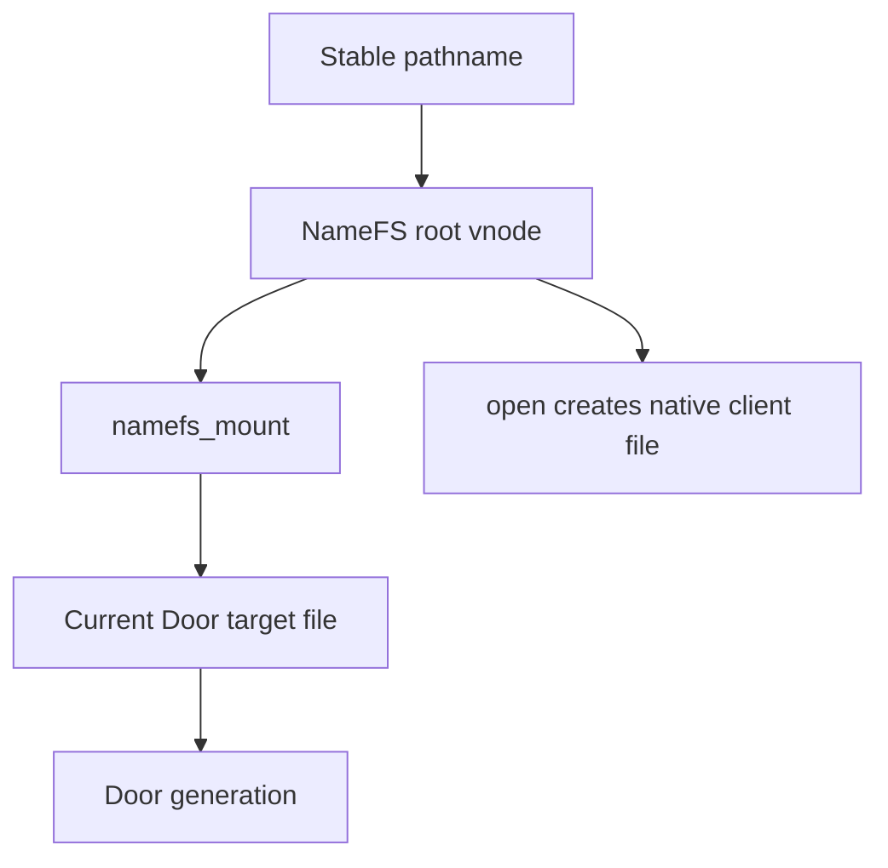

This separation provides:

- stable VFS/namecache identity;
- atomic target replacement;
- generation pinning at open;
- VFS-controlled detach and forced unmount;
- a recovery interval in which the pathname remains mounted but cannot open a
  dead generation;
- normal filesystem permissions derived from the covered file.

<a id="contents-8-2-objects-and-references"></a>

### 8.2. Objects and references

<a id="contents-ch8-struct-namefs-mount"></a>

#### `struct namefs_mount`

```c
struct namefs_mount {
	struct mtx nm_lock;
	struct file *nm_target;
	struct vnode *nm_rootvp;
	struct ucred *nm_attach_cred;
	struct vattr nm_attr;

	LIST_ENTRY(namefs_mount) nm_registry_link;
	char *nm_attach_path;
	bool nm_registry_linked;

	enum namefs_state nm_state;
	u_int nm_internal_vrefs;
	struct namefs_gc *nm_gc;
};
```

| Object | Creator / owner | References | Protecting lock | Final destruction |
|---|---|---|---|---|
| `namefs_mount` | initial NameFS mount; stored in `mp->mnt_data` | VFS mount lifetime, global endpoint registry membership, root vnode `v_data`, optional GC task association | `nm_lock` protects target/state/GC; `namefs_endpoints_lock` protects registry membership; VFS mount locks protect mount lifetime | successful unmount after `vflush()` unregisters it, clears target/GC, releases credentials/path, destroys lock and frees object |

The mount object is the stable publication identity.  Rebind modifies
`nm_target` and `nm_state`; it does not allocate a replacement root vnode.

<a id="contents-ch8-namefs-state"></a>

#### NameFS state

```c
enum namefs_state {
        NAMEFS_LIVE = 0,
        NAMEFS_RECOVERY,
        NAMEFS_UNMOUNTING
};
```

| State | Meaning | `open()` behavior |
|---|---|---|
| `LIVE` | `nm_target` names a live Door file generation | may acquire and clone target |
| `RECOVERY` | old target is orphaned/dead; vnode may be retained for rebind because external references exist | fails with `ENXIO`/`EBADF`; no stale generation is cloned |
| `UNMOUNTING` | mount teardown claimed the object | new opens fail; target and root are being detached |

`RECOVERY` is deliberately not a new Door generation.  It is the absence of a
usable target while preserving the namespace anchor.

<a id="contents-ch8-root-vnode"></a>

#### Root vnode

`namefs_alloc_root()` creates a new vnode with:

```c
vp->v_type = VREG;
vp->v_data = nm;
vp->v_vflag |= VV_ROOT;
insmntque1(vp, mp);
vn_set_state(vp, VSTATE_CONSTRUCTED);
```

| Object | Creator / owner | References | Protecting lock | Final destruction |
|---|---|---|---|---|
| NameFS root vnode | `getnewvnode()` during mount | mount/root internal refs, namecache/path lookup refs, open/O_PATH/external vnode refs | vnode interlock/lock and mount locks; `nm_lock` protects data reached through mount | `vflush()` drives inactive/reclaim; reclaim clears `v_data`; mount object is freed only after root users are drained or forcibly closed |

The vnode is synthetic.  It is not the original placeholder vnode, a DoorFS
vnode, or a NullFS lower vnode.

<a id="contents-ch8-covered-vnode"></a>

#### Covered vnode

`mp->mnt_vnodecovered` is the pre-existing vnode on which the file mount is
placed.  NameFS validates that it exists, locks it long enough to obtain
attributes, and snapshots those attributes in `nm_attr`.

| Object | Creator / owner | References | Protecting lock | Final destruction |
|---|---|---|---|---|
| covered vnode | underlying filesystem; selected by VFS mount lookup | VFS mount infrastructure holds the covered relationship; NameFS does not create a second manual lower-vnode chain | underlying vnode lock plus mount topology locks | owned/reclaimed by underlying FS after the covering mount is removed and ordinary refs drain |

The covered vnode may belong to UFS, tmpfs, NullFS, or another filesystem that
permits the operation.  NameFS does not call its read/write operations after
mount; it uses the attribute snapshot for publication metadata.

<a id="contents-ch8-target-door-file"></a>

#### Target Door file

`nm_target` is a referenced `struct file *`, not a vnode pointer.  It must be a
live Door service/client file accepted by `door_file_is_door()` and
`door_file_is_live()`.

| Object | Creator / owner | References | Protecting lock | Final destruction |
|---|---|---|---|---|
| target Door file | obtained by `fget(doorfd)` during mount/update | one file reference owned by NameFS; each concurrent open temporarily takes another `fhold`; opened client files independently hold the Door object | `nm_lock` protects pointer replacement and state; file ref protects `f_data`; Door `d_lock` protects endpoint liveness | old target `fdrop()` after atomic swap or unmount; underlying file is freed by normal file refcount when all users release it |

Holding the file pins the exact Door generation through its `f_data` Door
reference.  The fd integer is used only for initial lookup.

<a id="contents-ch8-door-vnode-versus-door-file"></a>

#### Door vnode versus Door file

The current design intentionally has no persistent “Door vnode” below NameFS.
DoorFS endpoints are native `struct file` capabilities.  NameFS provides the
vnode required for namespace lookup and replaces the file allocated by
`openatfp()` with Door fileops during `VOP_OPEN`.

This distinction avoids inventing a lower Door vnode whose lifetime and mount
ownership would have to be synchronized with both DoorFS and NameFS.

<a id="contents-ch8-gc-object"></a>

#### GC object

```c
struct namefs_gc {
	struct timeout_task ng_task;
	struct mount *ng_mp;
	bool ng_queued;
	u_int ng_probe_budget;
};
```

| Object | Creator / owner | References | Protecting lock | Final destruction |
|---|---|---|---|---|
| `namefs_gc` | initial mount | associated with `nm`; queued task takes a VFS mount ref in `ng_mp`; global object count supports drain and lifetime assertions | `nm_lock` protects association/queued/budget; taskqueue owns execution | freed after successful automatic unmount, ordinary unmount when not queued, or detached terminal task completion |

The task does not hold a raw unprotected `namefs_mount *`.  It holds the mount,
then resolves `mp->mnt_data` when it runs.

<a id="contents-ch8-internal-and-external-vnode-references"></a>

#### Internal and external vnode references

After constructing the root, NameFS records:

```c
nm->nm_internal_vrefs = vrefcnt(nm->nm_rootvp);
```

Later it computes:

```c
external = max(vrefcnt(root) - nm_internal_vrefs, 0);
```

Internal refs are the baseline owned by the mount/vnode machinery.  External
refs come from clients such as `O_PATH`, lookup users, or other VFS activity.

The distinction decides recovery behavior:

- orphaned target and no external refs: automatic unmount may proceed;
- orphaned target with external refs: retain mount/root in `RECOVERY` so a
  replacement can rebind safely.

This is why an `O_PATH` anchor can deliberately preserve the vnode identity
across owner exit.

<a id="contents-ch8-generation-and-recovery-metadata"></a>

#### Generation and recovery metadata

NameFS does not duplicate Door's uniquifier in `namefs_mount`.  The held target
file itself pins the generation.  Recovery metadata consists of:

- `nm_state`;
- whether `nm_target` is live/orphaned;
- stable `nm_rootvp`;
- attachment path and credentials;
- external vnode ref count;
- GC probe budget and mount reference.

When a new target is installed, its Door uniquifier becomes the generation
returned by future opens.  Old opened fds still hold the former Door object.

<a id="contents-ch8-file-mount-ownership"></a>

#### File-mount ownership

NameFS is registered with:

```c
VFS_SET(namefs_vfsops, namefs, VFCF_FILEMOUNT);
```

It mounts on one covered file vnode rather than covering a directory tree.
The VFS mount owns the replacement relationship at that pathname; pathname
mutation of the covered mount point is rejected as busy until detach.

<a id="contents-8-3-mount-and-validation-protocol"></a>

### 8.3. Mount and validation protocol

<a id="contents-ch8-public-fattach-path"></a>

#### Public `fattach()` path

`libdoor` implements `fattach(fd, path)` by building an `nmount(2)` iovec:

```c
fstype = "namefs"
fspath = path
doorfd = fd
```

The user-facing argument is a path.  The actual FreeBSD VFS option is named
`fspath`, not `path`.  `doorfd` is binary `int` data, not a decimal string.

If the initial mount returns `EBUSY`, `fattach()` retries with `MNT_UPDATE`.
That is the rebind path for an existing NameFS publication.

<a id="contents-ch8-option-validation"></a>

#### Option validation

NameFS verifies:

- `doorfd` option exists and has exactly `sizeof(int)` bytes;
- fd is nonnegative;
- `fspath` exists, is nonempty and NUL-terminated within its option length;
- `fget()` succeeds;
- the file is an actual Door file with recognized fileops;
- the Door generation is live;
- initial mount has a non-null covered vnode.

Unknown/malformed values fail before mount state is published.

<a id="contents-ch8-target-acquisition"></a>

#### Target acquisition

`fget()` converts the process-local fd number into a referenced target file.
From that point the mount owns a kernel file reference.  Closing the original
server fd does not invalidate the target merely because the integer is gone;
Door owner/orphan/revoke policy still determines service liveness.

<a id="contents-ch8-initial-mount-sequence"></a>

#### Initial mount sequence

```text
parse doorfd and fspath
→ fget target file
→ validate Door type and liveness
→ acquire covered vnode attributes
→ allocate namefs_mount, lock, credential, path and GC
→ set mp->mnt_data
→ allocate/construct synthetic root vnode
→ register mount in NameFS endpoint list
→ assign fsid and mounted-from name
→ snapshot internal vnode references
→ return success
```

The mount becomes globally discoverable only after its root vnode is fully
constructed.

<a id="contents-ch8-rebind-with-mnt-update"></a>

#### Rebind with `MNT_UPDATE`

Update does not recreate the mount:

```c
mtx_lock(&nm->nm_lock);
old = nm->nm_target;
nm->nm_target = target;
nm->nm_state = NAMEFS_LIVE;
nm->nm_gc->ng_probe_budget = 0;
mtx_unlock(&nm->nm_lock);

if (old != NULL)
        fdrop(old, curthread);
```

The new target was validated and referenced before the lock.  The swap is
atomic to `open()`.  The old file is dropped outside `nm_lock` because final
file/door destruction may acquire other locks or sleep.

<a id="contents-ch8-anonymous-mount-rejection"></a>

#### Anonymous-mount rejection

NameFS is a file mount and requires `mp->mnt_vnodecovered`.  A request without
a real covered pathname returns `EINVAL`.  There is no anonymous root
namespace whose vnode could serve as the stable service identity.

This is stricter than simply requiring `fspath` text: the VFS must have
resolved the path and installed the covered-vnode relationship.

<a id="contents-ch8-vfcf-filemount-behavior"></a>

#### `VFCF_FILEMOUNT` behavior

The VFS treats the mount as covering one vnode.  Consequences include:

- the mounted path itself resolves to the NameFS root;
- unlink/rename of the active mount point is rejected as busy;
- `statfs(path)` reports `namefs`;
- unmount can address the mount by fsid even if pathname traversal is
  complicated by stacking;
- no child lookup implementation is required;
- the root vnode presents regular-file attributes.

<a id="contents-ch8-attribute-publication"></a>

#### Attribute publication

NameFS snapshots the covered vnode's `vattr` during the initial mount.
`VOP_GETATTR` returns this snapshot with `VREG` and the NameFS fsid.
`VOP_ACCESS` applies `vaccess()` using the snapshotted mode, uid and gid.

This retains the administrator-controlled permissions of the placeholder
without forwarding each access to a potentially changing lower vnode chain.

<a id="contents-ch8-error-rollback"></a>

#### Error rollback

| Failure point | Rollback |
|---|---|
| malformed option | return without acquiring objects |
| `fget()`/type/liveness failure | drop target if acquired |
| covered vnode getattr failure | free path, drop target |
| mount allocation setup failure | release credential/path/target/GC and destroy lock |
| root vnode construction failure | clear `mnt_data`, release every allocated object |
| rebind validation failure | retain old target and state unchanged |
| unmount `vflush()` failure | restore previous state if this caller claimed unmount |

No failure may leave `mp->mnt_data` pointing to freed storage or register a
mount whose root vnode was not constructed.

<a id="contents-8-4-vfs-and-vnode-lifecycle"></a>

### 8.4. VFS and vnode lifecycle

<a id="contents-ch8-lookup"></a>

#### Lookup

The parent filesystem and mount traversal resolve the covered path to the
NameFS mount root.  Since it is a one-vnode file mount, NameFS has no directory
children and no custom component lookup operation.

The namecache caches ordinary pathname-to-vnode relationships and mount
crossing.  It never caches a Door generation separately.  Generation
selection occurs later under `nm_lock` during `VOP_OPEN`.

<a id="contents-ch8-open-and-file-replacement"></a>

#### Open and file replacement

The key operation is:

```c
mtx_lock(&nm->nm_lock);
if (nm->nm_state != NAMEFS_LIVE || nm->nm_target == NULL)
        fail;
target = nm->nm_target;
if (!fhold(target))
        fail;
mtx_unlock(&nm->nm_lock);

error = door_file_clone(target, ap->a_fp, ap->a_mode, ap->a_cred);
fdrop(target, curthread);
return (error == 0 ? ENXIO : error);
```

The `ENXIO` success sentinel is part of the FreeBSD `openatfp()` replacement
contract used here: `door_file_clone()` has replaced the newly allocated
file's operations/data with a native Door client file, so the VFS must not
continue treating it as a vnode file.

`door_file_clone()` performs the Door jail check, increments logical client
open accounting, holds the exact Door generation and installs Door fileops.

<a id="contents-ch8-atomic-generation-selection"></a>

#### Atomic generation selection

`open()` holds `nm_lock` only long enough to check state and `fhold()` the
target.  Rebind holds the same lock while swapping the pointer.  Therefore an
open obtains either:

- a held old target before the swap; or
- a held new target after the swap.

It never observes a freed pointer or a half-installed generation.

<a id="contents-ch8-existing-descriptors-before-replacement"></a>

#### Existing descriptors before replacement

Once cloned, the fd owns a Door client file and no longer refers to the NameFS
vnode or `nm_target`.  Rebind, detach, NameFS unmount, NullFS unmount, or
namecache eviction cannot retarget that descriptor.

If the old Door is still live, it continues serving the fd.  If its owner
exited or it was revoked, calls fail according to DoorFS state.  They never
cross into the replacement generation.

<a id="contents-ch8-vnode-identity-and-replacement"></a>

#### Vnode identity and replacement

Rebind changes the target file, not `nm_rootvp`.  The same vnode remains root
of the same mount and continues to be the object referenced by `O_PATH`,
namecache entries, and VFS users.

This is what makes the pathname a service identity rather than a direct alias
of one Door object.

<a id="contents-ch8-inactive"></a>

#### `inactive`

When the root vnode becomes inactive, NameFS schedules a zero-budget GC check:

```c
if (nm != NULL)
        namefs_gc_kick(nm, 0);
```

It does not free `v_data` or unmount synchronously from `VOP_INACTIVE`, because
that context may hold vnode/VFS locks incompatible with `dounmount()`.

<a id="contents-ch8-reclaim"></a>

#### `reclaim`

`VOP_RECLAIM` only clears:

```c
ap->a_vp->v_data = NULL;
```

Mount teardown owns the `namefs_mount` allocation.  Reclaim must not free it
independently while `mp->mnt_data`, registry or GC task still references it.

<a id="contents-ch8-ordinary-unmount"></a>

#### Ordinary unmount

`fdetach(path)` verifies `statfs(path)` reports NameFS, formats the mount fsid,
and calls `unmount(..., MNT_BYFSID)`.  Addressing by fsid avoids accidentally
unmounting a different covering filesystem selected by a changed path walk.

The VFS unmount path:

1. claims `UNMOUNTING` under `nm_lock`;
2. calls `vflush(mp, 1, 0, ...)`;
3. restores the prior state if busy;
4. unregisters the mount after successful flush;
5. detaches target and GC under `nm_lock`;
6. clears `mp->mnt_data`;
7. drops target/credential/path and frees mount state.

<a id="contents-ch8-forced-unmount"></a>

#### Forced unmount

With `MNT_FORCE`, `vflush()` receives `FORCECLOSE`.  Forced unmount removes the
NameFS namespace publication even when vnode users would block an ordinary
unmount.

Already opened native Door client fds are not vnode files and retain their Door
generation references.  Force therefore removes discovery; it does not
rewrite or forcibly close unrelated process capabilities.

<a id="contents-ch8-reference-accounting-and-use-after-free-prevention"></a>

#### Reference accounting and use-after-free prevention

The safety chain is:

- `mp->mnt_data` points to `nm` while mount is live;
- root `v_data` points to `nm` until reclaim;
- endpoint registry membership is removed before freeing `nm`;
- queued GC holds `vfs_ref(mp)`, not a bare mount-private pointer;
- `nm_target` is swapped under `nm_lock` and held before unlock;
- old target is dropped outside the lock;
- `vflush()` drains root vnode users before mount state free;
- queued GC work retains a VFS reference until detached task storage is drained.

Violating any one of these rules creates a possible vnode, file, mount or task
use-after-free.

<a id="contents-ch8-interaction-with-the-namecache"></a>

#### Interaction with the namecache

Rebind does not require invalidating the pathname's cached vnode because the
vnode identity is intentionally unchanged.  The generation is not embedded in
the namecache entry.

Detach/unmount uses normal VFS mount crossing and cache invalidation rules.
Recreating a lower placeholder after detach creates ordinary underlying-FS
namespace behavior; it does not resurrect the old NameFS target.

<a id="contents-8-5-interaction-with-nullfs"></a>

### 8.5. Interaction with NullFS

<a id="contents-ch8-nullfs-over-namefs"></a>

#### NullFS over NameFS

Topology:

```text
source directory
└── placeholder covered by NameFS file mount

nullfs(source directory) → target directory
```

FreeBSD NullFS mirrors the lower directory/vnode namespace; it does not
recursively propagate subordinate mounts located inside that lower tree.  As a
result, opening `target/door` through the NullFS view reaches the underlying
placeholder vnode, not the hidden NameFS file mount.  It produces an ordinary
file and a Door call fails with `ENOTTY`.

The direct source path still crosses into NameFS and returns a Door client fd.
An already opened direct Door fd continues working after the upper NullFS mount
is unmounted.

This behavior is intentional and tested.  NameFS must not attempt to pierce
NullFS and discover hidden child mounts manually; doing so would violate VFS
mount namespace semantics.

<a id="contents-ch8-namefs-over-nullfs"></a>

#### NameFS over NullFS

Topology:

```text
source directory
→ nullfs target directory
   └── visible placeholder covered by NameFS
```

Here `fattach()` resolves the visible path through NullFS first.  The covered
vnode is therefore the NullFS upper vnode, and NameFS creates its synthetic
root above it.  Opens cross into NameFS normally and return Door capabilities.

`fdetach()` through the visible path removes NameFS, after which NullFS can be
unmounted.  NameFS does not retain an extra ad-hoc lower-vnode pointer that
would keep the NullFS stack busy after detach.

<a id="contents-ch8-covered-filesystem-unmount-notification"></a>

#### Covered-filesystem unmount notification

NameFS registers the global `vfs_unmounted` event.  When any filesystem,
including a relevant NullFS layer, is unmounted, the handler schedules a GC
check for registered NameFS mounts.

The handler does not synchronously tear them all down and does not assume the
event's mount is necessarily their covered FS.  Each task rechecks target
orphaning, state and external root refs under its own locks.  This conservative
design avoids dereferencing a lower vnode during an unrelated VFS teardown.

<a id="contents-8-6-doorctl-identities-and-operations"></a>

### 8.6. DoorCTL identities and operations

<a id="contents-ch8-two-discovery-mechanisms"></a>

#### Two discovery mechanisms

DoorCTL and NameFS solve related but distinct problems:

| Property | DoorCTL | NameFS |
|---|---|---|
| public identity | logical name in kernel registry | filesystem pathname/vnode/mount |
| acquisition | `door_named_connect()` installs client fd | `open()` clones target into client fd |
| scope | jail-local or global registry | VFS namespace plus Door jail check |
| replacement | registry entry swaps generation | `MNT_UPDATE` swaps target file |
| dead identity | retained DEAD entry with grace period | RECOVERY mount/vnode while externally referenced |
| detachment | unregister | unmount/fdetach |

Neither requires the other.  A service may use one, both, or direct fd
transfer.

<a id="contents-ch8-register"></a>

#### Register

DoorCTL validates the logical name, scope, credentials and live Door file,
then stores a reference to the exact generation and its uniquifier.  If the
same service identity is DEAD or replacement is allowed, the new generation is
installed atomically under `door_named_lock`.

Registering does not automatically mount NameFS.  A service using both must
publish each explicitly and handle rollback if the second publication fails.

<a id="contents-ch8-connect"></a>

#### Connect

Connect holds the current LIVE Door generation under the registry lock and
installs a native Door client file.  Like NameFS open, the returned descriptor
is independent of later registry replacement.

<a id="contents-ch8-unregister"></a>

#### Unregister

Unregister removes or transitions future logical discovery.  It drops the
registry's Door publication reference but does not close descriptors already
returned by connect or NameFS open.

<a id="contents-ch8-generation-replacement"></a>

#### Generation replacement

The stable DoorCTL name remains the same while `dne_uniquifier` and
`dne_door` change to the replacement generation.  NameFS similarly retains
its vnode while `nm_target` changes.

If both are used, service code should make the replacement visible in an
order consistent with its availability policy.  There is no single kernel
transaction spanning the DoorCTL registry and VFS mount update.

<a id="contents-ch8-recovery-and-rebind"></a>

#### Recovery and rebind

On revoke, DoorFS calls `doorctl_generation_revoked()`.  Matching LIVE entries
become DEAD and drop their Door references.  NameFS independently rejects
opening its dead target and may enter RECOVERY.

Replacement then performs:

```text
create new Door
→ ready worker pool
→ register/re-register DoorCTL name
→ rebind NameFS path with MNT_UPDATE
→ retire old publication metadata
```

If atomic visibility across both names is required, the service manager must
choose an order and expose readiness/version metadata to clients.

<a id="contents-ch8-atomicity-boundary"></a>

#### Atomicity boundary

Each subsystem provides atomic generation selection within itself:

- one DoorCTL connect sees one registry generation;
- one NameFS open sees one `nm_target` generation.

The kernel does not promise that simultaneous DoorCTL connect and NameFS open
during replacement choose the same generation unless userspace coordinates
the two publication operations.

<a id="contents-8-7-recovery-rebind-and-generation-replacement"></a>

### 8.7. Recovery, rebind, and generation replacement

<a id="contents-ch8-combined-service-lifecycle"></a>

#### Combined service lifecycle

The conceptual sequence across DoorFS, DoorCTL and NameFS is:

```text
LIVE Door generation
→ owner exit or revoke
→ DoorCTL identity becomes DEAD
→ NameFS target becomes unusable / RECOVERY
→ replacement server creates a new Door
→ MNT_UPDATE REBIND
→ NameFS LIVE with replacement generation
```

NameFS itself does not store the DoorCTL `DEAD` entry.  DoorCTL and NameFS are
independent discovery systems that observe the same Door generation death.

<a id="contents-ch8-detecting-an-orphaned-target"></a>

#### Detecting an orphaned target

GC checks the held target file's reference count:

```c
refs = atomic_load_acq_int(&fp->f_count);
orphaned = refs <= 1;
```

The single remaining ref is NameFS itself.  Process-exit events schedule a few
delayed probes because descriptor teardown may complete shortly after the
event.  Once orphaned:

- LIVE becomes RECOVERY;
- if no external root vnode refs exist, GC attempts ordinary unmount;
- if external refs exist, the stable vnode remains available for rebind.

Door liveness is also checked directly on mount/update/open, so reference
count is not used as an authorization decision.

<a id="contents-ch8-why-preserve-the-existing-vnode"></a>

#### Why preserve the existing vnode

An `O_PATH` reference, namecache entry, monitoring handle or service manager
may already refer to `nm_rootvp`.  Destroying it and mounting a new vnode would
make the service identity dependent on a race between final vnode release and
replacement attach.

Preserving it allows:

- the same mount/fsid and vnode to survive the recovery window;
- atomic target replacement under `nm_lock`;
- existing namespace anchors to remain valid;
- future opens to acquire the new generation;
- old native Door fds to remain isolated on the old generation.

<a id="contents-ch8-why-no-arbitrary-upper-lower-vnode-chain"></a>

#### Why no arbitrary upper/lower vnode chain

An earlier design direction could have represented every replacement as a new
upper vnode linked to an old/lower vnode.  This is rejected because:

- VFS may unmount or reclaim a lower layer independently;
- every generation adds another reference and lock-order relationship;
- lookup/reclaim would have to traverse stale endpoint generations;
- a forced unmount could bypass assumptions about lower/upper continuity;
- it duplicates stackable-filesystem machinery for an object that is already
  represented safely by a held `struct file`;
- chain traversal increases generation-confusion and use-after-free risk.

NameFS uses one stable synthetic vnode and one replaceable held file.  NullFS
continues to own its legitimate upper/lower vnode relation separately.

<a id="contents-ch8-installing-a-replacement"></a>

#### Installing a replacement

The replacement server:

1. creates and readies a new Door;
2. calls `fattach(newfd, same_path)`;
3. initial mount receives `EBUSY` because NameFS already covers the file;
4. `libdoor` retries `nmount()` with `MNT_UPDATE`;
5. NameFS validates/holds the new Door file;
6. under `nm_lock`, swaps `nm_target`, sets `LIVE`, and cancels probe budget;
7. drops the old target after unlocking.

The root vnode and mount do not change.

<a id="contents-ch8-old-capabilities"></a>

#### Old capabilities

Capabilities opened before replacement hold the old Door directly.  They:

- never call the replacement service;
- continue if the old generation remains live;
- fail with the old generation's revoke/owner-death result otherwise;
- retain old SHM and call-generation identity;
- cannot be upgraded by re-opening metadata through the old fd.

<a id="contents-ch8-new-connections"></a>

#### New connections

An open racing with rebind holds either the old or new target under `nm_lock`.
Every open after the completed swap clones the new target and therefore the
new `d_uniquifier`.

<a id="contents-ch8-generation-confusion-prevention"></a>

#### Generation-confusion prevention

The design prevents confusion through:

- target `struct file` references rather than numeric fd reuse;
- immutable Door object identity/uniquifier;
- atomic target swap;
- no mutation of existing client file `f_data`;
- SHM handles qualified by Door uniquifier;
- DoorCTL entry recording its generation separately;
- dead targets rejected at open and update;
- old target ref dropped only after concurrent opens have taken their holds.

<a id="contents-8-8-client-reconnection"></a>

### 8.8. Client reconnection

A client reconnects by acquiring a new capability; it never retargets an old
file descriptor.  DoorCTL and NameFS select a generation atomically within
their own discovery domains, then return a Door fd pinned to that generation.
The client must retain the returned uniquifier whenever later resources, such
as persistent SHM, are generation-qualified.

Connect and retain identity together:

```c
static int
connect_generation(const char *name, int *fdp, uint64_t *uniqp)
{
        door_named_info_t info;
        int fd;

        fd = door_named_connect(name, 0, &info);
        if (fd == -1)
                return (-1);
        *fdp = fd;
        *uniqp = info.dni_uniquifier;
        return (0);
}
```

Use installed `door.h` as authoritative for exact field names/layout. The
important sequence is:

```text
connect A
→ allocate/attach A resources
→ issue operation with application request id
→ success: commit local state
→ definite pre-execution failure: reconnect B and retry if policy permits
→ uncertain completion: query/deduplicate by request id
→ never transfer A SHM references to B
```

`EBADF`, `ECONNRESET` and `EINTR` have different completion implications.
Use the completion rules in Chapter 10; do not retry every error blindly.

<a id="contents-ch8-oneway-recovery"></a>

#### ONEWAY recovery

ONEWAY success is kernel submission, not callback completion. Unregistering,
revoking A or publishing B does not prove all A callbacks are done. Wait for an
application acknowledgement/consume event before reusing buffers, mappings,
ring slots or generation state.

<a id="contents-ch8-descriptor-move-recovery"></a>

#### Descriptor MOVE recovery

Kernel MOVE is transactional, but process/connection loss can still make
application-level remote completion uncertain. Use operation ids and
server-side deduplication for non-idempotent work; do not guess from fd numbers.

<a id="contents-ch8-error-oriented-recovery-table"></a>

#### Error-oriented recovery table

| Observation | Meaning | Recovery action |
|---|---|---|
| connect returns `ENOENT` | No visible live name in caller's scope | Follow supervisor/backoff policy |
| old call returns `EBADF` | Old capability/generation is revoked/stale | Reconnect explicitly; old fd stays old |
| active call returns `ECONNRESET` | Assigned worker disappeared | Establish commit/idempotence before retry |
| call returns `EINTR` | Interruptible wait ended under ABI rules | Apply documented retry policy |
| SHM operation returns `EXDEV` | Generation/region mismatch | Allocate/attach in new generation |
| `open(path)` fails during recovery | No permitted live target currently published | Retry discovery, never bypass VFS/jail checks |
| `fdetach()` succeeds | Future lookup no longer uses publication | Existing fds may remain; revoke/drain separately |
| unregister succeeds | Future logical lookup removed | Connected fds remain capabilities |

<a id="contents-ch8-reconnection-anti-patterns"></a>

#### Reconnection anti-patterns

Do not:

- retarget an old fd to a replacement Door;
- equate numeric SHM ids across generations;
- blindly retry MOVE or non-idempotent calls;
- use `usleep()` as proof of exit, callback completion or rebind;
- treat ONEWAY submission as permission to unmap SHM;
- equate unregister, detach, close and revoke;
- create arbitrary NameFS vnode chains;
- bypass kernel generation/Capsicum/prison checks in userspace;
- assume SIGKILL has already reached `door_process_exit()`.


<a id="chapter-9"></a>

<a id="contents-chapter-9-libdoor-architecture"></a>

## Chapter 9. libdoor architecture

This chapter describes the user-space half of the FreeBSD Doors subsystem.
It is an implementation guide for maintainers of `libdoor.so.1`, not a
replacement for the public manual pages or the kernel ABI definitions in
`<sys/door_core.h>`.

The most important boundary is this:

> `libdoor` provides compatibility, process-local dispatch state, worker
> management, and checked convenience APIs. It is not a security boundary.
> The kernel must independently validate every fd, pointer, size, flag,
> capability right, credential request, generation identity, and state
> transition.

<a id="contents-9-1-library-role-and-trust-boundary"></a>

### 9.1. Library role and trust boundary

`libdoor` has six related roles:

1. It presents a source-compatible Solaris/illumos-style Doors API through
   `<door.h>` and the `LIBDOOR_1.0` symbol version.
2. It converts public structures such as `door_arg_t`, `door_desc_t`, and
   `door_info_t` into the fixed-width FreeBSD kernel ABI structures from
   `<sys/door_core.h>`.
3. It owns the process-local association between a Door created by this
   process and its callback, cookie, attributes, and worker-pool policy.
4. It creates workers, binds them to the kernel endpoint, dispatches callbacks,
   and implements the fused reply-and-wait server loop.
5. It exposes FreeBSD extensions for ONEWAY calls, persistent shared memory,
   checked shared rings, DoorCTL names and generations, and NameFS attach.
6. It centralizes compatibility behavior, allocation, conversion, and rollback
   so ordinary applications do not need to construct raw kernel ABI blocks.

The split of responsibility is deliberate:

| Concern | `libdoor` responsibility | Kernel responsibility |
|---|---|---|
| Callback dispatch | Locate a process-local `door_entry` and call its function pointer | Never execute or trust a user callback pointer |
| Arguments | Check obvious shape errors and construct ABI blocks | Validate all user addresses, ranges, flags, versions, overflow, rights, and object state |
| Descriptors | Convert public metadata and close installed fds on late library failure | Hold references, enforce Capsicum rights, install atomically, and implement transactional MOVE |
| Workers | Create threads and maintain user-space pool accounting | Bind a thread, assign calls, cancel/revoke waits, and own call state |
| Names | Issue checked DoorCTL requests | Enforce prison scope, ownership, generation, and publication rules |
| SHM | Map handles and provide checked convenience wrappers | Authorize regions, pin generation identity, validate ranges, and retain active-call references |

Consequently, bypassing `libdoor` does not bypass policy. A program may invoke
the raw `door(2)` syscall, but it receives the same kernel validation and must
obey the same ABI state machine. Conversely, successful library validation is
never sufficient reason for the kernel to trust an operation.

<a id="contents-9-2-public-library-abi"></a>

### 9.2. Public library ABI

<a id="contents-ch9-shared-library-and-symbol-abi"></a>

#### Shared-library and symbol ABI

The build declares `SHLIB_MAJOR=1`, producing SONAME `libdoor.so.1`.
`Symbol.map` exports the API under `LIBDOOR_1.0` and makes every unlisted symbol
local. Internal names beginning with `__door_` are therefore not an application
ABI even when shared by multiple library translation units.

The exported set is:

```text
door_create door_revoke door_info door_call door_oneway door_return
door_cred door_ucred door_bind door_unbind door_getparam door_setparam
door_server_create door_xcreate
door_shm_create door_shm_attach door_shm_unmap door_shm_destroy
door_call_shm door_call_shm_region door_shm_ref_init door_shm_destroy_handle
door_shm_ring_create door_shm_ring_attach door_shm_ring_reserve
door_shm_ring_commit door_shm_ring_abort door_shm_ring_push
door_shm_ring_acquire door_shm_ring_consume door_shm_ring_pop
door_shm_ring_unmap
door_named_register door_named_unregister door_named_lookup door_named_connect
fattach fdetach
```

The linker uses `-z nodelete`. This prevents unloading the DSO while detached
workers, pthread TLS destructors, atfork handlers, or application-held function
pointers may still enter its text.

<a id="contents-ch9-layout-rules"></a>

#### Layout rules

`door_desc_t` and `door_info_t` are explicitly packed to four-byte alignment.
That packing is part of ABI 1. Public identity and pointer-like fields use
fixed-width integer types:

| Type | Width and meaning |
|---|---|
| `door_ptr_t` | 64-bit process-local pointer representation; convert only when `DOOR_LOCAL` is present |
| `door_id_t` | 64-bit Door generation/object identity |
| `door_attr_t` | 32-bit attribute mask |
| `door_shm_id_t` | 64-bit region identity within a Door generation |

Native pointers in `door_arg_t`, `door_shm_t`, ring writers, and ring views are
process-local convenience fields. They are never valid wire identities. Kernel
ABI blocks use explicit `uint64_t` addresses and version fields so validation
does not depend on compiler pointer packing.

Reserved public fields (`di_resv`, `dc_resv`, `dsh_resv`, `dsr_resv`, and
future equivalents) must be zero when documented as input and ignored when
documented as output. Applications must not assign semantics to them.

<a id="contents-ch9-compatibility-policy"></a>

#### Compatibility policy

ABI-compatible evolution may add new functions to a new symbol version, define
new flag bits with explicit opt-in, or use previously reserved output fields
after version negotiation. It must not change:

- size, alignment, packing, or existing-field offsets;
- the meaning of an existing flag or errno;
- ownership of returned arrays, descriptors, mappings, or TLS pointers;
- the distinction between process-local pointer values and kernel identities;
- success semantics of synchronous versus ONEWAY calls.

An incompatible structure change requires a new structure version and kernel
ABI negotiation; an incompatible exported C ABI requires a new symbol version
and, when old callers cannot coexist, a new shared-library major.

<a id="contents-9-3-source-file-map"></a>

### 9.3. Source-file map

<a id="contents-ch9-overview"></a>

#### Overview

| File | Primary responsibility |
|---|---|
| `door_create.c` | Endpoint creation, registry construction, and initial worker readiness |
| `door_call.c` | Synchronous CALL, scalar fast-call selection, reply conversion, and late-failure cleanup |
| `door_server.c` | Worker pools, binding, callback dispatch, fused `door_return()`, depletion, and `door_xcreate()` |
| `door_registry.c` | Process-local endpoint registry, worker TLS, TLS destruction, and fork repair |
| `door_misc.c` | Revoke, info, credentials, bind/unbind, and endpoint parameters |
| `door_desc.c` | Public/kernel descriptor conversion and safe validation |
| `door_shm.c` | Persistent SHM lifecycle, strong handles, and SHM calls |
| `door_shm_view.c` | Page-composite publication, attach, query, release, close, and destroy |
| `door_async.c` | Native async, ONEWAY framing, pending accounting, and completion drain |
| `door_async_server.c` | Authenticated ONEWAY session routing and response helpers |
| `door_shm_ring.c` | Checked lock-free SPSC protocol over persistent SHM |
| `door_named.c` | DoorCTL register, unregister, lookup, and connect |
| `door_oneway.c` | Compact data-only ONEWAY submission |
| `door_safe.c` | Fault-contained copy of public descriptor arrays |
| `door_iov.c` | Owned `nmount(2)` iovec construction and cleanup |
| `door_attach.c` | NameFS attach, replacement mount, and detach |
| `libdoor_impl.h` | Internal objects, TLS, syscall wrapper, limits, and cross-file contracts |

The following per-file descriptions use “locks” to include process-local
mutexes, condition variables, TLS isolation, and atomic ordering. Kernel locks
are outside the library and are described in the kernel architecture documents.

<a id="contents-ch9-door-create-c"></a>

#### `door_create.c`

- **Public entry point:** `door_create()`.
- **Internal entry points:** `__door_create_common()` and
  `__door_entry_pool_destroy()`; the private `door_create_kernel()` wrapper.
- **Kernel selectors:** `DOOR_SC_CREATE`; failure cleanup reaches
  `DOOR_SC_REVOKE` through `door_revoke()`.
- **Synchronization:** initializes `de_pool_lock` and `de_pool_cv` and waits on
  the condition variable until the first worker has bound successfully or
  published a startup error.
- **Ownership:** the kernel returns the public fd; the library allocates a
  `door_entry`, inserts it into the registry, and starts one managed worker.
  The entry owns its pool lock/CV and process-local callback metadata.
- **Rollback:** invalid attributes fail before the syscall. Allocation or lock
  initialization failure closes the new fd. Worker startup failure revokes and
  closes the endpoint while preserving the original error.
- **Why readiness is synchronous:** `pthread_create()` alone does not prove
  that buffers were allocated or `DOOR_SC_BIND` succeeded. Publishing the fd
  earlier permits a caller to queue work to an endpoint with no viable worker.
- **Related tests:** `api`, `basic`, `attributes`, `legacy_pool`,
  `pool_lifecycle`, `fault_injection`, `worker_hardening`, and `xcreate`.

<a id="contents-ch9-door-call-c"></a>

#### `door_call.c`

- **Public entry point:** `door_call()`.
- **Internal entry points:** private `door_call_kernel()` and
  `door_fast_call_kernel()`.
- **Kernel selectors:** `DOOR_SC_CALL`, `DOOR_SC_FAST_CALL`, and
  `DOOR_SC_EMPTY_CALL`.
- **Synchronization:** no library-global lock; every invocation uses stack or
  call-owned temporary storage. Synchronization with the server is entirely a
  kernel call-state operation.
- **Ownership:** the caller retains request and receive buffers. The library
  owns temporary kernel descriptor arrays. On success it allocates the public
  reply descriptor array, which becomes caller-owned. Installed fds in that
  array are also caller-owned.
- **Fast-path condition:** there are no outgoing descriptors, the ABI can
  preserve a 64-bit packed return, and the receive descriptor capacity is the
  scalar fast capacity. Empty request data selects `EMPTY_CALL`; otherwise
  `FAST_CALL` is used. All descriptor sends use generic `CALL`.
- **Rollback:** visible `door_arg_t` result fields are updated only after the
  kernel operation and conversion succeed. If allocation fails after the
  kernel installed reply descriptors, every installed fd is closed before
  returning `ENOMEM`. Temporary arrays are freed on all paths.
- **Related tests:** `basic`, `api`, `mixed_payload`, `huge_payload`,
  `descriptor*`, `signals`, `cancellation`, `recursive`, `capsicum`, and
  `resource_limits`.

<a id="contents-ch9-door-server-c"></a>

#### `door_server.c`

- **Public entry points:** `door_return()`, `door_server_create()`, and
  `door_xcreate()`.
- **Internal entry points:** `__door_server_main()`, `__door_spawn_server()`,
  `__door_launch_managed_worker()`, `__door_notify_factory()`, and
  `__door_xcreate_launch()`, plus private pool and receive-buffer helpers.
- **Kernel selectors:** `DOOR_SC_BIND`, `DOOR_SC_RETURN`,
  `DOOR_SC_FAST_RETURN`, `DOOR_SC_EMPTY_RETURN`, `DOOR_SC_UNBIND`, and
  `DOOR_SC_WORKER_EXIT`.
- **Synchronization:** `de_pool_lock` protects worker counts, readiness,
  depletion state, stopping, and startup errors; `de_pool_cv` publishes every
  material pool transition. `__door_lock` protects the legacy factory pointer.
  Per-worker call state and buffers live in `door_tls`.
- **Ownership:** managed workers are detached. A launch context owns a duplicate
  endpoint fd until the new thread binds; the worker closes that duplicate
  immediately after a successful bind. TLS owns receive buffers and staged
  request metadata until worker exit.
- **Rollback:** every allocation, bind, and factory failure reverses the
  `de_workers_starting` count, closes the duplicate fd, frees the context, and
  signals waiters. Receive buffers grow geometrically; failures do not claim a
  request was delivered. Expected revoke errors terminate quietly; recoverable
  wait errors rebind or re-wait.
- **Related tests:** `basic`, `legacy_pool`, `depletion`, `xcreate`,
  `pool_lifecycle`, `worker_hardening`, `signals`, `cancellation`,
  `lifetime_extended`, `recursive`, `concurrency_stress`, and `final_stress`.

<a id="contents-ch9-door-registry-c"></a>

#### `door_registry.c`

- **Public entry points:** none.
- **Internal entry points:** `__door_tls_get()`, `__door_entry_lookup()`,
  `__door_entry_add()`, `__door_entry_begin_revoke()`, and
  `__door_entry_finish_revoke()`.
- **Kernel selectors:** TLS cleanup uses `DOOR_SC_UNBIND` or
  `DOOR_SC_WORKER_EXIT` when cleanup belongs to the same process.
- **Synchronization:** `__door_lock` protects the registry and process-wide
  factory pointer. A `pthread_once` creates the TLS key and installs
  `pthread_atfork` handlers. Registry-to-pool ordering is `__door_lock` then
  `de_pool_lock`.
- **Ownership:** the registry contains process-local `door_entry` objects. A
  pthread TLS key owns each allocated `door_tls`; its destructor releases a
  live binding and transport fd.
- **Fork rules and rollback:** prepare locks the registry so the child cannot
  inherit it owned by a vanished thread. The child drops the registry view
  without walking or destroying inherited mutexes, clears copied TLS without
  issuing a child-side UNBIND, and retains inherited fds only as client handles.
  Failed revoke restores pool operation unless another revoke already won.
- **Related tests:** `fork_exec`, `lifetime`, `race_hardening`,
  `concurrency_stress`, and `final_stress`.

<a id="contents-ch9-door-misc-c"></a>

#### `door_misc.c`

- **Public entry points:** `door_revoke()`, `door_info()`, `door_getparam()`,
  `door_setparam()`, `door_cred()`, `door_ucred()`, `door_bind()`, and
  `door_unbind()`.
- **Internal entry points:** private parameter conversion and credential-load
  helpers.
- **Kernel selectors:** `DOOR_SC_REVOKE`, `DOOR_SC_INFO`, `DOOR_SC_GETPARAM`,
  `DOOR_SC_SETPARAM`, `DOOR_SC_CRED`, `DOOR_SC_BIND`, and `DOOR_SC_UNBIND`.
- **Synchronization:** revoke coordinates registry state through
  `__door_entry_begin_revoke()`/`finish_revoke()`; bind state and credential
  caching are thread-local.
- **Ownership:** `door_info()` returns values, never references. `door_ucred()`
  returns a pointer to TLS storage valid only until that worker's next
  credential operation/callback lifecycle change. Explicit bind installs a
  TLS association but does not transfer ownership of the public fd.
- **Rollback:** revoke publishes stopping before entering the kernel, but a
  failed syscall re-enables the pool. It intentionally does not join callbacks.
  Parameter conversion checks narrowing. Bind records TLS only after kernel
  success; unbind clears TLS only after kernel success.
- **Related tests:** `api`, `abi`, `attributes`, `lifetime`,
  `lifetime_extended`, `cancellation`, `capsicum`, and `process_control`.

<a id="contents-ch9-door-desc-c"></a>

#### `door_desc.c`

- **Public entry points:** none.
- **Internal entry points:** `__door_desc_export()` and
  `__door_desc_import()`.
- **Kernel selectors:** none directly; converted arrays feed CALL and RETURN.
- **Synchronization:** no shared mutable state. Input is copied before it is
  inspected so concurrent application mutation cannot turn validation into an
  arbitrary userspace fault.
- **Ownership:** export allocates a kernel-format array owned by its caller.
  Import writes an already allocated public array. `DOOR_RELEASE` is an
  instruction on send and is deliberately not propagated to the receiver.
- **Rollback:** validates count overflow, readability, descriptor tag, and
  nonnegative fd; frees both snapshots on any error.
- **Related tests:** `descriptor`, `descriptor_graph`, `descriptor_limits`,
  `descriptor_ownership`, `descriptor_types`, `mixed_payload`, and
  `fault_injection`.

<a id="contents-ch9-door-shm-c"></a>

#### `door_shm.c`

- **Public entry points:** `door_shm_create()`, `door_shm_attach()`,
  `door_shm_unmap()`, `door_shm_destroy()`, `door_call_shm()`,
  `door_shm_ref_init()`, `door_call_shm_region()`, and
  `door_shm_destroy_handle()`.
- **Internal entry points:** private flag, rounding, fd-duplication, and
  `door_call_shm_impl()` helpers.
- **Kernel selectors:** `DOOR_SC_SHM_CREATE`, `DOOR_SC_SHM_ATTACH`,
  `DOOR_SC_SHM_DESTROY`, and `DOOR_SC_CALL_SHM`.
- **Synchronization:** no library-global lock. A `door_shm_t` handle is mutable
  caller-owned state and must be externally serialized if shared.
- **Ownership:** create/attach map VM and retain a private `CLOEXEC` duplicate
  of the Door fd. That duplicate pins the exact Door generation used to create
  the handle. Unmap removes the local VM mapping and closes the duplicate;
  destroy invalidates the creator-side kernel handle but does not itself unmap.
- **Rollback:** mapping or metadata failure unmaps and closes partial state.
  Strong helpers validate offset/length overflow and compare the supplied
  uniquifier with the pinned generation. Destroy-handle preserves the first
  error while still attempting local cleanup.
- **Related tests:** `persistent_shm`, `shared_memory`, `doorctl_shm`,
  `doorctl_oneway_shm`, `resource_limits`, and `fault_injection`.

<a id="contents-ch9-door-shm-ring-c"></a>

#### `door_shm_ring.c`

- **Public entry points:** `door_shm_ring_create()`,
  `door_shm_ring_attach()`, `door_shm_ring_reserve()`,
  `door_shm_ring_commit()`, `door_shm_ring_abort()`, `door_shm_ring_push()`,
  `door_shm_ring_acquire()`, `door_shm_ring_consume()`,
  `door_shm_ring_pop()`, and `door_shm_ring_unmap()`.
- **Internal entry points:** layout, alignment, slot-address, writer-validation,
  and payload helpers.
- **Kernel selectors:** indirect SHM create/attach/destroy operations through
  `door_shm.c`; ring publication itself is entirely shared-memory based.
- **Synchronization:** an SPSC protocol uses acquire/release atomics on producer,
  consumer, and per-slot sequence values. It has no mutex and is not an MPMC
  container. Each local ring handle permits only one outstanding writer or
  acquired view.
- **Ownership:** the producer owns a reserved slot until commit/abort; the
  consumer owns an acquired immutable view until consume. The underlying
  `door_shm_t` owns the mapping and pinned generation fd.
- **Rollback:** all layout arithmetic is overflow checked. Attach unmaps an
  invalid layout. Push aborts an uncommitted reservation. Stale, modified, or
  replayed writer/view tokens fail with `EPROTO`; a short pop reports required
  size without consuming the item.
- **Related tests:** `shm_ring`, `persistent_shm`, `doorctl_oneway_shm`, and
  `final_stress`.

<a id="contents-ch9-door-named-c"></a>

#### `door_named.c`

- **Public entry points:** `door_named_register()`,
  `door_named_unregister()`, `door_named_lookup()`, and
  `door_named_connect()`.
- **Internal entry points:** `/dev/doorctl` open, name-copy, and flag-conversion
  helpers.
- **Kernel interface:** `DOORCTL_IOC_REGISTER`, `DOORCTL_IOC_UNREGISTER`,
  `DOORCTL_IOC_LOOKUP`, and `DOORCTL_IOC_CONNECT`; these are ioctls, not
  `door(2)` selectors.
- **Synchronization:** no library lock. Atomicity, generation replacement, and
  prison scoping are DoorCTL responsibilities.
- **Ownership:** each operation owns a short-lived `O_CLOEXEC` control fd.
  CONNECT returns a new caller-owned Door fd pinned to the generation reported
  in `door_named_info_t`.
- **Rollback:** names and flags are validated before open. All ioctl failures
  preserve `errno` across control-fd close. If closing the control fd fails
  after CONNECT, the newly returned Door fd is closed to avoid an ambiguous
  success and fd leak.
- **Related tests:** `doorctl`, `doorctl_oneway`, `doorctl_shm`,
  `doorctl_oneway_shm`, `lifetime_extended`, and NameFS recovery tests.

<a id="contents-ch9-door-oneway-c"></a>

#### `door_oneway.c`

- **Public entry point:** `door_oneway()`.
- **Internal entry points:** none.
- **Kernel selector:** `DOOR_SC_ONEWAY`.
- **Synchronization:** no library lock; the kernel snapshots and accepts the
  request before success is returned.
- **Ownership:** the caller retains the source buffer and may reuse it after a
  successful submit because the kernel has copied/snapshotted it. Success does
  not mean that a server callback has started or completed.
- **Rollback:** rejects negative fd and nonzero length with a null pointer; all
  deeper limits and state checks remain kernel-enforced.
- **Related tests:** `oneway`, `doorctl_oneway`, `doorctl_oneway_shm`,
  `attributes`, `final_stress`, and `mass_stress`.

<a id="contents-ch9-door-safe-c"></a>

#### `door_safe.c`

- **Public entry points:** none.
- **Internal entry point:** `__door_safe_copyin()`.
- **Kernel selectors:** none.
- **Synchronization:** `door_copy_lock` serializes the process-wide temporary
  `SIGSEGV`/`SIGBUS` dispositions; `_Thread_local door_copy_env` identifies
  only the thread currently performing the protected copy.
- **Ownership:** the caller owns source/destination; the helper temporarily
  owns saved signal dispositions.
- **Rollback:** restores both dispositions on every installed-handler path,
  chains unrelated faults to the original handler, and translates a fault in
  the protected copy to `EFAULT`.
- **Constraint:** because signal dispositions are process-wide, this is a
  compatibility validation technique, not a security primitive and not an
  async-signal-safe operation.
- **Related tests:** `descriptor` unreadable/partially-readable cases,
  `fault_injection`, `signals`, and `worker_hardening`.

<a id="contents-ch9-door-iov-c"></a>

#### `door_iov.c`

- **Public entry points:** none.
- **Internal entry points:** `__door_iov_add()` and `__door_iov_free()`.
- **Kernel interface:** none directly; constructed vectors are passed to
  `nmount(2)` by `door_attach.c`.
- **Synchronization:** no shared state.
- **Ownership:** every name and value is copied. The vector owns all elements
  until `__door_iov_free()`.
- **Rollback:** a failed allocation frees the new partial pair without
  invalidating the previous vector; the attach caller frees the complete vector
  after success or failure.
- **Related tests:** `access_stats`, `basic` attach tests, and NameFS tests.

<a id="contents-ch9-door-attach-c"></a>

#### `door_attach.c`

- **Public entry points:** `fattach()` and `fdetach()`.
- **Internal entry point:** private `door_namefs_mount()`.
- **Kernel interface:** `nmount(2)`, `statfs(2)`, and `unmount(2)` by FSID.
- **Synchronization:** no library lock; VFS and NameFS serialize publication and
  replacement.
- **Ownership:** attach does not consume the Door fd. NameFS obtains its own
  kernel references. Detach identifies the mounted instance by FSID rather than
  relying on a mutable pathname after validation.
- **Rollback:** all iovec allocations are freed. `EBUSY` on first attach is the
  intentional signal to retry as `MNT_UPDATE`; other errors are returned.
  Detach refuses non-NameFS paths.
- **Related tests:** `access_stats`, NameFS `basic`, `lifecycle`, `recovery`,
  `replacement`, `race`, and `security` suites.

<a id="contents-ch9-libdoor-impl-h"></a>

#### `libdoor_impl.h`

- **Public entry points:** none; this header is private to the library.
- **Internal contracts:** declares `door_entry`, `door_tls`, pool types,
  server launch context, global registry symbols, helper prototypes, default
  buffer/descriptor capacities, and `__door_syscall()`.
- **Kernel interface:** maps `DOOR_SYSCALL_NR` to `SYS_door`; when unavailable,
  the wrapper returns `ENOSYS` without evaluating a different syscall number.
- **Synchronization:** records which fields belong to `__door_lock`,
  `de_pool_lock`, or a single TLS owner. The structures themselves do not add
  synchronization.
- **Ownership:** defines, rather than owns, the cross-file lifetime contracts.
- **Compatibility role:** it is free to change with the library implementation;
  applications must include `<door.h>`, never this header.
- **Related tests:** all library tests indirectly depend on these contracts;
  `abi` ensures none of the private layout leaks into the public ABI.

<a id="contents-9-4-process-local-registry-and-fork"></a>

### 9.4. Process-local registry and fork

<a id="contents-ch9-door-entry-ownership"></a>

#### `door_entry` ownership

A `door_entry` records the facts that the kernel cannot and must not use for
user-space callback dispatch:

```text
creation fd → callback + cookie + attributes + pool policy + pool state
```

`__door_entries` is protected by `__door_lock`. `de_pool_lock` separately
protects worker counts and lifecycle state. The current implementation marks an
entry revoked but keeps its process-local allocation available because detached
workers may still hold the pointer. Reclamation therefore cannot be inferred
from `close(fd)` or the return of `door_revoke()`.

The registry key is the creation fd number, but an fd number is not a permanent
identity. Only endpoints created and registered in this process have callback
metadata. A duplicate or transferred fd remains a valid kernel capability, but
does not magically serialize a C function pointer into the descriptor.

<a id="contents-ch9-fork-vfork-and-exec"></a>

#### `fork`, `vfork`, and `exec`

`pthread_atfork` implements these `fork()` rules:

1. The prepare handler takes `__door_lock`.
2. The parent handler releases it.
3. The child sets `__door_entries = NULL`, clears copied worker TLS, closes an
   inherited private transport fd, and releases the lock.

The child deliberately does not walk entries or destroy their mutexes: another
parent thread may have owned those locks at the instant of fork and that thread
does not exist in the child. Inherited public Door fds remain usable as client
capabilities serviced by the parent's workers. A child-created Door builds a
fresh registry and worker pool.

`vfork()` does not run a safe independent multi-threaded library environment;
the child must restrict itself to the operations permitted by `vfork(2)` and
call `_exit()` or `execve()`. Calling libdoor routines in that interval is not
supported. `execve()` replaces all callback code and registry memory; surviving
non-`CLOEXEC` Door fds are capabilities only, not server callback registrations.

An fd received via `SCM_RIGHTS` similarly carries only the kernel capability.
It has no callback pointer, cookie, pool, or TLS association in the receiving
process. It can be used for operations authorized by its fd rights, but it
cannot make `door_info().di_proc` meaningful or turn the receiver into the
original owner.

<a id="contents-9-5-worker-pools"></a>

### 9.5. Worker pools

<a id="contents-ch9-pool-policies"></a>

#### Pool policies

| Policy | Construction | Growth and notification |
|---|---|---|
| `DOOR_POOL_SHARED` | Normal `door_create()` without `DOOR_PRIVATE` | Current implementation starts one stable managed worker. The process-wide `door_server_create()` callback is notified, but this is not a shared executor across endpoints. |
| `DOOR_POOL_LEGACY_PRIVATE` | `door_create(..., DOOR_PRIVATE)` | Per-Door managed workers; depletion may notify the legacy factory and launch another managed worker. |
| `DOOR_POOL_XCREATE_PRIVATE` | `door_xcreate()`; `DOOR_PRIVATE` is forced | Application factory launches the supplied complete worker entry; optional setup hook runs before bind. |

The distinction is policy, not kernel call semantics. Every worker ultimately
binds through `DOOR_SC_BIND` and receives work through RETURN/wait.

<a id="contents-ch9-readiness-and-depletion"></a>

#### Readiness and depletion

Creation succeeds only after the initial worker has:

1. allocated TLS and receive/descriptor buffers;
2. executed optional xcreate setup;
3. bound successfully to the kernel Door; and
4. incremented `de_workers_ready` under `de_pool_lock`.

When a private-pool worker leaves idle state and no idle worker remains,
depletion is armed once. `de_depletion_in_progress` prevents a callback storm.
The legacy private policy calls the process factory and launches a detached
managed worker. The xcreate policy invokes the application factory with
`DOOR_DEPLETION_CB` in `door_info_t.di_attributes`. Callback completion rearms
depletion.

All library-managed pthreads are detached. Their exit is reflected in pool
counters and the condition variable, but there is no public pthread handle to
join. `door_revoke()` cancels endpoint service and wakes waits; it intentionally
does not wait for a callback currently running in userspace. `close(fd)` merely
drops that descriptor reference and is even less like `pthread_join()`. Waiting
for callbacks inside revoke would deadlock applications whose callback release
protocol begins only after revoke returns.

<a id="contents-9-6-worker-tls-and-fused-return"></a>

### 9.6. Worker TLS and fused return

Each worker has a `door_tls` object containing:

| Field group | Purpose and validity |
|---|---|
| `dt_entry`, `dt_worker_fd`, `dt_pid`, `dt_bound` | Current process-local entry, pre-bind duplicate fd, process identity, and kernel binding state |
| `dt_call_id`, `dt_is_unref` | Current invocation identity and UNREF status |
| `dt_cred`, `dt_cred_valid`, `dt_ucred` | Eager/lazy credential snapshot and converted TLS result |
| `dt_in_callback`, `dt_reply_submitted` | Enforce that exactly one `door_return()` belongs to the current callback |
| `dt_pool_idle`, `dt_pool_active` | Prevent double updates of pool accounting |
| request data and descriptor buffers | Reusable, geometrically resizable receive storage |
| `dt_next_return`, `dt_next_ready` | Next request staged by the fused RETURN syscall |
| `dt_return_error`, `dt_exit_after_return` | Deferred syscall outcome and graceful revoke exit |

<a id="contents-ch9-fused-return-wait-next"></a>

#### Fused `RETURN + wait-next`

`door_return()` is not merely a “send reply” wrapper. It performs a fused
operation while the callback frame and its reply buffers are still alive:

```text
callback calls door_return(reply)
    → kernel consumes/publishes current reply
    → same syscall waits for or assigns the next request
    → next request metadata is staged in worker TLS
    → door_return() returns
    → callback returns normally
    → worker loop dispatches staged request without a second wait syscall
```

This avoids copying a reply to a heap trampoline and removes one userspace to
kernel round trip between calls. The current callback frame must remain alive
until `door_return()` returns because its reply pointers are passed directly.

Receive growth requires a subtle rule. If the kernel sets
`DOOR_RETURN_F_COMPLETED` and then reports that the next request needs larger
buffers, the old call is already complete. The library clears `dt_call_id`,
grows receive storage, and retries only as a pure wait. It must never submit the
same reply twice. Requests not delivered because of insufficient buffers are
requeued by the kernel.

`DOOR_RETURN_F_REWAIT` means completion succeeded but no next request was
staged; the loop waits again. `DOOR_RETURN_F_EXIT` means an ONEWAY completion
was accepted while revoke removed the binding; `door_return()` succeeds for the
callback and the worker exits gracefully afterward.

<a id="contents-9-7-fast-paths-and-generic-fallback"></a>

### 9.7. Fast paths and generic fallback

<a id="contents-ch9-selection-matrix"></a>

#### Selection matrix

| Operation | Fast selector | Conditions | Generic fallback |
|---|---|---|---|
| Empty CALL | `DOOR_SC_EMPTY_CALL_MAPPED` | No outgoing descriptors, zero request bytes, scalar descriptor capacity, 64-bit packed return supported | `DOOR_SC_CALL` |
| Scalar CALL | `DOOR_SC_FAST_CALL_MAPPED` | No outgoing descriptors, nonempty data, scalar descriptor capacity, replacement-buffer output, 64-bit packed return supported | `DOOR_SC_CALL` |
| Empty RETURN/wait | `DOOR_SC_EMPTY_RETURN` | No reply descriptors, zero reply bytes, call id fits packed format | `DOOR_SC_RETURN` |
| Scalar RETURN/wait | `DOOR_SC_FAST_RETURN` | No reply descriptors, nonempty reply, call id fits packed format | `DOOR_SC_RETURN` |
| ONEWAY submit | `DOOR_SC_ONEWAY` | Data-only explicit `door_oneway()` | ONEWAY `door_call()` uses CALL handling and reports empty success |
| SHM call | `DOOR_SC_CALL_SHM` | Valid region reference; API supports empty reply | No implicit copy fallback; failure is reported |

`__door_syscall()` uses FreeBSD's quad-width syscall entry so packed 64-bit
returns are not truncated by the C `syscall()` prototype. On 32-bit word-size
builds the scalar CALL/RETURN wrappers select generic ABI structures instead.

Fast and generic paths have identical externally visible semantics: the same
validation, cancellation, descriptor ownership, generation checks, callback
arguments, reply contents, and errno contract. A fast path may remove ABI
marshalling but may not weaken correctness.

If `SYS_door` is unavailable at build time, the wrapper returns `ENOSYS`.
Unknown selectors, unsupported modes, and incompatible ABI versions are kernel
errors; the library must not silently reinterpret them. Compatibility fallback
is safe only where the operation has not been committed, such as choosing the
generic wrapper before entry or retrying a pure wait after an old-kernel
`EMSGSIZE` result.

<a id="contents-9-8-persistent-shm-and-ring-api"></a>

### 9.8. Persistent SHM and ring API

Persistent SHM is a generation-pinned transport, not an unqualified numeric
shared-memory namespace.  A `door_shm_t` retains the mapping metadata and a
private `CLOEXEC` duplicate of the Door fd that created or attached it.  The
duplicate pins the endpoint generation even if the application closes its
original discovery fd or a stable service name is rebound.

The principal operations are:

| API | Successful completion | Remaining lifetime work |
|---|---|---|
| `door_shm_create()` | Region exists, creator mapping is installed, and the handle pins the generation | Consumer is not attached |
| `door_shm_attach()` | Consumer mapping is installed after identity and permission validation | Calls and peer mapping have independent lifetimes |
| `door_shm_ref_init()` | Offset, length, access, region id, and uniquifier form a checked value reference | The value does not lock application bytes against concurrent modification |
| `door_call_shm()` | Kernel accepted the strong reference for synchronous or ONEWAY processing | ONEWAY callback/consumption may still be pending |
| `door_call_shm_region()` | The pinned handle was used to form and submit a checked reference | Completion follows the selected call mode |
| `door_shm_destroy()` | Creator-side kernel handle is removed from future lookup | Existing mappings and active call references may remain |
| `door_shm_destroy_handle()` | Strong handle identity is destroyed with coordinated local state update | Mapping remains until unmap |
| `door_shm_unmap()` | Local mapping and pinned duplicate fd are released | Peer mappings and kernel call references may remain |

A handle is mutable caller-owned state.  Sharing it between threads requires
external serialization against destroy and unmap.  Range validation uses
checked subtraction against usable size, and strong helpers compare the stored
Door uniquifier before submission.  Equal numeric region ids in two service
generations never imply object identity.

<a id="contents-ch9-spsc-ring-model"></a>

#### SPSC ring model

`door_shm_ring_t` builds a checked single-producer/single-consumer record queue
inside persistent SHM.  It does not turn the kernel into a message broker and
is not an MPMC queue.  Producer, consumer, and per-slot sequence fields use
release/acquire ordering; each local handle permits at most one outstanding
writer or acquired view.

All ten public ring operations participate in one ownership protocol:

| Operation | Role and ownership transition |
|---|---|
| `door_shm_ring_create()` | Create producer mapping and initialize validated layout |
| `door_shm_ring_attach()` | Map an existing region and validate layout, generation, and selected role |
| `door_shm_ring_reserve()` | Producer borrows one writable slot and receives an unforgeable writer token |
| `door_shm_ring_commit()` | Revalidate token, publish length/sequence with release ordering, and return a strong SHM reference |
| `door_shm_ring_abort()` | Release the exact unpublished reservation without affecting committed records |
| `door_shm_ring_push()` | Copy one record and perform reserve/commit as a convenience transaction |
| `door_shm_ring_acquire()` | Consumer validates the next committed slot and borrows an immutable view |
| `door_shm_ring_consume()` | Revalidate the view and release the exact slot for producer reuse |
| `door_shm_ring_pop()` | Copy and consume one record; `EMSGSIZE` leaves it unconsumed and reports required size |
| `door_shm_ring_unmap()` | Invalidate the local role and mapping only after outstanding writer/view use is drained |

Writer and view tokens contain ring, offset, sequence, and length identity.
Copying, editing, replaying, or using a token after commit, abort, consume, or
unmap fails rather than acting on a newly reused slot.  Layout arithmetic,
slot multiplication, alignment, and total-size calculations are overflow
checked before pointer construction.

For ONEWAY use, commit makes bytes visible to the consumer, while Door submit
only makes the reference visible to the kernel/server path.  Neither event
proves callback completion.  A producer may reuse a slot only after the ring
consumer publishes consumption or another application acknowledgement proves
that the shared bytes are no longer in use.

<a id="contents-ch9-page-view-handles"></a>

#### Page-view handles

`door_shm_view.c` wraps publish, attach, query, release, close, and destroy.
Producer and consumer roles have different cleanup: release removes consumer
VA; close disposes of an already released consumer handle; destroy removes
producer publication. Each handle retains a private fd, protecting generation
identity from reuse of the original descriptor number (§10.8.1).

<a id="contents-9-9-named-service-helpers"></a>

### 9.9. Named-service helpers

`door_named.c` wraps DoorCTL while `door_attach.c` and `door_iov.c` wrap NameFS.
They expose two discovery forms that return the same kind of result: a native
Door fd pinned to one endpoint generation.

| Helper | Kernel interface | Ownership and completion |
|---|---|---|
| `door_named_register()` | `DOORCTL_IOC_REGISTER` | Registry obtains its own publication reference; input fd remains caller-owned |
| `door_named_unregister()` | `DOORCTL_IOC_UNREGISTER` | Future logical lookup is removed; already connected fds are not revoked |
| `door_named_lookup()` | `DOORCTL_IOC_LOOKUP` | Returns metadata only; it is not an atomic lookup-plus-capability acquisition |
| `door_named_connect()` | `DOORCTL_IOC_CONNECT` | Returns a caller-owned fd and matching generation metadata selected atomically |
| `fattach()` | `nmount(2)`, followed by `MNT_UPDATE` for recovery | NameFS retains its own target reference; input fd is not consumed |
| `fdetach()` | `statfs(2)` and unmount by validated FSID | Removes future pathname discovery; existing Door fds remain generation-pinned |

Every DoorCTL operation uses a short-lived `O_CLOEXEC` control fd.  The
library preserves the operation's `errno` across control-fd close.  If CONNECT
succeeded but final local cleanup fails, it closes the returned Door fd rather
than expose an ambiguous partial success.

Names, flags, pathname mount vectors, and result structures are validated in
userspace for usability, but scope, credentials, prison policy, generation
replacement, and Door liveness remain kernel decisions.  A client requiring a
capability must use CONNECT rather than treating LOOKUP metadata as a promise
that a later operation will select the same generation.

NameFS attach owns a copied iovec until `nmount()` returns.  An initial `EBUSY`
on an existing NameFS publication triggers the explicit `MNT_UPDATE` recovery
path; unrelated errors are not converted into replacement attempts.  Detach
verifies the filesystem type and addresses the mount by FSID so a changed path
walk cannot detach an unrelated covering filesystem.

<a id="contents-9-10-thread-safety-ownership-and-errors"></a>

### 9.10. Thread safety, ownership, and errors

Thread safety in `libdoor` is an ownership property, not a promise that the
same mutable argument, SHM handle, or ring handle can be concurrently modified.
The error table and per-function contract below define both synchronization and
post-failure ownership.

<a id="contents-ch9-error-translation"></a>

#### Error translation


Most APIs return `-1` and preserve the kernel or library validation error in
`errno`; successful fd-producing APIs return the fd. The library does not
collapse distinct lifetime errors into a generic status.

| Kernel/library result | Public result | Meaning and library action |
|---|---|---|
| `EBADF` | `-1`, `errno=EBADF` | Invalid, revoked, stale, or unauthorized endpoint/generation; expected during worker teardown after revoke |
| `ECONNRESET` | `-1` | Bound worker disappeared while an active synchronous call depended on it |
| `EINTR` | `-1` to callers; worker loop may rebind/re-wait | Interruptible wait/call; `DOOR_NO_CANCEL` changes kernel cancellation policy, not arbitrary library retry |
| `ERESTART` | Internal syscall restart handling | Kernel may restart according to syscall/signal rules; applications do not receive a fabricated success |
| `EXDEV` | `-1` | SHM, Door, or named generation identity does not match |
| `EMSGSIZE` | Receive resize or `-1` | Ordinary CALL reply data receives an automatic mapping without replay; server receive capacity is grown only before delivery; ring pop reports required size without consuming |
| `ENOBUFS` | `-1` or worker re-wait | Resource capacity unavailable; never treated as successful delivery |
| `ENOTSUP` | `-1` | Unsupported attribute, credential mode, transport, or operation |
| `ENOSYS` | `-1` | `SYS_door` is absent |
| `EFAULT` | `-1` | Invalid public pointer detected by safe descriptor copy or kernel copyin/copyout |
| `EINVAL` | `-1` | Invalid shape, flags, context, role, state transition, or callback use |
| `EOVERFLOW` | `-1` | Count, size, alignment, offset, sequence, or narrowing would overflow |
| `EPROTO` | `-1` | Corrupt/stale ring token or inconsistent staged worker result |
| `EAGAIN` | `-1` | SPSC ring full/empty or another explicitly retryable resource condition |

Transactional rules take precedence over convenience: on late descriptor-array
allocation failure the library closes already installed reply fds; on CONNECT
control-fd close failure it closes the returned endpoint; on SHM attach/layout
failure it unmaps and closes pinned fds; and failed revoke restores pool state
when the endpoint remains live.


<a id="contents-ch9-general-rules"></a>

#### General rules

- “Thread-safe” means separate calls may execute concurrently when callers do
  not concurrently mutate the same argument object, SHM handle, or ring handle.
- No public libdoor function is specified as async-signal-safe. Several allocate,
  lock, change signal dispositions, issue non-async-safe syscalls, or enter
  cancellation-sensitive waits.
- A callback receives borrowed request data and descriptor-array storage valid
  only for that callback. Received fds themselves are installed process fds and
  remain valid until closed.
- `door_return()` consumes reply pointers synchronously before returning, but
  an ONEWAY request has no reply channel. ONEWAY submit success means kernel
  acceptance, not callback completion.
- POSIX thread cancellation is not a substitute for Door cancellation. The
  default xcreate setup disables cancellation; a custom setup owns its policy.
  Abruptly cancelling an arbitrary server thread can violate application
  invariants even though the kernel eventually tears down its binding.
- Recursive `door_call()` is supported when it does not create an application
  dependency cycle and enough workers exist to service it. The library cannot
  prevent a logical deadlock caused by calling back into a Door whose only
  worker is the current callback.

<a id="contents-ch9-per-function-contract"></a>

#### Per-function contract

“Callback” below means a libdoor-managed server callback. “External sync” means
the function is safe in itself but a shared mutable handle must have a single
owner or application locking.

| Function | Thread-safe | Async-signal-safe | Valid in callback / recursion | Cancellation, buffers, ownership, and shutdown |
|---|---|---|---|---|
| `door_create` | Yes | No | Yes, but creating service from a callback is application policy | Waits for initial worker readiness; returns caller-owned fd; startup rollback revokes/closes |
| `door_xcreate` | Yes | No | Yes; factory must obey its own recursion rules | Waits for requested initial workers; factory owns actual thread creation; returned fd is caller-owned |
| `door_revoke` | Yes | No | Yes, including self-revoke; callback may continue in userspace | Cancels service but does not join workers; concurrent operations may fail with lifetime errors |
| `door_info` | Yes | No | Yes; `DOOR_QUERY` only with current worker TLS | Output by value; `di_proc` is meaningful only for a locally registered endpoint |
| `door_call` | Yes, with independent `door_arg_t`/buffers | No | Yes; recursive dependency must be serviceable | Interruptible per kernel policy; request borrowed through syscall; reply descriptors/array become caller-owned |
| `door_oneway` | Yes, with stable input | No | Yes | Kernel snapshots before success; no completion guarantee and no reply ownership |
| `door_return` | TLS-confined | No | Only once inside current callback | Blocks while publishing reply and waiting next; reply storage must remain valid until return; revoke may request graceful worker exit |
| `door_cred` | TLS-confined | No | Only during non-UNREF callback | Copies credential snapshot into caller storage; may issue lazy `CRED` syscall |
| `door_ucred` | TLS-confined | No | Only during non-UNREF callback | Returns pointer to worker TLS, not caller-owned memory; do not retain beyond callback/TLS reuse |
| `door_bind` | Per-thread | No | Not on an already managed/bound callback thread | Establishes TLS/kernel binding; fd remains caller-owned |
| `door_unbind` | Per-thread | No | Not during an active managed callback | Removes current thread binding only after kernel success |
| `door_getparam` | Yes | No | Yes | Writes caller-owned scalar; endpoint shutdown may produce `EBADF` |
| `door_setparam` | Yes; concurrent setters have last-kernel-update semantics | No | Yes | Kernel validates value and state; no client-side rollback is needed |
| `door_server_create` | Yes | No | Yes, but affects future notifications process-wide | Atomically swaps process-wide callback and returns old function pointer; caller owns pointer lifetime correctness |
| `door_shm_create` | Yes with distinct output handle | No | Yes | Creates mapping plus pinned generation fd; caller must unmap/destroy according to ownership |
| `door_shm_attach` | Yes with distinct output handle | No | Yes | Maps server side and pins generation; rollback removes partial mapping/fd |
| `door_shm_unmap` | External sync per handle | No | Yes | Invalidates local address and closes pinned fd; does not necessarily destroy kernel region |
| `door_shm_destroy` | Yes | No | Yes | Invalidates creator handle in kernel; existing mappings/active-call references may outlive it |
| `door_shm_ref_init` | External sync against handle destruction | No | Yes | Produces value reference with strong generation identity; does not retain mapping itself |
| `door_call_shm` | Yes with immutable reference | No | Yes | Synchronous or ONEWAY according to endpoint; referenced bytes must obey protocol lifetime until kernel acceptance/completion rules |
| `door_call_shm_region` | External sync per `door_shm_t` | No | Yes | Uses pinned fd/uniquifier; validates range; no reply payload |
| `door_shm_destroy_handle` | External sync per handle | No | Yes | Attempts kernel destroy and local unmap/close; handle becomes unusable on completed cleanup |
| `door_shm_ring_create` | Yes with distinct ring | No | Yes | Caller owns producer handle and underlying mapping |
| `door_shm_ring_attach` | Yes with distinct ring | No | Yes | Caller owns selected producer/consumer handle; invalid layout is unmapped |
| `door_shm_ring_reserve` | Single producer; external sync per handle | No | Yes | Returns borrowed writable slot valid only until matching commit/abort |
| `door_shm_ring_commit` | Single producer; external sync per handle | No | Yes | Publishes bytes with release ordering; successful reference is a value |
| `door_shm_ring_abort` | Single producer; external sync per handle | No | Yes | Cancels only the exact current unpublished reservation |
| `door_shm_ring_push` | Single producer; external sync per handle | No | Yes | Copies then commits; aborts reservation on commit failure |
| `door_shm_ring_acquire` | Single consumer; external sync per handle | No | Yes | Returns borrowed immutable view valid until matching consume |
| `door_shm_ring_consume` | Single consumer; external sync per handle | No | Yes | Releases exact acquired slot; stale/replayed views fail |
| `door_shm_ring_pop` | Single consumer; external sync per handle | No | Yes | Copies into caller buffer; `EMSGSIZE` leaves item unconsumed |
| `door_shm_ring_unmap` | External sync per handle | No | Yes | Requires no concurrent reservation/view use; invalidates all local pointers |
| `door_named_register` | Yes | No | Yes | Does not consume Door fd; kernel owns publication reference and policy |
| `door_named_unregister` | Yes | No | Yes | Removes matching publication; connected generation fds may remain valid |
| `door_named_lookup` | Yes | No | Yes | Returns metadata by value; race-free use requires CONNECT, not lookup-then-open assumptions |
| `door_named_connect` | Yes | No | Yes | Returns caller-owned fd pinned to the selected generation |
| `fattach` | Yes for distinct mount targets; VFS serializes same target | No | Yes | Does not consume fd; retries existing file mount as update |
| `fdetach` | Yes; VFS serializes unmount | No | Yes | Detaches NameFS by validated FSID; already opened fds retain their references |

<a id="contents-ch9-shutdown-checklist-for-applications"></a>

#### Shutdown checklist for applications

A safe server shutdown protocol normally follows this order:

1. stop accepting new application-level work;
2. unregister or detach public names if new clients must be excluded;
3. revoke the Door to wake pending clients and workers;
4. wait using application-owned callback/accounting state if callback completion
   is required;
5. close endpoint descriptors;
6. destroy/unmap SHM only after the application protocol proves no ONEWAY or
   active callback still references it;
7. release callback cookies and other user objects last.

Neither `close()`, `door_revoke()`, `door_named_unregister()`, nor
`door_shm_destroy()` alone is a universal quiescence barrier. The library keeps
these operations non-joining because kernel object lifetime, callback lifetime,
filesystem publication lifetime, and application work completion are distinct
contracts.


---

<a id="contents-9-11-native-async-runtime-and-error-handling"></a>

### 9.11. Async runtime and error handling

`door_async_open()` selects the transport from the request Door attributes.
An ordinary Door uses native kernel async; a DOOR_ONEWAY request endpoint
uses the library's framed request/reply protocol. Both share pending-ID
accounting and a private ONEWAY reply endpoint.

<a id="contents-ch9-9-11-1-native-kernel-mode"></a>

#### 9.11.1. Native kernel mode

The server runs its ordinary callback and calls `door_return()`. No application
token registration is required. `door_async.c` removes the pending entry before
invoking its completion callback; duplicate events therefore do not create
duplicate user callbacks. Raw completion tests establish kernel publication
uniqueness independently of that library filter.

<a id="contents-ch9-9-11-2-library-protocol-over-oneway"></a>

#### 9.11.2. Library protocol over ONEWAY

The application first registers the reply capability through an authenticated
synchronous control CALL. It obtains the borrowed fd with
`door_async_reply_fd()` and the context token with `door_async_token()`,
transfers the capability to the control service, and waits for registration
acknowledgement before submitting data requests.

`door_async_server_open(max_sessions, ...)` creates a bounded session registry.
Inside the control callback, `door_async_server_register()` reads captured
caller credentials, verifies that the reply Door is ONEWAY and owned by that
caller, duplicates its fd, and binds the token to caller PID and jail ID.
The caller retains ownership of the fd passed to register; the registry owns
its duplicate. A token alone does not establish the caller's identity.

On the data endpoint, `door_async_request_parse()` validates the frame and
records request ID, token, and captured PID/JID. Its data pointer borrows the
request callback's input storage. Deferred work must copy payload bytes before
that callback returns. `door_async_server_respond()` selects the registered
reply capability by token and verifies PID/JID before sending the response.
The lower-level `door_async_respond()` is for a dedicated, authenticated
connection whose application already controls reply routing.

`door_async_server_unregister()` retires the registered reply capability.
Stop new work and drain request callbacks before `door_async_server_close()`.
The protocol provides neither timeout nor remote cancellation;
`door_async_cancel()` returns ENOTSUP in this mode. Applications implement
peer-death detection, generation change handling, and authenticated teardown.

<a id="contents-ch9-9-11-3-pending-admission-and-callback-execution"></a>

#### 9.11.3. Pending admission and callback execution

| Limit | Scope | Capacity charged until |
|---|---|---|
| `max_pending` passed to `door_async_open()` | One library context | Pending entry is extracted |
| 4096 pending entries | All library async contexts in the process | Pending entry is extracted, before its callback runs |
| 256 unfinished kernel calls | One native completion endpoint | Kernel reservation is returned |

Admission exhaustion returns EAGAIN. The library process counter counts pending
entries, not callbacks currently executing. Kernel reservations also cover raw
submissions; the library limits and kernel limit are independent.

The library reports errors through return values, errno, and async status.
Pthread error codes are translated where the public API requires errno.
Rollback preserves the primary error across revoke/close. ABI layout and
64-bit atomic alignment assertions are compile-time contract checks.

<a id="part-iii"></a>

<a id="contents-part-iii-observable-semantics-and-correctness"></a>

# Part III. Observable semantics and correctness

<a id="chapter-10"></a>

<a id="contents-chapter-10-abi-and-operation-semantics"></a>

## Chapter 10. ABI and operation semantics

The ABI specifies operation effects, successful-return guarantees, pending
events, and generation identity across revoke, exit, and publication replacement.

The definitions apply equally to:

- direct use of the `door(2)` multiplexed syscall;
- `libdoor.so.1` wrappers;
- generic and scalar/empty fast selectors;
- descriptors opened directly, inherited, transferred with `SCM_RIGHTS`,
  returned by DoorCTL, or cloned through NameFS.

The library may add validation and convenience, but it does not change the
kernel ABI's completion points.

<a id="contents-10-1-version-negotiation-and-structure-validation"></a>

### 10.1. Version negotiation and structure validation


<a id="contents-ch10-version-domains"></a>

#### Version domains

There are separate version domains:

| Domain | Current constant | Scope |
|---|---:|---|
| Door syscall structures | `DOOR_ABI_VERSION` = 13 | CALL, RETURN, CANCEL, parameters, credentials, SHM, and replacement reply mappings |
| DoorCTL structures | `DOOR_CTL_ABI_VERSION` = 1 | register, unregister, connect, and lookup |
| Shared library symbols | `LIBDOOR_1.0` / SONAME `libdoor.so.1` | Public C functions and public structure layout |

They must not be inferred from each other. Increasing a kernel structure
version does not automatically require a SONAME change; changing public C
layout incompatibly does.

<a id="contents-ch10-negotiation-rule"></a>

#### Negotiation rule

Versioned generic structures currently require an exact supported version.
Unsupported versions fail with `EINVAL`; the kernel must not guess the caller's
layout from structure size or silently reinterpret unknown fields.

Legacy scalar selectors have no user-supplied version member because each
selector defines a fixed encoding. ABI 13 adds separate mapped-reply scalar
selectors with an explicitly versioned input/output structure. Their
implementation constructs the current generic semantic form internally. A
future incompatible fast encoding requires another selector, not
reinterpretation of an existing selector.

Compatibility extensions may use explicit capability/input flags, as with
`DOOR_RETURN_F_RESIZABLE`. Historical scalar selectors retain their original
`EMSGSIZE` behavior, while ABI 13 generic and mapped-reply selectors implement
automatic client reply mappings.

<a id="contents-ch10-validation-order"></a>

#### Validation order

Before committing observable state, the kernel validates as applicable:

1. selector and ABI version;
2. fixed flags and reserved input fields;
3. pointer/length consistency and integer narrowing/overflow;
4. descriptor numbers, arrays, passability, and Capsicum rights;
5. Door type, generation, owner, jail, and revoke state;
6. per-Door data/descriptor limits;
7. call id uniqueness and state-machine legality;
8. SHM generation, region, offset, length, and mapping identity.

Expensive capture may occur before the final revoke recheck. Such work remains
provisional and is rolled back if the authoritative state changed before
publication.

<a id="contents-ch10-reserved-field-rules"></a>

#### Reserved-field rules

All reserved input fields and unused input flag bits must be zero. Callers must
zero-initialize ABI structures before filling documented fields.

The compatibility rule is strict even where a current implementation happens
to ignore a copied reserved word:

- nonzero reserved input has no defined meaning;
- applications may not depend on its acceptance;
- a later kernel may reject it with `EINVAL` without breaking a conforming
  application;
- output reserved fields must be ignored by callers;
- the kernel and library should zero output structures before publication so
  no kernel or stack data leaks through padding/reserved storage.

Known output flags must be masked and interpreted according to the selected ABI
version. Unknown output bits are not permission to read undocumented fields.

<a id="contents-ch10-pointer-and-size-rules"></a>

#### Pointer and size rules

Kernel ABI addresses use fixed-width integer fields. Every operation must check:

- a nonzero size requires a non-null address;
- conversion to `size_t`, `int`, page count, or descriptor count does not
  overflow;
- `offset + length` is expressed as `offset <= limit` and
  `length <= limit - offset` to avoid wraparound;
- array multiplication fits the allocation/copy size;
- output capacity and actual count retain their documented input/output roles.

Pointers are process-local addresses, never persistent identities. Returning a
server-local SHM address to a client or carrying a pointer through a named
generation is invalid even if the numeric value happens to be mapped.


<a id="contents-ch10-compatibility-policy"></a>

#### Compatibility policy


<a id="contents-ch10-compatible-changes"></a>

#### Compatible changes

The following are compatible when they preserve every completion point and
ownership rule:

- a new syscall selector for a representational fast path;
- a new opt-in flag ignored/rejected by older versions in a defined way;
- additional output-only diagnostic fields in a new structure version;
- performance changes to queue selection, worker wakeup, shuttle use, copy
  threshold, caching, or allocation class;
- new library functions in a new symbol version while retaining old exports;
- stronger validation of fields already specified as zero/reserved.

<a id="contents-ch10-incompatible-changes"></a>

#### Incompatible changes

The following require a new negotiated ABI and possibly a new library symbol
version or SONAME:

- changing public structure size, packing, alignment, or existing offsets;
- changing an existing flag or error's meaning;
- making ONEWAY success mean callback completion;
- retargeting an old descriptor to a replacement generation;
- treating a numeric SHM region id as globally unique;
- changing COPY/MOVE ownership or acknowledgement rules;
- allowing a fast path to return a result different from generic ABI;
- changing revoke into a worker-join barrier;
- making unregister revoke all issued capabilities implicitly;
- treating `kill()` return as owner-exit completion.

<a id="contents-ch10-required-invariants-for-all-future-versions"></a>

#### Required invariants for all future versions

Every future ABI version must preserve these invariants or introduce an
explicitly different operation rather than silently changing the old one:

1. A descriptor identifies one immutable Door generation.
2. Publication replacement affects future discovery, not issued capabilities.
3. State transitions are published before wakeups.
4. Failed optimization falls back to the ordinary correct path without losing
   a wakeup or duplicating a committed operation.
5. ONEWAY acceptance and callback completion remain distinct.
6. SHM handle destruction and final VM-object destruction remain distinct.
7. Fast and generic encodings remain semantically identical.
8. Security validation remains in the kernel even when `libdoor` performed the
   same check first.

These rules allow internal scheduling, allocation, and transport mechanisms to
evolve without making applications depend on implementation timing or turning
names, fd numbers, pointers, or region counters into identities they were never
designed to be.
<a id="contents-ch10-10-1-1-freebsd32-and-fixed-width-records"></a>

### 10.1.1. FreeBSD32 and fixed-width records

The native syscall uses six machine-word `long` operands. FreeBSD32 has a
separate generated argument declaration and `freebsd32_door()` entry, included
through `compat/freebsd32/freebsd32_proto.h`. The common decoder widens pointers
and unsigned words and sign-extends fd operands according to selector semantics.
A 32-bit process understands `uint64_t`; it has different pointer widths and
possibly different alignment. Replacing call IDs or wire fields with `long`
would break the fixed-width contract.

Wire record sizes and offsets are asserted in both data models. Reserved
fields provide explicit layout where required. `door_ioc_async_cancel` is
24 bytes; `door_ioc_shm_view` is 56 bytes and each view segment is 32 bytes.
Public handles containing native pointers need not have identical sizes.
Full-width syscall results use `__syscall()` and a `quad_t` result; testing
only `long` or `int` would truncate 64-bit identifiers on ILP32. The current
ABI version is 13. Matching installed headers, library, and kernel are essential.

`lib/libdoor/abi/check-layout.sh` checks both layouts; compatibility tests run
64/64, 32/32, 32/64, and 64/32 peers. Earlier complete libdoor runs reported
333/333 for native and ELF32; that is distinct from a new mixed page-view run.

The current adapter in `sys/fs/doorfs/door_syscall.c` is:

```c
int
freebsd32_door(struct thread *td, struct freebsd32_door_args *uap)
{
#ifdef DOORFS
    struct door_compat_args args;
    uint32_t words[5];
    int error;

    /* __syscall() observes both i386 result registers, including for int ops. */
    td->td_retval[0] = 0;
    td->td_retval[1] = 0;
    words[0] = (uint32_t)uap->arg1;
    words[1] = (uint32_t)uap->arg2;
    words[2] = (uint32_t)uap->arg3;
    words[3] = (uint32_t)uap->arg4;
    words[4] = (uint32_t)uap->arg5;
    error = door_compat_decode((uint32_t)uap->op, words, &args);
    if (error != 0)
        return (error);
    return (kern_door(td, args.op, (long)args.arg[0], (long)args.arg[1],
        (long)args.arg[2], (long)args.arg[3], (long)args.arg[4]));
#else
    (void)td;
    (void)uap;
    return (ENOSYS);
#endif
}
```

<a id="contents-ch10-10-1-2-full-width-native-async-cancellation"></a>

#### 10.1.2. Full-width native async cancellation

On LP64, `door_async_cancel()` passes the 64-bit ID as a machine-word operand
to DOOR_SC_ASYNC_CANCEL. When `unsigned long` is narrower than `uint64_t`,
it uses DOOR_SC_ASYNC_CANCEL_FULL: the request fd is an operand and another
operand points to this fixed-width record from `sys/sys/door_core.h`.

```c
struct door_ioc_async_cancel {
	uint32_t diacc_version;
	uint32_t diacc_flags; /* must be zero */
	int32_t diacc_completion_fd;
	uint32_t diacc_reserved; /* must be zero */
	uint64_t diacc_call_id;
};
```

The record is 24 bytes with the call ID at offset 16 in both data models.
Flags and reserved fields must be zero. Passing the pointer through the
FreeBSD32 word decoder leaves the full ID in the record; it is never truncated
into a 32-bit syscall operand.

<a id="contents-10-2-linearization-and-completion-points"></a>

### 10.2. Linearization and completion points


<a id="contents-ch10-invocation-acceptance-and-api-completion"></a>

#### Invocation, acceptance, and API completion

Three moments must not be conflated:

1. **Invocation** is the caller entering the syscall or library function.
2. **Linearization** is the single state transition at which the operation is
   ordered relative to competing operations.
3. **API completion** is the function or syscall returning to userspace.

For a short control operation these moments may be close. For synchronous RPC,
they are intentionally different: CALL is accepted into the Door under
`d_lock`, waits for RETURN, installs the result, and only then returns to the
client. For fused RETURN, the previous result may already be published while
the same syscall continues waiting for a next request.

<a id="contents-ch10-generation-and-capability"></a>

#### Generation and capability

A **Door generation** is one kernel `struct door`, identified by its immutable
`d_uniquifier`. A file descriptor is a capability to that exact object. Names
and paths are discovery mechanisms; they do not retarget an existing
descriptor.

A **named service identity** may survive replacement of its live Door
generation. The service name is stable; the Door uniquifier is not. CONNECT or
NameFS open snapshots the generation that is live at that operation's
linearization point.

An **SHM region id** is meaningful only together with its Door generation. The
strong identity is conceptually:

```text
(Door uniquifier, region id)
```

The numeric region id alone is not globally unique and is not safe as a
cross-generation handle.

<a id="contents-ch10-linearization-under-d-lock"></a>

#### Linearization under `d_lock`

Unless explicitly stated otherwise, Door call-state transitions linearize
while `door->d_lock` is held. The implementation changes the authoritative
state first and wakes clients/workers afterward. A wakeup is a notification of
an already-published transition, not the transition itself.


<a id="contents-ch10-completion-point-summary"></a>

#### Completion-point summary


| Operation | Linearization or completion point |
|---|---|
| CREATE | Kernel endpoint publication; successful API completion additionally requires installation of its fd |
| CALL acceptance | Pending-queue insertion or direct assignment to a bound worker under `d_lock` |
| Synchronous CALL completion | Reply state is observed, data/descriptors are installed, and required MOVE acknowledgement is complete |
| RETURN of current call | Result publication under `d_lock`; the fused RETURN syscall may continue waiting for the next request |
| ONEWAY submit | Acceptance by the kernel queue/direct-assignment path after request snapshot and lifetime transfer |
| Native async submit | Accepted request with reserved completion capacity; server result remains pending |
| Native async terminal event | Winning RETURN/cancel/revoke/worker-exit transition selects one correlated completion |
| Page-view release | Consumer mapping removed before source loans are returned |
| CANCEL | Transition of the matching call to `DOOR_CALL_CANCELLED` under `d_lock` |
| REVOKE | Publication of `d_revoked` and `DOOR_HOT_REVOKED` under `d_lock` |
| Owner exit | `door_process_exit()` invokes `door_revoke()` for the detached owned generation |
| SHM create | Region insertion into the Door's live SHM list after successful creator mapping |
| SHM attach | Consumer mapping metadata publication under `d_lock` after successful VM mapping |
| SHM destroy | Handle removal and `dr_dead` publication, not necessarily final object or mapping destruction |
| DoorCTL register | Named entry publication under `door_named_lock` |
| DoorCTL unregister | Matching named publication removal under `door_named_lock` |
| Named replacement | Atomic replacement of the live generation under `door_named_lock` |
| DoorCTL connect | Selection and reference acquisition of the current generation; returned fd remains pinned to it |
| NameFS rebind | Atomic swap of `nm_target` under `nm_lock` |
| CLOSE | Removal of that descriptor/file reference; revoke occurs only if the separate orphan conditions become true |

The rest of this document expands each row and separates the state transition
from later cleanup.


<a id="contents-ch10-endpoint-and-capability-operations"></a>

#### Endpoint and capability operations


<a id="contents-ch10-create"></a>

#### CREATE

CREATE validates attributes and creation mode, allocates a Door, assigns a
uniquifier, and publishes it in the owner and all-object indexes. A successful
user-visible CREATE also installs a file descriptor referring to that Door.

The endpoint-publication point establishes:

- immutable generation identity;
- owner process and credential snapshot;
- attributes and initial limits;
- owner-list and live-object-registry membership.

If fd installation fails, the implementation revokes the new Door, removes its
owner anchor, and drops all provisional references. The user therefore cannot
observe a successful CREATE without a usable fd.

`libdoor` adds a later readiness condition: `door_create()` does not return
until its first managed worker has allocated receive storage and successfully
bound. This is a library guarantee, not a different kernel CREATE
linearization point. Raw syscall users must bind workers themselves.

<a id="contents-ch10-bind-and-unbind"></a>

#### BIND and UNBIND

BIND linearizes when the new `door_server_binding` is linked into the Door and
binding registry and is published in `td->td_door_server`. After success, the
binding owns an independent Door reference; closing the fd used for BIND does
not remove the binding.

UNBIND linearizes when an idle binding is unlinked and the thread slot is
cleared under `d_lock`. It fails with `EBUSY` while a call is assigned. Worker
exit is a stronger operation: it resolves an assigned active call with
`ECONNRESET`, removes the binding, and then releases its structural reference.

<a id="contents-ch10-info-and-parameters"></a>

#### INFO and parameters

INFO is a snapshot, not a transaction reservation. Counts may change
immediately after the snapshot. `di_uniquifier` identifies the exact generation
described. `di_proc` is process-local compatibility information and is useful
only when `DOOR_LOCAL` is present and the local registry recognizes the
endpoint.

GETPARAM returns a value observed under `d_lock`. SETPARAM linearizes when the
selected limit is updated under `d_lock`; later calls observe the new policy.
Calls already accepted retain the state resulting from their own validation
and call-state protocol.


<a id="contents-ch10-call-and-return-semantics"></a>

#### CALL and RETURN semantics


<a id="contents-ch10-call-acceptance"></a>

#### CALL acceptance

Before publication, the kernel validates the ABI block, fd rights, endpoint
state, policy limits, descriptor bundle, credentials, and request transport.
For ordinary data calls, capture completes before dispatch. The descriptor
early-dispatch path may publish the call before descriptor capture completes,
but the worker cannot export the request until `dc_request_ready` is published.

CALL acceptance linearizes under `d_lock` in one of two equivalent forms:

- the call is inserted into `d_pending`; or
- an idle binding receives the call directly through `ds->ds_call` and the
  call becomes active.

The choice is a scheduling optimization. It does not change call identity,
cancellation, credentials, descriptor ownership, reply semantics, or errors.

<a id="contents-ch10-synchronous-call-completion"></a>

#### Synchronous CALL completion

Acceptance is not successful synchronous API completion. A successful
synchronous CALL returns only after:

1. RETURN published `DOOR_CALL_DONE` and the reply under `d_lock`;
2. the client copied reply data to its receive buffer;
3. reply descriptors were installed and their metadata copied out;
4. partial installation, if any, was rolled back;
5. a transactional reply MOVE, when requested, was acknowledged after the
   server closed the exact source descriptor.

Descriptor capacity remains an input constraint. If reply data does not fit in
the supplied `rbuf`, or `rbuf == NULL` and `rsize == 0`, the kernel atomically
creates a page-rounded anonymous mapping for the already completed reply.
`libdoor` replaces `rbuf`/`rsize`, points `data_ptr` at that mapping, and returns
success without executing the callback again. The caller owns the replacement
mapping and releases it with `munmap(rbuf, rsize)`.

Failures unrelated to receive capacity may still follow visible server
execution. Applications must not interpret every CALL error as proof that the
server callback did not run.

<a id="contents-ch10-return-publication"></a>

#### RETURN publication

RETURN linearizes the current result when, under `d_lock`, it:

- detaches the call from the active relationship;
- attaches the captured reply data and descriptor bundle;
- sets error/result fields;
- transitions the call to `DOOR_CALL_DONE`; and
- wakes the client.

For cancelled or revoked calls, a later server RETURN cannot resurrect the
call or replace the already selected cancellation error.

<a id="contents-ch10-fused-return-and-wait-next"></a>

#### Fused RETURN and wait-next

RETURN is a fused operation:

```text
publish completion of call N
    → optionally wait for call N+1
    → export N+1 to the same worker
    → return to userspace
```

Therefore the RETURN syscall's return to the server is not the completion point
of call N. Call N can be visible to and completed by its client while the
server thread remains asleep waiting for N+1.

`DOOR_RETURN_F_COMPLETED` reports that the prior completion committed.
`DOOR_RETURN_F_NEED_BUFS` means the next request was not delivered and has been
requeued while the worker grows buffers. Retrying after COMPLETED must use
`dir_call_id == 0` and must not resubmit the old reply.

`DOOR_RETURN_F_REWAIT` means the old operation completed but no next request is
staged. `DOOR_RETURN_F_EXIT` means completion was accepted while revoke caused
the worker binding to terminate rather than enter another wait.

<a id="contents-ch10-descriptor-move"></a>

#### Descriptor MOVE

COPY gives the receiver a new fd while preserving the sender fd. MOVE is
transactional:

1. capture pins the exact sender `struct file` and source fd number;
2. receiver fds are installed;
3. result metadata is copied out;
4. only after successful installation does the sender execute
   `fdclose(td, captured_fp, source_fd)`;
5. the server publishes MOVE acknowledgement;
6. the client may return successfully.

The conditional `fdclose()` prevents a close/reuse race from closing an
unrelated file that later reused the same numeric fd. Failed capture, install,
or copyout leaves the source descriptor owned by the sender and closes any
partially installed receiver fds.


<a id="contents-ch10-cancel-signals-and-restart"></a>

#### CANCEL, signals, and restart


<a id="contents-ch10-explicit-cancel"></a>

#### Explicit CANCEL

CANCEL validates the version and nonzero call id, verifies that cancellation is
allowed, locates a call belonging to the requesting process, and linearizes
when it changes `PENDING` or `ACTIVE` to `DOOR_CALL_CANCELLED` under `d_lock`.

- a pending call is removed from `d_pending`;
- an active call remains available to the server cleanup path but its client
  result is fixed to the cancellation error;
- a terminal DONE, CANCELLED, or REVOKED call still discoverable in the
  pending/active lists yields `EALREADY`;
- no matching retained call yields `ESRCH`, including after terminal-call
  removal; a repeated cancel therefore does not guarantee `EALREADY`;
- `DOOR_NO_CANCEL` yields `ENOTSUP`.

The wakeup follows state publication. A callback may already be executing when
an active call is cancelled; cancellation is not asynchronous termination of
arbitrary server userspace code.

<a id="contents-ch10-signal-interruption"></a>

#### Signal interruption

For a cancellable synchronous CALL, an interrupt that wins the state race
transitions the call through the cancellation path and returns `EINTR`.
Assignment, reply, revoke, and signal delivery are ordered by the state observed
under `d_lock`; a wakeup alone does not decide the winner.

`DOOR_NO_CANCEL` suppresses normal client cancellation by signal according to
the kernel call policy. It does not prevent explicit endpoint revoke, owner
exit, process termination, or fatal system conditions.

`ERESTART` is an internal syscall/signal-control result where FreeBSD restart
rules apply. Neither the kernel nor `libdoor` may convert an operation whose
commit status is unknown into a new submission that could duplicate it.

<a id="contents-10-3-close-revoke-unregister-and-owner-exit"></a>

### 10.3. Close, revoke, unregister, and owner exit

These operations affect different references and must not be treated as
synonyms.  CLOSE removes one file reference; REVOKE terminates one endpoint
generation; unregister removes future logical discovery; owner exit invokes
kernel revocation only after process exit reaches its Door lifecycle hook.

<a id="contents-ch10-close-is-not-generally-revoke"></a>

#### CLOSE is not generally REVOKE

Closing a numeric fd removes that fd reference. It does not generally revoke
the endpoint because the same generation may still be held by:

- another duplicate descriptor;
- a client descriptor in another process;
- a bound server thread;
- a NameFS or DoorCTL publication;
- an active or queued call;
- an SHM handle or active-call region reference.

For an owner generation, final file-object close can trigger orphan detection
only when both `d_file_count == 0` and `d_publications == 0`. That separate
transition sets orphaning, removes the owner anchor, and invokes revoke. Thus
some last-close scenarios lead to revoke, but CLOSE and REVOKE are not ABI
synonyms.


<a id="contents-ch10-revoke-and-owner-exit"></a>

#### REVOKE and owner exit


<a id="contents-ch10-revoke"></a>

#### REVOKE

REVOKE linearizes when `d_revoked` is set and `DOOR_HOT_REVOKED` is published
under `d_lock`. From that point:

- no new CALL, publication, SHM handle, or server bind may successfully attach
  to the generation;
- pending calls become REVOKED with `EBADF`;
- active synchronous calls are woken/marked but remain safely attached while
  their worker unwinds;
- sleeping workers are woken and remove their own bindings;
- SHM handles and named live-generation publication are subsequently detached.

The last two cleanup groups occur after the central Door transition and may
finish later. They cannot make the generation live again.

Repeated REVOKE returns `EBADF`; it is not a second successful transition.

<a id="contents-ch10-owner-exit"></a>

#### Owner exit

Owner exit first detaches the Door from the owner list, sets orphaning, and
takes a temporary reference. The generation's service-death point is the later
call by `door_process_exit()` to `door_revoke()`, specifically publication of
`d_revoked` inside that call.

> `kill(pid, SIGKILL)` does not mean owner exit has already linearized.

`kill()` only requests signal delivery. Until the target process reaches exit,
the process-exit hook detaches each owned Door, and `door_revoke()` publishes
the revoked state, other CPUs may still observe and use the live generation.
Tests and applications must wait for process death or observe endpoint state;
they must not use the return of `kill()` as a revoke barrier.

Owner exit never frees another thread's server binding. Revoke marks calls and
wakes workers. The exact worker removes its binding, or `thread_dtor` cleans it
after that thread stops.


<a id="contents-ch10-register-and-unregister"></a>

#### Register and unregister

REGISTER linearizes when the DoorCTL entry publishes the selected Door
generation under `door_named_lock`. The publication owns a reference distinct
from the caller's descriptor.

UNREGISTER linearizes when the matching publication is removed. It prevents
future discovery through that registry entry, but:

> unregister does not necessarily revoke capabilities already issued by
> CONNECT, NameFS open, descriptor duplication, inheritance, or transfer.

Those descriptors remain pinned to their generation and follow normal
revoke/close lifetime rules. If policy requires immediate service death, the
owner must revoke the generation in addition to unregistering the name.

<a id="contents-10-4-oneway-submission-and-callback-completion"></a>

### 10.4. ONEWAY submission and callback completion


<a id="contents-ch10-submit-completion"></a>

#### Submit completion

ONEWAY submit succeeds when the kernel has:

- validated the request and endpoint policy;
- snapshotted/captured the request storage;
- assigned a call identity and transferred lifetime away from the submitting
  thread; and
- queued the call or directly assigned it to a worker under `d_lock`.

This is the kernel-acceptance point. The submitter may reuse an ordinary copied
input buffer after success because kernel capture is complete.

> ONEWAY submit success does not mean that a worker has entered the callback,
> that the callback has completed, or that application-level side effects are
> durable.

Public ONEWAY has no reply transaction. libdoor completes the request with an
empty RETURN and can wait for more work; supplied application reply bytes do
not become a client result. Raw RETURN for a public ONEWAY request must be
empty and descriptor-free; a nonempty reply is rejected with EINVAL. Native
async uses a separate kernel completion path despite shared internal lifetime
flags.

<a id="contents-ch10-assigned-versus-delivered"></a>

#### Assigned versus delivered

An ONEWAY call has an important internal distinction:

- **assigned-undelivered:** a binding owns it, but request export to userspace
  has not committed;
- **delivery committed:** `dc_server_delivered` was published under `d_lock`
  before unlocking for copyout/install. SERVER must survive even if export
  fails; the flag does not prove callback entry.

Revoke may detach and release an assigned-undelivered call because no callback
can legitimately complete it. A delivered call retains server ownership until
the callback/worker completion path releases it. This distinction prevents
both leaks and use-after-free during revoke and generation replacement.

<a id="contents-ch10-application-completion-protocols"></a>

#### Application completion protocols

If a producer needs to know that an ONEWAY operation was processed, it must use
an application protocol such as:

- a second Door acknowledgement;
- an atomic sequence/consumer counter in persistent SHM;
- an event fd, pipe, or other explicit completion channel;
- a ring slot whose ownership returns to the producer only after consume.

Returning from submit is insufficient permission to reuse an SHM slot, destroy
a region, unmap a shared address, free externally referenced data, or assume a
business transaction completed.

<a id="contents-10-5-generation-and-shm-identity"></a>

### 10.5. Generation and SHM identity


<a id="contents-ch10-region-identity"></a>

#### Region identity

`disc_region` is allocated from a per-Door counter. Different Door generations
may issue the same numeric value. A raw region id is therefore not an authority
and not a global identifier.

Strong library handles record both:

- the Door uniquifier; and
- a private duplicated Door fd pinned to that generation.

`CALL_SHM` includes the expected Door generation and fails rather than applying
an old region id to a replacement generation. Cross-generation confusion must
never be repaired by silently substituting the new generation.

<a id="contents-ch10-shm-create"></a>

#### SHM CREATE

SHM CREATE reserves Door quota, allocates a VM object, maps it into the creator,
and then revalidates the Door. It linearizes when the fully mapped region is
assigned an id and inserted into `d_shm_regions` under `d_lock`.

If revoke wins before insertion, the new mapping is removed and the operation
returns `EBADF`. A successful output contains caller-local address, exact usable
size policy, region id, and Door uniquifier.

<a id="contents-ch10-shm-attach"></a>

#### SHM ATTACH

ATTACH is owner/server-only. If no compatible consumer mapping exists, it pins
the region, creates a mapping outside `d_lock`, then reacquires `d_lock`.
It linearizes when the new consumer vmspace/address/flags are published after
revalidation.

If another attach, destroy, or revoke wins, the provisional mapping and
vmspace reference are rolled back. Repeated compatible attach in the same
consumer vmspace returns the existing mapping; it does not create an unrelated
second identity.

<a id="contents-ch10-shm-destroy"></a>

#### SHM DESTROY

SHM DESTROY linearizes when the creator-owned handle is removed from the Door's
region list, `dr_dead` is set, and Door quota is released under `d_lock`.

Success means the numeric handle can no longer start a new call. It does not
mean:

- creator or consumer virtual mappings were synchronously unmapped;
- an active call released its region reference;
- the VM object was physically destroyed;
- all pages disappeared immediately.

Mappings own independent VM references and are removed by local unmap/process
teardown. Active calls hold the region allocation until their final reference
drops.


<a id="contents-ch10-named-generation-selection"></a>

#### Named generation selection

<a id="contents-ch10-replacement"></a>

#### Replacement

Named replacement linearizes as one atomic registry update from the old live
generation to the new live generation. Afterward:

- new CONNECT operations select the replacement;
- the stable service name remains the same;
- the reported Door uniquifier changes;
- old descriptors continue to reference the old generation;
- old SHM handles remain tied to the old generation;
- capabilities and rights are not copied from old fd objects to new ones.

An old descriptor must never silently address the replacement generation.
Retargeting it would violate capability identity, permit cross-generation SHM
confusion, and make concurrent calls non-linearizable.

<a id="contents-ch10-connect-and-lookup"></a>

#### CONNECT and LOOKUP

LOOKUP returns an informational snapshot. It does not reserve the generation
for a later operation. A replacement may occur immediately after LOOKUP.

CONNECT atomically selects and holds the current generation before installing
the returned fd. The fd is the authoritative capability. Its returned
uniquifier describes that same selected generation. If fd installation fails,
CONNECT rolls back the acquired references and returns no partial capability.

<a id="contents-ch10-namefs-generation-selection"></a>

#### NameFS generation selection

NameFS preserves a stable root vnode while `MNT_UPDATE` atomically swaps
`nm_target`. Each open pins the target under `nm_lock` and clones native Door
fileops into the new file. Consequently:

- an fd opened before rebind remains attached to the old generation;
- an open linearized after rebind receives the new generation;
- vnode stability does not imply Door-generation identity;
- unmount or pathname replacement does not retarget already opened fds.

<a id="contents-10-6-error-stability-and-fast-path-equivalence"></a>

### 10.6. Error stability and fast-path equivalence


<a id="contents-ch10-stable-semantic-classes"></a>

#### Stable semantic classes

The following errors carry stable ABI meaning:

| Error | Stable meaning |
|---|---|
| `EINVAL` | Invalid version, flags, reserved input, structure shape, context, or state transition |
| `EBADF` | Revoked/stale endpoint generation or invalid descriptor capability |
| `EPERM` | Valid object but caller is not its owner/authorized actor |
| `EACCES` | Requested access/protection is not permitted |
| `ENOTSUP` | Endpoint policy or transport does not support the requested operation |
| `EINTR` | Interrupt won before successful synchronous completion under the cancellation policy |
| `ECANCELED` | Explicit cancellation selected the call result |
| `ECONNRESET` | Required bound worker disappeared during an active call |
| `EALREADY` | Target call already reached a terminal state |
| `ESRCH` | No matching cancellable call or process/lifetime target exists |
| `EEXIST` | Requested nonzero call id collides with a pending/active call |
| `EMSGSIZE` | Supplied receive capacity cannot represent the result/request |
| `ENOBUFS` | Per-Door data policy rejected the size |
| `ENFILE` | Per-Door descriptor limit rejected the count |
| `EOVERFLOW` / `ERANGE` | ABI value cannot be represented or violates numeric range |
| `EXDEV` | Strong Door/SHM generation identities do not match |
| `ENXIO` | Required worker/mapping/publication side is unavailable |
| `ENOSYS` | Door subsystem or selected encoding is unavailable |

Resource exhaustion may additionally report normal FreeBSD allocation,
file-table, VM, or descriptor errors. Applications should make control-flow
decisions from documented semantic errors and treat resource errors as
retryable only when their own protocol makes retry safe.

<a id="contents-ch10-error-does-not-always-mean-not-executed"></a>

#### Error does not always mean “not executed”

An error returned before acceptance proves the operation did not publish a
call. An error after acceptance may describe delivery, reply copyout,
descriptor installation, cancellation, or revoke after the server already
observed the request.

In particular:

- `EMSGSIZE` can follow server execution;
- `EFAULT` during reply copyout can follow result publication;
- `EINTR` can race with assignment or callback execution;
- `EBADF` after owner exit can race with already delivered work;
- ONEWAY success gives no later callback status at all.

Applications requiring exactly-once business effects need request identifiers,
deduplication, or transactional application protocols. The transport cannot
infer whether arbitrary callback side effects committed.

<a id="contents-ch10-no-semantic-drift-between-wrappers"></a>

#### No semantic drift between wrappers

`libdoor` may translate structure representation, allocate output arrays, or
close partially installed descriptors on a late library failure. It must
preserve the kernel error whenever no stronger library rollback error is the
documented result. It must not map generation mismatch, revoke, cancellation,
or worker disappearance to generic `EIO`.


<a id="contents-ch10-fast-path-equivalence"></a>

#### Fast-path equivalence


The ABI has generic CALL/RETURN selectors and scalar/empty fast selectors:

| Generic operation | Fast encoding |
|---|---|
| `DOOR_SC_CALL` | `DOOR_SC_FAST_CALL` or `DOOR_SC_EMPTY_CALL` |
| `DOOR_SC_RETURN` | `DOOR_SC_FAST_RETURN` or `DOOR_SC_EMPTY_RETURN` |

Fast selectors omit fields that are provably unused and may pack sizes, counts,
flags, or call ids into registers. They do not define new semantics.

> A successful fast path has exactly the same ABI result as the corresponding
> successful generic path.

Equivalence includes:

- the same Door generation and capability-right checks;
- the same request snapshot and CALL acceptance point;
- the same callback credentials and call id;
- the same cancellation and revoke race outcome;
- the same reply bytes and installed descriptors;
- the same RETURN publication point and fused wait behavior;
- the same ONEWAY empty-result semantics;
- the same error when the operation cannot be completed.

A fast path may be selected only when its encoding can represent the complete
result. Otherwise `libdoor` selects generic ABI before entering the operation.
It must not retry a possibly committed fast operation generically.

On platforms whose native return width cannot preserve packed 64-bit results,
the fast selector returns `ENOSYS` or the library selects generic ABI. That is
an availability difference, not permission to truncate a result.


<a id="contents-10-7-native-async-observable-contract"></a>

### 10.7. Async observable contract

Both modes return after acceptance and deliver correlated completions
independently. Native mode routes kernel completion; ONEWAY protocol mode
uses application-authenticated token registration (§9.11). A copied command
may carry an application SHM/ring reference; its storage lifetime remains an
application protocol, not kernel async CALL_SHM.

A completion callback may execute before `door_async_submit()` returns.
libdoor publishes the pending lookup entry before entering the submission
syscall so an immediately completed request can be matched. Initialize the
cookie and all completion-visible state before submit; initialization after
a successful return is too late. The submitting thread and callback may
access that state concurrently, so lifetime and synchronization must cover
both. A binding must not rely on submit having returned before resolving or
queueing the operation's completion.

<a id="contents-ch10-scope-and-rationale-of-native-async-limits"></a>

#### Scope and rationale of native async limits

| Limit | Purpose | Nature of the restriction |
|---|---|---|
| 256 kernel reservations per completion endpoint | Bound accepted work and deferred completion resources when the receiver falls behind | Fixed implementation policy, independent of library context limits |
| Context `max_pending` | Application backpressure for one stream of operations | Caller-selected bound |
| 4096 library pending entries per process | Bound aggregate pending metadata across contexts | Library policy; executing callbacks are no longer charged as pending |
| Copied request up to 1 MiB; reply up to 64 KiB | Bound captured payload and completion message size | Current ABI/implementation bounds, not universally optimal measured constants |
| No descriptor payload or direct async CALL_SHM | Keep the implemented deferred-delivery contract data-only | Selected ABI scope, not an inherent limit of asynchronous RPC |

Descriptor transfer does not depend on shuttle. Supporting it in native async
would require defined request MOVE commit and cancellation rollback, and
reply-fd installation/disposal when completion delivery fails or the endpoint
closes. Synchronous transfer helpers provide infrastructure, but the async
recipient and terminal-event paths must own that work explicitly. The present
ABI rejects unsupported combinations rather than leaving partial transfer
semantics to applications.

Direct SHM invocation likewise needs a defined acquisition and mutable-reuse
contract across cancellation and deferred completion. The current interface
uses copied commands containing application-managed SHM/ring/view references
where appropriate. A cancellation result does not prove server readers have
stopped. Page-view release establishes a separate source-loan barrier.

These choices define the supported interface; they do not promise future
expansion. Performance claims for other limits or transports require separate
measurements. Shuttle is a scheduling optimization independent of payload
capabilities.

<a id="contents-ch10-10-7-1-close-and-callback-thread-context"></a>

#### 10.7.1. Close and callback thread context

`door_async_close()` stops submissions, waits for submissions already in
progress, revokes the private reply Door, and drains its managed workers and
claimed completion callbacks. It then invokes every remaining pending callback
synchronously on the closing thread with ECANCELED and no result bytes.
A callback can therefore run on a reply worker or on the closing thread;
thread-affine language runtimes must dispatch both cases appropriately.
Completion result bytes are borrowed only for the callback invocation.

Closing from a completion callback of the same context returns EINVAL. A close
that observes the context already closing returns EALREADY. This check does
not authorize reuse of a freed context after successful close. If reply-endpoint
revoke fails, close preserves that error, clears the closing flag, and returns
without freeing the context.

Stop other context and borrowed-reply-fd users before close. Close neither
stops nor joins server-side request callbacks. Request callbacks require their
own last-access barrier before application cookies, mutexes, or condition
variables are destroyed.

<a id="contents-ch10-10-7-2-native-capability-checks-and-cancellation"></a>

#### 10.7.2. Native capability checks and cancellation

Submit and cancel require CAP_DOOR_CALL on the request Door and
CAP_DOOR_SERVICE on the completion Door. The completion Door must belong
to the calling process. Passing an arbitrary completion fd does not transfer
completion ownership to the caller.

Cancellation selects ECANCELED only if it wins the terminal transition; it
does not stop an already executing server callback. A terminal call that
remains discoverable returns EALREADY; once no matching retained call exists,
lookup returns ESRCH. Repeated cancellation has no unconditional EALREADY
guarantee. FreeBSD32 uses the full-width cancellation record in §10.1.2.

<a id="contents-10-8-page-view-ownership-contract"></a>

### 10.8. Page-view ownership contract

Publish accepts at most 64 nonempty full-page segments within exact source
bounds and the same owning generation. Overlapping loans conflict; disjoint
loans can coexist. Legacy writable attachment and CALL_SHM cannot bypass an
active loan. The consumer mapping has read-only maximum protection and
VM_INHERIT_NONE. Attach, release, and destroy are distinct operations.

PUBLISHED → MAPPING → ATTACHED → RELEASING → RELEASED tracks ownership.
Destroy cancels a pending publication or disposes of a released one; destroying
an active view fails with EBUSY. Release removes the mapping before returning
source leases. Producer query/release acknowledgement must precede reuse.

Revoke cancels pending views but preserves active mappings and their strong
page references. An attach already in flight may complete during revoke.
A held private fd permits explicit release; new attach after revoke fails.
Producer exit does not invalidate an attached consumer view. Late exit/exec
cleanup releases consumer mappings after readers have stopped. Source bytes
remain charged while retained pages are live.

The producer still has a writable alias. Immutability is cooperative: no writes,
DMA, or recycling while loaned. Consumers must stop readers before release and
not create aliases or share the VM through unsupported inheritance mechanisms.
This API is not an isolation boundary for an adversarial producer or consumer.


<a id="contents-ch10-10-8-1-public-operations-and-authority"></a>

#### 10.8.1. Public operations and authority

All kernel page-view selectors require CAP_DOOR_SHM on the Door capability.
Publication is authorized for the creator of the source regions; attachment
is performed by the owning Door process. Knowledge of view ID/token alone
is insufficient. The private capability retained in a handle supports
permitted query/release/destroy cleanup after revoke (§6.10).

| Function | Effect and handle lifetime |
|---|---|
| `door_shm_view_publish()` | Producer publishes checked segments and retains a private fd in its handle. |
| `door_shm_view_attach()` | Door owner obtains the contiguous read-only consumer mapping and a private fd. |
| `door_shm_view_query()` | Reads kernel state and refreshes the local handle state; optionally returns it through the state pointer. |
| `door_shm_view_release()` | Removes the consumer mapping, clears its local address, and marks the local handle RELEASED. The private fd remains open. |
| `door_shm_view_close()` | Closes a consumer handle only when its local state is RELEASED and it has no mapping. Other valid but unreleased/wrong-role handles yield EBUSY; this operation does not implicitly release a live view. |
| `door_shm_view_destroy()` | Removes the producer publication and closes its private fd. ENOENT from kernel destruction is accepted for cleanup; other destruction errors retain the handle. A close error can still be reported. |


<a id="chapter-11"></a>

<a id="contents-chapter-11-locks-references-and-lifetime"></a>

## Chapter 11. Locks, references, and lifetime

This chapter defines the locking and reference-ownership contract for the
FreeBSD Doors implementation. It is normative for changes to DoorFS, the
shuttle scheduler integration, DoorCTL, NameFS, persistent shared memory, and
`libdoor`.

The implementation does not have one global lifetime lock. Correctness comes
from three separate mechanisms:

- locks serialize membership and state transitions;
- references keep objects allocated after those locks are released;
- wakeup and publication barriers make state visible before another actor is
  allowed to consume it.

These mechanisms are not interchangeable. Holding `d_lock` does not replace a
Door reference. Holding a Door reference does not authorize reading queue state
without `d_lock`. Waking a thread does not transfer an object reference unless
the relevant state protocol explicitly says so.

<a id="contents-11-1-lock-inventory"></a>

### 11.1. Lock inventory

<a id="contents-ch11-door-object-lists-door-list-lock"></a>

#### Door object lists: `door_list_lock`

`door_list_lock` is a sleep mutex in `door_core.c`. It protects:

- the owner-indexed `door_list`;
- the live-object `door_all` registry used for lifetime accounting;
- `d_owner`, `d_owner_pid`, `d_owner_linked`, and list membership;
- allocation of `d_uniquifier`;
- the transition from an owner-visible Door to an orphaned Door.

It does not protect call queues, server bindings, SHM lists, publication counts,
client counts, parameters, or revoke state. Those belong to `d_lock`.

The canonical nested order is:

```text
PROC_LOCK(owner), when creation must interlock with exit
    → door_list_lock
        → door->d_lock
```

Most paths do not hold all three locks. `door_owner_lock()` takes
`door_list_lock → d_lock`, validates owner identity and orphan/revoke state,
then releases `door_list_lock` while returning with `d_lock` held.

The final `door_drop()` may destroy the Door and acquire `door_list_lock` to
remove `d_all_link`. Therefore a potentially final Door reference must not be
dropped while `door_list_lock` or `d_lock` is held.

<a id="contents-ch11-per-door-state-door-d-lock"></a>

#### Per-Door state: `door->d_lock`

`d_lock` is the primary Door interlock. It protects:

- `d_revoked`, `d_orphaning`, hot-state publication, and mutable parameters;
- `d_file_count`, `d_publications`, and `d_client_count`;
- pending and active call queues and their counters;
- each `door_call` state while the call is linked or assigned;
- the server list, server count, idle hint, binding wait state, and
  `ds_call` assignment;
- SHM region-list membership, identifiers, accounting, and dead state;
- call identifiers and UNREF generation state;
- CV predicates for clients, workers, reply installation, and MOVE
  acknowledgement.

Every wait on a Door call or server CV uses `d_lock` as its predicate lock.
State is changed before the wakeup while `d_lock` is still held. Waking is not
the state transition; it only makes the already-published transition runnable.

`d_lock` must not be held across:

- `fdclose()`, `fdrop()` that may be final, or descriptor installation
  rollback;
- user copyin/copyout except narrowly audited nonblocking scalar operations;
- `kern_munmap()`, `vmspace_free()`, or `vm_object_deallocate()`;
- `door_call_drop()` when the reference may be final;
- `door_server_binding_drop()` when the reference may be final;
- NameFS/VFS teardown, vnode reclamation, or mount operations;
- arbitrary callbacks or userspace execution.

<a id="contents-ch11-binding-registry-door-binding-registry-lock"></a>

#### Binding registry: `door_binding_registry_lock`

The binding registry exists because `door_list` stops being a valid lookup
index when the owner exits, while worker threads and their bindings may still
be unwinding. Its lock protects:

- `door_binding_registry` membership;
- `ds_global_linked`;
- global visibility of all published bindings for lifetime assertions.

The critical rule is:

The current `thread_dtor` path does not search this registry. It obtains the
binding from the stopped thread's `td_door_server` slot and immediately takes a
temporary `ds_refs` hold. The registry remains an independent all-bindings
lifetime index and cleanup invariant.

If a future registry lookup needs to dereference a binding after unlock, it
must take a binding reference, release `door_binding_registry_lock`, and only
then acquire `door->d_lock`.

The registry lock is never held while acquiring `d_lock`. The reverse audited
direction, `d_lock → door_binding_registry_lock`, is used when publishing or
removing a binding. Registry-only readers never wait for `d_lock` while holding
the registry lock, so this asymmetry prevents a cycle.

The registry protects the `door_server_binding` object, not the `struct thread`.
Only the binding's owner thread or that exact thread's destructor may perform
final binding removal.

<a id="contents-ch11-doorctl-registry-door-named-lock"></a>

#### DoorCTL registry: `door_named_lock`

`door_named_lock` protects:

- the service-name registry;
- `door_named_entry` membership and replacement;
- jail/global namespace keys;
- current and recovery generations;
- dead-generation and deferred-GC publication state.

Registration and generation replacement may use the audited order:

```text
door_named_lock → generation Door d_lock
```

The reverse direction is forbidden. Revoke first publishes Door state under
`d_lock`, releases it, and only then calls DoorCTL generation notification.
Door references detached from a named entry are dropped after
`door_named_lock` is released, because final `door_drop()` can invoke a
destructor and take `door_list_lock`.

<a id="contents-ch11-namefs-locks"></a>

#### NameFS locks

NameFS has three relevant lock domains:

| Lock/domain | Protected state |
|---|---|
| `namefs_endpoints_lock` | Global list of mounted NameFS endpoints and `nm_registry_linked` |
| `nm->nm_lock` | Current target file, state, root/GC relationship, probe budget, and replacement generation |
| vnode/mount locks | vnode construction, lookup/open/reclaim, mount busy state, `vflush()`, and unmount |

The audited global-to-local direction is:

```text
namefs_endpoints_lock → nm_lock
```

Process-exit and VFS-unmounted event handlers traverse the global list and call
`namefs_gc_kick()`, which briefly enters `nm_lock`. No path holding `nm_lock`
may acquire `namefs_endpoints_lock`.

`nm_lock` may pin a target with `fhold()` or a mount with `vfs_ref()`, but the
corresponding `fdrop()`, `dounmount()`, `vflush()`, vnode destruction, and final
mount release happen after `nm_lock` is released. NameFS never calls an
arbitrary lower vnode through a permanent upper/lower chain; it snapshots the
published Door file and clones native Door fileops into the opened file.

The vnode lock is used for vnode construction and covered-vnode attribute
lookup. It is not a substitute for `nm_lock`: vnode identity can remain stable
while `nm_target` changes to a replacement generation.

<a id="contents-ch11-process-and-thread-list-protection"></a>

#### Process and thread-list protection

`PROC_LOCK(p)` protects process exit flags and participates in standard FreeBSD
thread-list/signal protocols. Door creation holds `PROC_LOCK(owner)` while it
checks `P2_WEXIT` and inserts the new owner-list entry. This creates a strict
order with `exit1()`:

- either creation publishes before exit begins and the exit pass revokes it;
- or `P2_WEXIT` is already visible and creation fails with `ESRCH`.

`door_process_exit(p)` must be invoked without `PROC_LOCK(p)` held. It acquires
Door locks, performs revoke, wakes threads, releases references, and may enter
destructors. Calling it under `PROC_LOCK` would invert normal process, Door,
scheduler, file, and VM orders.

Door code must not traverse another process's thread list and free its worker
bindings. Owner exit revokes and wakes. The worker removes its own binding from
RETURN, or `thread_dtor` cleans the binding for the exact stopped thread.

<a id="contents-ch11-filedesc-locks-and-file-references"></a>

#### Filedesc locks and file references

`fget()`, `fget_cap()`, `finstall()`, `fdclose()`, and `fdrop()` use the process
filedesc subsystem and file reference counts. DoorFS normally works with held
`struct file *` references rather than holding a filedesc lock directly.

The rules are:

- capture each descriptor and its `filecaps` before call publication;
- hold the `struct file` across queueing and delivery;
- perform receiver installation outside `d_lock`;
- perform sender-side MOVE `fdclose()` outside `d_lock`;
- on partial install, close installed receiver descriptors outside `d_lock`;
- treat a final `fdrop()` as a destructor-capable operation.

`fdclose(td, fp, fd)` is intentionally used for MOVE because it closes the
numeric descriptor only if it still names the captured `fp`; this resolves a
concurrent close/reuse race without trusting the old fd number.

<a id="contents-ch11-scheduler-locks"></a>

#### Scheduler locks

DoorFS enters the scheduler only through the shuttle API and ordinary wakeup
interfaces. The relevant locks are:

- 4BSD's global spin `sched_lock`;
- ULE's per-CPU `tdq_lock` instances;
- the dynamic `td_lock` acquired through `thread_lock(td)`;
- sleepqueue-chain locks used by the generic sleep path.

DoorFS must not acquire these locks directly. Scheduler code owns the transition
from the sleep interlock to `thread_lock`/run-queue protection.

While holding `d_lock`, DoorFS may:

- publish call/binding state;
- call the documented scheduler shuttle wake/resume helper;
- signal the Door CV using the normal wait-channel protocol.

It may not:

- call `thread_lock(peer)` itself;
- acquire `sched_lock` or a TDQ lock;
- directly enqueue a peer or perform a cross-CPU `cpu_switch()`;
- retain a scheduler lock on return to Door code;
- sleep on an unrelated lock while the scheduler owns the thread transition.

The shuttle helper must either complete its documented reservation/wake
transition or fall back to the ordinary correct wake path. It must not return
with a lost wakeup or a thread left in a non-running state.

<a id="contents-ch11-vm-and-shm-locks"></a>

#### VM and SHM locks

Persistent SHM crosses Door, vmspace, VM map, and VM object domains. `d_lock`
protects region identity, list membership, accounting, and mapping metadata,
but it does not protect VM internals.

The implementation therefore uses a two-phase pattern:

1. under `d_lock`, validate state, reserve accounting, or take a temporary
   `door_shm_region` reference;
2. release `d_lock` and call `vmspace_acquire_ref()`, `vm_mmap_object()`,
   `kern_munmap()`, `vmspace_free()`, or `vm_object_deallocate()`;
3. reacquire `d_lock` and revalidate Door/region state before publication;
4. on a race, detach under `d_lock` and undo VM work outside it.

The final region drop can free vmspaces and a VM object. It must never occur
under `d_lock`, a DoorCTL/NameFS registry lock, a vnode lock, or a scheduler
spin lock.

Page-backed transient transfers similarly hold pages through VM APIs and
unhold them only in `door_xfer_destroy()` outside incompatible Door locks.

<a id="contents-ch11-library-mutexes-and-condition-variables"></a>

#### Library mutexes and condition variables

`libdoor` has user-space synchronization independent of kernel locks:

| Primitive | Protected state |
|---|---|
| `__door_lock` | process-local `door_entry` registry and legacy server-factory pointer |
| `entry->de_pool_lock` | worker counts, startup, readiness, depletion, stopping, and revoke intent |
| `entry->de_pool_cv` | readiness and worker/pool state predicates protected by `de_pool_lock` |
| `door_copy_lock` | temporary process-wide `SIGSEGV`/`SIGBUS` handler installation in safe copyin |
| pthread TLS key | per-worker callback, binding, credential, buffer, and staged-next-request state |

The nested library order is:

```text
__door_lock → de_pool_lock
```

Pool code does not acquire `__door_lock` while holding `de_pool_lock`.
`pthread_atfork` takes `__door_lock` before fork and drops the child registry
without walking inherited entry mutexes. Detached workers are not joined while
either library mutex is held.

<a id="contents-11-2-lock-order-contract"></a>

### 11.2. Lock-order contract

The table describes project-specific nesting. “Permitted next” means that the
listed direction is used or safe under the stated contract; it is not general
permission to call arbitrary code while both locks are held.

| Lock already held | Lock permitted next | Lock forbidden next | Reason |
|---|---|---|---|
| `PROC_LOCK(owner)` during Door creation | `door_list_lock` | `door_process_exit()`, VM/VFS teardown, arbitrary Door revoke | Creation must interlock with `P2_WEXIT`; exit processing is destructor- and wake-capable |
| `door_list_lock` | The selected Door's `d_lock` | DoorCTL registry, NameFS locks, filedesc operations, VM teardown, final `door_drop()` | Owner/orphan state requires list-to-object order; final drop re-enters `door_list_lock` |
| `door->d_lock` | Binding registry lock; scheduler wake API; its own Door CV protocol | `door_list_lock`, `door_named_lock`, `namefs_endpoints_lock`, `nm_lock`, `fdclose()`, final `fdrop()`, VM teardown, VFS operations | Reverse global ordering and destructor/file/VM re-entry would deadlock or sleep in an unsafe context |
| Binding registry lock | Membership changes while `d_lock` is already held; atomic `ds_refs` hold for any future lookup | Acquiring `door->d_lock`, thread teardown, final binding drop | Registry readers must never wait for the Door lock; prevents registry↔Door cycle |
| `door_named_lock` | Current generation's `d_lock` for narrow validation | `door_list_lock`, final `door_drop()`, NameFS/VFS teardown | Named-to-Door is audited; detached generation refs are dropped after unlock |
| `namefs_endpoints_lock` | `nm->nm_lock` through a short GC kick | VFS unmount, `vflush()`, final `fdrop()`, vnode reclaim | Registry traversal may mark work, but teardown must run after both registry locks are released |
| `nm->nm_lock` | `fhold()`/`vfs_ref()` pin operations | `namefs_endpoints_lock`, `dounmount()`, `vflush()`, final `fdrop()`, vnode lock acquisition for teardown | Snapshot state under the mutex, then operate on pinned objects outside it |
| vnode lock | VFS-approved vnode-local operations | Door registry locks, Door final drops, filedesc close, VM teardown | Avoid VFS↔Door inversion and destructor recursion |
| filedesc lock or internal `fdclose()` context | Filedesc-defined operations only | `d_lock`, DoorCTL/NameFS registry locks, arbitrary callback | File close may invoke Door `fo_close()` and orphan/revoke logic |
| VM map/object lock | VM-defined operations only | Door/NameFS/DoorCTL locks, file close, scheduler wake | VM faults and teardown have independent sleeping and callback-capable paths |
| sleepqueue lock / `thread_lock(td)` / `sched_lock` / TDQ lock | Scheduler-defined next lock only | Door, DoorCTL, NameFS, filedesc, VM, or userspace mutexes | These are spin/dynamic scheduler domains; Door code must not extend their scope |
| `__door_lock` | `entry->de_pool_lock` in revoke coordination | callback execution, pthread join, blocking Door RPC | Registry state must not be held across application code or unbounded waits |
| `entry->de_pool_lock` | `de_pool_cv` wait, which atomically releases/reacquires it | `__door_lock`, callback/factory invocation, kernel RETURN wait | Prevent library lock inversion and keep callbacks outside pool accounting lock |
| `door_copy_lock` | Temporary signal-disposition operations | other library locks, callbacks, Door syscalls | Signal disposition is process-wide; keep the protected interval isolated and bounded |

<a id="contents-ch11-mandatory-negative-rules"></a>

#### Mandatory negative rules

The following rules are release-blocking requirements, not suggestions:

1. **Do not hold `PROC_LOCK` while executing `door_process_exit()`.** The
   function acquires Door locks, revokes calls, wakes threads, and drops
   references.
2. **Do not hold `door_binding_registry_lock` while acquiring `d_lock`.** Take
   a temporary binding reference, unlock the registry, then enter `d_lock`.
3. **Do not run `fdclose()` under `d_lock`.** MOVE acknowledgement retains a
   call/server reference, releases `d_lock`, closes source descriptors, then
   reacquires `d_lock` to publish completion.
4. **Do not enter VM teardown with a Door interlock.** Remove or mark the SHM
   region under `d_lock`; perform unmap/vmspace/object drops afterward.
5. **Do not free another thread's server binding.** Revoke only wakes and marks
   state. The owner worker or its `thread_dtor` clears `td_door_server` and
   drops the structural reference.
6. **Scheduler wake under `d_lock` must use the scheduler API.** Door code may
   publish and request a wake, but may not take `thread_lock`, `sched_lock`, or
   TDQ locks directly.
7. **Do not perform a potentially final reference drop under the lock that
   protects the object's membership.** Detach to a local list or retain an
   explicit temporary reference, unlock, and then drop.

<a id="contents-11-3-reference-classes-and-ownership-transfer"></a>

### 11.3. Reference classes and ownership transfer

<a id="contents-ch11-reference-table"></a>

#### Reference table

| Reference class | Creator and initial owner | Transfer and state ownership | Permitted drop context | Final-drop effects | Exceptional rollback |
|---|---|---|---|---|---|
| Door owner-list reference | `door_alloc()` initializes one reference for `door_list` | Owned while `d_owner_linked`; detached by owner exit or orphaning | After `door_list_lock` and `d_lock` are released | May remove the live-object registry link, destroy `d_lock`, free credentials and Door | Failed allocation removes no published entry; owner-exit takes a temporary Door ref before detaching |
| Door syscall/local reference | `door_alloc()`, `door_file_get()`, named lookup, or explicit `door_hold()` | Local code owns until operation completes | No Door/list/registry lock if potentially final | `door_destroy()` acquires `door_list_lock` and asserts all subordinate state empty | Every failed install or lookup drops exactly the acquired hold |
| Door file-object reference | `door_file_install()`/clone holds Door for the file object | Owned by `struct file`; dup shares the same file reference | Door file `fo_close()` path, outside `d_lock` | File close decrements `d_file_count`, may orphan/revoke, then drops Door | Failed fd install drops file and Door holds without publishing a client |
| Door client-open reference/accounting | Native Door file clone/open calls `door_client_open()` and holds Door via file | Owned by the opened file generation until final file close | Outside `d_lock`; accounting change occurs briefly under it | Last visible reachability can trigger orphan and revoke | Failed open reverses client accounting and file holds |
| Publication reference | NameFS or DoorCTL publication calls publication hold | Owned by publication entry/generation, independent of descriptors | Detach entry under publication lock; drop after unlock | May make Door unreachable and trigger orphan/final destruction | Failed mount/register/update returns the hold or restores old generation atomically |
| `door_call` client reference | Normal call allocation initializes client/local ownership | Synchronous client owns through result installation and MOVE acknowledgement | Outside `d_lock` if final; helper may unlock around final drop | Destroys xfers, SHM hold, fd bundles, credentials, CV/UMA object | Capture/publication failure destroys only initialized components |
| `door_call` pending/async reference | Queue publication transfers/adds queue or asynchronous ownership | Pending queue owns until activation, cancellation, revoke, or ONEWAY completion path | Detach under `d_lock`, drop after unlock | Same call destructor; may close captured files and unhold pages | Revoke moves calls to local drop lists; failed dispatch returns ownership to pending or caller |
| `door_call` server reference | Activation assigns `ds->ds_call` and server ownership | Binding owns while assigned/active; delivered ONEWAY retains server ownership through callback | Clear `ds_call` and queue membership under `d_lock`; drop outside if final | Frees request/reply transport and descriptors | Undelivered cancelled calls can be requeued/discarded; delivered ONEWAY is never freed merely because submitter returned |
| UNREF call reference | `door_unref_enqueue()` creates kernel-owned pseudo-call | Queue/server owns until callback completion or revoke | Same rules as pending/server call | Frees call with no client waiter | Generation mismatch/revoke detaches and drops without fabricating a reply |
| Binding structural reference | `door_server_bind()` initializes `ds_refs=1` | Owned while binding is linked/published in Door and thread slot | Remove under `d_lock`; drop after unlock | Destroys CV/cache, drops binding's Door ref, frees binding | Bind failure destroys unlinked object directly; cleanup is idempotent |
| Binding thread-cleanup reference | `door_thread_cleanup_all()` reads the stopped thread's `td_door_server` and increments `ds_refs` | That exact thread-dtor cleanup owns the hold while it enters `d_lock` and removes the binding | After cleanup and outside `d_lock` | Can become the final binding destructor | If removal is already complete, the temporary hold still keeps the object and Door alive until cleanup returns |
| Binding Door reference | Successful bind calls `door_hold()` and sets `ds_door_ref` | Binding owns until final `ds_refs` release | Released inside final binding destructor, which itself must run outside `d_lock` | May cause final Door destruction | Failed bind never sets it; partial bind rollback clears links before drop |
| Reply-cache binding reference | Cache allocation gives binding one reference | Binding owns until final binding destruction | Outside `d_lock` when potentially final | Frees cache buffer | Allocation/bind failure drops cache before freeing binding |
| Reply-cache transfer reference | BUFFER reply atomically claims cache and takes another reference | `door_xfer` owns until client copyout/destruction | `door_xfer_destroy()` outside incompatible locks | Clears busy/holds and may free cache after binding is gone | Busy cache selects malloc fallback; never waits while holding Door state |
| Captured descriptor/file reference | `fget_cap()` captures `struct file` plus `filecaps` | `door_fd_bundle` owns across queueing and installation | Bundle drop outside `d_lock`; `fdclose()` outside it | May invoke file destructor, Door close/orphan logic, or VFS cleanup | Partial capture drops captured files/caps; partial install closes installed fds |
| Receiver descriptor-table reference | `finstall()` publishes a new fd | Receiver file table owns after successful install/copyout | Normal filedesc close context | File's `fo_close()` may run | Copyout/install failure closes all newly installed receiver fds transactionally |
| MOVE source descriptor | Sender file table owns numeric fd; bundle separately holds `fp` | After receiver install, sender `fdclose(td, fp, fd)` conditionally removes exact source | Outside `d_lock` after install barrier | May run file destructor; bundle hold keeps file alive through acknowledgement | If install fails, source remains open; fd reuse cannot close an unrelated file |
| SHM door-list reference | `door_shm_create()` initializes `dr_refs=1` before list insertion | Door's SHM list owns while region is live | Detach under `d_lock`, drop after unlock | Frees vmspace refs, VM object ref, and region | Reservation/object/map failure reverses accounting and VM work in two phases |
| SHM temporary lookup reference | Attach takes `door_shm_region_hold()` before releasing `d_lock` | Attach/revalidation code owns across VM mapping | Outside VM and Door locks | Same region destructor | Lost race unmaps new mapping, frees vmspace ref, then drops temporary hold |
| SHM active-call reference | `door_shm_call_capture_locked()` holds region into `dc_shm_region` | Call owns through server export and final call destruction | Released by call destructor outside `d_lock` | May finally release VM resources | Invalid generation/range takes no hold; revoked handle can be dead while active call hold keeps storage alive |
| VM object private reference | Region allocates one object reference | Region owns until final region destruction | VM-safe context outside Door/registry/vnode locks | `vm_object_deallocate()` may enter VM teardown | Mapping failure deallocates mapping reference while private region reference remains for rollback |
| VM mapping reference | `vm_mmap_object()` consumes/owns the prepared object reference on success | VM map entry owns independently of SHM handle | VM map/unmap context outside `d_lock` | Mapping removal releases object and pages | Failed mmap explicitly deallocates prepared object reference |
| vmspace reference | `vmspace_acquire_ref()` during mapping | Region records creator/consumer vmspaces | Final region drop outside Door locks | `vmspace_free()` may perform substantial teardown | Failed map or publication race frees the acquired vmspace reference |
| NameFS target-file reference | `fget()` at mount/update; `fhold()` at open | `nm_target` owns published generation; open owns a temporary snapshot | Swap under `nm_lock`, `fdrop(old)` after unlock | May close Door file and trigger Door lifetime transitions | Mount/update failure drops candidate; open drops temporary target after clone |
| NameFS root vnode reference | `getnewvnode()`/mount construction | Mount holds internal root reference; external lookups/openers hold independent vrefs | VFS-controlled `vput`/`vrele`/`vflush` contexts | Reclaim clears vnode data; unmount may free mount state | Construction failure uses `vgone`/`vput`; external refs block ordinary unmount |
| NameFS mount reference | VFS mount owns mount state; GC takes `vfs_ref()` | GC task owns temporary mount reference across deferred work | `vfs_rel()` after task finishes and no `nm_lock` | May allow final mount destruction | Failed `dounmount()` restores recovery state and releases task reference |
| Named-generation reference | DoorCTL entry holds current/recovery Door generation | Registry entry transfers current→dead/recovery or replacement atomically | Detach under `door_named_lock`, drop after unlock | Can finally destroy old Door generation | Failed replacement leaves old publication intact and drops candidate holds |

<a id="contents-ch11-door-destruction-is-the-last-consequence-not-the-first-action"></a>

#### Door destruction is the last consequence, not the first action

A Door may outlive all of the following independently:

- its owner's process;
- the creation descriptor;
- the last numeric descriptor in one process;
- a named publication replacement;
- one or more active calls;
- server thread exit;
- a destroyed SHM handle whose mapping or active-call reference remains.

`door_destroy()` is legal only when the final `d_refs` release proves that no
such owner remains. Its assertions are deliberately strict: no owner link,
publication, client, queue entry, server binding, or SHM list member may remain.
Code must repair reference ownership, not weaken those assertions.

<a id="contents-ch11-call-reference-state-model"></a>

#### Call-reference state model

A synchronous call normally carries at least these logical owners:

```text
client/local
    → pending queue
    → server binding
    → client result installation
    → final drop
```

Transitions can temporarily overlap. For example, a server reference keeps the
call alive while the client installs reply descriptors, and the client keeps it
alive while the server releases `d_lock` to acknowledge MOVE. Counts are the
mechanism; queue membership alone is not ownership.

ONEWAY differs because there is no waiting client reference after submission.
Before server delivery, asynchronous queue ownership keeps the call alive.
After `dc_server_delivered` is published under `d_lock`, server/callback
ownership keeps it alive even if revoke removes the endpoint and the submitter
has long returned.

<a id="contents-ch11-binding-ownership-and-thread-teardown"></a>

#### Binding ownership and thread teardown

The binding's structural reference jointly protects:

- the binding allocation and CV;
- `ds_door` through an independent Door reference;
- the validity of `td->td_door_server` while published.

Owner-process exit does not free bindings. Doing so can race with a worker
returning from `sched_shuttle_swtch()` or `cv_wait()` while it still holds a
local `ds` pointer. Exit revokes, detaches calls as appropriate, and wakes the
worker. Binding removal occurs in one of two places:

1. the owner worker observes revoke/exit in RETURN and removes itself; or
2. `thread_dtor` pins that exact thread's binding and performs idempotent
   cleanup after the thread has stopped executing.

No process-wide scan is permitted to free another live thread's binding.

<a id="contents-11-4-destructor-and-rollback-contexts"></a>

### 11.4. Destructor and rollback contexts

A reference drop is not a scalar bookkeeping operation when it can become the
last reference.  The final drop may destroy mutexes and CVs, close files,
release credentials, enter VM or VFS teardown, and recursively release a Door.
Code must therefore reason about the destructor reached by the drop, not only
about the refcount field being decremented.

| Object/reference | Detach under | Final drop must occur | Principal rollback duty |
|---|---|---|---|
| Door | owner, publication, or file-state lock | outside `door_list_lock`, `d_lock`, DoorCTL, NameFS, filedesc, VM, and scheduler locks | remove provisional registry/file/publication state before dropping |
| `door_call` | `d_lock` | outside `d_lock` when final; audited helper may release/reacquire it | destroy only initialized xfers, fd bundles, credentials, SHM and cache holds |
| server binding | `d_lock` and binding membership protocol | by owner worker or exact stopped-thread cleanup, outside `d_lock` | clear `td_door_server`, `ds_call`, lists, and Door hold exactly once |
| captured file/bundle | fd-table capture and call state | outside `d_lock`; MOVE close after install acknowledgement | close installed destination prefix and preserve unacknowledged sources |
| SHM region | `d_lock` | outside Door, registry, vnode, scheduler and VM locks | undo mappings/vmspace holds outside `d_lock`, then restore accounting |
| NameFS target | `nm_lock` | `fdrop(old)` after target swap and unlock | failed update leaves old target/state unchanged |
| vnode/mount/GC hold | VFS and `nm_lock` state | VFS/task context after registry and mount locks are released | failed unmount restores claimed state and releases task references |
| named generation | `door_named_lock` | after registry unlock | failed replacement retains old generation and drops candidate |
| userspace worker state | pool mutex/TLS ownership | after detached worker reports exit or application barrier drains | startup failure reverses counters, closes duplicate fd, and signals waiters |

<a id="contents-ch11-canonical-detach-and-drop-pattern"></a>

#### Canonical detach-and-drop pattern

Destruction-capable work uses this pattern:

```c
LOCK(container);
object = detach_or_mark_locked(container);
take_or_transfer_required_reference(object);
UNLOCK(container);

/* May close files, release VM objects, destroy CVs, or free memory. */
object_drop(object);
```

When a final drop is possible but the code must continue holding `d_lock`,
`door_call_detached_drop_locked()` checks whether only one reference remains.
It temporarily releases `d_lock` around the final call destructor. This helper
is a narrow exception, not permission to make all drops under `d_lock`.

<a id="contents-ch11-reference-drop-audit-questions"></a>

#### Reference-drop audit questions

Every new reference drop must answer all of these questions in review:

1. Can this be the final reference?
2. Which destructor runs if it is final?
3. Can that destructor acquire `door_list_lock`, a filedesc lock, VM locks, a
   vnode/mount lock, or a library mutex?
4. Is the object still linked in a container protected by the current lock?
5. Does another actor retain a raw pointer that needs its own reference?
6. On error, was ownership transferred, duplicated, or never acquired?
7. Does rollback close a numeric fd that may have been concurrently reused?

If any answer is uncertain, detach or pin under the current lock and perform
the drop afterward.

<a id="contents-11-5-userspace-lifetime"></a>

### 11.5. Userspace lifetime

<a id="contents-ch11-registry-references"></a>

#### Registry references

`libdoor`'s `door_entry` registry is process-local metadata, not a mirror of
kernel object references. It associates the creation fd with:

- callback and cookie pointers;
- creation attributes;
- pool type and optional xcreate factory/setup hooks;
- worker readiness, activity, depletion, and stopping state.

`__door_lock` serializes registry mutation and lookup. A duplicated, inherited,
or `SCM_RIGHTS`-received fd is still a kernel Door capability but does not
transport callback pointers or create a new registry entry.

At fork, the child discards its registry view without walking or freeing
entries because their pthread mutexes may have been owned by parent threads
that no longer exist in the child. Inherited fds remain client capabilities.
New child-owned services build new entries and pools.

<a id="contents-ch11-worker-context-and-tls"></a>

#### Worker context and TLS

A worker launch context owns:

- a `door_entry *` whose service lifetime must outlast its detached workers;
- a duplicate Door fd used only until successful bind;
- the xcreate/managed-worker launch mode.

The new thread transfers these values into `door_tls`, allocates receive
buffers, binds, closes the duplicate fd, and publishes readiness under
`de_pool_lock`. On failure it reverses `de_workers_starting`, publishes
`de_start_error`, closes the fd, frees the context, and wakes creation waiters.

TLS owns all per-worker mutable callback state:

- binding identity and current call id;
- current credentials and validity;
- in-callback and reply-submitted flags;
- request data and kernel/public descriptor arrays;
- staged next request from fused RETURN;
- deferred return error and graceful-exit state.

TLS is not shared between workers and must not be used as a process-wide
reference. `door_ucred()` returns a pointer into this TLS and applications must
not retain it beyond the callback/TLS reuse boundary.

<a id="contents-ch11-callback-state-and-fused-return"></a>

#### Callback state and fused RETURN

The callback receives borrowed request buffers owned by worker TLS or a
kernel-validated SHM mapping. The descriptor-array allocation is also borrowed,
but each installed descriptor remains a normal process fd until closed.

`door_return()` keeps the callback frame alive while the kernel consumes reply
pointers and waits for the next request. It then stages the next request in
TLS, returns to the callback, and lets the callback return normally to the
worker loop. Therefore:

- reply data and descriptor arrays must remain valid until `door_return()`
  returns;
- exactly one successful reply submission is allowed per callback;
- callback return without `door_return()` produces the documented empty-reply
  compatibility behavior on the next wait;
- the callback must not free its cookie merely because the endpoint fd was
  closed or revoked.

<a id="contents-ch11-detached-thread-lifetime"></a>

#### Detached-thread lifetime

Library-managed workers are detached. Neither `close(fd)` nor `door_revoke()`
is a pthread join:

- `close()` drops a descriptor reference;
- `door_revoke()` prevents new work, aborts/wakes kernel waits, and marks pool
  stopping;
- an active callback may still be executing userspace code after both calls
  return;
- TLS cleanup and pool counters are published only when the worker exits.

The `door_entry` and callback cookie therefore need an application-level
quiescence rule. Freeing them immediately after revoke is a use-after-free even
when the kernel Door object itself is correctly referenced.

<a id="contents-ch11-application-owned-callback-data"></a>

#### Application-owned callback data

The library cannot infer the lifetime of `cookie`, objects reachable from it,
or resources owned by callback code. Applications must provide their own
reference count, mutex/CV, epoch, or task-drain protocol. A typical callback
contract is:

1. acquire an application reference before using shared service state;
2. reject new logical work after shutdown is published;
3. release the reference on every callback exit path;
4. signal a shutdown CV when the active-callback count becomes zero;
5. free the cookie only after the explicit barrier completes.

For ONEWAY and persistent SHM, kernel acceptance is not callback completion.
The application must add an acknowledgement, ring consumer index, sequence
number, or other completion protocol before reusing or unmapping shared input.

<a id="contents-ch11-explicit-shutdown-barriers"></a>

#### Explicit shutdown barriers

A complete userspace shutdown normally uses this order:

```text
publish application STOPPING
    → unregister DoorCTL name / detach NameFS path
    → door_revoke(fd)
    → wait for application active-callback count to reach zero
    → wait for application ONEWAY/SHM completion protocol
    → close endpoint and generation fds
    → release active page views and acknowledge source reuse
    → destroy view publications and close released consumer handles
    → destroy/unmap SHM and rings
    → free callback cookie and service state
```

The barrier must be owned by the application because the public ABI
intentionally keeps revoke non-joining. Waiting inside `door_revoke()` would
deadlock valid programs that release a callback only after revoke returns.

<a id="contents-11-6-consolidated-invariants"></a>

### 11.6. Consolidated invariants

The following invariants summarize the lock and lifetime model.  They are
release criteria for kernel and library changes:

1. Container membership is changed under its named lock; storage lifetime is
   protected by a distinct reference.
2. State becomes authoritative before a waiter is awakened.
3. Registry lookup takes a reference before releasing the registry lock.
4. A potentially final drop does not run under the lock protecting the
   object's membership or mutable state.
5. `fdclose()`, final `fdrop()`, VM teardown, VFS teardown, and application
   callbacks never execute under `d_lock`.
6. Owner exit revokes and wakes; it never frees another live thread's binding.
7. Scheduler transitions use only scheduler APIs and return with the documented
   thread lock domain restored.
8. Descriptor MOVE closes a source only after destination installation and
   exact-file acknowledgement.
9. SHM handle removal, mapping lifetime, active-call lifetime, and application
   data reuse are independent events.
10. Rebind replaces future discovery while issued fds remain pinned to their
    original generation.
11. Library registry and TLS state are process-local and are not transferred by
    descriptor inheritance or `SCM_RIGHTS`.
12. Revoke, close, unregister, and detached-worker exit are not application
    callback-join barriers.

<a id="contents-ch11-locking-checklist-for-new-code"></a>

#### Locking checklist for new code

Before merging a new path, verify:

- every shared field has one named protecting lock or explicit atomic rule;
- every queue/list transition transfers or retains a documented reference;
- state is published before wakeup;
- registry lookup pins an object before releasing the registry lock;
- no potentially final drop occurs under its membership/interlock lock;
- `fdclose()`, VM teardown, VFS teardown, and callbacks run outside `d_lock`;
- owner exit does not free another thread's binding;
- scheduler interaction uses only the shuttle/wakeup API and has ordinary
  fallback semantics;
- rollback covers every partially captured descriptor, mapped vmspace,
  published fd, vnode, mount, call, and generation reference;
- userspace shutdown documentation does not imply that close or revoke joins
  detached workers.

These rules are the minimum needed to preserve both safety and the performance
properties of the implementation. Removing a lock acquisition is valid only
when an equivalent reference/publication proof is documented; adding a lock is
valid only when it does not introduce a reverse edge in this order.


<a id="contents-ch11-shm-view-attach-lock-order-and-final-destruction"></a>

#### SHM view attach lock order and final destruction

ATTACH calls `door_owner_lock()` before selecting a view. The helper acquires
`door_list_lock → d_lock`, validates owner/orphan state, releases the list lock,
and returns with d_lock held. Calling `door_is_owner()` under d_lock reverses
that order and can deadlock against owner-list operations. QUERY, RELEASE, and
DESTROY keep their separate role checks and permitted post-revoke cleanup;
they must not be routed through a live-owner-only attach gate.

Final Door destruction asserts `d_async_reserved == 0`. Completion reservations
hold lifetime through rollback/publication and must be returned before the
last Door reference disappears. The once-fired UNREF flag is a historical
latch ignored by MULTI; generations label zero-client events and do not cancel
an owed notification merely because another client has opened.

<a id="contents-ch11-native-async-and-page-view-lifetime-summary"></a>

#### Native async and page-view lifetime summary

A native async call retains completion-endpoint and publication-job ownership
after submit returns. Removing a library pending entry releases admission
before the callback runs; separate active-callback accounting protects the
context through callback return. Request callback state has an independent
last-access barrier. Raw duplicate detection therefore joins terminal actors
and drains accounted publication rather than observing only library callbacks.

A page view retains the exact source VM objects and page loans. Producer exit
can retire source metadata while the consumer still reads attached pages.
Revoke cancels pending acquisition without invalidating active consumer VA.
Release removes that VA before returning loans; late consumer exit/exec cleanup
performs the corresponding release after readers stop. See §10.8 for roles
and the distinction between consumer close and producer destroy.

<a id="chapter-12"></a>

<a id="contents-chapter-12-race-safety-and-failure-protocols"></a>

## Chapter 12. Race safety and failure protocols

This chapter is a practical race-safety guide for both kernel and application
developers. It complements the normative lifetime, locking, and ABI contracts
in Chapters 11 and 10. The examples describe failures that may
survive hundreds of stress iterations before becoming visible; elapsed time or
a successful wakeup is therefore never proof that the underlying protocol is
correct.

Every safe protocol in this subsystem combines four elements:

1. an authoritative state predicate;
2. the lock or atomic operation that serializes that predicate;
3. a reference that keeps every accessed object alive;
4. an explicit completion event defining when resources may be reused.

A delay, a signal, a scheduler hint, or possession of a numeric identifier is
not a substitute for any of these elements.

<a id="contents-12-1-lost-wake-before-private-park"></a>

### 12.1. Lost wake before private park

<a id="contents-ch12-the-race"></a>

#### The race

An interruptible Door client cannot safely test for a signal and publish its
sleep as two unrelated operations:

```text
client                         signal sender
------                         -------------
check signal: none
                               post signal and try to wake
                               thread is not yet parked
publish private sleep
wait forever
```

In compact form, the unsafe order is:

```text
check signal → signal arrives → publish sleep → wake is lost
```

This race is especially easy to introduce in an optimized private wait path.
The ordinary sleepqueue code already has a carefully ordered signal protocol;
a shuttle implementation must preserve the same contract even when it avoids
the ordinary run-queue round trip.

<a id="contents-ch12-required-publication-protocol"></a>

#### Required publication protocol

The final signal check and publication of the private wait state must be
serialized by the thread lock:

```text
thread_lock
    recheck signal, suspension, and explicit wake flags
    publish TDS_SHUTTLE_WAIT and interruptible-wait state
    test any early-resume indication
thread_unlock
```

The important ordering is:

```text
thread_lock → recheck signal → publish sleep → unlock
```

A sender that arrives before publication is observed by the recheck. A sender
that arrives after publication must acquire the same thread lock and observes
an interruptible parked thread. There is no interval in which the signal is
neither pending nor capable of waking the waiter.

The scheduler implementation must also handle a resume that races with park
publication. If a pending resume is found before the switch commits, the
implementation must:

- cancel the shuttle reservation;
- remove or undo any private-wait publication;
- restore the current thread to `TDS_RUNNING`;
- return an aborted/retry result to the caller;
- continue through the ordinary correct path when optimization is unavailable.

The state change must occur before the corresponding wakeup. A wakeup is only
a notification; it is not the authoritative state transition.

<a id="contents-ch12-kernel-review-checklist"></a>

#### Kernel review checklist

For every new private park or direct-handoff path, verify all of the following:

- the last interrupt check is made while `thread_lock` is held;
- signal, suspension, cancel, revoke, and peer-exit paths use the same
  publication interlock;
- no code drops `thread_lock` between the final check and wait publication;
- an early abort leaves the current thread in `TDS_RUNNING`;
- a stale or missing reservation falls back without losing the wake;
- the entry and return ownership of `thread_lock` matches the scheduler API;
- both 4BSD and ULE implement the same public outcome despite different
  scheduler locks and run queues.

Stress tests should target each side of the publication boundary. Random timing
can expose the race, but correctness must be established from the lock and
state protocol, not from a large number of successful runs.

<a id="contents-12-2-owner-exit"></a>

### 12.2. Owner exit

<a id="contents-ch12-signal-delivery-is-not-process-exit"></a>

#### Signal delivery is not process exit

`kill(pid, SIGKILL)` reports that the signal was accepted for delivery. It does
not establish that the target has exited, that `door_process_exit()` has run,
or that Door revoke has linearized. Another process may still observe a live
generation during that interval.

The relevant milestones are distinct:

```text
fatal signal accepted
    → target begins exit
    → door_process_exit()
    → door_revoke() publishes d_revoked
    → remaining process teardown
    → waitpid() observes exit
```

`waitpid()` is the userspace barrier for observed process exit. Kernel-visible
Door state or a purpose-built test barrier is needed when a test must identify
an earlier internal milestone.

<a id="contents-ch12-call-state-matters"></a>

#### Call state matters

An owner-exit test must say which call state it requires:

| Call state | Meaning | Typical owner-exit consequence |
|---|---|---|
| Pending | Accepted but not assigned | Revoke removes it and wakes the caller with the stale/revoked endpoint result |
| Assigned, not delivered | Stored in a binding but not exported to userspace | Revoke/worker teardown must detach it exactly once and wake the caller |
| Delivered/active | Callback may already have observed the request | Worker loss may produce `ECONNRESET`; application side effects may already exist |
| Completed | Result was published | Later owner exit must not rewrite the completed result |

A test expecting a pending call must not create a normal `libdoor` endpoint
with an automatically started worker. Assignment may occur before the test
checks the condition, making the intended state nondeterministic.

<a id="contents-ch12-deterministic-pending-call-test-pattern"></a>

#### Deterministic pending-call test pattern

For guaranteed pending behavior:

1. create the endpoint with the raw kernel CREATE selector;
2. do not register it in the process-local library registry;
3. do not bind or start a worker;
4. transfer a client descriptor to the caller;
5. start the call;
6. poll kernel-visible INFO until `pending_calls == 1` and
   `active_calls == 0`, with a bounded timeout;
7. send the fatal signal to the owner;
8. use `waitpid()` to observe owner exit;
9. verify the caller's exact ABI result and that it terminates.

For an active-call test, use a worker-controlled pipe, condition variable, or
other explicit barrier that is signalled after request delivery and before the
callback is allowed to return.

`usleep()` is not state synchronization. It is acceptable only as backoff
between checks of an authoritative predicate. A test that sleeps and assumes a
call has become pending, active, or completed remains racy regardless of how
long the delay is.

<a id="contents-12-3-oneway-and-premature-resource-reuse"></a>

### 12.3. ONEWAY and premature resource reuse

<a id="contents-ch12-acceptance-is-not-callback-completion"></a>

#### Acceptance is not callback completion

A successful ONEWAY submission means that the kernel accepted the request. The
call may still be queued, assigned but not delivered, executing in a callback,
or waiting for application-level completion bookkeeping.

This is unsafe for shared-memory input:

```c
door_call_shm(fd, &ref);
munmap(region, size);
```

It is also unsafe to overwrite the referenced range, destroy synchronization
objects embedded in it, return the region to an allocator, or replace its
meaning immediately after submit returns. Ordinary copied input has already
been snapshotted by the kernel, but SHM and application-owned objects are
intentionally shared and retain their own lifetime requirements.

The relevant states are:

| State | What submit guarantees | May the producer reuse SHM? |
|---|---|---|
| Queued | Kernel owns an accepted call reference | No |
| Assigned, not delivered | A worker owns the assignment | No |
| Delivered/executing | Callback may read or modify the region | No |
| Application completion acknowledged | The agreed consumer work is complete | Yes, under that protocol |
| Revoked but not drained | New work is rejected; old delivered work may remain | No |

<a id="contents-ch12-safe-completion-designs"></a>

#### Safe completion designs

Applications must add a completion protocol appropriate to their data model.
Valid designs include:

- a completion sequence or counter in a persistent shared region, published
  with release semantics and observed with acquire semantics;
- an acknowledgement Door invoked by the consumer after it has stopped using
  the request storage;
- a pipe, event descriptor, kqueue-visible event, or another explicit event;
- a refcounted pool in which submission transfers one region reference and the
  callback releases it;
- a documented stop, revoke, and drain protocol that counts all accepted work
  and waits for every accepted item to complete or be cancelled.

For example, a sequence counter can protect a reusable slot:

```c
/* Producer owns slot N while completed < N. */
prepare_slot(slot, N);
atomic_store_explicit(&slot->submitted, N, memory_order_release);
if (submit_oneway(fd, slot) == -1)
        cancel_local_submission(slot, N);

while (atomic_load_explicit(&slot->completed,
    memory_order_acquire) < N)
        wait_for_completion_event();

reuse_slot(slot);
```

The consumer must publish `completed = N` only after its final access to the
slot. The event wakes the producer; the counter is the predicate. The wait must
always recheck the predicate because events may be coalesced or spurious.

<a id="contents-ch12-revoke-and-shm-destruction-are-not-drains"></a>

#### Revoke and SHM destruction are not drains

Revoke prevents new successful use of the generation and resolves calls
according to their current states. It does not retroactively make a delivered
callback stop touching application state. Similarly, SHM handle destruction
removes the handle but is not necessarily final object destruction or an
application completion fence.

Before unmapping or repurposing a region, the application must establish that:

1. no new producer can submit a reference to it;
2. all accepted submissions have reached the application's completion point;
3. no callback, worker, or retained application reference can access it;
4. all mappings and handles are then released in the documented order.

<a id="contents-12-4-generation-replacement"></a>

### 12.4. Generation replacement

<a id="contents-ch12-stable-service-name-changing-object-identity"></a>

#### Stable service name, changing object identity

A named service may preserve its filesystem or DoorCTL name while replacing
the live Door generation. The stable name and the current endpoint are not the
same identity. Every descriptor remains a capability to the exact
`d_uniquifier` it acquired; it must never silently retarget to a replacement.

The application must verify generation identity when a protocol spans a
disconnect, recovery, or reconnect. The strong identity of a persistent SHM
region is:

```text
(Door uniquifier, region id)
```

Equal numeric region ids from two generations do not identify the same object.
The kernel must reject cross-generation use, including an attempt to attach or
submit a strong SHM reference from the old generation to the replacement.

<a id="contents-ch12-safe-reconnect-order"></a>

#### Safe reconnect order

The safe order is:

1. observe failure or replacement of the old generation;
2. stop issuing new operations through old application state;
3. connect or open the named service again;
4. read INFO and record the new Door uniquifier;
5. confirm that protocol version and service identity are acceptable;
6. allocate or attach SHM through the new descriptor;
7. publish the new application session atomically;
8. drain and release old-generation state independently.

Do not create replacement-generation resources through an old descriptor, do
not relabel an old region by copying a new numeric id into it, and do not share
a cached strong reference between sessions. Old descriptors, mappings,
credentials, and capabilities stay tied to the old generation until their own
lifetime ends.

Code that caches named connections should store at least the descriptor and
uniquifier together, and should replace the pair as one synchronized session
object. Comparing only fd numbers is unsafe because fd numbers are reusable.

<a id="contents-12-5-descriptor-move"></a>

### 12.5. Descriptor MOVE

<a id="contents-ch12-move-is-a-transaction"></a>

#### MOVE is a transaction

Descriptor MOVE cannot be implemented as “close source, then send integer.”
The source file must remain held until receiver installation and the required
acknowledgement have succeeded. The conceptual transaction is:

```text
capture source file reference
    → validate graph, rights, and limits
    → reserve/install receiver descriptor
    → copy result metadata to receiver
    → acknowledge successful installation
    → close the captured source descriptor conditionally
```

The close must verify that the source fd still denotes the captured file. If
another thread closed and reused the numeric fd, cleanup must not close the new
unrelated object.

<a id="contents-ch12-reply-move-commit-across-revoke"></a>

#### Reply MOVE commit across revoke

After publishing a reply, the server detaches the call from `ds_call` but
retains its local SERVER reference. If MOVE is required, it waits for receiver
installation success or failure even after revoke. Successful installation
commits the transfer; the client cannot return EBADF solely because revoke
raced the remaining source consumption.

The server drops d_lock for `fdclose(td, captured_fp, source_fd)`, reacquires
it, sets `dc_reply_move_done`, and wakes the client. The client waits on that
predicate without using endpoint revoke as an early exit. A following request
cannot reuse this MOVE worker before the barrier completes. Installation
failure preserves sources. A later fault copying the final syscall argument
structure is a distinct uncertain-result case; this protocol does not promise
rollback of an already committed transfer.

`reply_move_revoke_before_install_ack` and
`reply_move_revoke_before_source_close` force both windows. Each checks success,
a working receiver descriptor, and source closure before client return.

<a id="contents-ch12-failure-rules"></a>

#### Failure rules

| Failure point | Receiver state | Source state | Required action |
|---|---|---|---|
| Capture or validation | Nothing installed | Unchanged | Drop provisional holds |
| Receiver fd reservation/install | Roll back all partial installs | Unchanged | Release reservations and captured refs |
| Descriptor metadata copyout within installation | Installation helper rolls back receiver fds | Unchanged | Report installation failure before commit |
| Revoke after reply installation | Receiver retains installed descriptors | Consume matching source and acknowledge | Finish committed MOVE; do not substitute EBADF |
| Final syscall-structure copyout after commit | Transfer may already be complete | Source may be consumed | Treat result as uncertain; do not infer rollback from errno |
| Acknowledgement/commit | Installed and owned by receiver | Close only the matching captured source | Publish success exactly once |
| Worker/caller loss with uncertain delivery | May require call-state-specific rollback | Must follow recorded commit state | Never infer ownership from errno alone |

Userspace must not close the source pre-emptively. It must also not blindly
retry a MOVE operation whose outcome is uncertain: the peer may have received
the descriptor or performed callback side effects even if the public call did
not produce the expected reply.

Protocols that require retry should include an application operation id and an
idempotence record. On reconnect, query or reconcile that record before
resubmitting a MOVE. COPY is preferable when the application cannot implement
uncertain-result recovery safely.

<a id="contents-12-6-callback-and-pool-teardown"></a>

### 12.6. Callback and pool teardown

<a id="contents-ch12-library-workers-are-not-owned-by-close"></a>

#### Library workers are not owned by `close()`

`libdoor` workers are detached. Callback execution may overlap unregister,
revoke, descriptor close, process-local registry removal, and the beginning of
application shutdown. Closing an fd removes one reference; it is not a
`pthread_join()` for workers and does not prove that callbacks have stopped.

Callback-visible state therefore needs an independent lifetime. Common choices
are a reference-counted service context or a mutex/CV-protected active-callback
count. A minimal protocol is:

```c
service_begin_callback(ctx)
{
        pthread_mutex_lock(&ctx->lock);
        if (ctx->stopping) {
                pthread_mutex_unlock(&ctx->lock);
                return (false);
        }
        ctx->active++;
        pthread_mutex_unlock(&ctx->lock);
        return (true);
}

service_end_callback(ctx)
{
        pthread_mutex_lock(&ctx->lock);
        if (--ctx->active == 0)
                pthread_cond_broadcast(&ctx->drained);
        pthread_mutex_unlock(&ctx->lock);
}
```

The real implementation must make acquisition atomic with publication of the
context pointer; otherwise teardown can free the context between lookup and
`active++`.

<a id="contents-ch12-safe-shutdown-sequence"></a>

#### Safe shutdown sequence

A service should normally:

1. publish `stopping` so producers and callbacks reject new application work;
2. remove named discovery or unregister the live generation;
3. revoke the endpoint to prevent new kernel-accepted calls;
4. wait for the library/application callback count to reach zero;
5. wait for the separate ONEWAY completion/drain predicate;
6. close remaining descriptors and destroy SHM handles;
7. unmap regions and destroy callback data, mutexes, CVs, and global state.

Steps 4 and 5 are distinct. A callback can have returned after handing work to
another application thread, or an accepted ONEWAY item may not yet have entered
the callback. The service's documented completion model decides which counters
must drain.

Avoid holding application locks while calling operations that may invoke
callbacks, wait for workers, perform descriptor finalization, or enter VFS/VM
teardown. Shutdown waits must use a predicate loop, not a one-shot signal.

<a id="contents-12-7-vnode-and-namespace-races"></a>

### 12.7. Vnode and namespace races

NameFS provides stable vnode identity while the Door generation behind that
vnode may change. Stable vnode identity does not mean that old open file
descriptors change generation.

<a id="contents-ch12-rebind-versus-open"></a>

#### Rebind versus open

Rebind replaces the mount's current target under the NameFS mount lock. Open
must acquire a file reference to the selected target while that target is
protected, then release the mount lock before performing operations that may
sleep. Consequently:

- an open linearized before rebind receives the old generation;
- an open linearized after rebind receives the replacement generation;
- an already-open descriptor continues to address its original generation;
- no open may observe a half-replaced target or an unreferenced file object.

The implementation must never expose an arbitrary upper/lower vnode chain as a
shortcut for replacement. NameFS preserves one controlled service vnode and
atomically changes its referenced Door target.

<a id="contents-ch12-unmount-versus-recovery"></a>

#### Unmount versus recovery

Unmount must publish an unmounting state before detaching recovery metadata or
allowing the mount to be reclaimed. Recovery/rebind must either take a stable
mount reference and complete before that transition, or observe the state and
fail without publishing a new target.

A deferred recovery or garbage-collection task must hold its own VFS/mount
reference. Merely retaining a raw mount pointer after dropping the registry
lock is a use-after-free risk. Forced unmount may invalidate ordinary work, but
it must still follow the reference protocol and must not free objects still
owned by an executing task.

<a id="contents-ch12-inactive-reclaim-and-cached-vnode-users"></a>

#### `inactive`, `reclaim`, and cached vnode users

`inactive` indicates that the vnode may be eligible for cleanup; it is not
permission to free state still reachable through cached or internal
references. `reclaim` is the final VFS detachment point and must clear vnode
private data so that later paths cannot rediscover freed mount state.

Namecache users, open files, lookup results, the mounted-on vnode, and NameFS's
own root hold different classes of references. Garbage-collection decisions
must distinguish:

- **internal references**, retained by the mount to maintain its root and
  publication machinery; and
- **external references**, held by lookups, opens, cached vnode users, or other
  consumers.

Subtracting or ignoring internal holds is valid only in the audited liveness
test for which they are known. It must not be generalized into a manual
reference drop. Final vnode and mount destruction remains the responsibility
of VFS reference accounting.

<a id="contents-ch12-race-matrix"></a>

#### Race matrix

| Race | Required invariant | Forbidden shortcut |
|---|---|---|
| Rebind vs. open | Target selection and reference acquisition are atomic under the mount lock | Read target pointer, unlock, then acquire its reference |
| Rebind vs. old fd | Old fd remains pinned to old generation | Retarget the existing file object |
| Unmount vs. recovery | Recovery holds a stable mount reference or fails after unmount publication | Queue work with only a raw mount pointer |
| `inactive` vs. cached vnode | Cleanup waits for externally owned references | Treat `inactive` as final destruction |
| `reclaim` vs. vnode operation | Private data is detached once and no new user can acquire it | Leave a stale `v_data` pointer |
| Forced unmount vs. callback | Object references remain valid until each user exits | Free mount/target state merely because force was requested |

<a id="contents-12-8-critical-regression-record"></a>

### 12.8. Critical regression record

The regression record groups failures by the invariant they violate. Each
entry records the symptom, unsafe interleaving, affected references, protection,
and forcing test. Chapter 15 describes the common testing method.

<a id="contents-ch12-regression-inventory"></a>

#### Regression inventory

Entries remain applicable after the defect is fixed: they identify the
protection and test required to prevent recurrence.

The words **observed regression** mean that the failure was reproduced during
development.  **Guarded hazard** means that the implementation and tests
deliberately prevent a plausible failure even when no released build is known
to have exhibited it.


| ID | Regression or hazard | Root cause | Required protection | Principal regression test |
|---|---|---|---|---|
| `REG-SCHED-001` | Signal lost before private park | Check-before-lock race | Recheck under `thread_lock` before publishing shuttle wait | `signals:repeated_interrupt_and_recovery` |
| `REG-SCHED-002` | Thread executes while not `TDS_RUNNING` | Direct shuttle choice bypassed `choosethread()` state transition | Use the ordinary scheduler switch path; never bypass required state transitions | `signals:repeated_interrupt_and_recovery`; mass scheduler runs |
| `REG-SCHED-003` | Invalid cross-CPU direct switch | Treating a remote affinity target as a local successor | Remote enqueue/wake with ordinary chooser fallback | pinned 4BSD/ULE functional and stress runs |
| `REG-LIFE-001` | False owner-exit failure | Delay used instead of observable pending state | Raw Door with no worker plus pending-count barrier | `lifetime_extended:owner_exit_during_pending_call` |
| `REG-LIFE-002` | Exit-path deadlock | Calling Door exit cleanup while holding `PROC_LOCK` | Invoke `door_process_exit()` outside the process lock | owner-exit lifetime cases; mass stress |
| `REG-LIFE-003` | Binding use-after-free during owner exit | Exit thread destroys another thread's binding | Revoke/wake only; binding owner or `thread_dtor` removes it | lifetime and worker-hardening suites |
| `REG-CALL-001` | Binding/call leak after revoke | Assigned-undelivered ONEWAY retains server ownership | Detach `ds_call`, clear ownership, drop server call reference | DoorCTL ONEWAY generation-replacement suites |
| `REG-CALL-002` | Client hangs after worker exit | Active call and binding not completed by worker teardown | Binding registry plus synchronous worker-exit and `thread_dtor` cleanup | `worker_exit_aborts_active_call`; worker-hardening suite |
| `REG-CALL-003` | Requeue of cancelled/revoked assigned request | RETURN assumes assigned call is still deliverable | Consume terminal assigned call before delivery/copyout | cancellation, revoke, and replacement suites |
| `REG-CALL-004` | Duplicate or missing wake after direct dispatch | Caller and dispatch helper both wake the same worker, or neither owns wake | Explicit `used`/ownership result and one wake owner | concurrency and final stress suites |
| `REG-CALL-005` | Reply-cache/call lifetime leak | Cached reply reference coupled to wait-next binding lifetime | Explicit cache claim/drop independent of next wait | repeated CALL/RETURN, revoke, worker-exit tests |
| `REG-SHM-001` | ONEWAY+SHM process crash | Mapping removed before callback use completed | Explicit application completion wait | `doorctl_oneway_shm:replacement_generation_shm` |
| `REG-SHM-002` | SHM object confused across generations | Numeric region id treated as global identity | Validate Door uniquifier and hold the exact region object | `cross_generation_region_rejected` cases |
| `REG-DESC-001` | MOVE ownership lost or committed transfer hidden by revoke | Premature source close or EBADF between receiver install and source acknowledgement | Install failure rollback; committed MOVE waits through revoke | `descriptor_ownership:failed_array_preserves_moved_source`; both `phases/phase_test:reply_move_revoke_*` cases |
| `REG-DESC-002` | Partial descriptor install leaks or double-closes fds | Multi-fd operation committed incrementally | Capture, validate, install, copyout, then acknowledge as one transaction | descriptor fault-injection and mixed-array cases |
| `REG-FORK-001` | Child tears down parent worker binding | Fork copied userspace TLS/registry state but kernel binding is thread-local | Clear child registry/TLS without issuing inherited UNBIND | `lifetime:worker_binding_not_inherited`; pool lifecycle |
| `REG-REVOKE-001` | Revoke/close race frees live Door | Descriptor lifetime mistaken for endpoint lifetime | Independent references and idempotent revoke publication | `race_hardening:revoke_close_same_door_race` |
| `REG-CTRL-001` | SIGSTOP/ptrace stop reported as cancellation | Process-control stop conflated with interrupting signal | Defer stop while kernel owns CALL; resume the same wait | `process_control:sigstop_sigcont_client`, `ptrace_stopped_client_resumes` |
| `REG-NAME-001` | Existing pathname capability silently changes generation | Replacement swaps the externally visible vnode/capability | Preserve namespace vnode; atomically replace its held target | NameFS rebind and owner-exit recovery tests |
| `REG-NAME-002` | NameFS vnode/mount use-after-free | Internal and external vnode references counted as one class | Separate internal holds, external refs, deferred GC and reclaim interlock | NameFS recovery, detach, NullFS layering tests |
| `REG-RING-001` | Stale writer commits into a reused ring slot | Reservation identity omitted or reused | Monotonic reservation token checked by commit and abort | `shm_ring:abort_rejects_stale_writer` |
| `REG-RING-002` | Consumer reads stale tail or expanded bounds | Mutable payload metadata trusted after publication | Snapshot/validate bounds and publish committed length last | ring bounds, corrupt-tail, and reused-tail cases |
| `REG-FAST-001` | Fast syscall returns different ABI result | Optimization bypasses validation, ownership, or rollback in generic path | Common semantic helpers and forced fallback | broad API tests; forced-path equivalence is still a gap |

<a id="contents-ch12-scheduler-and-shuttle-regressions"></a>

#### Scheduler and shuttle regressions

<a id="contents-ch12-reg-sched-001-signal-lost-before-private-park"></a>

##### `REG-SCHED-001`: signal lost before private park

**Class:** Observed regression; lost-wakeup race.

**Observable symptom:** A client in `door_call()` remains indefinitely in the
private shuttle wait even though a handled signal was delivered.  In the
repeated signal test, one thread is visible in `sched_4bsd_shuttle_switch()` or
the corresponding ULE wait in the historical trace while the signal-producing
and supervisory threads wait for it to recover.

**Invalid interleaving:**

1. The caller checks for a pending interrupt without owning `thread_lock`.
2. The signal path marks the signal pending and attempts to wake the thread.
3. Because private-park state is not yet published, the wake observes no
   shuttle waiter and completes.
4. The caller publishes `TDS_SHUTTLE_WAIT` and switches out.
5. No later event is required to wake it, so the earlier signal is lost.

**Affected state and references:** The client thread state, its `thread_lock`,
the Door call's client reference, the shuttle peer relationship, and the
binding/client continuation used for direct resumption.  The call reference
keeps the object alive but cannot repair a missed scheduler wake.

**Required protection:** `sched_shuttle_sleep()` prepares the operation, but
the final signal/AST recheck and publication of private park must be serialized
by `thread_lock`.  An interrupt found in this region aborts the optimization
and returns to the Door caller's post-wake checks; it need not start
another sleep. A peer wake that arrives while the thread is still running
with `PREPARED` set can be latched in `ss_pending`. After the park is
published, signal handling can unpark the target under the same thread lock.

**Forcing test:**
`lib/libdoor/tests/signals/signals_test.c:repeated_interrupt_and_recovery`
repeats interrupt-and-retry cycles so the narrow window is sampled many times.
`handled_signal_interrupts_wait`, cancellation interrupt cases, and the
1000-iteration scheduler matrix supply supporting coverage on both 4BSD and
ULE.

**Do not reintroduce:** Do not move the last signal check before acquiring
`thread_lock`, publish `TDS_SHUTTLE_WAIT` after releasing it, or treat the first
unlocked check as authoritative to save an AST test.

<a id="contents-ch12-reg-sched-002-selected-successor-is-not-marked-running"></a>

##### `REG-SCHED-002`: selected successor is not marked running

**Class:** Observed kernel panic during the experimental specialized 4BSD
shuttle switch; the specialized path was removed.

**Observable symptom:** The selected peer executes, then the next condition
variable/shuttle operation fails an invariant such as “not `TDS_RUNNING`”.
The immediate stack may implicate the next wait rather than the earlier faulty
context switch.

**Invalid interleaving:** A direct 4BSD shuttle switch calls the scheduler's
private chooser and `cpu_switch()` without passing through `choosethread()`.
The chooser returns a thread still in `TDS_CAN_RUN`; `choosethread()` normally
performs the required `TD_SET_RUNNING()` transition.  Execution therefore
continues with scheduler state disagreeing with reality.

**Affected state and references:** `td_state`, run-queue membership, scheduler
reservation state, and the client/server call references associated with the
selected peer.  Reference correctness cannot compensate for invalid scheduler
state.

**Required protection:** The retained 4BSD implementation uses the ordinary
`sched_switch()` in `sched_4bsd.c` and the ordinary `choosethread()` path.
Exact-successor hints can influence selection but must preserve the standard
transition and switch tail.  This is sufficient because the core scheduler remains the only owner of
the complete runnable-to-running state transition.

**Forcing test:** Signal recovery, synchronous RPC, `final_stress`, and repeated
full-suite runs exercise the next sleep immediately after a handoff.  The
failure was also instantly reproducible in the repeated Door ping workload.

**Do not reintroduce:** Do not restore an abbreviated
`sched_4bsd_shuttle_sswitch()` by copying only ULE's visible steps.  ULE TDQ
locking and 4BSD's global-lock switch path are not interchangeable.

<a id="contents-ch12-reg-sched-003-cross-cpu-direct-successor-switch"></a>

##### `REG-SCHED-003`: cross-CPU direct successor switch

**Class:** Guarded architecture hazard.

**Observable symptom:** Affinity violation, run-queue corruption, assertion or
deadlock when the client on one CPU attempts to switch directly to a worker
bound to another CPU.

**Invalid interleaving:** A local shuttle reservation is created without first
proving that the peer may run on the current CPU.  The current CPU then commits
the peer despite its cpuset/affinity requiring a remote CPU.

**Affected state and references:** Thread affinity, local and remote run queues,
4BSD `sched_lock` or ULE TDQ locks, idle-CPU state, and the call's peer hint.

**Required protection:** Local exact handoff is conditional on affinity and
current-CPU eligibility.  Affinity mismatch falls back to ordinary remote
enqueue, target-CPU wake/IPI as required, and normal target-side selection.
The `door_idle_handoff` hint is advisory and does not authorize a cross-CPU
`cpu_switch()`.

**Forcing test:** Pinned functional/stress runs with client/worker placements
on the same CPU, another core, and an SMT sibling are required for both 4BSD
and ULE.  A focused kernel assertion test is still listed as `GAP-AFF-001` in
the coverage matrix in Chapter 15 and Appendix 1.

**Do not reintroduce:** Do not interpret “exact successor” as permission to
migrate the successor implicitly, and do not make a remote handoff slot own a
thread outside the ordinary run-queue protocol.

<a id="contents-ch12-owner-binding-and-call-lifetime-regressions"></a>

#### Owner, binding, and call lifetime regressions

<a id="contents-ch12-reg-life-001-false-owner-exit-result-caused-by-timing-only-setup"></a>

##### `REG-LIFE-001`: false owner-exit result caused by timing-only setup

**Class:** Observed test defect that concealed the actual ABI boundary.

**Observable symptom:**
`owner_exit_during_pending_call` intermittently reports that the pending call
succeeded when `EBADF` was expected, commonly only after hundreds of suite
iterations.

**Invalid interleaving:** The test creates a normal library Door with a worker,
starts a call, sleeps for an arbitrary interval, and kills the owner.  The
worker can accept and complete the call before owner exit linearizes.  A
successful call is therefore legal, while the test falsely labels it a kernel
failure.  `kill(pid, SIGKILL)` itself is not proof that `exit1()` or
`door_process_exit()` has run.

**Affected state and references:** The pending-queue reference, direct server
assignment, owner-process reference, and test-side descriptor inherited or
transferred to the caller.

**Required protection:** Construct a raw endpoint without a worker so the call
is guaranteed to remain pending.  Wait on a kernel-visible pending-call count
or another explicit barrier, then trigger and observe owner exit.  Only after
the exit/revoke completion point may the test require `EBADF`.  This is
sufficient because server execution can no longer race the intended pending
state.

**Forcing test:**
`lifetime_extended:owner_exit_during_pending_call`, repeated 1000 times in
isolation and as part of the complete scheduler matrix.

**Do not reintroduce:** Do not replace the pending-count barrier with
`usleep()`, assume `SIGKILL` has already completed exit, or use a libdoor-created
endpoint whose automatic worker can consume the request.

<a id="contents-ch12-reg-life-002-proc-lock-held-across-door-owner-cleanup"></a>

##### `REG-LIFE-002`: `PROC_LOCK` held across Door owner cleanup

**Class:** Guarded deadlock regression.

**Observable symptom:** Process exit hangs with one thread in Door revoke or
scheduler wake code while another waits for process/thread state.  The lock
cycle may prevent both the owner and pending callers from exiting.

**Invalid interleaving:** `kern_exit.c` invokes `door_process_exit(p)` during a
process-locked teardown pass.  Door cleanup acquires `d_lock`, wakes scheduler
waiters, and may interact with binding/thread cleanup that needs process or
thread-list protection, forming an inverted lock order.

**Affected state and references:** Process-owned Door list, `PROC_LOCK`,
`door_list_lock`, `d_lock`, binding structural references, call references, and
scheduler locks.

**Required protection:** Invoke `door_process_exit()` only after releasing
`PROC_LOCK`, while the exiting process remains otherwise stable by the exit
protocol.  Door objects are held through their own references, not through the
process lock.  This removes `PROC_LOCK` from every Door revoke/wake lock chain.

**Forcing test:** Pending and active owner-exit tests, `sigkill_pending_client_cleanup`,
fork/exit pool tests, `mass_parallel_revoke`, and repeated complete-suite runs.

**Do not reintroduce:** Do not move the hook into a convenient process-locked
loop or add a helper called by that loop which indirectly takes Door or
scheduler locks.

<a id="contents-ch12-reg-life-003-owner-exit-frees-another-thread-s-binding"></a>

##### `REG-LIFE-003`: owner exit frees another thread's binding

**Class:** Observed/guarded use-after-free and lock-ownership hazard.

**Observable symptom:** Worker or client hangs, `ds_call` assertions, a stale
`td_door_server` pointer, or a crash when a worker resumes after owner exit.

**Invalid interleaving:** The owner-exit thread walks server bindings, removes
and frees a binding owned by a worker, then the worker returns from sleep or
its thread destructor dereferences the old pointer.  Conversely, both paths
may drop the same structural reference.

**Affected state and references:** `td_door_server`, `door_binding_registry`,
the binding's structural reference and Door reference, `ds_call`, and any
temporary registry lookup hold.

**Required protection:** `door_process_exit()` revokes the endpoint, detaches
calls as required, and wakes workers, but it never destroys another thread's
binding.  A running worker removes its own binding in RETURN/worker-exit; a
non-resuming worker is handled by the `thread_dtor` registry lookup.  The
structural reference keeps both binding and Door alive until that owner-side
removal.

**Forcing test:** `multiple_worker_bindings_are_independent`, active owner-exit,
worker-exit, pthread cancellation/exit, depletion replacement, and mass revoke
tests.

**Do not reintroduce:** Do not make process exit “clean up everything” by
freeing foreign bindings, and do not remove the global binding registry on the
assumption that every worker returns normally through libdoor.

<a id="contents-ch12-reg-call-001-assigned-undelivered-oneway-leaks-server-ownership"></a>

##### `REG-CALL-001`: assigned-undelivered ONEWAY leaks server ownership

**Class:** Observed replacement-generation reference leak.

**Observable symptom:** A revoked generation remains live, replacement or
live-object counters do not return to baseline, or
one server binding retains exactly one call reference.

**Invalid interleaving:**

1. ONEWAY submission directly assigns a call to an idle binding.
2. The call becomes active and transfers its queue/asynchronous ownership to
   the server binding, but the worker has not yet delivered it to userspace.
3. Unregister/revoke replaces the generation.
4. Revoke removes the call from general Door queues but fails to find and
   detach the binding-owned `ds_call`.
5. Neither the queue nor the worker later drops the server reference.

**Affected state and references:** ONEWAY asynchronous reference, server-call
reference, `ds_call`, binding structural reference, Door generation reference,
and SHM/descriptor request holds owned by the call.

**Required protection:** Under `d_lock`, revoke locates the binding that owns an
active undelivered ONEWAY call, clears `ds_call`, marks the terminal state, and
transfers the detached call to an explicit drop path outside the lock.  The
worker wakes with no current call and tears down normally.  Every ownership
edge is removed exactly once.

**Forcing test:** `doorctl_oneway:replacement_generation`,
`burst_submit_revoke`, and the equivalent `doorctl_oneway_shm` cases repeatedly
replace generations while requests are queued, assigned, and active.

**Do not reintroduce:** Do not assume every `ACTIVE` call has been delivered,
scan only the pending/asynchronous queue during revoke, or clear `ds_call`
without arranging the corresponding server-reference drop.

<a id="contents-ch12-reg-call-002-active-client-hangs-after-worker-exit"></a>

##### `REG-CALL-002`: active client hangs after worker exit

**Class:** Observed lifecycle regression.

**Observable symptom:** The client remains in `door_call()` forever after its
assigned worker calls `pthread_exit()`, is cancelled, or dies without invoking
normal `door_return()`.

**Invalid interleaving:** A worker owns an active call and a kernel binding.
Userspace thread teardown bypasses the ordinary RETURN loop.  Without a
thread-exit hook, the endpoint still considers the binding/call active and no
path publishes `ECONNRESET` to the client.

**Affected state and references:** Worker binding structural and Door refs,
server call ref, client call ref, `td_door_server`, and the client's sleep/wake
state.

**Required protection:** libdoor explicitly reports graceful worker exit when
possible.  Independently, the kernel binding registry lets `thread_dtor` find
and clean a binding even when the runtime is bypassed.  Cleanup marks the
active call failed, wakes the client with `ECONNRESET`, unlinks the binding,
and drops structural ownership in the prescribed order.

**Forcing test:**
`lifetime_extended:worker_exit_aborts_active_call`,
`worker_hardening:pthread_cancel_active_worker_aborts_call`, and
`pthread_exit_worker_aborts_call_other_worker_survives`.

**Do not reintroduce:** Do not rely exclusively on a libdoor cleanup handler,
make `thread_dtor` depend on a still-open public descriptor, or remove the
binding's independent Door reference.

<a id="contents-ch12-reg-call-003-terminal-assigned-call-delivered-after-revoke-cancel"></a>

##### `REG-CALL-003`: terminal assigned call delivered after revoke/cancel

**Class:** Observed rapid revoke/direct-dispatch race.

**Observable symptom:** A callback runs after revoke, a worker receives stale
request data, a server reference leaks, or RETURN asserts because its assigned
call is already `CANCELLED`/`REVOKED`.

**Invalid interleaving:** Direct dispatch stores a call in `ds_call`; cancel or
revoke marks it terminal before the worker copies it out.  The worker resumes
and treats every non-null assignment as deliverable.

**Affected state and references:** `ds_call`, call state, client/server refs,
request transfer/SHM holds, and the binding's wait state.

**Required protection:** The RETURN/wait-next path tests assigned call state
under `d_lock` before any delivery.  A terminal assignment is detached and
completed through the cancellation/revoke path, with its server reference
dropped exactly once.  No request bytes or descriptors are exposed.

**Forcing test:** Pending/active cancellation, revoke-active, ONEWAY generation
replacement, `mass_revoke_move_no_cancel`, and concurrent revoke stress.

**Do not reintroduce:** Do not reduce the worker condition to
`ds_call != NULL`, and do not move the state check after copyout or descriptor
installation.

<a id="contents-ch12-reg-call-004-ambiguous-ownership-of-the-worker-wake"></a>

##### `REG-CALL-004`: ambiguous ownership of the worker wake

**Class:** Guarded wake protocol regression.

**Observable symptom:** Duplicate enqueue/wakeup corrupts scheduler state, or a
directly assigned worker remains asleep because each participant assumes the
other issued the wake.

**Invalid interleaving:** Dispatch assigns `ds_call` and may wake the worker,
then the caller repeats the wake unconditionally.  The opposite refactor—both
paths deferring wake—loses it.

**Affected state and references:** Binding wait state, `ds_call`, direct
dispatch result, shuttle peer/reservation, and scheduler run-queue state.

**Required protection:** Dispatch returns an explicit result describing
whether an idle binding was consumed and whether wake responsibility was
already discharged.  Exactly one path calls the synchronous or asynchronous
wake helper.  The fallback queue remains authoritative when direct dispatch
cannot commit.

**Forcing test:** Simultaneous burst/drain, independent Door progress,
multi-client stress, repeated ONEWAY submission, and pinned scheduler runs.

**Do not reintroduce:** Do not replace explicit wake ownership with inference
from a stale binding flag after releasing `d_lock`.

<a id="contents-ch12-reg-call-005-reply-cache-extends-a-call-indefinitely"></a>

##### `REG-CALL-005`: reply cache extends a call indefinitely

**Class:** Guarded reference leak.

**Observable symptom:** Calls or transferred objects remain allocated after a
client receives its reply; resource-limit and lifetime baselines remain elevated.

**Invalid interleaving:** A BUFFER reply cache claims a reference from the
binding.  Worker wait-next/revoke then changes binding state, but cache cleanup
is implicitly tied to a future RETURN that may never occur.

**Affected state and references:** Binding-owned reply cache, completed call,
reply transfer bundle, installed descriptor acknowledgement, and Door/binding
references.

**Required protection:** Cache ownership is explicit and independently
claimable.  Completion, revoke, worker exit, and destructor paths each either
transfer or drop it, never assuming another wait-next cycle.  Final call drop
occurs outside `d_lock` where destructors and file drops are safe.

**Forcing test:** Multiple/repeated calls, reply resize recovery, descriptor
reply tests, active revoke, worker exit, and resource-limit release cases.

**Do not reintroduce:** Do not fold cache lifetime into `ds_call`, use the
binding's existence as proof that a future RETURN will occur, or drop the final
call reference while holding `d_lock`.

<a id="contents-ch12-shm-descriptor-and-ring-regressions"></a>

#### SHM, descriptor, and ring regressions

<a id="contents-ch12-reg-shm-001-oneway-shm-unmapped-before-callback-completion"></a>

##### `REG-SHM-001`: ONEWAY SHM unmapped before callback completion

**Class:** Observed test/application crash; ABI misuse exposed by generation
replacement stress.

**Observable symptom:** The server or test process faults while reading a SHM
request after ONEWAY submission has already returned.  The failure may appear
as an empty/broken ATF result rather than a normal assertion.

**Invalid interleaving:** The producer submits an ONEWAY `door_call_shm()`,
interprets successful return as callback completion, destroys/unmaps the
region, and begins generation replacement.  The worker then dereferences the
still-active mapping/reference.

**Affected state and references:** Userspace mapping, kernel SHM region object,
handle reference, active call strong reference, Door generation identity, and
application-owned contents stored in the mapping.

**Required protection:** Kernel acceptance retains the region object for the
call, but it cannot preserve a userspace mapping or authorize premature reuse
of its contents.  The application/test waits for an explicit callback
completion event or acknowledgement before unmap, reuse, destroy-sensitive
teardown, or replacement.  This matches the ABI completion point.

**Forcing test:**
`doorctl_oneway_shm:replacement_generation_shm`, plus
`oneway_shm_destroy_handle_while_active`, `oneway_shm_revoke_active`, and the
persistent-SHM ONEWAY cases.

**Do not reintroduce:** Do not use a successful ONEWAY return, a short sleep,
or endpoint unregister as proof that the callback stopped using the mapping.

<a id="contents-ch12-reg-shm-002-numeric-shm-id-crosses-door-generation"></a>

##### `REG-SHM-002`: numeric SHM id crosses Door generation

**Class:** Guarded security and isolation regression.

**Observable symptom:** A descriptor connected to a replacement service can
access memory created for the old service because the new generation reused
the same small numeric region id.

**Invalid interleaving:** Client caches region id `N`; old Door is revoked and
replaced; new Door allocates its own region `N`; validation compares only the
number and resolves the wrong object.

**Affected state and references:** SHM handle, strong region reference,
owner/server mappings, Door uniquifier, DoorCTL generation, and active calls.

**Required protection:** SHM identity is the pair `(Door uniquifier, region
id)`, backed by a held region object.  Connect/replacement returns a new
uniquifier; every SHM call validates it before lookup or mapping.  Existing
strong references remain tied to the old object and cannot be rebound by
numeric coincidence.

**Forcing test:** `doorctl_shm:cross_generation_region_rejected` and
`doorctl_oneway_shm:cross_generation_region_rejected` deliberately carry an
old reference into a replacement generation and require rejection.

**Do not reintroduce:** Do not make region ids global-looking ABI capabilities,
silently rewrite a cached uniquifier on reconnect, or resolve a strong
reference through the current named service.

<a id="contents-ch12-reg-desc-001-failed-move-destroys-the-source-descriptor"></a>

##### `REG-DESC-001`: failed MOVE destroys the source descriptor

**Class:** Guarded ABI ownership regression with security consequences.

**Observable symptom:** `door_call()` fails, yet a source descriptor marked
MOVE is closed.  Blind retry may operate on a reused fd number and transfer an
unrelated object.

**Invalid interleaving:** Capture sees MOVE and closes/removes the source
immediately.  A later descriptor in the array is invalid, destination install
fails, reply copyout faults, or the call is cancelled.  The operation returns
failure without a destination fd and without the source.

**Affected state and references:** Source `file *` hold, source fd-table slot,
transfer bundle ownership, destination installation, copyout acknowledgement,
and call reference.

**Required protection:** MOVE is transactional.  Capture holds the file but
does not consume the source.  All elements and limits are validated; the
destination array is installed and reported; only the final acknowledged
commit closes the source.  Every pre-commit failure releases temporary holds
and preserves the original fd.

**Forcing test:**
`descriptor_ownership:failed_array_preserves_moved_source`,
`fault_injection:partial_descriptor_array_preserves_move`,
`bad_descriptor_after_move_is_atomic`, and cancellation MOVE cases.

**Do not reintroduce:** Do not close source fds during per-element capture,
acknowledge MOVE before copyout succeeds, or recommend blind application retry
when ownership outcome is not proven.

<a id="contents-ch12-reg-desc-002-partial-descriptor-installation-escapes-rollback"></a>

##### `REG-DESC-002`: partial descriptor installation escapes rollback

**Class:** Guarded leak/double-close and capability-confusion regression.

**Observable symptom:** Failure leaves some destination fds installed, leaks
`file *` references, double closes duplicate entries, or exposes descriptors
even though request data was not dispatched.

**Invalid interleaving:** A descriptor array is installed one element at a
time.  A later validation/install/copyout failure returns immediately without
walking the exact committed prefix and duplicate graph.

**Affected state and references:** Captured file holds, duplicate graph,
destination fd slots, COPY/MOVE source ownership, transfer bundle, and user
array copyout.

**Required protection:** Validate and capture the entire graph first, enforce
limits atomically, maintain explicit installed-count state, and roll back every
installed destination in reverse on failure.  Duplicate source entries own
distinct holds, while MOVE acknowledgement is deduplicated per source fd.

**Forcing test:** Mixed valid/invalid arrays, partially readable arrays, large
mixed atomic failure, duplicate descriptors, exact/over-limit arrays, and all
descriptor fault-injection cases.

**Do not reintroduce:** Do not use the loop index as an implicit ownership
ledger after callbacks can fail, and do not merge duplicate file references
without separately defining MOVE acknowledgement.

<a id="contents-ch12-reg-ring-001-stale-writer-commits-a-reused-slot"></a>

##### `REG-RING-001`: stale writer commits a reused slot

**Class:** Guarded userspace concurrency regression.

**Observable symptom:** A writer handle aborted for an earlier reservation can
commit data over a slot now owned by another producer.

**Invalid interleaving:** Producer A reserves slot S and aborts.  Producer B
reserves the same slot.  If commit validates only slot index/state, A's stale
writer is accepted against B's reservation.

**Affected state and references:** Ring producer view, slot ownership state,
reservation generation/token, payload length, and SHM mapping lifetime.

**Required protection:** Each reservation receives a distinct token stored in
the writer and slot state.  Commit and abort compare both slot and token; abort
invalidates the old writer.  Reuse therefore cannot make stale authority valid
again.

**Forcing test:** `shm_ring:abort_rejects_stale_writer` aborts a reservation,
reuses the slot, then requires both stale abort and stale commit to fail.

**Do not reintroduce:** Do not reduce the writer identity to a slot index or
reset reservation counters during ordinary ring reuse.

<a id="contents-ch12-reg-ring-002-mutable-metadata-expands-a-published-ring-view"></a>

##### `REG-RING-002`: mutable metadata expands a published ring view

**Class:** Guarded bounds and stale-data disclosure regression.

**Observable symptom:** Consumer reads bytes beyond the committed payload,
observes a previous slot tail, or accepts corrupted tail/length metadata.

**Invalid interleaving:** Producer publishes slot readiness before final
length, or consumer repeatedly trusts mutable header fields after acquiring a
view.  Another writer/corruptor changes length or tail and expands the readable
range.

**Affected state and references:** Ring header, slot length/state, acquired
consumer view, payload bytes, and producer/consumer memory ordering.

**Required protection:** Validate ring geometry and slot bounds, snapshot the
committed length into the acquired view, publish readiness only after payload
and length, and reject header/tail corruption.  Short-pop retry must not expose
or consume the slot prematurely.

**Forcing test:** `payload_mutation_cannot_change_view_bounds`,
`corrupt_slot_length_rejected`, `corrupt_tail_rejected`, `short_pop_can_retry`,
and `committed_length_hides_reused_tail`.

**Do not reintroduce:** Do not read the live slot length on every access after
acquisition or clear only the visible prefix while allowing an old larger
length to become observable.

<a id="contents-ch12-process-revoke-and-namespace-regressions"></a>

#### Process, revoke, and namespace regressions

<a id="contents-ch12-reg-fork-001-fork-child-unbinds-a-parent-worker"></a>

##### `REG-FORK-001`: fork child unbinds a parent worker

**Class:** Guarded process-local runtime regression.

**Observable symptom:** After `fork()`, a child cleanup path corrupts or
removes a binding used by a parent worker; subsequent parent calls hang or
return connection reset.

**Invalid interleaving:** pthread TLS and libdoor registry memory are copied to
the child, but kernel worker binding belongs to the original parent thread.
The child's atfork cleanup interprets copied TLS as a live child binding and
issues UNBIND against unrelated child-side state.

**Affected state and references:** Userspace `door_entry` references, worker
TLS, kernel `td_door_server`, pool counters, and inherited public Door fds.

**Required protection:** Child atfork handling discards/reinitializes
process-local callback registry and TLS without issuing UNBIND for copied
parent state.  Inherited fds remain valid client capabilities, but callback
pointers and worker identities do not cross the fork boundary.

**Forcing test:** `lifetime:worker_binding_not_inherited`, fork shared/private/
xcreate pool lifecycle cases, and repeated fork/exec cycles.

**Do not reintroduce:** Do not infer a kernel binding from non-null copied TLS,
or treat an fd received by inheritance/`SCM_RIGHTS` as carrying a callback
pointer.

<a id="contents-ch12-reg-revoke-001-revoke-races-the-last-descriptor-close"></a>

##### `REG-REVOKE-001`: revoke races the last descriptor close

**Class:** Guarded endpoint use-after-free regression.

**Observable symptom:** Panic or memory corruption in revoke/close, or a
duplicate fd observes inconsistent revoked state.

**Invalid interleaving:** One thread obtains a raw pointer from an fd and begins
revoke while another closes the last apparent descriptor.  If descriptor
visibility is mistaken for total lifetime, close frees the Door beneath
revoke, bindings, publication, or calls.

**Affected state and references:** File reference, Door core reference,
publication and binding refs, queued/active call refs, SHM refs, and
`d_revoked`.

**Required protection:** Every lookup acquires a real Door/file hold before
dropping filedesc protection.  Revoke publishes `d_revoked` once under
`d_lock`; close drops only its file-held reference.  Final destruction occurs
only after all independent reference classes vanish.

**Forcing test:** `race_hardening:revoke_close_same_door_race`, duplicate-close
lifetime cases, concurrent revoke stress, and revoke-visible-to-duplicate
kernel tests.

**Do not reintroduce:** Do not equate last visible fd with last object
reference, use an unheld `f_data`/vnode pointer after fd lookup, or make revoke
free synchronously.

<a id="contents-ch12-reg-ctrl-001-process-control-stop-becomes-door-cancellation"></a>

##### `REG-CTRL-001`: process-control stop becomes Door cancellation

**Class:** Observed/guarded ABI semantics regression.

**Observable symptom:** A stopped or ptrace-attached client returns `EINTR`,
cancels its call, or loses a reply merely because it was suspended and later
continued.

**Invalid interleaving:** Sleep interruption code treats every AST/stop event
as a handled signal.  Door cancellation runs while the event is actually
SIGSTOP/SIGCONT or ptrace suspension, not a cancellable signal delivery.

**Affected state and references:** Client call reference/state, pending or
active queue ownership, process stop flags, sleepqueue/shuttle state, and
reply publication.

**Required protection:** Door wait distinguishes handled interrupting signals
from process-control suspension.  Stop/ptrace is deferred while the kernel owns
the syscall state; after resume, the same CALL continues.  Fatal exit still
performs normal client cleanup.

**Forcing test:** `process_control:sigstop_sigcont_client`,
`ptrace_stopped_client_resumes`, and `sigkill_pending_client_cleanup`.

**Do not reintroduce:** Do not collapse all nonzero sleep interruption results
into CALL cancellation or let a shuttle fast path skip the process-control
classification used by the generic wait.

<a id="contents-ch12-reg-name-001-replacement-changes-an-already-opened-capability"></a>

##### `REG-NAME-001`: replacement changes an already opened capability

**Class:** Guarded generation-confusion and capability regression.

**Observable symptom:** An fd opened before service replacement silently
starts addressing the new server, or the pathname disappears/reappears with a
different externally visible vnode and stale namecache behavior.

**Invalid interleaving:** Recovery unmounts/recreates the namespace object or
rewrites every open wrapper to the replacement target.  Old and new clients
then cannot distinguish generations.

**Affected state and references:** Stable NameFS root vnode, held target Door
vnode/file, open file capabilities, namecache identity, named entry generation,
and Door uniquifier.

**Required protection:** Preserve the existing NameFS namespace vnode and
atomically replace only the mount's held live target for future opens/connects.
Already issued Door fds retain their original generation and observe its
revoke semantics.  New opens acquire the replacement generation and its new
uniquifier.

**Forcing test:** `namefs:rebind_preserves_open_generation`,
`owner_exit_recovery_rebind`, `doorctl:revoked_generation_replaced`, and stale
SHM generation tests.

**Do not reintroduce:** Do not build arbitrary upper/lower vnode chains for
recovery, mutate the Door pointer inside existing open capabilities, or reuse
the old uniquifier.

<a id="contents-ch12-reg-name-002-vnode-reclaimed-while-recovery-or-open-still-uses-it"></a>

##### `REG-NAME-002`: vnode reclaimed while recovery or open still uses it

**Class:** Guarded VFS use-after-free and unmount race.

**Observable symptom:** Panic in NameFS open/rebind/reclaim, leaked mount/vnode,
or forced unmount completes while a recovery task still dereferences mount
state.

**Invalid interleaving:** Internal mount references and externally visible
vrefs are counted identically.  `inactive`/`reclaim` or unmount sees an
apparently final reference while a deferred recovery/GC task, cached lookup, or
pre-opened capability still owns the object.

**Affected state and references:** `namefs_mount`, root vnode, target vnode,
internal root hold, external vrefs, recovery metadata/task, namecache users,
and Door publication reference.

**Required protection:** Track internal versus external references explicitly;
serialize target swap and mount state with the NameFS lock; drain/cancel
deferred work during teardown; let `inactive` and `reclaim` perform only their
defined ownership drops.  NullFS composition must use ordinary VFS holds, not
private pointer assumptions.

**Forcing test:** NameFS detach/rebind/owner-exit cases and
`nullfs_over_namefs`/`namefs_over_nullfs`.  A concurrent
rebind/unmount/reclaim stress case remains an explicit coverage gap.

**Do not reintroduce:** Do not infer “no external users” from `v_usecount`
without subtracting documented internal holds, queue GC without a mount hold,
or access `nm_targetvp` outside its lock/reference protocol.

<a id="contents-ch12-fast-path-semantic-regression"></a>

#### Fast-path semantic regression

<a id="contents-ch12-reg-fast-001-optimized-selector-diverges-from-generic-abi"></a>

##### `REG-FAST-001`: optimized selector diverges from generic ABI

**Class:** Guarded ABI regression.

**Observable symptom:** Scalar/empty CALL or RETURN accepts invalid flags,
forgets credential/cancellation behavior, returns a different errno, or leaks
an ownership reference that the generic path rolls back.

**Invalid interleaving:** A fast syscall duplicates only the success-path body
and bypasses shared version, pointer, size, descriptor, generation, call-id, or
binding validation.  An exceptional race then has a different completion
point from the generic ioctl/syscall.

**Affected state and references:** Call client/server refs, binding authority,
request/reply buffers, descriptor acknowledgement, credentials, and userspace
fast-path selection.

**Required protection:** Fast selectors validate the same ABI envelope and
enter common semantic helpers.  libdoor falls back to the generic path when a
selector/version is unavailable.  A successful fast operation has exactly the
same linearization point, output ownership, and error contract as generic
operation.

**Forcing test:** Basic, API validation, signals, cancellation, descriptor,
large/mixed payload, and final stress suites exercise ordinary path selection.
A test that forcibly runs each input through fast and generic implementations
and compares results remains `GAP-RAW-002`.

**Do not reintroduce:** Do not optimize by omitting checks based on libdoor's
prior validation: raw `SYS_door` callers are untrusted and the kernel is the
security boundary.

<a id="contents-ch12-review-rules-for-future-changes"></a>

#### Review rules for future changes

A patch touching any recorded area must answer all of the following before it
is accepted:

1. Which entry's invariant can the patch affect?
2. At every success, error, cancellation, revoke, owner-exit, and thread-exit
   edge, who owns each reference?
3. Which lock makes the tested state observable, and is the predicate checked
   while that lock is held?
4. Does the patch preserve the public completion point from
   `abi-semantics.md`?
5. Does a fast/direct path converge on the same rollback as the generic path?
6. Is the protecting test deterministic, or does it rely on a delay?
7. For a race, has the focused test also been repeated under both 4BSD and ULE?
8. If an existing guard, registry, reference or state check is removed, which
   regression test proves that its former interleaving is now impossible?

Passing one broad test run is necessary but not sufficient for narrow races.
The release procedure must run the focused deterministic case first, then the
complete `lib/libdoor`, `sys/fs/doorfs`, and `sys/fs/namefs` suites repeatedly
under both supported schedulers.  Coverage gaps remain gaps even when no crash
appears in a stress run.


<a id="chapter-13"></a>

<a id="contents-chapter-13-security-model"></a>

## Chapter 13. Security model

This chapter defines the authority, isolation, validation, and availability
properties enforced by the kernel.  It assumes that a caller may bypass or
replace `libdoor`, issue arbitrary selectors and bit patterns, race every
operation with close, revoke, signal, fork, exit, and replacement, and modify
all shared memory to which it has legitimately been given write access.

The protected assets are kernel memory and control flow; process address
spaces; credentials and prison identity; file capabilities and Capsicum
rights; Door, call, binding, generation, vnode, mapping, and descriptor
lifetime; request/reply association; and system availability within configured
limits.  A hostile client and server may cooperate.  Neither side is trusted to
validate the other.

<a id="contents-13-1-raw-abi-as-an-untrusted-boundary"></a>

### 13.1. Raw ABI as an untrusted boundary

The raw `door(2)` syscall, DoorCTL ioctls, NameFS mount arguments, public file
operations, and shared mappings are untrusted kernel entry points.  Library
validation improves diagnostics but cannot establish kernel authority or
memory safety.

A raw caller may:

- omit `libdoor` and construct ABI structures directly;
- use unknown selectors, versions, flags, enum values, and nonzero reserved
  fields;
- supply invalid, aliased, unmapped, or concurrently modified memory;
- race fd lookup with close and numeric reuse;
- forge pid, uid, cookie, call id, region id, or callback state in payloads;
- retain old descriptors and SHM references across generation replacement;
- issue operations with deliberately reduced capability rights;
- arrange worker exit, owner exit, signal, cancel, and revoke at any transition;
- modify ring headers, slot metadata, sequence fields, and payload after an
  earlier validation;
- exhaust every resource class up to the configured limits.

The required result is a defined error or a correctly committed operation,
never kernel memory disclosure, authority amplification, partial capability
publication, use-after-free, double drop, or permanent lost wake.

<a id="contents-ch13-kernel-validation-pipeline"></a>

#### Kernel validation pipeline

Each selector performs the applicable stages before publishing observable
state:

1. decode the operation and reject unsupported selectors;
2. validate the exact ABI version and fixed structure shape;
3. reject unknown input flags and nonzero reserved fields;
4. validate pointer/count and pointer/length relationships;
5. check narrowing, addition, multiplication, alignment, page rounding, and
   allocation-size arithmetic;
6. acquire the fd with the operation-specific Capsicum rights;
7. verify exact file type, exact `fileops`, non-null private object, and
   endpoint liveness;
8. validate owner, binding, call id, credential, prison, and generation
   authority;
9. snapshot descriptors, credentials, bytes, or SHM object references;
10. recheck mutable Door state and limits under the authoritative lock before
    queue insertion, assignment, replacement, or other commit.

Expensive copy, allocation, page hold, or VM mapping may occur before the final
locked check.  Such work remains provisional.  If revoke, parameter change, or
replacement wins the race, the provisional state is rolled back and never
becomes a published call or capability.

RETURN authority comes from the kernel's
`td_door_server → binding → active call` relationship and matching call id.
A callback pointer, cookie, payload pid, or user-supplied thread identifier
does not authorize a reply.

Output structures and unused storage are initialized before copyout.  The
kernel never exposes allocation padding, stale credentials, a previous call's
descriptor metadata, or uninitialized reserved fields.

<a id="contents-13-2-capsicum-rights"></a>

### 13.2. Capsicum rights

Door authority is split into operation-specific Capsicum rights:

| Right | Authority granted |
|---|---|
| `CAP_DOOR_CALL` | Submit synchronous, native async, fast, empty, or ONEWAY calls and use documented call control |
| `CAP_DOOR_SERVICE` | Bind a worker and perform RETURN/wait operations |
| `CAP_DOOR_ADMIN` | Revoke and perform endpoint administration |
| `CAP_DOOR_INFO` | Query information and parameters without service or admin authority |
| `CAP_DOOR_SHM` | Create, attach, destroy, and reference persistent SHM as permitted |

The fd is acquired with the rights required by the selected operation, not
with a generic “is a Door” permission.  Combined operations require the union:
an SHM call requires both call authority and SHM authority.  Owner-only
operations additionally verify owner/generation identity; possession of
`CAP_DOOR_ADMIN` on an unrelated or client-only object is not proof of
ownership.

Rights are monotonic.  `cap_rights_limit()` can reduce authority but no Door
operation, descriptor transfer, NameFS open, or DoorCTL connect may restore a
removed right implicitly.  COPY and MOVE capture and install the source
`filecaps`; the destination receives the captured rights rather than a fresh
full-rights descriptor.

Exact `f_type` and `f_ops` validation prevents type confusion through a
reused numeric fd or a foreign object with a coincidental private pointer.
A held `struct file *`, not the integer fd, identifies the captured open file
description.  MOVE revalidates that the source number still names that same
file before closing it.

Capability mode does not disable prison, owner, generation, binding, or state
checks.  Capsicum answers which operations a descriptor authorizes; it does not
replace the object-specific predicates for those operations.

<a id="contents-13-3-jail-and-credential-boundaries"></a>

### 13.3. Jail and credential boundaries

Unless `DOOR_NO_CRED` is configured, call creation takes a kernel credential
snapshot with `crhold()` and records the caller identity associated with the
call.  The server obtains credentials from that active kernel call, not from
payload fields.  Later credential changes or client exit do not rewrite the
snapshot.

Lazy credential export means that the captured snapshot is converted only when
the callback asks for it.  It does not mean that the kernel re-reads the
client's current credentials.  With `DOOR_NO_CRED`, credentials are
explicitly unavailable; TLS or output storage must not retain values from a
previous call.

By default, acquisition and use across prison boundaries are denied.  The
`DOOR_CROSS_JAIL` attribute permits only its documented cross-prison call
relationship.  It does not grant:

- owner identity;
- `CAP_DOOR_ADMIN`, `CAP_DOOR_INFO`, or `CAP_DOOR_SHM`;
- permission to bind as a server;
- host credentials or visibility into unrelated prisons;
- authority to publish a global DoorCTL name.

DoorCTL names are keyed by prison scope unless a global publication is
explicitly requested and authorized.  NameFS applies ordinary VFS access
checks and then Door prison policy when cloning the target.  Seeing a pathname,
guessing a logical service name, or having access to a NullFS view does not
itself grant a Door capability.

The prison check is repeated at capability acquisition through DoorCTL,
NameFS, and file cloning.  An already issued fd remains a capability to its
exact generation; replacement does not transfer it to a new server principal.
Applications must still validate service-specific payloads from peers to which
they intentionally grant access.

<a id="contents-13-4-pointer-size-range-and-overflow-validation"></a>

### 13.4. Pointer, size, range, and overflow validation

ABI addresses use fixed-width integer fields and are converted only after their
representability is proven.  The following rules apply to every selector and
transport variant:

| Input relation | Required validation |
|---|---|
| pointer and length | nonzero length requires a non-null, canonical userspace address |
| pointer and count | array multiplication must fit both ABI and native allocation/copy types |
| offset and length | `offset <= limit` and `length <= limit - offset` |
| page-backed range | page offset, page count, rounding, and end address must not wrap |
| descriptor count | count must fit allocation size, ABI result fields, fd limits, and Door policy |
| packed fast result | every mask, shift, count, and native return width must represent the generic result |
| enum/flags | value must be in the documented set; unused bits are zero |
| reserved fields | all reserved input is zero; callers ignore reserved output |
| call id | nonzero ids must be unique among relevant pending/active calls |
| SHM size | authorization uses exact usable size, never page-rounded tail capacity |

User arrays that must remain stable for a transaction are copied into kernel
storage before validation.  Descriptor capture takes file references and
`filecaps`; request snapshots detach ONEWAY bytes from caller mutation.
A successful `copyin()` does not make the original userspace memory trusted
later.

Shared memory is intentionally different: payload remains mutable by mapped
peers.  Kernel code revalidates every structural field it consumes and never
uses an earlier bounds check as authority for later mutable ring metadata.
The application protocol is responsible for protecting semantic consistency
of application data.

No userspace copyout is assumed to succeed.  A reply-copyout error may occur
after the callback executed, but it must not expose kernel bytes, close an
unrelated fd, leak installed descriptors, or turn a failed operation into an
undocumented partial MOVE.

Fast selectors apply the same checks as generic selectors.  If their encoding
cannot represent all required input or output, the library selects the generic
operation before entry; it does not retry a possibly committed fast call.

<a id="contents-13-5-descriptor-and-shm-isolation"></a>

### 13.5. Descriptor and SHM isolation

<a id="contents-ch13-descriptor-transactions"></a>

#### Descriptor transactions

A descriptor bundle is validated and captured as a whole before delivery.
The kernel checks count, tags, flags, passability, duplicates, endpoint policy,
source file identity, and captured rights.  Destination installation reserves
the complete set before publishing it.

COPY retains the source.  MOVE follows:

```text
hold exact source file and rights
→ reserve every destination
→ install the complete destination bundle
→ copy destination numbers to the receiver
→ acknowledge successful installation
→ conditionally close each still-matching source fd
```

Any failure before acknowledgement preserves source ownership and removes the
destination prefix.  A concurrently reused numeric source fd is not closed
because `fdclose(td, captured_fp, fd)` verifies file identity.  Duplicate
entries and Door-descriptor graphs remain bounded by limits and do not amplify
rights.

<a id="contents-ch13-shm-identity-and-mapping-isolation"></a>

#### SHM identity and mapping isolation

The strong SHM identity is:

```text
(Door uniquifier, region id)
```

A numeric region id is local to one Door generation.  A replacement service can
reuse the same number without referring to the same object.  Every strong
reference validates the expected uniquifier, live region, role, permissions,
offset, and length.

Create and attach map the same VM object only for authorized participants.
Consumer-read-only policy prevents a writable attach even if another mapping
is writable.  Removing a region handle prevents future lookup but does not
forcibly tear down mappings or active-call holds; each mapping and call owns a
separate lifetime reference.

Old-generation mappings and descriptors never become capabilities to the
replacement generation.  A client reconnects, records the new uniquifier, and
creates or attaches new resources.  `EXDEV` identifies a generation mismatch
rather than silently redirecting access.

Ring headers and slots are untrusted mutable data.  Layout and slot boundaries
are checked on attach and use; writer/view tokens bind ring, sequence, offset,
and length.  Stale or modified tokens fail instead of committing or consuming a
reused slot.  Release/acquire ordering publishes records, but application
completion is still required before ONEWAY reuse or unmap.

<a id="contents-13-6-resource-limits-and-denial-of-service"></a>

### 13.6. Resource limits and denial of service

Availability is protected by limits at the point where resources are charged,
not by trusting well-behaved library callers.

| Resource class | Bounding mechanism |
|---|---|
| endpoint ownership | maximum Doors per process and owner-exit cleanup |
| workers/bindings | maximum servers per Door and one binding per worker role |
| request/reply data | per-Door minimum/maximum policy, checked allocation classes, page-hold limits |
| descriptors | per-Door descriptor maximum plus native process/system fd limits |
| calls | bounded allocation and native memory pressure; each queue state owns an explicit reference |
| persistent SHM | maximum regions and total SHM bytes per Door |
| VM mappings/pages | native VM policy plus rollback of every provisional hold |
| credentials | bounded group export and one snapshot per applicable call |
| DoorCTL names | maximum registry entries and bounded DEAD-generation grace policy |
| NameFS work | reference-held deferred work and VFS busy/reference rules |
| rings | checked slot size/count/layout and application SPSC backpressure |
| scheduler assistance | bounded idle spin and scheduler-owned asynchronous wake hints |

A reservation is charged before irreversible publication and uncharged on
every failure path.  If allocation or copy occurs outside `d_lock`, the
operation reacquires the lock and revalidates limits and endpoint state before
commit.  A concurrent parameter reduction can reject provisional work but
cannot permit it to bypass the new authoritative limit.

ONEWAY acceptance is deliberately asynchronous, so applications also need
backpressure.  Kernel limits prevent unbounded kernel ownership; an application
queue, acknowledgement window, or SHM ring consumer index prevents producers
from exhausting their own memory or overwriting live work.

Failure cleanup is part of denial-of-service protection.  Revoke, cancel,
owner/worker exit, copy faults, descriptor rollback, failed VM mapping, and
failed NameFS publication must release every charged call, file, page, vmspace,
region, binding, name, vnode, and temporary buffer exactly once.

Operational counters may help identify a failure to return to baseline, but
counters are not security barriers and do not replace references.  Temporary
hot-path diagnostics are excluded from the production ABI.

<a id="contents-13-7-security-invariants-and-coverage"></a>

### 13.7. Security invariants and coverage

The normative security invariants are:

| ID | Invariant |
|---|---|
| `SEC-001` | Every raw selector is validated independently of `libdoor` |
| `SEC-002` | Rights are operation-specific and never amplified by transfer or discovery |
| `SEC-003` | RETURN is authorized by the kernel binding and active call identity |
| `SEC-004` | Caller credentials are kernel snapshots or explicitly unavailable |
| `SEC-005` | Cross-prison access is denied by default and never implies admin authority |
| `SEC-006` | All pointer, count, size, alignment, and range arithmetic is overflow-safe |
| `SEC-007` | Descriptor installation is all-or-nothing and failed MOVE preserves the source |
| `SEC-008` | SHM identity includes the immutable Door uniquifier |
| `SEC-009` | Mutable SHM/ring metadata is revalidated at use |
| `SEC-010` | Replacement affects future discovery, never issued capabilities |
| `SEC-011` | Every resource reservation has a bounded charge and complete rollback |
| `SEC-012` | Fast paths accept no input and grant no authority rejected by the generic path |
| `SEC-013` | Terminal state is published before wake; teardown cannot expose freed state |
| `SEC-014` | Diagnostics expose no kernel addresses, private pointers, or weaker alternate ABI |

Security qualification spans distinct test layers:

| Boundary | Required coverage | Current classification |
|---|---|---|
| public library API | invalid arguments, ownership, capability attenuation, SHM/ring helpers | Covered by the installed `lib/libdoor` suites |
| raw Door ABI | malformed structures, pointers, selectors, file types, rights, partial-failure rollback | Layered coverage exists; complete selector-by-selector raw matrix remains a review target |
| Capsicum | independent CALL, SERVICE, ADMIN, INFO, and SHM rights | Covered for principal operations; new combined selectors require explicit cases |
| jail/prison | default denial, authorized `DOOR_CROSS_JAIL`, NameFS and DoorCTL scope | Basic cross-jail call coverage exists; focused jailed-admin denial remains important |
| descriptors | COPY/MOVE, duplicates, graphs, fd reuse, install/copyout failure | Covered by descriptor ownership and fault suites |
| SHM/generation | bounds, rounded tail, permissions, active refs, replacement mismatch | Covered by persistent, DoorCTL, ONEWAY SHM, and cross-generation cases |
| NameFS/VFS | invalid target, stable vnode, rebind, stale generation, NullFS layering | Covered functionally; focused concurrent reclaim stress remains a distinct gap |
| resource exhaustion | Door, workers, descriptors, SHM, names, VM/call rollback | Covered at integration level; baselines must be checked after failure |
| scheduler boundary | signal publication, stale reservation, affinity fallback | Covered on both 4BSD and ULE by race and mass qualification |
| fast/generic equivalence | identical result, authority, and rollback | Broadly layered; forced-path equivalence matrix should be retained as an explicit goal |

A passing library test cannot prove raw ABI safety, and a raw syscall test cannot
prove NameFS vnode lifetime.  Release qualification therefore requires all
three installed layers—`lib/libdoor`, `sys/fs/doorfs`, and
`sys/fs/namefs`—plus both schedulers and the relevant jail, Capsicum, VM, and
CPU-placement variants.  Appendix 1 is the authoritative test inventory;
Chapter 15 maps these invariants to implementation and tests.

Any future optimization or compatibility extension is rejected if it weakens
one of these invariants, even when the common library path continues to pass.


---

<a id="contents-ch13-native-async-and-page-view-authority"></a>

#### Native async and page-view authority

Native async checks request CALL rights and SERVICE rights on a completion
Door owned by the caller. ONEWAY library sessions additionally bind their
token to captured PID/JID through authenticated control registration. Neither
a raw ID nor a token substitutes for a capability and credential check.

All page-view selectors require CAP_DOOR_SHM. Publish requires source-creator
authority; attach requires Door ownership. Full-page bounds avoid granting
access to unrelated partial-page tails, but producer writable aliases remain.
The loan protocol requires cooperative immutability and reader quiescence
before release; read-only consumer protection is not an adversarial snapshot
guarantee (§10.8).

<a id="part-iv"></a>

<a id="contents-part-iv-programming-and-verification"></a>

# Part IV. Programming and verification

<a id="chapter-14"></a>

<a id="contents-chapter-14-programming-guide"></a>

## Chapter 14. Programming guide

This guide explains how to build correct FreeBSD Doors applications with
`libdoor.so.1`. It is intended for application developers; the raw kernel ABI
remains independently validated and does not trust this library.

Doors provide local capability-based RPC and a generation-bound SHM data plane.
Pair-based application streams complement the invocation interface (§14.17–14.18).
A Door descriptor identifies one exact
kernel endpoint generation. `libdoor` supplies callback dispatch, worker
management, data and descriptor conversion, shared-memory helpers, and named
service convenience APIs. It does not turn asynchronous submission into
completion, join detached workers during `close()`, or make application data
formats trustworthy.

The examples below use:

```c
#include <sys/types.h>

#include <door.h>
#include <stdbool.h>
#include <errno.h>
#include <inttypes.h>
#include <pthread.h>
#include <stdatomic.h>
#include <stdio.h>
#include <stdint.h>
#include <stdlib.h>
#include <string.h>
#include <unistd.h>
```

Compile with:

```sh
cc -Wall -Wextra -O2 server.c -ldoor -lpthread -o server
cc -Wall -Wextra -O2 client.c -ldoor -lpthread -o client
```

<a id="contents-14-1-minimal-server-and-synchronous-client"></a>

### 14.1. Minimal server and synchronous client


A server callback has this type:

```c
typedef void door_server_procedure_t(void *cookie, char *data, size_t size,
    door_desc_t *descs, uint_t ndescs);
```

The simplest server creates an endpoint, publishes it at a NameFS path, and
keeps the process alive:

```c
static void
echo_callback(void *cookie, char *data, size_t size,
    door_desc_t *descs, uint_t ndescs)
{
        (void)cookie;
        (void)descs;
        (void)ndescs;

        if (door_return(data, size, NULL, 0) == -1) {
                /* Log through a service-safe path; do not exit while locked. */
        }
        return;
}

int
start_service(const char *path)
{
        int fd;

        fd = door_create(echo_callback, NULL, 0);
        if (fd == -1)
                return (-1);
        if (fattach(fd, path) == -1) {
                int error = errno;
                (void)door_revoke(fd);
                (void)close(fd);
                errno = error;
                return (-1);
        }
        return (fd);
}
```

The target pathname must exist before `fattach()`; production code normally
creates an owner-only anchor with `O_CREAT | O_EXCL` and mode `0600`. Publication
does not consume `fd`. Keep it for control, revoke, INFO, parameters, and clean
shutdown.

`door_create()` returns only after its initial managed worker is ready. A raw
kernel CREATE user does not receive that library guarantee and must bind its
own worker. Creation attributes include:

| Attribute | Use |
|---|---|
| `DOOR_PRIVATE` | Use a private worker-pool policy |
| `DOOR_ONEWAY` | Requests have no reply channel |
| `DOOR_NO_RETURN` | Endpoint policy forbids ordinary returned data |
| `DOOR_NO_CANCEL` | Do not cancel accepted calls merely because the caller's wait is interrupted |
| `DOOR_NO_CRED` | Avoid credential capture; `door_cred()` returns `ENOTSUP` |
| `DOOR_REFUSE_DESC` | Reject descriptor-bearing calls |
| `DOOR_CROSS_JAIL` | Permit only the explicitly authorized cross-jail policy |

Do not pass output-only state flags such as `DOOR_LOCAL`, `DOOR_REVOKED`,
`DOOR_IS_UNREF`, or `DOOR_PRIVCREATE` as creation policy.


Use a versioned fixed-width request and response instead of sending native
pointers or compiler-dependent structures:

```c
#define CALC_VERSION 1

struct calc_request {
        uint32_t version;
        uint32_t operation;
        int64_t left;
        int64_t right;
        uint64_t reserved;
};

struct calc_reply {
        uint32_t version;
        int32_t status;
        int64_t value;
        uint64_t reserved;
};
```

The server validates every field, including reserved fields:

```c
static void
calc_callback(void *cookie, char *data, size_t size,
    door_desc_t *descs, uint_t ndescs)
{
        struct calc_request request;
        struct calc_reply reply = { .version = CALC_VERSION };

        (void)cookie;
        if (ndescs != 0 || size != sizeof(request)) {
                reply.status = EINVAL;
        } else {
                memcpy(&request, data, sizeof(request));
                if (request.version != CALC_VERSION ||
                    request.reserved != 0) {
                        reply.status = EPROTO;
                } else if (request.operation != 1) {
                        reply.status = ENOTSUP;
                } else {
                        reply.value = request.left + request.right;
                }
        }
        (void)door_return((char *)&reply, sizeof(reply), NULL, 0);
}
```

The client provides reply storage in `rbuf`/`rsize`:

```c
static int
calc_add(int fd, int64_t left, int64_t right, int64_t *value)
{
        struct calc_request request = {
                .version = CALC_VERSION,
                .operation = 1,
                .left = left,
                .right = right
        };
        struct calc_reply reply;
        door_arg_t arg = {
                .data_ptr = (char *)&request,
                .data_size = sizeof(request),
                .rbuf = (char *)&reply,
                .rsize = sizeof(reply)
        };

        if (door_call(fd, &arg) == -1)
                return (-1);
        if (arg.data_size != sizeof(reply)) {
                errno = EPROTO;
                return (-1);
        }
        memcpy(&reply, arg.data_ptr, sizeof(reply));
        if (reply.version != CALC_VERSION || reply.reserved != 0) {
                errno = EPROTO;
                return (-1);
        }
        if (reply.status != 0) {
                errno = reply.status;
                return (-1);
        }
        *value = reply.value;
        return (0);
}
```

On successful synchronous return, `arg.data_ptr` refers to `arg.rbuf` and
`arg.data_size` is the actual reply length. Save the original `rbuf` value
before CALL. If `arg.rbuf` changed, the reply resides in a page-rounded mapping
created by the kernel; release it with `munmap(arg.rbuf, arg.rsize)` after use.
This also permits the illumos idiom `rbuf = NULL, rsize = 0`.

If descriptors were returned,
`arg.desc_ptr` is a library-allocated array owned by the client. Close or retain
each returned fd deliberately, then `free(arg.desc_ptr)`.

Transport success and application success should remain separate. Encode an
application `status` in the reply instead of forcing every ordinary service
error into a transport failure.

<a id="contents-14-2-multithreaded-server-and-worker-pools"></a>

### 14.2. Multithreaded server and worker pools


Most public entry points are thread-safe for independent arguments, but object
handles are not automatically safe for conflicting concurrent mutation.

| Object/API | Concurrency rule |
|---|---|
| `door_call()` / `door_oneway()` | Concurrent calls are allowed with independent argument blocks and buffers |
| `door_info()`, parameters, named operations | Thread-safe; snapshots can become stale immediately |
| Callback cookie | Application must provide synchronization and lifetime references |
| `door_return()`, `door_cred()`, `door_ucred()` | Confined to the current callback's worker TLS |
| `door_bind()` / `door_unbind()` | Per-thread; do not unbind an active managed callback thread |
| One `door_shm_t` | Externally serialize against unmap/destroy and mapping reuse |
| One SHM producer ring | Exactly one producer and one outstanding reservation |
| One SHM consumer ring | Exactly one consumer and one outstanding acquired view |
| `door_arg_t` | Do not share one mutable instance between concurrent calls |
| Reply descriptor array | Owned by the successful caller; coordinate fd transfer/close normally |
| Service session replacement | Publish fd, generation, SHM, and protocol state atomically as one object |

Do not hold a service mutex across a Door call if the target can call back into
code requiring that mutex. Do not hold it while waiting for callback drain if
callbacks need it to decrement the count.

After `fork()` only the calling thread survives. The library clears child-side
callback registry state; inherited descriptors remain capabilities but do not
magically carry callback function pointers or worker pools into the child.
After `exec()`, any surviving descriptor is likewise only a capability.

<a id="contents-ch14-which-server-model-to-choose"></a>

#### Which server model to choose

There are three distinct APIs; they should not be conflated:

| API | What it configures | Recommended use |
|---|---|---|
| `door_create()` | Normal managed endpoint with an initial library worker | Default for simple and most production services |
| `door_xcreate()` | Private endpoint whose threads are created by an application factory | Explicit worker count, thread attributes, CPU policy, scheduling setup |
| `door_server_create()` | Process-wide legacy notification hook used by subsequently created normal Doors | Compatibility and monitoring; not a replacement for `door_xcreate()` |

`door_create()` is already thread-capable: callbacks from independent calls may
execute on different managed workers when pool policy and depletion require it.
The callback cookie must therefore be synchronized even if the first version of
the service appears to use one worker.

<a id="contents-ch14-complete-door-xcreate-multithreaded-pattern"></a>

#### Complete `door_xcreate()` multithreaded pattern

The factory receives the complete library worker entry point. It must start
exactly that function with exactly that argument and report whether a thread was
created:

```c
struct service_state {
        pthread_mutex_t lock;
        pthread_cond_t drained;
        unsigned active;
        bool stopping;
};

static int
worker_factory(door_info_t *info, void *(*start)(void *),
    void *start_arg, void *cookie)
{
        pthread_attr_t attr;
        pthread_t thread;
        int error;

        (void)cookie;
        if (info == NULL ||
            (info->di_attributes & DOOR_PRIVATE) == 0 ||
            (info->di_attributes & DOOR_PRIVCREATE) == 0) {
                errno = EINVAL;
                return (-1);
        }

        if ((error = pthread_attr_init(&attr)) != 0)
                goto fail;
        if ((error = pthread_attr_setdetachstate(&attr,
            PTHREAD_CREATE_DETACHED)) != 0) {
                (void)pthread_attr_destroy(&attr);
                goto fail;
        }
        error = pthread_create(&thread, &attr, start, start_arg);
        (void)pthread_attr_destroy(&attr);
        if (error != 0)
                goto fail;
        return (1);                    /* One worker was created. */

fail:
        errno = error;
        return (-1);
}

static void
worker_setup(void *cookie)
{
        struct service_state *state = cookie;

        (void)state;
        /* Optional per-thread mask, name, affinity, or allocator setup. */
        /* Never enter the Door worker loop here; the library does that next. */
}
```

The callback accounts for its own application lifetime:

```c
static void
parallel_callback(void *cookie, char *data, size_t size,
    door_desc_t *descs, uint_t ndescs)
{
        struct service_state *state = cookie;
        bool accepted;

        close_unexpected_descriptors(descs, ndescs);

        pthread_mutex_lock(&state->lock);
        accepted = !state->stopping;
        if (accepted)
                state->active++;
        pthread_mutex_unlock(&state->lock);

        if (accepted)
                process_request(data, size);
        (void)door_return(NULL, 0, NULL, 0);

        if (accepted) {
                pthread_mutex_lock(&state->lock);
                if (--state->active == 0)
                        pthread_cond_broadcast(&state->drained);
                pthread_mutex_unlock(&state->lock);
        }
}
```

Create four initial workers:

```c
int fd = door_xcreate(parallel_callback, &state, 0,
    worker_factory, worker_setup, &state, 4);
if (fd == -1)
        handle_creation_failure();
```

`door_xcreate()` normalizes the endpoint to a private worker model. The factory
may be called again for depletion. It returns `1` when it created one thread,
`0` when it intentionally created none, or `-1` with `errno` on failure.
Partial initial creation is rolled back by the library; the application must not
publish the fd until `door_xcreate()` succeeds.

The example counter above remains active until the callback finishes all
application accesses, not merely until `door_return()` publishes the reply.
Place the decrement earlier only if no later code touches the service context.

<a id="contents-ch14-legacy-door-server-create-notification"></a>

#### Legacy `door_server_create()` notification

The legacy callback receives endpoint information when the normal managed pool
requests server attention:

```c
static void
pool_notification(door_info_t *info)
{
        /* Keep it short: record telemetry or notify an application manager. */
        atomic_fetch_add(&pool_notifications, 1);
        (void)info;
}

door_server_func_t *old = door_server_create(pool_notification);
int fd = door_create(callback, state, 0);
/* ... */
(void)door_server_create(old);
```

The setting is process-wide and affects subsequently created normal Doors. It
does not give the callback ownership of a worker start routine and must not be
used to emulate `door_xcreate()`. Replacing the hook does not wait for a prior
notification already executing; storage referenced by a hook needs its own
lifetime protocol.

<a id="contents-ch14-explicit-door-bind-and-door-unbind"></a>

#### Explicit `door_bind()` and `door_unbind()`

These advanced per-thread operations publish/remove a kernel worker binding for
a locally registered Door:

```c
if (door_bind(fd) == -1)
        return (-1);

/* Perform only the documented work for the explicitly bound thread. */

if (door_unbind() == -1)
        return (-1);
```

A thread can be bound to only one Door at a time. Binding is not inherited by a
fork child. Closing the public descriptor does not itself remove an existing
binding, because the binding owns a separate endpoint reference.

The public `door_bind()` API does not replace the managed callback loop and is
not a recipe for calling `door_return()` outside a callback—`door_return()`
requires current callback TLS and rejects such use. Prefer `door_create()` or
`door_xcreate()` unless implementing an audited runtime behavior that
specifically needs explicit binding state.

<a id="contents-14-3-callback-contract-and-door-return"></a>

### 14.3. Callback contract and `door_return()`


The callback runs concurrently on a managed worker and receives borrowed
storage. Observe these rules:

- request `data` and the descriptor array are valid only during the callback;
- copy data that must outlive the callback or transfer ownership into an
  application object protected by its own lifetime protocol;
- received descriptor numbers are real process descriptors; close every fd not
  deliberately retained;
- call `door_return()` at most once for the current callback;
- reply data and descriptor storage must remain valid until `door_return()`
  returns because the library passes it directly to the kernel;
- after successful `door_return()`, return normally from the callback;
- do not retain the pointer returned by `door_ucred()` beyond the callback;
- `door_cred()` is invalid for UNREF callbacks and unavailable on
  `DOOR_NO_CRED` endpoints;
- never let a callback escape through `longjmp()` or terminate the worker while
  owning application locks or descriptors.

Unlike historical APIs where RETURN was described as non-returning, this
implementation deliberately fuses result publication with the worker's wait
for its next request. `door_return()` returns to the callback, possibly with a
next request already staged in worker TLS. Normal C cleanup may then run, and
the callback must return.

For ONEWAY endpoints there is no reply channel. `door_return()` ignores any
payload and publishes only server-side completion. Always pass an empty result:

```c
if (door_return(NULL, 0, NULL, 0) == -1)
        handle_worker_error();
return;
```

Do not call process-terminating error helpers from a library callback unless
terminating the complete service is intentional. Prefer recording the failure,
releasing callback-owned resources, and beginning controlled shutdown.

<a id="contents-ch14-inspecting-identity-with-door-info"></a>

#### Inspecting identity with `door_info()`

Use INFO after acquiring a descriptor and before placing it in a session:

```c
door_info_t info;

memset(&info, 0, sizeof(info));
if (door_info(fd, &info) == -1)
        return (-1);
if ((info.di_attributes & DOOR_REVOKED) != 0) {
        errno = EBADF;
        return (-1);
}
session->generation = info.di_uniquifier;
session->attributes = info.di_attributes;
```

Inside a managed callback, `door_info(DOOR_QUERY, &info)` queries the current
worker's Door. Outside a callback, pass a real descriptor. `di_proc` and
`di_data` are process-local compatibility values and may be interpreted as
pointers only when `DOOR_LOCAL` is present. INFO is a snapshot, not a lock on
the endpoint.

<a id="contents-ch14-caller-credentials"></a>

#### Caller credentials

Authorize at callback entry:

```c
static int
authorize_current_call(uid_t required_uid)
{
        door_cred_t basic;
        ucred_t *full;

        if (door_cred(&basic) == -1)
                return (-1);
        if (basic.dc_euid != required_uid) {
                errno = EACCES;
                return (-1);
        }

        if (door_ucred(&full) == -1)
                return (-1);
        if (full->du_jid != expected_jail_id()) {
                errno = EPERM;
                return (-1);
        }
        return (0);
}
```

`door_cred()` copies basic credentials. `door_ucred()` returns borrowed TLS
storage containing saved/effective/real ids, jail id, and bounded group data;
copy fields needed after the callback. Both describe the kernel-captured caller,
not a pid claimed in request bytes. A `DOOR_NO_CRED` endpoint intentionally
returns `ENOTSUP`.

<a id="contents-ch14-per-door-limits"></a>

#### Per-Door limits

Set limits before publication so clients never observe a partially configured
policy:

```c
static int
configure_limits(int fd)
{
        size_t value;

        if (door_setparam(fd, DOOR_PARAM_DATA_MIN, 16) == -1 ||
            door_setparam(fd, DOOR_PARAM_DATA_MAX, 64 * 1024) == -1 ||
            door_setparam(fd, DOOR_PARAM_DESC_MAX, 8) == -1)
                return (-1);

        if (door_getparam(fd, DOOR_PARAM_DATA_MAX, &value) == -1)
                return (-1);
        if (value != 64 * 1024) {
                errno = EPROTO;
                return (-1);
        }
        return (0);
}
```

`DATA_MIN` is transport policy, not permission to accept undersized application
messages without validation. `DATA_MAX` and `DESC_MAX` are denial-of-service
limits; application format limits may be smaller. `DOOR_REFUSE_DESC` fixes the
descriptor maximum at zero and makes an incompatible later setter fail.

<a id="contents-14-4-oneway-and-explicit-completion"></a>

### 14.4. ONEWAY and explicit completion


Create an asynchronous endpoint with `DOOR_ONEWAY` and submit copied data with
`door_oneway()`:

```c
int fd = door_create(log_callback, state, DOOR_ONEWAY);

if (door_oneway(fd, record, record_size) == -1)
        handle_submit_failure();
/* record may now be reused: copied input was snapshotted by the kernel. */
```

Successful submission means kernel acceptance, not callback completion. Design
the protocol around one of these explicit completion mechanisms:

- a monotonically increasing completion sequence exposed through a separate
  synchronous control Door;
- an acknowledgement Door called by the server;
- a pipe, kqueue-observable object, or another event plus a state predicate;
- a refcounted queue/region pool;
- a stop-and-drain operation that rejects new submissions and waits until the
  accepted count equals the completed/cancelled count.

ONEWAY callbacks must be idempotent if the application intends to retry after
an uncertain failure. Include an operation id or sequence number, retain a
bounded deduplication record, and define whether duplicate submissions return
the original result, are ignored, or are rejected.

There is no descriptor channel in `door_oneway()`. To associate a capability
with later ONEWAY work:

1. transfer the descriptor through a synchronous control Door;
2. assign it an application slot and generation;
3. acknowledge installation synchronously;
4. refer to `(slot, generation)` in subsequent ONEWAY messages;
5. close/replace the slot only after a synchronized drain.

<a id="contents-ch14-calling-an-oneway-endpoint-through-generic-door-call"></a>

#### Calling an ONEWAY endpoint through generic `door_call()`

`door_oneway()` is the preferred compact data-only API. Generic `door_call()`
also preserves endpoint semantics and can be used by code that selects the
endpoint dynamically:

```c
door_arg_t arg = {
        .data_ptr = payload,
        .data_size = payload_size
};

if (door_call(oneway_fd, &arg) == -1)
        return (-1);
if (arg.data_ptr != NULL || arg.data_size != 0 ||
    arg.desc_ptr != NULL || arg.desc_num != 0) {
        errno = EPROTO;
        return (-1);
}
```

This success still means kernel acceptance only. `door_oneway()` additionally
rejects unsupported descriptor/reply shapes by construction.

<a id="contents-14-5-persistent-shm"></a>

### 14.5. Persistent SHM


Persistent kernel-backed SHM (KSHM in the examples and design discussion)
avoids copying a large payload through each call. Creation maps the region in
the creator and fills a generation-pinned handle:

```c
door_shm_t shm;
door_shm_ref_t ref;

if (door_shm_create(fd, region_size,
    DOOR_SHM_RW | DOOR_SHM_CONSUMER_RO, &shm) == -1)
        return (-1);

memcpy(shm.dsh_addr, input, input_size);
if (door_shm_ref_init(&shm, 0, input_size, &ref) == -1)
        goto fail;
if (door_call_shm(fd, &ref) == -1)
        goto fail;
```

The server must first attach the numeric region through an authenticated
control protocol and retain the resulting `door_shm_t`. Use
`DOOR_SHM_CONSUMER_RO` when the server should never modify creator data.

Prefer `door_shm_ref_init()` or `door_call_shm_region()` over constructing a
reference manually. They include the Door uniquifier, making the identity:

```text
(Door generation uniquifier, numeric region id, offset, length)
```

A numeric region id alone is not globally unique. Never carry an SHM reference
across generation replacement, even when the new endpoint allocates the same
number.

For a synchronous Door, successful `door_call_shm()` is an empty
acknowledgement and the callback has returned. For an ONEWAY Door it only means
acceptance; do not overwrite, destroy, or unmap the range until an explicit
application completion barrier confirms that the server has stopped using it.

Cleanup order is normally:

```c
/* First stop submissions and wait for the application completion barrier. */
if (door_shm_destroy_handle(&shm) == -1)
        handle_destroy_error();
if (door_shm_unmap(&shm) == -1)
        handle_unmap_error();
```

Handle destruction removes creator ownership but is not a callback drain.
Unmapping removes only the local mapping. The peer must detach its own mapping
through the service protocol.

For streaming, the checked SPSC ring API enforces one producer, one consumer,
one outstanding writer reservation, and one outstanding consumer view per
handle. A reserved slot is borrowed until matching commit/abort; an acquired
view is borrowed until matching consume. Do not add multiple producers by
merely putting a mutex around individual calls unless the complete reservation
and publication protocol is serialized.

<a id="contents-ch14-complete-persistent-shm-exchange"></a>

#### Complete persistent SHM exchange

Persistent kernel-backed SHM uses a control call because the server must attach
the region before data references can be delivered. A minimal control message
contains an operation and region id:

```c
enum shm_operation { SHM_ATTACH = 1, SHM_DETACH = 2 };

struct shm_control {
        uint32_t version;
        uint32_t operation;
        door_shm_id_t region;
};
```

The server owns an attached handle in generation-scoped state:

```c
struct shm_server {
        pthread_mutex_t lock;
        int doorfd;
        bool attached;
        pid_t owner_pid;
        door_shm_t mapping;
};
```

Inside a validated control callback, attach a read-only consumer mapping:

```c
static int
server_attach(struct shm_server *server, door_shm_id_t region,
    pid_t caller_pid)
{
        int error = 0;

        pthread_mutex_lock(&server->lock);
        if (server->attached) {
                error = EBUSY;
        } else if (door_shm_attach(server->doorfd, region,
            DOOR_SHM_READ, &server->mapping) == -1) {
                error = errno;
        } else {
                server->attached = true;
                server->owner_pid = caller_pid;
        }
        pthread_mutex_unlock(&server->lock);
        return (error);
}
```

The callback obtains `caller_pid` from `door_cred()`, not from request bytes.
Detach must verify the same authenticated session, reject new data calls, wait
for active users of the mapping to drain, call `door_shm_unmap()`, and only then
clear the attached state.

The client lifecycle is complete and ordered:

```c
door_shm_t shm;

if (door_shm_create(fd, capacity,
    DOOR_SHM_RW | DOOR_SHM_CONSUMER_RO, &shm) == -1)
        goto fail;

if (shm_control_call(fd, SHM_ATTACH, shm.dsh_region) == -1)
        goto destroy;

memcpy(shm.dsh_addr, message, message_size);
if (door_call_shm_region(&shm, 0, message_size) == -1)
        goto detach_uncertain;

/* Synchronous Door: callback has acknowledged this range. */
if (shm_control_call(fd, SHM_DETACH, shm.dsh_region) == -1)
        goto detach_uncertain;

if (door_shm_destroy_handle(&shm) == -1)
        goto fail;
if (door_shm_unmap(&shm) == -1)
        goto fail;
```

`door_call_shm_region()` is preferred when the `door_shm_t` is available: it
forms a strong reference and uses the private pinned fd, preventing fd-number
reuse or generation confusion. `door_shm_ref_init()` plus `door_call_shm()` is
useful when the value reference must be queued or passed to another local
component, but that component must still keep the original mapping/session
alive.

For a `DOOR_ONEWAY` endpoint, replace the synchronous comment above with an
explicit completion barrier. Successful `door_call_shm_region()` then means
only acceptance, and neither detach, destroy, overwrite, nor unmap is safe until
the server reports completion.

<a id="contents-ch14-raw-shm-helpers-versus-generation-pinned-helpers"></a>

#### Raw SHM helpers versus generation-pinned helpers

Normal application code should use the handle form:

```c
if (door_shm_destroy_handle(&shm) == -1)
        return (-1);
if (door_shm_unmap(&shm) == -1)
        return (-1);
```

The lower-level form exists for code that separately owns an endpoint
capability and numeric region id:

```c
if (door_shm_destroy(fd, region_id) == -1)
        return (-1);
```

It does not unmap `door_shm_t`, close its pinned fd, or prove that `region_id`
belongs to an application session. Prefer `door_shm_destroy_handle()` because
the handle carries the exact generation identity. The server-side peer releases
its local attach with `door_shm_unmap()`; it must not destroy a creator-owned
region.

<a id="contents-ch14-when-to-use-a-page-view-instead-of-a-region-slice"></a>

#### When to use a page view instead of a region slice

Use an ordinary SHM reference for one bounded region slice, a ring for SPSC
record ownership, and a page view when disjoint full-page ranges must appear
contiguous at the receiver. Publish the view, send its ID/token in a command,
attach and finish readers, release, then acknowledge. Reuse only after the
producer observes RELEASED. Cooperative source immutability and authority
requirements remain in §10.8; example 25 supplies the client/server sequence.

<a id="contents-14-6-shm-ring-api"></a>

### 14.6. SHM ring API

<a id="contents-ch14-what-the-shm-ring-does-and-does-not-do"></a>

#### What the SHM ring does—and does not do

The ring is shared storage and an ordered publication protocol. It is not a
standalone notification mechanism. The producer publishes a slot into the ring,
then sends the returned strong `door_shm_ref_t` through `door_call_shm()`. The
Door call wakes or dispatches the consumer. The consumer acquires the next ring
slot and verifies that the acquired view is the same range delivered by the
Door invocation.

```text
producer reserve
    → write bytes
    → ring commit returns strong SHM reference
    → door_call_shm(reference) notifies server
    → callback receives mapped range
    → ring acquire returns next ordered view
    → verify callback range == acquired view
    → process
    → ring consume releases slot
    → door_return acknowledges synchronous call
```

This separation is intentional:

- the ring controls slot ownership, ordering, and memory visibility;
- the Door controls dispatch, credentials, cancellation, generation identity,
  and synchronous or ONEWAY completion semantics;
- the application control protocol controls initial attach, final detach, and
  drain.

<a id="contents-ch14-ring-control-protocol"></a>

#### Ring control protocol

Do not assume that both processes can discover the mapping from an address.
Addresses are process-local. Send the numeric region id through an ordinary
synchronous setup request, then let `door_shm_ring_attach()` validate and map
the ring in the server generation.

```c
#define RING_MAGIC      UINT32_C(0x52494e47)
#define RING_ATTACH     1U
#define RING_DETACH     2U
#define RING_SLOT_SIZE  (64 * 1024)
#define RING_SLOT_COUNT 16

struct ring_control {
        uint32_t magic;
        uint32_t operation;
        door_shm_id_t region;
};
```

The synchronous helper uses the same Door for setup and data notification:

```c
static int
ring_control_call(int fd, uint32_t operation, door_shm_id_t region)
{
        struct ring_control request = {
                .magic = RING_MAGIC,
                .operation = operation,
                .region = region
        };
        char empty_reply[1];
        door_arg_t arg = {
                .data_ptr = (char *)&request,
                .data_size = sizeof(request),
                .rbuf = empty_reply,
                .rsize = sizeof(empty_reply)
        };

        return (door_call(fd, &arg));
}
```

Production protocols should add a version, expected Door uniquifier, ring
layout parameters, session id, and status reply. The server must authorize the
caller before attaching a region.

<a id="contents-ch14-door-shm-ring-create-and-door-shm-ring-attach"></a>

#### `door_shm_ring_create()` and `door_shm_ring_attach()`

The producer creates and initializes the ring:

```c
door_shm_ring_t producer;

memset(&producer, 0, sizeof(producer));
if (door_shm_ring_create(fd, RING_SLOT_SIZE, RING_SLOT_COUNT,
    &producer) == -1)
        goto fail;

if (ring_control_call(fd, RING_ATTACH,
    producer.dsr_shm.dsh_region) == -1)
        goto fail_destroy;
```

`slot_size` is the maximum payload per record. `slot_count` is bounded storage,
not a promise that writes can never block or return a full condition. The
returned handle has producer role and owns its mapping plus the creator's region
handle.

The server attaches a consumer handle inside the control callback:

```c
struct ring_server {
        pthread_mutex_t lock;
        int doorfd;
        bool attached;
        door_shm_ring_t consumer;
};

static int
attach_ring(struct ring_server *server, door_shm_id_t region)
{
        int result;

        pthread_mutex_lock(&server->lock);
        if (server->attached) {
                pthread_mutex_unlock(&server->lock);
                errno = EBUSY;
                return (-1);
        }
        result = door_shm_ring_attach(server->doorfd, region,
            DOOR_SHM_RING_CONSUMER, &server->consumer);
        if (result == 0)
                server->attached = true;
        pthread_mutex_unlock(&server->lock);
        return (result);
}
```

`door_shm_ring_attach()` maps the region and validates its header, layout, role,
slot size, slot count, and generation. A successful mapping must still be kept
alive by application state until data calls are drained.

The current helper API also supports `DOOR_SHM_RING_PRODUCER` when a process is
attaching as the producer rather than creating the ring. There must still be
only one logical producer and one logical consumer.

<a id="contents-ch14-zero-copy-producer-reserve-commit-and-abort"></a>

#### Zero-copy producer: `reserve()`, `commit()`, and `abort()`

Use the split API when the application can encode directly into the shared
slot:

```c
static int
ring_send_direct(int fd, door_shm_ring_t *ring,
    const void *header, size_t header_size,
    const void *body, size_t body_size)
{
        door_shm_ring_writer_t writer;
        door_shm_ref_t ref;
        size_t total;

        if (header_size > SIZE_MAX - body_size) {
                errno = EOVERFLOW;
                return (-1);
        }
        total = header_size + body_size;

        if (door_shm_ring_reserve(ring, &writer) == -1)
                return (-1);
        if (total > writer.drw_capacity) {
                (void)door_shm_ring_abort(ring, &writer);
                errno = EMSGSIZE;
                return (-1);
        }

        memcpy(writer.drw_data, header, header_size);
        memcpy((char *)writer.drw_data + header_size, body, body_size);

        if (door_shm_ring_commit(ring, &writer, total, &ref) == -1) {
                int error = errno;
                (void)door_shm_ring_abort(ring, &writer);
                errno = error;
                return (-1);
        }

        /* Commit publishes storage; this call performs peer notification. */
        return (door_call_shm(fd, &ref));
}
```

Function roles are precise:

- `door_shm_ring_reserve()` obtains the next producer slot and returns a
  borrowed writable pointer plus an opaque reservation identity;
- `door_shm_ring_commit()` revalidates the exact reservation, publishes only
  the requested length with release ordering, advances the producer sequence,
  and returns a strong SHM reference suitable for `door_call_shm()`;
- `door_shm_ring_abort()` discards the current unpublished reservation without
  creating a consumer-visible record.

Call `abort()` on every path after a successful reserve that does not commit.
Do not copy or edit `door_shm_ring_writer_t`, reuse an old writer, reserve a
second slot before resolving the first, or access `drw_data` after commit or
abort.

There is an important failure boundary after commit: if `door_call_shm()` then
fails, the record is already committed in the ring. Do not call `abort()`—it is
too late. The application must reconcile or drain that committed record. For a
recoverable protocol, include a sequence id and provide a control operation
that reports the consumer sequence.

<a id="contents-ch14-copying-producer-door-shm-ring-push"></a>

#### Copying producer: `door_shm_ring_push()`

When the source already exists in a contiguous buffer, `push()` performs
reserve, copy, and commit as one checked operation:

```c
static int
ring_send_copy(int fd, door_shm_ring_t *ring, const void *data, size_t size)
{
        door_shm_ref_t ref;

        if (door_shm_ring_push(ring, data, size, &ref) == -1)
                return (-1);
        if (door_call_shm(fd, &ref) == -1) {
                /* Record is committed: reconcile; never push it blindly. */
                return (-1);
        }
        return (0);
}
```

`push()` automatically aborts its private reservation if commit fails. It does
not notify the peer and does not wait for consumption; `door_call_shm()` still
defines the transport behavior.

<a id="contents-ch14-zero-copy-consumer-acquire-and-consume"></a>

#### Zero-copy consumer: `acquire()` and `consume()`

The callback receives a pointer into the server's attached mapping. It must
acquire the ring's next logical record and compare both views:

```c
static int
consume_direct(struct ring_server *server, char *data, size_t size)
{
        door_shm_ring_view_t view;
        int error;

        /* One consumer handle: serialize the complete acquire/use/consume. */
        pthread_mutex_lock(&server->lock);
        if (!server->attached) {
                pthread_mutex_unlock(&server->lock);
                errno = ENXIO;
                return (-1);
        }
        if (door_shm_ring_acquire(&server->consumer, &view) == -1) {
                error = errno;
                pthread_mutex_unlock(&server->lock);
                errno = error;
                return (-1);
        }
        if (view.drv_data != data || view.drv_size != size) {
                /* Do not consume a record delivered under a mismatched ref. */
                pthread_mutex_unlock(&server->lock);
                errno = EPROTO;
                return (-1);
        }

        if (validate_record(view.drv_data, view.drv_size) == -1) {
                error = errno;
                pthread_mutex_unlock(&server->lock);
                errno = error;
                return (-1);
        }
        process_record(view.drv_data, view.drv_size);

        if (door_shm_ring_consume(&server->consumer, &view) == -1) {
                error = errno;
                pthread_mutex_unlock(&server->lock);
                errno = error;
                return (-1);
        }
        pthread_mutex_unlock(&server->lock);
        return (0);
}
```

`door_shm_ring_acquire()` returns a borrowed immutable view of the next
published slot. It validates the sequence and pins one outstanding local view.
`door_shm_ring_consume()` revalidates the exact offset, sequence, and length,
then releases the slot to the producer with the required ordering.

Do not retain `drv_data` after consume. If processing must continue elsewhere,
copy the record or transfer it into separately reference-counted application
storage before consuming. If validation fails, the protocol must decide whether
to consume-and-report, revoke the session, or leave the ring stopped for
diagnosis; simply returning while leaving the view outstanding prevents the
consumer handle from acquiring another record. A multithreaded callback pool
must serialize the complete acquire/use/consume interval for a single consumer
handle, as the example does; locking only `acquire()` is insufficient.

<a id="contents-ch14-copying-consumer-door-shm-ring-pop"></a>

#### Copying consumer: `door_shm_ring_pop()`

`pop()` combines acquire, copy, and consume:

```c
static int
consume_copy(door_shm_ring_t *ring)
{
        unsigned char buffer[RING_SLOT_SIZE];
        size_t actual;

        if (door_shm_ring_pop(ring, buffer, sizeof(buffer), &actual) == -1)
                return (-1);
        return (process_record(buffer, actual));
}
```

If the destination is too small, `pop()` returns `EMSGSIZE` and leaves the
record unconsumed so it can be retried with adequate storage. The copied bytes
are application-owned after success and may outlive the ring view.

<a id="contents-ch14-complete-server-callback"></a>

#### Complete server callback

The same callback can handle setup messages and mapped data. The abbreviated
pattern below shows the dispatch boundary:

```c
static void
ring_callback(void *cookie, char *data, size_t size,
    door_desc_t *descs, uint_t ndescs)
{
        struct ring_server *server = cookie;
        struct ring_control control;
        int error = 0;

        if (ndescs != 0) {
                close_all_received(descs, ndescs);
                error = EINVAL;
        } else if (size == sizeof(control)) {
                memcpy(&control, data, sizeof(control));
                if (control.magic != RING_MAGIC)
                        error = EPROTO;
                else if (control.operation == RING_ATTACH)
                        error = attach_ring(server, control.region) == -1 ?
                            errno : 0;
                else if (control.operation == RING_DETACH)
                        error = detach_ring_after_drain(server) == -1 ?
                            errno : 0;
                else
                        error = ENOTSUP;
        } else {
                error = consume_direct(server, data, size) == -1 ? errno : 0;
        }

        /* A production reply carries error explicitly for control calls. */
        (void)door_return(NULL, 0, NULL, 0);
}
```

Do not identify ring data only by “not a control-sized request.” Verify that
`data..data+size` lies inside the currently attached mapping and that acquire
returns the same pointer and length. A versioned control header should be
unambiguous from application records.

<a id="contents-ch14-teardown-and-door-shm-ring-unmap"></a>

#### Teardown and `door_shm_ring_unmap()`

The safe producer teardown sequence is:

```c
/* 1. Stop producers and resolve every outstanding writer. */
wait_until_all_notifications_completed();

/* 2. Ask the server to drain and unmap its consumer handle. */
if (ring_control_call(fd, RING_DETACH, 0) == -1)
        handle_uncertain_detach();

/* 3. Remove the creator handle, then release the local mapping. */
if (door_shm_destroy_handle(&producer.dsr_shm) == -1)
        handle_destroy_error();
if (door_shm_ring_unmap(&producer) == -1)
        handle_unmap_error();
```

The consumer calls `door_shm_ring_unmap()` only after no callback can acquire or
use a view and no view is outstanding. The producer does the same only after no
thread can reserve, write, commit, push, or notify through the handle.

All ten ring operations are therefore used as follows:

| Function | Side | Place in protocol |
|---|---|---|
| `door_shm_ring_create()` | Initial producer | Allocate and initialize ring |
| `door_shm_ring_attach()` | Peer producer or consumer | Map and validate an existing ring |
| `door_shm_ring_reserve()` | Producer | Borrow a writable slot |
| `door_shm_ring_commit()` | Producer | Publish a direct-written record and obtain its strong reference |
| `door_shm_ring_abort()` | Producer | Release an unpublished reservation |
| `door_shm_ring_push()` | Producer | Copy and publish a contiguous record |
| `door_shm_ring_acquire()` | Consumer | Borrow the next immutable record |
| `door_shm_ring_consume()` | Consumer | Release the exact acquired record |
| `door_shm_ring_pop()` | Consumer | Copy and consume one record |
| `door_shm_ring_unmap()` | Either side | Invalidate the local role and mapping after drain |

<a id="contents-14-7-descriptor-copy-and-move"></a>

### 14.7. Descriptor COPY and MOVE


Send descriptors in `door_arg_t.desc_ptr`:

```c
door_desc_t desc;
door_arg_t arg;

memset(&desc, 0, sizeof(desc));
desc.d_attributes = DOOR_DESCRIPTOR;          /* COPY */
desc.d_descriptor = source_fd;

memset(&arg, 0, sizeof(arg));
arg.data_ptr = (char *)&request;
arg.data_size = sizeof(request);
arg.desc_ptr = &desc;
arg.desc_num = 1;
arg.rbuf = (char *)&reply;
arg.rsize = sizeof(reply);

if (door_call(fd, &arg) == -1)
        handle_call_failure();
```

COPY installs another descriptor in the receiver and leaves `source_fd` open.
MOVE adds `DOOR_RELEASE`:

```c
desc.d_attributes = DOOR_DESCRIPTOR | DOOR_RELEASE;
```

On successful MOVE, receiver installation and acknowledgement are complete and
the kernel closes the matching source descriptor transactionally. The
application must not close it early. It should mark the local variable invalid
only after success:

```c
if (door_call(fd, &arg) == 0)
        source_fd = -1;       /* Ownership moved. */
```

Do not blindly retry MOVE after an uncertain result. The receiver may already
own the capability or may have executed side effects. Use operation ids and an
idempotent reconciliation method, or use COPY when safe recovery cannot be
implemented.

The receiver must validate descriptor count, `DOOR_DESCRIPTOR`, allowed file
type, access mode, Capsicum rights, protocol role, and graph/duplication limits.
Closing unexpected descriptors is mandatory. Descriptor integers are
process-local and must never be used as persistent cross-process identities.

<a id="contents-14-8-doorctl-and-namefs-publication"></a>

### 14.8. DoorCTL and NameFS publication


There are two publication mechanisms:

| Mechanism | Use |
|---|---|
| NameFS `fattach()` | Stable filesystem pathname with vnode semantics |
| DoorCTL `door_named_register()` | Logical service name and atomic generation-aware CONNECT |

DoorCTL publication:

```c
if (door_named_register(server_fd, "com.example.calc", 0) == -1)
        handle_register_error();
```

Client connection must use CONNECT rather than treating LOOKUP as a reservation:

```c
door_named_info_t info;
int fd;

memset(&info, 0, sizeof(info));
fd = door_named_connect("com.example.calc", 0, &info);
if (fd == -1)
        handle_connect_error();
printf("connected generation=%ju\n", (uintmax_t)info.dni_uniquifier);
```

`door_named_lookup()` returns metadata only. The publication can change
immediately afterward. `door_named_connect()` atomically selects and references
one generation and returns an fd pinned to it.

`DOOR_NAMED_GLOBAL` requests the explicitly controlled global namespace.
Default publication remains scoped by the jail/prison policy. Never enable
cross-jail or global discovery merely to work around a deployment error.

<a id="contents-ch14-complete-doorctl-lifecycle"></a>

#### Complete DoorCTL lifecycle

The server publishes only after its state and workers are ready:

```c
static int
publish_named_service(struct service *service, const char *name)
{
        service->fd = door_xcreate(service_callback, service, 0,
            worker_factory, worker_setup, service, 4);
        if (service->fd == -1)
                return (-1);

        if (door_named_register(service->fd, name, 0) == -1) {
                int error = errno;
                (void)door_revoke(service->fd);
                (void)close(service->fd);
                service->fd = -1;
                errno = error;
                return (-1);
        }
        return (0);
}
```

A monitoring client may use LOOKUP without acquiring a capability:

```c
door_named_info_t observed;

if (door_named_lookup("com.example.service", 0, &observed) == 0)
        print_generation(observed.dni_uniquifier);
```

An RPC client must use CONNECT and retain its returned identity:

```c
struct service_session session;
door_named_info_t connected;

memset(&connected, 0, sizeof(connected));
session.fd = door_named_connect("com.example.service", 0, &connected);
if (session.fd == -1)
        return (-1);
session.generation = connected.dni_uniquifier;
```

Shutdown removes discovery before revoking the endpoint:

```c
publish_stopping(service);
if (door_named_unregister(service->fd, name, 0) == -1 &&
    errno != ENOENT)
        record_shutdown_error(errno);
if (door_revoke(service->fd) == -1 && errno != EBADF)
        record_shutdown_error(errno);
wait_for_callbacks_and_oneway_drain(service);
(void)close(service->fd);
```

Registration does not consume the fd. Unregister requires the matching name,
flags, and generation capability; it cannot be used by an arbitrary process to
remove another owner's service. Existing connected fds remain capabilities to
their selected generation after unregister.

<a id="contents-ch14-namefs-publication-and-doorctl-publication-together"></a>

#### NameFS publication and DoorCTL publication together

One endpoint may be published through both mechanisms when pathname
compatibility and logical discovery are both required:

```c
if (fattach(fd, "/var/run/example.door") == -1)
        goto fail;
if (door_named_register(fd, "com.example.service", 0) == -1) {
        int error = errno;
        (void)fdetach("/var/run/example.door");
        errno = error;
        goto fail;
}
```

They own independent publication references. Cleanup must remove both:

```c
(void)door_named_unregister(fd, "com.example.service", 0);
(void)fdetach("/var/run/example.door");
(void)door_revoke(fd);
wait_for_callbacks_and_oneway_drain(service);
(void)close(fd);
```

Closing `fd` before removing publications is not an equivalent shutdown. NameFS
opens and DoorCTL CONNECT each acquire ordinary generation-pinned capabilities.

<a id="contents-14-9-recovery-and-generation-replacement"></a>

### 14.9. Recovery and generation replacement


A service name is stable; a Door generation is not. Store the connected fd and
uniquifier together as one session object:

```c
struct service_session {
        int fd;
        door_id_t generation;
        /* Generation-owned SHM, slots, and protocol state follow. */
};
```

On `EBADF`, a revoked state, or an explicit recovery notification:

1. stop publishing new operations through the old session;
2. decide the outcome of uncertain in-flight operations using operation ids;
3. CONNECT again and obtain the replacement uniquifier;
4. require it to differ when replacement is expected;
5. renegotiate protocol version and features;
6. create/attach new-generation SHM and descriptor slots;
7. atomically publish the replacement session to application threads;
8. drain and destroy old-generation resources separately.

Never change only `session.fd` while leaving old SHM references or slot ids in
place. Old capabilities remain tied to the old generation. NameFS preserves
stable vnode identity, but an fd opened before rebind continues to address its
original endpoint; it does not silently become a replacement capability.

Unregister removes future discovery. It does not revoke already connected fds.
Use revoke when the old endpoint must reject new calls, and still account for
callbacks already delivered before revoke.

<a id="contents-14-10-signals-cancellation-and-recursive-calls"></a>

### 14.10. Signals, cancellation, and recursive calls


An interruptible synchronous `door_call()` may return `-1` with `errno ==
EINTR`. The exact server-side state may be pending, assigned, delivered, or
completed. Therefore:

- never equate `EINTR` with “the server did nothing”;
- do not retry a non-idempotent request without an operation id;
- query/reconcile uncertain operations through a separate idempotent method;
- keep request buffers valid for the duration of the call itself;
- use `DOOR_NO_CANCEL` only when the service protocol requires accepted work to
  continue despite interruption, not as a substitute for retry design.

Signals may arrive immediately before private park. The kernel scheduler and
sleep code close that lost-wakeup window under `thread_lock`; applications
must not attempt to reproduce completion ordering with `usleep()` or signal
timing.

Signal handlers should set an atomic flag or write to a dedicated
async-signal-safe notification fd. Perform `door_revoke()`, unregister,
`fdetach()`, SHM teardown, allocation, and mutex operations in normal thread
context.

POSIX thread cancellation is separate from Door call cancellation. Custom
`door_xcreate()` thread setup owns its cancellation policy. Cleanup handlers
must not destroy callback state while kernel or application references remain.


A callback may call another Door, and a service may call itself, but only if
the dependency graph has enough independently runnable workers.

Safe cross-service recursion:

```text
client → Door A callback → Door B call → Door B callback → return
```

Self-recursion with one available worker deadlocks:

```text
Door A worker → Door A call → waits for another Door A worker
```

Before allowing recursion:

- model the maximum synchronous depth;
- provision at least one runnable worker for every simultaneously blocked
  level, including depletion/factory failure cases;
- never hold an application mutex needed by the downstream callback;
- define revoke propagation through the call chain;
- bound depth and reject loops in user-controlled routing;
- prefer asynchronous continuation when cycles cannot be bounded.

Thread-local callback metadata remains associated with the outer callback;
only call `door_return()` for that callback once. A nested client call's reply
must be fully processed or copied before the outer callback returns. Every
hop receives the credentials of its immediate caller. If a relay needs to
represent the original principal, carry an explicitly authenticated identity
in the application protocol; do not assume that nested calls preserve it.
Define how an inner transport error becomes an outer application error.
See [the forwarding and crash tests](#forwarding-tests).

<a id="contents-14-11-graceful-shutdown"></a>

### 14.11. Graceful shutdown


Server shutdown is a protocol, not `close(fd)`:

1. publish application state `STOPPING`;
2. make producers reject or redirect new work;
3. call `door_named_unregister()` and/or `fdetach()` to remove discovery;
4. call `door_revoke()` to publish endpoint revoke and wake waiters;
5. wait for application callback accounting to reach zero;
6. wait for accepted ONEWAY work to complete or be cancelled;
7. detach peer SHM mappings through the control protocol;
8. destroy creator SHM handles and unmap local mappings;
9. close endpoint and retained capability descriptors;
10. destroy callback cookies, mutexes, CVs, pools, and global state last.

Use a mutex/CV-protected callback counter or a reference-counted service
context. Publication of `STOPPING` and acquisition of a callback reference must
be atomic relative to each other. Always wait in a predicate loop:

```c
pthread_mutex_lock(&state->lock);
state->stopping = true;
while (state->active_callbacks != 0 ||
    state->completed_oneway != state->accepted_oneway)
        pthread_cond_wait(&state->drained, &state->lock);
pthread_mutex_unlock(&state->lock);
```

`door_revoke()` intentionally does not join detached workers. Waiting inside
revoke would deadlock services whose callbacks need application cooperation to
finish. The application owns its quiescence barrier.


A robust service normally uses four channels of state:

1. a synchronous control Door for negotiation, descriptor transfer, SHM
   attach/detach, barriers, and reconciliation;
2. an optional ONEWAY data Door for accepted asynchronous work;
3. generation-scoped SHM or ring objects for bulk data;
4. a named publication whose CONNECT returns the current exact capability.

The control protocol should carry a version, operation id, session generation,
status, and completion sequence. This structure makes cancellation,
replacement, uncertain retry, ONEWAY drain, and graceful shutdown explicit
instead of relying on scheduling timing.

Complete compilable examples are available in `freebsd-doors-guide/examples`:

| Example | Topic |
|---|---|
| `01-echo` | Minimal synchronous server and pathname client |
| `02-descriptor-transfer` | Bidirectional COPY/MOVE and retained slots |
| `03-oneway` | Copied asynchronous submission |
| `04-persistent-shm` | Synchronous SHM attach/call/detach |
| `05-shm-ring` | Checked SPSC persistent ring |
| `06-client-credentials` | Credential-based authorization |
| `07-oneway-shm` | ONEWAY SHM with completion barrier |
| `08-oneway-fd` | Synchronous fd installation followed by generation-safe ONEWAY work |
| `09-doorctl-matrix` | Named sync/ONEWAY services, SHM, credentials, and completion control |
| `10-mixed-service` | One ordinary Door dispatching reply-bearing and application no-reply operations |
| `11-oneway-completion` | Copied, persistent-SHM, and ring submissions with an explicit completion watermark |
| `12-concurrent-pools` | Shared legacy workers versus private `door_xcreate()` pools under identical clients |
| `13-limits-and-introspection` | Endpoint identity, attributes, parameters, limits, and expected rejection |
| `14-generation-recovery` | DoorCTL replacement, NameFS rebind, stale descriptors, and generation-bound SHM |
| `15-graceful-shutdown` | Admission stop, callback/ONEWAY drain, storage teardown, and revoke |
| `16-duplex-rings` | Two reciprocal Doors and direction-specific SPSC rings |
| `17-multiclient-sessions` | Isolated per-client capabilities, quotas, rings, and teardown |
| `18-capability-pipeline` | Transactional fd installation followed by generation-checked asynchronous work |
| `19-security-boundaries` | Capsicum rights, credentials, jail scope, and named discovery |
| `20-signals-recursion` | `EINTR`, cancellation, idempotent recovery, and bounded recursive calls |
| `21-unref-fork-exec` | UNREF, inherited fds, exec, Door COPY relay, and process-local callback ownership |
| `22-raw-abi` | Direct `SYS_door` records, worker loop, and hostile-input validation |
| `23-adaptive-transport` | Semantic selection among copied CALL, ONEWAY, persistent SHM, and rings |
| `24-async-call` | Synchronous and native async request/reply, 16 outstanding calls, application SHM/ring references, and completion drain |
| `25-shm-page-view` | NameFS client/server, composed read-only page mappings, consumer release, and source-page reuse |

The authoritative cross-example matrix is `examples/examples-matrix.md`. It
marks each transport as primary or supporting, records endpoint topology, and
maps common workloads to the smallest correct combination. Example execution
is integration evidence and documentation validation; it does not replace the
349-case source inventory of the libdoor ATF suite or the raw-kernel and VFS suites.

<a id="contents-ch14-endpoint-revoke-and-fd-close"></a>

#### Endpoint revoke and fd close

Use revoke for endpoint state and close for descriptor ownership:

```c
int revoke_error = 0;

if (door_revoke(fd) == -1 && errno != EBADF)
        revoke_error = errno;
wait_for_callbacks_and_oneway_drain(service);
if (close(fd) == -1 && revoke_error == 0)
        revoke_error = errno;
if (revoke_error != 0) {
        errno = revoke_error;
        return (-1);
}
```

Self-revoke from a callback is permitted, but the callback still owns its local
state and must complete safely. Revoke wakes/cancels kernel waits according to
their state; it is not a join operation.

<a id="contents-ch14-14-11-1-async-fixtures-and-page-view-shutdown"></a>

### 14.11.1. Async fixtures and page-view shutdown

Wait for each request callback's last cookie access before destroying fixture
mutex/cv state. Closing the completion runtime is a different barrier. Worker
join and accounted publication drain are required when verifying late completion
absence. An empty queue alone is insufficient.

For composed views: finish consumer readers, release the mapping, acknowledge
release, observe RELEASED, destroy metadata, then recycle source pages.
When ordinary SHM handles alias the same VA range, unmap each unique range
once and close every private fd; skipping a second unmap must not leak its fd.

<a id="contents-14-12-successful-return-guarantees"></a>

### 14.12. Successful-return guarantees

A successful return does not always mean that all related work has finished.
Before choosing an API, define the operation's application completion point
and identify any work that may remain asynchronous.
The following table is the central rule of this guide.

| Function or operation | Guaranteed complete on success | Work that may still be running |
|---|---|---|
| `door_create()` | Kernel endpoint exists and the initial managed worker is ready | Future callbacks and depletion-driven worker creation |
| `door_xcreate()` | Endpoint exists and the requested initial workers were created by the factory | Future callbacks and factory/depletion activity |
| `door_call()` on a synchronous Door | Synchronous RPC, reply copyout, reply-fd installation, and required MOVE acknowledgement | None from that RPC; application work explicitly delegated by the callback may continue |
| `door_call()` on `DOOR_ONEWAY` | Kernel accepted a copied request snapshot | Callback may not have started |
| `door_oneway()` | Compact copied request was accepted by the kernel | Callback may not have started |
| `door_async_submit()` in native mode | Request accepted with completion capacity reserved | Request execution and correlated result delivery may still be pending |
| `door_async_submit()` over ONEWAY | Framed request accepted | Explicit peer response and callback remain pending |
| `door_async_close()` | Reply workers and claimed callbacks drained; remaining pending callbacks invoked with ECANCELED on closing thread | Server request callbacks may continue; their state needs a separate barrier |
| synchronous `door_call_shm()` | Server acknowledged the SHM invocation with an empty reply | Only work the server explicitly delegated beyond its acknowledgement |
| ONEWAY `door_call_shm()` | Strong SHM reference was accepted | Server may not have started and may still use the mapping |
| `door_return()` | Current result or ONEWAY completion token was published; the fused wait may also have staged the next request | After an ONEWAY callback, application work delegated elsewhere may continue |
| `door_revoke()` | Revoke was published and new calls are rejected | Delivered callback teardown and application work may continue; workers are not joined |
| `close(doorfd)` | That descriptor reference was removed | Endpoint, publication, bindings, calls, and callbacks may remain alive |
| `door_named_register()` | Name now publishes that exact Door generation | Existing clients of earlier generations remain independent |
| `door_named_unregister()` | New lookup by that name no longer returns the removed publication | Existing fds retain their defined generation semantics |
| `door_named_connect()` | Returned fd is pinned to the generation selected atomically by CONNECT | The named service may be replaced immediately afterward; the returned fd does not retarget |
| `fattach()` | NameFS publication is mounted at the pathname | Existing opens and later rebind/recovery have independent lifetimes |
| `fdetach()` | NameFS publication is detached from new pathname lookup | Already opened descriptors remain valid according to their generation |
| `door_shm_create()` | Region exists, is mapped locally, and the handle pins its Door generation | No server mapping exists until attach/protocol setup |
| `door_shm_attach()` | Consumer mapping exists locally and pins the generation | Calls using the region follow their own completion rules |
| `door_shm_destroy()` | Creator handle was removed from the live region namespace | Existing mappings and active-call references may remain |
| `door_shm_unmap()` | This process's mapping and pinned handle fd were released | Peer mappings and kernel references may remain |
| `door_shm_view_publish()` | Checked source loans and publication established | Consumer may not have attached; producer must retain immutable bytes |
| `door_shm_view_attach()` | Read-only composed consumer mapping installed | Readers and release are application-controlled |
| `door_shm_view_release()` | Consumer mapping removed and source loans returned | Producer metadata still requires destruction |
| `door_shm_view_close()` | Released consumer handle fd closed | Producer publication may remain |
| `door_shm_view_destroy()` | Publication cleanup and private-fd close completed | Other permitted retained VM references follow their own lifetime |
| descriptor COPY | Receiver installation is acknowledged | Sender retains its descriptor and may continue using it |
| descriptor MOVE | Receiver installation is acknowledged and the matching source fd is closed transactionally | Peer use of the transferred capability may continue |

No public `libdoor` function is specified as async-signal-safe.

The remaining exported operations have the following completion boundaries:

| Function | Guaranteed complete on success | Work or state that may remain |
|---|---|---|
| `door_info()` | One endpoint metadata snapshot was copied to the caller | Counts, revoke state, and publication state may change immediately |
| `door_cred()` | Current callback's basic credential snapshot was copied | Caller process credentials may later change; no authorization decision is retained automatically |
| `door_ucred()` | Pointer to the current worker-TLS credential snapshot was returned | Pointer is borrowed and becomes invalid after callback/TLS reuse |
| `door_bind()` | Calling thread is bound as a worker to the selected Door | Thread must continue the worker protocol or explicitly unbind |
| `door_unbind()` | Calling thread's idle binding was removed | Door and other workers remain alive |
| `door_getparam()` | One parameter value was read | A concurrent setter may change it immediately |
| `door_setparam()` | New parameter value was published | Calls already accepted retain state determined by their own validation |
| `door_server_create()` | Process-wide legacy notification callback pointer was atomically exchanged | Notifications already in progress and application lifetime of the old callback remain the application's responsibility |
| `door_shm_ref_init()` | Range and handle metadata were validated and a strong value reference was formed | It does not retain or lock the mapping; concurrent unmap/reuse remains forbidden |
| `door_shm_destroy_handle()` | Creator handle was invalidated and the local handle records that region as destroyed | Local mapping remains until `door_shm_unmap()`; peer mappings and active references may remain |
| `door_shm_ring_create()` | Producer ring and underlying mapping were initialized | Consumer is not attached and no record has been consumed |
| `door_shm_ring_attach()` | Selected producer/consumer view was mapped and layout-validated | Peer activity follows the ring protocol independently |
| `door_shm_ring_reserve()` | One producer slot was reserved and a borrowed writable view returned | Bytes are not visible to the consumer until commit |
| `door_shm_ring_commit()` | Exact reservation and length were published with release ordering | Consumer may not yet have acquired or processed the record |
| `door_shm_ring_abort()` | Exact unpublished reservation was discarded | Previously committed records are unaffected |
| `door_shm_ring_push()` | Data was copied into a slot and committed | Consumer processing may not have started |
| `door_shm_ring_acquire()` | Next committed slot was validated and a borrowed immutable view returned | Slot remains occupied until matching consume |
| `door_shm_ring_consume()` | Exact acquired slot was released to the producer | Application work derived from copied/retained data may continue |
| `door_shm_ring_pop()` | Next record was copied to caller storage and consumed | Application processing of the copied record may continue |
| `door_shm_ring_unmap()` | Local ring mapping and handle were invalidated | Peer mapping and already copied application data remain |
| `door_named_lookup()` | One metadata snapshot was returned | Publication may be replaced immediately; LOOKUP does not reserve a generation |

Successful return from a fast syscall path has exactly the same meaning as
successful return from its generic path.


Always preserve `errno` across cleanup and distinguish transport failure from
an application status returned in a valid reply.

| Error | Typical meaning | Retry guidance |
|---|---|---|
| `EINVAL` | Invalid pointer relationship, flags, structure, context, or state transition | Programming/protocol error; validate and fix, do not retry unchanged |
| `EFAULT` | Invalid userspace address | Programming or hostile-input error; do not retry unchanged |
| `EBADF` | Invalid, revoked, stale, or wrong-generation endpoint capability | Reconnect only through the documented discovery protocol; never retarget old state |
| `ECONNRESET` | Bound worker disappeared during an active call | Result may be uncertain; reconcile by operation id |
| `EINTR` | Interruptible wait was interrupted | Retry only if operation is idempotent or its outcome is reconciled |
| `ERESTART` | Internal syscall restart condition | Normally handled by syscall/runtime policy; do not expose as an application transaction rule |
| `EXDEV` | Generation or SHM identity mismatch | Rebuild resources from the connected generation; never rewrite ids |
| `EMSGSIZE` | Reply/receive/ring capacity insufficient | Resize according to the API contract; preserve unconsumed ring items |
| `ENOTSUP` | Unsupported mode, attribute, credentials, or transport combination | Select a supported path; do not spin-retry |
| `EACCES` / `EPERM` | Capability, jail, ownership, or policy denial | Correct authority or policy; never weaken checks automatically |
| `EBUSY` | Active binding, attached region, outstanding state, or drain required | Wait on an explicit predicate or complete teardown; avoid delay-only loops |

Classify requests before implementing automatic retry:

| Request class | Safe automatic retry? |
|---|---|
| Pure read identified by immutable key | Usually, if the generation change is acceptable |
| Idempotent update with operation id | Yes after reconciliation/deduplication |
| Counter increment or append without id | No |
| Descriptor MOVE | No without transaction reconciliation |
| ONEWAY submit with unknown acceptance | No without deduplication |

Use bounded retry with deadline and jitter for transient discovery failure.
Never loop forever on `EBADF`, `EXDEV`, `EINVAL`, or authorization failure.

<a id="contents-14-13-security-and-race-checklist"></a>

### 14.13. Security and race checklist


Treat every callback input as hostile, even when clients normally use
`libdoor`:

- validate request version, exact or bounded size, enum values, flags, reserved
  fields, offsets, lengths, alignment, and all integer additions;
- never dereference a pointer value received in request bytes;
- authenticate with kernel-captured `door_cred()`/`door_ucred()`, not claimed
  pid/uid fields in the payload;
- check jail identity and enable `DOOR_CROSS_JAIL` or global publication only
  under an explicit policy;
- minimize endpoint fd rights and require the proper Capsicum rights for CALL,
  SERVICE, ADMIN, INFO, and SHM operations;
- cap request size, descriptor count, pending calls, SHM size, ring capacity,
  recursion depth, and per-client outstanding work;
- validate every received descriptor's type, rights, access mode, and protocol
  role before retaining it;
- reject duplicate, cyclic, replayed, or cross-generation capabilities;
- use `DOOR_SHM_CONSUMER_RO` when server writes are unnecessary;
- validate SHM content after acquiring it because another process may modify
  writable shared bytes concurrently;
- zero reserved fields in outgoing structures and require zero on input;
- avoid leaking uninitialized padding or process pointers in replies;
- roll back partial fd installation, SHM setup, publication, and worker startup;
- preserve old-generation isolation during recovery;
- design quotas so an authenticated client still cannot exhaust kernel or
  service resources;
- remember that convenience validation in `libdoor` is not a kernel security
  boundary and raw syscall callers remain possible.


Before shipping a service, answer each question explicitly:

<a id="contents-ch14-waiting-and-cancellation"></a>

#### Waiting and cancellation

- Is every wait governed by a predicate and the same mutex/atomic protocol as
  its wake?
- Can a signal arrive between the final check and park publication?
- Is `EINTR` treated as an uncertain operation outcome where required?
- Are timeouts used only to bound waits, never to assert a state transition?

<a id="contents-ch14-oneway-and-shm"></a>

#### ONEWAY and SHM

- Does successful submit mean acceptance or application completion in this
  protocol?
- What exact event permits buffer overwrite, SHM unmap, slot reuse, or object
  destruction?
- Can revoke happen while a delivered callback still uses the mapping?
- Are accepted, delivered, completed, and cancelled counts reconciled?

<a id="contents-ch14-generations-and-discovery"></a>

#### Generations and discovery

- Is every session identified by Door uniquifier rather than fd number alone?
- Are SHM references and descriptor slots bound to the same generation as the
  connected fd?
- Can lookup race replacement, and is CONNECT used for atomic acquisition?
- Do old descriptors remain old instead of silently addressing replacement?

<a id="contents-ch14-descriptors"></a>

#### Descriptors

- Is MOVE source close deferred until installation acknowledgement?
- Are partial installs rolled back and unexpected received fds closed?
- Can a numeric fd be closed after another thread has reused that number?
- Is retry safe if ownership transfer had an uncertain result?

<a id="contents-ch14-callback-and-teardown"></a>

#### Callback and teardown

- Can callback execution overlap unregister, revoke, or close?
- Does callback state have an independent reference/count and drain barrier?
- Are detached workers treated as non-joinable by `close()` and revoke?
- Are mutexes, mappings, cookies, and globals destroyed only after callback and
  ONEWAY drain?

<a id="contents-ch14-recursive-and-multithreaded-calls"></a>

#### Recursive and multithreaded calls

- Is there enough worker capacity for the maximum synchronous dependency depth?
- Is an application lock held across a call into a service that can call back?
- Are mutable handles serialized against destroy/unmap/replacement?
- Is the complete session object replaced atomically rather than field by field?

<a id="contents-ch14-filesystem-publication"></a>

#### Filesystem publication

- Can open race NameFS rebind without acquiring a stable reference?
- Can recovery race unmount or vnode reclaim?
- Are already-open descriptors intentionally pinned to the old generation?
- Does shutdown remove discovery before destroying publication-owned state?

See Chapter 12 for the private-park, owner-exit, MOVE, and vnode race protocols; Chapter 10 for normative completion points; and Chapter 11 for lock and reference ownership.


Most applications should use `libdoor`. Language runtimes, compatibility
layers, and kernel ABI tests may call `SYS_door` directly. The raw entry point
is a selector plus five machine-word arguments:

```c
#include <sys/door_core.h>
#include <sys/syscall.h>

#include <sys/types.h>

static quad_t
raw_door(long selector, long a1, long a2, long a3, long a4, long a5)
{
        return (__syscall((quad_t)SYS_door,
            selector, a1, a2, a3, a4, a5));
}
```

A raw CREATE demonstrates that the kernel, not `libdoor`, creates the endpoint:

```c
int fd = (int)raw_door(DOOR_SC_CREATE,
    0,                              /* attributes */
    (long)(uintptr_t)cookie_value,  /* opaque ABI cookie */
    DOOR_CREATE_F_NORMAL,
    0, 0);
if (fd == -1)
        handle_error(errno);
```

That raw fd has no process-local callback registry entry and no managed worker.
It is useful for testing guaranteed pending calls, but it is not a functioning
`libdoor` server until a runtime implements binding and the complete RETURN
receive loop.

Raw INFO uses a versioned kernel structure:

```c
struct door_ioc_info info;

memset(&info, 0, sizeof(info));
info.di_version = DOOR_ABI_VERSION;
if (raw_door(DOOR_SC_INFO, fd,
    (long)(uintptr_t)&info, 0, 0, 0) == -1)
        handle_error(errno);
```

Raw CALL similarly initializes every field, every fd sentinel, every capacity,
and all reserved words:

```c
struct door_ioc_call call;

memset(&call, 0, sizeof(call));
call.dic_version = DOOR_ABI_VERSION;
call.dic_request_ptr = (uint64_t)(uintptr_t)request;
call.dic_request_size = request_size;
call.dic_reply_ptr = (uint64_t)(uintptr_t)reply;
call.dic_reply_size = reply_capacity;
call.dic_send_fd = -1;
call.dic_recv_fd = -1;

if (raw_door(DOOR_SC_CALL, fd,
    (long)(uintptr_t)&call, 0, 0, 0) == -1)
        handle_error(errno);
```

A raw server is substantially more complex. It must:

1. bind the current thread with `DOOR_SC_BIND`;
2. allocate request and descriptor receive capacities;
3. enter `DOOR_SC_RETURN` with `dir_call_id == 0` to wait for its first call;
4. validate returned sizes, flags, credentials, descriptors, and SHM metadata;
5. execute the language callback;
6. submit the previous result and wait for the next call in the same RETURN;
7. implement `DOOR_RETURN_F_NEED_BUFS`, `REWAIT`, `EXIT`, UNREF, lazy
   credentials, cancellation, fd rollback, and worker-exit rules;
8. unbind or publish worker exit during teardown.

The fast selectors are optimizations with the same ABI result as generic CALL
and RETURN. A runtime must always retain a generic fallback. It must not hardcode
private syscall numbers, packed-register layouts, or structure sizes from a
different kernel build.

The kernel validates raw pointers, versions, reserved fields, sizes, overflow,
flags, capabilities, jail policy, descriptor graphs, and generation identity.
Using raw selectors therefore does not bypass security checks. It does bypass
the library's callback registry, worker lifecycle, resizing, descriptor
conversion, TLS, rollback convenience, and compatibility handling—which is why
raw use belongs primarily in runtimes and tests.


<a id="contents-14-14-native-async-application-pattern"></a>

### 14.14. Native async application pattern

Example 24 uses an ordinary request service and a client-owned completion
Door. It compares synchronous and native async copied requests, SHM bounds,
and ring wraparound, with 16 outstanding async calls. Publish pending IDs
before submit; retain callback state through completion; stop submission and
drain before teardown. SHM/ring references inside copied commands retain their
application lifetime until acknowledgement (§10.7).

<a id="contents-14-15-page-view-application-pattern"></a>

### 14.15. Page-view programming guide

A page view presents disjoint full-page SHM ranges as one contiguous read-only
consumer mapping. It aliases the source VM objects; it does not copy payload
bytes into a new compact allocation. A small Door command carries its ID and
token. §10.8 specifies authority, state transitions, and cleanup semantics;
the sequence below shows how an application uses that contract.

<a id="contents-ch14-14-15-1-choose-the-transport-and-assign-roles"></a>

#### 14.15.1. Choose the transport and assign roles

| Requirement | Interface |
|---|---|
| One contiguous slice of one existing region | Ordinary persistent SHM reference |
| Repeated SPSC records with reserve/consume ownership | SHM ring |
| Disjoint full-page ranges that the receiver must read consecutively | Page view |
| Unaligned fragments or exact packing without page-sized tails | Application packing/copy or scatter/gather protocol |

The producer creates the source regions through a capability to the consumer's
Door generation. It owns their writable mappings and publishes selected pages.
The consumer is the process owning that Door; its callback attaches the view.
Both selectors require CAP_DOOR_SHM; possession of ID/token alone does not
grant attach authority. No separate writable attach of loaned source regions
is needed. Persistent region names remain generation-qualified.

All segment offsets and lengths must be page aligned and nonzero, within the
source's exact usable bounds. At most 64 segments are accepted. They map in
array order, regardless of source-region identity or source address order.
Disjoint loans can coexist; overlapping loans and conflicting legacy writable
attachments are rejected. Allocate full pages for records intended for this
protocol; padding is visible to the consumer and must contain initialized
data. The API does not remove unrelated bytes from a partially used page.

<a id="contents-ch14-14-15-2-prepare-and-publish-source-ranges"></a>

#### 14.15.2. Prepare and publish source ranges

Example 25 creates source A with four pages and source B with two pages.
Its three references select A page 3, B page 1, and A page 1 (zero-based).
The attached range therefore has three consecutive pages in that order.

The following helper uses existing creator handles. The caller initializes
the selected payload pages before publication and guarantees that no current
loan or concurrent writer owns them. `door_shm_ref_init()` validates each
range and supplies generation identity; publish acquires the loans.

```c
#include <sys/types.h>
#include <door.h>
#include <unistd.h>

static int
publish_selected_pages(int fd, const door_shm_t *a, const door_shm_t *b,
    door_shm_view_t *offer)
{
    door_shm_ref_t refs[3];
    size_t page = (size_t)getpagesize();

    if (door_shm_ref_init(a, 3 * page, page, &refs[0]) == -1 ||
        door_shm_ref_init(b, page, page, &refs[1]) == -1 ||
        door_shm_ref_init(a, page, page, &refs[2]) == -1)
        return (-1);

    return (door_shm_view_publish(fd, refs, 3, offer));
}
```

On success the producer owns `offer`, including its private fd. Keep the
source bytes unchanged until release: no CPU writes, DMA, ring recycling, or
reuse through another alias. Consumer read-only protection leaves the producer
writable mapping intact. Publication is cooperative ownership, not a frozen
snapshot of an untrusted producer.

<a id="contents-ch14-14-15-3-send-identity-through-the-request-door"></a>

#### 14.15.3. Send identity through the request Door

Send only fixed-width protocol fields, such as the following copied command.
The producer obtains them from `offer.dsv_id` and `offer.dsv_token`. Never send
the native `door_shm_view_t` handle: it contains a process-local pointer and
private fd, and its layout differs between LP64 and ILP32.

```c
#include <stdint.h>

struct page_view_command {
    uint64_t id;
    uint64_t token;
};
_Static_assert(sizeof(struct page_view_command) == 16,
    "page-view command layout");
```

Example 25 publishes `./shm-view.door` with NameFS; the producer opens it
O_RDWR and sends the command with ordinary synchronous CALL. Reuse an existing
regular anchor file without truncating it or changing its permissions. The
full example validates request size, descriptors, page size, and response
layout. Production services also apply their caller/operation authorization.

A synchronous reply is a release acknowledgement only if the server protocol
explicitly releases before RETURN. ONEWAY needs a separate acknowledgement;
native async can carry the same copied command, but its completion may reflect
cancellation or revoke while server readers still run. Neither acceptance nor
an error completion alone permits reuse of loaned pages.

<a id="contents-ch14-14-15-4-attach-finish-readers-release-and-close"></a>

#### 14.15.4. Attach, finish readers, release, and close

The consumer passes its own service Door fd to attach. `dsv_addr` then points
to a read-only range of `dsv_size` bytes. Validate the expected size before
processing. A processing function must not retain a pointer or launch an
unjoined reader past the release boundary.

This helper makes that boundary explicit. `consume()` runs synchronously and
must finish all reads before returning, including on error. A failed release
leaves the active handle available to the caller for retry or shutdown; the
caller must retain it and must not send a release-success acknowledgement.

```c
#include <errno.h>

static int
consume_page_view(int service_fd, const struct page_view_command *command,
    size_t expected_size, door_shm_view_t *receiver,
    int (*consume)(const void *, size_t))
{
    int status;

    if (door_shm_view_attach(service_fd, command->id, command->token,
        receiver) == -1)
        return (-1);

    status = receiver->dsv_size == expected_size ?
        consume(receiver->dsv_addr, receiver->dsv_size) : EPROTO;

    if (door_shm_view_release(receiver) == -1)
        return (-1);

    if (door_shm_view_close(receiver) == -1)
        return (-1);

    if (status != 0) {
        errno = status;
        return (-1);
    }

    return (0);
}
```

`consume()` returns zero or a positive errno. The helper's return value alone
is not a wire-level release proof: it can fail after successful release due
to a processing or close error. Track handle acquisition/release explicitly
in the callback and define response status independently. On any failure,
release errors take priority because active loans still constrain the producer.
Example 25 uses a fail-stop consumer on release failure, and sends its normal
response only after release and consumer-handle close.

`door_shm_view_release()` removes the consumer VA and returns source loans,
then clears the local address and sets RELEASED.
`door_shm_view_close()` closes only an already released consumer handle;
it returns EBUSY for a live mapping or wrong role. It does not implicitly
release. After release every pointer into that mapping is invalid.

<a id="contents-ch14-14-15-5-acknowledge-and-recycle-at-the-producer"></a>

#### 14.15.5. Acknowledge and recycle at the producer

After the consumer's release acknowledgement, query the producer handle.
`door_shm_view_query()` refreshes its local state. Require RELEASED before
destroying the publication and starting the next reuse round. Keep ownership
metadata after uncertain transport errors instead of overwriting pages.

```c
static int
finish_page_offer(door_shm_view_t *offer)
{
    uint_t state;

    if (door_shm_view_query(offer, &state) == -1)
        return (-1);

    if (state != DOOR_SHM_VIEW_RELEASED) {
        errno = EBUSY;
        return (-1);
    }

    return (door_shm_view_destroy(offer));
}
```

Destroy closes the producer handle's private fd on completed cleanup and
accepts ENOENT from kernel destruction. It does not close the original
service fd or unmap creator source handles. The ordinary path is: finish
readers → release consumer VA → close consumer handle → acknowledge →
query RELEASED → destroy producer publication → refill/reuse source pages.
Loans are returned at release, not by a plain synchronous reply or cancellation.

<a id="contents-ch14-14-15-6-failure-revoke-and-shutdown"></a>

#### 14.15.6. Failure, revoke, and shutdown

| Observation | Required action |
|---|---|
| Publish fails | No successful offer exists; preserve the error and resolve bounds, authority, quota, or loan conflict before retrying. |
| Offer is PUBLISHED and will not be used | Stop racing consumers, then destroy the pending publication; a consumer racing attach may make destroy fail with EBUSY. |
| Attach or processing fails | Distinguish no mapping from an acquired mapping; finish readers and release any successfully acquired view before claiming safe reuse. |
| Release fails | Keep the live consumer handle; do not discard its private fd, clear it by hand, or acknowledge source reuse. |
| Producer query finds MAPPING/ATTACHED/RELEASING | Retain ownership state and wait/reconcile through the service protocol; do not rewrite pages. |
| Destroy returns EBUSY | The view is active; obtain release rather than treating destroy as forced unmap. |
| Request CALL returns an error or async cancel wins | Query/reconcile view state; server work and attached readers may continue. |
| Door is revoked | New attach fails; an attach already in flight may finish. Retained capabilities still support permitted query/release/destroy cleanup. |
| Producer exits | Attached consumer pages remain retained; finish reading and release normally. |
| Consumer exits or execs | Late kernel cleanup removes old mappings after readers stop and returns loans; observe producer state before reuse. |

Do not clone aliases, manually munmap the view behind its handle, share the
consumer VM using unsupported inheritance mechanisms, or close `dsv_fd`
directly. Normal fork does not inherit the composed mapping. Mutable source
identity and view ownership must remain in application state until completion
or explicit reconciliation; a timeout alone transfers no ownership.

At shutdown stop publication/submission, finish consumers, release active
views, destroy pending or released publications, and only then destroy/unmap
source regions. Generation replacement creates a fresh session; old handles
and ID/token pairs must not be retargeted to a replacement Door. §14.11
describes the broader service barrier.

<a id="contents-ch14-14-15-7-complete-client-server-example-and-tests"></a>

#### 14.15.7. Complete client/server example and tests

`examples/25-shm-page-view` contains the full NameFS server, producer client,
shared wire protocol, and local `run.sh`. Three rounds combine D/F/B, E/G/C,
and F/H/D from the same source page positions; each round releases before
rewriting. Run `make run` in that directory against matching installed
headers/library/kernel. Earlier ELF32 and ELF64 runs were reported successful;
this expanded prose and its helpers have not been executed on FreeBSD here.

The ten `shm_view` cases cover order/read-only protection, validation,
pending cancellation, loan conflicts, revoke, fork noninheritance, producer
exit, copyout rollback, receiver exit/exec, and concurrent publication.
They complement the client/server example; lifecycle gates and WITNESS runs
check surrounding ownership and lock-order behavior. The current attach path
uses `door_owner_lock()` before view lookup to preserve list-before-Door order.

<a id="contents-14-16-runtime-controls-and-manuals"></a>

### 14.16. Runtime controls and manuals

The installed references are `door(2)`, `door(3)`, `doorfs(4)`, `namefs(4)`,
and `doorctl(4)`. Sysctl values below are initial baselines, not measured universal
optima. Record the scheduler and topology before tuning one control at a time.

| Sysctl | Default | Effect and tuning rule |
|---|---:|---|
| `kern.doorfs.client_spins` | 0 | Synchronous remote-peer spin iterations; keep 0 initially for ULE and 4BSD. Does not accelerate native async callback drain. |
| `kern.sched.4bsd.door_idlespins` | 10000 | 4BSD SMP Door-hot idle polling; 0 disables it. Compare latency with CPU/power cost. Absent on ULE. |
| `kern.doorfs.max_doors_per_proc` | 1024 | Boot-time per-process Door quota. Raise only with a resource budget. |
| `kern.doorfs.max_servers_per_door` | 256 | Boot-time worker quota per endpoint. |
| `kern.doorfs.max_shm_regions_per_door` | 1024 | Boot-time generation-owned SHM region quota. |
| `kern.doorfs.max_shm_bytes_per_door` | 1073741824 | Boot-time SHM byte quota; retained loaned source pages remain charged. |
| `kern.doorfs.call_outstanding` | read-only | Live call objects; not proof that all endpoint, mapping, or publication references are gone. |
| `kern.doorctl.max_entries` | 4096 | Registry identity capacity; includes retained DEAD entries. |
| `kern.doorctl.dead_grace` | 60 seconds | DEAD identity retention; nonpositive disables retention, not deferred-task synchronization. |
| `kern.doorctl.entries`, `kern.doorctl.dead_entries` | read-only | Registry accounting, distinct from live Door object counts. |

DoorCTL is optional and uses `/dev/doorctl` for discovery, not transport. A
connect acquires a generation-pinned Door capability. Lookup metadata is a
snapshot rather than a lease. Local names precede global names; registering
global identities requires the host prison. Rebinding discovery never retargets
already acquired fds. See `doorctl(4)` for names, flags, permissions, and errors.


<a id="chapter-15"></a>

<a id="pair-programming"></a>

### 14.17. Pair sessions, pooling, and streaming applications

Use a Door CALL or another authenticated bootstrap to exchange a region id and
protocol version. The client creates its region/pool; the Door owner explicitly
attaches before declaring the session ready. An M:N service dispatches threads
inside those two process roles; workers do not each need a new Pair lane.
Appendix 3 provides complete thread and process listings.

Assign request/response event lanes and independent payload predicates. Keep
producer/consumer indices, per-record lengths and slot/lease generations in the
application protocol. Bound in-flight work by credits. Publish data with
release ordering, observe with acquire ordering, snapshot the event before
rechecking an empty/full predicate, and then wait. Notify once per batch where
possible. If notifications are conditionally suppressed, prove the separate
waiter-hint handshake; the corrected benchmark uses SC ordering (§6.8.1).

A dynamic-chain protocol is reserve → fill → publish descriptor → consume →
final-access ACK → release. A reused-chain protocol performs reserve/map once,
then cycles the payload ownership state; release follows the final cycle and
peer drain. Never transmit `iovec` pointers as cross-process identity. Never
assume chain-map validation pins a lease or that cancellation authorizes reuse.
The pool is process-local and mutex-serialized, not a globally lockless heap.

End-of-stream is an application record or state transition, not a kernel Pair
operation. Stop admission, publish shutdown, wake sleepers, drain or abandon
according to the application's failure contract, join local users, obtain the
peer's final-access/detach acknowledgement, release leases, destroy the creator
handle/pool, and unmap local peer handles. On uncertain failure, isolate the old
session rather than recycling bytes that the peer may still use. Mapping
invalidation is not equivalent to revoking a producer's writable aliases.

<a id="module-programming-guide"></a>

<a id="programming-14-18"></a>

### 14.18. Choosing a transport and defining a session protocol

Start with the completion and lifetime requirement, then choose the data path.
A faster notification cannot compensate for an ambiguous ownership protocol.
The real nginx and PostgreSQL integrations in Appendix 4 illustrate different
choices; they do not require every application to use the same dispatch model.

| Requirement | Suitable starting point | What the application must still define |
|---|---|---|
| Small synchronous operation with a definite reply | `door_call()` / `door_return()` | Opcodes, bounds, SQL/business errors, idempotency |
| Event-loop submission with a correlated final status | Native async | Callback lifetime, bounded admission, cancellation and drain |
| Fire-and-forget acceptance | ONEWAY | Separate completion if any bytes or capabilities will be reused |
| Repeated bounded messages in persistent memory | SHM slots/ring plus Pair | Queue ownership, credit, publication, completion and teardown |
| Variable-length messages without per-size fixed slots | SHM pool chains plus Pair | Descriptor publication and final-access ACK before release |
| A contiguous read-only alias over eligible source pages | Page view | Page-aligned loans, immutability and explicit release |
| PostgreSQL SELECT result into preallocated memory | PGDoor CALL plus registered arena | SQL parameters, offset/capacity, successful status and result lifetime |

A session descriptor should contain a protocol version, unique session nonce,
Door-generation identity, registered region ids, declared capacities and a
bounded set of operation codes. Carry offsets, lengths and record generations,
not process pointers. Validate sizes before adding them: `offset <= arena_size`
and `length <= arena_size - offset` avoid addition overflow. Distinguish logical
length from allocation capacity. Copy a peer-writable command into private
memory once and validate that snapshot before dispatch.

For a circular queue using monotonic unsigned counters, validate
`used = tail - head` against physical capacity before indexing `counter % slots`.
The counter-wrap argument requires bounded outstanding work; it does not make
a finite queue infinite. Each producer/consumer topology needs a proof: a
serialized producer and one consumer is different from an MPMC queue.
Reserve/commit/abort is the producer lifecycle, acquire/consume the consumer
lifecycle. A Pair event carries no implicit record count or payload ownership.

Assign independent record and session generations. A late response from an
old record must not complete a newly reused slot. If an operation times out
without proving the peer's last access, quarantine that slot or retire its
session. Merely incrementing its generation rejects a late response but does
not stop the old peer from writing the bytes.

<a id="programming-14-19"></a>

### 14.19. Integrating completion into an event loop

Keep event-loop objects under event-loop ownership. A callback or reply thread
may validate a completion and update a protected mailbox, but should not
finalize an nginx request or call its output filter. Wake the event loop through
an already registered descriptor, then drain the mailbox there. The event
is a doorbell, not the authoritative completion queue; a single readable byte
can represent several ready slots.

The nginx integration uses a dedicated kqueue user event and a slot bitmap. Completion
records contain session and slot generation, making duplicate/stale responses
rejectable before setting the mailbox bit. Both native ACK and application READY
may arrive before or after task submission returns. The state machine must
record each independently and finalize only once its completion predicate holds.
In Pair mode there is no separate per-request native ACK: successful local
queue publication supplies admission state, while a checked reply supplies READY.

A request-pool cleanup callback must release a slot only after the HTTP output
chain no longer references its response bytes. Response publication is not that
barrier: a slow network client may keep nginx's output chain alive. Similarly,
a timeout must not unpin a submission task that still uses its context. The
module uses blocked-request/task accounting and poisons uncertain slots.

For an application that has no event-loop requirement, the simpler synchronous
PGDoor client can be a better match. Do not create an extra worker merely to
label a synchronous API asynchronous. Conversely, do not execute a blocking SQL
call in nginx's event loop. Put that work in the application backend or another
explicit execution context.

<a id="programming-14-20"></a>

### 14.20. Registering a destination arena and using typed SQL parameters

PGDoor's client library is built without PostgreSQL headers. Include
`<pgdoor/pgd_client.h>` and link `-lpgdoor -ldoor`. Use one client handle per
independently executing caller, or serialize every operation and every read of
its result under application control. The handle contains mutable result offset
and capacity; it is not a concurrent libpq-style object.

The following complete example uses a library-owned 64 KiB arena, a typed value
rather than SQL string interpolation, and direct text encoding. It deliberately
checks both transport return value and server status. The offset is not required
to be page-aligned: it selects bytes inside an already registered mapping.

```c
#include <sys/types.h>
#include <stdint.h>
#include <stdio.h>
#include <stdlib.h>
#include <pgdoor/pgd_client.h>

int
main(int argc, char **argv)
{
        struct pgd_client client;
        struct pgd_reply reply;
        uint32_t type = PGD_TYPE_TEXT;
        const char *value = "Door parameter, not SQL source";
        int result = EXIT_FAILURE;

        if (argc != 2) {
                fprintf(stderr, "usage: %s endpoint-name\n", argv[0]);
                return (EXIT_FAILURE);
        }
        if (pgd_connect(&client, argv[1], &reply) == -1) {
                perror("pgd_connect");
                return (EXIT_FAILURE);
        }
        if (pgd_execute_params_into(&client, "SELECT $1::text", 1,
            &type, &value, 123, 4096, PGD_F_DIRECT, &reply) == -1) {
                perror("pgd_execute_params_into");
                goto close;
        }
        if (reply.status != 0) {
                fprintf(stderr, "SQL status=%u state=%s message=%s\n",
                    reply.status, reply.sqlstate, reply.message);
                goto close;
        }
        if (reply.rows != 1 || reply.columns != 1) {
                fprintf(stderr, "unexpected result shape\n");
                goto close;
        }
        size_t at = 0;
        uint32_t length;
        const unsigned char *cell;
        if (pgd_cell(pgd_result_data(&client), reply.bytes, &at,
            &cell, &length) != 0 || at != reply.bytes) {
                fprintf(stderr, "invalid result frame\n");
                goto close;
        }
        if (length == UINT32_MAX)
                puts("NULL");
        else {
                if (fwrite(cell, 1, length, stdout) != length ||
                    putchar('\n') == EOF)
                        goto close;
        }
        result = EXIT_SUCCESS;
close:
        if (pgd_disconnect(&client) == -1) {
                perror("pgd_disconnect");
                result = EXIT_FAILURE;
        }
        return (result);
}
```

```sh
cc -std=gnu17 -O2 -Wall -Wextra -Werror \
    -I/usr/local/include -L/usr/local/lib \
    -o pgdoor-example pgdoor-example.c -lpgdoor -ldoor
./pgdoor-example pgdoor.0
```

Use `pgd_connect_size()` when the destination must exceed the default arena,
within both client and server limits. For an existing arena, first connect to
the intended endpoint and create/register the region against that same Door
generation. `pgd_connect_arena()` duplicates the endpoint fd, borrows the caller's
mapping and does not destroy/unmap it on disconnect. Its return does not transfer
ownership of the arena. Keep the original handle alive until all sessions,
calls and result readers have finished. Disconnect all borrowed sessions before
destroying and unmapping the caller-owned region.

“Arbitrary buffer” means an explicitly checked offset/capacity **inside that
registered arena**. A stack buffer, malloc pointer, foreign-generation SHM or
nginx arena associated with another Door cannot simply be supplied as a pointer.
The caller selects the destination range; the server validates it against the
session mapping and writes there. This mechanism avoids a final result-buffer
copy, but encoding still writes result bytes and detoasting can allocate/copy.

Results are length-delimited row-major text cells, not null-terminated strings
and not `PGresult`. A four-byte length precedes every cell; `UINT32_MAX` means
SQL NULL. Use `pgd_cell()` and require complete frame consumption. Do not use
`strlen()` on a cell, read on nonzero SQL status, or retain a cell pointer after
the next call reuses its range. Partial bytes may remain after a SQL/overflow
error; only a successful reply publishes valid dimensions and length.

<a id="programming-14-21"></a>

### 14.21. Configuration ownership, startup, and failure handling

The web server configuration owns HTTP listening, TLS, request admission and
the application endpoint. The application's configuration owns routes, service
state, transport dispatch and database selection. PostgreSQL owns the PGDoor
worker database/role/endpoint prefix. A similarly named setting in one process
does not configure the other two; validate their agreement at startup.

Start the database extension when used, then the application, wait for its
READY, and only then start nginx workers. Create Door client contexts after the
nginx master forks. Match the health-check URL to the actual `listen` address
and port. A health timeout on port 80 does not prove failure of a server bound
only to 8080. The supplied stack supervisor coordinates app/nginx, not PostgreSQL.

| Event | What is known | Required application response |
|---|---|---|
| Registration fails | No accepted new session | Clean up only locally owned setup resources; inspect configuration/authority |
| Local queue is full | Work was not admitted by that enqueue | Apply backpressure; avoid replay of already admitted work |
| SQL status is nonzero after successful Door exchange | Server returned a SQL/protocol error | Inspect status/SQLSTATE, do not consume arena bytes |
| Transport error or timeout after publication | Peer access/completion may be uncertain | Quarantine range/session; do not silently retry non-idempotent operations |
| Client disconnects while output references SHM | Network lifecycle ended, not necessarily backend access | Preserve request/task and slot lifetime until safe cleanup |
| Endpoint generation is replaced | Old capability remains bound to old service | Explicit reconnect and re-registration; no blind result-pointer reuse |
| Shutdown begins | New work must stop | Stop admission, join callbacks/threads, drain mappings, then release |

Do not equate Pair invalidation, database transaction abort, HTTP timeout and
business-operation rollback. They belong to different state machines.
Appendix 4 maps these rules onto the actual module implementations.

<a id="programming-14-22"></a>

### 14.22. Example 26: independent SHM and SPSC ring peers with Pair

Build and exercise both modes with `make -C examples/26-shm-pair run`.
For a manual run, start `./pair_demo_server guide.pair.manual` and wait for
`READY`. Then, in another terminal under the same user and jail, run
`./pair_demo_client guide.pair.manual shm` or select `ring`.

The server publishes an ordinary Door through DoorCTL; the client connects
by name, creates the mappings, and sends their IDs in a synchronous REGISTER.
The server attaches as Door owner before returning the readiness ACK. The
two programs do not inherit descriptors or mappings from one another.

| Step | SHM + Pair | Ring + Pair |
|---|---|---|
| Write | Fill one fixed slot after the control page | Reserve, fill and commit eight slots in the separate SPSC ring |
| Publish | Release-store the last record number; notify lane 0 | Release-store the batch's last record number; notify lane 0 once |
| Read | Check the published counter and verify the slot | Check the published counter, then acquire, verify and consume each slot |
| Reuse | Wait for the completed counter on lane 1 | Wait for the batch's completed counter on lane 1 |

The waiter loads the event sequence before checking its acquire-loaded
predicate. If the predicate is false, it waits against that sequence and
checks again. A wake alone does not authorize reading or recycling a slot.
The two modes differ in batching and storage, not in the event protocol.
A more concurrent ring can grant credits as slots are consumed; this
example waits for a whole batch to keep its ownership protocol explicit.

The last Pair completion permits slot reuse. A separate DETACH CALL waits
for the server worker's last access and returns the verified count after
the server unmaps. Only then does the client destroy its handles. Both modes
verify 1,024 records; ring mode repeatedly wraps its eight physical slots.
The server accepts another session after a successful detach. See [Example 26](#example-26-door-bootstrap).

<a id="contents-chapter-15-verification-methodology"></a>

## Chapter 15. Verification methodology

The implementation crosses syscall dispatch, file-descriptor lifetime, VFS,
VM, process and thread exit, signal delivery, two schedulers, and a userspace
runtime. A successful happy-path RPC test cannot establish correctness across
those boundaries. Verification must instead connect each externally visible
requirement to a protected invariant, the implementation that enforces it,
and tests that force both its normal and exceptional transitions.

Appendix 1 lists individual cases and results. Examples demonstrate application
composition; raw-input and race tests exercise the kernel boundary.

<a id="contents-15-1-verification-objectives"></a>

### 15.1. Verification objectives

The verification programme has eight distinct objectives.

1. **ABI conformance.** Every raw selector, versioned structure, reserved
   field, flag, size, offset, descriptor array, and error result must obey the
   contract in Chapter 10. Direct syscall callers receive the same protection
   as callers using `libdoor`.
2. **Functional correctness.** CREATE, CALL, RETURN, ONEWAY, cancellation,
   descriptor transfer, SHM, publication, recovery, and administrative
   operations must produce their specified observable result.
3. **Lifetime correctness.** Door, call, binding, file, vnode, mapping, region,
   publication, and userspace callback objects must retain exactly the
   references required by their current state and release them on every
   terminal or rollback edge.
4. **Concurrency correctness.** Signals, revoke, owner exit, worker exit,
   descriptor close, SHM destruction, generation replacement, and vnode
   reclamation must not cause a lost wakeup, deadlock, stale dereference,
   double release, or completion of the wrong transaction.
5. **Security enforcement.** Malformed raw ABI input, insufficient Capsicum
   rights, jail-policy violations, stale generations, invalid descriptor
   graphs, and unauthorized SHM ranges must be rejected in the kernel without
   partial authority transfer.
6. **Scheduler-independent semantics.** 4BSD and ULE may implement shuttle
   dispatch differently, but clients and servers must observe the same ABI,
   cancellation, error, and completion semantics. An unavailable optimization
   must converge on a correct ordinary scheduler path.
7. **Recovery and resource stability.** Revoke, process exit, replacement, and
   repeated use must return resource ownership to a defined baseline while
   preserving the intentionally surviving old-generation capabilities.
8. **Example and documentation conformance.** All 26 examples must build and
   execute against the same headers and `libdoor` revision, use only documented
   API contracts, reject malformed command lines, and perform their documented
   cleanup. Their coverage matrix must remain aligned with the actual source.

These objectives are related but not interchangeable. For example, a test
that validates returned bytes does not establish descriptor ownership; a
clean process exit does not establish absence of a kernel reference leak; and
a fast benchmark does not establish that a signal cannot be lost immediately
before private park publication.

<a id="contents-15-2-verification-layers"></a>

### 15.2. Verification layers

Verification is divided by trust boundary rather than by source directory
alone. Each layer can expose failures hidden by the layer above it.

| Layer | Principal interface | Properties established | Properties it cannot establish alone |
|---|---|---|---|
| Raw DoorFS ABI | `SYS_door`, Door file operations, versioned kernel structures | Kernel validation, selector semantics, rollback, raw-call security | `libdoor` registry, pool, TLS, and convenience ownership |
| NameFS and VFS | mount/publication, lookup, open, vnode operations, recovery and rebind | Stable pathname identity, vnode/reference lifetime, old-open behavior | Callback execution or library discovery policy |
| Public `libdoor` API | exported `libdoor.so.1` functions | ABI conversion, callback dispatch, pools, TLS, fast-path fallback, public ownership | Safety of a hostile caller bypassing the library |
| Cross-subsystem integration | DoorFS + scheduler + VM + filedesc + NameFS + library | End-to-end call, descriptor, SHM, discovery, revoke, and recovery behavior | Exhaustive interleavings without focused race forcing |
| Focused regression | One invariant under a deliberately forced transition | Reproduction and prevention of a known dangerous interleaving | Broad compatibility outside the focused path |
| Repeated stress | Complete suites and race cases over many executions | Probabilistic exposure of rare ordering and lifetime failures | Formal proof or replacement for deterministic barriers |

The separation is mandatory. Passing all `libdoor` tests does not prove that
the raw ABI rejects a nonzero reserved field, because the library normally
zeroes it. Passing raw DoorFS tests does not prove that NameFS preserves vnode
identity across replacement. Passing synchronous CALL tests does not prove
that ONEWAY users wait before reusing shared storage.

Every race test should prefer an observable kernel or userspace predicate over
an arbitrary delay. Suitable synchronization includes a pipe handshake, a
condition variable guarded by the tested predicate, a reported pending-call
count, confirmed worker binding, an acknowledged generation transition, or a
test hook whose only purpose is to stop at a defined state. A timeout bounds a
test; it does not prove that the intended state was reached.

<a id="contents-15-3-requirements-traceability"></a>

### 15.3. Requirements traceability

The verification unit is a traceable claim, not merely a test-case name. Each
claim follows this chain:

```text
public requirement
    -> correctness or security invariant
    -> implementation point and protecting lock/reference
    -> focused normal and exceptional tests
    -> integration and repeated-stress coverage
```

The identifiers introduced at the beginning of this document keep that chain
stable when functions or test files move. Functional requirements use
`REQ-F-nnn`, security requirements `REQ-S-nnn`, non-functional requirements
`REQ-N-nnn`, and implementation invariants `INV-nnn`. Observable ABI rules,
race hazards, and tests use `ABI-nnn`, `RACE-nnn`, and `TEST-*` identifiers.

The complete matrix belongs to Appendix 1. Each row records at least:

| Field | Required content |
|---|---|
| Requirement | Stable identifier and concise externally visible rule |
| Status | Public ABI, internal correctness rule, or security boundary |
| Invariant | State, ownership, ordering, or isolation property that must hold |
| Implementation | Source files, key functions, locks, and reference classes |
| Specification | Chapter and section defining the expected behavior |
| Focused tests | Exact suite, program, and `ATF_TC` names |
| Broader evidence | Integration, repeated stress, and scheduler/configuration variants |
| Coverage state | Covered, partially covered, intentionally unsupported, or gap |

A test may protect multiple requirements, and one requirement normally needs
multiple tests. For example, generation isolation requires tests of stale Door
descriptors, old SHM references, equal numeric region identifiers in different
generations, atomic CONNECT, and replacement while old clients remain alive.
No single successful reconnect test proves the whole property.

Traceability is bidirectional. When an invariant changes, its rows identify
the tests requiring review. When a test is removed or weakened, the matrix
shows which claim has lost evidence. A requirement without an implementation
point is an unimplemented specification; one without a focused test is a
coverage gap; a test without a requirement or regression rationale is not
automatically useless, but its purpose must be established before release.

<a id="contents-15-4-scheduler-and-configuration-matrix"></a>

### 15.4. Scheduler and configuration matrix

The public protocol is scheduler-neutral, while its wake and switch mechanics
are not. Qualification therefore covers both supported FreeBSD schedulers.

| Dimension | Required variants | Purpose |
|---|---|---|
| Scheduler | 4BSD and ULE | Exercise global `sched_lock` and per-CPU TDQ implementations |
| Processor model | SMP; any explicitly supported UP build where applicable | Exercise remote wake, affinity, and conditional scheduler code |
| Worker placement | Unbound, same CPU, different core; SMT sibling when topology permits | Exercise local shuttle, remote enqueue, idle wake, and affinity fallback |
| ABI path | Generic selectors and every enabled fast selector | Establish semantic and rollback equivalence |
| Transport | Empty/scalar, buffered, page-backed, SHM slices, composed views, and supported descriptor boundaries | Exercise all ownership and size-policy transitions |
| Endpoint state | Live, revoked, owner exiting, worker exiting, and replaced generation | Exercise terminal paths and stale-capability isolation |

Not every functional case must be repeated under every CPU placement. Placement
is material when the case reaches shuttle reservation, remote dispatch, idle
wake, affinity selection, or timing-sensitive cancellation. Pure structure
validation does not gain evidence from running on an SMT sibling. Appendix 1
marks which matrix dimensions are relevant to each test group.

The build identity used for qualification must record the exact source
revision, kernel configuration, architecture, scheduler, relevant security
configuration, and installed world/library ABI. A kernel and `libdoor` built
from different ABI revisions do not form a valid test environment. Temporary
fault injection may be used for focused rollback tests, but its presence and
setting are part of the result provenance.

Scheduler success means more than absence of a panic. The matrix must confirm:

- no wakeup is lost when a signal, abort, or revoke overlaps private park;
- a missing, stale, or affinity-incompatible reservation falls back normally;
- a selected peer reaches a valid running state;
- cross-CPU dispatch never attempts a direct local `cpu_switch()`;
- ordinary non-Door scheduling remains unaffected by an unavailable shuttle;
- public return values and errors are identical across 4BSD and ULE.

<a id="contents-15-5-failure-classification"></a>

### 15.5. Failure classification

All non-successful executions are retained and classified before rerunning.
Repeating a case until it passes destroys evidence about rare races.

| Class | Observable result | Interpretation and required action |
|---|---|---|
| Assertion failure | ATF reports `failed` with a checked value or invariant | Preserve stderr and result database; determine whether implementation, specification, or test assumption is wrong |
| Broken test | `broken`, empty result, malformed result file, or harness failure | Treat as unqualified, not passed; inspect process termination and harness state |
| Timeout or hang | Kyua timeout, blocked process, or no progress at a defined state | Capture thread stacks, wait channels, endpoint state, and ownership before termination |
| Userspace fault | Signal, abort, invalid free, or unexpected child death | Preserve core and process/thread state; distinguish library defect from deliberately hostile input |
| Kernel failure | Panic, assertion, trap, lock-order report, or corrupted scheduler state | Stop the campaign, retain crash dump and exact build, and isolate the smallest reproducer |
| Resource instability | Object, mapping, vnode, descriptor, or allocation count fails to return to its expected baseline | Treat as correctness failure even when all assertions passed |
| Semantic false success | Operation reports success at the wrong completion point or transfers/reuses the wrong ownership | Treat as ABI failure; typical examples involve ONEWAY, MOVE, owner exit, and generation replacement |

For a hang, useful evidence includes `procstat -kk`, `procstat -t`,
`procstat -f`, thread wait channels, the Kyua work directory and result
database, kernel messages, and production object/accounting interfaces. The
exact scheduler and CPU placement must accompany the evidence. Instrumentation
may be added to a reproducer build, but a result obtained only with that
instrumentation must not silently replace the original observation.

An isolated retry is diagnostic, not exculpatory. A failure after hundreds of
iterations remains a product failure even if the next thousand invocations
pass. Once corrected, the focused case must first demonstrate its forced
interleaving and then survive a repetition count chosen to exceed the original
failure horizon by a meaningful margin.

<a id="contents-15-6-correctness-and-performance-evidence"></a>

### 15.6. Correctness and performance evidence

Correctness and performance answer different questions and use separate
evidence sets.

| Correctness evidence | Performance evidence |
|---|---|
| Establishes whether specified state and ownership transitions are valid | Measures cost, latency distribution, throughput, and scaling of already-correct operations |
| Includes negative input, forced races, failure injection, exit, revoke, and rollback | Uses controlled workload, topology, placement, warmup, repetitions, and statistical summaries |
| May use assertions and targeted diagnostic instrumentation | Must use a production-equivalent build without temporary diagnostic counters |
| A single failure invalidates the affected qualification claim | Variation is expected and must be reported statistically |
| Cannot be replaced by a lower latency result | Cannot redefine ABI semantics or justify removing a safe fallback |

Appendix 2 records numerical benchmark baselines. A result is
admissible there only when it identifies the source revision, kernel
configuration, scheduler, CPU topology, placement, benchmark source and build
flags, warmup, sample count, repetitions, aggregation method, and active
instrumentation. Measurements from debug kernels, removed experimental
branches, or runs with temporary atomic diagnostic counters are not carried
forward as production results.

Architectural measurements may still inform design. For example, they can
show whether time is dominated by copying, wakeup, a global scheduler lock, or
application batching. They cannot prove memory safety, absence of a lost
wakeup, or correct ONEWAY completion. Similarly, a stress campaign can reveal
a rare race but cannot quantify steady-state latency unless it was designed as
a benchmark.

<a id="contents-15-7-release-qualification"></a>

### 15.7. Release qualification

A source revision is qualified only when all evidence refers to that same
revision and the following gates are satisfied:

1. the raw DoorFS, NameFS/VFS, and public `libdoor` suites complete without
   failed, broken, timed-out, or crashed cases;
2. scheduler-relevant suites and focused shuttle regressions complete on both
   4BSD and ULE;
3. recently corrected races pass their deterministic reproducer and an
   extended repeated campaign beyond the previously observed failure horizon;
4. generic and enabled fast paths have equivalent results, errors, ownership,
   cancellation, and rollback behavior;
5. malformed raw inputs, Capsicum restrictions, jail policy, generation
   isolation, and resource limits are exercised at the kernel boundary;
6. Door, call, binding, descriptor, SHM, mapping, vnode, publication, and
   userspace callback resources return to their defined post-test baseline;
7. no unresolved panic, lock-order violation, false success, unexplained
   timeout, or intermittent broken result is waived by a later passing run;
8. Appendix 1 names every accepted gap and does not present an unexecuted case
   as verified coverage;
9. all 26 Appendix 3 examples build and complete their documented automatic
   runs with matching installed kernel, headers, and `libdoor`; A3.7 records
   earlier runs separately from the complete run required after the latest audit;
10. any published performance result independently satisfies the provenance
   rules of Appendix 2.

The qualification record in Appendix 1 contains the date, FreeBSD build, ABI,
installed component identity, scheduler, result databases, repeated-test counts,
and known gaps. Counts are updated only after the corresponding complete
campaign finishes; partial progress is not reported as a completed baseline.

These gates do not constitute a mathematical proof of absence of every
concurrency defect. They provide a reproducible engineering argument: the
specified properties are linked to implementation mechanisms, exercised at
each trust boundary, forced at known dangerous interleavings, repeated across
the two scheduler architectures, and separated from performance claims.

---

<a id="part-v"></a>

<a id="contents-part-v-discussion-and-conclusions"></a>

# Part V. Discussion and conclusions

Chapter 16 records the architectural choices and their limits. Chapter 17 then
compares the completed FreeBSD system with the Solaris/illumos model at the
source-API, observable-semantics, kernel-integration, and extension levels.
Chapter 18 summarizes the implemented mechanisms, validation, and scope.

<a id="chapter-16"></a>

<a id="contents-chapter-16-design-decisions-and-limitations"></a>

## Chapter 16. Design decisions and limitations

The architecture described in Parts II and III is the result of choices among
multiple plausible implementations. Some alternatives were rejected because
they violated a public semantic rule; others preserved correctness but added
system-wide risk or complexity without sufficient benefit. Recording those
choices prevents a future optimization from accidentally reopening a settled
question without the evidence required to do so.

The decisions below record the selected design, rejected alternatives, and
tradeoffs. Chapters 6–13 specify the resulting state, locking, ownership, and
ABI contracts.

<a id="contents-16-1-decision-record-format"></a>

### 16.1. Decision-record format

Every architectural decision uses a stable `DEC-*` identifier and contains the
following fields.

| Field | Meaning |
|---|---|
| Identifier | Stable reference independent of function or file names |
| Status | Accepted, superseded, or open; accepted decisions govern the described revision |
| Scope | Scheduler, ABI, lifetime, VFS, security, ownership, or performance |
| Context | The conflict or constraint that required a choice |
| Decision | The rule adopted by the implementation |
| Alternatives | Material designs that were evaluated |
| Rationale | Correctness, security, architectural, or measured reason for rejection |
| Consequences | Benefits, costs, and obligations imposed by the decision |
| Evidence | Normative chapters and focused tests supporting the conclusion |
| Reconsideration condition | A concrete changed assumption and evidence required to reopen it |

A replacement design must provide:

1. a complete success, failure, cancellation, revoke, and exit state model;
2. lock and reference ownership for every changed transition;
3. raw-ABI and security analysis rather than library-only reasoning;
4. deterministic regression coverage and repeated 4BSD/ULE qualification;
5. compatibility analysis for existing descriptors, SHM references, names,
   generations, and applications;
6. production-build measurements when performance is part of the claim.

A microbenchmark improvement alone is insufficient. Conversely, a failed
experiment may still establish a useful limit and therefore belongs in the
rationale even though its code does not remain in the implementation. Exact
historical timings and temporary diagnostics are intentionally excluded; any
publishable numerical evidence belongs to Appendix 2.

<a id="contents-16-2-accepted-decisions"></a>

### 16.2. Accepted decisions

The accepted records are summarized below and then stated individually.

| Identifier | Decision | Primary invariant |
|---|---|---|
| `DEC-SCHED-001` | Preserve the native 4BSD and ULE locking architectures | Door integration must not become a scheduler redesign |
| `DEC-SCHED-002` | Never perform a cross-CPU direct `cpu_switch()` | CPU affinity and run-queue ownership remain authoritative |
| `DEC-SCHED-003` | Every shuttle optimization retains a generic fallback | Optimization failure must never lose a wakeup or alter RPC semantics |
| `DEC-SCHED-004` | Use minimal, expiring scheduler hints | Door state must not become a second scheduler |
| `DEC-ABI-001` | ONEWAY submission remains asynchronous | Acceptance and callback completion are distinct events |
| `DEC-LIFE-001` | Revoke, close, unregister, and owner exit remain distinct | Each operation keeps its own linearization point |
| `DEC-GEN-001` | Issued capabilities remain tied to one generation | Replacement cannot silently change authority |
| `DEC-NAME-001` | Preserve one stable NameFS namespace identity | Recovery does not create arbitrary vnode chains |
| `DEC-BIND-001` | A foreign exit context does not destroy another worker's binding | Thread-private binding state is reclaimed by its owner or destructor |
| `DEC-SEC-001` | The kernel remains the security boundary | Raw ABI callers receive complete validation |
| `DEC-DESC-001` | Descriptor MOVE is transactional | The source is retained until destination commit is acknowledged |
| `DEC-SHM-001` | SHM identity includes the Door generation | Equal numeric ids do not imply equal authority |
| `DEC-PERF-001` | Wake hints preserve scheduler control; spinning and batching are bounded | Latency improvement cannot replace fairness or backpressure |
| `DEC-CLEAN-001` | Temporary diagnostics and failed branches are removed | Production behavior remains small and auditable |

<a id="contents-ch16-dec-sched-001-preserve-native-scheduler-architecture"></a>

#### `DEC-SCHED-001`: preserve native scheduler architecture

**Status and scope:** Accepted; scheduler architecture.

4BSD protects its scheduler state with a global `sched_lock`, whereas ULE uses
per-CPU TDQ locks. Doors requires a common semantic interface but does not
justify transforming one scheduler into the other. The implementation
therefore adds scheduler-specific shuttle hooks while retaining each
scheduler's run queues, accounting, affinity model, and lock ownership.

Introducing per-CPU 4BSD locks only for Door work was rejected because it
would create two authorities over runnable threads. Affinity changes, load
accounting, migration, idle state, priority, and the ordinary run queue would
then require new cross-domain ordering rules. Converting all 4BSD scheduling
to per-CPU locking would be an independent system-wide scheduler project, not
a localized IPC integration.

The consequence is an acknowledged remote-handoff cost under 4BSD: the target
CPU may still wait for the global lock even after work has become runnable.
That architectural cost is accepted in exchange for preserving a reviewable
4BSD implementation. Chapter 7 defines the resulting local and remote paths;
Appendix 1 qualifies them under both schedulers.

Reconsideration requires an independently reviewed FreeBSD-wide change to
4BSD locking. Door performance alone is not sufficient justification.

<a id="contents-ch16-dec-sched-002-prohibit-cross-cpu-direct-switching"></a>

#### `DEC-SCHED-002`: prohibit cross-CPU direct switching

**Status and scope:** Accepted invariant; affinity and scheduler ownership.

Knowing the desired successor does not grant the current CPU ownership of that
thread. A direct shuttle commit is legal only when the peer is eligible on the
current CPU and already belongs to the correct local scheduler domain. A peer
assigned to another CPU is enqueued through the scheduler's remote path, the
target is notified as required, and that target performs its own switch.

Implicit migration, temporary affinity bypass, a source-owned remote successor
slot, and direct switching from an IPI handler were rejected. They can make a
thread visible to two CPUs or none, violate cpuset policy, bypass switch
accounting, or execute a context-switch operation from an invalid lock and
interrupt context. An IPI is notification, not ownership transfer.

The remote path may use an exact-successor hint to reduce selection work, but
it remains an enqueue-and-wake path. Affinity, remote-dispatch, and scheduler
fallback tests in Appendix 1 protect this decision.

Reconsideration requires a scheduler-provided, reviewed primitive that
explicitly transfers runnable-thread ownership across CPUs.

<a id="contents-ch16-dec-sched-003-preserve-the-generic-fallback"></a>

#### `DEC-SCHED-003`: preserve the generic fallback

**Status and scope:** Accepted, non-negotiable; scheduler/API correctness.

Shuttle is an optimization of an otherwise valid sleep, wake, choose, and
switch sequence. Reservation may be unavailable because of affinity, priority,
signal delivery, revoke, peer exit, changed state, or scheduler policy. Every
prepare, park, resume, reservation, and direct-dispatch operation must therefore
be able to decline or abort and converge on the ordinary scheduler path.

Making a reservation mandatory after worker selection or treating fallback as
a panic condition was rejected. The state can legitimately change between
selection and switch; turning a hint into an obligation converts ordinary
races into hangs, missed wakeups, or invalid thread state. Correct fallback
must restore the expected lock domain, run-queue/load state, reservation
ownership, and error semantics.

The result is scheduler-independent public behavior even if all shuttle hooks
fall back. Signal, cancellation, revoke, worker-exit, and affinity regression
tests are the primary evidence. This requirement itself is permanent; only the
implementation of fallback may change.

<a id="contents-ch16-dec-sched-004-prefer-minimal-expiring-hints"></a>

#### `DEC-SCHED-004`: prefer minimal, expiring hints

**Status and scope:** Accepted implementation policy; scheduler integration.

DoorFS can know the exact peer, whether the interaction is synchronous, and
whether a worker or client has just parked. The scheduler still owns runnable
state. Door information is therefore exposed as small one-shot hints: prepare,
sleep, resume, abort, eligible local reservation, and remote wake guidance.
Each hint expires or falls back as soon as its predicate is no longer true.

A Door-specific scheduling class, private runnable states invisible to generic
wake code, permanent client/server pairing, and independent Door run queues
were rejected because they duplicate signal, exit, accounting, affinity, and
fairness machinery. They also enlarge the state space in which a thread can be
stranded outside ordinary scheduler visibility.

The accepted design keeps scheduler changes localized and lets 4BSD and ULE
reach identical public semantics through different internal mechanisms. Any
new hint must specify its lifetime, lock ownership, cancellation path, and
generic fallback before it is admitted.

<a id="contents-ch16-dec-abi-001-keep-oneway-asynchronous"></a>

#### `DEC-ABI-001`: keep ONEWAY asynchronous

**Status and scope:** Accepted public ABI contract.

A successful ONEWAY call means that the kernel accepted and captured the
request according to the selected transport. It does not mean that the
callback has begun or completed. Waiting for callback entry or return would
remove the defining property of ONEWAY and could deadlock protocols that rely
on asynchronous submission.

Giving SHM-backed ONEWAY a different completion rule was also rejected. The
kernel can retain the region object, but it cannot infer when application code
has finished using mutable content. A producer therefore waits for an explicit
acknowledgement, event, completion counter, refcounted pool transition, or ring
consume operation before overwriting or unmapping callback-visible storage.

Chapter 10 defines the completion point and Chapter 14 demonstrates safe
protocols. Appendix 1 includes blocked-callback, snapshot, revoke, SHM, and
generation-replacement cases. A future synchronous notification API would
require a different operation name and contract; it cannot redefine ONEWAY.

<a id="contents-ch16-dec-life-001-keep-lifecycle-operations-distinct"></a>

#### `DEC-LIFE-001`: keep lifecycle operations distinct

**Status and scope:** Accepted; endpoint, process, and publication lifetime.

`close()`, `door_revoke()`, named unregister, pathname detach, fatal signal
delivery, and observed owner exit are different events. They retain separate
linearization points and must not be collapsed into one teardown operation.

In particular, revoke does not kill the owner, and sending `SIGKILL` does not
prove that `door_process_exit()` has run. Close removes one descriptor
reference, not necessarily the endpoint or its publication. Unregister removes
future discovery, not capabilities already issued to clients.

Coupling these operations was rejected because it would give endpoint
administration unrelated process-control authority, break multi-endpoint
servers, obscure pending versus active-call results, and make tests depend on
timing rather than observable state. Owner-exit tests therefore synchronize on
a kernel-visible pending state or another explicit barrier, not a delay after
signal delivery.

The normative distinctions appear in Chapter 10; Chapter 12 records the owner
exit race; Appendix 1 contains pending, active, revoke, close, and unregister
cases. Existing ABI operations will not be merged.

<a id="contents-ch16-dec-gen-001-preserve-generation-specific-capabilities"></a>

#### `DEC-GEN-001`: preserve generation-specific capabilities

**Status and scope:** Accepted security and ABI invariant.

A stable service name may select a replacement Door, but every opened or
connected descriptor is authority over the exact generation selected at its
acquisition point. Existing descriptors, transferred capabilities, and SHM
references remain tied to that generation after replacement. New connections
receive the replacement and its new uniquifier.

Rewriting existing fds, reusing the old uniquifier, resolving every operation
through the current registry entry, or silently reconnecting after `EBADF` was
rejected. Each would let authority granted by one principal address a later
principal, permit cross-generation SHM confusion, or replay an uncertain
non-idempotent request.

Applications recover explicitly: reconnect, compare the uniquifier, discard
old session resources, and create or attach resources belonging to the new
generation. Chapters 8, 10, and 14 define this protocol; stale-descriptor and
cross-generation tests enforce it.

Only a separately versioned routing capability that explicitly grants access
to future generations could adopt different semantics. A Door fd remains
generation-specific.

<a id="contents-ch16-dec-name-001-preserve-a-stable-namefs-vnode-without-arbitrary-chains"></a>

#### `DEC-NAME-001`: preserve a stable NameFS vnode without arbitrary chains

**Status and scope:** Accepted; VFS recovery and rebind.

NameFS owns a stable namespace vnode and publication identity. Recovery
atomically changes the live Door target used by future opens while preserving
the namespace identity and the generation of already opened capabilities.
Ordinary NullFS composition is supported through VFS contracts; NameFS does
not build a private, unbounded upper/lower vnode chain for successive service
generations.

Layering a new NameFS instance over the previous generation, recreating the
pathname, teaching generic name lookup about Door generations, and rewriting
the Door behind an old open file were rejected. Such schemes complicate vnode
locking, namecache, inactive/reclaim, and reference accounting, or violate
`DEC-GEN-001`.

The consequence is a deliberate separation between stable pathname identity
and immutable opened-capability identity. Chapter 8 supplies the VFS model;
Appendix 1 covers rebind, old opens, recovery, detach, and both relevant NullFS
composition directions.

<a id="contents-ch16-dec-bind-001-reclaim-worker-bindings-in-their-owning-context"></a>

#### `DEC-BIND-001`: reclaim worker bindings in their owning context

**Status and scope:** Accepted; binding and thread lifetime.

A binding belongs to a particular kernel thread, holds structural Door state,
and may own an assigned call. Owner-process exit or revoke can mark terminal
state and wake the worker, but it does not free a binding that another thread
may still execute through. Normal RETURN/worker-exit cleanup removes the
binding; abnormal thread termination is completed by the thread destructor
through the independently protected binding registry.

Immediate foreign-binding destruction and reliance on `libdoor` to unbind
every worker were rejected. Raw ABI users, cancellation, and abnormal thread
exit can bypass library cleanup, while freeing another executing thread's
private object creates use-after-free and double-drop races.

This decision requires temporary registry references, a fixed registry-to-Door
lock rule, and a single final unlink/drop authority. Chapters 6 and 11 define
the ownership; worker-hardening, owner-exit, and generation stress tests
protect it.

<a id="contents-ch16-dec-sec-001-retain-complete-kernel-validation"></a>

#### `DEC-SEC-001`: retain complete kernel validation

**Status and scope:** Accepted, non-negotiable; trust boundary.

`libdoor` is a compatibility and convenience runtime, not a security boundary.
Callers can invoke the raw syscall, inherit or receive descriptors, implement a
different runtime, or deliberately construct malformed structures. The kernel
therefore validates versions, selectors, structure relationships, reserved
fields, flags, pointers, integer ranges, descriptors, bindings, call ids,
Capsicum rights, jail policy, resource limits, Door/SHM generations, and every
partial-failure rollback.

Trusting library-generated structures, authenticating RETURN through the
process-local callback registry, or validating fast selectors less strictly
was rejected. Those designs are bypassable and could permit cross-jail or
cross-generation access, unintended descriptor use, resource exhaustion, or
memory corruption.

Fast and generic paths must converge on equivalent validation and results.
Chapters 10 and 13 define the boundary; raw ABI, fault-injection, Capsicum,
jail, descriptor, and SHM tests remain mandatory even when the complete
library suite passes. Userspace validation may improve diagnostics but never
replace kernel enforcement.

<a id="contents-ch16-dec-desc-001-make-descriptor-move-transactional"></a>

#### `DEC-DESC-001`: make descriptor MOVE transactional

**Status and scope:** Accepted; descriptor ownership.

The sender retains a MOVE source until the kernel has captured and validated
the entire bundle, installed the destination, completed required copyout, and
acknowledged commit. Any failure before that point preserves the source and
rolls back partial destination state.

Closing during capture, consuming array entries incrementally, or leaving
ownership unspecified after error was rejected because it can lose or
double-close a descriptor and makes retry unsafe after fd-number reuse.

Transactional MOVE requires temporary file references and explicit rollback,
but its ownership rule is predictable and secure. Chapters 6, 10, and 12
define the protocol; descriptor ownership, graph, limit, copyout, and
cancellation tests enforce it.

<a id="contents-ch16-dec-shm-001-bind-shm-identity-to-a-door-generation"></a>

#### `DEC-SHM-001`: bind SHM identity to a Door generation

**Status and scope:** Accepted; shared-memory isolation.

A numeric region id is meaningful only together with the exact owning Door
generation. Active calls and mappings use strong references; destroying a
public handle prevents new acquisition but does not invalidate storage still
held by an active operation. Replacement never retargets an old region.

Globally meaningful numeric ids, lookup through the current service name, and
rewriting SHM handles during reconnect were rejected because they enable stale
handle confusion and memory access across security principals.

Clients construct new regions after reconnecting to a replacement generation.
ONEWAY clients additionally observe `DEC-ABI-001` before reuse. Chapters 6,
10, and 13 define validation and lifetime; bounds, permission, active-destroy,
and cross-generation tests provide evidence.

<a id="contents-ch16-dec-perf-001-bound-latency-optimizations-and-expose-backpressure"></a>

#### `DEC-PERF-001`: bound latency optimizations and expose backpressure

**Status and scope:** Accepted; performance, fairness, and application design.

Idle spinning, scheduler wake hints, and application batching can
reduce fixed invocation cost, but none may be unbounded. Scheduler mechanisms
return to ordinary fairness; application protocols expose queue capacity and
completion; throughput is evaluated at drain rather than submission alone.

Unbounded busy wait, unconditional producer preference, callback polling, and
treating ONEWAY submit rate as completed service capacity were rejected. They
can waste a CPU, starve unrelated threads, conceal queue growth, and produce a
misleading performance claim.

Chapter 7 defines bounded scheduler behavior and Chapter 14 demonstrates
explicit ONEWAY and ring backpressure. Appendix 2 reports latency and
throughput separately, with build provenance and comparison boundaries.

<a id="contents-ch16-dec-clean-001-remove-temporary-and-abandoned-production-paths"></a>

#### `DEC-CLEAN-001`: remove temporary and abandoned production paths

**Status and scope:** Accepted; maintainability and measurement integrity.

Diagnostic counters and experimental scheduler branches are useful while
testing a hypothesis, especially in hot lock-sensitive paths. Once the
question is answered, production retains only the justified mechanism and the
architectural conclusion. Temporary atomics, sysctls, dead branches, unused
helpers, and abandoned switch paths are removed.

Leaving every counter compiled but disabled or retaining failed paths for
possible future activation was rejected. It enlarges the review surface,
changes hot-path layout and timing, and lets obsolete assumptions return
without the context of their failure. Source history and this decision record
are the appropriate archive.

This rule also protects Appendix 2: production measurements must not include
temporary scheduler instrumentation. A diagnostic proposed as a permanent
operational facility requires its own ABI, cost, security, and maintenance
analysis.

<a id="contents-16-3-rejected-alternatives"></a>

### 16.3. Rejected alternatives

The following table consolidates rejected architectural directions. It is not
a catalogue of every discarded patch; it records alternatives tempting enough
to be proposed again and the invariant that rules them out.

| Alternative | Why it appeared attractive | Decisive rejection reason | Governing decision |
|---|---|---|---|
| Per-CPU lock domain only for 4BSD Door work | Reduce remote contention | Creates competing ownership/accounting domains inside 4BSD | `DEC-SCHED-001` |
| Reimplement 4BSD using ULE TDQ concepts | Reproduce ULE remote behavior | System-wide scheduler redesign outside Door scope | `DEC-SCHED-001` |
| Cross-CPU direct `cpu_switch()` | Treat exact peer as an immediate successor | Violates affinity, run-queue ownership, and switch context | `DEC-SCHED-002` |
| Direct switch from an IPI handler | Avoid target chooser path | Notification context is not thread-ownership authority | `DEC-SCHED-002` |
| Mandatory shuttle reservation | Eliminate chooser fallback | Legitimate races become hangs or corrupt thread states | `DEC-SCHED-003` |
| Specialized 4BSD switch tail | Skip generic chooser/accounting | Duplicates correctness transitions and did not justify its complexity | `DEC-SCHED-003`, `DEC-CLEAN-001` |
| Door-specific run queue or scheduling class | Keep client/server pairs hot | Duplicates scheduler, signal, exit, priority, and accounting state | `DEC-SCHED-004` |
| Unbounded idle spin or producer preference | Avoid sleep/wakeup cost | Wastes CPU and can starve workers or unrelated threads | `DEC-PERF-001` |
| Return from ONEWAY only after callback completion | Simplify resource lifetime | Converts asynchronous submission into synchronous RPC | `DEC-ABI-001` |
| Infer ONEWAY completion from delay or revoke | Avoid an acknowledgement protocol | Neither event proves delivered callback completion | `DEC-ABI-001` |
| Couple revoke with process termination | Force immediate service teardown | Adds unrelated authority and conflates lifecycle events | `DEC-LIFE-001` |
| Treat delivery of a fatal signal as completed owner exit | Simplify tests | Signal delivery precedes exit cleanup and revocation | `DEC-LIFE-001` |
| Retarget old fds during service replacement | Make recovery transparent | Transfers existing authority to a different principal | `DEC-GEN-001` |
| Automatically retry against a replacement generation | Hide `EBADF` from clients | Can replay an uncertain non-idempotent operation | `DEC-GEN-001` |
| Stack a new NameFS vnode layer for every generation | Preserve an apparent pathname chain | Produces unsafe and unbounded vnode/reference complexity | `DEC-NAME-001` |
| Free all worker bindings from owner-exit context | Centralize cleanup | Foreign workers may still execute through those bindings | `DEC-BIND-001` |
| Enforce validation only in `libdoor` | Reduce kernel code | Raw callers bypass the library and remain untrusted | `DEC-SEC-001` |
| Close MOVE sources while capturing them | Reduce temporary reference state | Partial failure loses ownership and makes retry ambiguous | `DEC-DESC-001` |
| Treat region numbers as global SHM identities | Simplify references | Allows stale and cross-generation memory confusion | `DEC-SHM-001` |
| Retain all experimental counters and branches | Preserve debugging convenience | Distorts hot paths and expands unsupported production state | `DEC-CLEAN-001` |

An alternative may be reconsidered only by superseding the relevant record,
not by adding a special case that bypasses it. For example, a new remote
scheduler primitive must first define cross-CPU ownership transfer; it cannot
be smuggled into DoorFS as an exceptional direct switch. A transparent service
proxy must define a new capability whose authority includes future
generations; it cannot mutate an ordinary Door descriptor.

<a id="contents-ch16-async-payload-scope-and-page-view-constraints"></a>

#### Async payload scope and page-view constraints

Native async currently supports copied data without descriptor payload or
direct CALL_SHM. These are explicit ABI boundaries; removing shuttle would
not implement the missing transfer and rollback contracts (§10.7).
Page views require at most 64 full-page segments and cooperative producer
immutability. They do not compact arbitrary byte slices or revoke producer
writable aliases. Existing mappings and loans have explicit release rules
through revoke and process teardown (§10.8).

<a id="contents-16-4-known-limitations"></a>

### 16.4. Known limitations

<a id="contents-ch16-pair-stream-scope"></a>

#### Pair stream scope

Pair supports bounded application streams without changing Door file I/O.
It does not supply a kernel record queue, per-thread memory isolation,
inter-channel global allocator, mirrored VA ring or native kqueue readiness.
A chain is scatter/gather; Pair regions cannot serve as page-view sources.
The application controls descriptor lifetime and final-access acknowledgement.
See §6.8.1 and §14.17 for the supported contracts.


The following are current architectural limits, not unclassified failures.
Each is either inherent in the selected model or deliberately outside the
scope of this implementation.

<a id="contents-ch16-local-ipc-scope"></a>

#### Local IPC scope

Doors address local processes sharing one FreeBSD kernel. They do not provide a
network protocol, distributed failure model, message durability, or
cross-machine generation consensus. A network-facing service requires a
separate transport and authentication design.

<a id="contents-ch16-4bsd-remote-handoff-floor"></a>

#### 4BSD remote-handoff floor

4BSD's global `sched_lock` serializes parts of remote runnable publication and
target switching. Exact handoff can avoid unnecessary selection work but
cannot remove the global lock without redesigning 4BSD. Applications sensitive
to this cost can use suitable placement, asynchronous submission, SHM rings,
or batching; DoorFS does not promise ULE-like locking behavior from 4BSD.

This is a qualitative architectural limit. Numerical comparison belongs only
to the production measurement campaign in Appendix 2.

<a id="contents-ch16-explicit-recovery"></a>

#### Explicit recovery

NameFS and DoorCTL provide stable discovery and atomic replacement, but existing
capabilities do not migrate to the replacement generation. Clients must
reconnect, compare identity, rebuild session state, and decide whether an
uncertain application operation is safe to retry. This is intentional security
behavior, not missing transparent failover.

<a id="contents-ch16-application-defined-oneway-completion"></a>

#### Application-defined ONEWAY completion

The kernel defines acceptance, queue/call lifetime, and revocation behavior. It
cannot define when arbitrary application work derived from a callback has
finished. Services that reuse buffers, mappings, descriptor-owned state, or
ring slots require an explicit completion protocol and backpressure policy.

<a id="contents-ch16-shm-consistency-is-not-business-transaction-consistency"></a>

#### SHM consistency is not business-transaction consistency

Strong region references prevent premature kernel object destruction and
generation confusion. They do not serialize concurrent application writes or
validate the semantic consistency of mutable data. Applications must use ring
ownership, atomics, locks, version counters, or immutable snapshots as
appropriate. A read-only consumer mapping limits writes but does not itself
establish a higher-level transaction.

<a id="contents-ch16-ring-api-concurrency-model"></a>

#### Ring API concurrency model

The documented SHM ring is a checked single-producer/single-consumer protocol.
Using one handle concurrently requires the synchronization stated in Chapter
14. General multi-producer/multi-consumer ordering, crash-consistent queues,
and persistent recovery after arbitrary writer failure are separate protocols,
not implied by the current API.

<a id="contents-ch16-callback-and-worker-lifetime-remains-asynchronous"></a>

#### Callback and worker lifetime remains asynchronous

Managed workers are detached, and revoke or close is not a thread join.
Applications whose callback state must be destroyed deterministically need an
explicit active-callback count and drain barrier. The library cannot infer the
lifetime of an arbitrary cookie, mutex, mapping, or object delegated beyond a
callback.

<a id="contents-ch16-compatibility-boundary"></a>

#### Compatibility boundary

Compatibility targets the documented Solaris/illumos-style public model while
adapting it to FreeBSD files, capabilities, jails, VFS, VM, and schedulers.
FreeBSD-specific SHM, ring, DoorCTL, and recovery facilities are extensions.
Undocumented behavior, private structure layout, scheduler internals, and
process-local callback pointers are not compatibility promises.

<a id="contents-ch16-verification-boundary"></a>

#### Verification boundary

The qualification method provides a reproducible engineering argument, not a
formal proof of freedom from every concurrency error. Rare interleavings remain
possible beyond any finite stress run. Release confidence therefore depends on
deterministic state barriers, invariant-focused regression cases, raw-boundary
negative tests, resource accounting, and repeated execution under both
schedulers. Unexecuted matrix cells remain explicit coverage gaps in Appendix
1 rather than being inferred from adjacent results.

<a id="contents-ch16-revision-and-benchmark-provenance"></a>

#### Revision and benchmark provenance

Final claims require an exact source revision and matching kernel, world,
library, and test artifacts. Until that revision is fixed, source-verification
status remains provisional where indicated in the drafting record. Appendix 2
retains the reported measurements and separates current Pair data from
superseded results; its evidence limits govern each
numerical claim rather than a blanket production qualification.

These limitations define the edge of the claim made by this work. They do not
weaken the core result: within one FreeBSD kernel, DoorFS, NameFS, scheduler
shuttle support, and `libdoor` provide a generation-safe, capability-aware,
race-hardened local invocation system with explicit completion and ownership
semantics.

<a id="chapter-17"></a>

<a id="contents-chapter-17-freebsd-and-illumos-implementation-differences"></a>

## Chapter 17. FreeBSD and illumos implementation differences

The FreeBSD implementation preserves the recognizable Solaris/illumos Doors
programming model while adapting it to FreeBSD kernel objects, security
mechanisms, schedulers, and service-publication requirements. Compatibility is
therefore defined at the public source and observable-operation levels, not as
an assertion that the two kernels, syscall records, libraries, or binary ABIs
are interchangeable.

<a id="contents-17-1-compatibility-boundary"></a>

### 17.1. Compatibility boundary

Three distinct compatibility claims must not be conflated.

| Level | Project commitment | Important qualification |
|---|---|---|
| Public source API | Familiar core types and calls such as `door_create()`, `door_call()`, `door_return()`, descriptor transfer, credentials, revoke, bind, and info | FreeBSD headers add extensions and may expose platform-specific types, flags, and helpers |
| Observable semantics | Equivalent request/reply completion, empty-call behavior, replacement reply mappings, callback dispatch, descriptor ownership, revoke, and error behavior where documented | FreeBSD security and lifecycle rules remain authoritative where the operating systems differ |
| Binary/kernel ABI | Stable versioned FreeBSD ABI between its own kernel and `libdoor.so.1` | No binary compatibility is promised with illumos syscall numbers, private records, vnode layout, or libc internals |

Applications written against the common API should normally need no knowledge
of the FreeBSD worker registry, DoorFS call objects, shuttle reservations, or
NameFS generation machinery. Applications that use ONEWAY, persistent SHM,
rings, DoorCTL, Capsicum rights, jail policy, or recovery helpers deliberately
select FreeBSD extensions.

Two compatibility cases are explicitly preserved because ordinary illumos
source relies on them:

- `door_call(fd, NULL)` performs one empty invocation and discards any result;
- a missing or undersized `rbuf` causes a sufficiently large mapping to be
  returned through `rbuf`/`rsize`, without replaying the callback.

The returned mapping is owned by the client and released with
`munmap(rbuf, rsize)`. A callback receiving a zero-length request must use the
length as authority; a non-NULL internal data pointer with `data_size == 0`
does not represent input bytes.

<a id="contents-17-2-kernel-object-and-syscall-architecture"></a>

### 17.2. Kernel object and syscall architecture

illumos implements Doors in its native doorfs, process, LWP, vnode, and
shuttle machinery. FreeBSD implements the same invocation abstraction through
DoorFS objects integrated with FreeBSD file descriptors, processes, threads,
VM, VFS, and scheduler interfaces.

| Subject | illumos | FreeBSD implementation |
|---|---|---|
| Invocation entry | Native illumos Doors system-call multiplexor and private records | Versioned `SYS_door` selectors plus typed FreeBSD kernel records and selected fast selectors |
| Endpoint backing | Native door vnode/node and illumos file structures | `struct door`, FreeBSD `struct file`, DoorFS vnode wrappers, and explicit reference classes |
| Client/server relation | Kernel associates a caller with an available LWP server | Kernel call and binding objects associate a FreeBSD thread with the exact transaction |
| Large reply overflow | Kernel-created client mapping | FreeBSD VM mapping returned through the same public `rbuf`/`rsize` ownership rule |
| Component lifetime | Native kernel subsystem | Deep kernel integration; dynamic unload is not a supported lifecycle operation |
| Observability | illumos process/LWP and door facilities | FreeBSD `procstat`, `fstat`, `vmstat -m`, mount state, and production DoorFS sysctls |

The raw records are an untrusted kernel boundary on FreeBSD. Every version,
selector, pointer, size, descriptor array, reserved field, range, overflow,
right, prison relation, generation, and rollback path is validated without
assuming that the caller used libdoor. Source compatibility never moves this
responsibility into userspace.

<a id="contents-17-3-server-threads-and-worker-pools"></a>

### 17.3. Server threads and worker pools

Both systems are based on already-created server threads that wait in the
Door return path; the kernel does not manufacture arbitrary userspace pthreads
for individual calls. The callback is the dispatcher for one invocation, not
an `accept()` loop.

The FreeBSD runtime differs internally:

- `door_create()` does not report success until the endpoint is registered and
  its initial managed worker has bound and announced readiness;
- a process-local registry associates the creator's callback, cookie,
  attributes, pool, and generation with the endpoint;
- worker TLS records the current entry, call id, credentials, received
  buffers/descriptors, callback state, reply state, and staged next request;
- RETURN and wait-next are fused so the reply is published before the same
  worker becomes available for another call;
- shared legacy, private, and `door_xcreate()` pools have explicit depletion,
  starting, active-callback, revoke, fork, and teardown accounting;
- workers are detached, and `close()` or `door_revoke()` is not a pthread join.

These differences are normally invisible. The common application still calls
`door_create()`, receives one request in its callback, and calls
`door_return()`. Explicit pool/factory interfaces expose policy only when an
application requests control. FreeBSD's readiness guarantee is stronger but
does not change a successful illumos-style call.

<a id="contents-17-4-scheduler-integration"></a>

### 17.4. Scheduler integration

illumos Doors and its scheduler were designed together around native shuttle
operations. FreeBSD must preserve two existing scheduler architectures:

- 4BSD uses a global `sched_lock`;
- ULE uses per-CPU TDQ locks and topology-aware queues.

FreeBSD therefore exposes scheduler-neutral shuttle operations but implements
them separately in 4BSD and ULE. Exact same-CPU successor handoff may avoid an
ordinary run-queue/chooser round trip. Affinity mismatch or any failed
reservation falls back to the normal scheduler path. A cross-CPU direct
`cpu_switch()` is forbidden.

The global 4BSD lock imposes a practical remote-handoff latency floor that ULE
does not share in the same form. The project deliberately does not redesign
4BSD around per-CPU locks. Experimental specialized switch paths that added
state transitions and diagnostics without a justified end-to-end gain were
removed. Public RPC semantics are identical whether the shuttle succeeds,
falls back, or is unsupported.

<a id="contents-17-5-data-and-descriptor-transport"></a>

### 17.5. Data and descriptor transport

The common model retains copied request/reply data and Door descriptor arrays.
FreeBSD strengthens and extends the transport as follows:

| Facility | Compatibility or extension | FreeBSD rule |
|---|---|---|
| Empty/scalar CALL and RETURN | Internal fast path | Must produce exactly the generic ABI result |
| Replacement reply mapping | illumos-compatible behavior | One callback execution; client owns the returned mapping |
| Descriptor COPY | Common model | Receiver receives an independent capability; sender retains its fd |
| Descriptor MOVE/`DOOR_RELEASE` | Common API with hardened transaction | Source closes only after destination installation and acknowledgement commit |
| Buffered/page-backed transfer | FreeBSD implementation choice | Thresholds may differ for request and reply without changing results |
| Persistent Door SHM | FreeBSD extension | Region and strong reference are bound to one Door generation |
| SPSC SHM rings | FreeBSD library extension | Explicit reserve/commit/acquire/consume ownership and corruption validation |

Numeric file descriptors and SHM region ids are never global object
identities. Descriptor transactions retain file-object identity across fd
reuse, and SHM references include the associated Door generation. ONEWAY SHM
does not permit a producer to overwrite or unmap storage merely because submit
returned successfully.

<a id="contents-17-6-oneway-and-completion"></a>

### 17.6. ONEWAY and completion

FreeBSD adds a true data-only ONEWAY endpoint and compact submission paths.
Success means kernel acceptance of the copied request or strong SHM reference;
it does not mean callback entry or completion. There is no reply channel.

Applications obtain completion through a separate protocol: acknowledgement
Door, completion sequence, pipe/kqueue event, refcounted record pool, or ring
consume operation. The same callback and worker runtime can process ordinary
and ONEWAY endpoint traffic, but an endpoint declared ONEWAY cannot be used to
manufacture synchronous replies. Mixed services either dispatch application
no-reply opcodes on an ordinary Door or publish separate synchronous and
ONEWAY endpoints.

Native async CALL is a FreeBSD extension of ordinary request/reply dispatch.
It uses the ordinary callback and RETURN with independent correlated completion,
rather than imposing the DOOR_ONEWAY request protocol. Both modes are described
in §9.11. Page-composite views are also FreeBSD extensions: they add ordered
read-only aliases and source loans to persistent SHM (§10.8).

<a id="contents-17-7-publication-discovery-and-replacement"></a>

### 17.7. Publication, discovery, and replacement

Classic `fattach()`-style pathname publication is preserved at the API level,
but FreeBSD implements it with a Door-aware NameFS file mount. DoorCTL adds a
logical-name registry and generation operations not present in the common
core interface.

| Concern | illumos-oriented model | FreeBSD model |
|---|---|---|
| Path publication | Attach a Door to a filesystem name | NameFS binds a stable vnode-backed service identity to a target file |
| Logical discovery | Usually application/service convention | DoorCTL REGISTER, LOOKUP, CONNECT, UNREGISTER, recovery, and replacement |
| Restart | Recreate and republish according to service policy | Preserve stable NameFS vnode identity and atomically rebind a new Door generation |
| Existing clients | Existing capability retains its endpoint | Same rule: old descriptors never silently retarget |
| Namespace projection | Native filesystem/zone policy | NameFS may interact with NullFS to expose selected service paths |

NullFS controls pathname visibility, not authorization. Door open, CONNECT,
CALL, descriptor transfer, and SHM operations still enforce file rights,
Capsicum rights, prison policy, generation identity, and optional global-name
rules. New clients obtain the replacement generation; previously issued
capabilities remain tied to the old one.

<a id="contents-17-8-security-model"></a>

### 17.8. Security model

The FreeBSD port integrates mechanisms with no direct one-to-one illumos ABI
equivalent:

- operation-specific Capsicum rights (`CAP_DOOR_CALL`, `CAP_DOOR_SERVICE`,
  `CAP_DOOR_ADMIN`, `CAP_DOOR_INFO`, and `CAP_DOOR_SHM`);
- jail/prison identity and explicit cross-jail policy;
- local versus global DoorCTL naming scopes;
- kernel-captured credentials independent of payload claims;
- global and per-object limits for calls, workers, descriptors, SHM, and names;
- transactional rollback after copyin, install, copyout, allocation, signal,
  revoke, and process-exit failures.

A pathname, a global service name, and possession of an fd are distinct facts.
Discovery does not grant every operation, and a capability does not bypass
server-side authorization. `libdoor` is a convenience and compatibility
runtime, never the security boundary.

<a id="contents-17-9-lifecycle-and-failure-semantics"></a>

### 17.9. Lifecycle and failure semantics

FreeBSD documents lifecycle operations as independent events:

| Operation | Observable effect |
|---|---|
| `close(fd)` | Drops one descriptor reference |
| `door_revoke(fd)` | Publishes revoke and rejects new calls |
| `fdetach(path)` | Removes new pathname discovery |
| `door_named_unregister()` | Removes future logical-name lookup/connect |
| Owner exit | Kernel exit integration revokes owned endpoints |
| SHM destroy | Removes the creator handle; mappings and active references may remain |

Sending a fatal signal is not the owner-exit linearization point. Revoke does
not join callbacks. Unregister does not invalidate already issued descriptors.
Worker exit, active calls, pending calls, queued ONEWAY work, assigned but
undelivered work, mappings, and publications each hold their documented
references until the corresponding terminal transition.

<a id="contents-17-10-deliberate-non-compatibilities-and-extensions"></a>

### 17.10. Deliberate non-compatibilities and extensions

The following are intentional rather than defects:

1. FreeBSD private syscall records and selectors are not illumos binary ABI.
2. DoorCTL, generation replacement, persistent SHM, rings, and true ONEWAY are
   FreeBSD extensions.
3. Capsicum and jail enforcement may reject an operation that has no identical
   illumos policy path.
4. NameFS recovery preserves a FreeBSD stable vnode identity and is not an
   arbitrary upper/lower vnode stacking mechanism.
5. Scheduler implementation and performance differ between 4BSD, ULE, and
   illumos while public call semantics remain unchanged.
6. Kernel-integrated DoorFS and NameFS are not dynamically unloadable project
   modules in the described system.
7. Internal worker readiness, TLS, pool accounting, and fused-return machinery
   are FreeBSD runtime details, although their public behavior remains
   compatible.

Future compatibility work should be driven by real applications or normative
Solaris/illumos behavior, not by reproducing private implementation details or
weak tutorial assumptions. Any new compatibility change must preserve raw-ABI
validation, exact-once callback dispatch, ownership, rollback, and the correct
generic fallback.

---

<a id="chapter-18"></a>

<a id="contents-chapter-18-conclusions"></a>

## Chapter 18. Conclusions

DoorFS defines invocation, descriptor transfer, completion, revocation, and
endpoint lifetime within one kernel ABI. The implementation includes libdoor,
NameFS publication, DoorCTL discovery, and scheduler-assisted synchronous
handoff for FreeBSD. Native asynchronous CALL adds correlated kernel
completion; page-composite SHM views map disjoint source pages into one
contiguous read-only consumer range.

The call and lifetime protocols cover normal dispatch and competing terminal
events. The protections described in Chapters 6–12 address early wake before
park, owner and worker exit, descriptor rollback, and generation replacement.

<a id="contents-18-1-completed-objectives"></a>

### 18.1. Completed objectives

<a id="contents-ch18-native-endpoint-and-synchronous-invocation-model"></a>

#### Native endpoint and synchronous invocation model

DoorFS provides a kernel-owned endpoint generation with an immutable
uniquifier, owner, attributes, limits, references, server bindings, and call
queues. CALL and RETURN form an explicitly associated transaction rather than
an application-level exchange of untrusted request identifiers. Direct worker
assignment and queued dispatch share the same observable semantics, while the
fused RETURN-plus-wait operation can complete one request and receive the next
without changing the completion point of either.

The data path covers empty and scalar calls, buffered transfers, large
page-backed transfers, receive-buffer growth, and rollback after failed copy,
allocation, or installation. Fast selectors remain optimizations of the same
ABI and retain the generic path as their semantic reference.

<a id="contents-ch18-defined-asynchronous-operation"></a>

#### Defined asynchronous operation

ONEWAY is implemented as genuine asynchronous submission. Successful return
means kernel acceptance and the required request snapshot or lifetime
transfer; it does not claim callback completion. The kernel tracks queued,
assigned-undelivered, delivered, and terminal ownership so revoke and worker
exit can release each reference exactly once.

Ordinary request bytes are captured before return. SHM-backed requests retain
shared storage and require an application completion protocol before reuse.

<a id="contents-ch18-capability-and-descriptor-semantics"></a>

#### Capability and descriptor semantics

Door descriptors participate in the FreeBSD file and Capsicum model.
Operation-specific rights distinguish invocation, service, administration,
information, and SHM authority. Descriptor COPY and MOVE are treated as
capability transactions: COPY retains sender ownership, while MOVE closes the
source only after complete receiver installation and acknowledgement. Partial
capture, installation, or copyout failure rolls back without exposing an
undocumented half-transfer.

The kernel performs these checks independently of `libdoor`. A raw syscall
caller cannot bypass type, rights, version, range, state, ownership, jail, or
generation validation by constructing structures the library would not emit.

<a id="contents-ch18-generation-qualified-shared-memory"></a>

#### Generation-qualified shared memory

The SHM extension provides kernel-managed regions, owner and server mappings,
exact range validation, permissions, handle destruction, and strong references
held by active calls. A region number is not a global capability: its identity
includes the owning Door generation. Replacement therefore cannot reinterpret
an old numeric id as memory belonging to a new server.

The persistent SHM library and its ten-operation SPSC ring API add explicit
producer reservation, release publication, consumer acquisition, and slot
reuse. Kernel object lifetime and application completion remain separate.

<a id="contents-ch18-service-discovery-and-recoverable-naming"></a>

#### Service discovery and recoverable naming

DoorCTL supplies scoped registration, connection, unregistration, generation
identity, and replacement. NameFS supplies stable vnode-backed pathname
publication. Together they separate three concepts that are often conflated:

- a stable service name;
- the live generation selected by a new connection or open;
- an already issued capability that remains bound to its original generation.

Recovery changes what future clients acquire while preserving the semantics of
old descriptors. NameFS maintains a controlled stable vnode identity instead
of constructing arbitrary generation-layer chains, and it composes with
NullFS through ordinary VFS references and mount boundaries.

<a id="contents-ch18-scheduler-integration-without-scheduler-replacement"></a>

#### Scheduler integration without scheduler replacement

The shuttle protocol expresses a preferred client/server successor while
leaving affinity, runnable ownership, accounting, and context switching under
the scheduler's authority. 4BSD preserves its global `sched_lock`; ULE
preserves its per-CPU TDQ locks. Same-CPU exact handoff, remote enqueue and
wake, signal/revoke abort, and ordinary fallback are implemented according to
each scheduler's architecture.

Direct handoff is limited to eligible local successors; failed reservation
uses ordinary scheduling. DoorFS supplies successor hints; the scheduler
retains control of runnable state and context switching.

<a id="contents-ch18-lifetime-and-race-hardening"></a>

#### Lifetime and race hardening

The implementation assigns explicit owners to Door, call, queue, client,
server, binding, file, descriptor, SHM, mapping, vnode, mount, publication,
and userspace callback references. It defines where ownership transfers, which
lock publishes terminal state, which context may perform a final drop, and how
rollback unwinds provisional resources.

In particular, it addresses the following high-risk transitions:

- signal or cancellation between the final predicate check and private park;
- revoke or owner exit while a call is pending, assigned, or active;
- worker exit while it owns an active call;
- foreign binding cleanup during process teardown;
- fd-number reuse during descriptor MOVE;
- SHM destruction while mappings or calls retain strong references;
- service replacement while old descriptors and region ids remain live;
- NameFS open, rebind, inactive, reclaim, and namespace operations racing one
  another;
- callback execution overlapping unregister, revoke, close, or application
  state destruction.

<a id="contents-ch18-public-runtime-and-programming-model"></a>

#### Public runtime and programming model

`libdoor.so.1` supplies the compatible public API, process-local callback
registry, legacy and private pools, `door_xcreate()` factories, worker TLS,
fused return handling, descriptor conversion, SHM and ring helpers, ONEWAY,
DoorCTL, NameFS attachment, recovery support, and safer convenience wrappers.
The programming guide states both what each successful return guarantees and
what work may remain in progress.

The library improves usability and compatibility but is intentionally not part
of the kernel security boundary. This permits alternative language runtimes
and raw ABI tests without weakening validation.

<a id="contents-ch18-native-async-and-page-composite-views"></a>

#### Native async and page-composite views

Native asynchronous CALL uses the ordinary server callback and publishes one
correlated terminal completion to a private completion Door. Ordered race
tests and raw publication drain check RETURN, cancel, and revoke outcomes.
Page views retain source VM-object pages across revoke and producer exit;
consumer release removes the mapping before returning source loans.
FreeBSD32 decoding and fixed-width records support the amd64/i386 data models.

<a id="contents-18-2-implementation-and-validation-summary"></a>

### 18.2. Implementation and validation summary

| Mechanism | Established behavior | Focused evidence |
|---|---|---|
| CALL and RETURN | Associated request/reply, fused RETURN/wait-next, rollback | Basic, payload, cancellation, and worker-lifetime cases |
| Descriptor COPY/MOVE | Complete install before commit; source consumption checked before fd reuse | Ownership, fault-injection, and descriptor suites |
| ONEWAY | Acceptance distinct from delivery and application completion | Snapshot tests and EXPORT delivery gate |
| Native async | Correlated terminal status, bounded admission, callback drain | Raw completion/drain, ordered winners, full 256-reservation refill |
| Persistent SHM and rings | Generation checks, bounded references, explicit mutable reuse | SHM/ring validation and lifetime cases |
| Synchronous forwarding | Hop-local credentials, nested failure return and surviving-route drain | [Seven forwarding ATF cases](#forwarding-tests) |
| Pair and allocation chains | Participant-bound events, checked scatter/gather, exact lease release | Seven Pair ATF cases, allocator/wait models, corrected M:N benchmark diagnostics |
| Page views | Ordered read-only aliases, exclusive page loans, release before reuse | Ten view cases including copyout rollback and process exit/exec |
| Scheduler handoff | Validated local successor and ordinary scheduling fallback | PREPARED gate, signal, process-control, and affinity tests |
| NameFS | Stable vnode, replacement generation, deferred orphan cleanup | GC/rebind, duplicate/inherited target, live-object cycle cases |
| DoorCTL | Scoped discovery and generation-pinned capabilities | Registration, connect, revoke, and replacement cases |
| FreeBSD32 | Selector-aware word decoding and checked wire layouts | ABI assertions, mixed peers, complete ELF32 libdoor run |

The current libdoor inventory has 349 registered cases, including seven Pair
cases (§A1.3.17) and seven forwarding cases (§A1.3.18). The forwarding program
passed 7/7 separately; a complete expanded 349-case run is not established here.
A historical complete 335/335
run was reported successful for the MOVE fix; the subsequent SHM lock-order
fix was also reported successful. Earlier native and ELF32 333/333 runs remain
separate evidence; a complete ELF32 335-case run was not separately supplied. Appendix 1 records the scope of those
runs and remaining coverage gaps; passing tests do not enumerate every SMP
interleaving or every injected failure.

<a id="contents-18-3-scope-and-limitations"></a>

### 18.3. Scope and limitations

The ABI describes local processes sharing one FreeBSD kernel. Solaris/illumos
compatibility covers the documented programming model; private implementation
layouts and identical scheduler behavior are outside that contract.

Applications define idempotence, retry after uncertain execution, durable
commit, and completion of work delegated beyond the callback. Mutable SHM
and page-view producer aliases require an explicit ownership protocol. The
ring API is SPSC. Discovery replacement affects new acquisitions; existing
capabilities retain their generation.

Shuttle eligibility depends on scheduler state and locality. A failed
optimization uses ordinary scheduling with the same public operation result.
Functional results do not establish a production latency or throughput
baseline; Appendix 2 supplies separate measurements and their methodology.

An actual validation record identifies the FreeBSD build, ABI, installed
components, scheduler, kernel configuration, and saved results. Additional
architectures and the latest complete example audit need their own runtime
checks. These checks qualify deployment environments without changing the
implemented contracts.

<a id="contents-18-4-maintenance-and-further-validation"></a>

### 18.4. Maintenance and further validation

The implemented mechanisms and ownership contracts form the maintained
interface. Further validation can broaden raw-input fuzzing, allocation and
copyout fault injection, architecture coverage, and scheduler/topology runs.
Any change must preserve existing success, error, and lifetime behavior.

The remaining measurement work compares completed operations under recorded
placement, load, and production kernel configuration. Language bindings and
application integration can use the existing ABI independently of that work.

<a id="contents-18-5-application-directions"></a>

### 18.5. Application directions

The existing ABI supports service separation and capability-based delegation.
The following designs require their own application protocols and integration
work; they are not additional DoorFS mechanisms.

| Application | Use of the existing interface | Responsibility outside DoorFS |
|---|---|---|
| Privileged execution and RBAC | Authenticated requests and narrow fd capabilities | Rights profiles, authorization, executable policy, audit, and recovery |
| MAC-managed and cross-jail services | Scoped discovery and credential-aware invocation | MAC policy, explicit cross-jail permission, and authority reduction |
| Database/cache or web service adapters | Local request/reply or asynchronous dispatch | Existing service framing, transaction semantics, ordering, and retry |
| High-throughput web pipeline | Rings, page loans, and completion acknowledgement | DMA ownership, buffer compatibility, and safe page reuse |
| X11 adapter | Local invocation and descriptor transfer | X11 protocol, event ordering, client isolation, and compatibility |

Page remapping avoids copying only when page alignment, source ownership, and
consumer lifetime permit it. Unaligned records or externally managed DMA
buffers require a compatible pool or a deliberate copy. End-to-end performance
must include dispatch, application work, backpressure, and completion.

<a id="references"></a>

# References and normative sources

## Reference policy

The implementation source, installed public headers, symbol map, and manual
pages from one selected revision are the primary normative sources. External
Solaris and illumos material defines the compatibility target but does not
override FreeBSD security, VFS, VM, filedesc, jail, Capsicum, or scheduler
invariants. POSIX and C standards govern only the interfaces and language
rules within their scope.

The source tree, matching public headers, tests, and manuals are maintained
continuously. Actual validation records identify their environment and ABI;
there is no monograph-wide source snapshot or final-revision prerequisite.

References are grouped by authority. Access dates apply to online material
whose contents may change.

## Project implementation and public ABI

1. **FreeBSD Doors implementation.** `sys/fs/doorfs/`,
   `sys/fs/namefs/`, scheduler and lifecycle changes under `sys/kern/`, public
   headers under `sys/sys/` and `include/`, `lib/libdoor/`, and the installed
   test trees.
2. **Door kernel ABI.** `sys/sys/door_core.h` and `sys/sys/door_impl.h` from
   the selected project revision.
3. **libdoor public ABI.** `include/door.h`, `lib/libdoor/Symbol.map`, and
   `lib/libdoor/libdoor_impl.h` from the selected project revision.
4. **Project manual pages.** `door(2)`, `door(3)`, `doorfs(4)`, and
   `namefs(4)` and `doorctl(4)` from `lib/libdoor/` in the selected project revision.
5. **Executable specification.** `lib/libdoor/tests`, `tests/sys/fs/doorfs`,
   and `tests/sys/fs/namefs` from the same revision. Appendix 1 inventories
   every currently registered ATF case.

## FreeBSD primary sources

6. **The FreeBSD Project.** *FreeBSD source tree*, `main` branch. Record the FreeBSD base used for an actual build or measurement.
   <https://cgit.freebsd.org/src/>.
7. **FreeBSD Architecture Handbook.** Kernel, locking, SMP, VM, and driver
   architecture background. <https://docs.freebsd.org/en/books/arch-handbook/>.
8. **FreeBSD Developers' Handbook.** Kernel and userspace development
   conventions. <https://docs.freebsd.org/en/books/developers-handbook/>.
9. **FreeBSD `capsicum(4)` and capability-mode interfaces.** Together with
   `cap_enter(2)`, `cap_rights_limit(2)`, `cap_rights_init(3)`, and the
   authoritative `sys/sys/capsicum.h` from the selected revision.
   <https://man.freebsd.org/cgi/man.cgi?query=capsicum&sektion=4>.
10. **FreeBSD jail interfaces.** `jail(2)`, `jail(8)`, `prison_check(9)`, and
    the credential/prison implementation from the selected source revision.
    <https://man.freebsd.org/cgi/man.cgi?query=jail&sektion=2>.
11. **FreeBSD VFS and vnode interfaces.** `vnode(9)`, `VFS(9)`, `namei(9)`,
    `VOP_LOOKUP(9)`, `nmount(2)`, `mount(8)`, and `nullfs(5)` together with
    the selected VFS source.
    <https://man.freebsd.org/cgi/man.cgi?query=vnode&sektion=9>.
12. **FreeBSD file-descriptor interfaces.** `open(2)`, `close(2)`, `dup(2)`,
    `fcntl(2)`, `fstat(2)`, `procstat(1)`, and `sys/kern/kern_descrip.c` from
    the selected revision.
    <https://man.freebsd.org/cgi/man.cgi?query=close&sektion=2>.
13. **FreeBSD VM interfaces.** `mmap(2)`, `munmap(2)`, `mprotect(2)`, and VM
    object/map implementation from the selected revision.
    <https://man.freebsd.org/cgi/man.cgi?query=mmap&sektion=2>.
14. **FreeBSD synchronization interfaces.** `locking(9)`, `mutex(9)`,
    `condvar(9)`, `sleepqueue(9)`, and the selected implementations in
    `sys/kern`.
    <https://man.freebsd.org/cgi/man.cgi?query=locking&sektion=9>.
15. **FreeBSD schedulers.** `sched_4bsd(4)`, `sched_ule(4)`, `sched_add(9)`,
    `mi_switch(9)`, and the exact `sched_4bsd.c`/`sched_ule.c` revision used by
    the project.
    <https://man.freebsd.org/cgi/man.cgi?query=sched_ule&sektion=4>.
16. **FreeBSD process, thread, and signal interfaces.** `fork(2)`, `execve(2)`,
    `waitpid(2)`, `sigaction(2)`, `pthread_create(3)`, and the selected kernel
    exit, signal, and thread lifecycle sources.
17. **FreeBSD Test Suite infrastructure.** `kyua(1)`, `kyua-test(1)`,
    `kyua-report(1)`, `atf(7)`, and `/usr/tests/Kyuafile` from the qualified
    installation.
    <https://man.freebsd.org/cgi/man.cgi?query=kyua&sektion=1>.

## Solaris and illumos compatibility sources

18. **illumos gate.** Door implementation, public headers, libc wrappers, and
    manual-page sources. The exact compatibility baseline commit must be
    recorded for a release comparison. <https://github.com/illumos/illumos-gate>.
19. **illumos `door_create(3C)`.** Endpoint creation, attributes, private
    server pools, and server-procedure model.
    <https://smartos.org/man/3C/door_create>.
20. **illumos Doors interfaces.** `door_call(3C)`, `door_return(3C)`,
    `door_bind(3C)`, `door_unbind(3C)`, `door_info(3C)`, `door_revoke(3C)`,
    `door_cred(3C)`, `door_server_create(3C)`, and `door_xcreate(3C)` from the
    same illumos baseline.
21. **Oracle Solaris documentation.** Doors programming model and RBAC/rights
    profile documentation, used as compatibility and future-work background.
    <https://docs.oracle.com/en/operating-systems/solaris/oracle-solaris/>.

The project intentionally extends this model with FreeBSD-specific Capsicum,
jail, DoorCTL, NameFS recovery, persistent SHM, ring, and scheduler-shuttle
interfaces. Compatibility claims apply only where Chapter 2 and Chapter 9 say
they apply.

## Language and operating-system standards

22. **The Open Group.** *POSIX.1-2024 / The Open Group Base Specifications,
    Issue 8*, IEEE Std 1003.1-2024. Process, signal, pthread, file-descriptor,
    memory-mapping, and synchronization interfaces within POSIX scope.
    <https://pubs.opengroup.org/onlinepubs/9799919799/>.
23. **ISO/IEC 9899:2024.** *Programming Languages — C*. Object representation,
    integer conversion and overflow rules, atomics, memory model, and language
    semantics used by the kernel and library code.
24. **System V Application Binary Interface, AMD64 Architecture Processor
    Supplement.** Calling convention and data-model background. Private fast
    selectors remain project ABI and are not standardized by this supplement.

## Background for prospective applications

25. **The netmap project.** Netmap API, rings, slots, buffer-index exchange,
    and `NS_BUF_CHANGED` zero-copy forwarding semantics.
    <https://github.com/luigirizzo/netmap>.
26. **wolfSSL.** *wolfSSL Manual*. Userspace TLS implementation considered in
    the prospective compartmentalized web-server design.
    <https://www.wolfssl.com/documentation/manuals/wolfssl/>.
27. **The X.Org Foundation.** X11 protocol and extension specifications,
    including request/reply/event ordering and descriptor-bearing extensions.
    <https://www.x.org/releases/current/doc/>.
28. **Solaris RBAC and `pfexec` documentation.** Background for the prospective
    profile-based privilege-execution model; it is not part of the implemented
    Door ABI.

Online sources last accessed 2026-09-21. Final publication must archive or pin
all mutable online references and replace provisional source-commit fields.

---

<a id="appendix-1"></a>

<a id="contents-appendix-1-test-specification-and-qualification"></a>

# Appendix 1. Test specification and qualification

This appendix treats the installed tests as executable ABI and lifetime
specifications. The source tree is authoritative. In the current source it
contains **47 libdoor programs with 349 cases**, **one DoorFS program with five
cases**, and **one NameFS program with eleven cases**: **49 programs and 365
ATF cases in total**.

A passing case establishes only the behavior named in its entry. It does not
promote a partial or missing lower-layer check into coverage. Scheduler and
race-sensitive cases require repeated execution as specified below.

<a id="contents-a1-1-test-environment-and-execution-rules"></a>

## A1.1. Test environment and execution rules

### A1.1.1. Installation identity

Tests execute from `/usr/tests`. Kernel, world, public headers, `libdoor`,
manual pages, examples, and installed tests must come from the same selected
source revision. Record before every qualification campaign:

```sh
cd /usr/tests || exit 1
uname -a
freebsd-version -ku
sysctl -n kern.sched.name
sysctl kern.smp.cpus
sysctl kern.sched.topology_spec
mount
```

DoorFS and NameFS are integrated kernel facilities in the system described by
this monograph. Their configured presence and the expected ABI must be verified
before the first case; dynamic component removal is not a test dimension.

### A1.1.2. Required test layers

Run the three suites independently from the test root:

```sh
cd /usr/tests || exit 1
kyua test lib/libdoor
kyua test sys/fs/doorfs
kyua test sys/fs/namefs
```

| Layer | Establishes | Does not establish alone |
|---|---|---|
| `lib/libdoor` | Public API, runtime, pools, RPC, descriptors, ONEWAY, SHM, DoorCTL, stress | Complete hostile raw-selector validation or VFS reclamation |
| `sys/fs/doorfs` | Raw Door file operations and kernel-facing ABI behavior represented by its cases | Worker-runtime or NameFS behavior |
| `sys/fs/namefs` | VFS publication, open, rebind, recovery, NullFS, and jail interaction | Raw selector or callback-pool safety |

A qualification result is the conjunction of all three layers. Preserve the
Kyua result id and report for each invocation.

### A1.1.3. Selecting and repeating cases

Programs and individual cases are selected by installed path:

```sh
kyua test lib/libdoor/signals/signals_test
kyua test \
  lib/libdoor/signals/signals_test:repeated_interrupt_and_recovery
kyua test \
  lib/libdoor/lifetime_extended/lifetime_extended_test:owner_exit_during_pending_call
kyua test sys/fs/namefs/namefs_test:owner_exit_recovery_rebind
```

Use `kyua list` when a selector is uncertain. Recently corrected races are
first repeated in isolation and then exercised in the complete-suite loop.
A timeout bounds a run but never proves that a state transition occurred.
Tests must wait for an observable predicate: pending/active counts, a pipe or
CV barrier, callback acknowledgement, child exit, generation change, or mount
state. Arbitrary delay is not evidence.

### A1.1.4. Mass execution

The established `door_mass_test.sh` runner defaults to `/usr/tests`, records
the scheduler, runs all three suites in order, stops on the first nonzero
status, and writes a cumulative log plus an atomically replaced progress file.

```sh
chmod 755 /root/door_mass_test.sh
/root/door_mass_test.sh 1000
cat /var/tmp/door-tests-progress
```

The progress record must include state, scheduler, current and total iteration,
suite, exit status, timestamp, and log path. A complete iteration means that
all three suites succeeded once. Partial iterations and isolated repetitions
are recorded separately and never added to the complete-iteration baseline.

### A1.1.5. Result retention

On first failure, preserve:

- exact test selector, scheduler, CPU placement, iteration, and timestamps;
- Kyua result id, `kyua report`, and `kyua report-junit` output;
- the Kyua work directory when available;
- userspace cores, kernel log, and crash dump where applicable;
- process/thread stacks and wait channels before killing a hung test;
- relevant production object/resource counters before and after cleanup.

Do not rerun first and investigate later. An intermittent failure remains a
failure even if a subsequent campaign succeeds.

<a id="contents-a1-2-test-case-description-template"></a>

## A1.2. Test-case description template

Every case in A1.3–A1.5 is described by the following contract:

```markdown
##### `suite/program:test_case`

**Purpose:** The exact invariant or public behavior being verified.

**Setup:** Doors, workers, processes, descriptors, mappings, names, and fault
state created by the test.

**Sequence:**
1. Observable operation or synchronization step.
2. State transition being forced.
3. Operation whose result is checked.

**Expected result:** Return value, errno, output data, descriptor ownership,
kernel state, and final object lifetime.

**Concurrency:** Participating processes/threads and every synchronization
point. State why no arbitrary delay is being used as proof.

**Regression:** The historic or plausible bug prevented by the case.

**Cleanup:** Revoke, unregister, unmap, descriptor close, worker drain, and
resource-accounting expectations.
```

Program entries additionally record source path, case count, shared fixtures,
and fixed workload constants. A source-line number is a review aid, not a
stable identifier; the suite/program/case tuple is authoritative.

### A1.2.1. Common concurrency and cleanup rules

Use readiness predicates, joins, completion barriers, and named kernel gates
to establish the intended order. A timeout bounds failure; it is not evidence
of the order. Request-callback last access and completion-endpoint drain are
different events. Revoke endpoints, join participants, remove each unique VA
range once, close every private fd, and compare live-resource baselines where
the case claims absence of leaks. Phase tests need four available CPUs: the
controller, gate-holding worker, and two clients have separate CPU assignments.

Existing case cards below retain specific operations and checked errors; the
new source-derived cards record assertions alongside scenario descriptions.

<a id="contents-a1-3-libdoor-api-tests"></a>

## A1.3. libdoor API tests

The entries below were compared with every `ATF_TC*` declaration and every
`ATF_TP_ADD_TC` registration in `lib/libdoor/tests` in the current implementation.
The source inventory registers 349 cases. The previous 335 case descriptions
are supplemented by seven Pair cases in §A1.3.17 and seven forwarding cases in
§A1.3.18; standalone models are
listed separately and are not counted as ATF programs.

### A1.3.1. Test-program inventory

| Directory | Test program | Cases |
|---|---|---:|
| `abi` | `abi_test` | 3 |
| `access_stats` | `access_stats_test` | 5 |
| `api` | `api_validation_test` | 7 |
| `async` | `async_kernel_limits_test` | 4 |
| `async` | `async_test` | 14 |
| `attributes` | `attributes_test` | 10 |
| `basic` | `basic_test` | 12 |
| `cancellation` | `cancellation_test` | 9 |
| `capsicum` | `capsicum_test` | 8 |
| `concurrency_stress` | `concurrency_stress_test` | 8 |
| `depletion` | `depletion_test` | 4 |
| `descriptor` | `descriptor_validation_test` | 8 |
| `descriptor_graph` | `descriptor_graph_test` | 6 |
| `descriptor_limits` | `descriptor_limits_test` | 7 |
| `descriptor_ownership` | `descriptor_ownership_test` | 9 |
| `descriptor_types` | `descriptor_types_test` | 8 |
| `doorctl` | `doorctl_test` | 5 |
| `doorctl_oneway` | `doorctl_oneway_test` | 5 |
| `doorctl_oneway_shm` | `doorctl_oneway_shm_test` | 7 |
| `doorctl_shm` | `doorctl_shm_test` | 5 |
| `fault_injection` | `fault_injection_test` | 7 |
| `final_stress` | `final_stress_test` | 2 |
| `fork_exec` | `fork_exec_test` | 16 |
| `huge_payload` | `huge_payload_test` | 12 |
| `legacy_pool` | `legacy_pool_test` | 4 |
| `lifetime` | `lifetime_test` | 9 |
| `lifetime_extended` | `lifetime_extended_test` | 9 |
| `mass_stress` | `mass_stress_test` | 2 |
| `mixed_payload` | `mixed_payload_test` | 9 |
| `oneway` | `oneway_test` | 11 |
| `persistent_shm` | `persistent_shm_test` | 13 |
| `phases` | `invariant_test` | 8 |
| `phases` | `phase_test` | 8 |
| `pool_lifecycle` | `pool_lifecycle_test` | 14 |
| `process_control` | `process_control_test` | 4 |
| `race_hardening` | `race_hardening_test` | 3 |
| `recursive` | `recursive_test` | 3 |
| `recursive` | `forward_test` | 7 |
| `resource_limits` | `resource_limits_test` | 6 |
| `shared_memory` | `shared_memory_test` | 11 |
| `shm_fd_reuse` | `shm_fd_reuse_test` | 2 |
| `shm_pair` | `shm_pair_test` | 7 |
| `shm_ring` | `shm_ring_test` | 14 |
| `shm_view` | `shm_view_test` | 10 |
| `signals` | `signals_test` | 4 |
| `worker_hardening` | `worker_hardening_test` | 3 |
| `xcreate` | `xcreate_test` | 7 |
| **Total** | **47 programs** | **349** |

### A1.3.2. ABI and API validation

#### `abi/abi_test`

**Program scope:** Public structure layout, packing, sizes, offsets, constants, and ABI stability.

**Source:** `lib/libdoor/tests/abi/abi_test.c`. **Cases:** 1.

##### `abi/abi_test:public_layout`

**Purpose:** Verify the frozen libdoor 1 public type layout and constants.

**Setup:** Compile-time/runtime abi observations. Source definition begins at `lib/libdoor/tests/abi/abi_test.c:70`.

**Sequence:**

1. Create the fixtures and publish the precondition described in Setup.
2. Execute the suite helper operations to force **public layout**.
3. Check the public result and then probe ownership/lifetime state independently before cleanup.

**Expected result:** The call result, returned data/state, and endpoint lifetime match the case name.

**Concurrency:** No concurrency; layout checks are deterministic.

**Cleanup:** No runtime object is created; there is no cleanup beyond normal ATF process exit.

#### `api/api_validation_test`

**Program scope:** Public argument validation and close/revoke semantics.

**Source:** `lib/libdoor/tests/api/api_validation_test.c`. **Cases:** 7.

##### `api/api_validation_test:create_invalid`

**Purpose:** Verify the `create invalid` behavior required by the public argument validation and close/revoke semantics contract.

**Setup:** A managed door plus deliberately invalid public arguments. Source definition begins at `lib/libdoor/tests/api/api_validation_test.c:52`.

**Sequence:**

1. Create the fixtures and publish the precondition described in Setup.
2. Execute `door_create()`, `test_create_door()`, `test_close_door()` to force **create invalid**.
3. Check the public result and then probe ownership/lifetime state independently before cleanup.

**Expected result:** Checked error outcomes include `EINVAL`; relevant ABI flags/constants include `DOOR_PRIVCREATE`.

**Cleanup:** Close descriptors.

##### `api/api_validation_test:create_attributes`

**Purpose:** Verify the `create attributes` behavior required by the public argument validation and close/revoke semantics contract.

**Setup:** A managed door plus deliberately invalid public arguments. Source definition begins at `lib/libdoor/tests/api/api_validation_test.c:70`.

**Sequence:**

1. Create the fixtures and publish the precondition described in Setup.
2. Execute `door_create()`, `door_info()`, `nitems()`, `test_close_door()` to force **create attributes**.
3. Check the public result and then probe ownership/lifetime state independently before cleanup.

**Expected result:** Relevant ABI flags/constants include `DOOR_PRIVATE`, `DOOR_REFUSE_DESC`, `DOOR_NO_CANCEL`, `DOOR_NO_DEPLETION_CB`, `DOOR_NO_CRED`, `DOOR_UNREF`, `DOOR_UNREF_MULTI`.

**Cleanup:** Close descriptors.

##### `api/api_validation_test:info_invalid`

**Purpose:** Verify the `info invalid` behavior required by the public argument validation and close/revoke semantics contract.

**Setup:** A managed door plus deliberately invalid public arguments. Source definition begins at `lib/libdoor/tests/api/api_validation_test.c:104`.

**Sequence:**

1. Create the fixtures and publish the precondition described in Setup.
2. Execute `door_revoke()`, `door_info()`, `pipe()`, `dup()`, `close()`, `test_make_regular_fd()`, `test_make_socket_fd()`, `test_create_door()`, `test_close_door()` to force **info invalid**.
3. Check the public result and then probe ownership/lifetime state independently before cleanup.

**Expected result:** Checked error outcomes include `ENOTTY`, `EINVAL`, `ENOTSUP`, `EBADF`; relevant ABI flags/constants include `DOOR_REVOKED`.

**Concurrency:** Participants are the test thread and libdoor-managed worker(s). Synchronization uses pipes, kernel INFO state. No arbitrary delay is used as proof; the named completion or state predicate is checked.

**Cleanup:** Revoke doors, close descriptors.

##### `api/api_validation_test:call_invalid`

**Purpose:** Verify the `call invalid` behavior required by the public argument validation and close/revoke semantics contract.

**Setup:** A managed door plus deliberately invalid public arguments. Source definition begins at `lib/libdoor/tests/api/api_validation_test.c:156`.

**Sequence:**

1. Create the fixtures and publish the precondition described in Setup.
2. Execute `door_call()`, `dup()`, `close()`, `test_init_call()`, `test_make_regular_fd()` to force **call invalid**.
3. Check the public result and then probe ownership/lifetime state independently before cleanup.

**Expected result:** Checked error outcomes include `ENOTTY`, `EINVAL`, `EBADF`.

**Cleanup:** Close descriptors.

##### `api/api_validation_test:return_invalid`

**Purpose:** Verify the `return invalid` behavior required by the public argument validation and close/revoke semantics contract.

**Setup:** A managed door plus deliberately invalid public arguments. Source definition begins at `lib/libdoor/tests/api/api_validation_test.c:217`.

**Sequence:**

1. Create the fixtures and publish the precondition described in Setup.
2. Execute `door_return()`, `pthread_create()`, `pthread_join()` to force **return invalid**.
3. Check the public result and then probe ownership/lifetime state independently before cleanup.

**Expected result:** Checked error outcomes include `EINVAL`.

**Concurrency:** Participants are multiple pthreads. Synchronization uses synchronous syscall/callback completion. No arbitrary delay is used as proof; the named completion or state predicate is checked.

**Cleanup:** Join test-owned threads.

##### `api/api_validation_test:revoke_invalid`

**Purpose:** Verify the `revoke invalid` behavior required by the public argument validation and close/revoke semantics contract.

**Setup:** A managed door plus deliberately invalid public arguments. Source definition begins at `lib/libdoor/tests/api/api_validation_test.c:235`.

**Sequence:**

1. Create the fixtures and publish the precondition described in Setup.
2. Execute `door_revoke()`, `pipe()`, `dup()`, `close()`, `test_make_regular_fd()`, `test_make_socket_fd()`, `test_create_door()`, `test_close_door()` to force **revoke invalid**.
3. Check the public result and then probe ownership/lifetime state independently before cleanup.

**Expected result:** Checked error outcomes include `ENOTTY`, `EINVAL`, `ENOTSUP`, `EALREADY`, `EBADF`, `ECANCELED`; all blocked participants terminate and final references can be released without a leak or hang.

**Cleanup:** Revoke doors, close descriptors.

##### `api/api_validation_test:close_semantics`

**Purpose:** Verify the `close semantics` behavior required by the public argument validation and close/revoke semantics contract.

**Setup:** A managed door plus deliberately invalid public arguments. Source definition begins at `lib/libdoor/tests/api/api_validation_test.c:287`.

**Sequence:**

1. Create the fixtures and publish the precondition described in Setup.
2. Execute `door_call()`, `dup()`, `close()`, `test_create_door()`, `test_close_door()` to force **close semantics**.
3. Check the public result and then probe ownership/lifetime state independently before cleanup.

**Expected result:** All blocked participants terminate and final references can be released without a leak or hang.

**Cleanup:** Close descriptors.

#### `attributes/attributes_test`

**Program scope:** Creation attributes, UNREF, cancellation policy, and descriptor refusal.

**Source:** `lib/libdoor/tests/attributes/attributes_test.c`. **Cases:** 10.

##### `attributes/attributes_test:unref_single_delivery`

**Purpose:** Verify the `unref single delivery` behavior required by the creation attributes, unref, cancellation policy, and descriptor refusal contract.

**Setup:** Doors created with the attribute under test, clients/workers, and any descriptor or signal fixture. Source definition begins at `lib/libdoor/tests/attributes/attributes_test.c:188`.

**Sequence:**

1. Create the fixtures and publish the precondition described in Setup.
2. Execute `door_call()`, `reset_events()`, `create_attached_door()`, `read_unref_count()`, `open_close_path()`, `wait_unref_count()`, `usleep()`, `pthread_mutex_lock()`, `pthread_mutex_unlock()`, `test_init_call()`, `close_attached_door()` to force **unref single delivery**.
3. Check the public result and then probe ownership/lifetime state independently before cleanup.

**Expected result:** Relevant ABI flags/constants include `DOOR_UNREF`.

**Concurrency:** Participants are the test thread and libdoor-managed worker(s). Synchronization uses synchronous syscall/callback completion. Any sleep is bounded polling/backoff only; it is not accepted as proof of state.

**Cleanup:** Close descriptors.

##### `attributes/attributes_test:unref_last_close_only`

**Purpose:** Verify the `unref last close only` behavior required by the creation attributes, unref, cancellation policy, and descriptor refusal contract.

**Setup:** Doors created with the attribute under test, clients/workers, and any descriptor or signal fixture. Source definition begins at `lib/libdoor/tests/attributes/attributes_test.c:221`.

**Sequence:**

1. Create the fixtures and publish the precondition described in Setup.
2. Execute `close()`, `reset_events()`, `create_attached_door()`, `open()`, `usleep()`, `read_unref_count()`, `wait_unref_count()`, `close_attached_door()` to force **unref last close only**.
3. Check the public result and then probe ownership/lifetime state independently before cleanup.

**Expected result:** Relevant ABI flags/constants include `DOOR_UNREF`; all blocked participants terminate and final references can be released without a leak or hang.

**Concurrency:** Participants are the test thread and libdoor-managed worker(s). Synchronization uses synchronous syscall/callback completion. Any sleep is bounded polling/backoff only; it is not accepted as proof of state.

**Cleanup:** Close descriptors.

##### `attributes/attributes_test:unref_multi_rearms`

**Purpose:** Verify the `unref multi rearms` behavior required by the creation attributes, unref, cancellation policy, and descriptor refusal contract.

**Setup:** Doors created with the attribute under test, clients/workers, and any descriptor or signal fixture. Source definition begins at `lib/libdoor/tests/attributes/attributes_test.c:241`.

**Sequence:**

1. Create the fixtures and publish the precondition described in Setup.
2. Execute `reset_events()`, `create_attached_door()`, `open_close_path()`, `wait_unref_count()`, `pthread_mutex_lock()`, `pthread_mutex_unlock()`, `close_attached_door()` to force **unref multi rearms**.
3. Check the public result and then probe ownership/lifetime state independently before cleanup.

**Expected result:** Relevant ABI flags/constants include `DOOR_UNREF_MULTI`.

**Cleanup:** Close descriptors.

##### `attributes/attributes_test:unref_multi_normalizes_attribute`

**Purpose:** Verify the `unref multi normalizes attribute` behavior required by the creation attributes, unref, cancellation policy, and descriptor refusal contract.

**Setup:** Doors created with the attribute under test, clients/workers, and any descriptor or signal fixture. Source definition begins at `lib/libdoor/tests/attributes/attributes_test.c:262`.

**Sequence:**

1. Create the fixtures and publish the precondition described in Setup.
2. Execute `door_create()`, `door_info()`, `test_close_door()` to force **unref multi normalizes attribute**.
3. Check the public result and then probe ownership/lifetime state independently before cleanup.

**Expected result:** Relevant ABI flags/constants include `DOOR_UNREF_MULTI`, `DOOR_UNREF`.

**Cleanup:** Close descriptors.

##### `attributes/attributes_test:no_cancel_ignores_signal`

**Purpose:** Verify the `no cancel ignores signal` behavior required by the creation attributes, unref, cancellation policy, and descriptor refusal contract.

**Setup:** Doors created with the attribute under test, clients/workers, and any descriptor or signal fixture. Source definition begins at `lib/libdoor/tests/attributes/attributes_test.c:303`.

**Sequence:**

1. Create the fixtures and publish the precondition described in Setup.
2. Execute `door_create()`, `pthread_create()`, `pthread_join()`, `pipe()`, `close()`, `read()`, `write()`, `sigemptyset()`, `sigaction()`, `pthread_kill()`, `usleep()`, `test_close_door()` to force **no cancel ignores signal**.
3. Check the public result and then probe ownership/lifetime state independently before cleanup.

**Expected result:** Relevant ABI flags/constants include `DOOR_NO_CANCEL`.

**Concurrency:** Participants are multiple pthreads, signal sender and target. Synchronization uses pipes. Any sleep is bounded polling/backoff only; it is not accepted as proof of state.

**Cleanup:** Close descriptors, join test-owned threads.

##### `attributes/attributes_test:no_cancel_rejects_explicit_cancel`

**Purpose:** Verify the `no cancel rejects explicit cancel` behavior required by the creation attributes, unref, cancellation policy, and descriptor refusal contract.

**Setup:** Doors created with the attribute under test, clients/workers, and any descriptor or signal fixture. Source definition begins at `lib/libdoor/tests/attributes/attributes_test.c:341`.

**Sequence:**

1. Create the fixtures and publish the precondition described in Setup.
2. Execute `door_create()`, `__syscall()`, `test_close_door()` to force **no cancel rejects explicit cancel**.
3. Check the public result and then probe ownership/lifetime state independently before cleanup.

**Expected result:** Checked error outcomes include `ENOTSUP`; relevant ABI flags/constants include `DOOR_NO_CANCEL`, `DOOR_ABI_VERSION`, `DOOR_SC_CANCEL`.

**Cleanup:** Close descriptors.

##### `attributes/attributes_test:no_cancel_revoke_still_terminates`

**Purpose:** Verify the `no cancel revoke still terminates` behavior required by the creation attributes, unref, cancellation policy, and descriptor refusal contract.

**Setup:** Doors created with the attribute under test, clients/workers, and any descriptor or signal fixture. Source definition begins at `lib/libdoor/tests/attributes/attributes_test.c:365`.

**Sequence:**

1. Create the fixtures and publish the precondition described in Setup.
2. Execute `door_create()`, `door_revoke()`, `pthread_create()`, `pthread_join()`, `pipe()`, `close()`, `read()`, `write()`, `d()`, `test_close_door()` to force **no cancel revoke still terminates**.
3. Check the public result and then probe ownership/lifetime state independently before cleanup.

**Expected result:** Checked error outcomes include `EBADF`; relevant ABI flags/constants include `DOOR_NO_CANCEL`; all blocked participants terminate and final references can be released without a leak or hang.

**Concurrency:** Participants are multiple pthreads. Synchronization uses pipes. No arbitrary delay is used as proof; the named completion or state predicate is checked.

**Cleanup:** Revoke doors, close descriptors, join test-owned threads.

##### `attributes/attributes_test:refuse_desc_request_preserves_source`

**Purpose:** Verify the `refuse desc request preserves source` behavior required by the creation attributes, unref, cancellation policy, and descriptor refusal contract.

**Setup:** Doors created with the attribute under test, clients/workers, and any descriptor or signal fixture. Source definition begins at `lib/libdoor/tests/attributes/attributes_test.c:398`.

**Sequence:**

1. Create the fixtures and publish the precondition described in Setup.
2. Execute `door_create()`, `door_call()`, `close()`, `test_make_regular_fd()`, `test_init_desc()`, `test_init_call()`, `test_require_fd_valid()`, `test_close_door()` to force **refuse desc request preserves source**.
3. Check the public result and then probe ownership/lifetime state independently before cleanup.

**Expected result:** Checked error outcomes include `ENOTSUP`; relevant ABI flags/constants include `DOOR_REFUSE_DESC`, `DOOR_RELEASE`; the source descriptor remains open and usable after the operation.

**Cleanup:** Close descriptors.

##### `attributes/attributes_test:refuse_desc_reply_preserves_source`

**Purpose:** Verify the `refuse desc reply preserves source` behavior required by the creation attributes, unref, cancellation policy, and descriptor refusal contract.

**Setup:** Doors created with the attribute under test, clients/workers, and any descriptor or signal fixture. Source definition begins at `lib/libdoor/tests/attributes/attributes_test.c:423`.

**Sequence:**

1. Create the fixtures and publish the precondition described in Setup.
2. Execute `door_create()`, `door_call()`, `close()`, `test_make_regular_fd()`, `test_init_call()`, `test_require_fd_valid()`, `test_close_door()` to force **refuse desc reply preserves source**.
3. Check the public result and then probe ownership/lifetime state independently before cleanup.

**Expected result:** Checked error outcomes include `ENOTSUP`; relevant ABI flags/constants include `DOOR_REFUSE_DESC`; the source descriptor remains open and usable after the operation.

**Cleanup:** Close descriptors.

##### `attributes/attributes_test:refuse_desc_data_only_and_param`

**Purpose:** Verify the `refuse desc data only and param` behavior required by the creation attributes, unref, cancellation policy, and descriptor refusal contract.

**Setup:** Doors created with the attribute under test, clients/workers, and any descriptor or signal fixture. Source definition begins at `lib/libdoor/tests/attributes/attributes_test.c:445`.

**Sequence:**

1. Create the fixtures and publish the precondition described in Setup.
2. Execute `door_create()`, `door_call()`, `door_getparam()`, `door_setparam()`, `test_init_call()`, `test_close_door()` to force **refuse desc data only and param**.
3. Check the public result and then probe ownership/lifetime state independently before cleanup.

**Expected result:** Checked error outcomes include `ENOTSUP`; relevant ABI flags/constants include `DOOR_REFUSE_DESC`, `DOOR_PARAM_DESC_MAX`.

**Cleanup:** Close descriptors.

### A1.3.3. Core RPC semantics

#### `basic/basic_test`

**Program scope:** Fundamental CREATE, CALL, RETURN, fd, credential, revoke, and parameter behavior.

**Source:** `lib/libdoor/tests/basic/basic_test.c`. **Cases:** 12.

##### `basic/basic_test:create_info`

**Purpose:** Verify the `create info` behavior required by the fundamental create, call, return, fd, credential, revoke, and parameter behavior contract.

**Setup:** A managed echo/null server and the resources named by the case. Source definition begins at `lib/libdoor/tests/basic/basic_test.c:82`.

**Sequence:**

1. Create the fixtures and publish the precondition described in Setup.
2. Execute `door_create()`, `door_info()`, `getpid()`, `test_close_door()` to force **create info**.
3. Check the public result and then probe ownership/lifetime state independently before cleanup.

**Expected result:** Relevant ABI flags/constants include `DOOR_LOCAL`.

**Cleanup:** Close descriptors.

##### `basic/basic_test:echo_call`

**Purpose:** Verify the `echo call` behavior required by the fundamental create, call, return, fd, credential, revoke, and parameter behavior contract.

**Setup:** A managed echo/null server and the resources named by the case. Source definition begins at `lib/libdoor/tests/basic/basic_test.c:101`.

**Sequence:**

1. Create the fixtures and publish the precondition described in Setup.
2. Execute `door_call()`, `test_create_door()`, `test_close_door()` to force **echo call**.
3. Check the public result and then probe ownership/lifetime state independently before cleanup.

**Expected result:** The call result, returned data/state, and endpoint lifetime match the case name.

**Cleanup:** Close descriptors.

##### `basic/basic_test:null_argument_call`

**Purpose:** Verify Solaris/illumos-compatible `door_call(fd, NULL)` semantics.

**Setup:** A managed Door whose callback records invocation count and whether
the request contains any bytes or descriptors.

**Sequence:**

1. Create the endpoint and wait for its initial managed worker to become ready.
2. Invoke `door_call(door_fd, NULL)` exactly once.
3. Check that the callback ran once with `data_size == 0` and `ndescs == 0`.

**Expected result:** The call succeeds. The callback executes exactly once and
observes an empty request. Pointer values accompanying zero lengths are not
part of the contract because a worker may retain an internal receive buffer.

**Concurrency:** Synchronous CALL completion is the barrier between the client
and callback. No sleep, polling delay, or callback replay is used.
call form with `EINVAL`, and prevents a compatibility wrapper from dispatching
the callback more than once.

**Cleanup:** Close the Door descriptor after synchronous completion; no reply
mapping or returned descriptor remains.

##### `basic/basic_test:multiple_calls`

**Purpose:** Verify multiple calls while preserving the fundamental create, call, return, fd, credential, revoke, and parameter behavior contract.

**Setup:** A managed echo/null server and the resources named by the case. Fixed program workload parameters: `MULTIPLE_CALLS_COUNT=1000`. Source definition begins at `lib/libdoor/tests/basic/basic_test.c:146`.

**Sequence:**

1. Create the fixtures and publish the precondition described in Setup.
2. Execute `door_call()`, `test_create_door()`, `test_close_door()` to force **multiple calls**.
3. Check the public result and then probe ownership/lifetime state independently before cleanup.

**Expected result:** The call result, returned data/state, and endpoint lifetime match the case name.

**Cleanup:** Close descriptors.

##### `basic/basic_test:fd_pipe`

**Purpose:** Verify the `fd pipe` behavior required by the fundamental create, call, return, fd, credential, revoke, and parameter behavior contract.

**Setup:** A managed echo/null server and the resources named by the case. Source definition begins at `lib/libdoor/tests/basic/basic_test.c:201`.

**Sequence:**

1. Create the fixtures and publish the precondition described in Setup.
2. Execute `door_call()`, `pipe()`, `close()`, `read()`, `test_create_door()`, `test_init_desc()`, `test_init_call()`, `test_require_fd_valid()`, `test_close_door()` to force **fd pipe**.
3. Check the public result and then probe ownership/lifetime state independently before cleanup.

**Expected result:** Post-operation fd probes establish exact COPY/MOVE ownership and reject double close or unintended consumption.

**Cleanup:** Close descriptors.

##### `basic/basic_test:fd_client_to_server`

**Purpose:** Verify the `fd client to server` behavior required by the fundamental create, call, return, fd, credential, revoke, and parameter behavior contract.

**Setup:** A managed echo/null server and the resources named by the case. Source definition begins at `lib/libdoor/tests/basic/basic_test.c:264`.

**Sequence:**

1. Create the fixtures and publish the precondition described in Setup.
2. Execute `door_call()`, `close()`, `write()`, `mkstemp()`, `test_create_door()`, `test_init_desc()`, `test_init_call()`, `test_require_fd_valid()`, `test_close_door()`, `unlink()` to force **fd client to server**.
3. Check the public result and then probe ownership/lifetime state independently before cleanup.

**Expected result:** Post-operation fd probes establish exact COPY/MOVE ownership and reject double close or unintended consumption.

**Cleanup:** Close descriptors.

##### `basic/basic_test:fd_server_to_client`

**Purpose:** Verify the `fd server to client` behavior required by the fundamental create, call, return, fd, credential, revoke, and parameter behavior contract.

**Setup:** A managed echo/null server and the resources named by the case. Source definition begins at `lib/libdoor/tests/basic/basic_test.c:330`.

**Sequence:**

1. Create the fixtures and publish the precondition described in Setup.
2. Execute `door_call()`, `close()`, `read()`, `write()`, `mkstemp()`, `strlcpy()`, `test_create_door()`, `test_init_call()`, `test_close_received_descs()`, `test_close_door()`, `unlink()` to force **fd server to client**.
3. Check the public result and then probe ownership/lifetime state independently before cleanup.

**Expected result:** Post-operation fd probes establish exact COPY/MOVE ownership and reject double close or unintended consumption.

**Cleanup:** Close descriptors.

##### `basic/basic_test:fd_permissions`

**Purpose:** Verify the `fd permissions` behavior required by the fundamental create, call, return, fd, credential, revoke, and parameter behavior contract.

**Setup:** A managed echo/null server and the resources named by the case. Source definition begins at `lib/libdoor/tests/basic/basic_test.c:439`.

**Sequence:**

1. Create the fixtures and publish the precondition described in Setup.
2. Execute `fattach()`, `fdetach()`, `fork()`, `waitpid()`, `close()`, `write()`, `getpwnam()`, `mkstemp()`, `strlcpy()`, `fchmod()`, `chmod()`, `test_create_door()` to force **fd permissions**.
3. Check the public result and then probe ownership/lifetime state independently before cleanup.

**Expected result:** Post-operation fd probes establish exact COPY/MOVE ownership and reject double close or unintended consumption.

**Cleanup:** Detach namefs publication, close descriptors, reap child processes.

##### `basic/basic_test:fd_independent_close`

**Purpose:** Verify the `fd independent close` behavior required by the fundamental create, call, return, fd, credential, revoke, and parameter behavior contract.

**Setup:** A managed echo/null server and the resources named by the case. Source definition begins at `lib/libdoor/tests/basic/basic_test.c:549`.

**Sequence:**

1. Create the fixtures and publish the precondition described in Setup.
2. Execute `close()`, `write()`, `mkstemp()`, `test_create_door()`, `call_independent_command()`, `pread()`, `test_require_fd_valid()`, `test_close_door()`, `unlink()` to force **fd independent close**.
3. Check the public result and then probe ownership/lifetime state independently before cleanup.

**Expected result:** Post-operation fd probes establish exact COPY/MOVE ownership and reject double close or unintended consumption; all blocked participants terminate and final references can be released without a leak or hang.

**Cleanup:** Close descriptors.

##### `basic/basic_test:revoke`

**Purpose:** Verify the `revoke` behavior required by the fundamental create, call, return, fd, credential, revoke, and parameter behavior contract.

**Setup:** A managed echo/null server and the resources named by the case. Source definition begins at `lib/libdoor/tests/basic/basic_test.c:591`.

**Sequence:**

1. Create the fixtures and publish the precondition described in Setup.
2. Execute `door_call()`, `door_revoke()`, `door_info()`, `test_create_door()`, `test_init_call()`, `test_close_door()` to force **revoke**.
3. Check the public result and then probe ownership/lifetime state independently before cleanup.

**Expected result:** Checked error outcomes include `EBADF`, `ECANCELED`; relevant ABI flags/constants include `DOOR_REVOKED`; all blocked participants terminate and final references can be released without a leak or hang.

**Cleanup:** Revoke doors, close descriptors.

##### `basic/basic_test:credentials`

**Purpose:** Verify the `credentials` behavior required by the fundamental create, call, return, fd, credential, revoke, and parameter behavior contract.

**Setup:** A managed echo/null server and the resources named by the case. Source definition begins at `lib/libdoor/tests/basic/basic_test.c:653`.

**Sequence:**

1. Create the fixtures and publish the precondition described in Setup.
2. Execute `door_call()`, `test_create_door()`, `geteuid()`, `getuid()`, `getegid()`, `getgid()`, `getpid()`, `test_close_door()` to force **credentials**.
3. Check the public result and then probe ownership/lifetime state independently before cleanup.

**Expected result:** The call result, returned data/state, and endpoint lifetime match the case name.

**Cleanup:** Close descriptors.

##### `basic/basic_test:parameters`

**Purpose:** Verify the `parameters` behavior required by the fundamental create, call, return, fd, credential, revoke, and parameter behavior contract.

**Setup:** A managed echo/null server and the resources named by the case. Source definition begins at `lib/libdoor/tests/basic/basic_test.c:677`.

**Sequence:**

1. Create the fixtures and publish the precondition described in Setup.
2. Execute `door_getparam()`, `door_setparam()`, `test_create_door()`, `test_close_door()` to force **parameters**.
3. Check the public result and then probe ownership/lifetime state independently before cleanup.

**Expected result:** Checked error outcomes include `EINVAL`; relevant ABI flags/constants include `DOOR_PARAM_DATA_MIN`, `DOOR_PARAM_DATA_MAX`, `DOOR_PARAM_DESC_MAX`.

**Cleanup:** Close descriptors.

#### `recursive/recursive_test`

**Program scope:** Nested and self-recursive RPC progress and revoke propagation.

**Source:** `lib/libdoor/tests/recursive/recursive_test.c`. **Cases:** 3.

##### `recursive/recursive_test:cross_door_recursive_call`

**Purpose:** Reject cross door recursive call while preserving the nested and self-recursive rpc progress and revoke propagation contract.

**Setup:** Two doors or a multiworker self-recursive door. Source definition begins at `lib/libdoor/tests/recursive/recursive_test.c:73`.

**Sequence:**

1. Create the fixtures and publish the precondition described in Setup.
2. Execute `door_call()`, `test_create_door()`, `test_init_call()`, `test_close_door()` to force **cross door recursive call**.
3. Check the public result and then probe ownership/lifetime state independently before cleanup.

**Expected result:** The call result, returned data/state, and endpoint lifetime match the case name.

**Cleanup:** Close descriptors.

##### `recursive/recursive_test:self_recursive_with_two_workers`

**Purpose:** Verify the `self recursive with two workers` behavior required by the nested and self-recursive rpc progress and revoke propagation contract.

**Setup:** Two doors or a multiworker self-recursive door. Source definition begins at `lib/libdoor/tests/recursive/recursive_test.c:88`.

**Sequence:**

1. Create the fixtures and publish the precondition described in Setup.
2. Execute `door_xcreate()`, `door_call()`, `door_revoke()`, `close()`, `test_init_call()` to force **self recursive with two workers**.
3. Check the public result and then probe ownership/lifetime state independently before cleanup.

**Expected result:** Relevant ABI flags/constants include `DOOR_NO_DEPLETION_CB`.

**Cleanup:** Revoke doors, close descriptors.

##### `recursive/recursive_test:recursive_revoke_propagates`

**Purpose:** Verify the `recursive revoke propagates` behavior required by the nested and self-recursive rpc progress and revoke propagation contract.

**Setup:** Two doors or a multiworker self-recursive door. Source definition begins at `lib/libdoor/tests/recursive/recursive_test.c:107`.

**Sequence:**

1. Create the fixtures and publish the precondition described in Setup.
2. Execute `door_call()`, `door_revoke()`, `close()`, `test_create_door()`, `test_init_call()`, `test_close_door()` to force **recursive revoke propagates**.
3. Check the public result and then probe ownership/lifetime state independently before cleanup.

**Expected result:** All blocked participants terminate and final references can be released without a leak or hang.

**Cleanup:** Revoke doors, close descriptors.

#### `mixed_payload/mixed_payload_test`

**Program scope:** Atomic data-plus-descriptor request and reply semantics.

**Source:** `lib/libdoor/tests/mixed_payload/mixed_payload_test.c`. **Cases:** 9.

##### `mixed_payload/mixed_payload_test:client_data_and_descriptor`

**Purpose:** Verify the `client data and descriptor` behavior required by the atomic data-plus-descriptor request and reply semantics contract.

**Setup:** A door, payload buffers, files/pipes, and configured data/descriptor limits. Source definition begins at `lib/libdoor/tests/mixed_payload/mixed_payload_test.c:246`.

**Sequence:**

1. Create the fixtures and publish the precondition described in Setup.
2. Execute `door_call()`, `close()`, `create_seed_file()`, `test_create_door()`, `test_init_desc()`, `test_init_call()`, `test_require_fd_valid()`, `test_close_door()`, `unlink()` to force **client data and descriptor**.
3. Check the public result and then probe ownership/lifetime state independently before cleanup.

**Expected result:** Post-operation fd probes establish exact COPY/MOVE ownership and reject double close or unintended consumption.

**Cleanup:** Close descriptors.

##### `mixed_payload/mixed_payload_test:server_data_and_descriptor`

**Purpose:** Verify the `server data and descriptor` behavior required by the atomic data-plus-descriptor request and reply semantics contract.

**Setup:** A door, payload buffers, files/pipes, and configured data/descriptor limits. Source definition begins at `lib/libdoor/tests/mixed_payload/mixed_payload_test.c:280`.

**Sequence:**

1. Create the fixtures and publish the precondition described in Setup.
2. Execute `door_call()`, `close()`, `read()`, `create_seed_file()`, `test_create_door()`, `test_init_call()`, `test_close_received_descs()`, `test_close_door()`, `unlink()` to force **server data and descriptor**.
3. Check the public result and then probe ownership/lifetime state independently before cleanup.

**Expected result:** Relevant ABI flags/constants include `DOOR_DESCRIPTOR`; post-operation fd probes establish exact COPY/MOVE ownership and reject double close or unintended consumption.

**Cleanup:** Close descriptors.

##### `mixed_payload/mixed_payload_test:bidirectional_single_descriptor`

**Purpose:** Verify the `bidirectional single descriptor` behavior required by the atomic data-plus-descriptor request and reply semantics contract.

**Setup:** A door, payload buffers, files/pipes, and configured data/descriptor limits. Source definition begins at `lib/libdoor/tests/mixed_payload/mixed_payload_test.c:314`.

**Sequence:**

1. Create the fixtures and publish the precondition described in Setup.
2. Execute `door_call()`, `close()`, `read()`, `create_seed_file()`, `test_create_door()`, `test_init_desc()`, `test_init_call()`, `test_require_fd_valid()`, `test_close_received_descs()`, `test_close_door()`, `unlink()` to force **bidirectional single descriptor**.
3. Check the public result and then probe ownership/lifetime state independently before cleanup.

**Expected result:** Relevant ABI flags/constants include `DOOR_DESCRIPTOR`; post-operation fd probes establish exact COPY/MOVE ownership and reject double close or unintended consumption.

**Cleanup:** Close descriptors.

##### `mixed_payload/mixed_payload_test:request_copy_ownership`

**Purpose:** Verify the `request copy ownership` behavior required by the atomic data-plus-descriptor request and reply semantics contract.

**Setup:** A door, payload buffers, files/pipes, and configured data/descriptor limits. Source definition begins at `lib/libdoor/tests/mixed_payload/mixed_payload_test.c:366`.

**Sequence:**

1. Create the fixtures and publish the precondition described in Setup.
2. Execute `door_call()`, `close()`, `create_seed_file()`, `test_create_door()`, `test_init_desc()`, `test_init_call()`, `test_require_fd_valid()`, `read_fd_matches()`, `test_close_door()`, `unlink()` to force **request copy ownership**.
3. Check the public result and then probe ownership/lifetime state independently before cleanup.

**Expected result:** Post-operation fd probes establish exact COPY/MOVE ownership and reject double close or unintended consumption.

**Cleanup:** Close descriptors.

##### `mixed_payload/mixed_payload_test:request_move_ownership`

**Purpose:** Verify the `request move ownership` behavior required by the atomic data-plus-descriptor request and reply semantics contract.

**Setup:** A door, payload buffers, files/pipes, and configured data/descriptor limits. Source definition begins at `lib/libdoor/tests/mixed_payload/mixed_payload_test.c:399`.

**Sequence:**

1. Create the fixtures and publish the precondition described in Setup.
2. Execute `door_call()`, `create_seed_file()`, `test_create_door()`, `test_init_desc()`, `test_init_call()`, `test_fd_valid()`, `test_close_door()`, `unlink()` to force **request move ownership**.
3. Check the public result and then probe ownership/lifetime state independently before cleanup.

**Expected result:** Relevant ABI flags/constants include `DOOR_RELEASE`; post-operation fd probes establish exact COPY/MOVE ownership and reject double close or unintended consumption.

**Cleanup:** Close descriptors.

##### `mixed_payload/mixed_payload_test:oversize_data_preserves_moved_descriptor`

**Purpose:** Verify the `oversize data preserves moved descriptor` behavior required by the atomic data-plus-descriptor request and reply semantics contract.

**Setup:** A door, payload buffers, files/pipes, and configured data/descriptor limits. Source definition begins at `lib/libdoor/tests/mixed_payload/mixed_payload_test.c:431`.

**Sequence:**

1. Create the fixtures and publish the precondition described in Setup.
2. Execute `door_call()`, `close()`, `atomic_store_explicit()`, `create_seed_file()`, `test_create_door()`, `set_mixed_limits()`, `fill_mixed_pattern()`, `test_init_desc()`, `test_init_call()`, `test_require_fd_valid()`, `atomic_load_explicit()`, `test_close_door()` to force **oversize data preserves moved descriptor**.
3. Check the public result and then probe ownership/lifetime state independently before cleanup.

**Expected result:** Checked error outcomes include `E2BIG`, `EMSGSIZE`, `ENOBUFS`; relevant ABI flags/constants include `DOOR_RELEASE`; post-operation fd probes establish exact COPY/MOVE ownership and reject double close or unintended consumption; the request is rejected atomically and the next valid operation still succeeds.

**Cleanup:** Close descriptors.

##### `mixed_payload/mixed_payload_test:invalid_descriptor_does_not_dispatch_data`

**Purpose:** Reject invalid descriptor does not dispatch data while preserving the atomic data-plus-descriptor request and reply semantics contract.

**Setup:** A door, payload buffers, files/pipes, and configured data/descriptor limits. Source definition begins at `lib/libdoor/tests/mixed_payload/mixed_payload_test.c:475`.

**Sequence:**

1. Create the fixtures and publish the precondition described in Setup.
2. Execute `door_call()`, `atomic_store_explicit()`, `test_create_door()`, `test_init_desc()`, `test_init_call()`, `atomic_load_explicit()`, `test_close_door()` to force **invalid descriptor does not dispatch data**.
3. Check the public result and then probe ownership/lifetime state independently before cleanup.

**Expected result:** Checked error outcomes include `EINVAL`; post-operation fd probes establish exact COPY/MOVE ownership and reject double close or unintended consumption.

**Cleanup:** Close descriptors.

##### `mixed_payload/mixed_payload_test:small_reply_buffer_recovers_mixed_call`

**Purpose:** Verify the `small reply buffer recovers mixed call` behavior required by the atomic data-plus-descriptor request and reply semantics contract.

**Setup:** A door, payload buffers, files/pipes, and configured data/descriptor limits. Fixed program workload parameters: `MIXED_REPLY_SIZE=512U`. Source definition begins at `lib/libdoor/tests/mixed_payload/mixed_payload_test.c:510`.

**Sequence:**

1. Create the fixtures and publish the precondition described in Setup.
2. Execute `door_call()`, `close()`, `create_seed_file()`, `test_create_door()`, `set_mixed_limits()`, `test_init_call()`, `require_mixed_pattern()`, `read_fd_matches()`, `test_close_received_descs()`, `test_close_door()`, `unlink()` to force **small reply buffer recovers mixed call**.
3. Check the public result and then probe ownership/lifetime state independently before cleanup.

**Expected result:** Checked error outcomes include `EMSGSIZE`; relevant ABI flags/constants include `DOOR_DESCRIPTOR`.

**Cleanup:** Close descriptors.

##### `mixed_payload/mixed_payload_test:combined_exact_limits`

**Purpose:** Verify the `combined exact limits` behavior required by the atomic data-plus-descriptor request and reply semantics contract.

**Setup:** A door, payload buffers, files/pipes, and configured data/descriptor limits. Fixed program workload parameters: `MIXED_DESC_LIMIT=4U`. Source definition begins at `lib/libdoor/tests/mixed_payload/mixed_payload_test.c:550`.

**Sequence:**

1. Create the fixtures and publish the precondition described in Setup.
2. Execute `door_call()`, `close()`, `create_seed_file()`, `test_init_desc()`, `fill_mixed_pattern()`, `test_create_door()`, `set_mixed_limits()`, `test_init_call()`, `require_mixed_pattern()`, `pread()`, `test_require_fd_valid()`, `test_close_received_descs()` to force **combined exact limits**.
3. Check the public result and then probe ownership/lifetime state independently before cleanup.

**Expected result:** The exact configured boundary succeeds.

**Cleanup:** Close descriptors.

#### `huge_payload/huge_payload_test`

**Program scope:** Boundary, overflow, guard-page, and resize behavior for large data.

**Source:** `lib/libdoor/tests/huge_payload/huge_payload_test.c`. **Cases:** 12.

##### `huge_payload/huge_payload_test:zero_payload`

**Purpose:** Verify the `zero payload` behavior required by the boundary, overflow, guard-page, and resize behavior for large data contract.

**Setup:** A door with explicit data limits and mapped/guarded request or reply buffers. Source definition begins at `lib/libdoor/tests/huge_payload/huge_payload_test.c:171`.

**Sequence:**

1. Create the fixtures and publish the precondition described in Setup.
2. Execute `test_create_door()`, `set_data_limits()`, `run_echo_call()`, `test_close_door()` to force **zero payload**.
3. Check the public result and then probe ownership/lifetime state independently before cleanup.

**Expected result:** The call result, returned data/state, and endpoint lifetime match the case name.

**Cleanup:** Close descriptors.

##### `huge_payload/huge_payload_test:one_byte_payload`

**Purpose:** Verify the `one byte payload` behavior required by the boundary, overflow, guard-page, and resize behavior for large data contract.

**Setup:** A door with explicit data limits and mapped/guarded request or reply buffers. Source definition begins at `lib/libdoor/tests/huge_payload/huge_payload_test.c:185`.

**Sequence:**

1. Create the fixtures and publish the precondition described in Setup.
2. Execute `test_create_door()`, `set_data_limits()`, `run_echo_call()`, `test_close_door()` to force **one byte payload**.
3. Check the public result and then probe ownership/lifetime state independently before cleanup.

**Expected result:** The call result, returned data/state, and endpoint lifetime match the case name.

**Cleanup:** Close descriptors.

##### `huge_payload/huge_payload_test:payload_below_limit`

**Purpose:** Verify the `payload below limit` behavior required by the boundary, overflow, guard-page, and resize behavior for large data contract.

**Setup:** A door with explicit data limits and mapped/guarded request or reply buffers. Source definition begins at `lib/libdoor/tests/huge_payload/huge_payload_test.c:199`.

**Sequence:**

1. Create the fixtures and publish the precondition described in Setup.
2. Execute `test_create_door()`, `set_data_limits()`, `run_echo_call()`, `test_close_door()` to force **payload below limit**.
3. Check the public result and then probe ownership/lifetime state independently before cleanup.

**Expected result:** The call result, returned data/state, and endpoint lifetime match the case name.

**Cleanup:** Close descriptors.

##### `huge_payload/huge_payload_test:payload_exact_limit`

**Purpose:** Verify the `payload exact limit` behavior required by the boundary, overflow, guard-page, and resize behavior for large data contract.

**Setup:** A door with explicit data limits and mapped/guarded request or reply buffers. Source definition begins at `lib/libdoor/tests/huge_payload/huge_payload_test.c:213`.

**Sequence:**

1. Create the fixtures and publish the precondition described in Setup.
2. Execute `test_create_door()`, `set_data_limits()`, `run_echo_call()`, `test_close_door()` to force **payload exact limit**.
3. Check the public result and then probe ownership/lifetime state independently before cleanup.

**Expected result:** The exact configured boundary succeeds.

**Cleanup:** Close descriptors.

##### `huge_payload/huge_payload_test:payload_over_limit`

**Purpose:** Verify the `payload over limit` behavior required by the boundary, overflow, guard-page, and resize behavior for large data contract.

**Setup:** A door with explicit data limits and mapped/guarded request or reply buffers. Source definition begins at `lib/libdoor/tests/huge_payload/huge_payload_test.c:227`.

**Sequence:**

1. Create the fixtures and publish the precondition described in Setup.
2. Execute `door_call()`, `test_create_door()`, `set_data_limits()`, `fill_pattern()`, `test_init_call()`, `test_close_door()` to force **payload over limit**.
3. Check the public result and then probe ownership/lifetime state independently before cleanup.

**Expected result:** Checked error outcomes include `E2BIG`, `EMSGSIZE`, `ENOBUFS`; the request is rejected atomically and the next valid operation still succeeds.

**Cleanup:** Close descriptors.

##### `huge_payload/huge_payload_test:recovery_after_oversize_request`

**Purpose:** Verify recovery after oversize request while preserving the boundary, overflow, guard-page, and resize behavior for large data contract.

**Setup:** A door with explicit data limits and mapped/guarded request or reply buffers. Fixed program workload parameters: `TEST_SMALL_REPLY=128U`. Source definition begins at `lib/libdoor/tests/huge_payload/huge_payload_test.c:254`.

**Sequence:**

1. Create the fixtures and publish the precondition described in Setup.
2. Execute `door_call()`, `test_create_door()`, `set_data_limits()`, `test_init_call()`, `run_echo_call()`, `test_close_door()` to force **recovery after oversize request**.
3. Check the public result and then probe ownership/lifetime state independently before cleanup.

**Expected result:** Checked error outcomes include `E2BIG`, `EMSGSIZE`, `ENOBUFS`; the request is rejected atomically and the next valid operation still succeeds.

**Cleanup:** Close descriptors.

##### `huge_payload/huge_payload_test:large_server_reply`

**Purpose:** Verify the `large server reply` behavior required by the boundary, overflow, guard-page, and resize behavior for large data contract.

**Setup:** A door with explicit data limits and mapped/guarded request or reply buffers. Source definition begins at `lib/libdoor/tests/huge_payload/huge_payload_test.c:281`.

**Sequence:**

1. Create the fixtures and publish the precondition described in Setup.
2. Execute `door_call()`, `test_create_door()`, `set_data_limits()`, `test_init_call()`, `require_pattern()`, `test_close_door()` to force **large server reply**.
3. Check the public result and then probe ownership/lifetime state independently before cleanup.

**Expected result:** The call result, returned data/state, and endpoint lifetime match the case name.

**Cleanup:** Close descriptors.

##### `huge_payload/huge_payload_test:reply_buffer_too_small`

**Purpose:** Verify the `reply buffer too small` behavior required by the boundary, overflow, guard-page, and resize behavior for large data contract.

**Setup:** A door with explicit data limits and mapped/guarded request or reply buffers. Fixed program workload parameters: `TEST_SMALL_REPLY=128U`. Source definition begins at `lib/libdoor/tests/huge_payload/huge_payload_test.c:309`.

**Sequence:**

1. Create the fixtures and publish the precondition described in Setup.
2. Execute `door_call()`, `test_create_door()`, `set_data_limits()`, `test_init_call()`, `require_filled()`, `require_pattern()`, `test_close_door()` to force **reply buffer too small**.
3. Check the public result and then probe ownership/lifetime state independently before cleanup.

**Expected result:** CALL succeeds once, leaves the short original buffer
unchanged, returns the complete pattern through a page-rounded replacement
mapping, and exposes that mapping through `rbuf`/`rsize` for `munmap()`.

**Cleanup:** Close descriptors.

##### `huge_payload/huge_payload_test:null_reply_buffer`

**Purpose:** Verify illumos-compatible CALL behavior when the client supplies
`rbuf = NULL` and `rsize = 0`.

**Setup:** A Door whose callback returns a generated nonempty payload and an
atomic callback-dispatch counter.

**Sequence:**

1. Initialize a request with no reply buffer.
2. Execute one `door_call()` and validate the generated payload.
3. Verify the callback count, replacement pointer, page-rounded mapping size,
   and final unmap.

**Expected result:** CALL succeeds, `data_ptr == rbuf`, `data_size` is the exact
reply length, `rsize` is the mapping length, and the callback executes exactly
once.

**Concurrency:** The synchronous CALL and callback completion provide the
barrier; no delay or replay is used.
to `EMSGSIZE`, duplicate callback execution, or an unowned mapping.

**Cleanup:** `munmap(rbuf, rsize)`, then revoke and close the Door with no
object-accounting delta.

##### `huge_payload/huge_payload_test:very_large_size_value`

**Purpose:** Verify the `very large size value` behavior required by the boundary, overflow, guard-page, and resize behavior for large data contract.

**Setup:** A door with explicit data limits and mapped/guarded request or reply buffers. Source definition begins at `lib/libdoor/tests/huge_payload/huge_payload_test.c:377`.

**Sequence:**

1. Create the fixtures and publish the precondition described in Setup.
2. Execute `door_call()`, `test_create_door()`, `set_data_limits()`, `test_init_call()`, `test_close_door()` to force **very large size value**.
3. Check the public result and then probe ownership/lifetime state independently before cleanup.

**Expected result:** Checked error outcomes include `E2BIG`, `EMSGSIZE`, `ENOBUFS`.

**Cleanup:** Close descriptors.

##### `huge_payload/huge_payload_test:partially_readable_request`

**Purpose:** Verify the `partially readable request` behavior required by the boundary, overflow, guard-page, and resize behavior for large data contract.

**Setup:** A door with explicit data limits and mapped/guarded request or reply buffers. Source definition begins at `lib/libdoor/tests/huge_payload/huge_payload_test.c:407`.

**Sequence:**

1. Create the fixtures and publish the precondition described in Setup.
2. Execute `door_call()`, `test_guarded_region_create()`, `test_create_door()`, `set_data_limits()`, `test_init_call()`, `test_close_door()`, `test_guarded_region_destroy()` to force **partially readable request**.
3. Check the public result and then probe ownership/lifetime state independently before cleanup.

**Expected result:** Checked error outcomes include `EFAULT`, `EMSGSIZE`.

**Cleanup:** Close descriptors.

##### `huge_payload/huge_payload_test:partially_writable_reply`

**Purpose:** Verify the `partially writable reply` behavior required by the boundary, overflow, guard-page, and resize behavior for large data contract.

**Setup:** A door with explicit data limits and mapped/guarded request or reply buffers. Source definition begins at `lib/libdoor/tests/huge_payload/huge_payload_test.c:435`.

**Sequence:**

1. Create the fixtures and publish the precondition described in Setup.
2. Execute `door_call()`, `test_guarded_region_create()`, `test_create_door()`, `set_data_limits()`, `test_init_call()`, `test_close_door()`, `test_guarded_region_destroy()` to force **partially writable reply**.
3. Check the public result and then probe ownership/lifetime state independently before cleanup.

**Expected result:** Checked error outcomes include `EFAULT`, `EMSGSIZE`.

**Cleanup:** Close descriptors.

### A1.3.4. Cancellation, signals, and process control

#### `cancellation/cancellation_test`

**Program scope:** Explicit and signal-driven cancellation of pending/active calls.

**Source:** `lib/libdoor/tests/cancellation/cancellation_test.c`. **Cases:** 9.

##### `cancellation/cancellation_test:cancel_nonexistent`

**Purpose:** Verify the `cancel nonexistent` behavior required by the explicit and signal-driven cancellation of pending/active calls contract.

**Setup:** Controlled pending or blocked-active calls, call ids, descriptors, pipes, and signals. Source definition begins at `lib/libdoor/tests/cancellation/cancellation_test.c:288`.

**Sequence:**

1. Create the fixtures and publish the precondition described in Setup.
2. Execute `test_create_door()`, `cancel_call()`, `test_close_door()` to force **cancel nonexistent**.
3. Check the public result and then probe ownership/lifetime state independently before cleanup.

**Expected result:** Checked error outcomes include `ESRCH`.

**Cleanup:** Close descriptors.

##### `cancellation/cancellation_test:cancel_active_call`

**Purpose:** Verify the `cancel active call` behavior required by the explicit and signal-driven cancellation of pending/active calls contract.

**Setup:** Controlled pending or blocked-active calls, call ids, descriptors, pipes, and signals. Source definition begins at `lib/libdoor/tests/cancellation/cancellation_test.c:302`.

**Sequence:**

1. Create the fixtures and publish the precondition described in Setup.
2. Execute `setup_control_pipes()`, `test_create_door()`, `init_raw_call()`, `start_raw_call()`, `wait_for_server_entry()`, `wait_for_call_counts()`, `cancel_call()`, `join_raw_call()`, `require_call_error()`, `release_server()`, `require_recovery_call()`, `test_close_door()` to force **cancel active call**.
3. Check the public result and then probe ownership/lifetime state independently before cleanup.

**Expected result:** Checked error outcomes include `ECANCELED`.

**Cleanup:** Close descriptors.

##### `cancellation/cancellation_test:cancel_active_twice`

**Purpose:** Verify the `cancel active twice` behavior required by the explicit and signal-driven cancellation of pending/active calls contract.

**Setup:** Controlled pending or blocked-active calls, call ids, descriptors, pipes, and signals. Source definition begins at `lib/libdoor/tests/cancellation/cancellation_test.c:329`.

**Sequence:**

1. Create the fixtures and publish the precondition described in Setup.
2. Execute `setup_control_pipes()`, `test_create_door()`, `init_raw_call()`, `start_raw_call()`, `wait_for_server_entry()`, `wait_for_call_counts()`, `cancel_call()`, `join_raw_call()`, `require_call_error()`, `release_server()`, `require_recovery_call()`, `test_close_door()` to force **cancel active twice**.
3. Check the public result and then probe ownership/lifetime state independently before cleanup.

**Expected result:** Checked error outcomes include `EALREADY`, `ECANCELED`.

**Cleanup:** Close descriptors.

##### `cancellation/cancellation_test:cancel_pending_call`

**Purpose:** Verify the `cancel pending call` behavior required by the explicit and signal-driven cancellation of pending/active calls contract.

**Setup:** Controlled pending or blocked-active calls, call ids, descriptors, pipes, and signals. Source definition begins at `lib/libdoor/tests/cancellation/cancellation_test.c:359`.

**Sequence:**

1. Create the fixtures and publish the precondition described in Setup.
2. Execute `setup_control_pipes()`, `test_create_door()`, `init_raw_call()`, `start_raw_call()`, `wait_for_server_entry()`, `wait_for_call_counts()`, `cancel_call()`, `join_raw_call()`, `require_call_error()`, `release_server()`, `require_call_success()`, `require_recovery_call()` to force **cancel pending call**.
3. Check the public result and then probe ownership/lifetime state independently before cleanup.

**Expected result:** Checked error outcomes include `ECANCELED`.

**Cleanup:** Close descriptors.

##### `cancellation/cancellation_test:interrupt_active_call`

**Purpose:** Verify the `interrupt active call` behavior required by the explicit and signal-driven cancellation of pending/active calls contract.

**Setup:** Controlled pending or blocked-active calls, call ids, descriptors, pipes, and signals. Source definition begins at `lib/libdoor/tests/cancellation/cancellation_test.c:393`.

**Sequence:**

1. Create the fixtures and publish the precondition described in Setup.
2. Execute `setup_control_pipes()`, `install_signal_handler()`, `test_create_door()`, `init_raw_call()`, `start_raw_call()`, `wait_for_server_entry()`, `wait_for_call_counts()`, `pthread_kill()`, `join_raw_call()`, `require_call_error()`, `release_server()`, `require_recovery_call()` to force **interrupt active call**.
3. Check the public result and then probe ownership/lifetime state independently before cleanup.

**Expected result:** Checked error outcomes include `EINTR`.

**Concurrency:** Participants are signal sender and target. Synchronization uses pipes. No arbitrary delay is used as proof; the named completion or state predicate is checked.

**Cleanup:** Close descriptors.

##### `cancellation/cancellation_test:interrupt_pending_call`

**Purpose:** Verify the `interrupt pending call` behavior required by the explicit and signal-driven cancellation of pending/active calls contract.

**Setup:** Controlled pending or blocked-active calls, call ids, descriptors, pipes, and signals. Source definition begins at `lib/libdoor/tests/cancellation/cancellation_test.c:424`.

**Sequence:**

1. Create the fixtures and publish the precondition described in Setup.
2. Execute `setup_control_pipes()`, `install_signal_handler()`, `test_create_door()`, `init_raw_call()`, `start_raw_call()`, `wait_for_server_entry()`, `wait_for_call_counts()`, `pthread_kill()`, `join_raw_call()`, `require_call_error()`, `release_server()`, `require_call_success()` to force **interrupt pending call**.
3. Check the public result and then probe ownership/lifetime state independently before cleanup.

**Expected result:** Checked error outcomes include `EINTR`.

**Concurrency:** Participants are signal sender and target. Synchronization uses pipes. No arbitrary delay is used as proof; the named completion or state predicate is checked.

**Cleanup:** Close descriptors.

##### `cancellation/cancellation_test:cancelled_active_preserves_moved_descriptor`

**Purpose:** Verify the `cancelled active preserves moved descriptor` behavior required by the explicit and signal-driven cancellation of pending/active calls contract.

**Setup:** Controlled pending or blocked-active calls, call ids, descriptors, pipes, and signals. Source definition begins at `lib/libdoor/tests/cancellation/cancellation_test.c:462`.

**Sequence:**

1. Create the fixtures and publish the precondition described in Setup.
2. Execute `close()`, `setup_control_pipes()`, `test_create_door()`, `test_make_regular_fd()`, `init_raw_call()`, `set_raw_move_descriptor()`, `start_raw_call()`, `wait_for_server_entry()`, `wait_for_call_counts()`, `cancel_call()`, `join_raw_call()`, `require_call_error()` to force **cancelled active preserves moved descriptor**.
3. Check the public result and then probe ownership/lifetime state independently before cleanup.

**Expected result:** Checked error outcomes include `ECANCELED`; post-operation fd probes establish exact COPY/MOVE ownership and reject double close or unintended consumption.

**Cleanup:** Close descriptors.

##### `cancellation/cancellation_test:interrupted_pending_preserves_moved_descriptor`

**Purpose:** Verify the `interrupted pending preserves moved descriptor` behavior required by the explicit and signal-driven cancellation of pending/active calls contract.

**Setup:** Controlled pending or blocked-active calls, call ids, descriptors, pipes, and signals. Source definition begins at `lib/libdoor/tests/cancellation/cancellation_test.c:494`.

**Sequence:**

1. Create the fixtures and publish the precondition described in Setup.
2. Execute `close()`, `setup_control_pipes()`, `install_signal_handler()`, `test_create_door()`, `init_raw_call()`, `start_raw_call()`, `wait_for_server_entry()`, `wait_for_call_counts()`, `test_make_regular_fd()`, `set_raw_move_descriptor()`, `pthread_kill()`, `join_raw_call()` to force **interrupted pending preserves moved descriptor**.
3. Check the public result and then probe ownership/lifetime state independently before cleanup.

**Expected result:** Checked error outcomes include `EINTR`; post-operation fd probes establish exact COPY/MOVE ownership and reject double close or unintended consumption.

**Concurrency:** Participants are signal sender and target. Synchronization uses pipes. No arbitrary delay is used as proof; the named completion or state predicate is checked.

**Cleanup:** Close descriptors.

##### `cancellation/cancellation_test:foreign_process_cannot_cancel`

**Purpose:** Verify the `foreign process cannot cancel` behavior required by the explicit and signal-driven cancellation of pending/active calls contract.

**Setup:** Controlled pending or blocked-active calls, call ids, descriptors, pipes, and signals. Source definition begins at `lib/libdoor/tests/cancellation/cancellation_test.c:536`.

**Sequence:**

1. Create the fixtures and publish the precondition described in Setup.
2. Execute `fork()`, `waitpid()`, `setup_control_pipes()`, `test_create_door()`, `init_raw_call()`, `start_raw_call()`, `wait_for_server_entry()`, `wait_for_call_counts()`, `cancel_call()`, `_exit()`, `join_raw_call()`, `require_call_error()` to force **foreign process cannot cancel**.
3. Check the public result and then probe ownership/lifetime state independently before cleanup.

**Expected result:** Checked error outcomes include `ESRCH`, `ECANCELED`.

**Concurrency:** Participants are parent and child processes. Synchronization uses pipes, waitpid. No arbitrary delay is used as proof; the named completion or state predicate is checked.

**Cleanup:** Close descriptors, reap child processes.

#### `signals/signals_test`

**Program scope:** Signal interruption, blocked signals, repeated recovery, and client death.

**Source:** `lib/libdoor/tests/signals/signals_test.c`. **Cases:** 4.

##### `signals/signals_test:handled_signal_interrupts_wait`

**Purpose:** Verify the `handled signal interrupts wait` behavior required by the signal interruption, blocked signals, repeated recovery, and client death contract.

**Setup:** A blocking callback, signal handlers/masks, client threads, and synchronization pipes. Source definition begins at `lib/libdoor/tests/signals/signals_test.c:153`.

**Sequence:**

1. Create the fixtures and publish the precondition described in Setup.
2. Execute `setup_pipes()`, `install_handler()`, `test_create_door()`, `start_call()`, `wait_entered()`, `pthread_kill()`, `join_call()`, `d()`, `release_one()`, `recovery_call()`, `test_close_door()`, `sigaction()` to force **handled signal interrupts wait**.
3. Check the public result and then probe ownership/lifetime state independently before cleanup.

**Expected result:** Checked error outcomes include `EINTR`.

**Concurrency:** Participants are signal sender and target. Synchronization uses pipes. No arbitrary delay is used as proof; the named completion or state predicate is checked.

**Cleanup:** Close descriptors.

##### `signals/signals_test:blocked_signal_does_not_interrupt_wait`

**Purpose:** Verify the `blocked signal does not interrupt wait` behavior required by the signal interruption, blocked signals, repeated recovery, and client death contract.

**Setup:** A blocking callback, signal handlers/masks, client threads, and synchronization pipes. Source definition begins at `lib/libdoor/tests/signals/signals_test.c:193`.

**Sequence:**

1. Create the fixtures and publish the precondition described in Setup.
2. Execute `pthread_create()`, `setup_pipes()`, `install_handler()`, `test_create_door()`, `wait_entered()`, `pthread_kill()`, `release_one()`, `join_call()`, `test_close_door()`, `sigaction()`, `close_pipes()` to force **blocked signal does not interrupt wait**.
3. Check the public result and then probe ownership/lifetime state independently before cleanup.

**Expected result:** The call result, returned data/state, and endpoint lifetime match the case name.

**Concurrency:** Participants are multiple pthreads, signal sender and target. Synchronization uses pipes. No arbitrary delay is used as proof; the named completion or state predicate is checked.

**Cleanup:** Close descriptors.

##### `signals/signals_test:repeated_interrupt_and_recovery`

**Purpose:** Exercise the signal-before/private-park and signal-during-park windows repeatedly, proving EINTR recovery without a lost wake or a thread left outside TDS_RUNNING.

**Setup:** A blocking callback, signal handlers/masks, client threads, and synchronization pipes. Fixed program workload parameters: `SIGNAL_ITERATIONS=32`. Source definition begins at `lib/libdoor/tests/signals/signals_test.c:222`.

**Sequence:**

1. Create the fixtures and publish the precondition described in Setup.
2. Execute `setup_pipes()`, `install_handler()`, `test_create_door()`, `start_call()`, `wait_entered()`, `pthread_kill()`, `join_call()`, `release_one()`, `recovery_call()`, `test_close_door()`, `sigaction()`, `close_pipes()` to force **repeated interrupt and recovery**.
3. Check the public result and then probe ownership/lifetime state independently before cleanup.

**Expected result:** Checked error outcomes include `EINTR`.

**Concurrency:** Participants are signal sender and target. Synchronization uses pipes. No arbitrary delay is used as proof; the named completion or state predicate is checked.

**Cleanup:** Close descriptors.

##### `signals/signals_test:killed_client_releases_active_call`

**Purpose:** Verify the `killed client releases active call` behavior required by the signal interruption, blocked signals, repeated recovery, and client death contract.

**Setup:** A blocking callback, signal handlers/masks, client threads, and synchronization pipes. Source definition begins at `lib/libdoor/tests/signals/signals_test.c:256`.

**Sequence:**

1. Create the fixtures and publish the precondition described in Setup.
2. Execute `door_call()`, `fork()`, `waitpid()`, `kill()`, `setup_pipes()`, `test_create_door()`, `alarm()`, `test_init_call()`, `_exit()`, `wait_entered()`, `release_one()`, `recovery_call()` to force **killed client releases active call**.
3. Check the public result and then probe ownership/lifetime state independently before cleanup.

**Expected result:** The call result, returned data/state, and endpoint lifetime match the case name.

**Concurrency:** Participants are parent and child processes, signal sender and target. Synchronization uses pipes, waitpid. No arbitrary delay is used as proof; the named completion or state predicate is checked.

**Cleanup:** Close descriptors, reap child processes.

#### `process_control/process_control_test`

**Program scope:** Stop/continue, fatal exit, ptrace suspension, affinity, and priority.

**Source:** `lib/libdoor/tests/process_control/process_control_test.c`. **Cases:** 4.

##### `process_control/process_control_test:sigstop_sigcont_client`

**Purpose:** Verify the `sigstop sigcont client` behavior required by the stop/continue, fatal exit, ptrace suspension, affinity, and priority contract.

**Setup:** Child/client processes, a door server, process-control primitives, and status pipes. Source definition begins at `lib/libdoor/tests/process_control/process_control_test.c:70`.

**Sequence:**

1. Create the fixtures and publish the precondition described in Setup.
2. Execute `door_create()`, `fork()`, `waitpid()`, `kill()`, `read()`, `write()`, `gate_init()`, `alarm()`, `_exit()`, `child_call()`, `usleep()`, `test_close_door()` to force **sigstop sigcont client**.
3. Check the public result and then probe ownership/lifetime state independently before cleanup.

**Expected result:** The call result, returned data/state, and endpoint lifetime match the case name.

**Concurrency:** Participants are parent and child processes, signal sender and target. Synchronization uses waitpid. Any sleep is bounded polling/backoff only; it is not accepted as proof of state.

**Cleanup:** Close descriptors, reap child processes.

##### `process_control/process_control_test:sigkill_pending_client_cleanup`

**Purpose:** Verify the `sigkill pending client cleanup` behavior required by the stop/continue, fatal exit, ptrace suspension, affinity, and priority contract.

**Setup:** Child/client processes, a door server, process-control primitives, and status pipes. Source definition begins at `lib/libdoor/tests/process_control/process_control_test.c:98`.

**Sequence:**

1. Create the fixtures and publish the precondition described in Setup.
2. Execute `door_create()`, `door_revoke()`, `fork()`, `waitpid()`, `kill()`, `close()`, `read()`, `write()`, `gate_init()`, `alarm()`, `_exit()`, `child_call()` to force **sigkill pending client cleanup**.
3. Check the public result and then probe ownership/lifetime state independently before cleanup.

**Expected result:** Relevant ABI flags/constants include `DOOR_NO_DEPLETION_CB`.

**Concurrency:** Participants are parent and child processes, signal sender and target. Synchronization uses waitpid. Any sleep is bounded polling/backoff only; it is not accepted as proof of state.

**Cleanup:** Revoke doors, close descriptors, reap child processes.

##### `process_control/process_control_test:ptrace_stopped_client_resumes`

**Purpose:** Verify the `ptrace stopped client resumes` behavior required by the stop/continue, fatal exit, ptrace suspension, affinity, and priority contract.

**Setup:** Child/client processes, a door server, process-control primitives, and status pipes. Source definition begins at `lib/libdoor/tests/process_control/process_control_test.c:134`.

**Sequence:**

1. Create the fixtures and publish the precondition described in Setup.
2. Execute `door_create()`, `fork()`, `waitpid()`, `kill()`, `read()`, `write()`, `ptrace()`, `gate_init()`, `alarm()`, `_exit()`, `child_call()`, `test_close_door()` to force **ptrace stopped client resumes**.
3. Check the public result and then probe ownership/lifetime state independently before cleanup.

**Expected result:** The call result, returned data/state, and endpoint lifetime match the case name.

**Concurrency:** Participants are parent and child processes, signal sender and target, ptrace controller and stopped tracee. Synchronization uses waitpid. No arbitrary delay is used as proof; the named completion or state predicate is checked.

**Cleanup:** Close descriptors, reap child processes.

##### `process_control/process_control_test:worker_affinity_and_rtprio`

**Purpose:** Verify the `worker affinity and rtprio` behavior required by the stop/continue, fatal exit, ptrace suspension, affinity, and priority contract.

**Setup:** Child/client processes, a door server, process-control primitives, and status pipes. Source definition begins at `lib/libdoor/tests/process_control/process_control_test.c:207`.

**Sequence:**

1. Create the fixtures and publish the precondition described in Setup.
2. Execute `door_xcreate()`, `door_call()`, `door_revoke()`, `close()`, `test_init_call()` to force **worker affinity and rtprio**.
3. Check the public result and then probe ownership/lifetime state independently before cleanup.

**Expected result:** Relevant ABI flags/constants include `DOOR_NO_DEPLETION_CB`.

**Cleanup:** Revoke doors, close descriptors.

### A1.3.5. Lifetime and worker pools

#### `lifetime/lifetime_test`

**Program scope:** Descriptor, fork, binding, ownership, and owner lifetime.

**Source:** `lib/libdoor/tests/lifetime/lifetime_test.c`. **Cases:** 9.

##### `lifetime/lifetime_test:close_duplicate_preserves_original`

**Purpose:** Verify the `close duplicate preserves original` behavior required by the descriptor, fork, binding, ownership, and owner lifetime contract.

**Setup:** Duplicate/inherited door fds, parent/child processes, and explicit bindings. Source definition begins at `lib/libdoor/tests/lifetime/lifetime_test.c:156`.

**Sequence:**

1. Create the fixtures and publish the precondition described in Setup.
2. Execute `dup()`, `close()`, `test_create_door()`, `perform_echo_call()`, `test_close_door()` to force **close duplicate preserves original**.
3. Check the public result and then probe ownership/lifetime state independently before cleanup.

**Expected result:** All blocked participants terminate and final references can be released without a leak or hang.

**Cleanup:** Close descriptors.

##### `lifetime/lifetime_test:close_original_preserves_duplicate`

**Purpose:** Verify the `close original preserves duplicate` behavior required by the descriptor, fork, binding, ownership, and owner lifetime contract.

**Setup:** Duplicate/inherited door fds, parent/child processes, and explicit bindings. Source definition begins at `lib/libdoor/tests/lifetime/lifetime_test.c:174`.

**Sequence:**

1. Create the fixtures and publish the precondition described in Setup.
2. Execute `dup()`, `close()`, `test_create_door()`, `test_run_child()` to force **close original preserves duplicate**.
3. Check the public result and then probe ownership/lifetime state independently before cleanup.

**Expected result:** All blocked participants terminate and final references can be released without a leak or hang.

**Cleanup:** Close descriptors.

##### `lifetime/lifetime_test:fork_child_can_call_inherited_descriptor`

**Purpose:** Verify fork child can call inherited descriptor while preserving the descriptor, fork, binding, ownership, and owner lifetime contract.

**Setup:** Duplicate/inherited door fds, parent/child processes, and explicit bindings. Source definition begins at `lib/libdoor/tests/lifetime/lifetime_test.c:201`.

**Sequence:**

1. Create the fixtures and publish the precondition described in Setup.
2. Execute `test_create_door()`, `test_run_child()`, `perform_echo_call()`, `test_close_door()` to force **fork child can call inherited descriptor**.
3. Check the public result and then probe ownership/lifetime state independently before cleanup.

**Expected result:** Post-operation fd probes establish exact COPY/MOVE ownership and reject double close or unintended consumption.

**Cleanup:** Close descriptors.

##### `lifetime/lifetime_test:child_close_does_not_affect_parent`

**Purpose:** Verify the `child close does not affect parent` behavior required by the descriptor, fork, binding, ownership, and owner lifetime contract.

**Setup:** Duplicate/inherited door fds, parent/child processes, and explicit bindings. Source definition begins at `lib/libdoor/tests/lifetime/lifetime_test.c:224`.

**Sequence:**

1. Create the fixtures and publish the precondition described in Setup.
2. Execute `fork()`, `waitpid()`, `close()`, `test_create_door()`, `alarm()`, `_exit()`, `perform_echo_call()`, `test_close_door()` to force **child close does not affect parent**.
3. Check the public result and then probe ownership/lifetime state independently before cleanup.

**Expected result:** All blocked participants terminate and final references can be released without a leak or hang.

**Cleanup:** Close descriptors, reap child processes.

##### `lifetime/lifetime_test:inherited_info_preserves_owner`

**Purpose:** Verify the `inherited info preserves owner` behavior required by the descriptor, fork, binding, ownership, and owner lifetime contract.

**Setup:** Duplicate/inherited door fds, parent/child processes, and explicit bindings. Source definition begins at `lib/libdoor/tests/lifetime/lifetime_test.c:248`.

**Sequence:**

1. Create the fixtures and publish the precondition described in Setup.
2. Execute `door_info()`, `fork()`, `waitpid()`, `getpid()`, `test_create_door()`, `alarm()`, `_exit()`, `test_close_door()` to force **inherited info preserves owner**.
3. Check the public result and then probe ownership/lifetime state independently before cleanup.

**Expected result:** The call result, returned data/state, and endpoint lifetime match the case name.

**Concurrency:** Participants are parent and child processes. Synchronization uses waitpid, kernel INFO state. No arbitrary delay is used as proof; the named completion or state predicate is checked.

**Cleanup:** Close descriptors, reap child processes.

##### `lifetime/lifetime_test:child_cannot_revoke_parent_door`

**Purpose:** Verify the `child cannot revoke parent door` behavior required by the descriptor, fork, binding, ownership, and owner lifetime contract.

**Setup:** Duplicate/inherited door fds, parent/child processes, and explicit bindings. Source definition begins at `lib/libdoor/tests/lifetime/lifetime_test.c:274`.

**Sequence:**

1. Create the fixtures and publish the precondition described in Setup.
2. Execute `door_revoke()`, `fork()`, `waitpid()`, `test_create_door()`, `alarm()`, `_exit()`, `perform_echo_call()`, `test_close_door()` to force **child cannot revoke parent door**.
3. Check the public result and then probe ownership/lifetime state independently before cleanup.

**Expected result:** Checked error outcomes include `EPERM`; all blocked participants terminate and final references can be released without a leak or hang.

**Cleanup:** Revoke doors, close descriptors, reap child processes.

##### `lifetime/lifetime_test:bind_unbind_lifecycle`

**Purpose:** Verify the `bind unbind lifecycle` behavior required by the descriptor, fork, binding, ownership, and owner lifetime contract.

**Setup:** Duplicate/inherited door fds, parent/child processes, and explicit bindings. Source definition begins at `lib/libdoor/tests/lifetime/lifetime_test.c:303`.

**Sequence:**

1. Create the fixtures and publish the precondition described in Setup.
2. Execute `door_bind()`, `door_unbind()`, `test_create_door()`, `test_close_door()` to force **bind unbind lifecycle**.
3. Check the public result and then probe ownership/lifetime state independently before cleanup.

**Expected result:** Checked error outcomes include `EINVAL`.

**Cleanup:** Close descriptors.

##### `lifetime/lifetime_test:worker_binding_not_inherited`

**Purpose:** Verify the `worker binding not inherited` behavior required by the descriptor, fork, binding, ownership, and owner lifetime contract.

**Setup:** Duplicate/inherited door fds, parent/child processes, and explicit bindings. Source definition begins at `lib/libdoor/tests/lifetime/lifetime_test.c:322`.

**Sequence:**

1. Create the fixtures and publish the precondition described in Setup.
2. Execute `door_bind()`, `door_unbind()`, `fork()`, `waitpid()`, `test_create_door()`, `alarm()`, `_exit()`, `test_close_door()` to force **worker binding not inherited**.
3. Check the public result and then probe ownership/lifetime state independently before cleanup.

**Expected result:** Checked error outcomes include `EINVAL`.

**Cleanup:** Close descriptors, reap child processes.

##### `lifetime/lifetime_test:owner_exit_invalidates_remote_descriptor`

**Purpose:** Verify the `owner exit invalidates remote descriptor` behavior required by the descriptor, fork, binding, ownership, and owner lifetime contract.

**Setup:** Duplicate/inherited door fds, parent/child processes, and explicit bindings. Source definition begins at `lib/libdoor/tests/lifetime/lifetime_test.c:351`.

**Sequence:**

1. Create the fixtures and publish the precondition described in Setup.
2. Execute `door_create()`, `door_call()`, `fork()`, `waitpid()`, `socketpair()`, `close()`, `alarm()`, `send_fd()`, `_exit()`, `receive_fd()`, `test_init_call()` to force **owner exit invalidates remote descriptor**.
3. Check the public result and then probe ownership/lifetime state independently before cleanup.

**Expected result:** Checked error outcomes include `EBADF`; post-operation fd probes establish exact COPY/MOVE ownership and reject double close or unintended consumption; all blocked participants terminate and final references can be released without a leak or hang.

**Cleanup:** Close descriptors, reap child processes.

#### `lifetime_extended/lifetime_extended_test`

**Program scope:** Owner/worker exit, active/pending calls, revoke, and binding independence.

**Source:** `lib/libdoor/tests/lifetime_extended/lifetime_extended_test.c`. **Cases:** 9.

##### `lifetime_extended/lifetime_extended_test:close_bound_public_descriptor`

**Purpose:** Verify the `close bound public descriptor` behavior required by the owner/worker exit, active/pending calls, revoke, and binding independence contract.

**Setup:** Raw unserved or managed doors selected for the exact pending/active state, worker threads, and barriers. Source definition begins at `lib/libdoor/tests/lifetime_extended/lifetime_extended_test.c:294`.

**Sequence:**

1. Create the fixtures and publish the precondition described in Setup.
2. Execute `door_bind()`, `door_unbind()`, `close()`, `test_create_door()` to force **close bound public descriptor**.
3. Check the public result and then probe ownership/lifetime state independently before cleanup.

**Expected result:** Post-operation fd probes establish exact COPY/MOVE ownership and reject double close or unintended consumption; all blocked participants terminate and final references can be released without a leak or hang.

**Cleanup:** Close descriptors.

##### `lifetime_extended/lifetime_extended_test:duplicate_chain_last_descriptor_works`

**Purpose:** Verify the `duplicate chain last descriptor works` behavior required by the owner/worker exit, active/pending calls, revoke, and binding independence contract.

**Setup:** Raw unserved or managed doors selected for the exact pending/active state, worker threads, and barriers. Source definition begins at `lib/libdoor/tests/lifetime_extended/lifetime_extended_test.c:311`.

**Sequence:**

1. Create the fixtures and publish the precondition described in Setup.
2. Execute `dup()`, `close()`, `test_create_door()`, `perform_echo_call()` to force **duplicate chain last descriptor works**.
3. Check the public result and then probe ownership/lifetime state independently before cleanup.

**Expected result:** Post-operation fd probes establish exact COPY/MOVE ownership and reject double close or unintended consumption.

**Cleanup:** Close descriptors.

##### `lifetime_extended/lifetime_extended_test:owner_exit_during_pending_call`

**Purpose:** Verify that owner exit revokes a call known to be pending on a raw Door with no worker, and that the caller receives EBADF rather than a false success or hang.

**Setup:** Raw unserved or managed doors selected for the exact pending/active state, worker threads, and barriers. Source definition begins at `lib/libdoor/tests/lifetime_extended/lifetime_extended_test.c:334`.

**Sequence:**

1. Create the fixtures and publish the precondition described in Setup.
2. Execute `fork()`, `waitpid()`, `kill()`, `socketpair()`, `close()`, `alarm()`, `create_unserved_door()`, `send_fd()`, `_exit()`, `pause()`, `receive_fd()`, `spawn_call_expect_error()` to force **owner exit during pending call**.
3. Check the public result and then probe ownership/lifetime state independently before cleanup.

**Expected result:** Checked error outcomes include `EBADF`; mapping contents, bounds, generation, or ring sequence are checked and remain valid for exactly the documented lifetime; all blocked participants terminate and final references can be released without a leak or hang.

**Concurrency:** Participants are parent and child processes, signal sender and target. Synchronization uses waitpid. No arbitrary delay is used as proof; the named completion or state predicate is checked.

**Cleanup:** Close descriptors, reap child processes.

##### `lifetime_extended/lifetime_extended_test:owner_exit_during_active_call`

**Purpose:** Verify owner-exit cleanup after a worker has received an active call, including deterministic callback release and caller error semantics.

**Setup:** Raw unserved or managed doors selected for the exact pending/active state, worker threads, and barriers. Source definition begins at `lib/libdoor/tests/lifetime_extended/lifetime_extended_test.c:380`.

**Sequence:**

1. Create the fixtures and publish the precondition described in Setup.
2. Execute `door_create()`, `fork()`, `waitpid()`, `kill()`, `pipe()`, `socketpair()`, `close()`, `alarm()`, `send_fd()`, `_exit()`, `pause()`, `receive_fd()` to force **owner exit during active call**.
3. Check the public result and then probe ownership/lifetime state independently before cleanup.

**Expected result:** Checked error outcomes include `EBADF`; mapping contents, bounds, generation, or ring sequence are checked and remain valid for exactly the documented lifetime; all blocked participants terminate and final references can be released without a leak or hang.

**Concurrency:** Participants are parent and child processes, signal sender and target. Synchronization uses pipes, waitpid. No arbitrary delay is used as proof; the named completion or state predicate is checked.

**Cleanup:** Close descriptors, reap child processes.

##### `lifetime_extended/lifetime_extended_test:worker_exit_aborts_active_call`

**Purpose:** Verify the `worker exit aborts active call` behavior required by the owner/worker exit, active/pending calls, revoke, and binding independence contract.

**Setup:** Raw unserved or managed doors selected for the exact pending/active state, worker threads, and barriers. Source definition begins at `lib/libdoor/tests/lifetime_extended/lifetime_extended_test.c:426`.

**Sequence:**

1. Create the fixtures and publish the precondition described in Setup.
2. Execute `pipe()`, `close()`, `test_create_door()`, `spawn_call_expect_error()`, `read_byte()`, `require_child_success()` to force **worker exit aborts active call**.
3. Check the public result and then probe ownership/lifetime state independently before cleanup.

**Expected result:** Checked error outcomes include `ECONNRESET`; all blocked participants terminate and final references can be released without a leak or hang.

**Cleanup:** Close descriptors.

##### `lifetime_extended/lifetime_extended_test:revoke_during_active_call`

**Purpose:** Verify the `revoke during active call` behavior required by the owner/worker exit, active/pending calls, revoke, and binding independence contract.

**Setup:** Raw unserved or managed doors selected for the exact pending/active state, worker threads, and barriers. Source definition begins at `lib/libdoor/tests/lifetime_extended/lifetime_extended_test.c:447`.

**Sequence:**

1. Create the fixtures and publish the precondition described in Setup.
2. Execute `door_revoke()`, `pipe()`, `close()`, `test_create_door()`, `spawn_call_expect_error()`, `read_byte()`, `write_byte()`, `require_child_success()` to force **revoke during active call**.
3. Check the public result and then probe ownership/lifetime state independently before cleanup.

**Expected result:** Checked error outcomes include `EBADF`; mapping contents, bounds, generation, or ring sequence are checked and remain valid for exactly the documented lifetime; all blocked participants terminate and final references can be released without a leak or hang.

**Cleanup:** Revoke doors, close descriptors.

##### `lifetime_extended/lifetime_extended_test:multiple_worker_bindings_are_independent`

**Purpose:** Verify multiple worker bindings are independent while preserving the owner/worker exit, active/pending calls, revoke, and binding independence contract.

**Setup:** Raw unserved or managed doors selected for the exact pending/active state, worker threads, and barriers. Fixed program workload parameters: `WORKER_COUNT=4`. Source definition begins at `lib/libdoor/tests/lifetime_extended/lifetime_extended_test.c:517`.

**Sequence:**

1. Create the fixtures and publish the precondition described in Setup.
2. Execute `pthread_create()`, `pthread_join()`, `pthread_mutex_init()`, `pthread_cond_init()`, `test_create_door()`, `pthread_mutex_lock()`, `pthread_cond_wait()`, `pthread_cond_broadcast()`, `pthread_mutex_unlock()`, `perform_echo_call()`, `pthread_cond_destroy()`, `pthread_mutex_destroy()` to force **multiple worker bindings are independent**.
3. Check the public result and then probe ownership/lifetime state independently before cleanup.

**Expected result:** The call result, returned data/state, and endpoint lifetime match the case name.

**Concurrency:** Participants are multiple pthreads. Synchronization uses condition variables. No arbitrary delay is used as proof; the named completion or state predicate is checked.

**Cleanup:** Close descriptors, join test-owned threads.

##### `lifetime_extended/lifetime_extended_test:independent_doors_survive_peer_revoke`

**Purpose:** Verify the `independent doors survive peer revoke` behavior required by the owner/worker exit, active/pending calls, revoke, and binding independence contract.

**Setup:** Raw unserved or managed doors selected for the exact pending/active state, worker threads, and barriers. Source definition begins at `lib/libdoor/tests/lifetime_extended/lifetime_extended_test.c:560`.

**Sequence:**

1. Create the fixtures and publish the precondition described in Setup.
2. Execute `door_revoke()`, `close()`, `test_create_door()`, `perform_echo_call()`, `test_close_door()` to force **independent doors survive peer revoke**.
3. Check the public result and then probe ownership/lifetime state independently before cleanup.

**Expected result:** All blocked participants terminate and final references can be released without a leak or hang.

**Cleanup:** Revoke doors, close descriptors.

##### `lifetime_extended/lifetime_extended_test:bind_to_second_door_is_rejected`

**Purpose:** Verify the `bind to second door is rejected` behavior required by the owner/worker exit, active/pending calls, revoke, and binding independence contract.

**Setup:** Raw unserved or managed doors selected for the exact pending/active state, worker threads, and barriers. Source definition begins at `lib/libdoor/tests/lifetime_extended/lifetime_extended_test.c:579`.

**Sequence:**

1. Create the fixtures and publish the precondition described in Setup.
2. Execute `door_bind()`, `door_unbind()`, `test_create_door()`, `test_close_door()` to force **bind to second door is rejected**.
3. Check the public result and then probe ownership/lifetime state independently before cleanup.

**Expected result:** Checked error outcomes include `EINVAL`.

**Cleanup:** Close descriptors.

#### `pool_lifecycle/pool_lifecycle_test`

**Program scope:** Pool behavior across fork, active work, replacement, depletion, and revoke.

**Source:** `lib/libdoor/tests/pool_lifecycle/pool_lifecycle_test.c`. **Cases:** 14.

##### `pool_lifecycle/pool_lifecycle_test:fork_shared_idle_child_call`

**Purpose:** Verify fork shared idle child call while preserving the pool behavior across fork, active work, replacement, depletion, and revoke contract.

**Setup:** Shared, legacy-private, or xcreate pools plus forked clients and factory counters. Source definition begins at `lib/libdoor/tests/pool_lifecycle/pool_lifecycle_test.c:217`.

**Sequence:**

1. Create the fixtures and publish the precondition described in Setup.
2. Execute `door_create()`, `door_revoke()`, `fork()`, `state_init()`, `_exit()`, `call_echo()`, `wait_child_ok()`, `test_close_door()`, `state_destroy()` to force **fork shared idle child call**.
3. Check the public result and then probe ownership/lifetime state independently before cleanup.

**Expected result:** The call result, returned data/state, and endpoint lifetime match the case name.

**Concurrency:** Participants are parent and child processes. Synchronization uses synchronous syscall/callback completion. No arbitrary delay is used as proof; the named completion or state predicate is checked.

**Cleanup:** Revoke doors, close descriptors.

##### `pool_lifecycle/pool_lifecycle_test:fork_legacy_private_idle_child_call`

**Purpose:** Verify fork legacy private idle child call while preserving the pool behavior across fork, active work, replacement, depletion, and revoke contract.

**Setup:** Shared, legacy-private, or xcreate pools plus forked clients and factory counters. Source definition begins at `lib/libdoor/tests/pool_lifecycle/pool_lifecycle_test.c:240`.

**Sequence:**

1. Create the fixtures and publish the precondition described in Setup.
2. Execute `door_create()`, `door_revoke()`, `fork()`, `state_init()`, `_exit()`, `call_echo()`, `wait_child_ok()`, `test_close_door()`, `state_destroy()` to force **fork legacy private idle child call**.
3. Check the public result and then probe ownership/lifetime state independently before cleanup.

**Expected result:** Relevant ABI flags/constants include `DOOR_PRIVATE`.

**Concurrency:** Participants are parent and child processes. Synchronization uses synchronous syscall/callback completion. No arbitrary delay is used as proof; the named completion or state predicate is checked.

**Cleanup:** Revoke doors, close descriptors.

##### `pool_lifecycle/pool_lifecycle_test:fork_xcreate_idle_child_call`

**Purpose:** Verify fork xcreate idle child call while preserving the pool behavior across fork, active work, replacement, depletion, and revoke contract.

**Setup:** Shared, legacy-private, or xcreate pools plus forked clients and factory counters. Source definition begins at `lib/libdoor/tests/pool_lifecycle/pool_lifecycle_test.c:263`.

**Sequence:**

1. Create the fixtures and publish the precondition described in Setup.
2. Execute `door_revoke()`, `fork()`, `state_init()`, `create_xdoor()`, `_exit()`, `call_echo()`, `wait_child_ok()`, `test_close_door()`, `state_destroy()` to force **fork xcreate idle child call**.
3. Check the public result and then probe ownership/lifetime state independently before cleanup.

**Expected result:** The call result, returned data/state, and endpoint lifetime match the case name.

**Concurrency:** Participants are parent and child processes. Synchronization uses synchronous syscall/callback completion. No arbitrary delay is used as proof; the named completion or state predicate is checked.

**Cleanup:** Revoke doors, close descriptors.

##### `pool_lifecycle/pool_lifecycle_test:fork_shared_active_child_waits_then_completes`

**Purpose:** Verify fork shared active child waits then completes while preserving the pool behavior across fork, active work, replacement, depletion, and revoke contract.

**Setup:** Shared, legacy-private, or xcreate pools plus forked clients and factory counters. Source definition begins at `lib/libdoor/tests/pool_lifecycle/pool_lifecycle_test.c:285`.

**Sequence:**

1. Create the fixtures and publish the precondition described in Setup.
2. Execute `door_create()`, `door_revoke()`, `fork()`, `state_init()`, `_exit()`, `call_echo()`, `wait_entered()`, `usleep()`, `release_server()`, `wait_child_ok()`, `test_close_door()`, `state_destroy()` to force **fork shared active child waits then completes**.
3. Check the public result and then probe ownership/lifetime state independently before cleanup.

**Expected result:** The call result, returned data/state, and endpoint lifetime match the case name.

**Concurrency:** Participants are parent and child processes. Synchronization uses synchronous syscall/callback completion. Any sleep is bounded polling/backoff only; it is not accepted as proof of state.

**Cleanup:** Revoke doors, close descriptors.

##### `pool_lifecycle/pool_lifecycle_test:fork_legacy_private_active_child_progress`

**Purpose:** Verify fork legacy private active child progress while preserving the pool behavior across fork, active work, replacement, depletion, and revoke contract.

**Setup:** Shared, legacy-private, or xcreate pools plus forked clients and factory counters. Source definition begins at `lib/libdoor/tests/pool_lifecycle/pool_lifecycle_test.c:319`.

**Sequence:**

1. Create the fixtures and publish the precondition described in Setup.
2. Execute `door_create()`, `door_revoke()`, `fork()`, `state_init()`, `_exit()`, `call_echo()`, `wait_entered()`, `usleep()`, `release_server()`, `wait_child_ok()`, `test_close_door()`, `state_destroy()` to force **fork legacy private active child progress**.
3. Check the public result and then probe ownership/lifetime state independently before cleanup.

**Expected result:** Relevant ABI flags/constants include `DOOR_PRIVATE`.

**Concurrency:** Participants are parent and child processes. Synchronization uses synchronous syscall/callback completion. Any sleep is bounded polling/backoff only; it is not accepted as proof of state.

**Cleanup:** Revoke doors, close descriptors.

##### `pool_lifecycle/pool_lifecycle_test:fork_xcreate_active_child_progress`

**Purpose:** Verify fork xcreate active child progress while preserving the pool behavior across fork, active work, replacement, depletion, and revoke contract.

**Setup:** Shared, legacy-private, or xcreate pools plus forked clients and factory counters. Source definition begins at `lib/libdoor/tests/pool_lifecycle/pool_lifecycle_test.c:349`.

**Sequence:**

1. Create the fixtures and publish the precondition described in Setup.
2. Execute `door_revoke()`, `fork()`, `state_init()`, `create_xdoor()`, `_exit()`, `call_echo()`, `wait_entered()`, `usleep()`, `release_server()`, `wait_child_ok()`, `test_close_door()`, `state_destroy()` to force **fork xcreate active child progress**.
3. Check the public result and then probe ownership/lifetime state independently before cleanup.

**Expected result:** The call result, returned data/state, and endpoint lifetime match the case name.

**Concurrency:** Participants are parent and child processes. Synchronization uses atomic counters. Any sleep is bounded polling/backoff only; it is not accepted as proof of state.

**Cleanup:** Revoke doors, close descriptors.

##### `pool_lifecycle/pool_lifecycle_test:fork_child_cannot_revoke_private_doors`

**Purpose:** Verify fork child cannot revoke private doors while preserving the pool behavior across fork, active work, replacement, depletion, and revoke contract.

**Setup:** Shared, legacy-private, or xcreate pools plus forked clients and factory counters. Source definition begins at `lib/libdoor/tests/pool_lifecycle/pool_lifecycle_test.c:379`.

**Sequence:**

1. Create the fixtures and publish the precondition described in Setup.
2. Execute `door_create()`, `door_revoke()`, `fork()`, `state_init()`, `create_xdoor()`, `_exit()`, `wait_child_ok()`, `call_echo()`, `test_close_door()`, `state_destroy()` to force **fork child cannot revoke private doors**.
3. Check the public result and then probe ownership/lifetime state independently before cleanup.

**Expected result:** Checked error outcomes include `EPERM`; relevant ABI flags/constants include `DOOR_PRIVATE`; all blocked participants terminate and final references can be released without a leak or hang.

**Concurrency:** Participants are parent and child processes. Synchronization uses synchronous syscall/callback completion. No arbitrary delay is used as proof; the named completion or state predicate is checked.

**Cleanup:** Revoke doors, close descriptors.

##### `pool_lifecycle/pool_lifecycle_test:fork_child_creates_independent_door`

**Purpose:** Verify fork child creates independent door while preserving the pool behavior across fork, active work, replacement, depletion, and revoke contract.

**Setup:** Shared, legacy-private, or xcreate pools plus forked clients and factory counters. Source definition begins at `lib/libdoor/tests/pool_lifecycle/pool_lifecycle_test.c:413`.

**Sequence:**

1. Create the fixtures and publish the precondition described in Setup.
2. Execute `door_create()`, `door_revoke()`, `fork()`, `state_init()`, `pthread_mutex_init()`, `pthread_cond_init()`, `call_echo()`, `_exit()`, `test_close_door()`, `wait_child_ok()`, `state_destroy()` to force **fork child creates independent door**.
3. Check the public result and then probe ownership/lifetime state independently before cleanup.

**Expected result:** The call result, returned data/state, and endpoint lifetime match the case name.

**Concurrency:** Participants are parent and child processes. Synchronization uses condition variables. No arbitrary delay is used as proof; the named completion or state predicate is checked.

**Cleanup:** Revoke doors, close descriptors.

##### `pool_lifecycle/pool_lifecycle_test:factory_replacement_isolated_across_fork`

**Purpose:** Verify the `factory replacement isolated across fork` behavior required by the pool behavior across fork, active work, replacement, depletion, and revoke contract.

**Setup:** Shared, legacy-private, or xcreate pools plus forked clients and factory counters. Source definition begins at `lib/libdoor/tests/pool_lifecycle/pool_lifecycle_test.c:449`.

**Sequence:**

1. Create the fixtures and publish the precondition described in Setup.
2. Execute `door_create()`, `door_revoke()`, `door_server_create()`, `fork()`, `state_init()`, `_exit()`, `test_close_door()`, `wait_child_ok()`, `state_destroy()` to force **factory replacement isolated across fork**.
3. Check the public result and then probe ownership/lifetime state independently before cleanup.

**Expected result:** The call result, returned data/state, and endpoint lifetime match the case name.

**Concurrency:** Participants are parent and child processes. Synchronization uses atomic counters. No arbitrary delay is used as proof; the named completion or state predicate is checked.

**Cleanup:** Revoke doors, close descriptors.

##### `pool_lifecycle/pool_lifecycle_test:factory_replacement_affects_new_not_existing_door`

**Purpose:** Verify the `factory replacement affects new not existing door` behavior required by the pool behavior across fork, active work, replacement, depletion, and revoke contract.

**Setup:** Shared, legacy-private, or xcreate pools plus forked clients and factory counters. Source definition begins at `lib/libdoor/tests/pool_lifecycle/pool_lifecycle_test.c:487`.

**Sequence:**

1. Create the fixtures and publish the precondition described in Setup.
2. Execute `door_create()`, `door_revoke()`, `door_server_create()`, `state_init()`, `call_echo()`, `test_close_door()`, `state_destroy()` to force **factory replacement affects new not existing door**.
3. Check the public result and then probe ownership/lifetime state independently before cleanup.

**Expected result:** The call result, returned data/state, and endpoint lifetime match the case name.

**Cleanup:** Revoke doors, close descriptors.

##### `pool_lifecycle/pool_lifecycle_test:xcreate_depletion_rearms_without_growth`

**Purpose:** Verify the `xcreate depletion rearms without growth` behavior required by the pool behavior across fork, active work, replacement, depletion, and revoke contract.

**Setup:** Shared, legacy-private, or xcreate pools plus forked clients and factory counters. Source definition begins at `lib/libdoor/tests/pool_lifecycle/pool_lifecycle_test.c:517`.

**Sequence:**

1. Create the fixtures and publish the precondition described in Setup.
2. Execute `door_revoke()`, `state_init()`, `create_xdoor()`, `call_echo()`, `test_close_door()`, `state_destroy()` to force **xcreate depletion rearms without growth**.
3. Check the public result and then probe ownership/lifetime state independently before cleanup.

**Expected result:** The call result, returned data/state, and endpoint lifetime match the case name.

**Cleanup:** Revoke doors, close descriptors.

##### `pool_lifecycle/pool_lifecycle_test:fork_child_pending_exit_does_not_poison_door`

**Purpose:** Verify fork child pending exit does not poison door while preserving the pool behavior across fork, active work, replacement, depletion, and revoke contract.

**Setup:** Shared, legacy-private, or xcreate pools plus forked clients and factory counters. Source definition begins at `lib/libdoor/tests/pool_lifecycle/pool_lifecycle_test.c:538`.

**Sequence:**

1. Create the fixtures and publish the precondition described in Setup.
2. Execute `door_create()`, `door_revoke()`, `fork()`, `waitpid()`, `kill()`, `state_init()`, `_exit()`, `call_echo()`, `wait_entered()`, `usleep()`, `release_server()`, `wait_child_ok()` to force **fork child pending exit does not poison door**.
3. Check the public result and then probe ownership/lifetime state independently before cleanup.

**Expected result:** All blocked participants terminate and final references can be released without a leak or hang.

**Concurrency:** Participants are parent and child processes, signal sender and target. Synchronization uses waitpid, atomic counters. Any sleep is bounded polling/backoff only; it is not accepted as proof of state.

**Cleanup:** Revoke doors, close descriptors, reap child processes.

##### `pool_lifecycle/pool_lifecycle_test:fork_xcreate_active_revoke_wakes_child`

**Purpose:** Verify fork xcreate active revoke wakes child while preserving the pool behavior across fork, active work, replacement, depletion, and revoke contract.

**Setup:** Shared, legacy-private, or xcreate pools plus forked clients and factory counters. Source definition begins at `lib/libdoor/tests/pool_lifecycle/pool_lifecycle_test.c:573`.

**Sequence:**

1. Create the fixtures and publish the precondition described in Setup.
2. Execute `door_revoke()`, `fork()`, `state_init()`, `create_xdoor()`, `call_echo()`, `_exit()`, `wait_entered()`, `release_server()`, `wait_child_ok()`, `test_close_door()`, `state_destroy()` to force **fork xcreate active revoke wakes child**.
3. Check the public result and then probe ownership/lifetime state independently before cleanup.

**Expected result:** Checked error outcomes include `EBADF`; all blocked participants terminate and final references can be released without a leak or hang.

**Concurrency:** Participants are parent and child processes. Synchronization uses synchronous syscall/callback completion. No arbitrary delay is used as proof; the named completion or state predicate is checked.

**Cleanup:** Revoke doors, close descriptors.

##### `pool_lifecycle/pool_lifecycle_test:fork_legacy_private_active_revoke_wakes_child`

**Purpose:** Verify fork legacy private active revoke wakes child while preserving the pool behavior across fork, active work, replacement, depletion, and revoke contract.

**Setup:** Shared, legacy-private, or xcreate pools plus forked clients and factory counters. Source definition begins at `lib/libdoor/tests/pool_lifecycle/pool_lifecycle_test.c:600`.

**Sequence:**

1. Create the fixtures and publish the precondition described in Setup.
2. Execute `door_create()`, `door_revoke()`, `fork()`, `state_init()`, `call_echo()`, `_exit()`, `wait_entered()`, `release_server()`, `wait_child_ok()`, `test_close_door()`, `state_destroy()` to force **fork legacy private active revoke wakes child**.
3. Check the public result and then probe ownership/lifetime state independently before cleanup.

**Expected result:** Checked error outcomes include `EBADF`; relevant ABI flags/constants include `DOOR_PRIVATE`; all blocked participants terminate and final references can be released without a leak or hang.

**Concurrency:** Participants are parent and child processes. Synchronization uses synchronous syscall/callback completion. No arbitrary delay is used as proof; the named completion or state predicate is checked.

**Cleanup:** Revoke doors, close descriptors.

#### `worker_hardening/worker_hardening_test`

**Program scope:** Unexpected worker cancellation/exit and replacement-worker recovery.

**Source:** `lib/libdoor/tests/worker_hardening/worker_hardening_test.c`. **Cases:** 3.

##### `worker_hardening/worker_hardening_test:pthread_cancel_active_worker_aborts_call`

**Purpose:** Verify the `pthread cancel active worker aborts call` behavior required by the unexpected worker cancellation/exit and replacement-worker recovery contract.

**Setup:** Multiple managed workers, a blocked active call, and pthread termination controls. Source definition begins at `lib/libdoor/tests/worker_hardening/worker_hardening_test.c:129`.

**Sequence:**

1. Create the fixtures and publish the precondition described in Setup.
2. Execute `door_xcreate()`, `door_revoke()`, `pthread_create()`, `pthread_join()`, `pthread_cancel()`, `close()`, `read()`, `init_state()`, `pthread_mutex_lock()`, `pthread_mutex_unlock()`, `fini_state()` to force **pthread cancel active worker aborts call**.
3. Check the public result and then probe ownership/lifetime state independently before cleanup.

**Expected result:** Checked error outcomes include `ECONNRESET`, `EBADF`; relevant ABI flags/constants include `DOOR_NO_DEPLETION_CB`.

**Concurrency:** Participants are multiple pthreads. Synchronization uses synchronous syscall/callback completion. No arbitrary delay is used as proof; the named completion or state predicate is checked.

**Cleanup:** Revoke doors, close descriptors, join test-owned threads.

##### `worker_hardening/worker_hardening_test:pthread_exit_worker_aborts_call_other_worker_survives`

**Purpose:** Verify the `pthread exit worker aborts call other worker survives` behavior required by the unexpected worker cancellation/exit and replacement-worker recovery contract.

**Setup:** Multiple managed workers, a blocked active call, and pthread termination controls. Source definition begins at `lib/libdoor/tests/worker_hardening/worker_hardening_test.c:159`.

**Sequence:**

1. Create the fixtures and publish the precondition described in Setup.
2. Execute `door_xcreate()`, `door_revoke()`, `pthread_create()`, `pthread_join()`, `close()`, `read()`, `init_state()`, `fini_state()` to force **pthread exit worker aborts call other worker survives**.
3. Check the public result and then probe ownership/lifetime state independently before cleanup.

**Expected result:** Checked error outcomes include `ECONNRESET`, `EBADF`; relevant ABI flags/constants include `DOOR_NO_DEPLETION_CB`; all blocked participants terminate and final references can be released without a leak or hang.

**Concurrency:** Participants are multiple pthreads. Synchronization uses synchronous syscall/callback completion. No arbitrary delay is used as proof; the named completion or state predicate is checked.

**Cleanup:** Revoke doors, close descriptors, join test-owned threads.

##### `worker_hardening/worker_hardening_test:new_worker_binds_during_depletion_after_cancel`

**Purpose:** Verify the `new worker binds during depletion after cancel` behavior required by the unexpected worker cancellation/exit and replacement-worker recovery contract.

**Setup:** Multiple managed workers, a blocked active call, and pthread termination controls. Source definition begins at `lib/libdoor/tests/worker_hardening/worker_hardening_test.c:184`.

**Sequence:**

1. Create the fixtures and publish the precondition described in Setup.
2. Execute `door_xcreate()`, `door_revoke()`, `pthread_create()`, `pthread_join()`, `pthread_cancel()`, `close()`, `read()`, `write()`, `init_state()`, `usleep()`, `pthread_mutex_lock()`, `pthread_mutex_unlock()` to force **new worker binds during depletion after cancel**.
3. Check the public result and then probe ownership/lifetime state independently before cleanup.

**Expected result:** Mapping contents, bounds, generation, or ring sequence are checked and remain valid for exactly the documented lifetime.

**Concurrency:** Participants are multiple pthreads. Synchronization uses synchronous syscall/callback completion. Any sleep is bounded polling/backoff only; it is not accepted as proof of state.

**Cleanup:** Revoke doors, close descriptors, join test-owned threads.

#### `fork_exec/fork_exec_test`

**Program scope:** Door fd and registry semantics across fork and exec.

**Source:** `lib/libdoor/tests/fork_exec/fork_exec_test.c`. **Cases:** 16.

##### `fork_exec/fork_exec_test:inherited_descriptor_survives_exec`

**Purpose:** Verify the `inherited descriptor survives exec` behavior required by the door fd and registry semantics across fork and exec contract.

**Setup:** Parent door, inherited/duplicated/remapped fds, helper exec process, and cloexec policy. Source definition begins at `lib/libdoor/tests/fork_exec/fork_exec_test.c:125`.

**Sequence:**

1. Create the fixtures and publish the precondition described in Setup.
2. Execute `test_create_door()`, `fcntl()`, `exec_helper()`, `perform_echo_call()`, `test_close_door()` to force **inherited descriptor survives exec**.
3. Check the public result and then probe ownership/lifetime state independently before cleanup.

**Expected result:** Post-operation fd probes establish exact COPY/MOVE ownership and reject double close or unintended consumption.

**Cleanup:** Close descriptors.

##### `fork_exec/fork_exec_test:inherited_info_survives_exec`

**Purpose:** Verify the `inherited info survives exec` behavior required by the door fd and registry semantics across fork and exec contract.

**Setup:** Parent door, inherited/duplicated/remapped fds, helper exec process, and cloexec policy. Source definition begins at `lib/libdoor/tests/fork_exec/fork_exec_test.c:140`.

**Sequence:**

1. Create the fixtures and publish the precondition described in Setup.
2. Execute `test_create_door()`, `fcntl()`, `exec_helper()`, `test_close_door()` to force **inherited info survives exec**.
3. Check the public result and then probe ownership/lifetime state independently before cleanup.

**Expected result:** The call result, returned data/state, and endpoint lifetime match the case name.

**Cleanup:** Close descriptors.

##### `fork_exec/fork_exec_test:cloexec_descriptor_is_closed`

**Purpose:** Verify the `cloexec descriptor is closed` behavior required by the door fd and registry semantics across fork and exec contract.

**Setup:** Parent door, inherited/duplicated/remapped fds, helper exec process, and cloexec policy. Source definition begins at `lib/libdoor/tests/fork_exec/fork_exec_test.c:154`.

**Sequence:**

1. Create the fixtures and publish the precondition described in Setup.
2. Execute `test_create_door()`, `fcntl()`, `exec_helper()`, `perform_echo_call()`, `test_close_door()` to force **cloexec descriptor is closed**.
3. Check the public result and then probe ownership/lifetime state independently before cleanup.

**Expected result:** Post-operation fd probes establish exact COPY/MOVE ownership and reject double close or unintended consumption; all blocked participants terminate and final references can be released without a leak or hang.

**Cleanup:** Close descriptors.

##### `fork_exec/fork_exec_test:cloexec_duplicate_does_not_close_original`

**Purpose:** Verify the `cloexec duplicate does not close original` behavior required by the door fd and registry semantics across fork and exec contract.

**Setup:** Parent door, inherited/duplicated/remapped fds, helper exec process, and cloexec policy. Source definition begins at `lib/libdoor/tests/fork_exec/fork_exec_test.c:169`.

**Sequence:**

1. Create the fixtures and publish the precondition described in Setup.
2. Execute `dup()`, `close()`, `test_create_door()`, `fcntl()`, `exec_helper()`, `perform_echo_call()`, `test_close_door()` to force **cloexec duplicate does not close original**.
3. Check the public result and then probe ownership/lifetime state independently before cleanup.

**Expected result:** All blocked participants terminate and final references can be released without a leak or hang.

**Cleanup:** Close descriptors.

##### `fork_exec/fork_exec_test:exec_child_close_does_not_affect_parent`

**Purpose:** Verify exec child close does not affect parent while preserving the door fd and registry semantics across fork and exec contract.

**Setup:** Parent door, inherited/duplicated/remapped fds, helper exec process, and cloexec policy. Source definition begins at `lib/libdoor/tests/fork_exec/fork_exec_test.c:187`.

**Sequence:**

1. Create the fixtures and publish the precondition described in Setup.
2. Execute `test_create_door()`, `fcntl()`, `exec_helper()`, `perform_echo_call()`, `test_close_door()` to force **exec child close does not affect parent**.
3. Check the public result and then probe ownership/lifetime state independently before cleanup.

**Expected result:** All blocked participants terminate and final references can be released without a leak or hang.

**Cleanup:** Close descriptors.

##### `fork_exec/fork_exec_test:multiple_exec_children_call`

**Purpose:** Verify multiple exec children call while preserving the door fd and registry semantics across fork and exec contract.

**Setup:** Parent door, inherited/duplicated/remapped fds, helper exec process, and cloexec policy. Fixed program workload parameters: `FORK_CHILDREN=16`. Source definition begins at `lib/libdoor/tests/fork_exec/fork_exec_test.c:202`.

**Sequence:**

1. Create the fixtures and publish the precondition described in Setup.
2. Execute `fork()`, `waitpid()`, `test_create_door()`, `fcntl()`, `helper_path()`, `alarm()`, `execl()`, `_exit()`, `perform_echo_call()`, `test_close_door()` to force **multiple exec children call**.
3. Check the public result and then probe ownership/lifetime state independently before cleanup.

**Expected result:** The call result, returned data/state, and endpoint lifetime match the case name.

**Concurrency:** Participants are parent and child processes, an exec helper. Synchronization uses waitpid. No arbitrary delay is used as proof; the named completion or state predicate is checked.

**Cleanup:** Close descriptors, reap child processes.

##### `fork_exec/fork_exec_test:repeated_fork_exec_cycles`

**Purpose:** Verify repeated fork exec cycles while preserving the door fd and registry semantics across fork and exec contract.

**Setup:** Parent door, inherited/duplicated/remapped fds, helper exec process, and cloexec policy. Source definition begins at `lib/libdoor/tests/fork_exec/fork_exec_test.c:236`.

**Sequence:**

1. Create the fixtures and publish the precondition described in Setup.
2. Execute `test_create_door()`, `fcntl()`, `exec_helper()`, `perform_echo_call()`, `test_close_door()` to force **repeated fork exec cycles**.
3. Check the public result and then probe ownership/lifetime state independently before cleanup.

**Expected result:** The call result, returned data/state, and endpoint lifetime match the case name.

**Cleanup:** Close descriptors.

##### `fork_exec/fork_exec_test:fork_child_can_call`

**Purpose:** Verify fork child can call while preserving the door fd and registry semantics across fork and exec contract.

**Setup:** Parent door, inherited/duplicated/remapped fds, helper exec process, and cloexec policy. Source definition begins at `lib/libdoor/tests/fork_exec/fork_exec_test.c:253`.

**Sequence:**

1. Create the fixtures and publish the precondition described in Setup.
2. Execute `fork()`, `waitpid()`, `test_create_door()`, `alarm()`, `_exit()`, `perform_echo_call()`, `test_close_door()` to force **fork child can call**.
3. Check the public result and then probe ownership/lifetime state independently before cleanup.

**Expected result:** The call result, returned data/state, and endpoint lifetime match the case name.

**Cleanup:** Close descriptors, reap child processes.

##### `fork_exec/fork_exec_test:fork_child_close_does_not_affect_parent`

**Purpose:** Verify fork child close does not affect parent while preserving the door fd and registry semantics across fork and exec contract.

**Setup:** Parent door, inherited/duplicated/remapped fds, helper exec process, and cloexec policy. Source definition begins at `lib/libdoor/tests/fork_exec/fork_exec_test.c:276`.

**Sequence:**

1. Create the fixtures and publish the precondition described in Setup.
2. Execute `fork()`, `waitpid()`, `close()`, `test_create_door()`, `_exit()`, `perform_echo_call()`, `test_close_door()` to force **fork child close does not affect parent**.
3. Check the public result and then probe ownership/lifetime state independently before cleanup.

**Expected result:** All blocked participants terminate and final references can be released without a leak or hang.

**Cleanup:** Close descriptors, reap child processes.

##### `fork_exec/fork_exec_test:parent_close_does_not_invalidate_fork_child`

**Purpose:** Verify the `parent close does not invalidate fork child` behavior required by the door fd and registry semantics across fork and exec contract.

**Setup:** Parent door, inherited/duplicated/remapped fds, helper exec process, and cloexec policy. Source definition begins at `lib/libdoor/tests/fork_exec/fork_exec_test.c:296`.

**Sequence:**

1. Create the fixtures and publish the precondition described in Setup.
2. Execute `fork()`, `waitpid()`, `pipe()`, `close()`, `read()`, `write()`, `test_create_door()`, `alarm()`, `_exit()`, `perform_echo_call()` to force **parent close does not invalidate fork child**.
3. Check the public result and then probe ownership/lifetime state independently before cleanup.

**Expected result:** All blocked participants terminate and final references can be released without a leak or hang.

**Concurrency:** Participants are parent and child processes. Synchronization uses pipes, waitpid. No arbitrary delay is used as proof; the named completion or state predicate is checked.

**Cleanup:** Close descriptors, reap child processes.

##### `fork_exec/fork_exec_test:exec_duplicate_survives_original_cloexec`

**Purpose:** Verify exec duplicate survives original cloexec while preserving the door fd and registry semantics across fork and exec contract.

**Setup:** Parent door, inherited/duplicated/remapped fds, helper exec process, and cloexec policy. Source definition begins at `lib/libdoor/tests/fork_exec/fork_exec_test.c:330`.

**Sequence:**

1. Create the fixtures and publish the precondition described in Setup.
2. Execute `dup()`, `close()`, `test_create_door()`, `fcntl()`, `exec_helper()`, `perform_echo_call()`, `test_close_door()` to force **exec duplicate survives original cloexec**.
3. Check the public result and then probe ownership/lifetime state independently before cleanup.

**Expected result:** The call result, returned data/state, and endpoint lifetime match the case name.

**Cleanup:** Close descriptors.

##### `fork_exec/fork_exec_test:exec_remapped_descriptor_can_call`

**Purpose:** Verify exec remapped descriptor can call while preserving the door fd and registry semantics across fork and exec contract.

**Setup:** Parent door, inherited/duplicated/remapped fds, helper exec process, and cloexec policy. Source definition begins at `lib/libdoor/tests/fork_exec/fork_exec_test.c:350`.

**Sequence:**

1. Create the fixtures and publish the precondition described in Setup.
2. Execute `dup2()`, `close()`, `test_create_door()`, `fcntl()`, `exec_helper()`, `perform_echo_call()`, `test_close_door()` to force **exec remapped descriptor can call**.
3. Check the public result and then probe ownership/lifetime state independently before cleanup.

**Expected result:** Post-operation fd probes establish exact COPY/MOVE ownership and reject double close or unintended consumption.

**Cleanup:** Close descriptors.

##### `fork_exec/fork_exec_test:exec_fresh_process_creates_door`

**Purpose:** Verify exec fresh process creates door while preserving the door fd and registry semantics across fork and exec contract.

**Setup:** Parent door, inherited/duplicated/remapped fds, helper exec process, and cloexec policy. Source definition begins at `lib/libdoor/tests/fork_exec/fork_exec_test.c:395`.

**Sequence:**

1. Create the fixtures and publish the precondition described in Setup.
2. Execute `exec_helper_no_fd()` to force **exec fresh process creates door**.
3. Check the public result and then probe ownership/lifetime state independently before cleanup.

**Expected result:** The call result, returned data/state, and endpoint lifetime match the case name.

**Cleanup:** Revoke/close the test door and release helper fixtures through the common test cleanup.

##### `fork_exec/fork_exec_test:exec_after_revoke_observes_revoked`

**Purpose:** Verify exec after revoke observes revoked while preserving the door fd and registry semantics across fork and exec contract.

**Setup:** Parent door, inherited/duplicated/remapped fds, helper exec process, and cloexec policy. Source definition begins at `lib/libdoor/tests/fork_exec/fork_exec_test.c:405`.

**Sequence:**

1. Create the fixtures and publish the precondition described in Setup.
2. Execute `door_revoke()`, `close()`, `test_create_door()`, `fcntl()`, `exec_helper()` to force **exec after revoke observes revoked**.
3. Check the public result and then probe ownership/lifetime state independently before cleanup.

**Expected result:** All blocked participants terminate and final references can be released without a leak or hang.

**Cleanup:** Revoke doors, close descriptors.

##### `fork_exec/fork_exec_test:exec_while_active_call_pending_then_completes`

**Purpose:** Verify exec while active call pending then completes while preserving the door fd and registry semantics across fork and exec contract.

**Setup:** Parent door, inherited/duplicated/remapped fds, helper exec process, and cloexec policy. Source definition begins at `lib/libdoor/tests/fork_exec/fork_exec_test.c:451`.

**Sequence:**

1. Create the fixtures and publish the precondition described in Setup.
2. Execute `fork()`, `waitpid()`, `pthread_create()`, `pthread_join()`, `pipe()`, `close()`, `read()`, `write()`, `test_create_door()`, `helper_path()`, `alarm()`, `execl()` to force **exec while active call pending then completes**.
3. Check the public result and then probe ownership/lifetime state independently before cleanup.

**Expected result:** The call result, returned data/state, and endpoint lifetime match the case name.

**Concurrency:** Participants are parent and child processes, an exec helper, multiple pthreads. Synchronization uses pipes, waitpid. Any sleep is bounded polling/backoff only; it is not accepted as proof of state.

**Cleanup:** Close descriptors, join test-owned threads, reap child processes.

##### `fork_exec/fork_exec_test:exec_during_xcreate_depletion_progresses`

**Purpose:** Verify exec during xcreate depletion progresses while preserving the door fd and registry semantics across fork and exec contract.

**Setup:** Parent door, inherited/duplicated/remapped fds, helper exec process, and cloexec policy. Source definition begins at `lib/libdoor/tests/fork_exec/fork_exec_test.c:538`.

**Sequence:**

1. Create the fixtures and publish the precondition described in Setup.
2. Execute `door_xcreate()`, `fork()`, `waitpid()`, `pthread_create()`, `pthread_join()`, `pipe()`, `close()`, `read()`, `write()`, `helper_path()`, `alarm()`, `execl()` to force **exec during xcreate depletion progresses**.
3. Check the public result and then probe ownership/lifetime state independently before cleanup.

**Expected result:** Mapping contents, bounds, generation, or ring sequence are checked and remain valid for exactly the documented lifetime.

**Concurrency:** Participants are parent and child processes, an exec helper, multiple pthreads. Synchronization uses pipes, waitpid. No arbitrary delay is used as proof; the named completion or state predicate is checked.

**Cleanup:** Close descriptors, join test-owned threads, reap child processes.

#### `legacy_pool/legacy_pool_test`

**Program scope:** Legacy factory replacement and shared/private depletion notifications.

**Source:** `lib/libdoor/tests/legacy_pool/legacy_pool_test.c`. **Cases:** 4.

##### `legacy_pool/legacy_pool_test:factory_replacement_returns_previous`

**Purpose:** Verify the `factory replacement returns previous` behavior required by the legacy factory replacement and shared/private depletion notifications contract.

**Setup:** Process-wide door_server_create hook, normal/private doors, and atomic counters. Source definition begins at `lib/libdoor/tests/legacy_pool/legacy_pool_test.c:135`.

**Sequence:**

1. Create the fixtures and publish the precondition described in Setup.
2. Execute `door_server_create()` to force **factory replacement returns previous**.
3. Check the public result and then probe ownership/lifetime state independently before cleanup.

**Expected result:** The call result, returned data/state, and endpoint lifetime match the case name.

**Cleanup:** Revoke/close the test door and release helper fixtures through the common test cleanup.

##### `legacy_pool/legacy_pool_test:shared_factory_receives_null`

**Purpose:** Verify the `shared factory receives null` behavior required by the legacy factory replacement and shared/private depletion notifications contract.

**Setup:** Process-wide door_server_create hook, normal/private doors, and atomic counters. Source definition begins at `lib/libdoor/tests/legacy_pool/legacy_pool_test.c:144`.

**Sequence:**

1. Create the fixtures and publish the precondition described in Setup.
2. Execute `door_create()`, `door_revoke()`, `door_server_create()`, `state_init()`, `test_close_door()`, `state_destroy()` to force **shared factory receives null**.
3. Check the public result and then probe ownership/lifetime state independently before cleanup.

**Expected result:** The call result, returned data/state, and endpoint lifetime match the case name.

**Cleanup:** Revoke doors, close descriptors.

##### `legacy_pool/legacy_pool_test:legacy_private_factory_receives_info`

**Purpose:** Verify the `legacy private factory receives info` behavior required by the legacy factory replacement and shared/private depletion notifications contract.

**Setup:** Process-wide door_server_create hook, normal/private doors, and atomic counters. Source definition begins at `lib/libdoor/tests/legacy_pool/legacy_pool_test.c:165`.

**Sequence:**

1. Create the fixtures and publish the precondition described in Setup.
2. Execute `door_create()`, `door_revoke()`, `door_server_create()`, `state_init()`, `test_close_door()`, `state_destroy()` to force **legacy private factory receives info**.
3. Check the public result and then probe ownership/lifetime state independently before cleanup.

**Expected result:** Relevant ABI flags/constants include `DOOR_PRIVATE`.

**Cleanup:** Revoke doors, close descriptors.

##### `legacy_pool/legacy_pool_test:legacy_private_depletion_progress`

**Purpose:** Verify the `legacy private depletion progress` behavior required by the legacy factory replacement and shared/private depletion notifications contract.

**Setup:** Process-wide door_server_create hook, normal/private doors, and atomic counters. Source definition begins at `lib/libdoor/tests/legacy_pool/legacy_pool_test.c:186`.

**Sequence:**

1. Create the fixtures and publish the precondition described in Setup.
2. Execute `door_create()`, `door_revoke()`, `door_server_create()`, `pthread_create()`, `pthread_join()`, `state_init()`, `wait_first()`, `usleep()`, `release_first()`, `test_close_door()`, `state_destroy()` to force **legacy private depletion progress**.
3. Check the public result and then probe ownership/lifetime state independently before cleanup.

**Expected result:** Relevant ABI flags/constants include `DOOR_PRIVATE`.

**Concurrency:** Participants are multiple pthreads. Synchronization uses atomic counters. Any sleep is bounded polling/backoff only; it is not accepted as proof of state.

**Cleanup:** Revoke doors, close descriptors, join test-owned threads.

#### `xcreate/xcreate_test`

**Program scope:** Private worker factory, setup hook, normalization, and rollback.

**Source:** `lib/libdoor/tests/xcreate/xcreate_test.c`. **Cases:** 7.

##### `xcreate/xcreate_test:basic_xcreate`

**Purpose:** Verify the `basic xcreate` behavior required by the private worker factory, setup hook, normalization, and rollback contract.

**Setup:** Door_xcreate factory/setup callbacks, requested worker counts, and failure injection counters. Source definition begins at `lib/libdoor/tests/xcreate/xcreate_test.c:142`.

**Sequence:**

1. Create the fixtures and publish the precondition described in Setup.
2. Execute `door_revoke()`, `create_xdoor()`, `require_echo()`, `test_close_door()` to force **basic xcreate**.
3. Check the public result and then probe ownership/lifetime state independently before cleanup.

**Expected result:** The call result, returned data/state, and endpoint lifetime match the case name.

**Cleanup:** Revoke doors, close descriptors.

##### `xcreate/xcreate_test:attributes_are_normalized`

**Purpose:** Verify the `attributes are normalized` behavior required by the private worker factory, setup hook, normalization, and rollback contract.

**Setup:** Door_xcreate factory/setup callbacks, requested worker counts, and failure injection counters. Source definition begins at `lib/libdoor/tests/xcreate/xcreate_test.c:161`.

**Sequence:**

1. Create the fixtures and publish the precondition described in Setup.
2. Execute `door_revoke()`, `door_info()`, `create_xdoor()`, `test_close_door()` to force **attributes are normalized**.
3. Check the public result and then probe ownership/lifetime state independently before cleanup.

**Expected result:** Relevant ABI flags/constants include `DOOR_UNREF_MULTI`, `DOOR_PRIVATE`, `DOOR_PRIVCREATE`, `DOOR_UNREF`.

**Cleanup:** Revoke doors, close descriptors.

##### `xcreate/xcreate_test:invalid_arguments`

**Purpose:** Reject invalid arguments while preserving the private worker factory, setup hook, normalization, and rollback contract.

**Setup:** Door_xcreate factory/setup callbacks, requested worker counts, and failure injection counters. Source definition begins at `lib/libdoor/tests/xcreate/xcreate_test.c:181`.

**Sequence:**

1. Create the fixtures and publish the precondition described in Setup.
2. Execute `door_xcreate()` to force **invalid arguments**.
3. Check the public result and then probe ownership/lifetime state independently before cleanup.

**Expected result:** Checked error outcomes include `EINVAL`; relevant ABI flags/constants include `DOOR_PRIVCREATE`.

**Cleanup:** Revoke/close the test door and release helper fixtures through the common test cleanup.

##### `xcreate/xcreate_test:initial_thread_count`

**Purpose:** Verify the `initial thread count` behavior required by the private worker factory, setup hook, normalization, and rollback contract.

**Setup:** Door_xcreate factory/setup callbacks, requested worker counts, and failure injection counters. Source definition begins at `lib/libdoor/tests/xcreate/xcreate_test.c:213`.

**Sequence:**

1. Create the fixtures and publish the precondition described in Setup.
2. Execute `door_revoke()`, `create_xdoor()`, `test_close_door()` to force **initial thread count**.
3. Check the public result and then probe ownership/lifetime state independently before cleanup.

**Expected result:** The call result, returned data/state, and endpoint lifetime match the case name.

**Cleanup:** Revoke doors, close descriptors.

##### `xcreate/xcreate_test:two_private_doors_are_independent`

**Purpose:** Verify the `two private doors are independent` behavior required by the private worker factory, setup hook, normalization, and rollback contract.

**Setup:** Door_xcreate factory/setup callbacks, requested worker counts, and failure injection counters. Source definition begins at `lib/libdoor/tests/xcreate/xcreate_test.c:229`.

**Sequence:**

1. Create the fixtures and publish the precondition described in Setup.
2. Execute `door_revoke()`, `create_xdoor()`, `require_echo()`, `test_close_door()` to force **two private doors are independent**.
3. Check the public result and then probe ownership/lifetime state independently before cleanup.

**Expected result:** The call result, returned data/state, and endpoint lifetime match the case name.

**Cleanup:** Revoke doors, close descriptors.

##### `xcreate/xcreate_test:partial_creation_failure_rolls_back`

**Purpose:** Handle partial creation failure rolls back while preserving the private worker factory, setup hook, normalization, and rollback contract.

**Setup:** Door_xcreate factory/setup callbacks, requested worker counts, and failure injection counters. Source definition begins at `lib/libdoor/tests/xcreate/xcreate_test.c:252`.

**Sequence:**

1. Create the fixtures and publish the precondition described in Setup.
2. Execute `door_xcreate()` to force **partial creation failure rolls back**.
3. Check the public result and then probe ownership/lifetime state independently before cleanup.

**Expected result:** Checked error outcomes include `EPIPE`.

**Cleanup:** Revoke/close the test door and release helper fixtures through the common test cleanup.

##### `xcreate/xcreate_test:ordinary_create_rejects_privcreate`

**Purpose:** Verify the `ordinary create rejects privcreate` behavior required by the private worker factory, setup hook, normalization, and rollback contract.

**Setup:** Door_xcreate factory/setup callbacks, requested worker counts, and failure injection counters. Source definition begins at `lib/libdoor/tests/xcreate/xcreate_test.c:269`.

**Sequence:**

1. Create the fixtures and publish the precondition described in Setup.
2. Execute `door_create()` to force **ordinary create rejects privcreate**.
3. Check the public result and then probe ownership/lifetime state independently before cleanup.

**Expected result:** Checked error outcomes include `EINVAL`; relevant ABI flags/constants include `DOOR_PRIVCREATE`.

**Cleanup:** Revoke/close the test door and release helper fixtures through the common test cleanup.

#### `depletion/depletion_test`

**Program scope:** Worker depletion detection and dynamic xcreate worker creation.

**Source:** `lib/libdoor/tests/depletion/depletion_test.c`. **Cases:** 4.

##### `depletion/depletion_test:xcreate_depletion_creates_worker`

**Purpose:** Verify the `xcreate depletion creates worker` behavior required by the worker depletion detection and dynamic xcreate worker creation contract.

**Setup:** A private xcreate door, blocked workers, factory counters, and optional no-depletion policy. Source definition begins at `lib/libdoor/tests/depletion/depletion_test.c:161`.

**Sequence:**

1. Create the fixtures and publish the precondition described in Setup.
2. Execute `door_revoke()`, `pthread_create()`, `pthread_join()`, `state_init()`, `create_door()`, `wait_first()`, `usleep()`, `release_first()`, `test_close_door()`, `state_destroy()` to force **xcreate depletion creates worker**.
3. Check the public result and then probe ownership/lifetime state independently before cleanup.

**Expected result:** The call result, returned data/state, and endpoint lifetime match the case name.

**Concurrency:** Participants are multiple pthreads. Synchronization uses atomic counters. Any sleep is bounded polling/backoff only; it is not accepted as proof of state.

**Cleanup:** Revoke doors, close descriptors, join test-owned threads.

##### `depletion/depletion_test:xcreate_depletion_attribute`

**Purpose:** Verify the `xcreate depletion attribute` behavior required by the worker depletion detection and dynamic xcreate worker creation contract.

**Setup:** A private xcreate door, blocked workers, factory counters, and optional no-depletion policy. Source definition begins at `lib/libdoor/tests/depletion/depletion_test.c:198`.

**Sequence:**

1. Create the fixtures and publish the precondition described in Setup.
2. Execute `door_revoke()`, `pthread_create()`, `pthread_join()`, `state_init()`, `create_door()`, `wait_first()`, `usleep()`, `release_first()`, `test_close_door()`, `state_destroy()` to force **xcreate depletion attribute**.
3. Check the public result and then probe ownership/lifetime state independently before cleanup.

**Expected result:** The call result, returned data/state, and endpoint lifetime match the case name.

**Concurrency:** Participants are multiple pthreads. Synchronization uses atomic counters. Any sleep is bounded polling/backoff only; it is not accepted as proof of state.

**Cleanup:** Revoke doors, close descriptors, join test-owned threads.

##### `depletion/depletion_test:xcreate_no_depletion_callback`

**Purpose:** Verify the `xcreate no depletion callback` behavior required by the worker depletion detection and dynamic xcreate worker creation contract.

**Setup:** A private xcreate door, blocked workers, factory counters, and optional no-depletion policy. Source definition begins at `lib/libdoor/tests/depletion/depletion_test.c:227`.

**Sequence:**

1. Create the fixtures and publish the precondition described in Setup.
2. Execute `door_revoke()`, `pthread_create()`, `pthread_join()`, `state_init()`, `create_door()`, `wait_first()`, `usleep()`, `release_first()`, `test_close_door()`, `state_destroy()` to force **xcreate no depletion callback**.
3. Check the public result and then probe ownership/lifetime state independently before cleanup.

**Expected result:** Relevant ABI flags/constants include `DOOR_NO_DEPLETION_CB`.

**Concurrency:** Participants are multiple pthreads. Synchronization uses atomic counters. Any sleep is bounded polling/backoff only; it is not accepted as proof of state.

**Cleanup:** Revoke doors, close descriptors, join test-owned threads.

##### `depletion/depletion_test:xcreate_default_thread_setup`

**Purpose:** Verify the `xcreate default thread setup` behavior required by the worker depletion detection and dynamic xcreate worker creation contract.

**Setup:** A private xcreate door, blocked workers, factory counters, and optional no-depletion policy. Source definition begins at `lib/libdoor/tests/depletion/depletion_test.c:258`.

**Sequence:**

1. Create the fixtures and publish the precondition described in Setup.
2. Execute `door_revoke()`, `pthread_create()`, `pthread_join()`, `state_init()`, `create_door()`, `test_close_door()`, `state_destroy()` to force **xcreate default thread setup**.
3. Check the public result and then probe ownership/lifetime state independently before cleanup.

**Expected result:** Relevant ABI flags/constants include `DOOR_NO_DEPLETION_CB`.

**Concurrency:** Participants are multiple pthreads. Synchronization uses atomic counters. No arbitrary delay is used as proof; the named completion or state predicate is checked.

**Cleanup:** Revoke doors, close descriptors, join test-owned threads.

### A1.3.6. Descriptor semantics

#### `descriptor/descriptor_validation_test`

**Program scope:** Descriptor-array validation and atomic rejection.

**Source:** `lib/libdoor/tests/descriptor/descriptor_validation_test.c`. **Cases:** 8.

##### `descriptor/descriptor_validation_test:invalid_values`

**Purpose:** Reject invalid values while preserving the descriptor-array validation and atomic rejection contract.

**Setup:** A door, valid/invalid fds, protected descriptor arrays, and move/copy flags. Source definition begins at `lib/libdoor/tests/descriptor/descriptor_validation_test.c:57`.

**Sequence:**

1. Create the fixtures and publish the precondition described in Setup.
2. Execute `test_create_door()`, `test_init_desc()`, `require_descriptor_error()`, `test_close_door()` to force **invalid values**.
3. Check the public result and then probe ownership/lifetime state independently before cleanup.

**Expected result:** Checked error outcomes include `EINVAL`, `EBADF`.

**Cleanup:** Close descriptors.

##### `descriptor/descriptor_validation_test:closed_descriptor`

**Purpose:** Verify the `closed descriptor` behavior required by the descriptor-array validation and atomic rejection contract.

**Setup:** A door, valid/invalid fds, protected descriptor arrays, and move/copy flags. Source definition begins at `lib/libdoor/tests/descriptor/descriptor_validation_test.c:80`.

**Sequence:**

1. Create the fixtures and publish the precondition described in Setup.
2. Execute `door_call()`, `pipe()`, `close()`, `test_create_door()`, `test_init_desc()`, `test_init_call()`, `test_require_fd_valid()`, `test_close_door()` to force **closed descriptor**.
3. Check the public result and then probe ownership/lifetime state independently before cleanup.

**Expected result:** Checked error outcomes include `EBADF`; post-operation fd probes establish exact COPY/MOVE ownership and reject double close or unintended consumption; all blocked participants terminate and final references can be released without a leak or hang.

**Cleanup:** Close descriptors.

##### `descriptor/descriptor_validation_test:unreadable_array`

**Purpose:** Reject unreadable array while preserving the descriptor-array validation and atomic rejection contract.

**Setup:** A door, valid/invalid fds, protected descriptor arrays, and move/copy flags. Source definition begins at `lib/libdoor/tests/descriptor/descriptor_validation_test.c:143`.

**Sequence:**

1. Create the fixtures and publish the precondition described in Setup.
2. Execute `test_create_door()`, `require_bad_array_efault()`, `test_guarded_region_create()`, `test_guarded_region_destroy()`, `test_close_door()` to force **unreadable array**.
3. Check the public result and then probe ownership/lifetime state independently before cleanup.

**Expected result:** The call result, returned data/state, and endpoint lifetime match the case name.

**Cleanup:** Close descriptors.

##### `descriptor/descriptor_validation_test:null_array`

**Purpose:** Verify the `null array` behavior required by the descriptor-array validation and atomic rejection contract.

**Setup:** A door, valid/invalid fds, protected descriptor arrays, and move/copy flags. Source definition begins at `lib/libdoor/tests/descriptor/descriptor_validation_test.c:166`.

**Sequence:**

1. Create the fixtures and publish the precondition described in Setup.
2. Execute `door_call()`, `test_create_door()`, `test_init_call()`, `test_close_door()` to force **null array**.
3. Check the public result and then probe ownership/lifetime state independently before cleanup.

**Expected result:** Checked error outcomes include `EINVAL`.

**Cleanup:** Close descriptors.

##### `descriptor/descriptor_validation_test:partially_readable_array`

**Purpose:** Verify the `partially readable array` behavior required by the descriptor-array validation and atomic rejection contract.

**Setup:** A door, valid/invalid fds, protected descriptor arrays, and move/copy flags. Source definition begins at `lib/libdoor/tests/descriptor/descriptor_validation_test.c:190`.

**Sequence:**

1. Create the fixtures and publish the precondition described in Setup.
2. Execute `close()`, `test_create_door()`, `test_make_regular_fd()`, `test_guarded_region_create()`, `test_init_desc()`, `require_bad_array_efault()`, `test_require_fd_valid()`, `test_guarded_region_destroy()`, `test_close_door()` to force **partially readable array**.
3. Check the public result and then probe ownership/lifetime state independently before cleanup.

**Expected result:** The call result, returned data/state, and endpoint lifetime match the case name.

**Cleanup:** Close descriptors.

##### `descriptor/descriptor_validation_test:structural_count`

**Purpose:** Verify the `structural count` behavior required by the descriptor-array validation and atomic rejection contract.

**Setup:** A door, valid/invalid fds, protected descriptor arrays, and move/copy flags. Source definition begins at `lib/libdoor/tests/descriptor/descriptor_validation_test.c:219`.

**Sequence:**

1. Create the fixtures and publish the precondition described in Setup.
2. Execute `door_call()`, `test_create_door()`, `test_init_call()`, `test_close_door()` to force **structural count**.
3. Check the public result and then probe ownership/lifetime state independently before cleanup.

**Expected result:** Checked error outcomes include `EINVAL`.

**Cleanup:** Close descriptors.

##### `descriptor/descriptor_validation_test:duplicate_descriptors`

**Purpose:** Verify the `duplicate descriptors` behavior required by the descriptor-array validation and atomic rejection contract.

**Setup:** A door, valid/invalid fds, protected descriptor arrays, and move/copy flags. Source definition begins at `lib/libdoor/tests/descriptor/descriptor_validation_test.c:257`.

**Sequence:**

1. Create the fixtures and publish the precondition described in Setup.
2. Execute `door_call()`, `pipe()`, `close()`, `read()`, `test_create_door()`, `nitems()`, `test_init_desc()`, `test_init_call()`, `test_require_fd_valid()`, `test_close_door()` to force **duplicate descriptors**.
3. Check the public result and then probe ownership/lifetime state independently before cleanup.

**Expected result:** Post-operation fd probes establish exact COPY/MOVE ownership and reject double close or unintended consumption.

**Cleanup:** Close descriptors.

##### `descriptor/descriptor_validation_test:mixed_valid_invalid`

**Purpose:** Verify the `mixed valid invalid` behavior required by the descriptor-array validation and atomic rejection contract.

**Setup:** A door, valid/invalid fds, protected descriptor arrays, and move/copy flags. Source definition begins at `lib/libdoor/tests/descriptor/descriptor_validation_test.c:294`.

**Sequence:**

1. Create the fixtures and publish the precondition described in Setup.
2. Execute `door_call()`, `dup()`, `close()`, `test_create_door()`, `test_make_regular_fd()`, `test_init_desc()`, `test_init_call()`, `nitems()`, `test_require_fd_valid()`, `test_close_door()` to force **mixed valid invalid**.
3. Check the public result and then probe ownership/lifetime state independently before cleanup.

**Expected result:** Checked error outcomes include `EBADF`; relevant ABI flags/constants include `DOOR_RELEASE`.

**Cleanup:** Close descriptors.

#### `descriptor_graph/descriptor_graph_test`

**Program scope:** Complex descriptor types, graphs, duplicates, and atomic mixed arrays.

**Source:** `lib/libdoor/tests/descriptor_graph/descriptor_graph_test.c`. **Cases:** 6.

##### `descriptor_graph/descriptor_graph_test:directory_descriptor`

**Purpose:** Verify the `directory descriptor` behavior required by the complex descriptor types, graphs, duplicates, and atomic mixed arrays contract.

**Setup:** Directories/devices/doors/shm objects and multi-entry copy/move graphs. Source definition begins at `lib/libdoor/tests/descriptor_graph/descriptor_graph_test.c:62`.

**Sequence:**

1. Create the fixtures and publish the precondition described in Setup.
2. Execute `close()`, `open()`, `test_create_door()`, `sendone()`, `test_close_door()` to force **directory descriptor**.
3. Check the public result and then probe ownership/lifetime state independently before cleanup.

**Expected result:** Relevant ABI flags/constants include `DOOR_DESCRIPTOR`; post-operation fd probes establish exact COPY/MOVE ownership and reject double close or unintended consumption.

**Cleanup:** Close descriptors.

##### `descriptor_graph/descriptor_graph_test:device_descriptor`

**Purpose:** Verify the `device descriptor` behavior required by the complex descriptor types, graphs, duplicates, and atomic mixed arrays contract.

**Setup:** Directories/devices/doors/shm objects and multi-entry copy/move graphs. Source definition begins at `lib/libdoor/tests/descriptor_graph/descriptor_graph_test.c:76`.

**Sequence:**

1. Create the fixtures and publish the precondition described in Setup.
2. Execute `close()`, `open()`, `test_create_door()`, `sendone()`, `test_close_door()` to force **device descriptor**.
3. Check the public result and then probe ownership/lifetime state independently before cleanup.

**Expected result:** Relevant ABI flags/constants include `DOOR_DESCRIPTOR`; post-operation fd probes establish exact COPY/MOVE ownership and reject double close or unintended consumption.

**Cleanup:** Close descriptors.

##### `descriptor_graph/descriptor_graph_test:door_descriptor_through_door`

**Purpose:** Verify the `door descriptor through door` behavior required by the complex descriptor types, graphs, duplicates, and atomic mixed arrays contract.

**Setup:** Directories/devices/doors/shm objects and multi-entry copy/move graphs. Source definition begins at `lib/libdoor/tests/descriptor_graph/descriptor_graph_test.c:90`.

**Sequence:**

1. Create the fixtures and publish the precondition described in Setup.
2. Execute `test_create_door()`, `sendone()`, `test_close_door()` to force **door descriptor through door**.
3. Check the public result and then probe ownership/lifetime state independently before cleanup.

**Expected result:** Relevant ABI flags/constants include `DOOR_DESCRIPTOR`; post-operation fd probes establish exact COPY/MOVE ownership and reject double close or unintended consumption.

**Cleanup:** Close descriptors.

##### `descriptor_graph/descriptor_graph_test:shm_grow_shrink_after_copy`

**Purpose:** Verify the `shm grow shrink after copy` behavior required by the complex descriptor types, graphs, duplicates, and atomic mixed arrays contract.

**Setup:** Directories/devices/doors/shm objects and multi-entry copy/move graphs. Source definition begins at `lib/libdoor/tests/descriptor_graph/descriptor_graph_test.c:103`.

**Sequence:**

1. Create the fixtures and publish the precondition described in Setup.
2. Execute `close()`, `shm_open()`, `ftruncate()`, `test_create_door()`, `sendone()`, `test_close_door()` to force **shm grow shrink after copy**.
3. Check the public result and then probe ownership/lifetime state independently before cleanup.

**Expected result:** Relevant ABI flags/constants include `DOOR_DESCRIPTOR`; post-operation fd probes establish exact COPY/MOVE ownership and reject double close or unintended consumption; mapping contents, bounds, generation, or ring sequence are checked and remain valid for exactly the documented lifetime.

**Cleanup:** Close descriptors.

##### `descriptor_graph/descriptor_graph_test:descriptor_graph_copy_move_copy`

**Purpose:** Verify the `descriptor graph copy move copy` behavior required by the complex descriptor types, graphs, duplicates, and atomic mixed arrays contract.

**Setup:** Directories/devices/doors/shm objects and multi-entry copy/move graphs. Source definition begins at `lib/libdoor/tests/descriptor_graph/descriptor_graph_test.c:120`.

**Sequence:**

1. Create the fixtures and publish the precondition described in Setup.
2. Execute `pipe()`, `dup()`, `close()`, `read()`, `write()`, `test_create_door()`, `sendone()`, `fcntl()`, `test_close_door()` to force **descriptor graph copy move copy**.
3. Check the public result and then probe ownership/lifetime state independently before cleanup.

**Expected result:** Checked error outcomes include `EBADF`; relevant ABI flags/constants include `DOOR_DESCRIPTOR`, `DOOR_RELEASE`; post-operation fd probes establish exact COPY/MOVE ownership and reject double close or unintended consumption.

**Cleanup:** Close descriptors.

##### `descriptor_graph/descriptor_graph_test:large_mixed_array_atomic_failure`

**Purpose:** Verify the `large mixed array atomic failure` behavior required by the complex descriptor types, graphs, duplicates, and atomic mixed arrays contract.

**Setup:** Directories/devices/doors/shm objects and multi-entry copy/move graphs. Source definition begins at `lib/libdoor/tests/descriptor_graph/descriptor_graph_test.c:143`.

**Sequence:**

1. Create the fixtures and publish the precondition described in Setup.
2. Execute `door_call()`, `pipe()`, `close()`, `test_create_door()`, `test_init_desc()`, `test_init_call()`, `fcntl()`, `test_close_door()` to force **large mixed array atomic failure**.
3. Check the public result and then probe ownership/lifetime state independently before cleanup.

**Expected result:** Checked error outcomes include `EBADF`; relevant ABI flags/constants include `DOOR_RELEASE`, `DOOR_DESCRIPTOR`.

**Cleanup:** Close descriptors.

#### `descriptor_limits/descriptor_limits_test`

**Program scope:** Per-Door descriptor limits and recovery.

**Source:** `lib/libdoor/tests/descriptor_limits/descriptor_limits_test.c`. **Cases:** 7.

##### `descriptor_limits/descriptor_limits_test:zero_limit_without_descriptors`

**Purpose:** Verify the `zero limit without descriptors` behavior required by the per-door descriptor limits and recovery contract.

**Setup:** A door with configured desc_max and exact/over-limit arrays. Source definition begins at `lib/libdoor/tests/descriptor_limits/descriptor_limits_test.c:140`.

**Sequence:**

1. Create the fixtures and publish the precondition described in Setup.
2. Execute `door_call()`, `test_create_door()`, `set_descriptor_limit()`, `test_init_call()`, `require_reply_ok()`, `test_close_door()` to force **zero limit without descriptors**.
3. Check the public result and then probe ownership/lifetime state independently before cleanup.

**Expected result:** Post-operation fd probes establish exact COPY/MOVE ownership and reject double close or unintended consumption.

**Cleanup:** Close descriptors.

##### `descriptor_limits/descriptor_limits_test:zero_limit_rejects_descriptor`

**Purpose:** Verify the `zero limit rejects descriptor` behavior required by the per-door descriptor limits and recovery contract.

**Setup:** A door with configured desc_max and exact/over-limit arrays. Source definition begins at `lib/libdoor/tests/descriptor_limits/descriptor_limits_test.c:164`.

**Sequence:**

1. Create the fixtures and publish the precondition described in Setup.
2. Execute `door_call()`, `close()`, `test_create_door()`, `set_descriptor_limit()`, `test_make_regular_fd()`, `test_init_desc()`, `test_init_call()`, `test_require_fd_valid()`, `test_close_door()` to force **zero limit rejects descriptor**.
3. Check the public result and then probe ownership/lifetime state independently before cleanup.

**Expected result:** Checked error outcomes include `ENFILE`; relevant ABI flags/constants include `DOOR_RELEASE`; post-operation fd probes establish exact COPY/MOVE ownership and reject double close or unintended consumption.

**Cleanup:** Close descriptors.

##### `descriptor_limits/descriptor_limits_test:client_exact_limit`

**Purpose:** Verify the `client exact limit` behavior required by the per-door descriptor limits and recovery contract.

**Setup:** A door with configured desc_max and exact/over-limit arrays. Fixed program workload parameters: `TEST_DESC_LIMIT=8`. Source definition begins at `lib/libdoor/tests/descriptor_limits/descriptor_limits_test.c:196`.

**Sequence:**

1. Create the fixtures and publish the precondition described in Setup.
2. Execute `door_call()`, `test_create_door()`, `set_descriptor_limit()`, `make_descriptors()`, `test_init_call()`, `require_reply_ok()`, `test_fd_valid()`, `test_close_door()` to force **client exact limit**.
3. Check the public result and then probe ownership/lifetime state independently before cleanup.

**Expected result:** The exact configured boundary succeeds.

**Cleanup:** Close descriptors.

##### `descriptor_limits/descriptor_limits_test:client_over_limit_is_atomic`

**Purpose:** Verify the `client over limit is atomic` behavior required by the per-door descriptor limits and recovery contract.

**Setup:** A door with configured desc_max and exact/over-limit arrays. Fixed program workload parameters: `TEST_DESC_LIMIT=8`. Source definition begins at `lib/libdoor/tests/descriptor_limits/descriptor_limits_test.c:231`.

**Sequence:**

1. Create the fixtures and publish the precondition described in Setup.
2. Execute `door_call()`, `test_create_door()`, `set_descriptor_limit()`, `make_descriptors()`, `test_init_call()`, `test_require_fd_valid()`, `close_source_descriptors()`, `test_close_door()` to force **client over limit is atomic**.
3. Check the public result and then probe ownership/lifetime state independently before cleanup.

**Expected result:** Checked error outcomes include `ENFILE`; the request is rejected atomically and the next valid operation still succeeds.

**Cleanup:** Close descriptors.

##### `descriptor_limits/descriptor_limits_test:recovery_after_limit_error`

**Purpose:** Verify recovery after limit error while preserving the per-door descriptor limits and recovery contract.

**Setup:** A door with configured desc_max and exact/over-limit arrays. Fixed program workload parameters: `TEST_DESC_LIMIT=8`. Source definition begins at `lib/libdoor/tests/descriptor_limits/descriptor_limits_test.c:267`.

**Sequence:**

1. Create the fixtures and publish the precondition described in Setup.
2. Execute `door_call()`, `test_create_door()`, `set_descriptor_limit()`, `make_descriptors()`, `test_init_call()`, `require_reply_ok()`, `close_source_descriptors()`, `test_close_door()` to force **recovery after limit error**.
3. Check the public result and then probe ownership/lifetime state independently before cleanup.

**Expected result:** Checked error outcomes include `ENFILE`.

**Cleanup:** Close descriptors.

##### `descriptor_limits/descriptor_limits_test:server_exact_limit`

**Purpose:** Verify the `server exact limit` behavior required by the per-door descriptor limits and recovery contract.

**Setup:** A door with configured desc_max and exact/over-limit arrays. Fixed program workload parameters: `TEST_DESC_LIMIT=8`. Source definition begins at `lib/libdoor/tests/descriptor_limits/descriptor_limits_test.c:308`.

**Sequence:**

1. Create the fixtures and publish the precondition described in Setup.
2. Execute `door_call()`, `test_create_door()`, `set_descriptor_limit()`, `test_init_call()`, `require_reply_ok()`, `test_require_fd_valid()`, `test_close_received_descs()`, `test_close_door()` to force **server exact limit**.
3. Check the public result and then probe ownership/lifetime state independently before cleanup.

**Expected result:** Relevant ABI flags/constants include `DOOR_DESCRIPTOR`; the exact configured boundary succeeds.

**Cleanup:** Close descriptors.

##### `descriptor_limits/descriptor_limits_test:limit_can_be_changed`

**Purpose:** Verify the `limit can be changed` behavior required by the per-door descriptor limits and recovery contract.

**Setup:** A door with configured desc_max and exact/over-limit arrays. Fixed program workload parameters: `TEST_DESC_LIMIT=8`. Source definition begins at `lib/libdoor/tests/descriptor_limits/descriptor_limits_test.c:341`.

**Sequence:**

1. Create the fixtures and publish the precondition described in Setup.
2. Execute `door_call()`, `test_create_door()`, `set_descriptor_limit()`, `make_descriptors()`, `test_init_call()`, `require_reply_ok()`, `close_source_descriptors()`, `test_close_door()` to force **limit can be changed**.
3. Check the public result and then probe ownership/lifetime state independently before cleanup.

**Expected result:** The call result, returned data/state, and endpoint lifetime match the case name.

**Cleanup:** Close descriptors.

#### `descriptor_ownership/descriptor_ownership_test`

**Program scope:** Exact COPY/MOVE source and receiver ownership.

**Source:** `lib/libdoor/tests/descriptor_ownership/descriptor_ownership_test.c`. **Cases:** 9.

##### `descriptor_ownership/descriptor_ownership_test:client_copy_retains_source`

**Purpose:** Verify the `client copy retains source` behavior required by the exact copy/move source and receiver ownership contract.

**Setup:** Source fds, duplicates, receiver descriptors, and success/failure reply paths. Fixed program workload parameters: `OWNERSHIP_REPLY_SIZE=32`. Source definition begins at `lib/libdoor/tests/descriptor_ownership/descriptor_ownership_test.c:157`.

**Sequence:**

1. Create the fixtures and publish the precondition described in Setup.
2. Execute `door_call()`, `close()`, `test_create_door()`, `create_data_file()`, `test_init_desc()`, `init_descriptor_call()`, `test_require_fd_valid()`, `require_file_contents()`, `test_close_door()` to force **client copy retains source**.
3. Check the public result and then probe ownership/lifetime state independently before cleanup.

**Expected result:** Post-operation fd probes establish exact COPY/MOVE ownership and reject double close or unintended consumption; the source descriptor remains open and usable after the operation.

**Cleanup:** Close descriptors.

##### `descriptor_ownership/descriptor_ownership_test:client_move_consumes_source`

**Purpose:** Verify the `client move consumes source` behavior required by the exact copy/move source and receiver ownership contract.

**Setup:** Source fds, duplicates, receiver descriptors, and success/failure reply paths. Fixed program workload parameters: `OWNERSHIP_REPLY_SIZE=32`. Source definition begins at `lib/libdoor/tests/descriptor_ownership/descriptor_ownership_test.c:183`.

**Sequence:**

1. Create the fixtures and publish the precondition described in Setup.
2. Execute `door_call()`, `test_create_door()`, `create_data_file()`, `test_init_desc()`, `init_descriptor_call()`, `fcntl()`, `test_close_door()` to force **client move consumes source**.
3. Check the public result and then probe ownership/lifetime state independently before cleanup.

**Expected result:** Checked error outcomes include `EBADF`; relevant ABI flags/constants include `DOOR_RELEASE`; post-operation fd probes establish exact COPY/MOVE ownership and reject double close or unintended consumption; the moved source descriptor is closed only after receiver installation succeeds.

**Cleanup:** Close descriptors.

##### `descriptor_ownership/descriptor_ownership_test:client_move_preserves_duplicate`

**Purpose:** Verify the `client move preserves duplicate` behavior required by the exact copy/move source and receiver ownership contract.

**Setup:** Source fds, duplicates, receiver descriptors, and success/failure reply paths. Fixed program workload parameters: `OWNERSHIP_REPLY_SIZE=32`. Source definition begins at `lib/libdoor/tests/descriptor_ownership/descriptor_ownership_test.c:207`.

**Sequence:**

1. Create the fixtures and publish the precondition described in Setup.
2. Execute `door_call()`, `dup()`, `close()`, `test_create_door()`, `create_data_file()`, `test_init_desc()`, `init_descriptor_call()`, `fcntl()`, `test_require_fd_valid()`, `require_file_contents()`, `test_close_door()` to force **client move preserves duplicate**.
3. Check the public result and then probe ownership/lifetime state independently before cleanup.

**Expected result:** Checked error outcomes include `EBADF`; relevant ABI flags/constants include `DOOR_RELEASE`; post-operation fd probes establish exact COPY/MOVE ownership and reject double close or unintended consumption.

**Cleanup:** Close descriptors.

##### `descriptor_ownership/descriptor_ownership_test:server_copy_retains_source`

**Purpose:** Verify the `server copy retains source` behavior required by the exact copy/move source and receiver ownership contract.

**Setup:** Source fds, duplicates, receiver descriptors, and success/failure reply paths. Fixed program workload parameters: `OWNERSHIP_REPLY_SIZE=32`. Source definition begins at `lib/libdoor/tests/descriptor_ownership/descriptor_ownership_test.c:237`.

**Sequence:**

1. Create the fixtures and publish the precondition described in Setup.
2. Execute `door_call()`, `close()`, `create_data_file()`, `test_create_door()`, `test_init_call()`, `require_file_contents()`, `test_require_fd_valid()`, `test_close_door()` to force **server copy retains source**.
3. Check the public result and then probe ownership/lifetime state independently before cleanup.

**Expected result:** Post-operation fd probes establish exact COPY/MOVE ownership and reject double close or unintended consumption; the source descriptor remains open and usable after the operation.

**Cleanup:** Close descriptors.

##### `descriptor_ownership/descriptor_ownership_test:server_move_consumes_source`

**Purpose:** Verify the `server move consumes source` behavior required by the exact copy/move source and receiver ownership contract.

**Setup:** Source fds, duplicates, receiver descriptors, and success/failure reply paths. Fixed program workload parameters: `OWNERSHIP_REPLY_SIZE=32`. Source definition begins at `lib/libdoor/tests/descriptor_ownership/descriptor_ownership_test.c:264`.

**Sequence:**

1. Create the fixtures and publish the precondition described in Setup.
2. Execute `door_call()`, `close()`, `create_data_file()`, `test_create_door()`, `test_init_call()`, `require_file_contents()`, `fcntl()`, `test_close_door()` to force **server move consumes source**.
3. Check the public result and then probe ownership/lifetime state independently before cleanup.

**Expected result:** Checked error outcomes include `EBADF`; post-operation fd probes establish exact COPY/MOVE ownership and reject double close or unintended consumption; the moved source descriptor is closed only after receiver installation succeeds.

**Cleanup:** Close descriptors.

##### `descriptor_ownership/descriptor_ownership_test:repeated_copy_creates_independent_receivers`

**Purpose:** Verify repeated copy creates independent receivers while preserving the exact copy/move source and receiver ownership contract.

**Setup:** Source fds, duplicates, receiver descriptors, and success/failure reply paths. Fixed program workload parameters: `OWNERSHIP_REPLY_SIZE=32`. Source definition begins at `lib/libdoor/tests/descriptor_ownership/descriptor_ownership_test.c:293`.

**Sequence:**

1. Create the fixtures and publish the precondition described in Setup.
2. Execute `door_call()`, `close()`, `test_create_door()`, `create_data_file()`, `nitems()`, `test_init_desc()`, `init_descriptor_call()`, `test_require_fd_valid()`, `require_file_contents()`, `test_close_door()` to force **repeated copy creates independent receivers**.
3. Check the public result and then probe ownership/lifetime state independently before cleanup.

**Expected result:** Post-operation fd probes establish exact COPY/MOVE ownership and reject double close or unintended consumption.

**Cleanup:** Close descriptors.

##### `descriptor_ownership/descriptor_ownership_test:mixed_copy_move_same_source`

**Purpose:** Verify the `mixed copy move same source` behavior required by the exact copy/move source and receiver ownership contract.

**Setup:** Source fds, duplicates, receiver descriptors, and success/failure reply paths. Fixed program workload parameters: `OWNERSHIP_REPLY_SIZE=32`. Source definition begins at `lib/libdoor/tests/descriptor_ownership/descriptor_ownership_test.c:319`.

**Sequence:**

1. Create the fixtures and publish the precondition described in Setup.
2. Execute `door_call()`, `test_create_door()`, `create_data_file()`, `test_init_desc()`, `init_descriptor_call()`, `nitems()`, `fcntl()`, `test_close_door()` to force **mixed copy move same source**.
3. Check the public result and then probe ownership/lifetime state independently before cleanup.

**Expected result:** Checked error outcomes include `EBADF`; relevant ABI flags/constants include `DOOR_RELEASE`; post-operation fd probes establish exact COPY/MOVE ownership and reject double close or unintended consumption.

**Cleanup:** Close descriptors.

##### `descriptor_ownership/descriptor_ownership_test:round_trip_move_transfers_ownership`

**Purpose:** Verify the `round trip move transfers ownership` behavior required by the exact copy/move source and receiver ownership contract.

**Setup:** Source fds, duplicates, receiver descriptors, and success/failure reply paths. Fixed program workload parameters: `OWNERSHIP_REPLY_SIZE=32`. Source definition begins at `lib/libdoor/tests/descriptor_ownership/descriptor_ownership_test.c:344`.

**Sequence:**

1. Create the fixtures and publish the precondition described in Setup.
2. Execute `door_call()`, `close()`, `test_create_door()`, `create_data_file()`, `test_init_desc()`, `init_descriptor_call()`, `require_file_contents()`, `fcntl()`, `test_close_door()` to force **round trip move transfers ownership**.
3. Check the public result and then probe ownership/lifetime state independently before cleanup.

**Expected result:** Checked error outcomes include `EBADF`; relevant ABI flags/constants include `DOOR_RELEASE`, `DOOR_DESCRIPTOR`; post-operation fd probes establish exact COPY/MOVE ownership and reject double close or unintended consumption.

**Cleanup:** Close descriptors.

##### `descriptor_ownership/descriptor_ownership_test:failed_array_preserves_moved_source`

**Purpose:** Roll back failed array preserves moved source while preserving the exact copy/move source and receiver ownership contract.

**Setup:** Source fds, duplicates, receiver descriptors, and success/failure reply paths. Fixed program workload parameters: `OWNERSHIP_REPLY_SIZE=32`. Source definition begins at `lib/libdoor/tests/descriptor_ownership/descriptor_ownership_test.c:374`.

**Sequence:**

1. Create the fixtures and publish the precondition described in Setup.
2. Execute `door_call()`, `dup()`, `close()`, `test_create_door()`, `create_data_file()`, `test_init_desc()`, `init_descriptor_call()`, `nitems()`, `test_require_fd_valid()`, `require_file_contents()`, `test_close_door()` to force **failed array preserves moved source**.
3. Check the public result and then probe ownership/lifetime state independently before cleanup.

**Expected result:** Checked error outcomes include `EBADF`; relevant ABI flags/constants include `DOOR_RELEASE`; post-operation fd probes establish exact COPY/MOVE ownership and reject double close or unintended consumption.

**Cleanup:** Close descriptors.

#### `descriptor_types/descriptor_types_test`

**Program scope:** Supported fd types and atomic multi-descriptor behavior.

**Source:** `lib/libdoor/tests/descriptor_types/descriptor_types_test.c`. **Cases:** 8.

##### `descriptor_types/descriptor_types_test:pipe_descriptor`

**Purpose:** Verify the `pipe descriptor` behavior required by the supported fd types and atomic multi-descriptor behavior contract.

**Setup:** Pipes, socketpairs, kqueues, shm, eventfd, duplicates, and closed descriptors. Source definition begins at `lib/libdoor/tests/descriptor_types/descriptor_types_test.c:93`.

**Sequence:**

1. Create the fixtures and publish the precondition described in Setup.
2. Execute `pipe()`, `close()`, `read()`, `test_create_door()`, `send_fd_call()`, `test_close_door()` to force **pipe descriptor**.
3. Check the public result and then probe ownership/lifetime state independently before cleanup.

**Expected result:** Relevant ABI flags/constants include `DOOR_DESCRIPTOR`; post-operation fd probes establish exact COPY/MOVE ownership and reject double close or unintended consumption.

**Cleanup:** Close descriptors.

##### `descriptor_types/descriptor_types_test:socketpair_descriptor`

**Purpose:** Verify the `socketpair descriptor` behavior required by the supported fd types and atomic multi-descriptor behavior contract.

**Setup:** Pipes, socketpairs, kqueues, shm, eventfd, duplicates, and closed descriptors. Source definition begins at `lib/libdoor/tests/descriptor_types/descriptor_types_test.c:110`.

**Sequence:**

1. Create the fixtures and publish the precondition described in Setup.
2. Execute `socketpair()`, `close()`, `read()`, `write()`, `test_create_door()`, `send_fd_call()`, `test_close_door()` to force **socketpair descriptor**.
3. Check the public result and then probe ownership/lifetime state independently before cleanup.

**Expected result:** Relevant ABI flags/constants include `DOOR_DESCRIPTOR`; post-operation fd probes establish exact COPY/MOVE ownership and reject double close or unintended consumption.

**Cleanup:** Close descriptors.

##### `descriptor_types/descriptor_types_test:kqueue_descriptor`

**Purpose:** Verify the `kqueue descriptor` behavior required by the supported fd types and atomic multi-descriptor behavior contract.

**Setup:** Pipes, socketpairs, kqueues, shm, eventfd, duplicates, and closed descriptors. Source definition begins at `lib/libdoor/tests/descriptor_types/descriptor_types_test.c:128`.

**Sequence:**

1. Create the fixtures and publish the precondition described in Setup.
2. Execute `door_call()`, `close()`, `kqueue()`, `test_create_door()`, `test_init_desc()`, `test_init_call()`, `fcntl()`, `test_close_door()` to force **kqueue descriptor**.
3. Check the public result and then probe ownership/lifetime state independently before cleanup.

**Expected result:** Checked error outcomes include `EOPNOTSUPP`, `ENOTSUP`; relevant ABI flags/constants include `DOOR_RELEASE`; post-operation fd probes establish exact COPY/MOVE ownership and reject double close or unintended consumption.

**Cleanup:** Close descriptors.

##### `descriptor_types/descriptor_types_test:shm_descriptor`

**Purpose:** Verify the `shm descriptor` behavior required by the supported fd types and atomic multi-descriptor behavior contract.

**Setup:** Pipes, socketpairs, kqueues, shm, eventfd, duplicates, and closed descriptors. Source definition begins at `lib/libdoor/tests/descriptor_types/descriptor_types_test.c:153`.

**Sequence:**

1. Create the fixtures and publish the precondition described in Setup.
2. Execute `close()`, `shm_open()`, `ftruncate()`, `test_create_door()`, `send_fd_call()`, `pread()`, `test_close_door()` to force **shm descriptor**.
3. Check the public result and then probe ownership/lifetime state independently before cleanup.

**Expected result:** Relevant ABI flags/constants include `DOOR_DESCRIPTOR`; post-operation fd probes establish exact COPY/MOVE ownership and reject double close or unintended consumption; mapping contents, bounds, generation, or ring sequence are checked and remain valid for exactly the documented lifetime.

**Cleanup:** Close descriptors.

##### `descriptor_types/descriptor_types_test:duplicated_descriptor_independent`

**Purpose:** Verify the `duplicated descriptor independent` behavior required by the supported fd types and atomic multi-descriptor behavior contract.

**Setup:** Pipes, socketpairs, kqueues, shm, eventfd, duplicates, and closed descriptors. Source definition begins at `lib/libdoor/tests/descriptor_types/descriptor_types_test.c:171`.

**Sequence:**

1. Create the fixtures and publish the precondition described in Setup.
2. Execute `pipe()`, `dup()`, `close()`, `read()`, `write()`, `test_create_door()`, `send_fd_call()`, `fcntl()`, `test_close_door()` to force **duplicated descriptor independent**.
3. Check the public result and then probe ownership/lifetime state independently before cleanup.

**Expected result:** Checked error outcomes include `EBADF`; relevant ABI flags/constants include `DOOR_RELEASE`; post-operation fd probes establish exact COPY/MOVE ownership and reject double close or unintended consumption.

**Cleanup:** Close descriptors.

##### `descriptor_types/descriptor_types_test:closed_before_call_is_atomic`

**Purpose:** Verify the `closed before call is atomic` behavior required by the supported fd types and atomic multi-descriptor behavior contract.

**Setup:** Pipes, socketpairs, kqueues, shm, eventfd, duplicates, and closed descriptors. Source definition begins at `lib/libdoor/tests/descriptor_types/descriptor_types_test.c:193`.

**Sequence:**

1. Create the fixtures and publish the precondition described in Setup.
2. Execute `door_call()`, `pipe()`, `close()`, `test_create_door()`, `test_init_desc()`, `test_init_call()`, `test_close_door()` to force **closed before call is atomic**.
3. Check the public result and then probe ownership/lifetime state independently before cleanup.

**Expected result:** Checked error outcomes include `EBADF`; relevant ABI flags/constants include `DOOR_RELEASE`; all blocked participants terminate and final references can be released without a leak or hang.

**Cleanup:** Close descriptors.

##### `descriptor_types/descriptor_types_test:multiple_move_descriptors`

**Purpose:** Verify multiple move descriptors while preserving the supported fd types and atomic multi-descriptor behavior contract.

**Setup:** Pipes, socketpairs, kqueues, shm, eventfd, duplicates, and closed descriptors. Source definition begins at `lib/libdoor/tests/descriptor_types/descriptor_types_test.c:218`.

**Sequence:**

1. Create the fixtures and publish the precondition described in Setup.
2. Execute `door_call()`, `pipe()`, `close()`, `test_create_door()`, `test_init_desc()`, `test_init_call()`, `fcntl()`, `test_close_door()` to force **multiple move descriptors**.
3. Check the public result and then probe ownership/lifetime state independently before cleanup.

**Expected result:** Checked error outcomes include `EBADF`; relevant ABI flags/constants include `DOOR_RELEASE`; post-operation fd probes establish exact COPY/MOVE ownership and reject double close or unintended consumption.

**Cleanup:** Close descriptors.

##### `descriptor_types/descriptor_types_test:eventfd_descriptor`

**Purpose:** Verify the `eventfd descriptor` behavior required by the supported fd types and atomic multi-descriptor behavior contract.

**Setup:** Pipes, socketpairs, kqueues, shm, eventfd, duplicates, and closed descriptors. Source definition begins at `lib/libdoor/tests/descriptor_types/descriptor_types_test.c:265`.

**Sequence:**

1. Create the fixtures and publish the precondition described in Setup.
2. Execute `close()`, `read()`, `eventfd()`, `test_create_door()`, `send_fd_call()`, `test_close_door()` to force **eventfd descriptor**.
3. Check the public result and then probe ownership/lifetime state independently before cleanup.

**Expected result:** Relevant ABI flags/constants include `DOOR_DESCRIPTOR`; post-operation fd probes establish exact COPY/MOVE ownership and reject double close or unintended consumption.

**Cleanup:** Close descriptors.

### A1.3.7. ONEWAY

#### `oneway/oneway_test`

**Program scope:** ONEWAY acceptance, snapshot, no-return, revoke, and completion distinction.

**Source:** `lib/libdoor/tests/oneway/oneway_test.c`. **Cases:** 11.

##### `oneway/oneway_test:oneway_returns_before_completion`

**Purpose:** ONEWAY returns after submit and server drains asynchronously.

**Setup:** A door_oneway or door_no_return endpoint, blocked callback, copied mappings, and barriers. Source definition begins at `lib/libdoor/tests/oneway/oneway_test.c:183`.

**Sequence:**

1. Create the fixtures and publish the precondition described in Setup.
2. Execute `door_create()`, `door_call()`, `door_revoke()`, `door_info()`, `close()`, `nsec_now()`, `wait_counter()` to force **oneway returns before completion**.
3. Check the public result and then probe ownership/lifetime state independently before cleanup.

**Expected result:** Relevant ABI flags/constants include `DOOR_ONEWAY`, `DOOR_REFUSE_DESC`; the submitter returns while an explicit callback barrier still proves server work is incomplete.

**Concurrency:** Participants are the test thread and libdoor-managed worker(s). Synchronization uses kernel INFO state, atomic counters. No arbitrary delay is used as proof; the named completion or state predicate is checked.

**Cleanup:** Revoke doors, close descriptors.

##### `oneway/oneway_test:oneway_snapshot_survives_munmap`

**Purpose:** ONEWAY request is a kernel snapshot even above the page threshold.

**Setup:** A door_oneway or door_no_return endpoint, blocked callback, copied mappings, and barriers. Source definition begins at `lib/libdoor/tests/oneway/oneway_test.c:239`.

**Sequence:**

1. Create the fixtures and publish the precondition described in Setup.
2. Execute `door_create()`, `door_call()`, `door_revoke()`, `mmap()`, `munmap()`, `close()`, `usleep()` to force **oneway snapshot survives munmap**.
3. Check the public result and then probe ownership/lifetime state independently before cleanup.

**Expected result:** Relevant ABI flags/constants include `DOOR_ONEWAY`.

**Concurrency:** Participants are the test thread and libdoor-managed worker(s). Synchronization uses atomic counters. Any sleep is bounded polling/backoff only; it is not accepted as proof of state.

**Cleanup:** Revoke doors, unmap vm fixtures, close descriptors.

##### `oneway/oneway_test:oneway_rejects_descriptors`

**Purpose:** ONEWAY is data-only and refuses descriptor transfer.

**Setup:** A door_oneway or door_no_return endpoint, blocked callback, copied mappings, and barriers. Source definition begins at `lib/libdoor/tests/oneway/oneway_test.c:283`.

**Sequence:**

1. Create the fixtures and publish the precondition described in Setup.
2. Execute `door_create()`, `door_call()`, `door_revoke()`, `close()`, `test_make_regular_fd()`, `test_init_desc()` to force **oneway rejects descriptors**.
3. Check the public result and then probe ownership/lifetime state independently before cleanup.

**Expected result:** Checked error outcomes include `ENOTSUP`; relevant ABI flags/constants include `DOOR_ONEWAY`, `DOOR_DESCRIPTOR`; post-operation fd probes establish exact COPY/MOVE ownership and reject double close or unintended consumption.

**Cleanup:** Revoke doors, close descriptors.

##### `oneway/oneway_test:no_return_empty_success`

**Purpose:** NO_RETURN preserves synchronous success for an empty reply.

**Setup:** A door_oneway or door_no_return endpoint, blocked callback, copied mappings, and barriers. Source definition begins at `lib/libdoor/tests/oneway/oneway_test.c:320`.

**Sequence:**

1. Create the fixtures and publish the precondition described in Setup.
2. Execute `door_create()`, `door_call()`, `door_revoke()`, `close()` to force **no return empty success**.
3. Check the public result and then probe ownership/lifetime state independently before cleanup.

**Expected result:** Relevant ABI flags/constants include `DOOR_NO_RETURN`.

**Cleanup:** Revoke doors, close descriptors.

##### `oneway/oneway_test:no_return_nonempty_reply_unchanged`

**Purpose:** NO_RETURN uses the ordinary reply path for a non-empty result.

**Setup:** A door_oneway or door_no_return endpoint, blocked callback, copied mappings, and barriers. Source definition begins at `lib/libdoor/tests/oneway/oneway_test.c:353`.

**Sequence:**

1. Create the fixtures and publish the precondition described in Setup.
2. Execute `door_create()`, `door_call()`, `door_revoke()`, `close()` to force **no return nonempty reply unchanged**.
3. Check the public result and then probe ownership/lifetime state independently before cleanup.

**Expected result:** Relevant ABI flags/constants include `DOOR_NO_RETURN`.

**Cleanup:** Revoke doors, close descriptors.

##### `oneway/oneway_test:oneway_call_returns_while_callback_blocked`

**Purpose:** ONEWAY caller returns while server callback is still blocked.

**Setup:** A door_oneway or door_no_return endpoint, blocked callback, copied mappings, and barriers. Source definition begins at `lib/libdoor/tests/oneway/oneway_test.c:387`.

**Sequence:**

1. Create the fixtures and publish the precondition described in Setup.
2. Execute `door_create()`, `door_call()`, `door_revoke()`, `close()`, `nsec_now()`, `usleep()`, `atomic_store_explicit()` to force **oneway call returns while callback blocked**.
3. Check the public result and then probe ownership/lifetime state independently before cleanup.

**Expected result:** Relevant ABI flags/constants include `DOOR_ONEWAY`.

**Concurrency:** Participants are the test thread and libdoor-managed worker(s). Synchronization uses atomic counters. Any sleep is bounded polling/backoff only; it is not accepted as proof of state.

**Cleanup:** Revoke doors, close descriptors.

##### `oneway/oneway_test:oneway_revoke_with_active_callback`

**Purpose:** revoke does not wait for an active ONEWAY callback to leave userspace.

**Setup:** A door_oneway or door_no_return endpoint, blocked callback, copied mappings, and barriers. Source definition begins at `lib/libdoor/tests/oneway/oneway_test.c:436`.

**Sequence:**

1. Create the fixtures and publish the precondition described in Setup.
2. Execute `door_create()`, `door_call()`, `door_revoke()`, `close()`, `usleep()`, `atomic_store_explicit()` to force **oneway revoke with active callback**.
3. Check the public result and then probe ownership/lifetime state independently before cleanup.

**Expected result:** Relevant ABI flags/constants include `DOOR_ONEWAY`; all blocked participants terminate and final references can be released without a leak or hang.

**Concurrency:** Participants are the test thread and libdoor-managed worker(s). Synchronization uses atomic counters. Any sleep is bounded polling/backoff only; it is not accepted as proof of state.

**Cleanup:** Revoke doors, close descriptors.

##### `oneway/oneway_test:oneway_large_snapshot_pattern`

**Purpose:** ONEWAY preserves a large request snapshot independently of caller memory.

**Setup:** A door_oneway or door_no_return endpoint, blocked callback, copied mappings, and barriers. Source definition begins at `lib/libdoor/tests/oneway/oneway_test.c:478`.

**Sequence:**

1. Create the fixtures and publish the precondition described in Setup.
2. Execute `door_create()`, `door_call()`, `door_revoke()`, `mmap()`, `munmap()`, `close()`, `usleep()` to force **oneway large snapshot pattern**.
3. Check the public result and then probe ownership/lifetime state independently before cleanup.

**Expected result:** Relevant ABI flags/constants include `DOOR_ONEWAY`.

**Concurrency:** Participants are the test thread and libdoor-managed worker(s). Synchronization uses atomic counters. Any sleep is bounded polling/backoff only; it is not accepted as proof of state.

**Cleanup:** Revoke doors, unmap vm fixtures, close descriptors.

##### `oneway/oneway_test:no_return_descriptor_reply_falls_back`

**Purpose:** NO_RETURN preserves ordinary descriptor reply semantics.

**Setup:** A door_oneway or door_no_return endpoint, blocked callback, copied mappings, and barriers. Source definition begins at `lib/libdoor/tests/oneway/oneway_test.c:522`.

**Sequence:**

1. Create the fixtures and publish the precondition described in Setup.
2. Execute `door_create()`, `door_call()`, `door_revoke()`, `close()` to force **no return descriptor reply falls back**.
3. Check the public result and then probe ownership/lifetime state independently before cleanup.

**Expected result:** Relevant ABI flags/constants include `DOOR_NO_RETURN`, `DOOR_DESCRIPTOR`; post-operation fd probes establish exact COPY/MOVE ownership and reject double close or unintended consumption.

**Cleanup:** Revoke doors, close descriptors.

##### `oneway/oneway_test:no_return_repeated_empty_calls`

**Purpose:** NO_RETURN empty fast path remains reusable across many calls.

**Setup:** A door_oneway or door_no_return endpoint, blocked callback, copied mappings, and barriers. Source definition begins at `lib/libdoor/tests/oneway/oneway_test.c:564`.

**Sequence:**

1. Create the fixtures and publish the precondition described in Setup.
2. Execute `door_create()`, `door_call()`, `door_revoke()`, `close()` to force **no return repeated empty calls**.
3. Check the public result and then probe ownership/lifetime state independently before cleanup.

**Expected result:** Relevant ABI flags/constants include `DOOR_NO_RETURN`.

**Cleanup:** Revoke doors, close descriptors.

##### `oneway/oneway_test:no_return_attribute_visible`

**Purpose:** door_info reports DOOR_NO_RETURN on a created door.

**Setup:** A door_oneway or door_no_return endpoint, blocked callback, copied mappings, and barriers. Source definition begins at `lib/libdoor/tests/oneway/oneway_test.c:598`.

**Sequence:**

1. Create the fixtures and publish the precondition described in Setup.
2. Execute `door_create()`, `door_revoke()`, `door_info()`, `close()` to force **no return attribute visible**.
3. Check the public result and then probe ownership/lifetime state independently before cleanup.

**Expected result:** Relevant ABI flags/constants include `DOOR_NO_RETURN`.

**Cleanup:** Revoke doors, close descriptors.

#### `doorctl_oneway/doorctl_oneway_test`

**Program scope:** Named ONEWAY capabilities across unregister, revoke, replacement, and bursts.

**Source:** `lib/libdoor/tests/doorctl_oneway/doorctl_oneway_test.c`. **Cases:** 5.

##### `doorctl_oneway/doorctl_oneway_test:connect_oneway_submit`

**Purpose:** Verify the `connect oneway submit` behavior required by the named oneway capabilities across unregister, revoke, replacement, and bursts contract.

**Setup:** Doorctl name, connected generation fd, oneway worker, replacement endpoint, and completion counters. Source definition begins at `lib/libdoor/tests/doorctl_oneway/doorctl_oneway_test.c:145`.

**Sequence:**

1. Create the fixtures and publish the precondition described in Setup.
2. Execute `door_named_unregister()`, `close()`, `make_name()`, `reset_gate()`, `create_named_oneway()`, `unpack_pair()`, `submit_word()`, `wait_atomic()`, `test_close_door()` to force **connect oneway submit**.
3. Check the public result and then probe ownership/lifetime state independently before cleanup.

**Expected result:** The call result, returned data/state, and endpoint lifetime match the case name.

**Cleanup:** Unregister names, close descriptors.

##### `doorctl_oneway/doorctl_oneway_test:unregister_capability_survives`

**Purpose:** Verify the `unregister capability survives` behavior required by the named oneway capabilities across unregister, revoke, replacement, and bursts contract.

**Setup:** Doorctl name, connected generation fd, oneway worker, replacement endpoint, and completion counters. Source definition begins at `lib/libdoor/tests/doorctl_oneway/doorctl_oneway_test.c:172`.

**Sequence:**

1. Create the fixtures and publish the precondition described in Setup.
2. Execute `door_named_unregister()`, `door_named_connect()`, `close()`, `make_name()`, `reset_gate()`, `create_named_oneway()`, `unpack_pair()`, `submit_word()`, `wait_atomic()`, `test_close_door()` to force **unregister capability survives**.
3. Check the public result and then probe ownership/lifetime state independently before cleanup.

**Expected result:** Checked error outcomes include `ENOENT`; new name lookup fails while the previously connected capability continues to operate.

**Cleanup:** Unregister names, close descriptors.

##### `doorctl_oneway/doorctl_oneway_test:revoke_active_capability`

**Purpose:** Verify the `revoke active capability` behavior required by the named oneway capabilities across unregister, revoke, replacement, and bursts contract.

**Setup:** Doorctl name, connected generation fd, oneway worker, replacement endpoint, and completion counters. Source definition begins at `lib/libdoor/tests/doorctl_oneway/doorctl_oneway_test.c:201`.

**Sequence:**

1. Create the fixtures and publish the precondition described in Setup.
2. Execute `door_call()`, `door_revoke()`, `close()`, `make_name()`, `reset_gate()`, `create_named_oneway()`, `unpack_pair()`, `submit_word()`, `wait_atomic()`, `test_close_door()` to force **revoke active capability**.
3. Check the public result and then probe ownership/lifetime state independently before cleanup.

**Expected result:** Checked error outcomes include `EBADF`; all blocked participants terminate and final references can be released without a leak or hang.

**Cleanup:** Revoke doors, close descriptors.

##### `doorctl_oneway/doorctl_oneway_test:replacement_generation`

**Purpose:** Verify the `replacement generation` behavior required by the named oneway capabilities across unregister, revoke, replacement, and bursts contract.

**Setup:** Doorctl name, connected generation fd, oneway worker, replacement endpoint, and completion counters. Source definition begins at `lib/libdoor/tests/doorctl_oneway/doorctl_oneway_test.c:237`.

**Sequence:**

1. Create the fixtures and publish the precondition described in Setup.
2. Execute `door_create()`, `door_call()`, `door_revoke()`, `door_named_register()`, `door_named_unregister()`, `door_named_connect()`, `close()`, `make_name()`, `create_named_oneway()`, `unpack_pair()`, `submit_word()`, `test_close_door()` to force **replacement generation**.
3. Check the public result and then probe ownership/lifetime state independently before cleanup.

**Expected result:** Checked error outcomes include `EBADF`; relevant ABI flags/constants include `DOOR_ONEWAY`; old and replacement uniquifiers differ, the old capability stays old, and a new CONNECT reaches the replacement.

**Cleanup:** Unregister names, revoke doors, close descriptors.

##### `doorctl_oneway/doorctl_oneway_test:burst_submit_revoke`

**Purpose:** Verify the `burst submit revoke` behavior required by the named oneway capabilities across unregister, revoke, replacement, and bursts contract.

**Setup:** Doorctl name, connected generation fd, oneway worker, replacement endpoint, and completion counters. Source definition begins at `lib/libdoor/tests/doorctl_oneway/doorctl_oneway_test.c:284`.

**Sequence:**

1. Create the fixtures and publish the precondition described in Setup.
2. Execute `door_revoke()`, `close()`, `make_name()`, `create_named_oneway()`, `unpack_pair()`, `submit_word()`, `test_close_door()` to force **burst submit revoke**.
3. Check the public result and then probe ownership/lifetime state independently before cleanup.

**Expected result:** All blocked participants terminate and final references can be released without a leak or hang.

**Cleanup:** Revoke doors, close descriptors.

#### `doorctl_oneway_shm/doorctl_oneway_shm_test`

**Program scope:** Named ONEWAY SHM lifetime and generation isolation.

**Source:** `lib/libdoor/tests/doorctl_oneway_shm/doorctl_oneway_shm_test.c`. **Cases:** 7.

##### `doorctl_oneway_shm/doorctl_oneway_shm_test:connect_oneway_shm_submit`

**Purpose:** Verify the `connect oneway shm submit` behavior required by the named oneway shm lifetime and generation isolation contract.

**Setup:** Doorctl generations, persistent shm mappings/strong refs, blocked callbacks, and completion barriers. Source definition begins at `lib/libdoor/tests/doorctl_oneway_shm/doorctl_oneway_shm_test.c:159`.

**Sequence:**

1. Create the fixtures and publish the precondition described in Setup.
2. Execute `door_call_shm_region()`, `door_named_unregister()`, `close()`, `make_name()`, `reset_gate()`, `setup_named_oneway_shm()`, `wait_atomic()`, `cleanup_shm()`, `test_close_door()` to force **connect oneway shm submit**.
3. Check the public result and then probe ownership/lifetime state independently before cleanup.

**Expected result:** Mapping contents, bounds, generation, or ring sequence are checked and remain valid for exactly the documented lifetime.

**Cleanup:** Unregister names, close descriptors.

##### `doorctl_oneway_shm/doorctl_oneway_shm_test:unregister_active_shm_survives`

**Purpose:** Verify the `unregister active shm survives` behavior required by the named oneway shm lifetime and generation isolation contract.

**Setup:** Doorctl generations, persistent shm mappings/strong refs, blocked callbacks, and completion barriers. Source definition begins at `lib/libdoor/tests/doorctl_oneway_shm/doorctl_oneway_shm_test.c:199`.

**Sequence:**

1. Create the fixtures and publish the precondition described in Setup.
2. Execute `door_call_shm()`, `door_named_unregister()`, `door_named_connect()`, `close()`, `make_name()`, `reset_gate()`, `setup_named_oneway_shm()`, `wait_atomic()`, `cleanup_shm()`, `test_close_door()` to force **unregister active shm survives**.
3. Check the public result and then probe ownership/lifetime state independently before cleanup.

**Expected result:** Checked error outcomes include `ENOENT`; mapping contents, bounds, generation, or ring sequence are checked and remain valid for exactly the documented lifetime; new name lookup fails while the previously connected capability continues to operate.

**Cleanup:** Unregister names, close descriptors.

##### `doorctl_oneway_shm/doorctl_oneway_shm_test:destroy_handle_while_active`

**Purpose:** Verify that destroying the creator handle does not prematurely free a mapping or active ONEWAY call reference still used by the callback.

**Setup:** Doorctl generations, persistent shm mappings/strong refs, blocked callbacks, and completion barriers. Source definition begins at `lib/libdoor/tests/doorctl_oneway_shm/doorctl_oneway_shm_test.c:241`.

**Sequence:**

1. Create the fixtures and publish the precondition described in Setup.
2. Execute `door_shm_attach()`, `door_shm_destroy()`, `door_call_shm()`, `door_named_unregister()`, `close()`, `make_name()`, `reset_gate()`, `setup_named_oneway_shm()`, `wait_atomic()`, `cleanup_shm()`, `test_close_door()` to force **destroy handle while active**.
3. Check the public result and then probe ownership/lifetime state independently before cleanup.

**Expected result:** Checked error outcomes include `ENOENT`; relevant ABI flags/constants include `DOOR_SHM_RW`; all blocked participants terminate and final references can be released without a leak or hang.

**Cleanup:** Unregister names, destroy shm handles, close descriptors.

##### `doorctl_oneway_shm/doorctl_oneway_shm_test:revoke_active_shm`

**Purpose:** Verify the `revoke active shm` behavior required by the named oneway shm lifetime and generation isolation contract.

**Setup:** Doorctl generations, persistent shm mappings/strong refs, blocked callbacks, and completion barriers. Source definition begins at `lib/libdoor/tests/doorctl_oneway_shm/doorctl_oneway_shm_test.c:288`.

**Sequence:**

1. Create the fixtures and publish the precondition described in Setup.
2. Execute `door_revoke()`, `door_call_shm()`, `close()`, `make_name()`, `reset_gate()`, `setup_named_oneway_shm()`, `wait_atomic()`, `cleanup_shm()`, `test_close_door()` to force **revoke active shm**.
3. Check the public result and then probe ownership/lifetime state independently before cleanup.

**Expected result:** Checked error outcomes include `EBADF`; mapping contents, bounds, generation, or ring sequence are checked and remain valid for exactly the documented lifetime; all blocked participants terminate and final references can be released without a leak or hang.

**Cleanup:** Revoke doors, close descriptors.

##### `doorctl_oneway_shm/doorctl_oneway_shm_test:replacement_generation_shm`

**Purpose:** Verify that replacing a named Door creates a distinct uniquifier, leaves old capabilities tied to the old generation, and requires newly created SHM for the replacement.

**Setup:** Doorctl generations, persistent shm mappings/strong refs, blocked callbacks, and completion barriers. Source definition begins at `lib/libdoor/tests/doorctl_oneway_shm/doorctl_oneway_shm_test.c:331`.

**Sequence:**

1. Create the fixtures and publish the precondition described in Setup.
2. Execute `door_revoke()`, `door_call_shm()`, `door_named_unregister()`, `close()`, `make_name()`, `setup_named_oneway_shm()`, `count_shm_server()`, `wait_atomic()`, `cleanup_shm()`, `test_close_door()` to force **replacement generation shm**.
3. Check the public result and then probe ownership/lifetime state independently before cleanup.

**Expected result:** Checked error outcomes include `EBADF`; mapping contents, bounds, generation, or ring sequence are checked and remain valid for exactly the documented lifetime; old and replacement uniquifiers differ, the old capability stays old, and a new CONNECT reaches the replacement.

**Cleanup:** Unregister names, revoke doors, close descriptors.

##### `doorctl_oneway_shm/doorctl_oneway_shm_test:cross_generation_region_rejected`

**Purpose:** Verify that a strong SHM reference from one Door generation is rejected with EXDEV by another generation even when numeric region ids collide.

**Setup:** Doorctl generations, persistent shm mappings/strong refs, blocked callbacks, and completion barriers. Source definition begins at `lib/libdoor/tests/doorctl_oneway_shm/doorctl_oneway_shm_test.c:393`.

**Sequence:**

1. Create the fixtures and publish the precondition described in Setup.
2. Execute `door_shm_ref_init()`, `door_call_shm()`, `door_named_unregister()`, `close()`, `make_name()`, `setup_named_oneway_shm()`, `cleanup_shm()`, `test_close_door()` to force **cross generation region rejected**.
3. Check the public result and then probe ownership/lifetime state independently before cleanup.

**Expected result:** Checked error outcomes include `EXDEV`; mapping contents, bounds, generation, or ring sequence are checked and remain valid for exactly the documented lifetime.

**Cleanup:** Unregister names, close descriptors.

##### `doorctl_oneway_shm/doorctl_oneway_shm_test:burst_submit_revoke`

**Purpose:** Verify the `burst submit revoke` behavior required by the named oneway shm lifetime and generation isolation contract.

**Setup:** Doorctl generations, persistent shm mappings/strong refs, blocked callbacks, and completion barriers. Source definition begins at `lib/libdoor/tests/doorctl_oneway_shm/doorctl_oneway_shm_test.c:441`.

**Sequence:**

1. Create the fixtures and publish the precondition described in Setup.
2. Execute `door_revoke()`, `door_call_shm()`, `close()`, `make_name()`, `setup_named_oneway_shm()`, `cleanup_shm()`, `test_close_door()` to force **burst submit revoke**.
3. Check the public result and then probe ownership/lifetime state independently before cleanup.

**Expected result:** All blocked participants terminate and final references can be released without a leak or hang.

**Cleanup:** Revoke doors, close descriptors.

### A1.3.8. SHM and rings

#### `shared_memory/shared_memory_test`

**Program scope:** Mapped transfer objects, descriptor ownership, ranges, and parallel regions.

**Source:** `lib/libdoor/tests/shared_memory/shared_memory_test.c`. **Cases:** 11.

##### `shared_memory/shared_memory_test:local_shared_mapping_visibility`

**Purpose:** Verify the `local shared mapping visibility` behavior required by the mapped transfer objects, descriptor ownership, ranges, and parallel regions contract.

**Setup:** Shared memory fds/mappings and ordinary descriptor transfer calls. Source definition begins at `lib/libdoor/tests/shared_memory/shared_memory_test.c:308`.

**Sequence:**

1. Create the fixtures and publish the precondition described in Setup.
2. Execute `munmap()`, `close()`, `create_shm()`, `map_shared()`, `fill_pattern()`, `verify_pattern()` to force **local shared mapping visibility**.
3. Check the public result and then probe ownership/lifetime state independently before cleanup.

**Expected result:** Mapping contents, bounds, generation, or ring sequence are checked and remain valid for exactly the documented lifetime.

**Cleanup:** Unmap vm fixtures, close descriptors.

##### `shared_memory/shared_memory_test:client_copy_to_server`

**Purpose:** Verify the `client copy to server` behavior required by the mapped transfer objects, descriptor ownership, ranges, and parallel regions contract.

**Setup:** Shared memory fds/mappings and ordinary descriptor transfer calls. Fixed program workload parameters: `SHM_OP_VERIFY=1`. Source definition begins at `lib/libdoor/tests/shared_memory/shared_memory_test.c:326`.

**Sequence:**

1. Create the fixtures and publish the precondition described in Setup.
2. Execute `munmap()`, `close()`, `test_create_door()`, `create_shm()`, `map_shared()`, `fill_pattern()`, `perform_shm_call()`, `test_require_fd_valid()`, `test_close_door()` to force **client copy to server**.
3. Check the public result and then probe ownership/lifetime state independently before cleanup.

**Expected result:** Post-operation fd probes establish exact COPY/MOVE ownership and reject double close or unintended consumption.

**Cleanup:** Unmap vm fixtures, close descriptors.

##### `shared_memory/shared_memory_test:client_move_to_server`

**Purpose:** Verify the `client move to server` behavior required by the mapped transfer objects, descriptor ownership, ranges, and parallel regions contract.

**Setup:** Shared memory fds/mappings and ordinary descriptor transfer calls. Fixed program workload parameters: `SHM_OP_VERIFY=1`. Source definition begins at `lib/libdoor/tests/shared_memory/shared_memory_test.c:354`.

**Sequence:**

1. Create the fixtures and publish the precondition described in Setup.
2. Execute `munmap()`, `test_create_door()`, `create_shm()`, `map_shared()`, `fill_pattern()`, `perform_shm_call()`, `test_fd_valid()`, `verify_pattern()`, `test_close_door()` to force **client move to server**.
3. Check the public result and then probe ownership/lifetime state independently before cleanup.

**Expected result:** Relevant ABI flags/constants include `DOOR_RELEASE`; post-operation fd probes establish exact COPY/MOVE ownership and reject double close or unintended consumption.

**Cleanup:** Unmap vm fixtures, close descriptors.

##### `shared_memory/shared_memory_test:server_copy_to_client`

**Purpose:** Verify the `server copy to client` behavior required by the mapped transfer objects, descriptor ownership, ranges, and parallel regions contract.

**Setup:** Shared memory fds/mappings and ordinary descriptor transfer calls. Source definition begins at `lib/libdoor/tests/shared_memory/shared_memory_test.c:383`.

**Sequence:**

1. Create the fixtures and publish the precondition described in Setup.
2. Execute `munmap()`, `close()`, `create_shm()`, `map_shared()`, `fill_pattern()`, `test_create_door()`, `receive_server_mapping()`, `verify_pattern()`, `test_require_fd_valid()`, `test_close_door()` to force **server copy to client**.
3. Check the public result and then probe ownership/lifetime state independently before cleanup.

**Expected result:** Post-operation fd probes establish exact COPY/MOVE ownership and reject double close or unintended consumption.

**Cleanup:** Unmap vm fixtures, close descriptors.

##### `shared_memory/shared_memory_test:server_move_to_client`

**Purpose:** Verify the `server move to client` behavior required by the mapped transfer objects, descriptor ownership, ranges, and parallel regions contract.

**Setup:** Shared memory fds/mappings and ordinary descriptor transfer calls. Source definition begins at `lib/libdoor/tests/shared_memory/shared_memory_test.c:410`.

**Sequence:**

1. Create the fixtures and publish the precondition described in Setup.
2. Execute `munmap()`, `close()`, `create_shm()`, `map_shared()`, `fill_pattern()`, `test_create_door()`, `receive_server_mapping()`, `wait_fd_invalid()`, `verify_pattern()`, `test_close_door()` to force **server move to client**.
3. Check the public result and then probe ownership/lifetime state independently before cleanup.

**Expected result:** Post-operation fd probes establish exact COPY/MOVE ownership and reject double close or unintended consumption.

**Cleanup:** Unmap vm fixtures, close descriptors.

##### `shared_memory/shared_memory_test:mapping_survives_descriptor_close`

**Purpose:** Verify the `mapping survives descriptor close` behavior required by the mapped transfer objects, descriptor ownership, ranges, and parallel regions contract.

**Setup:** Shared memory fds/mappings and ordinary descriptor transfer calls. Source definition begins at `lib/libdoor/tests/shared_memory/shared_memory_test.c:448`.

**Sequence:**

1. Create the fixtures and publish the precondition described in Setup.
2. Execute `munmap()`, `close()`, `create_shm()`, `map_shared()`, `fill_pattern()`, `verify_pattern()` to force **mapping survives descriptor close**.
3. Check the public result and then probe ownership/lifetime state independently before cleanup.

**Expected result:** Post-operation fd probes establish exact COPY/MOVE ownership and reject double close or unintended consumption; mapping contents, bounds, generation, or ring sequence are checked and remain valid for exactly the documented lifetime; all blocked participants terminate and final references can be released without a leak or hang.

**Cleanup:** Unmap vm fixtures, close descriptors.

##### `shared_memory/shared_memory_test:offset_length_region`

**Purpose:** Verify the `offset length region` behavior required by the mapped transfer objects, descriptor ownership, ranges, and parallel regions contract.

**Setup:** Shared memory fds/mappings and ordinary descriptor transfer calls. Fixed program workload parameters: `SHM_OP_FILL=2`. Source definition begins at `lib/libdoor/tests/shared_memory/shared_memory_test.c:464`.

**Sequence:**

1. Create the fixtures and publish the precondition described in Setup.
2. Execute `munmap()`, `close()`, `test_create_door()`, `create_shm()`, `map_shared()`, `perform_shm_call()`, `verify_pattern()`, `test_close_door()` to force **offset length region**.
3. Check the public result and then probe ownership/lifetime state independently before cleanup.

**Expected result:** Mapping contents, bounds, generation, or ring sequence are checked and remain valid for exactly the documented lifetime.

**Cleanup:** Unmap vm fixtures, close descriptors.

##### `shared_memory/shared_memory_test:out_of_bounds_region_rejected`

**Purpose:** Verify the `out of bounds region rejected` behavior required by the mapped transfer objects, descriptor ownership, ranges, and parallel regions contract.

**Setup:** Shared memory fds/mappings and ordinary descriptor transfer calls. Fixed program workload parameters: `SHM_OP_FILL=2`. Source definition begins at `lib/libdoor/tests/shared_memory/shared_memory_test.c:497`.

**Sequence:**

1. Create the fixtures and publish the precondition described in Setup.
2. Execute `close()`, `test_create_door()`, `create_shm()`, `perform_shm_call()`, `test_require_fd_valid()`, `test_close_door()` to force **out of bounds region rejected**.
3. Check the public result and then probe ownership/lifetime state independently before cleanup.

**Expected result:** Checked error outcomes include `ERANGE`; mapping contents, bounds, generation, or ring sequence are checked and remain valid for exactly the documented lifetime; the request is rejected atomically and the next valid operation still succeeds.

**Cleanup:** Close descriptors.

##### `shared_memory/shared_memory_test:offset_length_overflow_rejected`

**Purpose:** Verify the `offset length overflow rejected` behavior required by the mapped transfer objects, descriptor ownership, ranges, and parallel regions contract.

**Setup:** Shared memory fds/mappings and ordinary descriptor transfer calls. Fixed program workload parameters: `SHM_OP_FILL=2`. Source definition begins at `lib/libdoor/tests/shared_memory/shared_memory_test.c:521`.

**Sequence:**

1. Create the fixtures and publish the precondition described in Setup.
2. Execute `close()`, `test_create_door()`, `create_shm()`, `perform_shm_call()`, `test_require_fd_valid()`, `test_close_door()` to force **offset length overflow rejected**.
3. Check the public result and then probe ownership/lifetime state independently before cleanup.

**Expected result:** Checked error outcomes include `ERANGE`.

**Cleanup:** Close descriptors.

##### `shared_memory/shared_memory_test:parallel_disjoint_regions`

**Purpose:** Verify parallel disjoint regions while preserving the mapped transfer objects, descriptor ownership, ranges, and parallel regions contract.

**Setup:** Shared memory fds/mappings and ordinary descriptor transfer calls. Fixed program workload parameters: `PARALLEL_WORKERS=8`, `PARALLEL_REGION_SIZE=4096`. Source definition begins at `lib/libdoor/tests/shared_memory/shared_memory_test.c:545`.

**Sequence:**

1. Create the fixtures and publish the precondition described in Setup.
2. Execute `pthread_create()`, `pthread_join()`, `munmap()`, `close()`, `test_create_door()`, `create_shm()`, `map_shared()`, `verify_pattern()`, `test_close_door()` to force **parallel disjoint regions**.
3. Check the public result and then probe ownership/lifetime state independently before cleanup.

**Expected result:** Mapping contents, bounds, generation, or ring sequence are checked and remain valid for exactly the documented lifetime.

**Concurrency:** Participants are multiple pthreads. Synchronization uses synchronous syscall/callback completion. No arbitrary delay is used as proof; the named completion or state predicate is checked.

**Cleanup:** Unmap vm fixtures, close descriptors, join test-owned threads.

##### `shared_memory/shared_memory_test:large_random_pattern`

**Purpose:** Verify the `large random pattern` behavior required by the mapped transfer objects, descriptor ownership, ranges, and parallel regions contract.

**Setup:** Shared memory fds/mappings and ordinary descriptor transfer calls. Fixed program workload parameters: `SHM_OP_VERIFY=1`. Source definition begins at `lib/libdoor/tests/shared_memory/shared_memory_test.c:591`.

**Sequence:**

1. Create the fixtures and publish the precondition described in Setup.
2. Execute `munmap()`, `close()`, `test_create_door()`, `create_shm()`, `map_shared()`, `fill_pattern()`, `perform_shm_call()`, `test_close_door()` to force **large random pattern**.
3. Check the public result and then probe ownership/lifetime state independently before cleanup.

**Expected result:** The call result, returned data/state, and endpoint lifetime match the case name.

**Cleanup:** Unmap vm fixtures, close descriptors.

#### `persistent_shm/persistent_shm_test`

**Program scope:** Kernel-backed persistent SHM create/attach/call/destroy policy.

**Source:** `lib/libdoor/tests/persistent_shm/persistent_shm_test.c`. **Cases:** 13.

##### `persistent_shm/persistent_shm_test:create_attach_visibility`

**Purpose:** Verify the `create attach visibility` behavior required by the kernel-backed persistent shm create/attach/call/destroy policy contract.

**Setup:** Creator and server mappings, strong references, permissions, ranges, and oneway barriers. Source definition begins at `lib/libdoor/tests/persistent_shm/persistent_shm_test.c:50`.

**Sequence:**

1. Create the fixtures and publish the precondition described in Setup.
2. Execute `door_shm_create()`, `door_shm_attach()`, `door_shm_unmap()`, `door_shm_destroy()`, `test_create_door()`, `test_close_door()` to force **create attach visibility**.
3. Check the public result and then probe ownership/lifetime state independently before cleanup.

**Expected result:** Relevant ABI flags/constants include `DOOR_SHM_RW`.

**Cleanup:** Unmap shm, destroy shm handles, close descriptors.

##### `persistent_shm/persistent_shm_test:call_shm_offset_length`

**Purpose:** Verify the `call shm offset length` behavior required by the kernel-backed persistent shm create/attach/call/destroy policy contract.

**Setup:** Creator and server mappings, strong references, permissions, ranges, and oneway barriers. Source definition begins at `lib/libdoor/tests/persistent_shm/persistent_shm_test.c:97`.

**Sequence:**

1. Create the fixtures and publish the precondition described in Setup.
2. Execute `door_shm_create()`, `door_shm_attach()`, `door_shm_unmap()`, `door_shm_destroy()`, `door_call_shm()`, `test_create_door()`, `test_close_door()` to force **call shm offset length**.
3. Check the public result and then probe ownership/lifetime state independently before cleanup.

**Expected result:** Relevant ABI flags/constants include `DOOR_SHM_RW`; mapping contents, bounds, generation, or ring sequence are checked and remain valid for exactly the documented lifetime.

**Cleanup:** Unmap shm, destroy shm handles, close descriptors.

##### `persistent_shm/persistent_shm_test:bounds_rejected`

**Purpose:** Verify the `bounds rejected` behavior required by the kernel-backed persistent shm create/attach/call/destroy policy contract.

**Setup:** Creator and server mappings, strong references, permissions, ranges, and oneway barriers. Source definition begins at `lib/libdoor/tests/persistent_shm/persistent_shm_test.c:137`.

**Sequence:**

1. Create the fixtures and publish the precondition described in Setup.
2. Execute `door_shm_create()`, `door_shm_attach()`, `door_shm_unmap()`, `door_shm_destroy()`, `door_call_shm()`, `test_create_door()`, `test_close_door()` to force **bounds rejected**.
3. Check the public result and then probe ownership/lifetime state independently before cleanup.

**Expected result:** Checked error outcomes include `EOVERFLOW`; relevant ABI flags/constants include `DOOR_SHM_RW`.

**Cleanup:** Unmap shm, destroy shm handles, close descriptors.

##### `persistent_shm/persistent_shm_test:rounded_tail_rejected`

**Purpose:** Verify the `rounded tail rejected` behavior required by the kernel-backed persistent shm create/attach/call/destroy policy contract.

**Setup:** Creator and server mappings, strong references, permissions, ranges, and oneway barriers. Source definition begins at `lib/libdoor/tests/persistent_shm/persistent_shm_test.c:167`.

**Sequence:**

1. Create the fixtures and publish the precondition described in Setup.
2. Execute `door_shm_create()`, `door_shm_attach()`, `door_shm_unmap()`, `door_shm_destroy()`, `door_shm_ref_init()`, `door_call_shm()`, `test_create_door()`, `test_close_door()` to force **rounded tail rejected**.
3. Check the public result and then probe ownership/lifetime state independently before cleanup.

**Expected result:** Checked error outcomes include `EOVERFLOW`, `EINVAL`; relevant ABI flags/constants include `DOOR_SHM_RW`.

**Cleanup:** Unmap shm, destroy shm handles, close descriptors.

##### `persistent_shm/persistent_shm_test:consumer_readonly_policy`

**Purpose:** Verify the `consumer readonly policy` behavior required by the kernel-backed persistent shm create/attach/call/destroy policy contract.

**Setup:** Creator and server mappings, strong references, permissions, ranges, and oneway barriers. Source definition begins at `lib/libdoor/tests/persistent_shm/persistent_shm_test.c:207`.

**Sequence:**

1. Create the fixtures and publish the precondition described in Setup.
2. Execute `door_shm_create()`, `door_shm_attach()`, `door_shm_unmap()`, `door_shm_destroy()`, `test_create_door()`, `test_close_door()` to force **consumer readonly policy**.
3. Check the public result and then probe ownership/lifetime state independently before cleanup.

**Expected result:** Checked error outcomes include `EACCES`; relevant ABI flags/constants include `DOOR_SHM_RW`, `DOOR_SHM_CONSUMER_RO`, `DOOR_SHM_READ`.

**Cleanup:** Unmap shm, destroy shm handles, close descriptors.

##### `persistent_shm/persistent_shm_test:consumer_readonly_mapping_faults`

**Purpose:** Verify the `consumer readonly mapping faults` behavior required by the kernel-backed persistent shm create/attach/call/destroy policy contract.

**Setup:** Creator and server mappings, strong references, permissions, ranges, and oneway barriers. Source definition begins at `lib/libdoor/tests/persistent_shm/persistent_shm_test.c:233`.

**Sequence:**

1. Create the fixtures and publish the precondition described in Setup.
2. Execute `door_shm_create()`, `door_shm_attach()`, `door_shm_unmap()`, `fork()`, `waitpid()`, `pipe()`, `mprotect()`, `close()`, `read()`, `write()`, `test_create_door()`, `_exit()` to force **consumer readonly mapping faults**.
3. Check the public result and then probe ownership/lifetime state independently before cleanup.

**Expected result:** Relevant ABI flags/constants include `DOOR_SHM_RW`, `DOOR_SHM_CONSUMER_RO`, `DOOR_SHM_READ`; mapping contents, bounds, generation, or ring sequence are checked and remain valid for exactly the documented lifetime.

**Concurrency:** Participants are parent and child processes, signal sender and target. Synchronization uses pipes, waitpid. No arbitrary delay is used as proof; the named completion or state predicate is checked.

**Cleanup:** Unmap shm, close descriptors, reap child processes.

##### `persistent_shm/persistent_shm_test:destroy_invalidates_handle_not_mapping`

**Purpose:** Verify the `destroy invalidates handle not mapping` behavior required by the kernel-backed persistent shm create/attach/call/destroy policy contract.

**Setup:** Creator and server mappings, strong references, permissions, ranges, and oneway barriers. Source definition begins at `lib/libdoor/tests/persistent_shm/persistent_shm_test.c:291`.

**Sequence:**

1. Create the fixtures and publish the precondition described in Setup.
2. Execute `door_shm_create()`, `door_shm_attach()`, `door_shm_unmap()`, `door_shm_destroy()`, `test_create_door()`, `test_close_door()` to force **destroy invalidates handle not mapping**.
3. Check the public result and then probe ownership/lifetime state independently before cleanup.

**Expected result:** Checked error outcomes include `ENOENT`; relevant ABI flags/constants include `DOOR_SHM_RW`; mapping contents, bounds, generation, or ring sequence are checked and remain valid for exactly the documented lifetime; all blocked participants terminate and final references can be released without a leak or hang.

**Cleanup:** Unmap shm, destroy shm handles, close descriptors.

##### `persistent_shm/persistent_shm_test:nonowner_attach_rejected`

**Purpose:** Verify the `nonowner attach rejected` behavior required by the kernel-backed persistent shm create/attach/call/destroy policy contract.

**Setup:** Creator and server mappings, strong references, permissions, ranges, and oneway barriers. Source definition begins at `lib/libdoor/tests/persistent_shm/persistent_shm_test.c:327`.

**Sequence:**

1. Create the fixtures and publish the precondition described in Setup.
2. Execute `door_shm_create()`, `door_shm_attach()`, `door_shm_unmap()`, `door_shm_destroy()`, `fork()`, `waitpid()`, `test_create_door()`, `_exit()`, `test_close_door()` to force **nonowner attach rejected**.
3. Check the public result and then probe ownership/lifetime state independently before cleanup.

**Expected result:** Checked error outcomes include `EPERM`; relevant ABI flags/constants include `DOOR_SHM_RW`.

**Cleanup:** Unmap shm, destroy shm handles, close descriptors, reap child processes.

##### `persistent_shm/persistent_shm_test:api_validation`

**Purpose:** Verify the `api validation` behavior required by the kernel-backed persistent shm create/attach/call/destroy policy contract.

**Setup:** Creator and server mappings, strong references, permissions, ranges, and oneway barriers. Source definition begins at `lib/libdoor/tests/persistent_shm/persistent_shm_test.c:362`.

**Sequence:**

1. Create the fixtures and publish the precondition described in Setup.
2. Execute `door_shm_create()`, `door_shm_attach()`, `door_shm_unmap()`, `door_shm_destroy()`, `door_call_shm()`, `test_create_door()`, `test_close_door()` to force **api validation**.
3. Check the public result and then probe ownership/lifetime state independently before cleanup.

**Expected result:** Checked error outcomes include `EINVAL`, `ENXIO`; relevant ABI flags/constants include `DOOR_SHM_RW`.

**Cleanup:** Unmap shm, destroy shm handles, close descriptors.

##### `persistent_shm/persistent_shm_test:oneway_shm_returns_before_callback`

**Purpose:** Verify ONEWAY shm returns before callback while preserving the kernel-backed persistent shm create/attach/call/destroy policy contract.

**Setup:** Creator and server mappings, strong references, permissions, ranges, and oneway barriers. Source definition begins at `lib/libdoor/tests/persistent_shm/persistent_shm_test.c:479`.

**Sequence:**

1. Create the fixtures and publish the precondition described in Setup.
2. Execute `door_create()`, `door_shm_create()`, `door_shm_attach()`, `door_shm_unmap()`, `door_shm_destroy()`, `door_call_shm()`, `oneway_shm_reset()`, `wait_atomic()`, `test_close_door()` to force **oneway shm returns before callback**.
3. Check the public result and then probe ownership/lifetime state independently before cleanup.

**Expected result:** Relevant ABI flags/constants include `DOOR_ONEWAY`, `DOOR_SHM_RW`; mapping contents, bounds, generation, or ring sequence are checked and remain valid for exactly the documented lifetime; the submitter returns while an explicit callback barrier still proves server work is incomplete.

**Cleanup:** Unmap shm, destroy shm handles, close descriptors.

##### `persistent_shm/persistent_shm_test:oneway_shm_destroy_handle_while_active`

**Purpose:** Verify the different KSHM rule: handle destruction does not invalidate the mapping/reference held by an already accepted ONEWAY call.

**Setup:** Creator and server mappings, strong references, permissions, ranges, and oneway barriers. Source definition begins at `lib/libdoor/tests/persistent_shm/persistent_shm_test.c:520`.

**Sequence:**

1. Create the fixtures and publish the precondition described in Setup.
2. Execute `door_create()`, `door_shm_create()`, `door_shm_attach()`, `door_shm_unmap()`, `door_shm_destroy()`, `door_call_shm()`, `oneway_shm_reset()`, `wait_atomic()`, `test_close_door()` to force **oneway shm destroy handle while active**.
3. Check the public result and then probe ownership/lifetime state independently before cleanup.

**Expected result:** Checked error outcomes include `ENOENT`; relevant ABI flags/constants include `DOOR_ONEWAY`, `DOOR_SHM_RW`; mapping contents, bounds, generation, or ring sequence are checked and remain valid for exactly the documented lifetime; all blocked participants terminate and final references can be released without a leak or hang.

**Cleanup:** Unmap shm, destroy shm handles, close descriptors.

##### `persistent_shm/persistent_shm_test:oneway_shm_revoke_active`

**Purpose:** Verify ONEWAY shm revoke active while preserving the kernel-backed persistent shm create/attach/call/destroy policy contract.

**Setup:** Creator and server mappings, strong references, permissions, ranges, and oneway barriers. Source definition begins at `lib/libdoor/tests/persistent_shm/persistent_shm_test.c:565`.

**Sequence:**

1. Create the fixtures and publish the precondition described in Setup.
2. Execute `door_create()`, `door_revoke()`, `door_shm_create()`, `door_shm_attach()`, `door_shm_unmap()`, `door_call_shm()`, `oneway_shm_reset()`, `wait_atomic()`, `test_close_door()` to force **oneway shm revoke active**.
3. Check the public result and then probe ownership/lifetime state independently before cleanup.

**Expected result:** Checked error outcomes include `EBADF`; relevant ABI flags/constants include `DOOR_ONEWAY`, `DOOR_SHM_RW`; mapping contents, bounds, generation, or ring sequence are checked and remain valid for exactly the documented lifetime; all blocked participants terminate and final references can be released without a leak or hang.

**Cleanup:** Revoke doors, unmap shm, close descriptors.

##### `persistent_shm/persistent_shm_test:oneway_shm_repeated_submit`

**Purpose:** Verify ONEWAY shm repeated submit while preserving the kernel-backed persistent shm create/attach/call/destroy policy contract.

**Setup:** Creator and server mappings, strong references, permissions, ranges, and oneway barriers. Source definition begins at `lib/libdoor/tests/persistent_shm/persistent_shm_test.c:605`.

**Sequence:**

1. Create the fixtures and publish the precondition described in Setup.
2. Execute `door_create()`, `door_revoke()`, `door_shm_create()`, `door_shm_attach()`, `door_shm_unmap()`, `door_call_shm()`, `test_close_door()` to force **oneway shm repeated submit**.
3. Check the public result and then probe ownership/lifetime state independently before cleanup.

**Expected result:** Relevant ABI flags/constants include `DOOR_ONEWAY`, `DOOR_SHM_RW`; mapping contents, bounds, generation, or ring sequence are checked and remain valid for exactly the documented lifetime.

**Cleanup:** Revoke doors, unmap shm, close descriptors.

#### `shm_ring/shm_ring_test`

**Program scope:** Checked SPSC ring layout, ownership, corruption rejection, and reuse.

**Source:** `lib/libdoor/tests/shm_ring/shm_ring_test.c`. **Cases:** 14.

##### `shm_ring/shm_ring_test:push_pop_and_reuse`

**Purpose:** Verify the `push pop and reuse` behavior required by the checked spsc ring layout, ownership, corruption rejection, and reuse contract.

**Setup:** Producer/consumer ring handles, slots, writer reservations, views, and controlled metadata corruption. Fixed program workload parameters: `RING_PAYLOAD=128`. Source definition begins at `lib/libdoor/tests/shm_ring/shm_ring_test.c:104`.

**Sequence:**

1. Create the fixtures and publish the precondition described in Setup.
2. Execute `door_shm_ring_push()`, `door_shm_ring_pop()`, `test_create_door()`, `create_ring_pair()`, `destroy_ring_pair()` to force **push pop and reuse**.
3. Check the public result and then probe ownership/lifetime state independently before cleanup.

**Expected result:** The call result, returned data/state, and endpoint lifetime match the case name.

**Cleanup:** Revoke/close the test door and release helper fixtures through the common test cleanup.

##### `shm_ring/shm_ring_test:full_ring_rejected`

**Purpose:** Verify the `full ring rejected` behavior required by the checked spsc ring layout, ownership, corruption rejection, and reuse contract.

**Setup:** Producer/consumer ring handles, slots, writer reservations, views, and controlled metadata corruption. Fixed program workload parameters: `RING_SLOTS=4`. Source definition begins at `lib/libdoor/tests/shm_ring/shm_ring_test.c:132`.

**Sequence:**

1. Create the fixtures and publish the precondition described in Setup.
2. Execute `door_shm_ring_push()`, `test_create_door()`, `create_ring_pair()`, `destroy_ring_pair()` to force **full ring rejected**.
3. Check the public result and then probe ownership/lifetime state independently before cleanup.

**Expected result:** Checked error outcomes include `EAGAIN`; mapping contents, bounds, generation, or ring sequence are checked and remain valid for exactly the documented lifetime; a full ring rejects another producer reservation without overwriting unconsumed slots.

**Cleanup:** Revoke/close the test door and release helper fixtures through the common test cleanup.

##### `shm_ring/shm_ring_test:independent_regions_do_not_overlap`

**Purpose:** Verify the `independent regions do not overlap` behavior required by the checked spsc ring layout, ownership, corruption rejection, and reuse contract.

**Setup:** Producer/consumer ring handles, slots, writer reservations, views, and controlled metadata corruption. Source definition begins at `lib/libdoor/tests/shm_ring/shm_ring_test.c:153`.

**Sequence:**

1. Create the fixtures and publish the precondition described in Setup.
2. Execute `door_shm_destroy()`, `door_shm_ring_push()`, `door_shm_ring_acquire()`, `door_shm_ring_consume()`, `door_shm_ring_unmap()`, `close()`, `test_create_door()`, `create_ring_pair()`, `test_close_door()` to force **independent regions do not overlap**.
3. Check the public result and then probe ownership/lifetime state independently before cleanup.

**Expected result:** Mapping contents, bounds, generation, or ring sequence are checked and remain valid for exactly the documented lifetime.

**Cleanup:** Unmap ring handles, destroy shm handles, close descriptors.

##### `shm_ring/shm_ring_test:oversized_payload_rejected`

**Purpose:** Verify the `oversized payload rejected` behavior required by the checked spsc ring layout, ownership, corruption rejection, and reuse contract.

**Setup:** Producer/consumer ring handles, slots, writer reservations, views, and controlled metadata corruption. Fixed program workload parameters: `RING_PAYLOAD=128`. Source definition begins at `lib/libdoor/tests/shm_ring/shm_ring_test.c:196`.

**Sequence:**

1. Create the fixtures and publish the precondition described in Setup.
2. Execute `door_shm_ring_push()`, `test_create_door()`, `create_ring_pair()`, `destroy_ring_pair()` to force **oversized payload rejected**.
3. Check the public result and then probe ownership/lifetime state independently before cleanup.

**Expected result:** Checked error outcomes include `EINVAL`; the request is rejected atomically and the next valid operation still succeeds.

**Cleanup:** Revoke/close the test door and release helper fixtures through the common test cleanup.

##### `shm_ring/shm_ring_test:acquire_consume_zero_copy`

**Purpose:** Verify the `acquire consume zero copy` behavior required by the checked spsc ring layout, ownership, corruption rejection, and reuse contract.

**Setup:** Producer/consumer ring handles, slots, writer reservations, views, and controlled metadata corruption. Source definition begins at `lib/libdoor/tests/shm_ring/shm_ring_test.c:214`.

**Sequence:**

1. Create the fixtures and publish the precondition described in Setup.
2. Execute `door_shm_ring_push()`, `door_shm_ring_acquire()`, `door_shm_ring_consume()`, `test_create_door()`, `create_ring_pair()`, `destroy_ring_pair()` to force **acquire consume zero copy**.
3. Check the public result and then probe ownership/lifetime state independently before cleanup.

**Expected result:** Checked error outcomes include `EINVAL`; post-operation fd probes establish exact COPY/MOVE ownership and reject double close or unintended consumption.

**Cleanup:** Revoke/close the test door and release helper fixtures through the common test cleanup.

##### `shm_ring/shm_ring_test:acquire_lifecycle_and_wrong_view`

**Purpose:** Verify the `acquire lifecycle and wrong view` behavior required by the checked spsc ring layout, ownership, corruption rejection, and reuse contract.

**Setup:** Producer/consumer ring handles, slots, writer reservations, views, and controlled metadata corruption. Source definition begins at `lib/libdoor/tests/shm_ring/shm_ring_test.c:242`.

**Sequence:**

1. Create the fixtures and publish the precondition described in Setup.
2. Execute `door_shm_ring_push()`, `door_shm_ring_acquire()`, `door_shm_ring_consume()`, `test_create_door()`, `create_ring_pair()`, `destroy_ring_pair()` to force **acquire lifecycle and wrong view**.
3. Check the public result and then probe ownership/lifetime state independently before cleanup.

**Expected result:** Checked error outcomes include `EBUSY`, `EPROTO`.

**Cleanup:** Revoke/close the test door and release helper fixtures through the common test cleanup.

##### `shm_ring/shm_ring_test:payload_mutation_cannot_change_view_bounds`

**Purpose:** Verify that a consumer view records committed bounds and cannot be expanded by later shared-memory metadata or payload mutation.

**Setup:** Producer/consumer ring handles, slots, writer reservations, views, and controlled metadata corruption. Source definition begins at `lib/libdoor/tests/shm_ring/shm_ring_test.c:276`.

**Sequence:**

1. Create the fixtures and publish the precondition described in Setup.
2. Execute `door_shm_ring_push()`, `door_shm_ring_acquire()`, `door_shm_ring_consume()`, `test_create_door()`, `create_ring_pair()`, `destroy_ring_pair()` to force **payload mutation cannot change view bounds**.
3. Check the public result and then probe ownership/lifetime state independently before cleanup.

**Expected result:** The call result, returned data/state, and endpoint lifetime match the case name.

**Cleanup:** Revoke/close the test door and release helper fixtures through the common test cleanup.

##### `shm_ring/shm_ring_test:short_pop_can_retry`

**Purpose:** Verify the `short pop can retry` behavior required by the checked spsc ring layout, ownership, corruption rejection, and reuse contract.

**Setup:** Producer/consumer ring handles, slots, writer reservations, views, and controlled metadata corruption. Source definition begins at `lib/libdoor/tests/shm_ring/shm_ring_test.c:303`.

**Sequence:**

1. Create the fixtures and publish the precondition described in Setup.
2. Execute `door_shm_ring_push()`, `door_shm_ring_pop()`, `test_create_door()`, `create_ring_pair()`, `destroy_ring_pair()` to force **short pop can retry**.
3. Check the public result and then probe ownership/lifetime state independently before cleanup.

**Expected result:** Checked error outcomes include `EMSGSIZE`; EMSGSIZE leaves the item unconsumed so a larger retry receives the same record.

**Cleanup:** Revoke/close the test door and release helper fixtures through the common test cleanup.

##### `shm_ring/shm_ring_test:corrupt_slot_length_rejected`

**Purpose:** Verify the `corrupt slot length rejected` behavior required by the checked spsc ring layout, ownership, corruption rejection, and reuse contract.

**Setup:** Producer/consumer ring handles, slots, writer reservations, views, and controlled metadata corruption. Fixed program workload parameters: `RING_PAYLOAD=128`. Source definition begins at `lib/libdoor/tests/shm_ring/shm_ring_test.c:328`.

**Sequence:**

1. Create the fixtures and publish the precondition described in Setup.
2. Execute `door_shm_ring_push()`, `door_shm_ring_pop()`, `test_create_door()`, `create_ring_pair()`, `destroy_ring_pair()` to force **corrupt slot length rejected**.
3. Check the public result and then probe ownership/lifetime state independently before cleanup.

**Expected result:** Checked error outcomes include `EPROTO`.

**Cleanup:** Revoke/close the test door and release helper fixtures through the common test cleanup.

##### `shm_ring/shm_ring_test:corrupt_tail_rejected`

**Purpose:** Verify the `corrupt tail rejected` behavior required by the checked spsc ring layout, ownership, corruption rejection, and reuse contract.

**Setup:** Producer/consumer ring handles, slots, writer reservations, views, and controlled metadata corruption. Fixed program workload parameters: `RING_SLOTS=4`. Source definition begins at `lib/libdoor/tests/shm_ring/shm_ring_test.c:354`.

**Sequence:**

1. Create the fixtures and publish the precondition described in Setup.
2. Execute `door_shm_ring_push()`, `test_create_door()`, `create_ring_pair()`, `destroy_ring_pair()` to force **corrupt tail rejected**.
3. Check the public result and then probe ownership/lifetime state independently before cleanup.

**Expected result:** Checked error outcomes include `EPROTO`.

**Cleanup:** Revoke/close the test door and release helper fixtures through the common test cleanup.

##### `shm_ring/shm_ring_test:reserve_commit_fragments`

**Purpose:** Verify the `reserve commit fragments` behavior required by the checked spsc ring layout, ownership, corruption rejection, and reuse contract.

**Setup:** Producer/consumer ring handles, slots, writer reservations, views, and controlled metadata corruption. Fixed program workload parameters: `RING_PAYLOAD=128`. Source definition begins at `lib/libdoor/tests/shm_ring/shm_ring_test.c:376`.

**Sequence:**

1. Create the fixtures and publish the precondition described in Setup.
2. Execute `door_shm_ring_reserve()`, `door_shm_ring_commit()`, `door_shm_ring_acquire()`, `door_shm_ring_consume()`, `test_create_door()`, `create_ring_pair()`, `destroy_ring_pair()` to force **reserve commit fragments**.
3. Check the public result and then probe ownership/lifetime state independently before cleanup.

**Expected result:** Checked error outcomes include `EBUSY`, `EAGAIN`.

**Cleanup:** Revoke/close the test door and release helper fixtures through the common test cleanup.

##### `shm_ring/shm_ring_test:reserve_bounds_and_modified_writer`

**Purpose:** Verify the `reserve bounds and modified writer` behavior required by the checked spsc ring layout, ownership, corruption rejection, and reuse contract.

**Setup:** Producer/consumer ring handles, slots, writer reservations, views, and controlled metadata corruption. Source definition begins at `lib/libdoor/tests/shm_ring/shm_ring_test.c:419`.

**Sequence:**

1. Create the fixtures and publish the precondition described in Setup.
2. Execute `door_shm_ring_reserve()`, `door_shm_ring_commit()`, `door_shm_ring_abort()`, `test_create_door()`, `create_ring_pair()`, `destroy_ring_pair()` to force **reserve bounds and modified writer**.
3. Check the public result and then probe ownership/lifetime state independently before cleanup.

**Expected result:** Checked error outcomes include `EMSGSIZE`, `EPROTO`.

**Cleanup:** Revoke/close the test door and release helper fixtures through the common test cleanup.

##### `shm_ring/shm_ring_test:abort_rejects_stale_writer`

**Purpose:** Verify the `abort rejects stale writer` behavior required by the checked spsc ring layout, ownership, corruption rejection, and reuse contract.

**Setup:** Producer/consumer ring handles, slots, writer reservations, views, and controlled metadata corruption. Source definition begins at `lib/libdoor/tests/shm_ring/shm_ring_test.c:450`.

**Sequence:**

1. Create the fixtures and publish the precondition described in Setup.
2. Execute `door_shm_ring_reserve()`, `door_shm_ring_commit()`, `door_shm_ring_abort()`, `door_shm_ring_acquire()`, `door_shm_ring_consume()`, `test_create_door()`, `create_ring_pair()`, `destroy_ring_pair()` to force **abort rejects stale writer**.
3. Check the public result and then probe ownership/lifetime state independently before cleanup.

**Expected result:** Checked error outcomes include `EINVAL`, `EPROTO`.

**Cleanup:** Revoke/close the test door and release helper fixtures through the common test cleanup.

##### `shm_ring/shm_ring_test:committed_length_hides_reused_tail`

**Purpose:** Verify that committing a shorter record after slot reuse exposes only the committed prefix and never stale tail bytes.

**Setup:** Producer/consumer ring handles, slots, writer reservations, views, and controlled metadata corruption. Fixed program workload parameters: `RING_SLOTS=4`. Source definition begins at `lib/libdoor/tests/shm_ring/shm_ring_test.c:484`.

**Sequence:**

1. Create the fixtures and publish the precondition described in Setup.
2. Execute `door_create()`, `door_call_shm()`, `door_shm_ring_reserve()`, `door_shm_ring_commit()`, `create_ring_pair()`, `destroy_ring_pair()` to force **committed length hides reused tail**.
3. Check the public result and then probe ownership/lifetime state independently before cleanup.

**Expected result:** The call result, returned data/state, and endpoint lifetime match the case name.

**Cleanup:** Revoke/close the test door and release helper fixtures through the common test cleanup.

#### `doorctl_shm/doorctl_shm_test`

**Program scope:** Named synchronous SHM and generation replacement.

**Source:** `lib/libdoor/tests/doorctl_shm/doorctl_shm_test.c`. **Cases:** 5.

##### `doorctl_shm/doorctl_shm_test:connect_shm_call`

**Purpose:** Verify the `connect shm call` behavior required by the named synchronous shm and generation replacement contract.

**Setup:** Doorctl publication, connected fd, generation-pinned shm, replacement endpoint, and control attach. Source definition begins at `lib/libdoor/tests/doorctl_shm/doorctl_shm_test.c:106`.

**Sequence:**

1. Create the fixtures and publish the precondition described in Setup.
2. Execute `door_call_shm()`, `make_name()`, `test_create_door()`, `setup_connected_shm()`, `cleanup_connected_shm()` to force **connect shm call**.
3. Check the public result and then probe ownership/lifetime state independently before cleanup.

**Expected result:** Mapping contents, bounds, generation, or ring sequence are checked and remain valid for exactly the documented lifetime.

**Cleanup:** Revoke/close the test door and release helper fixtures through the common test cleanup.

##### `doorctl_shm/doorctl_shm_test:unregister_shm_survives`

**Purpose:** Verify the `unregister shm survives` behavior required by the named synchronous shm and generation replacement contract.

**Setup:** Doorctl publication, connected fd, generation-pinned shm, replacement endpoint, and control attach. Source definition begins at `lib/libdoor/tests/doorctl_shm/doorctl_shm_test.c:134`.

**Sequence:**

1. Create the fixtures and publish the precondition described in Setup.
2. Execute `door_call_shm()`, `door_named_unregister()`, `door_named_connect()`, `make_name()`, `test_create_door()`, `setup_connected_shm()`, `cleanup_connected_shm()` to force **unregister shm survives**.
3. Check the public result and then probe ownership/lifetime state independently before cleanup.

**Expected result:** Checked error outcomes include `ENOENT`; mapping contents, bounds, generation, or ring sequence are checked and remain valid for exactly the documented lifetime; new name lookup fails while the previously connected capability continues to operate.

**Cleanup:** Unregister names.

##### `doorctl_shm/doorctl_shm_test:replacement_generation_shm`

**Purpose:** Verify that replacing a named Door creates a distinct uniquifier, leaves old capabilities tied to the old generation, and requires newly created SHM for the replacement.

**Setup:** Doorctl publication, connected fd, generation-pinned shm, replacement endpoint, and control attach. Source definition begins at `lib/libdoor/tests/doorctl_shm/doorctl_shm_test.c:163`.

**Sequence:**

1. Create the fixtures and publish the precondition described in Setup.
2. Execute `door_revoke()`, `door_shm_create()`, `door_shm_attach()`, `door_shm_unmap()`, `door_shm_destroy()`, `door_call_shm()`, `door_named_register()`, `door_named_unregister()`, `door_named_connect()`, `close()`, `make_name()`, `test_create_door()` to force **replacement generation shm**.
3. Check the public result and then probe ownership/lifetime state independently before cleanup.

**Expected result:** Checked error outcomes include `EBADF`; relevant ABI flags/constants include `DOOR_SHM_RW`; mapping contents, bounds, generation, or ring sequence are checked and remain valid for exactly the documented lifetime; old and replacement uniquifiers differ, the old capability stays old, and a new CONNECT reaches the replacement.

**Cleanup:** Unregister names, revoke doors, unmap shm, destroy shm handles, close descriptors.

##### `doorctl_shm/doorctl_shm_test:cross_generation_region_rejected`

**Purpose:** Verify that a strong SHM reference from one Door generation is rejected with EXDEV by another generation even when numeric region ids collide.

**Setup:** Doorctl publication, connected fd, generation-pinned shm, replacement endpoint, and control attach. Source definition begins at `lib/libdoor/tests/doorctl_shm/doorctl_shm_test.c:225`.

**Sequence:**

1. Create the fixtures and publish the precondition described in Setup.
2. Execute `door_shm_ref_init()`, `door_call_shm()`, `door_named_register()`, `door_named_unregister()`, `door_named_connect()`, `close()`, `make_name()`, `test_create_door()`, `setup_connected_shm()`, `test_close_door()`, `cleanup_connected_shm()` to force **cross generation region rejected**.
3. Check the public result and then probe ownership/lifetime state independently before cleanup.

**Expected result:** Checked error outcomes include `EXDEV`; mapping contents, bounds, generation, or ring sequence are checked and remain valid for exactly the documented lifetime.

**Cleanup:** Unregister names, close descriptors.

##### `doorctl_shm/doorctl_shm_test:destroy_after_unregister`

**Purpose:** Verify the `destroy after unregister` behavior required by the named synchronous shm and generation replacement contract.

**Setup:** Doorctl publication, connected fd, generation-pinned shm, replacement endpoint, and control attach. Source definition begins at `lib/libdoor/tests/doorctl_shm/doorctl_shm_test.c:261`.

**Sequence:**

1. Create the fixtures and publish the precondition described in Setup.
2. Execute `door_shm_attach()`, `door_shm_destroy()`, `door_named_unregister()`, `make_name()`, `test_create_door()`, `setup_connected_shm()`, `cleanup_connected_shm()` to force **destroy after unregister**.
3. Check the public result and then probe ownership/lifetime state independently before cleanup.

**Expected result:** Checked error outcomes include `ENOENT`; relevant ABI flags/constants include `DOOR_SHM_RW`; all blocked participants terminate and final references can be released without a leak or hang.

**Cleanup:** Unregister names, destroy shm handles.

### A1.3.9. Named service and recovery

#### `doorctl/doorctl_test`

**Program scope:** Named registration, lookup, connect, unregister, validation, and replacement.

**Source:** `lib/libdoor/tests/doorctl/doorctl_test.c`. **Cases:** 5.

##### `doorctl/doorctl_test:register_lookup_connect`

**Purpose:** Verify the `register lookup connect` behavior required by the named registration, lookup, connect, unregister, validation, and replacement contract.

**Setup:** Doorctl names, live/revoked generations, connected fds, and metadata snapshots. Source definition begins at `lib/libdoor/tests/doorctl/doorctl_test.c:62`.

**Sequence:**

1. Create the fixtures and publish the precondition described in Setup.
2. Execute `door_info()`, `door_named_register()`, `door_named_unregister()`, `door_named_lookup()`, `door_named_connect()`, `close()`, `make_name()`, `test_create_door()`, `call_ping()`, `test_close_door()` to force **register lookup connect**.
3. Check the public result and then probe ownership/lifetime state independently before cleanup.

**Expected result:** The call result, returned data/state, and endpoint lifetime match the case name.

**Cleanup:** Unregister names, close descriptors.

##### `doorctl/doorctl_test:duplicate_live_registration`

**Purpose:** Verify the `duplicate live registration` behavior required by the named registration, lookup, connect, unregister, validation, and replacement contract.

**Setup:** Doorctl names, live/revoked generations, connected fds, and metadata snapshots. Source definition begins at `lib/libdoor/tests/doorctl/doorctl_test.c:101`.

**Sequence:**

1. Create the fixtures and publish the precondition described in Setup.
2. Execute `door_named_register()`, `door_named_unregister()`, `make_name()`, `test_create_door()`, `test_close_door()` to force **duplicate live registration**.
3. Check the public result and then probe ownership/lifetime state independently before cleanup.

**Expected result:** Checked error outcomes include `EEXIST`.

**Cleanup:** Unregister names, close descriptors.

##### `doorctl/doorctl_test:unregister_hides_name_but_capability_survives`

**Purpose:** Verify the `unregister hides name but capability survives` behavior required by the named registration, lookup, connect, unregister, validation, and replacement contract.

**Setup:** Doorctl names, live/revoked generations, connected fds, and metadata snapshots. Source definition begins at `lib/libdoor/tests/doorctl/doorctl_test.c:123`.

**Sequence:**

1. Create the fixtures and publish the precondition described in Setup.
2. Execute `door_named_register()`, `door_named_unregister()`, `door_named_lookup()`, `door_named_connect()`, `close()`, `make_name()`, `test_create_door()`, `call_ping()`, `test_close_door()` to force **unregister hides name but capability survives**.
3. Check the public result and then probe ownership/lifetime state independently before cleanup.

**Expected result:** Checked error outcomes include `ENOENT`; new name lookup fails while the previously connected capability continues to operate.

**Cleanup:** Unregister names, close descriptors.

##### `doorctl/doorctl_test:revoked_generation_replaced`

**Purpose:** Verify the `revoked generation replaced` behavior required by the named registration, lookup, connect, unregister, validation, and replacement contract.

**Setup:** Doorctl names, live/revoked generations, connected fds, and metadata snapshots. Source definition begins at `lib/libdoor/tests/doorctl/doorctl_test.c:151`.

**Sequence:**

1. Create the fixtures and publish the precondition described in Setup.
2. Execute `door_call()`, `door_revoke()`, `door_named_register()`, `door_named_unregister()`, `door_named_connect()`, `close()`, `make_name()`, `test_create_door()`, `call_ping()`, `test_init_call()`, `test_close_door()` to force **revoked generation replaced**.
3. Check the public result and then probe ownership/lifetime state independently before cleanup.

**Expected result:** Checked error outcomes include `EBADF`; all blocked participants terminate and final references can be released without a leak or hang.

**Cleanup:** Unregister names, revoke doors, close descriptors.

##### `doorctl/doorctl_test:validation`

**Purpose:** Verify the `validation` behavior required by the named registration, lookup, connect, unregister, validation, and replacement contract.

**Setup:** Doorctl names, live/revoked generations, connected fds, and metadata snapshots. Source definition begins at `lib/libdoor/tests/doorctl/doorctl_test.c:196`.

**Sequence:**

1. Create the fixtures and publish the precondition described in Setup.
2. Execute `door_named_register()`, `door_named_lookup()`, `make_name()`, `test_create_door()`, `test_close_door()` to force **validation**.
3. Check the public result and then probe ownership/lifetime state independently before cleanup.

**Expected result:** Checked error outcomes include `EINVAL`, `ENOENT`.

**Cleanup:** Close descriptors.

### A1.3.10. Security and failure injection

**Coverage note:** The current source tree has no dedicated jail/cross-jail ATF case. Capsicum, raw validation, pathname access, and capability transfer are covered below, but `DOOR_CROSS_JAIL` policy still requires a future jail fixture. This is an explicit coverage gap, not an implied pass.

#### `capsicum/capsicum_test`

**Program scope:** Capsicum rights enforcement for each Door operation.

**Source:** `lib/libdoor/tests/capsicum/capsicum_test.c`. **Cases:** 8.

##### `capsicum/capsicum_test:create_in_capmode`

**Purpose:** Verify the `create in capmode` behavior required by the capsicum rights enforcement for each door operation contract.

**Setup:** Capability-mode process and fds restricted to individual cap_door rights. Source definition begins at `lib/libdoor/tests/capsicum/capsicum_test.c:79`.

**Sequence:**

1. Create the fixtures and publish the precondition described in Setup.
2. Execute `test_run_child()` to force **create in capmode**.
3. Check the public result and then probe ownership/lifetime state independently before cleanup.

**Expected result:** The call result, returned data/state, and endpoint lifetime match the case name.

**Cleanup:** Revoke/close the test door and release helper fixtures through the common test cleanup.

##### `capsicum/capsicum_test:call_right`

**Purpose:** Verify the `call right` behavior required by the capsicum rights enforcement for each door operation contract.

**Setup:** Capability-mode process and fds restricted to individual cap_door rights. Source definition begins at `lib/libdoor/tests/capsicum/capsicum_test.c:94`.

**Sequence:**

1. Create the fixtures and publish the precondition described in Setup.
2. Execute `door_call()`, `door_info()`, `dup()`, `close()`, `test_create_door()`, `limit_to()`, `test_init_call()`, `test_close_door()` to force **call right**.
3. Check the public result and then probe ownership/lifetime state independently before cleanup.

**Expected result:** Checked error outcomes include `ENOTCAPABLE`.

**Cleanup:** Close descriptors.

##### `capsicum/capsicum_test:info_right`

**Purpose:** Verify the `info right` behavior required by the capsicum rights enforcement for each door operation contract.

**Setup:** Capability-mode process and fds restricted to individual cap_door rights. Source definition begins at `lib/libdoor/tests/capsicum/capsicum_test.c:121`.

**Sequence:**

1. Create the fixtures and publish the precondition described in Setup.
2. Execute `door_call()`, `door_info()`, `dup()`, `close()`, `test_create_door()`, `limit_to()`, `test_init_call()`, `test_close_door()` to force **info right**.
3. Check the public result and then probe ownership/lifetime state independently before cleanup.

**Expected result:** Checked error outcomes include `ENOTCAPABLE`.

**Cleanup:** Close descriptors.

##### `capsicum/capsicum_test:empty_rights`

**Purpose:** Verify the `empty rights` behavior required by the capsicum rights enforcement for each door operation contract.

**Setup:** Capability-mode process and fds restricted to individual cap_door rights. Source definition begins at `lib/libdoor/tests/capsicum/capsicum_test.c:144`.

**Sequence:**

1. Create the fixtures and publish the precondition described in Setup.
2. Execute `door_call()`, `door_info()`, `dup()`, `close()`, `cap_rights_limit()`, `test_create_door()`, `cap_rights_init()`, `test_init_call()`, `test_close_door()` to force **empty rights**.
3. Check the public result and then probe ownership/lifetime state independently before cleanup.

**Expected result:** Checked error outcomes include `ENOTCAPABLE`.

**Cleanup:** Close descriptors.

##### `capsicum/capsicum_test:service_right`

**Purpose:** Verify the `service right` behavior required by the capsicum rights enforcement for each door operation contract.

**Setup:** Capability-mode process and fds restricted to individual cap_door rights. Source definition begins at `lib/libdoor/tests/capsicum/capsicum_test.c:171`.

**Sequence:**

1. Create the fixtures and publish the precondition described in Setup.
2. Execute `door_bind()`, `dup()`, `close()`, `test_create_door()`, `limit_to()`, `__syscall()`, `test_close_door()` to force **service right**.
3. Check the public result and then probe ownership/lifetime state independently before cleanup.

**Expected result:** Relevant ABI flags/constants include `DOOR_SC_BIND`, `DOOR_SC_UNBIND`.

**Cleanup:** Close descriptors.

##### `capsicum/capsicum_test:admin_right`

**Purpose:** Verify the `admin right` behavior required by the capsicum rights enforcement for each door operation contract.

**Setup:** Capability-mode process and fds restricted to individual cap_door rights. Source definition begins at `lib/libdoor/tests/capsicum/capsicum_test.c:197`.

**Sequence:**

1. Create the fixtures and publish the precondition described in Setup.
2. Execute `door_revoke()`, `door_info()`, `dup()`, `close()`, `test_create_door()`, `limit_to()`, `test_close_door()` to force **admin right**.
3. Check the public result and then probe ownership/lifetime state independently before cleanup.

**Expected result:** Checked error outcomes include `ENOTCAPABLE`.

**Cleanup:** Revoke doors, close descriptors.

##### `capsicum/capsicum_test:shm_right`

**Purpose:** Verify the `shm right` behavior required by the capsicum rights enforcement for each door operation contract.

**Setup:** Capability-mode process and fds restricted to individual cap_door rights. Source definition begins at `lib/libdoor/tests/capsicum/capsicum_test.c:217`.

**Sequence:**

1. Create the fixtures and publish the precondition described in Setup.
2. Execute `door_info()`, `door_shm_create()`, `door_shm_unmap()`, `door_shm_destroy_handle()`, `dup()`, `close()`, `test_create_door()`, `limit_to()`, `test_close_door()` to force **shm right**.
3. Check the public result and then probe ownership/lifetime state independently before cleanup.

**Expected result:** Checked error outcomes include `ENOTCAPABLE`; relevant ABI flags/constants include `DOOR_SHM_RW`; mapping contents, bounds, generation, or ring sequence are checked and remain valid for exactly the documented lifetime.

**Cleanup:** Unmap shm, destroy shm handles, close descriptors.

##### `capsicum/capsicum_test:transferred_rights`

**Purpose:** Verify the `transferred rights` behavior required by the capsicum rights enforcement for each door operation contract.

**Setup:** Capability-mode process and fds restricted to individual cap_door rights. Source definition begins at `lib/libdoor/tests/capsicum/capsicum_test.c:240`.

**Sequence:**

1. Create the fixtures and publish the precondition described in Setup.
2. Execute `door_call()`, `close()`, `cap_rights_limit()`, `test_make_regular_fd()`, `cap_rights_init()`, `test_create_door()`, `test_init_call()`, `test_init_desc()`, `test_close_door()` to force **transferred rights**.
3. Check the public result and then probe ownership/lifetime state independently before cleanup.

**Expected result:** The call result, returned data/state, and endpoint lifetime match the case name.

**Cleanup:** Close descriptors.

#### `resource_limits/resource_limits_test`

**Program scope:** Global/per-object limits, exhaustion, release, and revoke cleanup.

**Source:** `lib/libdoor/tests/resource_limits/resource_limits_test.c`. **Cases:** 6.

##### `resource_limits/resource_limits_test:sysctls_read_only`

**Purpose:** Verify the `sysctls read only` behavior required by the global/per-object limits, exhaustion, release, and revoke cleanup contract.

**Setup:** Temporarily constrained sysctls or repeated door/server/shm allocations plus baseline counters. Source definition begins at `lib/libdoor/tests/resource_limits/resource_limits_test.c:89`.

**Sequence:**

1. Create the fixtures and publish the precondition described in Setup.
2. Execute `nitems()`, `read_ulong_limit()`, `sysctlbyname()`, `read_uint_limit()` to force **sysctls read only**.
3. Check the public result and then probe ownership/lifetime state independently before cleanup.

**Expected result:** Checked error outcomes include `EPERM`.

**Cleanup:** Revoke/close the test door and release helper fixtures through the common test cleanup.

##### `resource_limits/resource_limits_test:door_limit_and_release`

**Purpose:** Verify the `door limit and release` behavior required by the global/per-object limits, exhaustion, release, and revoke cleanup contract.

**Setup:** Temporarily constrained sysctls or repeated door/server/shm allocations plus baseline counters. Fixed program workload parameters: `MAX_DOOR_TEST_LIMIT=4096U`. Source definition begins at `lib/libdoor/tests/resource_limits/resource_limits_test.c:122`.

**Sequence:**

1. Create the fixtures and publish the precondition described in Setup.
2. Execute `close()`, `read_uint_limit()`, `getrlimit()`, `raw_create()` to force **door limit and release**.
3. Check the public result and then probe ownership/lifetime state independently before cleanup.

**Expected result:** Checked error outcomes include `EMFILE`.

**Cleanup:** Close descriptors.

##### `resource_limits/resource_limits_test:shm_region_limit_and_release`

**Purpose:** Verify the `shm region limit and release` behavior required by the global/per-object limits, exhaustion, release, and revoke cleanup contract.

**Setup:** Temporarily constrained sysctls or repeated door/server/shm allocations plus baseline counters. Fixed program workload parameters: `MAX_SHM_REGION_TEST_LIMIT=4096U`. Source definition begins at `lib/libdoor/tests/resource_limits/resource_limits_test.c:159`.

**Sequence:**

1. Create the fixtures and publish the precondition described in Setup.
2. Execute `close()`, `read_uint_limit()`, `sysconf()`, `read_ulong_limit()`, `raw_create()`, `raw_shm_create()`, `destroy_mapping()` to force **shm region limit and release**.
3. Check the public result and then probe ownership/lifetime state independently before cleanup.

**Expected result:** Checked error outcomes include `ENOSPC`; mapping contents, bounds, generation, or ring sequence are checked and remain valid for exactly the documented lifetime.

**Cleanup:** Close descriptors.

##### `resource_limits/resource_limits_test:shm_byte_limit_and_release`

**Purpose:** Verify the `shm byte limit and release` behavior required by the global/per-object limits, exhaustion, release, and revoke cleanup contract.

**Setup:** Temporarily constrained sysctls or repeated door/server/shm allocations plus baseline counters. Source definition begins at `lib/libdoor/tests/resource_limits/resource_limits_test.c:200`.

**Sequence:**

1. Create the fixtures and publish the precondition described in Setup.
2. Execute `close()`, `read_ulong_limit()`, `sysconf()`, `raw_create()`, `raw_shm_create()`, `destroy_mapping()` to force **shm byte limit and release**.
3. Check the public result and then probe ownership/lifetime state independently before cleanup.

**Expected result:** Checked error outcomes include `ENOMEM`; mapping contents, bounds, generation, or ring sequence are checked and remain valid for exactly the documented lifetime.

**Cleanup:** Close descriptors.

##### `resource_limits/resource_limits_test:shm_revoke_cleanup`

**Purpose:** Verify the `shm revoke cleanup` behavior required by the global/per-object limits, exhaustion, release, and revoke cleanup contract.

**Setup:** Temporarily constrained sysctls or repeated door/server/shm allocations plus baseline counters. Source definition begins at `lib/libdoor/tests/resource_limits/resource_limits_test.c:229`.

**Sequence:**

1. Create the fixtures and publish the precondition described in Setup.
2. Execute `munmap()`, `close()`, `sysconf()`, `raw_create()`, `raw_shm_create()`, `__syscall()` to force **shm revoke cleanup**.
3. Check the public result and then probe ownership/lifetime state independently before cleanup.

**Expected result:** Relevant ABI flags/constants include `DOOR_SC_REVOKE`; mapping contents, bounds, generation, or ring sequence are checked and remain valid for exactly the documented lifetime; all blocked participants terminate and final references can be released without a leak or hang.

**Cleanup:** Unmap vm fixtures, close descriptors.

##### `resource_limits/resource_limits_test:server_limit_and_release`

**Purpose:** Verify the `server limit and release` behavior required by the global/per-object limits, exhaustion, release, and revoke cleanup contract.

**Setup:** Temporarily constrained sysctls or repeated door/server/shm allocations plus baseline counters. Source definition begins at `lib/libdoor/tests/resource_limits/resource_limits_test.c:288`.

**Sequence:**

1. Create the fixtures and publish the precondition described in Setup.
2. Execute `pthread_create()`, `pthread_join()`, `close()`, `read_uint_limit()`, `raw_create()`, `pthread_mutex_init()`, `pthread_cond_init()`, `pthread_mutex_lock()`, `pthread_cond_wait()`, `pthread_cond_broadcast()`, `pthread_mutex_unlock()`, `pthread_cond_destroy()` to force **server limit and release**.
3. Check the public result and then probe ownership/lifetime state independently before cleanup.

**Expected result:** Checked error outcomes include `EAGAIN`.

**Concurrency:** Participants are multiple pthreads. Synchronization uses condition variables. No arbitrary delay is used as proof; the named completion or state predicate is checked.

**Cleanup:** Close descriptors, join test-owned threads.

#### `fault_injection/fault_injection_test`

**Program scope:** User-pointer faults and late rollback atomicity.

**Source:** `lib/libdoor/tests/fault_injection/fault_injection_test.c`. **Cases:** 7.

##### `fault_injection/fault_injection_test:unreadable_request_is_atomic`

**Purpose:** Reject unreadable request is atomic while preserving the user-pointer faults and late rollback atomicity contract.

**Setup:** Guard pages/read-only mappings, mixed descriptors, and move candidates. Source definition begins at `lib/libdoor/tests/fault_injection/fault_injection_test.c:66`.

**Sequence:**

1. Create the fixtures and publish the precondition described in Setup.
2. Execute `door_call()`, `test_create_door()`, `test_init_call()`, `normal_call()`, `test_close_door()` to force **unreadable request is atomic**.
3. Check the public result and then probe ownership/lifetime state independently before cleanup.

**Expected result:** Checked error outcomes include `EFAULT`.

**Cleanup:** Close descriptors.

##### `fault_injection/fault_injection_test:request_crossing_guard_is_atomic`

**Purpose:** Verify the `request crossing guard is atomic` behavior required by the user-pointer faults and late rollback atomicity contract.

**Setup:** Guard pages/read-only mappings, mixed descriptors, and move candidates. Source definition begins at `lib/libdoor/tests/fault_injection/fault_injection_test.c:85`.

**Sequence:**

1. Create the fixtures and publish the precondition described in Setup.
2. Execute `door_call()`, `test_guarded_region_create()`, `test_create_door()`, `test_init_call()`, `normal_call()`, `test_close_door()`, `test_guarded_region_destroy()` to force **request crossing guard is atomic**.
3. Check the public result and then probe ownership/lifetime state independently before cleanup.

**Expected result:** Checked error outcomes include `EFAULT`.

**Cleanup:** Close descriptors.

##### `fault_injection/fault_injection_test:unwritable_reply_recovers`

**Purpose:** Verify the `unwritable reply recovers` behavior required by the user-pointer faults and late rollback atomicity contract.

**Setup:** Guard pages/read-only mappings, mixed descriptors, and move candidates. Source definition begins at `lib/libdoor/tests/fault_injection/fault_injection_test.c:108`.

**Sequence:**

1. Create the fixtures and publish the precondition described in Setup.
2. Execute `door_call()`, `mmap()`, `munmap()`, `getpagesize()`, `test_create_door()`, `test_init_call()`, `normal_call()`, `test_close_door()` to force **unwritable reply recovers**.
3. Check the public result and then probe ownership/lifetime state independently before cleanup.

**Expected result:** Checked error outcomes include `EFAULT`.

**Cleanup:** Unmap vm fixtures, close descriptors.

##### `fault_injection/fault_injection_test:readonly_reply_recovers`

**Purpose:** Recover from read-only reply recovers while preserving the user-pointer faults and late rollback atomicity contract.

**Setup:** Guard pages/read-only mappings, mixed descriptors, and move candidates. Source definition begins at `lib/libdoor/tests/fault_injection/fault_injection_test.c:133`.

**Sequence:**

1. Create the fixtures and publish the precondition described in Setup.
2. Execute `door_call()`, `mmap()`, `munmap()`, `getpagesize()`, `test_create_door()`, `test_init_call()`, `normal_call()`, `test_close_door()` to force **readonly reply recovers**.
3. Check the public result and then probe ownership/lifetime state independently before cleanup.

**Expected result:** Checked error outcomes include `EFAULT`.

**Cleanup:** Unmap vm fixtures, close descriptors.

##### `fault_injection/fault_injection_test:unreadable_descriptor_array_preserves_source`

**Purpose:** Reject unreadable descriptor array preserves source while preserving the user-pointer faults and late rollback atomicity contract.

**Setup:** Guard pages/read-only mappings, mixed descriptors, and move candidates. Source definition begins at `lib/libdoor/tests/fault_injection/fault_injection_test.c:157`.

**Sequence:**

1. Create the fixtures and publish the precondition described in Setup.
2. Execute `door_call()`, `close()`, `test_create_door()`, `test_make_regular_fd()`, `test_init_call()`, `test_require_fd_valid()`, `test_close_door()` to force **unreadable descriptor array preserves source**.
3. Check the public result and then probe ownership/lifetime state independently before cleanup.

**Expected result:** Checked error outcomes include `EFAULT`; post-operation fd probes establish exact COPY/MOVE ownership and reject double close or unintended consumption; the source descriptor remains open and usable after the operation.

**Cleanup:** Close descriptors.

##### `fault_injection/fault_injection_test:partial_descriptor_array_preserves_move`

**Purpose:** Force descriptor-array copyin to fault partway through and verify that every proposed MOVE source remains open.

**Setup:** Guard pages/read-only mappings, mixed descriptors, and move candidates. Source definition begins at `lib/libdoor/tests/fault_injection/fault_injection_test.c:177`.

**Sequence:**

1. Create the fixtures and publish the precondition described in Setup.
2. Execute `door_call()`, `close()`, `test_guarded_region_create()`, `test_make_regular_fd()`, `test_init_desc()`, `test_create_door()`, `test_init_call()`, `test_require_fd_valid()`, `test_close_door()`, `test_guarded_region_destroy()` to force **partial descriptor array preserves move**.
3. Check the public result and then probe ownership/lifetime state independently before cleanup.

**Expected result:** Checked error outcomes include `EFAULT`; relevant ABI flags/constants include `DOOR_RELEASE`; post-operation fd probes establish exact COPY/MOVE ownership and reject double close or unintended consumption.

**Cleanup:** Close descriptors.

##### `fault_injection/fault_injection_test:bad_descriptor_after_move_is_atomic`

**Purpose:** Place an invalid descriptor after a valid MOVE candidate and require whole-array rejection with no source consumed.

**Setup:** Guard pages/read-only mappings, mixed descriptors, and move candidates. Source definition begins at `lib/libdoor/tests/fault_injection/fault_injection_test.c:203`.

**Sequence:**

1. Create the fixtures and publish the precondition described in Setup.
2. Execute `door_call()`, `close()`, `test_make_regular_fd()`, `test_init_desc()`, `test_create_door()`, `test_init_call()`, `test_require_fd_valid()`, `normal_call()`, `test_close_door()` to force **bad descriptor after move is atomic**.
3. Check the public result and then probe ownership/lifetime state independently before cleanup.

**Expected result:** Checked error outcomes include `EBADF`; relevant ABI flags/constants include `DOOR_RELEASE`; post-operation fd probes establish exact COPY/MOVE ownership and reject double close or unintended consumption.

**Cleanup:** Close descriptors.

#### `access_stats/access_stats_test`

**Program scope:** Filesystem access control, stat/fstat observability, and transferred-fd authority.

**Source:** `lib/libdoor/tests/access_stats/access_stats_test.c`. **Cases:** 5.

##### `access_stats/access_stats_test:attached_stat_and_fstat`

**Purpose:** Verify the `attached stat and fstat` behavior required by the filesystem access control, stat/fstat observability, and transferred-fd authority contract.

**Setup:** Namefs mountpoints with selected modes plus transferred readable/writable fds. Source definition begins at `lib/libdoor/tests/access_stats/access_stats_test.c:141`.

**Sequence:**

1. Create the fixtures and publish the precondition described in Setup.
2. Execute `door_info()`, `fattach()`, `fdetach()`, `close()`, `make_mountpoint()`, `stat()`, `test_create_door()`, `open()`, `fstat()`, `test_close_door()`, `unlink()` to force **attached stat and fstat**.
3. Check the public result and then probe ownership/lifetime state independently before cleanup.

**Expected result:** The call result, returned data/state, and endpoint lifetime match the case name.

**Cleanup:** Detach namefs publication, close descriptors.

##### `access_stats/access_stats_test:denied_mountpoint_cannot_be_opened`

**Purpose:** Verify the `denied mountpoint cannot be opened` behavior required by the filesystem access control, stat/fstat observability, and transferred-fd authority contract.

**Setup:** Namefs mountpoints with selected modes plus transferred readable/writable fds. Source definition begins at `lib/libdoor/tests/access_stats/access_stats_test.c:182`.

**Sequence:**

1. Create the fixtures and publish the precondition described in Setup.
2. Execute `fattach()`, `fdetach()`, `fork()`, `waitpid()`, `require_unprivileged_user()`, `make_mountpoint()`, `test_create_door()`, `become_user()`, `_exit()`, `access()`, `open()`, `test_close_door()` to force **denied mountpoint cannot be opened**.
3. Check the public result and then probe ownership/lifetime state independently before cleanup.

**Expected result:** Checked error outcomes include `EACCES`.

**Cleanup:** Detach namefs publication, close descriptors, reap child processes.

##### `access_stats/access_stats_test:allowed_mountpoint_can_call`

**Purpose:** Verify the `allowed mountpoint can call` behavior required by the filesystem access control, stat/fstat observability, and transferred-fd authority contract.

**Setup:** Namefs mountpoints with selected modes plus transferred readable/writable fds. Source definition begins at `lib/libdoor/tests/access_stats/access_stats_test.c:229`.

**Sequence:**

1. Create the fixtures and publish the precondition described in Setup.
2. Execute `fattach()`, `fdetach()`, `fork()`, `waitpid()`, `require_unprivileged_user()`, `make_mountpoint()`, `test_create_door()`, `become_user()`, `_exit()`, `access()`, `call_attached_door()`, `test_close_door()` to force **allowed mountpoint can call**.
3. Check the public result and then probe ownership/lifetime state independently before cleanup.

**Expected result:** The call result, returned data/state, and endpoint lifetime match the case name.

**Cleanup:** Detach namefs publication, close descriptors, reap child processes.

##### `access_stats/access_stats_test:transferred_read_fd_works_without_path_access`

**Purpose:** Verify the `transferred read fd works without path access` behavior required by the filesystem access control, stat/fstat observability, and transferred-fd authority contract.

**Setup:** Namefs mountpoints with selected modes plus transferred readable/writable fds. Source definition begins at `lib/libdoor/tests/access_stats/access_stats_test.c:315`.

**Sequence:**

1. Create the fixtures and publish the precondition described in Setup.
2. Execute `fattach()`, `fdetach()`, `fork()`, `waitpid()`, `close()`, `write()`, `require_unprivileged_user()`, `mkstemp()`, `fchmod()`, `fstat()`, `strlcpy()`, `make_mountpoint()` to force **transferred read fd works without path access**.
3. Check the public result and then probe ownership/lifetime state independently before cleanup.

**Expected result:** Post-operation fd probes establish exact COPY/MOVE ownership and reject double close or unintended consumption.

**Cleanup:** Detach namefs publication, close descriptors, reap child processes.

##### `access_stats/access_stats_test:transferred_write_fd_works_without_path_access`

**Purpose:** Verify the `transferred write fd works without path access` behavior required by the filesystem access control, stat/fstat observability, and transferred-fd authority contract.

**Setup:** Namefs mountpoints with selected modes plus transferred readable/writable fds. Source definition begins at `lib/libdoor/tests/access_stats/access_stats_test.c:396`.

**Sequence:**

1. Create the fixtures and publish the precondition described in Setup.
2. Execute `fattach()`, `fdetach()`, `fork()`, `waitpid()`, `close()`, `read()`, `require_unprivileged_user()`, `mkstemp()`, `fchmod()`, `strlcpy()`, `make_mountpoint()`, `test_create_door()` to force **transferred write fd works without path access**.
3. Check the public result and then probe ownership/lifetime state independently before cleanup.

**Expected result:** Post-operation fd probes establish exact COPY/MOVE ownership and reject double close or unintended consumption.

**Cleanup:** Detach namefs publication, close descriptors, reap child processes.

### A1.3.11. Stress and race hardening

#### `concurrency_stress/concurrency_stress_test`

**Program scope:** Concurrent calls, descriptors, creation, destruction, and revoke.

**Source:** `lib/libdoor/tests/concurrency_stress/concurrency_stress_test.c`. **Cases:** 8.

**Fixed workload constants:** `CONCURRENT_CLIENTS=32`, `CALLS_PER_CLIENT=100`, `BURST_CLIENTS=64`, `MULTIDOOR_COUNT=4`, `MULTIDOOR_CALLS=500`, `DESCRIPTOR_CLIENTS=12`, `DESCRIPTOR_CALLS=40`, `SEQUENTIAL_CALLS=10000`, `CREATE_DESTROY_LOOPS=250`, `REVOKE_CLIENTS=24`, `REVOKE_MAX_CALLS=10000`.

##### `concurrency_stress/concurrency_stress_test:concurrent_clients_single_door`

**Purpose:** Verify concurrent clients single door while preserving the concurrent calls, descriptors, creation, destruction, and revoke contract.

**Setup:** Multiple client threads, one or more doors, descriptors, loop counters, and a start barrier. Fixed program workload parameters: `CONCURRENT_CLIENTS=32`, `CALLS_PER_CLIENT=100`, `BURST_CLIENTS=64`, `MULTIDOOR_COUNT=4`, `MULTIDOOR_CALLS=500`, `DESCRIPTOR_CLIENTS=12`, `DESCRIPTOR_CALLS=40`, `SEQUENTIAL_CALLS=10000`, `CREATE_DESTROY_LOOPS=250`, `REVOKE_CLIENTS=24`, `REVOKE_MAX_CALLS=10000`. Effective case load: 32 clients × 100 calls = 3,200 synchronous calls. Source definition begins at `lib/libdoor/tests/concurrency_stress/concurrency_stress_test.c:405`.

**Sequence:**

1. Create the fixtures and publish the precondition described in Setup.
2. Execute `test_create_door()`, `start_gate_init()`, `start_echo_clients()`, `start_gate_release()`, `join_echo_clients()`, `start_gate_destroy()`, `test_close_door()` to force **concurrent clients single door**.
3. Check the public result and then probe ownership/lifetime state independently before cleanup.

**Expected result:** The call result, returned data/state, and endpoint lifetime match the case name.

**Concurrency:** Participants are multiple client/controller threads and libdoor-managed workers. Synchronization uses synchronous syscall/callback completion. No arbitrary delay is used as proof; the named completion or state predicate is checked.

**Cleanup:** Close descriptors.

##### `concurrency_stress/concurrency_stress_test:simultaneous_burst_drain`

**Purpose:** Verify the `simultaneous burst drain` behavior required by the concurrent calls, descriptors, creation, destruction, and revoke contract.

**Setup:** Multiple client threads, one or more doors, descriptors, loop counters, and a start barrier. Fixed program workload parameters: `CONCURRENT_CLIENTS=32`, `CALLS_PER_CLIENT=100`, `BURST_CLIENTS=64`, `MULTIDOOR_COUNT=4`, `MULTIDOOR_CALLS=500`, `DESCRIPTOR_CLIENTS=12`, `DESCRIPTOR_CALLS=40`, `SEQUENTIAL_CALLS=10000`, `CREATE_DESTROY_LOOPS=250`, `REVOKE_CLIENTS=24`, `REVOKE_MAX_CALLS=10000`. Effective case load: 64 clients released as one burst. Source definition begins at `lib/libdoor/tests/concurrency_stress/concurrency_stress_test.c:429`.

**Sequence:**

1. Create the fixtures and publish the precondition described in Setup.
2. Execute `test_create_door()`, `start_gate_init()`, `start_echo_clients()`, `start_gate_release()`, `join_echo_clients()`, `start_gate_destroy()`, `perform_echo_call()`, `test_close_door()` to force **simultaneous burst drain**.
3. Check the public result and then probe ownership/lifetime state independently before cleanup.

**Expected result:** The call result, returned data/state, and endpoint lifetime match the case name.

**Concurrency:** Participants are multiple client/controller threads and libdoor-managed workers. Synchronization uses synchronous syscall/callback completion. No arbitrary delay is used as proof; the named completion or state predicate is checked.

**Cleanup:** Close descriptors.

##### `concurrency_stress/concurrency_stress_test:independent_doors_progress`

**Purpose:** Verify the `independent doors progress` behavior required by the concurrent calls, descriptors, creation, destruction, and revoke contract.

**Setup:** Multiple client threads, one or more doors, descriptors, loop counters, and a start barrier. Fixed program workload parameters: `CONCURRENT_CLIENTS=32`, `CALLS_PER_CLIENT=100`, `BURST_CLIENTS=64`, `MULTIDOOR_COUNT=4`, `MULTIDOOR_CALLS=500`, `DESCRIPTOR_CLIENTS=12`, `DESCRIPTOR_CALLS=40`, `SEQUENTIAL_CALLS=10000`, `CREATE_DESTROY_LOOPS=250`, `REVOKE_CLIENTS=24`, `REVOKE_MAX_CALLS=10000`. Effective case load: 4 Doors × 500 calls = 2,000 calls. Source definition begins at `lib/libdoor/tests/concurrency_stress/concurrency_stress_test.c:457`.

**Sequence:**

1. Create the fixtures and publish the precondition described in Setup.
2. Execute `start_gate_init()`, `test_create_door()`, `start_echo_clients()`, `start_gate_release()`, `join_echo_clients()`, `test_close_door()`, `start_gate_destroy()` to force **independent doors progress**.
3. Check the public result and then probe ownership/lifetime state independently before cleanup.

**Expected result:** The call result, returned data/state, and endpoint lifetime match the case name.

**Concurrency:** Participants are multiple client/controller threads and libdoor-managed workers. Synchronization uses synchronous syscall/callback completion. No arbitrary delay is used as proof; the named completion or state predicate is checked.

**Cleanup:** Close descriptors.

##### `concurrency_stress/concurrency_stress_test:concurrent_descriptor_copy`

**Purpose:** Verify concurrent descriptor copy while preserving the concurrent calls, descriptors, creation, destruction, and revoke contract.

**Setup:** Multiple client threads, one or more doors, descriptors, loop counters, and a start barrier. Fixed program workload parameters: `CONCURRENT_CLIENTS=32`, `CALLS_PER_CLIENT=100`, `BURST_CLIENTS=64`, `MULTIDOOR_COUNT=4`, `MULTIDOOR_CALLS=500`, `DESCRIPTOR_CLIENTS=12`, `DESCRIPTOR_CALLS=40`, `SEQUENTIAL_CALLS=10000`, `CREATE_DESTROY_LOOPS=250`, `REVOKE_CLIENTS=24`, `REVOKE_MAX_CALLS=10000`. Effective case load: 12 clients × 40 iterations = 480 descriptor COPY calls. Source definition begins at `lib/libdoor/tests/concurrency_stress/concurrency_stress_test.c:482`.

**Sequence:**

1. Create the fixtures and publish the precondition described in Setup.
2. Execute `run_descriptor_stress()` to force **concurrent descriptor copy**.
3. Check the public result and then probe ownership/lifetime state independently before cleanup.

**Expected result:** Post-operation fd probes establish exact COPY/MOVE ownership and reject double close or unintended consumption.

**Concurrency:** Participants are multiple client/controller threads and libdoor-managed workers. Synchronization uses synchronous syscall/callback completion. No arbitrary delay is used as proof; the named completion or state predicate is checked.

**Cleanup:** Revoke/close the test door and release helper fixtures through the common test cleanup.

##### `concurrency_stress/concurrency_stress_test:concurrent_descriptor_move`

**Purpose:** Verify concurrent descriptor move while preserving the concurrent calls, descriptors, creation, destruction, and revoke contract.

**Setup:** Multiple client threads, one or more doors, descriptors, loop counters, and a start barrier. Fixed program workload parameters: `CONCURRENT_CLIENTS=32`, `CALLS_PER_CLIENT=100`, `BURST_CLIENTS=64`, `MULTIDOOR_COUNT=4`, `MULTIDOOR_CALLS=500`, `DESCRIPTOR_CLIENTS=12`, `DESCRIPTOR_CALLS=40`, `SEQUENTIAL_CALLS=10000`, `CREATE_DESTROY_LOOPS=250`, `REVOKE_CLIENTS=24`, `REVOKE_MAX_CALLS=10000`. Effective case load: 12 clients × 40 iterations = 480 descriptor MOVE attempts. Source definition begins at `lib/libdoor/tests/concurrency_stress/concurrency_stress_test.c:490`.

**Sequence:**

1. Create the fixtures and publish the precondition described in Setup.
2. Execute `run_descriptor_stress()` to force **concurrent descriptor move**.
3. Check the public result and then probe ownership/lifetime state independently before cleanup.

**Expected result:** Relevant ABI flags/constants include `DOOR_RELEASE`; post-operation fd probes establish exact COPY/MOVE ownership and reject double close or unintended consumption.

**Concurrency:** Participants are multiple client/controller threads and libdoor-managed workers. Synchronization uses synchronous syscall/callback completion. No arbitrary delay is used as proof; the named completion or state predicate is checked.

**Cleanup:** Revoke/close the test door and release helper fixtures through the common test cleanup.

##### `concurrency_stress/concurrency_stress_test:sequential_call_stress`

**Purpose:** Verify the `sequential call stress` behavior required by the concurrent calls, descriptors, creation, destruction, and revoke contract.

**Setup:** Multiple client threads, one or more doors, descriptors, loop counters, and a start barrier. Fixed program workload parameters: `CONCURRENT_CLIENTS=32`, `CALLS_PER_CLIENT=100`, `BURST_CLIENTS=64`, `MULTIDOOR_COUNT=4`, `MULTIDOOR_CALLS=500`, `DESCRIPTOR_CLIENTS=12`, `DESCRIPTOR_CALLS=40`, `SEQUENTIAL_CALLS=10000`, `CREATE_DESTROY_LOOPS=250`, `REVOKE_CLIENTS=24`, `REVOKE_MAX_CALLS=10000`. Effective case load: 10,000 sequential calls. Source definition begins at `lib/libdoor/tests/concurrency_stress/concurrency_stress_test.c:498`.

**Sequence:**

1. Create the fixtures and publish the precondition described in Setup.
2. Execute `test_create_door()`, `perform_echo_call()`, `test_close_door()` to force **sequential call stress**.
3. Check the public result and then probe ownership/lifetime state independently before cleanup.

**Expected result:** The call result, returned data/state, and endpoint lifetime match the case name.

**Concurrency:** Participants are multiple client/controller threads and libdoor-managed workers. Synchronization uses synchronous syscall/callback completion. No arbitrary delay is used as proof; the named completion or state predicate is checked.

**Cleanup:** Close descriptors.

##### `concurrency_stress/concurrency_stress_test:create_call_destroy_stress`

**Purpose:** Verify the `create call destroy stress` behavior required by the concurrent calls, descriptors, creation, destruction, and revoke contract.

**Setup:** Multiple client threads, one or more doors, descriptors, loop counters, and a start barrier. Fixed program workload parameters: `CONCURRENT_CLIENTS=32`, `CALLS_PER_CLIENT=100`, `BURST_CLIENTS=64`, `MULTIDOOR_COUNT=4`, `MULTIDOOR_CALLS=500`, `DESCRIPTOR_CLIENTS=12`, `DESCRIPTOR_CALLS=40`, `SEQUENTIAL_CALLS=10000`, `CREATE_DESTROY_LOOPS=250`, `REVOKE_CLIENTS=24`, `REVOKE_MAX_CALLS=10000`. Effective case load: 250 complete create/call/destroy lifecycles. Source definition begins at `lib/libdoor/tests/concurrency_stress/concurrency_stress_test.c:516`.

**Sequence:**

1. Create the fixtures and publish the precondition described in Setup.
2. Execute `test_create_door()`, `perform_echo_call()`, `test_close_door()` to force **create call destroy stress**.
3. Check the public result and then probe ownership/lifetime state independently before cleanup.

**Expected result:** All blocked participants terminate and final references can be released without a leak or hang.

**Concurrency:** Participants are multiple client/controller threads and libdoor-managed workers. Synchronization uses synchronous syscall/callback completion. No arbitrary delay is used as proof; the named completion or state predicate is checked.

**Cleanup:** Close descriptors.

##### `concurrency_stress/concurrency_stress_test:concurrent_revoke_race`

**Purpose:** Verify concurrent revoke race while preserving the concurrent calls, descriptors, creation, destruction, and revoke contract.

**Setup:** Multiple client threads, one or more doors, descriptors, loop counters, and a start barrier. Fixed program workload parameters: `CONCURRENT_CLIENTS=32`, `CALLS_PER_CLIENT=100`, `BURST_CLIENTS=64`, `MULTIDOOR_COUNT=4`, `MULTIDOOR_CALLS=500`, `DESCRIPTOR_CLIENTS=12`, `DESCRIPTOR_CALLS=40`, `SEQUENTIAL_CALLS=10000`, `CREATE_DESTROY_LOOPS=250`, `REVOKE_CLIENTS=24`, `REVOKE_MAX_CALLS=10000`. Effective case load: 24 clients, each bounded by 10,000 calls before revoke/drain. Source definition begins at `lib/libdoor/tests/concurrency_stress/concurrency_stress_test.c:534`.

**Sequence:**

1. Create the fixtures and publish the precondition described in Setup.
2. Execute `door_revoke()`, `pthread_create()`, `pthread_join()`, `test_create_door()`, `start_gate_init()`, `start_gate_release()`, `usleep()`, `start_gate_destroy()`, `test_close_door()` to force **concurrent revoke race**.
3. Check the public result and then probe ownership/lifetime state independently before cleanup.

**Expected result:** Checked error outcomes include `EBADF`; all blocked participants terminate and final references can be released without a leak or hang.

**Concurrency:** Participants are multiple pthreads. Synchronization uses synchronous syscall/callback completion. Any sleep is bounded polling/backoff only; it is not accepted as proof of state.

**Cleanup:** Revoke doors, close descriptors, join test-owned threads.

#### `mass_stress/mass_stress_test`

**Program scope:** High-volume process/thread revoke and fork/exec races.

**Source:** `lib/libdoor/tests/mass_stress/mass_stress_test.c`. **Cases:** 2.

**Fixed workload constants:** `CLIENTS=100`, `EXEC_LOOPS=100`.

##### `mass_stress/mass_stress_test:mass_parallel_revoke`

**Purpose:** Verify the `mass parallel revoke` behavior required by the high-volume process/thread revoke and fork/exec races contract.

**Setup:** Large parallel worker/client sets and repeated lifecycle operations. Fixed program workload parameters: `CLIENTS=100`, `EXEC_LOOPS=100`. Effective case load: 100 concurrent clients. Source definition begins at `lib/libdoor/tests/mass_stress/mass_stress_test.c:56`.

**Sequence:**

1. Create the fixtures and publish the precondition described in Setup.
2. Execute `door_create()`, `door_revoke()`, `pthread_create()`, `pthread_join()`, `pipe()`, `close()`, `usleep()` to force **mass parallel revoke**.
3. Check the public result and then probe ownership/lifetime state independently before cleanup.

**Expected result:** Checked error outcomes include `EBADF`, `ECONNRESET`, `ENXIO`; relevant ABI flags/constants include `DOOR_NO_DEPLETION_CB`; all blocked participants terminate and final references can be released without a leak or hang.

**Concurrency:** Participants are multiple pthreads. Synchronization uses pipes. Any sleep is bounded polling/backoff only; it is not accepted as proof of state.

**Cleanup:** Revoke doors, close descriptors, join test-owned threads.

##### `mass_stress/mass_stress_test:fork_exec_smoke_storm`

**Purpose:** Verify fork exec smoke storm while preserving the high-volume process/thread revoke and fork/exec races contract.

**Setup:** Large parallel worker/client sets and repeated lifecycle operations. Fixed program workload parameters: `CLIENTS=100`, `EXEC_LOOPS=100`. Effective case load: 100 fork/exec cycles. Source definition begins at `lib/libdoor/tests/mass_stress/mass_stress_test.c:84`.

**Sequence:**

1. Create the fixtures and publish the precondition described in Setup.
2. Execute `fork()`, `waitpid()`, `execl()`, `_exit()` to force **fork exec smoke storm**.
3. Check the public result and then probe ownership/lifetime state independently before cleanup.

**Expected result:** Checked error outcomes include `EXEC_LOOPS`.

**Concurrency:** Participants are parent and child processes, an exec helper. Synchronization uses waitpid. No arbitrary delay is used as proof; the named completion or state predicate is checked.

**Cleanup:** Reap child processes.

#### `final_stress/final_stress_test`

**Program scope:** Composite long-running ownership, revoke, attach, and lifecycle fuzz.

**Source:** `lib/libdoor/tests/final_stress/final_stress_test.c`. **Cases:** 2.

**Fixed workload constants:** `MASS_CLIENTS=100`, `FUZZ_THREADS=16`, `FUZZ_LOOPS=40`.

##### `final_stress/final_stress_test:mass_revoke_move_no_cancel`

**Purpose:** Stress the interaction of transactional MOVE, DOOR_NO_CANCEL, concurrent revoke, and worker/caller teardown without double-close, leak, or hang.

**Setup:** Many threads/processes, move descriptors, door_no_cancel, namefs attach, and randomized legal operation sequences. Fixed program workload parameters: `MASS_CLIENTS=100`, `FUZZ_THREADS=16`, `FUZZ_LOOPS=40`. Effective case load: 100 concurrent clients. Source definition begins at `lib/libdoor/tests/final_stress/final_stress_test.c:91`.

**Sequence:**

1. Create the fixtures and publish the precondition described in Setup.
2. Execute `door_create()`, `door_revoke()`, `pthread_create()`, `pthread_join()`, `pipe()`, `close()`, `read()`, `sigemptyset()`, `sigaction()`, `test_make_regular_fd()`, `pthread_kill()`, `usleep()` to force **mass revoke move no cancel**.
3. Check the public result and then probe ownership/lifetime state independently before cleanup.

**Expected result:** Checked error outcomes include `EBADF`, `ENXIO`, `ECONNRESET`; relevant ABI flags/constants include `DOOR_NO_CANCEL`, `DOOR_NO_DEPLETION_CB`; post-operation fd probes establish exact COPY/MOVE ownership and reject double close or unintended consumption; all blocked participants terminate and final references can be released without a leak or hang.

**Concurrency:** Participants are multiple pthreads, signal sender and target. Synchronization uses pipes, atomic counters. Any sleep is bounded polling/backoff only; it is not accepted as proof of state.

**Cleanup:** Revoke doors, close descriptors, join test-owned threads.

##### `final_stress/final_stress_test:multithread_create_call_attach_fuzz`

**Purpose:** Fuzz concurrent create/call/NameFS attach-detach/revoke lifecycles and require all threads, mounts, fds, and objects to drain.

**Setup:** Many threads/processes, move descriptors, door_no_cancel, namefs attach, and randomized legal operation sequences. Fixed program workload parameters: `MASS_CLIENTS=100`, `FUZZ_THREADS=16`, `FUZZ_LOOPS=40`. Effective case load: 16 threads × 40 iterations = 640 lifecycle-fuzz iterations. Source definition begins at `lib/libdoor/tests/final_stress/final_stress_test.c:320`.

**Sequence:**

1. Create the fixtures and publish the precondition described in Setup.
2. Execute `pthread_create()`, `pthread_join()`, `atomic_init()` to force **multithread create call attach fuzz**.
3. Check the public result and then probe ownership/lifetime state independently before cleanup.

**Expected result:** The call result, returned data/state, and endpoint lifetime match the case name.

**Concurrency:** Participants are multiple pthreads. Synchronization uses atomic counters. No arbitrary delay is used as proof; the named completion or state predicate is checked.

**Cleanup:** Detach namefs publication, join test-owned threads.

#### `race_hardening/race_hardening_test`

**Program scope:** Focused revoke/close/fork/create race safety.

**Source:** `lib/libdoor/tests/race_hardening/race_hardening_test.c`. **Cases:** 3.

**Fixed workload constants:** `RACE_ITERS=500`, `STRESS_THREADS=12`, `STRESS_LOOPS=100`.

##### `race_hardening/race_hardening_test:revoke_close_same_door_race`

**Purpose:** Force revoke and final descriptor close against the same Door and require idempotent lifetime handling without use-after-free.

**Setup:** Shared endpoint references and threads/processes released by a common start gate. Fixed program workload parameters: `RACE_ITERS=500`, `STRESS_THREADS=12`, `STRESS_LOOPS=100`. Effective case load: 500 revoke/close race iterations. Source definition begins at `lib/libdoor/tests/race_hardening/race_hardening_test.c:67`.

**Sequence:**

1. Create the fixtures and publish the precondition described in Setup.
2. Execute `pthread_create()`, `pthread_join()`, `dup()`, `close()`, `test_create_door()` to force **revoke close same door race**.
3. Check the public result and then probe ownership/lifetime state independently before cleanup.

**Expected result:** Checked error outcomes include `EBADF`, `ENXIO`; all blocked participants terminate and final references can be released without a leak or hang.

**Concurrency:** Participants are multiple pthreads. Synchronization uses atomic counters. No arbitrary delay is used as proof; the named completion or state predicate is checked.

**Cleanup:** Close descriptors, join test-owned threads.

##### `race_hardening/race_hardening_test:revoke_fork_race`

**Purpose:** Force fork registry repair to overlap revoke and require parent/child ownership to remain isolated.

**Setup:** Shared endpoint references and threads/processes released by a common start gate. Fixed program workload parameters: `RACE_ITERS=500`, `STRESS_THREADS=12`, `STRESS_LOOPS=100`. Effective case load: 500 revoke/fork race iterations. Source definition begins at `lib/libdoor/tests/race_hardening/race_hardening_test.c:93`.

**Sequence:**

1. Create the fixtures and publish the precondition described in Setup.
2. Execute `door_call()`, `door_revoke()`, `fork()`, `waitpid()`, `close()`, `test_create_door()`, `alarm()`, `test_init_call()`, `_exit()` to force **revoke fork race**.
3. Check the public result and then probe ownership/lifetime state independently before cleanup.

**Expected result:** Checked error outcomes include `EBADF`, `ENXIO`, `ECONNRESET`; all blocked participants terminate and final references can be released without a leak or hang.

**Cleanup:** Revoke doors, close descriptors, reap child processes.

##### `race_hardening/race_hardening_test:parallel_create_revoke_stress`

**Purpose:** Verify parallel create revoke stress while preserving the focused revoke/close/fork/create race safety contract.

**Setup:** Shared endpoint references and threads/processes released by a common start gate. Fixed program workload parameters: `RACE_ITERS=500`, `STRESS_THREADS=12`, `STRESS_LOOPS=100`. Effective case load: 12 threads × 100 iterations = 1,200 create/revoke iterations. Source definition begins at `lib/libdoor/tests/race_hardening/race_hardening_test.c:144`.

**Sequence:**

1. Create the fixtures and publish the precondition described in Setup.
2. Execute `pthread_create()`, `pthread_join()` to force **parallel create revoke stress**.
3. Check the public result and then probe ownership/lifetime state independently before cleanup.

**Expected result:** All blocked participants terminate and final references can be released without a leak or hang.

**Concurrency:** Participants are multiple pthreads. Synchronization uses atomic counters. No arbitrary delay is used as proof; the named completion or state predicate is checked.

**Cleanup:** Join test-owned threads.

### A1.3.12. Remaining suites

The source-driven inventory contains no unclassified suite. Future directories must be added to the summary and given full per-case entries rather than being hidden in this catch-all section.

### A1.3.13. Maintenance and review rules

- Extract case names from both `ATF_TC_*` declarations and confirm every declaration is registered by `ATF_TP_ADD_TCS`.
- Compare the summary total with `kyua list` from `/usr/tests` after installation; source cases omitted by build integration are a defect.
- Preserve deterministic state gates. `usleep()` may throttle polling but must never replace INFO counters, pipes, CVs, callback flags, waitpid, or an acknowledgement.
- Record exact descriptor ownership after every success and failure, especially MOVE, partial arrays, copyout failure, cancellation, and revoke.
- Record Door uniquifiers for replacement tests and treat `(uniquifier, region id)` as the SHM identity.
- Run focused race cases thousands of times and the complete suite repeatedly under both 4BSD and ULE. Keep the first failing Kyua result database and process/thread stacks.
- Require resource counters to return to baseline before accepting stress cleanup.

### A1.3.14. Native async, deterministic phases, compatibility, and page views

##### `abi/abi_test:compat_word_decode`

**Scenario and barrier:** Decode signed fd and unsigned pointer words for the FreeBSD32 entry; preserve full-width IDs and reject invalid selector operands.

**Source:** `lib/libdoor/tests/abi/abi_test.c:260`.

**Checked conditions:** `door_compat_decode(DOOR_SC_CALL, words, &out), 0`; `out.arg[0], -1`; `out.arg[1], INT64_C(0xf1234567)`; `door_compat_decode(DOOR_SC_CREATE, words, &out), 0`; `out.arg[0], UINT32_MAX`.

##### `abi/abi_test:receive_resize_without_replay`

**Scenario and barrier:** Resize raw receive buffers after EMSGSIZE/ENOBUFS without resubmitting or replaying accepted application work.

**Source:** `lib/libdoor/tests/abi/abi_test.c:251`.

**Checked conditions:** Delegated fixture helper checks the scenario result and lifetime..

##### `async/async_kernel_limits_test:raw_return_cancel_revoke_drained`

**Scenario and barrier:** Join RETURN/cancel/revoke participants, execute DOOR_TEST_DRAIN, then count raw completion headers for the original ID. Require one event and no late duplicate.

**Source:** `lib/libdoor/tests/async/async_kernel_limits_test.c:285`.

**Checked conditions:** `probe >= 0, "Build DOORFS_TEST kernel before running this test"`; `close(probe) == 0`.

##### `async/async_kernel_limits_test:raw_admission_rollback_and_full_queue`

**Scenario and barrier:** Force admission rollback and full completion capacity. Accept 256 requests, require EAGAIN on 257, consume/drain, and verify capacity is reusable.

**Source:** `lib/libdoor/tests/async/async_kernel_limits_test.c:13`.

**Checked conditions:** `raw_submit(request, completion, 1, (void *)(uintptr_t)1, 4) == -1`; `errno, EFAULT`; `raw_submit(request, completion, 1, NULL, 0) == 0`; `raw_submit(request, completion, 1, NULL, 0) == -1`; `errno, EEXIST`.

##### `async/async_kernel_limits_test:raw_worker_exit_returns_reservation`

**Scenario and barrier:** Exit a bound worker after accepting work, consume the error completion, then fill all 256 reservations and require EAGAIN on the 257th.

**Source:** `lib/libdoor/tests/async/async_kernel_limits_test.c:100`.

**Checked conditions:** `raw_submit(request, completion, 7, NULL, 0) == 0`; `raw_op(DOOR_SC_BIND, request, 0, 0, 0, 0) == 0`; `raw_return_shm(&r) == 0`; `raw_op(DOOR_SC_WORKER_EXIT, 0, 0, 0, 0, 0) == 0`; `raw_op(DOOR_SC_BIND, completion, 0, 0, 0, 0) == 0`.

##### `async/async_kernel_limits_test:raw_return_cancel_revoke_completion_count`

**Scenario and barrier:** Race terminal actors through a common barrier and inspect raw headers. FIFO marker plus 100 ms observation catches already published/quick duplicates; this case alone is not a publication drain.

**Source:** `lib/libdoor/tests/async/async_kernel_limits_test.c:273`.

**Checked conditions:** Delegated fixture helper checks the scenario result and lifetime..

##### `async/async_test:kernel_return_cancel_revoke_race`

**Scenario and barrier:** Race RETURN/cancel/revoke and require one user callback. This proves API delivery behavior; libdoor deduplication cannot prove one kernel completion.

**Source:** `lib/libdoor/tests/async/async_test.c:678`.

**Checked conditions:** `pthread_barrier_init(&r.start, NULL, 4) == 0`; `pthread_mutex_init(&r.reply.lock, NULL) == 0`; `pthread_cond_init(&r.reply.cv, NULL) == 0`; `r.fd >= 0`; `door_async_open(r.fd, 1, &r.ctx) == 0`.

##### `async/async_test:kernel_close_waits_running_callback`

**Scenario and barrier:** Hold the running completion callback at a condition-variable barrier. Close must remain blocked until explicit release, then join the closer before fixture destruction.

**Source:** `lib/libdoor/tests/async/async_test.c:762`.

**Checked conditions:** `pthread_mutex_init(&f.lock, NULL) == 0`; `pthread_cond_init(&f.cv, NULL) == 0`; `fd >= 0`; `door_async_open(fd, 1, &f.ctx) == 0`; `door_async_submit(f.ctx, "ping", 4, blocked_completion, &f, NULL) == 0`.

##### `async/async_test:kernel_invalid_reply_statuses`

**Scenario and barrier:** Exercise kernel invalid reply statuses. The source assertions below identify the concrete checked result; completion/request barriers are required before fixture teardown.

**Source:** `lib/libdoor/tests/async/async_test.c:846`.

**Checked conditions:** `b.descriptor >= 0`; `pthread_mutex_init(&b.result.lock, NULL) == 0`; `pthread_cond_init(&b.result.cv, NULL) == 0`; `fd >= 0`; `door_async_open(fd, 1, &ctx) == 0`.

##### `async/async_test:request_reply_and_limit`

**Scenario and barrier:** Exercise request reply and limit. The source assertions below identify the concrete checked result; completion/request barriers are required before fixture teardown.

**Source:** `lib/libdoor/tests/async/async_test.c:533`.

**Checked conditions:** `pthread_mutex_init(&f.lock, NULL) == 0`; `pthread_cond_init(&f.cv, NULL) == 0`; `fd >= 0, "door_create: %s", strerror(errno)`; `door_async_open(fd, 1, &ctx) == 0, "door_async_open: %s", strerror(errno)`; `f.reply_fd >= 0`.

##### `async/async_test:invalid_request_frame`

**Scenario and barrier:** Exercise invalid request frame. The source assertions below identify the concrete checked result; completion/request barriers are required before fixture teardown.

**Source:** `lib/libdoor/tests/async/async_test.c:571`.

**Checked conditions:** `door_async_request_parse(malformed, sizeof(malformed), &request) == -1`; `errno == EPROTO`; `door_async_request_parse(NULL, 0, &request) == -1`; `errno == EPROTO`.

##### `async/async_test:shared_request_endpoint`

**Scenario and barrier:** Exercise shared request endpoint. The source assertions below identify the concrete checked result; completion/request barriers are required before fixture teardown.

**Source:** `lib/libdoor/tests/async/async_test.c:586`.

**Checked conditions:** `pthread_mutex_init(&requests.lock, NULL) == 0`; `pthread_cond_init(&requests.cv, NULL) == 0`; `pthread_mutex_init(&first.lock, NULL) == 0`; `pthread_cond_init(&first.cv, NULL) == 0`; `pthread_mutex_init(&second.lock, NULL) == 0`.

##### `async/async_test:kernel_routed_shared_endpoint`

**Scenario and barrier:** Exercise kernel routed shared endpoint. The source assertions below identify the concrete checked result; completion/request barriers are required before fixture teardown.

**Source:** `lib/libdoor/tests/async/async_test.c:221`.

**Checked conditions:** `pthread_mutex_init(&first.lock, NULL) == 0`; `pthread_cond_init(&first.cv, NULL) == 0`; `pthread_mutex_init(&second.lock, NULL) == 0`; `pthread_cond_init(&second.cv, NULL) == 0`; `fd >= 0`.

##### `async/async_test:kernel_pending_revoke_completion`

**Scenario and barrier:** Exercise kernel pending revoke completion. The source assertions below identify the concrete checked result; completion/request barriers are required before fixture teardown.

**Source:** `lib/libdoor/tests/async/async_test.c:268`.

**Checked conditions:** `pthread_mutex_init(&f.lock, NULL) == 0`; `pthread_cond_init(&f.cv, NULL) == 0`; `fd >= 0`; `door_async_open(fd, 1, &ctx) == 0`; `door_async_submit(ctx, "ping", 4, async_completed, &f, &f.submitted_id) == 0`.

##### `async/async_test:kernel_revoke_completion`

**Scenario and barrier:** Exercise kernel revoke completion. The source assertions below identify the concrete checked result; completion/request barriers are required before fixture teardown.

**Source:** `lib/libdoor/tests/async/async_test.c:302`.

**Checked conditions:** `pthread_mutex_init(&f.lock, NULL) == 0`; `pthread_cond_init(&f.cv, NULL) == 0`; `fd >= 0`; `door_async_open(fd, 1, &ctx) == 0`; `door_async_submit(ctx, "ping", 4, async_completed, &f, &f.submitted_id) == 0`.

##### `async/async_test:kernel_cancel_completion`

**Scenario and barrier:** Exercise kernel cancel completion. The source assertions below identify the concrete checked result; completion/request barriers are required before fixture teardown.

**Source:** `lib/libdoor/tests/async/async_test.c:335`.

**Checked conditions:** `pthread_mutex_init(&f.lock, NULL) == 0`; `pthread_cond_init(&f.cv, NULL) == 0`; `fd >= 0`; `door_async_open(fd, 1, &ctx) == 0`; `door_async_submit(ctx, "ping", 4, async_completed, &f, &f.submitted_id) == 0`.

##### `async/async_test:kernel_close_callback_thread`

**Scenario and barrier:** Exercise kernel close callback thread. The source assertions below identify the concrete checked result; completion/request barriers are required before fixture teardown.

**Source:** `lib/libdoor/tests/async/async_test.c:368`.

**Checked conditions:** `pthread_mutex_init(&f.lock, NULL) == 0`; `pthread_cond_init(&f.cv, NULL) == 0`; `fd >= 0`; `door_async_open(fd, 1, &ctx) == 0`; `door_async_submit(ctx, "ping", 4, async_completed, &f, &f.submitted_id) == 0`.

##### `async/async_test:kernel_stop_revoke_completion`

**Scenario and barrier:** Exercise kernel stop revoke completion. The source assertions below identify the concrete checked result; completion/request barriers are required before fixture teardown.

**Source:** `lib/libdoor/tests/async/async_test.c:404`.

**Checked conditions:** `pthread_mutex_init(&server.lock, NULL) == 0`; `pthread_cond_init(&server.cv, NULL) == 0`; `fd >= 0`; `pipe(channel) == 0`; `child >= 0`.

##### `async/async_test:kernel_raw_validation`

**Scenario and barrier:** Exercise kernel raw validation. The source assertions below identify the concrete checked result; completion/request barriers are required before fixture teardown.

**Source:** `lib/libdoor/tests/async/async_test.c:472`.

**Checked conditions:** `request_fd >= 0`; `reply_fd >= 0`; `syscall(SYS_door, DOOR_SC_ASYNC_CALL, request_fd, &arg, 0, 0, 0) == -1`; `errno == EINVAL`; `syscall(SYS_door, DOOR_SC_ASYNC_CALL, request_fd, &arg, 0, 0, 0) == -1`.

##### `async/async_test:kernel_worker_exit_completion`

**Scenario and barrier:** Exercise kernel worker exit completion. The source assertions below identify the concrete checked result; completion/request barriers are required before fixture teardown.

**Source:** `lib/libdoor/tests/async/async_test.c:508`.

**Checked conditions:** `pthread_mutex_init(&f.lock, NULL) == 0`; `pthread_cond_init(&f.cv, NULL) == 0`; `fd >= 0`; `door_async_open(fd, 1, &ctx) == 0`; `door_async_submit(ctx, "ping", 4, async_completed, &f, &f.submitted_id) == 0`.

##### `phases/invariant_test:async_return_first`

**Scenario and barrier:** Establish RETURN as terminal winner before cancel/revoke; inspect its raw completion and check the terminating RETURN result.

**Source:** `lib/libdoor/tests/phases/invariant_test.c:218`.

**Checked conditions:** `close(probe) == 0`.

##### `phases/invariant_test:async_cancel_first`

**Scenario and barrier:** Cancel before releasing the request callback, then RETURN/revoke; require one ECANCELED raw completion after publication drain.

**Source:** `lib/libdoor/tests/phases/invariant_test.c:224`.

**Checked conditions:** `close(probe) == 0`.

##### `phases/invariant_test:async_revoke_first`

**Scenario and barrier:** Revoke before releasing the request callback, then RETURN/cancel; require one EBADF raw completion after drain.

**Source:** `lib/libdoor/tests/phases/invariant_test.c:230`.

**Checked conditions:** `close(probe) == 0`.

##### `phases/invariant_test:ipc_live_objects_after_cycles`

**Scenario and barrier:** Observe live Door/call/binding/SHM/view/async-job resources above baseline before teardown, repeat cycles, drain, then wait for every counter to return to baseline.

**Source:** `lib/libdoor/tests/phases/invariant_test.c:236`.

**Checked conditions:** `base.async_jobs, 0`; `door_shm_create(fd, 4096, DOOR_SHM_RW, &a) == 0`; `door_shm_attach(fd, a.dsh_region, DOOR_SHM_RW, &b) == 0`; `door_shm_destroy_handle(&a) == 0`; `raw_submit(fd, completion, n + 1, NULL, 0) == 0`.

##### `phases/invariant_test:namefs_gc_rebind`

**Scenario and barrier:** Hold the stable namespace anchor through orphan recovery, rebind a new generation, and verify new opens acquire replacement while old capabilities remain old.

**Source:** `lib/libdoor/tests/phases/invariant_test.c:433`.

**Checked conditions:** `close(probe) == 0`.

##### `phases/invariant_test:namefs_gc_waits_dup_target`

**Scenario and barrier:** Keep a duplicated target fd alive; orphan GC must wait for its last external target reference before automatic unmount.

**Source:** `lib/libdoor/tests/phases/invariant_test.c:504`.

**Checked conditions:** `close(probe) == 0`.

##### `phases/invariant_test:namefs_gc_waits_inherited_target`

**Scenario and barrier:** Keep a target fd inherited in a child and synchronize its release; GC must not unmount while the inherited target is held.

**Source:** `lib/libdoor/tests/phases/invariant_test.c:515`.

**Checked conditions:** `close(probe) == 0`.

##### `phases/invariant_test:namefs_live_objects_after_cycles`

**Scenario and barrier:** Repeat publication and orphan cleanup with NameFS live-resource counters. Wait for actual automatic unmount and baseline recovery, accounting for deferred GC probes.

**Source:** `lib/libdoor/tests/phases/invariant_test.c:526`.

**Checked conditions:** `close(probe) == 0`.

##### `phases/phase_test:async_close_during_reserved_submit`

**Scenario and barrier:** Hold reserved async admission at its kernel gate, start close on another CPU, then release. Verify submit/close rollback and reply-endpoint accounting.

**Source:** `lib/libdoor/tests/phases/phase_test.c:476`.

**Checked conditions:** `door_async_open(fd, 1, &f.ctx) == 0`; `pthread_create(&submitter, NULL, paused_submit, &f) == 0`; `pthread_create(&f.closer, NULL, close_during_submit, &f) == 0`; `atomic_load(&f.close_done), 0`; `pthread_join(submitter, NULL) == 0`.

##### `phases/phase_test:async_revoke_before_delivery`

**Scenario and barrier:** Reach EXPORT with assigned-but-undelivered async work, revoke, release gate; callback must not begin and raw completion is EBADF.

**Source:** `lib/libdoor/tests/phases/phase_test.c:519`.

**Checked conditions:** `raw_submit(fd, completion, 77, NULL, 0) == 0`; `inspect(fd).assigned, 1`; `atomic_load(&w.received), 0`; `door_revoke(fd) == 0`; `pthread_join(wt, NULL) == 0`.

##### `phases/phase_test:prepark_completion_and_revoke`

**Scenario and barrier:** Stop at PREPARED, publish completion or revoke before park commit, then release. Verify no lost wake in the prepared window.

**Source:** `lib/libdoor/tests/phases/phase_test.c:267`.

**Checked conditions:** `close(probe) == 0`.

##### `phases/phase_test:oneway_revoke_delivery_boundary`

**Scenario and barrier:** Hold ONEWAY at EXPORT before delivery, revoke, then release; no request callback may observe the undelivered input.

**Source:** `lib/libdoor/tests/phases/phase_test.c:284`.

**Checked conditions:** `door_call(fd, &a) == 0`; `i.assigned, 1`; `i.delivered, 0`; `door_revoke(fd) == 0`; `inspect(fd).assigned, 0`.

##### `phases/phase_test:shm_destroy_before_export`

**Scenario and barrier:** Hold request EXPORT, destroy the SHM handle, release gate, and verify strong references protect permitted in-flight state and cleanup uses unique VA ranges.

**Source:** `lib/libdoor/tests/phases/phase_test.c:336`.

**Checked conditions:** `door_shm_create(fd, 4096, DOOR_SHM_RW, &shm) == 0`; `door_shm_attach(fd, shm.dsh_region, DOOR_SHM_RW, &mapping) == 0`; `door_shm_ref_init(&shm, 0, 64, &c.ref) == 0`; `inspect(fd).assigned, 1`; `door_shm_destroy_handle(&shm) == 0`.

##### `phases/phase_test:page_reply_install_before_reuse`

**Scenario and barrier:** Hold REPLY_INSTALL while another client executes on a different CPU. Verify reply installation owns pages before transfer-object reuse.

**Source:** `lib/libdoor/tests/phases/phase_test.c:380`.

**Checked conditions:** `n != 10000`; `atomic_load(&w.second), 0`; `pthread_join(ft, NULL) == 0`; `first.result, 0`; `first.reply_size, sizeof(first.reply)`.

##### `shm_fd_reuse/shm_fd_reuse_test:create_original_fd_reused`

**Scenario and barrier:** Reuse the original public fd number after SHM creation; operations must use held private capabilities rather than the recycled descriptor slot.

**Source:** `lib/libdoor/tests/shm_fd_reuse/shm_fd_reuse_test.c:126`.

**Checked conditions:** Delegated fixture helper checks the scenario result and lifetime..

##### `shm_fd_reuse/shm_fd_reuse_test:attach_original_fd_reused`

**Scenario and barrier:** Reuse the original fd number after attachment; unmap/destroy use private fds, and shared creator/attach VA aliases are unmapped only once.

**Source:** `lib/libdoor/tests/shm_fd_reuse/shm_fd_reuse_test.c:128`.

**Checked conditions:** Delegated fixture helper checks the scenario result and lifetime..

##### `shm_view/shm_view_test:page_order_readonly_and_release`

**Scenario and barrier:** Compose disjoint source pages in requested order, prove read-only maximum protection, release, observe RELEASED, destroy, and reuse pages.

**Source:** `lib/libdoor/tests/shm_view/shm_view_test.c:86`.

**Checked conditions:** `door_shm_view_publish(fd, refs, 2, &publisher) == 0`; `EBUSY, door_shm_destroy_handle(&shm) == -1`; `door_shm_view_attach(fd, publisher.dsv_id, publisher.dsv_token, &receiver) == 0`; `EBUSY, door_shm_view_destroy(&publisher) == -1`; `EBUSY, door_shm_view_close(&receiver) == -1`.

##### `shm_view/shm_view_test:validation_and_pending_cancel`

**Scenario and barrier:** Reject malformed/alignment/bounds segment records and cancel a PUBLISHED view without creating an active consumer mapping.

**Source:** `lib/libdoor/tests/shm_view/shm_view_test.c:111`.

**Checked conditions:** `EINVAL, door_shm_view_publish(fd, bad, 2, &publisher) == -1`; `ESTALE, door_shm_view_publish(fd, bad, 2, &publisher) == -1`; `EINVAL, door_shm_view_publish(fd, bad, 2, &publisher) == -1`; `EOVERFLOW, door_shm_view_publish(fd, bad, 1, &publisher) == -1`; `EINVAL, door_shm_view_publish(fd, refs, 0, &publisher) == -1`.

##### `shm_view/shm_view_test:disjoint_and_overlapping_leases`

**Scenario and barrier:** Allow disjoint source-page loans; reject overlapping leases and conflicting legacy attachment/CALL_SHM until release.

**Source:** `lib/libdoor/tests/shm_view/shm_view_test.c:140`.

**Checked conditions:** `door_shm_view_publish(fd, refs, 1, &a) == 0`; `door_shm_view_publish(fd, refs + 1, 1, &b) == 0`; `EBUSY, door_shm_view_publish(fd, refs, 1, &again) == -1`; `door_shm_view_attach(fd, a.dsv_id, a.dsv_token, &reader) == 0`; `EBUSY, door_shm_destroy_handle(&shm) == -1`.

##### `shm_view/shm_view_test:revoke_preserves_live_view`

**Scenario and barrier:** Revoke after attachment; retained read-only bytes remain accessible and release succeeds through the held private capability.

**Source:** `lib/libdoor/tests/shm_view/shm_view_test.c:163`.

**Checked conditions:** `door_shm_view_publish(fd, refs, 2, &publisher) == 0`; `door_shm_view_attach(fd, publisher.dsv_id, publisher.dsv_token, &receiver) == 0`; `door_revoke(fd) == 0`.

##### `shm_view/shm_view_test:mapping_not_inherited_by_fork`

**Scenario and barrier:** Fork after attaching and verify VM_INHERIT_NONE prevents the child from inheriting the composed mapping.

**Source:** `lib/libdoor/tests/shm_view/shm_view_test.c:182`.

**Checked conditions:** `door_shm_view_publish(fd, refs, 2, &publisher) == 0`; `door_shm_view_attach(fd, publisher.dsv_id, publisher.dsv_token, &receiver) == 0`; `child != -1`; `waitpid(child, &status, 0) == child`; `WIFSIGNALED(status) && WTERMSIG(status) == SIGSEGV`.

##### `shm_view/shm_view_test:producer_exit_keeps_attached_pages`

**Scenario and barrier:** Exit producer after consumer attach; retained VM-object references keep pages accessible until receiver release.

**Source:** `lib/libdoor/tests/shm_view/shm_view_test.c:212`.

**Checked conditions:** `pipe(pipes[0]) == 0 && pipe(pipes[1]) == 0`; `child != -1`; `door_shm_view_publish(fd, refs, 2, &publisher) == 0`; `write(pipes[0][1], &offer, sizeof(offer)) == sizeof(offer)`; `read(pipes[1][0], &byte, 1) == 1`.

##### `shm_view/shm_view_test:copyout_rollback`

**Scenario and barrier:** Fault result copyout during publish/attach and verify metadata, mapping, loans, and quotas roll back without residue.

**Source:** `lib/libdoor/tests/shm_view/shm_view_test.c:258`.

**Checked conditions:** `arg != MAP_FAILED`; `mprotect(arg, page, PROT_READ) == 0`; `EFAULT, raw_view(fd, DOOR_SC_SHM_VIEW_PUBLISH, arg) == -1`; `door_shm_view_publish(fd, refs, 2, &publisher) == 0`; `mprotect(arg, page, PROT_READ | PROT_WRITE) == 0`.

##### `shm_view/shm_view_test:receiver_exit_releases_pages`

**Scenario and barrier:** Exit receiver with an active mapping; late process cleanup removes VA and returns source loans before reuse.

**Source:** `lib/libdoor/tests/shm_view/shm_view_test.c:408`.

**Checked conditions:** Delegated fixture helper checks the scenario result and lifetime..

##### `shm_view/shm_view_test:receiver_exec_releases_before_exit`

**Scenario and barrier:** Exec the receiver and prove old view mappings and leases release without waiting for eventual process exit.

**Source:** `lib/libdoor/tests/shm_view/shm_view_test.c:415`.

**Checked conditions:** Delegated fixture helper checks the scenario result and lifetime..

##### `shm_view/shm_view_test:concurrent_publish_has_one_winner`

**Scenario and barrier:** Synchronize concurrent overlapping publications; exactly one obtains the lease and losing publication leaves no mapping/accounting residue.

**Source:** `lib/libdoor/tests/shm_view/shm_view_test.c:440`.

**Checked conditions:** `pthread_barrier_init(&barrier, NULL, 2) == 0`; `pthread_create(&threads[i], NULL, publish_race, &racers[i]) == 0`; `pthread_join(threads[i], NULL) == 0`; `door_shm_view_destroy(&racers[i].view) == 0`; `racers[i].result == -1 && racers[i].error == EBUSY`.


### A1.3.15. Strengthened existing ownership cases

`shared_memory/shared_memory_test:server_move_to_client` checks source closure
immediately after successful CALL, before any operation can reuse the fd number.
`descriptor_ownership/descriptor_ownership_test:server_move_consumes_source`
already checks source consumption. SHM alias cleanup uses
`test_shm_unmap_pair()`: one unmap for a shared VA range, both private fds closed.
Async fixtures expose explicit request-callback completion barriers;
`door_async_close()` only supplies reply-endpoint/ completion-callback drain.

### A1.3.16. Reply MOVE commit versus revoke

##### `phases/phase_test:reply_move_revoke_before_install_ack`

**Scenario:** Gate the client at DOOR_TEST_REPLY_MOVE_INSTALL after fd
installation but before publishing install acknowledgement. The controller
revokes the endpoint, verifies the client has not returned, then releases
the gate. SERVER must still wait for installation and consume the source.

**Expected:** CALL succeeds, the source fd is EBADF before any allocating
operation can reuse its number, and the received pipe descriptor works.
Fused server RETURN exits with EBADF when it tries to receive on the revoked
endpoint. Join client and worker, then close received/control fds.


**Source:** `lib/libdoor/tests/phases/phase_test.c:664`.

##### `phases/phase_test:reply_move_revoke_before_source_close`

**Scenario:** Gate the server at DOOR_TEST_REPLY_MOVE_CLOSE after successful
installation acknowledgement and after dropping d_lock, before source close.
Revoke from the controller, verify the client remains blocked, release gate.

**Expected:** Source consumption and MOVE acknowledgement complete before
CALL returns success; the installed descriptor remains usable. The original
EBADF-after-install behavior fails this check. Join both threads before cleanup.


**Source:** `lib/libdoor/tests/phases/phase_test.c:676`.

<a id="pair-tests"></a>

### A1.3.17. Pair events, allocation chains, and stream-protocol invariants

**Sources:** `lib/libdoor/tests/shm_pair/shm_pair_test.c`,
`pool_model.c`, `pair_model_prefix.h`, and `pair_model_suffix.h`.
`shm_pair_test` registers seven ordinary ATF cases. These add seven to the
previous 335-case instrumented inventory. With the seven forwarding cases
in §A1.3.18, the current total is 349 cases in 47 programs, or 332
without the 17 conditional phase/raw-drain cases. The separate standalone
models are not additional Kyua cases and must not be counted as kernel runtime
qualification.

| ATF case | Setup, action, and assertion | Invariant exercised | Coverage boundary |
|---|---|---|---|
| `validation_and_lanes` | Reject size 1; create a page; check initial values, zero/short timeout, changed expected value, independent lane increment and invalid lane 2 | Bounded lane selection and event/timeout contract | Does not enumerate every raw malformed-wire field or quota failure |
| `publication_wait_race` | Two threads exchange 10000 release/acquire data/ACK values over two lanes; join before cleanup | Sequence snapshot before predicate recheck; payload publication precedes notification; no observed lost wake | Stress interleavings, not a deterministic gate at every kernel instruction |
| `destroy_wait_boundary` | A waiting thread uses a stable handle snapshot while the creator destroys the original; join and expect `ENOENT` | Invalidation versus wait entry/registration is safe | Test does not force the waiter to have entered the CV before destroy |
| `revoke_wait_boundary` | The analogous race revokes the Door and expects `EBADF` | Revocation terminates the wait path without early mapping teardown | Same scheduling boundary limitation as destroy |
| `guessed_region_denied` | Fork child inherits the mapping/fd and attempts raw `SHM_PAIR_WAKE`; expect `EPERM` | Inherited memory and knowledge of an id do not authorize a new participant's kernel wake | Does not claim that inherited memory becomes unreadable |
| `creator_exit_invalidates_pair` | Child creates after fork; parent Door owner explicitly attaches; child exits after handshake; parent polls and expects `ENOENT` | Creator lifetime invalidates the Pair even when a peer mapping remains | Registered-consumer exit and exec variants require separate native qualification |
| `variable_chain_reuse` | Fragment a 1024-byte pool, reserve a two-segment 640-byte chain, reject control-page tampering and stale/double release, recover one zeroed full-capacity extent | Exact lease identity, no control-page payload, coalescing, zero-on-release and busy destroy | Does not prove hostile-peer lease liveness or per-lease hardware isolation |

#### Standalone allocator model

`pool_model.c` runs the actual allocator with a mapping/setup double. It checks:

- size arithmetic overflow and `EBUSY` with outstanding leases;
- fragmented two-segment allocation, overlap/control-page rejection, exact
  descriptor matching, stale slot-generation reuse and tampering in unused fields;
- lease generation exhaustion without wraparound;
- the 64-segment boundary and transactional failure when 65 extents are needed;
- four concurrent allocating/releasing threads with byte-pattern verification;
- rejection of a fork-inherited allocator and recovery of full capacity.

These are allocator and userspace-concurrency checks. The mapping double does
not test Door authorization, VM wiring, kernel quotas, process-exit hooks or
FreeBSD condition variables.

#### Wait-body model and benchmark regression checks

The Pair model combines the real kernel wait-function body with the real
library atomics and pthread substitutes for the lock/CV/time primitives. It
exercises 100000 handshakes, registered-waiter invalidation, outsider rejection
and reference balance. It is useful for the wake-registration argument but
cannot certify native signal, scheduler or VM behavior.

The external benchmark checks complement ATF: explicit consumer registration
across processes; fixed payload verification through ring wraparound; M:N
layouts with windows 1 and 32; and SC completion/waiter-hint ordering when
notification is suppressed. The corrected Door M:N campaign completed 660
verified cases with `client_wait_timeouts=0` in every record (Appendix 2).
A payload checksum pass alone would not have detected the former one-second
lost-notification fallback, so deadline and wait diagnostics are retained too.

#### Traceability and remaining work

| Invariant | Enforcing implementation | Evidence |
|---|---|---|
| Peer-writable words never select kernel authority | Region/lane lookup and participant VM-space checks under `d_lock` | `guessed_region_denied`; wait-body model |
| Recheck and park share the wake/invalidation lock | Wired sequence word, region hold, interruptible CV wait | `publication_wait_race`; invalidation model |
| Event progress is distinct from payload completion | Separate application predicates and final-access ACK | Example 26 (§A3.8); full-byte benchmark verification |
| Failed reserve leaves allocation state reusable | Plan before commit; private free/lease tables | 64/65-segment allocator-model boundary |
| An old descriptor cannot free a new allocation | Indexed monotonic lease and exact descriptor comparison | Stale reuse, unused-field tampering and double-release checks |
| Teardown follows final local access | Join, peer ACK, then release/destroy/unmap | ATF cleanup; benchmark detach handshake |
| Notify suppression must not lose a wake | SC completion/waiter handshake in M:N harness | Corrected 660-case run with no client wait timeouts |

Do not infer complete coverage from this matrix. Native tests for all raw-wire
rejections, signal interruption, wrap/ABA policy, global Pair-page exhaustion,
consumer exec/exit races, and malicious mutation during chain mapping are not
all registered as dedicated Pair ATF cases in this archive. Registered case
counts are a source inventory; the retained earlier 335/335 report must not be
relabeled as a 349/349 run.

<a id="forwarding-tests"></a>

### A1.3.18. Synchronous forwarding and process failure

`lib/libdoor/tests/recursive/forward_test.c` adds seven cases alongside
`recursive_test`. A relay is a regular Door callback: it receives one
synchronous call, makes a second `door_call()` to the next endpoint, and
returns a reply to its own caller. The kernel does not transparently
forward the original call or its credentials. Every hop sees its immediate
caller; the front relay translates inner failures into an application reply
where the test protocol requires one.

| Case | Invariant and observable check |
|---|---|
| `forward_chain` | Nested calls preserve payload bytes, hop count and caller identity; both caller-supplied and replacement reply storage are handled. |
| `forward_across_processes` | A descriptor transferred through two relay callbacks still refers to the expected pipe object. Payload transformation, the backend's immediate caller PID and descriptor usability are checked. |
| `forward_revoke_and_recover` | Revoking the blocked backend yields `EBADF` in the front relay's reply. Redirecting the front relay to a healthy endpoint restores service. |
| `forward_chain_long` | Twelve relay processes and a backend preserve the routing and reply contract. The route propagates an `EMSGSIZE` error envelope and remains usable for a following empty request. |
| `forward_client_crash` | Kill the client with the route active, release the backend gate, then reuse the same route and check that all surviving endpoints drain. |
| `forward_backend_crash` | Kill the gated backend; the outer call returns the relay's `EBADF` envelope. A direct call on the dead endpoint fails with `EBADF`; replacement endpoints serve the next request. |
| `forward_relay_crash` | Kill the intermediate relay with both adjacent calls active. The outer caller wakes before the surviving backend gate opens. Replacing the relay restores service and surviving endpoints drain. |

Crash tests use a phase gate rather than a delay: the backend signals that
its callback has entered, and `DOOR_SC_INFO` confirms one active call and
zero pending calls on the three live endpoints before `SIGKILL`. The
test verifies the signal with `waitpid()` and checks zero active and
pending calls on surviving endpoints after recovery. Socket pairs and a
pipe are test fixtures for gating, descriptor bootstrap or descriptor
identity; nested request and reply traffic uses Door. These cases cover
selected failure phases, not arbitrary recursion depth, transparent retry,
or exactly-once effects across process death.

On a host booted with the matching Door kernel and libdoor, build/install
the subtree, then confirm the generated manifest and run the installed suite:

```sh
cd /usr/src/lib/libdoor/tests/recursive
make && make install
kyua list -k /usr/tests/Kyuafile | grep 'lib/libdoor/recursive/forward_test:'
kyua test -k /usr/tests/Kyuafile lib/libdoor/recursive/forward_test
```

The later FreeBSD run reported **7/7 passed** on 2026-11-08
(`usr_tests.20261108-103214-433856`). An earlier run listed only three
cases. Check the names and count in the installed manifest before treating a
passing partial run as the expanded qualification.

<a id="contents-a1-4-doorfs-raw-kernel-tests"></a>

## A1.4. DoorFS raw-kernel tests

These entries were checked against the current kernel-test source; the case names and counts match exactly.

### A1.4.1. Program: `doorfs_test`

**Source:** `tests/sys/fs/doorfs/doorfs_test.c`

**Build/install:** The program is built as `ATF_TESTS_C+=doorfs_test`, links
against `libdoor` and `libpthread`, and is installed below
`/usr/tests/sys/fs/doorfs`.

The program creates a managed echo Door and concentrates on the file object
returned by CREATE. `call_echo()` submits the fixed byte string
`"doorfs-file"`, requires a same-sized reply, and compares the bytes exactly.
That helper turns a successful call into an independent liveness probe for a
duplicated or inherited file capability.

#### Coverage summary

| Area | Current coverage |
|---|---|
| File attributes through `fstat()` | `file_stat` |
| Rejection of stream `read()`/`write()` | `non_stream_io_rejected` |
| Duplicate file-reference lifetime | `duplicate_holds_file` |
| Revoke visibility through duplicate fds | `revoke_visible_to_duplicate` |
| Fork-inherited capability | `inherited_file_capability` |
| Raw `SYS_door` selectors | **Not covered by this program** |
| Historical ioctl transport | **Not covered by this program** |
| Malformed kernel ABI blocks/pointers | **Not covered by this program** |
| Capsicum rights | **Not covered by this program**; covered at the libdoor test layer only |
| Owner exit and worker loss | **Not covered by this program** |
| Kernel object accounting/baselines | **Not covered** |
| Partial allocation/copyin/copyout rollback | **Not covered** |

The missing rows are explicit coverage gaps. A successful run of these five
cases must not be cited as proof of complete raw-selector hardening, kernel
object accounting, or failure rollback.

#### `doorfs/doorfs_test:file_stat`

**Purpose:** Verify the externally visible `struct file` metadata of a newly
created Door descriptor.

**Setup:** Create one managed echo Door with `door_create()`. No pathname,
duplicate, child process, descriptor transfer, or mapping is involved.

**Sequence:**

1. Create the Door and retain its returned fd.
2. Call `fstat()` on that fd.
3. Check file type, mode, link count, and close the only visible descriptor.

**Expected result:** `fstat()` succeeds. `st_mode` reports a regular-file
presentation with permissions `0600`; `st_nlink` is exactly `1`. Closing the fd
succeeds. The regular-file presentation is an observability/compatibility
choice and does not authorize stream I/O.

**Concurrency:** The creating thread and the initial libdoor-managed worker are
present. No callback is invoked. Creation waits for worker readiness, so no
delay is used as proof.
incorrect vnode/file reporting in `fstat`/`procstat`, and changes that expose
broader permissions than intended.

**Cleanup:** Close the Door fd. Final library/kernel references must unwind
without requiring an RPC or pathname publication.

#### `doorfs/doorfs_test:non_stream_io_rejected`

**Purpose:** Verify that a Door capability cannot be treated as a byte stream.

**Setup:** Create one managed echo Door and a one-byte userspace buffer.

**Sequence:**

1. Call `read(fd, &byte, 1)` and record failure.
2. Clear `errno`, call `write(fd, &byte, 1)`, and record failure.
3. Close the Door normally.

**Expected result:** Both `read()` and `write()` return `-1` and set a nonzero
`errno`. The test intentionally does not freeze one exact errno; its ABI
invariant is that ordinary stream operations never consume, expose, or mutate
Door RPC state.

**Concurrency:** No RPC is dispatched. The test thread performs both file
operations sequentially while the managed worker remains idle.
handlers, data disclosure through an unimplemented read path, or corruption of
call queues by stream writes.

**Cleanup:** Close the Door fd. The failed operations must not create a call,
server assignment, buffer, or retained reference.

#### `doorfs/doorfs_test:duplicate_holds_file`

**Purpose:** Verify that `dup()` creates an independent file-descriptor
reference that keeps the exact Door generation callable after the original fd
is closed.

**Setup:** Create one echo Door, duplicate its fd with `dup()`, and retain both
numeric descriptors initially.

**Sequence:**

1. Close the original descriptor.
2. Perform the fixed echo RPC through the duplicate.
3. Compare reply bytes and close the duplicate.

**Expected result:** Original close succeeds and does not revoke or destroy the
endpoint. `door_call()` through the duplicate succeeds and echoes the exact
request. The final duplicate close succeeds and releases its file reference.

**Concurrency:** One client thread synchronizes with one managed callback by
the synchronous CALL/RETURN completion point. No timing assumption is used.
the underlying file reference, premature revoke on non-final close, and
use-after-free through a surviving duplicate.

**Cleanup:** Close both descriptors in ownership order. No publication or child
exists; after the final close, all test-owned file references must be gone.

#### `doorfs/doorfs_test:revoke_visible_to_duplicate`

**Purpose:** Verify that revoke is endpoint-wide and is observed through every
descriptor referring to that generation.

**Setup:** Create an echo Door and duplicate its fd. Both descriptors reference
the same `struct door` generation.

**Sequence:**

1. Invoke `door_revoke()` through the original fd.
2. Attempt the fixed echo call through the duplicate.
3. Check the allowed lifetime error and close both descriptors.

**Expected result:** Revoke succeeds. The duplicate does not remain a hidden
live endpoint: its call fails with `EBADF`, `ECANCELED`, or `ENXIO`, depending
on the precise call/revoke observation point. It must never call the callback,
succeed against a replacement, or hang.

**Concurrency:** Revoke returns before the follow-up call is issued, so the
ordering is deterministic. The worker may be unwinding, which accounts for the
enumerated error set; no delay selects an outcome.
silent generation retargeting, and workers remaining indefinitely blocked
after revoke.

**Cleanup:** Close the duplicate and original fd after revoke. All workers and
file references must be eligible for ordinary asynchronous teardown.

#### `doorfs/doorfs_test:inherited_file_capability`

**Purpose:** Verify that a Door file capability inherited across `fork()`
remains callable even though the child does not inherit the owner's callback
registry or worker threads.

**Setup:** The parent creates an echo Door and forks. The child inherits the
client fd; the owner and managed server worker remain in the parent.

**Sequence:**

1. Child calls the inherited fd using the fixed echo transaction.
2. Child exits with status zero only on a correct reply.
3. Parent uses `waitpid()` and verifies normal successful exit.

**Expected result:** The child call succeeds through the inherited kernel file
capability. `waitpid()` returns the child, `WIFEXITED` is true, and exit status
is zero. The child is a client only; it does not acquire a callback pointer by
inheritance.

**Concurrency:** Parent owner/worker and child client are distinct processes.
The synchronous RPC and `waitpid()` are the two completion barriers. No sleep
is used.
calls, lost file references during fork, and confusion between inheriting a
capability and inheriting server runtime state.

**Cleanup:** Child exits; parent reaps it and closes the original fd. No zombie,
active call, or child-held file reference may remain.

<a id="contents-a1-5-namefs-vfs-tests"></a>

## A1.5. NameFS VFS tests

These entries were checked against the current kernel-test source; the case names and counts match exactly.

### A1.5.1. Program: `namefs_test`

**Source:** `tests/sys/fs/namefs/namefs_test.c`

**Build/install:** Built as `ATF_TESTS_C+=namefs_test`, linked with `libdoor` and
`libpthread`, and installed below `/usr/tests/sys/fs/namefs`. All cases require
root because they mount/unmount NameFS, compose mounts, or create jails.

The common fixture creates a private directory and an existing regular-file
placeholder named `door`. `fattach()` performs the NameFS file mount on that
target. `marker_server()` returns its generation-specific cookie string, so a
successful call distinguishes old and replacement endpoints even though the
filesystem pathname and NameFS vnode identity remain stable.

Every case with `ATF_TC_WITH_CLEANUP` has best-effort cleanup that attempts
`fdetach()`, forced unmount of a fixture directory when necessary, unlink, and
`rmdir`. Cleanup is recovery after a failed assertion; its use of `MNT_FORCE`
is not itself a successful forced-unmount test.

#### Coverage summary

| Area | Current cases |
|---|---|
| Basic mount, lookup/open, call, detach | `basic_publish` |
| Rebind with old/new open generations | `rebind_preserves_open_generation` |
| Owner-exit recovery and rebind | `owner_exit_recovery_rebind` |
| Detach with an already-open capability | `detach_preserves_open_capability` |
| Revoked target rejection | `dead_door_open_and_attach_rejected` |
| Invalid non-Door target fd | `invalid_target_rejected` |
| Mounted-on vnode unlink/rename exclusion | `mounted_path_mutation_rejected` |
| NullFS above NameFS | `nullfs_over_namefs` |
| NameFS above NullFS | `namefs_over_nullfs` |
| Default host-to-jail denial | `host_to_jail_denied` |
| Explicit cross-jail permission | `host_to_jail_cross_allowed` |
| Direct malformed `nmount()` option matrix | **Not covered** |
| Successful direct ordinary/forced `unmount(2)` of NameFS | **Not covered** |
| Concurrent open/rebind/unmount/reclaim stress | **Not covered** |

#### `namefs/namefs_test:basic_publish`

**Purpose:** Verify the complete ordinary NameFS publication lifecycle and the
filesystem identity visible to applications.

**Setup:** Create directory `basic`, create its `door` placeholder, create a
marker Door returning `"basic"`, and retain the server fd.

**Sequence:**

1. Attach the Door to the placeholder with `fattach()`.
2. Use `statfs()` to identify the mounted filesystem as `namefs`.
3. Open the path, call the endpoint, and require marker `"basic"`.
4. Close the client, detach, close the server, and remove the fixture.

**Expected result:** Attach, lookup/open, synchronous call, close, and detach all
succeed. `f_fstypename` is exactly `namefs`; the opened fd is a usable Door
capability, not the underlying placeholder file.

**Concurrency:** Test process and managed worker synchronize by CALL/RETURN.
Mount and detach operations are sequential. No delay is used.
vnode/file, open failing to acquire the Door reference, or detach leaking the
mount/root vnode.

**Cleanup:** Normal path closes client and server, detaches, unlinks, and removes
the directory. ATF cleanup repeats safe best-effort detach/forced-unmount and
path removal after an early failure.

#### `namefs/namefs_test:rebind_preserves_open_generation`

**Purpose:** Verify stable NameFS pathname/vnode identity while open file
descriptors remain pinned to the generation selected at their own open.

**Setup:** Create two marker Doors returning `"first"` and `"second"`. Attach
the first, then open `old_client` before rebind.

**Sequence:**

1. Reattach the second Door at the already mounted path.
2. Open `new_client` after rebind.
3. Call both clients and compare their distinct markers.

**Expected result:** Rebind succeeds atomically. `old_client` continues to call
`"first"`; `new_client` calls `"second"`. Existing capabilities never silently
retarget, and new opens never obtain a half-updated target.

**Concurrency:** Operations are deliberately ordered in one test thread;
synchronous replies prove generation selection. The case tests temporal
identity without relying on scheduling delay.
generation confusion, dropping the old target reference too early, and
non-atomic `nm_target` replacement.

**Cleanup:** Close both clients, detach the stable publication, close both
server fds, and remove the placeholder/directory. Both generation references
must drain independently.

#### `namefs/namefs_test:owner_exit_recovery_rebind`

**Purpose:** Verify recovery of the same named vnode after the original Door
owner exits, while preserving stale-capability isolation.

**Setup:** Create `recovery/door`, two synchronization pipes, and fork an owner
child. The child creates/attaches a Door returning `"departed"`, signals READY,
and waits for a control byte. The parent opens both a Door client and an
`O_PATH` recovery anchor before permitting owner exit.

**Sequence:**

1. Parent releases the child and observes actual exit with `waitpid()`.
2. Verify a new `open(O_RDWR)` of the dead publication fails with `EBADF` or
   `ENXIO`.
3. Create a replacement Door returning `"replacement"` and rebind it at the
   same path while the recovery anchor preserves namespace reachability.
4. Verify the old client fails with a lifetime error.
5. Open a new client and require the replacement marker.

**Expected result:** Owner exit makes the old generation dead; merely retaining
the NameFS identity does not keep calls alive. Rebind succeeds without creating
a new pathname identity. The stale client fails with `EBADF`, `ECANCELED`, or
`ENXIO`; the new client calls only the replacement.

**Concurrency:** Parent and owner child synchronize with READY/control pipes.
`waitpid()` proves the owner entered and completed process exit; sending a
signal or sleeping is not used as an exit barrier. Synchronous calls prove old
and new generation behavior.

**Regression:** Protects the recovery path that previously risked losing the
mounted vnode during owner teardown, rebinding an arbitrary lower/upper vnode,
or retargeting stale descriptors to the replacement generation.

**Cleanup:** Close recovery anchor and stale/new clients, detach, close the
replacement fd, remove paths, and reap the child. Cleanup must release old and
new Door references and the stable NameFS vnode exactly once.

#### `namefs/namefs_test:detach_preserves_open_capability`

**Purpose:** Verify that unpublishing a pathname affects future lookup but does
not revoke a capability opened before detach.

**Setup:** Attach a Door returning `"held"` and open a client through NameFS.

**Sequence:**

1. Call `fdetach()` while the client fd remains open.
2. Open the restored underlying placeholder and call `door_call(fd, NULL)`,
   requiring only that the invalid call fails.
3. Call the pre-detach client and require `"held"`.

**Expected result:** Detach succeeds and a new open of the pathname succeeds.
The pre-existing client remains a valid generation-pinned Door capability and
completes its call. The `door_call(fd, NULL)` check is not sufficient to prove
the new fd's type because `libdoor` rejects a NULL `door_arg_t` before it needs
to exercise that fd; a future revision should use `fstat()` plus a valid CALL
argument and require `ENOTTY` from the restored regular file.

**Concurrency:** Sequential detach and probes remove timing ambiguity. The
managed callback participates only in the final old-capability call.
Door files. Continued lookup/namecache exposure is only partially checked by
the current new-open probe and should be strengthened as described above.

**Cleanup:** Close underlying-file fd, old Door client, and server; unlink the
placeholder and remove the directory. No NameFS mount remains after detach.

#### `namefs/namefs_test:dead_door_open_and_attach_rejected`

**Purpose:** Verify that revoked Door generations cannot be newly opened from
an existing publication or attached at another pathname.

**Setup:** Attach a live Door at `dead-open/door`, revoke it, and prepare a
second placeholder at `dead-attach/door`.

**Sequence:**

1. Attempt to open the first published path after revoke.
2. Detach the first publication.
3. Attempt `fattach()` of the same revoked server fd to the second path.

**Expected result:** Opening the revoked publication fails with `EBADF` or
`ENXIO`. Attaching the revoked Door fails with exactly `EBADF`. No new client or
publication reference is acquired on either failure.

**Concurrency:** Revoke completes before both checks. No worker callback or
timing race is required.
revoked capability, and reference leaks during failed open/attach validation.

**Cleanup:** Detach first mount, close server fd, remove both placeholders and
directories. ATF cleanup handles either fixture after partial failure.

#### `namefs/namefs_test:invalid_target_rejected`

**Purpose:** Verify that NameFS accepts only a valid live Door fd as `doorfd`.

**Setup:** Create `invalid/door` and open `/dev/null` read-only as a deliberately
wrong target object.

**Sequence:**

1. Call `fattach(/dev/null-fd, path)`.
2. Check failure and exact errno.
3. Close the invalid fd and remove the untouched fixture.

**Expected result:** `fattach()` returns `-1` with `EINVAL`. No mount is
published, the placeholder remains an ordinary file, and the unrelated
`/dev/null` file is not consumed or modified.

**Concurrency:** Single-threaded validation before any mount publication.
objects as Doors, and partial mount/reference publication before target
validation completes.

**Cleanup:** Close `/dev/null`, best-effort detach, unlink, and remove directory.
There must be no mount or Door reference from the rejected attempt.

#### `namefs/namefs_test:mounted_path_mutation_rejected`

**Purpose:** Verify VFS file-mount protection of the mounted-on pathname.

**Setup:** Attach a marker Door at `mutation/door`.

**Sequence:**

1. Attempt `unlink(path)` while NameFS is mounted.
2. Attempt `rename(path, "mutation/renamed")`.
3. Detach and then remove the original placeholder normally.

**Expected result:** Both unlink and rename fail with `EBUSY` while mounted.
After detach, unlink succeeds. No alternate renamed entry is created.

**Concurrency:** Sequential namespace mutations under ordinary VFS locking; no
callback is needed.
active file mount, dangling `nm_mountvp`, and namecache references to an
unreachable publication.

**Cleanup:** Detach, close server, unlink original and any unexpected renamed
path, and remove the directory.

#### `namefs/namefs_test:nullfs_over_namefs`

**Purpose:** Define behavior when NullFS covers a directory containing a NameFS
file mount: the lower hidden file mount must not leak through the upper NullFS
namespace, while directly opened capabilities remain valid.

**Setup:** Create source and target directories, attach a Door returning
`"null-over"` at the source path, then mount NullFS from source onto target.

**Sequence:**

1. Open `target/door` through NullFS and attempt a Door call.
2. Require `ENOTTY`, demonstrating that the covered lower NameFS file mount was
   not traversed through the new upper mount.
3. Open the direct source NameFS path and call successfully.
4. Unmount NullFS and call again through the already-open direct client.

**Expected result:** The NullFS view opens a non-Door object and Door call fails
with exactly `ENOTTY`. Direct NameFS open returns the correct marker before and
after NullFS unmount. Unmount does not invalidate the already-open direct Door
capability.

**Concurrency:** Sequential mount/open/call/unmount operations; synchronous
calls are the endpoint barriers.
file mount through NullFS, and prevents upper-mount teardown from dropping an
unrelated directly opened NameFS capability.

**Cleanup:** Unmount NullFS, close direct client, detach NameFS, close server,
and remove both directory trees. Cleanup may force-unmount a residual fixture.

#### `namefs/namefs_test:namefs_over_nullfs`

**Purpose:** Verify that NameFS can be mounted on a pathname reached through a
NullFS view and can be detached through the same composed namespace.

**Setup:** Mount NullFS from `under-source` onto `under-target`; create the
placeholder in the source and attach a Door returning `"name-over"` to the
corresponding target view.

**Sequence:**

1. Open `under-target/door` and call the Door.
2. Detach NameFS through the NullFS view.
3. Unmount NullFS and remove the underlying fixture.

**Expected result:** Attach/open/call succeeds and returns `"name-over"`.
`fdetach(view)` succeeds while NullFS remains mounted; ordinary NullFS unmount
then succeeds. Reference ownership between the upper NameFS file mount and
lower NullFS vnode remains balanced.

**Concurrency:** Sequential VFS composition and synchronous callback. No delay.
the host filesystem directly, incorrect FSID/mount lookup during detach, and
lower-vnode leaks after layered unmount.

**Cleanup:** Detach NameFS, unmount NullFS, close server, unlink lower
placeholder, and remove source/target directories.

#### `namefs/namefs_test:host_to_jail_denied`

**Purpose:** Verify default jail isolation for a host-owned NameFS Door.

**Setup:** Host creates and attaches a Door without `DOOR_CROSS_JAIL`, resolves
the publication to an absolute path, then forks a child that enters a new jail
rooted at `/`.

**Sequence:**

1. Jailed child attempts `open(path, O_RDWR)`.
2. Child exits zero only when open fails with `EACCES`.
3. Parent reaps the child and checks its encoded step result.

**Expected result:** Cross-prison open is denied with exactly `EACCES`; no Door
fd or client reference is installed in the jailed process. Parent-side
publication remains intact until normal detach.

**Concurrency:** Host parent/server and jailed child are separate processes.
`waitpid()` is the completion barrier; child exit codes identify the failing
step without timing assumptions.
boundaries and ensures NameFS open performs Door jail policy checks rather than
trusting filesystem visibility alone.

**Cleanup:** Parent detaches, closes server, removes fixture, and reaps child.
The child holds no successful capability.

#### `namefs/namefs_test:host_to_jail_cross_allowed`

**Purpose:** Verify the explicit `DOOR_CROSS_JAIL` exception and ensure it grants
only the intended Door capability behavior.

**Setup:** Same jail fixture as the denial case, but create the host Door with
`DOOR_CROSS_JAIL` and marker `"jail"`.

**Sequence:**

1. Jailed child opens the absolute NameFS path.
2. Child calls the endpoint and requires marker `"jail"`.
3. Child closes the fd and exits; parent verifies success.

**Expected result:** Open and synchronous call succeed only because the Door
was explicitly created with cross-jail policy. The child receives a normal
generation-pinned capability; the flag does not transfer owner/admin authority.

**Concurrency:** Host owner/worker and jailed child client synchronize by
CALL/RETURN and `waitpid()`.
cross-jail service and overly broad bypasses that would make all host Doors
visible/callable from a jail.

**Cleanup:** Child closes client and exits; parent reaps it, detaches NameFS,
closes server, and removes fixture.

<a id="contents-a1-6-scheduler-and-race-qualification"></a>

## A1.6. Scheduler and race qualification

#### Ordinary and instrumented libdoor builds

| Build | Registered libdoor cases | Kernel requirement |
|---|---:|---|
| Default tests | 332 | Functional Doors support |
| `WITH_DOOR_TESTS=yes` | 349 | Built-in DOORFS, DOORFS_TEST, INVARIANTS; four available CPUs for phase tests |

The extra 17 cases are 16 phase/invariant cases and one raw async publication
drain case. They are conditionally built, not missing failures or skipped
results. Release kernels must omit DOORFS_TEST; it deliberately requires
INVARIANTS. Build the full tests with matching private headers:

```sh
make -C /usr/src/lib/libdoor/tests WITH_DOOR_TESTS=yes clean all install
kyua test -k /usr/tests/lib/libdoor/Kyuafile
```

### A1.6.1. Scheduler matrix

Public semantics must be qualified under both supported schedulers. Record the
active scheduler from `kern.sched.name`; a configured kernel name is not a
substitute for the runtime value.

| Dimension | Required coverage | Relevant mechanisms |
|---|---|---|
| Scheduler | 4BSD and ULE | Global `sched_lock` versus per-CPU TDQ ownership |
| Placement | Unbound, same CPU, different core, SMT sibling where available | Local reservation, affinity fallback, remote wake |
| Call state | Pending, assigned, active, interrupted, revoked | Park publication, abort, resume, ordinary fallback |
| Workload | Synchronous, native async, ONEWAY, SHM, page views, descriptor-bearing sync calls, recursive | Different wake, completion, and ownership paths |
| Process state | Signal, stop/continue, worker exit, owner exit, fork/exec | Lifecycle integration |

CPU placement is required for scheduler-sensitive focused tests and benchmark
workloads, not for structure-only ABI validation. Functional results must be
identical across schedulers even though lock topology and latency differ.

### A1.6.2. Focused race protocol

For each corrected race:

1. identify the unsafe interleaving and invariant;
2. make the precondition observable with a barrier or protected counter;
3. repeat the focused case beyond its previously observed failure horizon;
4. run the complete three-suite iteration repeatedly;
5. preserve the first failure and do not combine partial campaigns;
6. execute under both 4BSD and ULE when scheduler interaction is possible;
7. verify resource state returns to baseline.

Priority focused cases include:

```text
signals/signals_test:repeated_interrupt_and_recovery
lifetime_extended/lifetime_extended_test:owner_exit_during_pending_call
lifetime_extended/lifetime_extended_test:worker_exit_aborts_active_call
doorctl_oneway/doorctl_oneway_test:replacement_generation
doorctl_oneway_shm/doorctl_oneway_shm_test:replacement_generation_shm
race_hardening/race_hardening_test:revoke_close_same_door_race
```

### A1.6.3. Verified development milestone

The recorded project milestone reported the following complete mass-test
campaigns:

| Scheduler | Complete iterations | Suites per iteration | Result |
|---|---:|---|---|
| 4BSD | 1000 | `lib/libdoor`, `sys/fs/doorfs`, `sys/fs/namefs` | Successful |
| ULE | 1000 | `lib/libdoor`, `sys/fs/doorfs`, `sys/fs/namefs` | Successful |

This record establishes the reported development milestone, not the final
release certificate. The final publication must attach the exact source
revision, kernel configuration, host identity, dates, test logs, and Kyua
result databases. Numerical performance observations are not part of
this correctness record.

<a id="contents-a1-7-requirements-coverage-matrix"></a>

## A1.7. Requirements coverage matrix

The matrix is a review index linking the normative identifiers in Chapter 3 to
the implementation and the detailed cases above. `Covered` means a focused
case directly checks the critical transition; `Layered` means several cases
jointly establish it; `Partial` leaves a named lower-layer or variant gap.

| Requirements/invariants | Primary implementation | Principal tests | Status/variants |
|---|---|---|---|
| `REQ-F-001`–`REQ-F-011`; `INV-001`–`INV-005`, `INV-020`, `INV-025` | `door_core.c`, `door_rpc.c`, `door_syscall.c`, `door_file.c`; `door_create.c`, `door_call.c`, `door_server.c` | `abi`, `api`, `basic`, `mixed_payload`, `huge_payload`; DoorFS file cases | Layered; fast-selector forced equivalence remains partial |
| `REQ-F-012`–`REQ-F-017`; `INV-003`–`INV-005`, `INV-008`, `INV-018` | cancel/revoke RPC paths; `kern_exit.c`, `kern_thread.c`, binding registry | `cancellation`, `signals`, `lifetime`, `lifetime_extended`, `worker_hardening`, `process_control` | Covered under 4BSD/ULE; resource baselines remain release evidence |
| `REQ-F-018`–`REQ-F-022`; `INV-019`–`INV-025` | `door_xfer.c`, descriptor capture/install/MOVE acknowledgement, filedesc integration | `mixed_payload`, `huge_payload`, all descriptor suites, `fault_injection` | Layered; focused fd-number-reuse MOVE barrier is a gap |
| `REQ-F-023`–`REQ-F-026`; `INV-026`, `INV-027`, `INV-030` | ONEWAY submit, queue/server reference transfer, revoke paths | `oneway`, `doorctl_oneway`, `doorctl_oneway_shm`, stress suites | Covered; application completion remains protocol-defined |
| `REQ-F-027`–`REQ-F-031`; `INV-006`, `INV-028`–`INV-030` | `door_shm.c`, mapping and strong-reference paths | `shared_memory`, `persistent_shm`, `doorctl_shm`, `doorctl_oneway_shm` | Covered for current API; accounting rollback matrix partial |
| `REQ-F-032`; `INV-031` | `door_shm_ring.c` ten-operation SPSC API | all fourteen `shm_ring` cases | Covered for documented SPSC model |
| `REQ-F-033`–`REQ-F-039`; `INV-002`, `INV-007`, `INV-032`–`INV-035` | `door_ctl.c`, NameFS VFS/vnode operations, NullFS composition | DoorCTL families; all eleven NameFS cases | Layered; malformed mount/reclaim stress gaps remain |
| `REQ-F-040`, `REQ-F-041`; `INV-040` | libdoor registry, pools, TLS, factory, fork handlers | `pool_lifecycle`, `legacy_pool`, `xcreate`, `depletion`, `fork_exec`, `worker_hardening` | Covered at public runtime layer |
| `REQ-F-042`–`REQ-F-045` | Native async kernel dispatch, `door_async.c`, reply workers and close | `async_test`, `async_kernel_limits_test`, ordered invariant and phase cases | Native/ELF32 complete runs reported; raw drain distinguishes publication from library deduplication |
| `REQ-F-046`–`REQ-F-049` | Kernel page loans and VM mapping; `door_shm_view.c` handles | All ten `shm_view` cases; fd-reuse and live-object cycles | Native/ELF32 runs reported; exhaustive injected-failure coverage remains separate |
| `INV-008`–`INV-013` | scheduler-neutral shuttle API, `sched_4bsd.c`, `sched_ule.c`, sleepqueue/signal paths | `signals`, cancellation, recursive/process-control/stress cases; scheduler campaign | Layered under 4BSD/ULE; focused affinity assertion and UP qualification remain gaps |
| `INV-014`–`INV-019`, `INV-036`–`INV-040` | Door/call/binding/file/SHM/vnode refs and lock order | lifetime, worker, descriptor, SHM, NameFS, fault and stress suites | Layered; complete kernel object-accounting test remains partial |
| `REQ-S-001`–`REQ-S-009` | raw syscall validation, binding authority, credential snapshots, Capsicum lookup | `api`, `fault_injection`, `capsicum`, `basic:credentials`, DoorFS cases | Partial: complete raw selector/right matrix not yet present |
| `REQ-S-010`–`REQ-S-018` | jail policy, descriptor transaction, SHM generation/range validation | NameFS jail cases; descriptor, Capsicum, SHM, DoorCTL replacement suites | Layered; cross-jail ADMIN/SHM denial matrix remains partial |
| `REQ-S-019`–`REQ-S-024` | object quotas, provisional charging, rollback and copyout hygiene | `resource_limits`, `fault_injection`, stress, access statistics | Layered; authoritative all-object baseline case remains a gap |
| `REQ-N-001`–`REQ-N-006` | public headers/symbol map, versioned ABI, scheduler fallback | `abi:public_layout`, API suites, 4BSD/ULE campaigns | Layered; non-LP64 compatibility requires explicit qualification |
| `REQ-N-007`–`REQ-N-014` | generic/fast convergence, bounded hints, production source hygiene | broad functional suites; Chapter 16 review records | Measured configurations in Appendix 2; unmeasured scenarios remain outside the claim |
| `REQ-N-015`–`REQ-N-020` | Chapter 15 method and this appendix | source inventory, 358 case entries including the Pair table, historical scheduler campaign | Implemented method; actual run metadata and saved results required |

Coverage never flows upward merely because a broader test passes. For example,
`libdoor` success cannot close a hostile raw-selector gap, and repeated stress
cannot replace a deterministic state barrier.

<a id="contents-a1-8-failure-classification-and-diagnostics"></a>

## A1.8. Failure classification and diagnostics

### A1.8.1. Classification

| Class | Evidence | Qualification result |
|---|---|---|
| ATF `failed` | Assertion message and expected/actual state | Failed; investigate implementation, specification, and test premise |
| Kyua `broken` | Empty/malformed result, harness error, or abrupt program exit | Not passed; classify underlying crash or harness failure |
| Timeout/hang | Kyua timeout or blocked process with no predicate progress | Failed; capture stacks and ownership before termination |
| Userspace crash | Signal, core, invalid memory or allocator failure | Failed unless the exact signal is the asserted result |
| Kernel panic | Trap, assertion, lock-order violation, corrupt scheduler state | Campaign invalid; preserve dump and exact build |
| Resource instability | Post-test count differs from defined baseline | Correctness failure even if assertions passed |
| Semantic false success | Success at the wrong completion point or ownership transfer | ABI failure; common in ONEWAY, MOVE, owner exit, and replacement |

### A1.8.2. Kyua evidence

```sh
kyua report --results-file='<result-id>'
kyua report-junit --results-file='<result-id>' > /var/tmp/door-failure.xml
kyua db-exec --results-file='<result-id>' 'SELECT * FROM test_results;'
```

Always name the result database. An unqualified `kyua report` may select a
later run and hide the original failure.

### A1.8.3. Blocked-process evidence

```sh
procstat -kk <pid>
procstat -t <pid>
procstat -f <pid>
ps -H -o pid,tid,state,wchan,command -p <pid>
```

Record every thread, not only the thread named in the assertion. A client in a
private scheduler wait, a server blocked on a pipe, and a coordinator waiting
on an umtx describe different ownership failures.

### A1.8.4. Kernel and resource evidence

Preserve `dmesg`, console output, crash dumps, scheduler identity, topology,
CPU placement, `vmstat -m` DoorFS allocations, `procstat` file observations,
and production Door/NameFS accounting interfaces. Temporary instrumentation
belongs to a separate reproducer build and cannot silently become release or
benchmark evidence.

<a id="contents-a1-9-verified-qualification-record"></a>

## A1.9. Verified qualification record

### A1.9.1. Actual check record

Record date, FreeBSD release/build, scheduler, CPU/affinity topology, kernel
configuration and instrumentation, ABI, installed component consistency,
commands, Kyua databases, and resource baselines. Continuous development does
not require a final repository revision or a source snapshot. A benchmark may
retain source identity for its particular measurement independently.

### A1.9.2. Reported results and scope

| Evidence | Result and limit |
|---|---|
| Current libdoor inventory | 47 programs, 349 registered cases; 365 with the 5 DoorFS and 11 NameFS cases |
| Synchronous forwarding, 8 November 2026 | 7/7 reported passed, including a twelve-relay chain and client/backend/relay process death; see [A1.3.18](#forwarding-tests) |
| Pair extension evidence | Seven registered ATF cases; standalone model checks and 660 corrected M:N benchmark cases are separate evidence, not a complete 349-case Kyua run |
| Earlier complete libdoor run | 335/335 reported successful, including both new MOVE/revoke gates |
| Scheduler cleanup run, 21 October 2026 | Author reported successful tests after switch unification and unused-method removal; no separate case count, scheduler/configuration or Kyua database supplied with this report |
| Subsequent SHM view lock fix | Reported successful after correction; no separate full result database supplied |
| Earlier native and ELF32 runs | 333/333 each; not a separately reported ELF32 335-case run |
| Reported earlier ELF environment | FreeBSD 16.0 (1600027), amd64/i386 ELF builds; latest base/configuration not supplied |
| Earlier scheduler campaigns | 1000 full iterations under each scheduler for an earlier inventory; not qualification of every later case |
| Editorial verification | Current source/case inventory, internal links, Mermaid render; no new FreeBSD execution here |
| Latest scheduler identity | Not specified with the scheduler-cleanup test report |
| Performance | Appendix 2 records IPC and local application workloads separately from ATF qualification |

A passing suite can coexist with WITNESS warnings. The page-view attach
reversal was found in console output despite 335/335. Qualification requires
review of kernel diagnostics as well as Kyua results. SIGSEGV/SIGBUS from
the read-only persistent SHM child and the non-inherited page-view child are
intentional protection checks when their parent test verifies the signal;
they are distinct from kernel panic or lock-order diagnostics.

<a id="contents-a1-10-known-coverage-gaps"></a>

## A1.10. Known coverage gaps

The following gaps remain visible even when all current cases pass:

| Gap ID | Missing proof | Required addition |
|---|---|---|
| `GAP-RAW-001` | Exhaustive raw selector/version/reserved-field/pointer matrix beyond the added async and compatibility checks | DoorFS case family covering every selector class |
| `GAP-RAW-002` | Forced generic/empty/scalar CALL and RETURN equivalence | Raw plus libdoor forced-path cases |
| `GAP-CAP-001` | Every `CAP_DOOR_*` right at the raw syscall boundary | Raw Capsicum rights matrix without registry assistance |
| `GAP-COUNT-001` | Exhaustive live-resource baseline after every injected failure (cycle counters now cover IPC and NameFS) | Kernel accounting rollback case |
| `GAP-MOVE-001` | Deterministic fd-number reuse during MOVE acknowledgement/rollback | Barrier-controlled reuse case |
| `GAP-NMOUNT-001` | Complete malformed/conflicting NameFS mount-option matrix | Raw `nmount()` validation cases |
| `GAP-VNODE-001` | Concurrent open/rebind/detach versus inactive/reclaim/deferred GC | NameFS VFS stress with reference baseline |
| `GAP-DETACH-001` | Strong proof that post-detach lookup reaches the underlying non-Door object | Strengthen detach case with `fstat()` and CALL rejection |
| `GAP-AFF-001` | Focused proof that affinity mismatch never performs cross-CPU direct switch | Pinned scheduler regression under 4BSD and ULE |
| `GAP-UP-001` | UP compile/runtime fallback qualification | UP build plus core, signal, lifetime suites |
| `GAP-JAIL-001` | Cross-jail CALL permission does not confer ADMIN/INFO/SHM owner authority | Cross-jail operation-right denial matrix |
| `GAP-ABI-001` | Architectures beyond the asserted amd64/i386 LP64/ILP32 pair | Add architecture builds and runtime evidence |
| `GAP-EXAMPLE-001` | Fresh complete 26-example runtime qualification after the latest audit | Example build/run qualification record |
| `GAP-BENCH-001` | Complete production-equivalent performance qualification beyond the recorded configurations | Appendix 2 supplies measured baselines; retain full provenance, alternate/randomize methods, and qualify missing workload/environment cells |

Gaps describe missing proof, not necessarily known implementation defects.
They must not be silently closed by a broad stress pass. Closing a row requires
the focused test, its source link, and a recorded focused result.

---

<a id="appendix-2"></a>

<a id="contents-appendix-2-benchmark-methodology-and-results"></a>

# Appendix 2. Benchmark methodology and results

## A2.1. Measurement scope and evidence

The recorded platform is FreeBSD 16.0-CURRENT on an Intel Core i5-10400 at 2.90 GHz, with six physical cores and twelve logical CPUs. Results characterize this processor and the measured implementations; they are not a scheduler-specific performance claim. The corrected Door JSON identifies GENERIC-NODEBUG. Its `invariants` field is null, so that field alone does not establish the individual kernel option state. No measurements were executed by the document editor.

There are two IPC evidence sets. The earlier complete matrix reports 7335 successful cases, no failures/skips, 1467 aggregate configurations and five repetitions each. It includes sockets, pipes, Door invocation, single-channel SHM, M:N Pair and direct ping. The later corrected Door M:N runs each contain 330 verified cases and 66 five-repeat aggregates; the SHM + futex/umtx summary supplies another 330 successful cases and 66 aggregates. The 132 old M:N configurations are superseded, not averaged with the correction. The retained tables therefore contain 1335 original non-M:N-Pair configurations plus 198 current SHM configurations: **1533 aggregate rows**. This is not a count of independent correctness tests.

The earlier intermediate global JSON was a running checkpoint with a 3000-record retention limit; it is not the final campaign record. The final earlier Markdown supplies every aggregate but not all raw JSON semantics and telemetry. New Door records retain verification, per-case CPU snapshots and wait diagnostics. The supplied futex file is an aggregate Markdown export, not its full raw JSON. These distinctions limit reanalysis.

## A2.2. Workload, timing, and comparison rules

The corrected SHM comparison uses stream/fixed payloads of 64, 1024 and 16384 bytes, 128 slots per client, windows 1 and 32, 100000 measured operations and 1000 warmup operations **per client**, five repetitions, eleven M:N layouts: 1:1, 1:2, 1:4, 2:1, 2:2, 2:4, 4:1, 4:4, 8:1, 8:2 and 8:4. Door client/server CPU lists are empty: placement is unbound. No disjoint CPU-set or reserved telemetry-core experiment is claimed for this run. In original matrix rows the worker field is a requested configuration value; not every engine instantiates that many server workers. In particular the Unix socket implementation uses one server event loop. Do not read a matrix label such as 8:4 as proof of four active socket-server threads. The IPC matrix operation count is total; direct-ping and SHM M:N counts are per client. Different counts can change run duration and scheduling exposure.

In the common SHM workload the client fills each payload, the server transforms it and the client checks every response byte. Queue counters and slots bound in-flight work. Ring and reused-chain descriptors are prepared before measurement; reuse does not include allocating/releasing every operation. Dynamic pool mode includes reserve/release costs and clearing. Zero-copy means no intermediate IPC payload copy; filling, transforming, verification, cache traffic and clearing still consume memory bandwidth.

Single-channel batch flow publishes a group and drains it; stream flow overlaps admission and completion. The synthetic mixed profile selects 50% min(256,max), 35% min(1024,max), 13% min(16384,max), and 2% max bytes. Max payload is not the average message size. Fixed slots/reused chains retain maximum capacity, while dynamic chains reserve actual length; memory budgets differ. Single-channel SHM has no separate warmup phase in this harness.

Throughput is completed operations divided by the measurement wall interval, including the slowest client and start skew. Aggregate ns/op is its inverse and is not request RTT. SHM latency is **fill-to-verified-response**; this includes the time a record spends behind other records. Native async measures its own completion boundary. Direct ONEWAY may report submit latency separately from eventual completion; a submit percentile must never be ranked against request/reply completion. Direct-ping SHM and full-byte SHM transport workloads also do not perform identical work. Original engine/test labels are retained in the detailed tables.

RPS, ns/op and p50/p95/p99/p99.9 are medians of repetition-level values; percentiles are not a merged histogram. Quantized histogram percentiles have approximately 1.6% bucket resolution. Original campaign `Max` is the median of repetition maxima, as emitted by its runner; new Door/futex Max is the largest repetition maximum. The two Max conventions must not be mixed. Ranges in detailed tables are repetition min/max throughput. Five repetitions give descriptive repeatability, not a confidence interval.

Socket, pipe, Door invocation and SHM engines differ in framing, dispatch, payload checks and buffering. Their ratios characterize end-to-end test implementations, not pure syscall overhead. Match flow/profile, payload, topology, outstanding window and completion boundary before comparison. M:N throughput is not one-operation latency, PPS on a NIC, or HTTP/PostgreSQL capacity.

CPU snapshots from `kern.cp_times` cover the entire host and case boundaries can include setup/warmup; backend RSS is not total physical memory for the chain. The original planned VNET cross-jail topology, reserved physical telemetry core, full process counters and complete histograms are not established by these supplied artifacts. They remain possible future campaigns, not measured features here.

## A2.3. Unix socket versus corrected SHM: matched 1:1, window 32

| Payload B | Unix stream Mops/s | Unix seqpacket Mops/s | Door Ring Mops/s | Door Pool reuse Mops/s | SHM futex Mops/s | Ring / stream | Futex / stream |
| --- | --- | --- | --- | --- | --- | --- | --- |
| 64 | 0.598 | 0.587 | 3.748 | 3.771 | 3.149 | 6.27× | 5.27× |
| 1024 | 0.383 | 0.381 | 1.205 | 1.207 | 1.226 | 3.15× | 3.20× |
| 16384 | 0.055 | 0.058 | 0.104 | 0.104 | 0.105 | 1.91× | 1.91× |

The shared-memory implementations exceed the measured socket implementation in these configurations. This supports choosing persistent memory and batched notification for this workload; it does not identify the isolated cost of socket copying or prove the same ratio in an application.

## A2.4. Corrected Pair versus futex: throughput and scaling

### Payload 64 bytes; window 32

| Clients:workers | Ring Mops/s | Pool reuse Mops/s | Futex Mops/s | Ring / futex | Pool / futex |
| --- | --- | --- | --- | --- | --- |
| 1:1 | 3.748 | 3.771 | 3.149 | 1.190 | 1.198 |
| 1:2 | 3.428 | 3.437 | 3.463 | 0.990 | 0.993 |
| 1:4 | 3.072 | 3.060 | 3.078 | 0.998 | 0.994 |
| 2:1 | 5.977 | 6.443 | 7.939 | 0.753 | 0.812 |
| 2:2 | 6.346 | 6.341 | 6.714 | 0.945 | 0.945 |
| 2:4 | 5.137 | 5.311 | 5.227 | 0.983 | 1.016 |
| 4:1 | 16.003 | 15.858 | 14.972 | 1.069 | 1.059 |
| 4:4 | 8.061 | 7.637 | 7.803 | 1.033 | 0.979 |
| 8:1 | 14.085 | 14.094 | 7.522 | 1.873 | 1.874 |
| 8:2 | 16.243 | 16.383 | 20.480 | 0.793 | 0.800 |
| 8:4 | 11.996 | 12.576 | 13.103 | 0.915 | 0.960 |

### Payload 1024 bytes; window 32

| Clients:workers | Ring Mops/s | Pool reuse Mops/s | Futex Mops/s | Ring / futex | Pool / futex |
| --- | --- | --- | --- | --- | --- |
| 1:1 | 1.205 | 1.207 | 1.226 | 0.982 | 0.984 |
| 1:2 | 1.160 | 1.162 | 1.148 | 1.010 | 1.012 |
| 1:4 | 1.091 | 1.095 | 1.036 | 1.053 | 1.057 |
| 2:1 | 2.277 | 2.277 | 2.279 | 0.999 | 0.999 |
| 2:2 | 2.257 | 2.255 | 2.207 | 1.023 | 1.022 |
| 2:4 | 2.012 | 2.001 | 1.924 | 1.046 | 1.040 |
| 4:1 | 3.037 | 2.999 | 3.049 | 0.996 | 0.983 |
| 4:4 | 3.416 | 3.476 | 3.412 | 1.001 | 1.019 |
| 8:1 | 2.912 | 2.914 | 3.010 | 0.968 | 0.968 |
| 8:2 | 5.030 | 5.017 | 5.005 | 1.005 | 1.002 |
| 8:4 | 4.799 | 4.776 | 4.795 | 1.001 | 0.996 |

### Payload 16384 bytes; window 32

| Clients:workers | Ring Mops/s | Pool reuse Mops/s | Futex Mops/s | Ring / futex | Pool / futex |
| --- | --- | --- | --- | --- | --- |
| 1:1 | 0.104 | 0.104 | 0.105 | 0.996 | 0.994 |
| 1:2 | 0.098 | 0.097 | 0.098 | 1.000 | 0.993 |
| 1:4 | 0.097 | 0.096 | 0.097 | 1.005 | 0.998 |
| 2:1 | 0.216 | 0.216 | 0.217 | 0.997 | 0.996 |
| 2:2 | 0.207 | 0.207 | 0.207 | 1.000 | 0.999 |
| 2:4 | 0.190 | 0.189 | 0.191 | 0.992 | 0.986 |
| 4:1 | 0.421 | 0.420 | 0.376 | 1.120 | 1.115 |
| 4:4 | 0.422 | 0.313 | 0.322 | 1.311 | 0.974 |
| 8:1 | 0.425 | 0.421 | 0.430 | 0.987 | 0.978 |
| 8:2 | 0.505 | 0.494 | 0.511 | 0.988 | 0.967 |
| 8:4 | 0.525 | 0.531 | 0.523 | 1.004 | 1.015 |

At 1 KiB and 8:2 all three paths reach approximately 5 million operations/s; the difference between their medians is below 1%. At 16 KiB they remain close. At 64 B and 8:2 futex reaches 20.480 Mops/s versus 16.243/16.383 Mops/s for Door Ring/Pool reuse, about 26%/25% higher. At 1:1 the Door median is higher, but the measured 64-byte throughput ranges overlap: Ring 3.226–3.854 Mops/s and futex 3.094–4.002 Mops/s. That case does not establish a stable universal advantage.

At 64 B adding workers from 8:2 to 8:4 lowers throughput and worsens tails for all three paths. These measurements expose a topology-sensitive limit; they do not separate scheduler, cache-coherence, wakeup or lock-contention costs. Ordinary SHM+umtx does not implement Door participant authorization or generation-bound resource management, so equal throughput is not equal functionality.

## A2.5. Tail latency and notification regression

| Payload B | Method, 8:2/window 32 | p50 µs | p95 µs | p99 µs | p99.9 µs | Max µs |
| --- | --- | --- | --- | --- | --- | --- |
| 64 | Door Ring + Pair | 8.128 | 21.760 | 62.464 | 458.752 | 2009.502 |
| 64 | Door Pool reuse + Pair | 8.128 | 23.040 | 64.000 | 471.040 | 1986.505 |
| 64 | SHM + futex/umtx | 7.872 | 13.184 | 18.432 | 62.976 | 912.225 |
| 1024 | Door Ring + Pair | 38.912 | 50.176 | 59.904 | 72.704 | 269.931 |
| 1024 | Door Pool reuse + Pair | 38.912 | 51.712 | 61.952 | 73.728 | 740.840 |
| 1024 | SHM + futex/umtx | 39.424 | 50.176 | 59.392 | 71.680 | 141.339 |
| 16384 | Door Ring + Pair | 368.640 | 507.904 | 520.192 | 540.672 | 796.204 |
| 16384 | Door Pool reuse + Pair | 368.640 | 512.000 | 524.288 | 540.672 | 735.788 |
| 16384 | SHM + futex/umtx | 368.640 | 507.904 | 520.192 | 540.672 | 866.567 |

Both corrected Door files report 330/330 verified cases, no failures/skips, SC sleep handshakes and zero client wait timeouts in all 660 records. Their largest observed delays across all configurations were 6.942 ms (Ring) and 6.896 ms (Pool reuse), rather than the former approximately one-second fallback. This is evidence for the tested correction, not a proof covering all interleavings. Futex raw timeout diagnostics were not supplied.

## A2.6. Application-level experiments

These application measurements are retained from the reported console results and are distinct from the IPC matrix. No missing raw runs or server CPU measurements are reconstructed. They demonstrate the scope in which a transport advantage does or does not remain visible.

### HTTP RAM backend: 64-byte response, no database

Three 30-second runs per variant, four load-generator threads, 384 connections, HTTP/1.1 over loopback. All requests succeeded. Door uses the backend RAM path; FastCGI uses `/fcgi-ram`. Values below are medians of the three console summaries; client CPU is percent of one logical core.

| Path | Successful requests/s | Mean ms | p95 ms | p99 ms | Client CPU % |
| --- | --- | --- | --- | --- | --- |
| Door Pair RAM | 194831.979 | 1.948 | 2.584 | 3.140 | 348.5 |
| Unix socket FastCGI RAM | 149198.732 | 2.565 | 3.040 | 3.615 | 389.4 |

Door throughput is approximately 30.6% higher in this setup. This comparison includes nginx, application dispatch and the client; it is not an isolated IPC transport ratio. Reconnects occurred in both variants; their cause is not established by the console summaries.

<a id="http-ram-follow-up"></a>

#### Follow-up HTTP RAM campaign: kqueue notification bridge

The follow-up report uses the same stated RAM workload shape: HTTP/1.1 on
loopback, 64-byte replies, 384 connections, four generator threads and
30-second runs. These are the reported summary values; there are no
additional raw samples or server-side CPU counters in this record.

| Path | Successful RPS | Mean ms | p50 ms | p95 ms | p99 ms | Client CPU % | Errors |
|---|---:|---:|---:|---:|---:|---:|---:|
| Door Pair RAM | 218528.197 | 1.741 | 1.675 | 2.474 | 2.943 | 344.237 | 0 |
| Unix socket FastCGI RAM | 149169.402 | 2.566 | 2.556 | 3.007 | 3.858 | 390.056 | 0 |

Door completed **46.5% more requests/s** than FastCGI in this comparison,
and **12.2% more requests/s** than in the earlier Door RAM series. This
is a follow-up after the bridge change, not a controlled isolation of
its cost. The loopback generator competes for host CPU and reports
client-side CPU only. Do not use these percentages to infer the effect
on the SQL-backed feed or on an external generator.

### HTTP PostgreSQL read workload: offered rate 8000/s

Three runs per variant: 32 users, four client threads, depth 12 (384 connections), 30 seconds, read/feed mix, seed 1. Every offered request succeeded; drops and errors were zero. These are open-loop rate-limited tests, not maximum-throughput tests.

| Path | Successful RPS | Mean ms | p95 ms | p99 ms | Transfer/processing mean ms | Scheduler mean ms | Client CPU % |
| --- | --- | --- | --- | --- | --- | --- | --- |
| Door HTTP + PGDoor direct | 7999.737 | 1.169 | 1.494 | 1.619 | 1.026 | 0.137 | 307.766 |
| Door HTTP + libpq | 7999.736 | 1.307 | 1.587 | 1.702 | 1.143 | 0.158 | 318.003 |
| FastCGI + libpq | 7999.398 | 3.123 | 7.630 | 11.383 | 2.936 | 0.181 | 309.059 |

The nearly equal RPS follows from the fixed offered rate. The observed advantage is lower latency, not demonstrated spare capacity. `worker_elapsed` in the load generator is a client-side transfer/completion interval, not application-worker or PostgreSQL CPU time. In a separate single run offered at 10000/s, PGDoor completed 9389.791/s, Door+libpq 9163.850/s and FastCGI+libpq 9158.613/s with user-window drops; these three single runs are not a five-repeat capacity estimate.

### PGDoor versus libpq: direct encoding and larger results

One client and one database worker/backend, full byte verification, median of three repetitions. The ordinary Door path uses SPI_getvalue; direct encoding writes supported Datum representations into the destination and falls back for other types. Both expose textual cells. These compare Door+SHM+SPI against libpq and PostgreSQL protocol processing over a Unix socket, not the transport alone.

| Case | Door ops/s | Door direct ops/s | libpq ops/s | Direct / libpq | Door mean µs | Direct mean µs | libpq mean µs |
| --- | --- | --- | --- | --- | --- | --- | --- |
| SELECT 1 | 154750 | 159373 | 67803 | 2.35× | 6.42 | 6.23 | 14.70 |
| 64 B | 150317 | 152664 | 67786 | 2.25× | 6.61 | 6.50 | 14.71 |
| 1 KiB | 147180 | 149300 | 64246 | 2.32× | 6.74 | 6.65 | 15.52 |
| 16 KiB | 66125 | 79522 | 32848 | 2.42× | 15.07 | 12.53 | 30.39 |
| 1 MiB | 1806 | 2610 | 1399 | 1.87× | 553.54 | 383.04 | 714.57 |
| 8 MiB | 120 | 193 | 84 | 2.30× | 8304.93 | 5182.92 | 11904.02 |
| 21 rows × 128 B | 32394 | 35895 | 23633 | 1.52× | 30.82 | 27.81 | 42.26 |

Earlier equal-worker scaling, before the direct-encoding campaign: SELECT 1 reached 567744 versus 215502 ops/s at 4:4 and 598412 versus 264853 ops/s at 8:8 (Door versus libpq). The supplied real feed SQL reached 12105 versus 11837 ops/s at 4:4, but 15304 versus 16588 at 8:8. Query execution therefore can dominate or reverse a microbenchmark transport advantage. The direct-encoding and equal-worker campaigns are separate measurements.

## A2.7. Complete corrected SHM data

All rows have five repetitions and stream/fixed semantics. Rates are rounded to whole operations/s; latency columns are microseconds. Pair uses 128 slots per client.

| Method | M:N | Window | Payload B | ops/s | p50 µs | p95 µs | p99 µs | p99.9 µs | Max µs |
| --- | --- | --- | --- | --- | --- | --- | --- | --- | --- |
| Door Ring + Pair | 1:1 | 1 | 64 | 164983 | 5.952 | 6.144 | 6.272 | 7.040 | 14.182 |
| Door Pool reuse + Pair | 1:1 | 1 | 64 | 165614 | 5.888 | 6.080 | 6.208 | 6.976 | 12.532 |
| SHM + futex/umtx | 1:1 | 1 | 64 | 162207 | 6.016 | 6.208 | 6.336 | 7.168 | 11.876 |
| Door Ring + Pair | 1:2 | 1 | 64 | 155512 | 6.336 | 6.784 | 7.104 | 7.680 | 15.729 |
| Door Pool reuse + Pair | 1:2 | 1 | 64 | 153927 | 6.336 | 6.912 | 7.168 | 7.744 | 12.549 |
| SHM + futex/umtx | 1:2 | 1 | 64 | 155340 | 6.336 | 6.528 | 6.656 | 7.424 | 10.369 |
| Door Ring + Pair | 1:4 | 1 | 64 | 158002 | 6.464 | 7.616 | 8.320 | 9.600 | 32.873 |
| Door Pool reuse + Pair | 1:4 | 1 | 64 | 157822 | 6.464 | 7.616 | 8.320 | 9.472 | 17.690 |
| SHM + futex/umtx | 1:4 | 1 | 64 | 141243 | 7.488 | 7.936 | 8.192 | 8.832 | 15.223 |
| Door Ring + Pair | 2:1 | 1 | 64 | 300320 | 6.592 | 8.000 | 9.472 | 20.224 | 1098.129 |
| Door Pool reuse + Pair | 2:1 | 1 | 64 | 292220 | 6.656 | 7.808 | 9.088 | 15.744 | 1535.570 |
| SHM + futex/umtx | 2:1 | 1 | 64 | 300622 | 6.528 | 6.784 | 6.976 | 7.680 | 15.903 |
| Door Ring + Pair | 2:2 | 1 | 64 | 255230 | 6.400 | 8.704 | 34.816 | 438.272 | 2630.235 |
| Door Pool reuse + Pair | 2:2 | 1 | 64 | 256615 | 6.400 | 8.576 | 34.304 | 442.368 | 3511.324 |
| SHM + futex/umtx | 2:2 | 1 | 64 | 291354 | 6.784 | 7.104 | 7.424 | 8.192 | 439.573 |
| Door Ring + Pair | 2:4 | 1 | 64 | 226760 | 6.400 | 8.832 | 56.832 | 655.360 | 4826.462 |
| Door Pool reuse + Pair | 2:4 | 1 | 64 | 228616 | 6.464 | 8.960 | 56.832 | 655.360 | 3950.928 |
| SHM + futex/umtx | 2:4 | 1 | 64 | 310689 | 4.608 | 7.936 | 17.920 | 655.360 | 3286.763 |
| Door Ring + Pair | 4:1 | 1 | 64 | 425531 | 6.400 | 10.112 | 55.808 | 655.360 | 3945.591 |
| Door Pool reuse + Pair | 4:1 | 1 | 64 | 432030 | 6.400 | 10.240 | 56.320 | 663.552 | 3513.934 |
| SHM + futex/umtx | 4:1 | 1 | 64 | 721049 | 5.632 | 6.464 | 7.552 | 10.240 | 24.284 |
| Door Ring + Pair | 4:4 | 1 | 64 | 314372 | 6.720 | 15.488 | 116.736 | 1097.728 | 5067.474 |
| Door Pool reuse + Pair | 4:4 | 1 | 64 | 316536 | 6.720 | 15.488 | 116.736 | 1097.728 | 5493.900 |
| SHM + futex/umtx | 4:4 | 1 | 64 | 764526 | 2.080 | 8.832 | 29.440 | 438.272 | 4183.132 |
| Door Ring + Pair | 8:1 | 1 | 64 | 486772 | 6.848 | 19.968 | 225.280 | 1343.488 | 5833.257 |
| Door Pool reuse + Pair | 8:1 | 1 | 64 | 484581 | 6.976 | 20.480 | 225.280 | 1523.712 | 5969.953 |
| SHM + futex/umtx | 8:1 | 1 | 64 | 685319 | 11.392 | 12.672 | 13.440 | 14.336 | 56.854 |
| Door Ring + Pair | 8:2 | 1 | 64 | 456582 | 6.848 | 23.296 | 229.376 | 1540.096 | 6457.267 |
| Door Pool reuse + Pair | 8:2 | 1 | 64 | 457670 | 6.912 | 23.552 | 229.376 | 1540.096 | 5739.288 |
| SHM + futex/umtx | 8:2 | 1 | 64 | 762908 | 10.496 | 12.928 | 14.336 | 16.640 | 1331.957 |
| Door Ring + Pair | 8:4 | 1 | 64 | 438811 | 5.824 | 23.040 | 233.472 | 1572.864 | 6941.893 |
| Door Pool reuse + Pair | 8:4 | 1 | 64 | 436727 | 6.016 | 23.552 | 233.472 | 1572.864 | 6895.732 |
| SHM + futex/umtx | 8:4 | 1 | 64 | 1536147 | 2.144 | 10.240 | 29.696 | 227.328 | 3137.892 |
| Door Ring + Pair | 1:1 | 1 | 1024 | 142885 | 6.784 | 7.040 | 7.168 | 7.936 | 22.852 |
| Door Pool reuse + Pair | 1:1 | 1 | 1024 | 142391 | 6.784 | 7.040 | 7.168 | 7.936 | 14.901 |
| SHM + futex/umtx | 1:1 | 1 | 1024 | 140067 | 6.912 | 7.104 | 7.296 | 8.000 | 12.567 |
| Door Ring + Pair | 1:2 | 1 | 1024 | 130885 | 7.552 | 7.936 | 8.064 | 8.704 | 29.687 |
| Door Pool reuse + Pair | 1:2 | 1 | 1024 | 131425 | 7.488 | 7.936 | 8.128 | 8.704 | 14.686 |
| SHM + futex/umtx | 1:2 | 1 | 1024 | 132533 | 7.296 | 7.616 | 7.808 | 8.448 | 14.389 |
| Door Ring + Pair | 1:4 | 1 | 1024 | 149511 | 8.128 | 9.344 | 10.240 | 11.648 | 18.703 |
| Door Pool reuse + Pair | 1:4 | 1 | 1024 | 150845 | 8.128 | 9.216 | 10.112 | 11.648 | 17.299 |
| SHM + futex/umtx | 1:4 | 1 | 1024 | 115466 | 8.576 | 8.960 | 9.216 | 9.984 | 15.382 |
| Door Ring + Pair | 2:1 | 1 | 1024 | 247956 | 7.808 | 8.320 | 8.704 | 9.344 | 878.895 |
| Door Pool reuse + Pair | 2:1 | 1 | 1024 | 245995 | 7.872 | 8.448 | 8.832 | 9.472 | 450.494 |
| SHM + futex/umtx | 2:1 | 1 | 1024 | 252540 | 7.680 | 8.128 | 8.320 | 8.832 | 30.258 |
| Door Ring + Pair | 2:2 | 1 | 1024 | 258513 | 7.808 | 10.240 | 16.896 | 63.488 | 2193.939 |
| Door Pool reuse + Pair | 2:2 | 1 | 1024 | 257245 | 7.872 | 10.368 | 16.896 | 61.952 | 1537.183 |
| SHM + futex/umtx | 2:2 | 1 | 1024 | 241909 | 8.064 | 8.448 | 8.704 | 9.472 | 58.314 |
| Door Ring + Pair | 2:4 | 1 | 1024 | 238085 | 7.424 | 10.880 | 30.464 | 442.368 | 3947.913 |
| Door Pool reuse + Pair | 2:4 | 1 | 1024 | 236706 | 7.424 | 10.880 | 30.464 | 442.368 | 3289.473 |
| SHM + futex/umtx | 2:4 | 1 | 1024 | 290862 | 5.120 | 9.728 | 18.944 | 223.232 | 3510.454 |
| Door Ring + Pair | 4:1 | 1 | 1024 | 356151 | 7.936 | 13.440 | 36.352 | 655.360 | 4821.827 |
| Door Pool reuse + Pair | 4:1 | 1 | 1024 | 353501 | 8.000 | 13.568 | 36.864 | 655.360 | 3727.372 |
| SHM + futex/umtx | 4:1 | 1 | 1024 | 534158 | 7.232 | 8.000 | 9.344 | 11.904 | 26.413 |
| Door Ring + Pair | 4:4 | 1 | 1024 | 286359 | 7.808 | 16.640 | 114.688 | 1114.112 | 4392.680 |
| Door Pool reuse + Pair | 4:4 | 1 | 1024 | 286610 | 7.808 | 16.640 | 115.712 | 1114.112 | 5931.615 |
| SHM + futex/umtx | 4:4 | 1 | 1024 | 453496 | 4.224 | 11.904 | 57.856 | 655.360 | 4618.270 |
| Door Ring + Pair | 8:1 | 1 | 1024 | 391852 | 9.472 | 29.952 | 231.424 | 1523.712 | 5775.364 |
| Door Pool reuse + Pair | 8:1 | 1 | 1024 | 388359 | 9.472 | 30.208 | 231.424 | 1523.712 | 5067.749 |
| SHM + futex/umtx | 8:1 | 1 | 1024 | 533033 | 14.464 | 15.744 | 16.384 | 17.408 | 226.572 |
| Door Ring + Pair | 8:2 | 1 | 1024 | 364101 | 9.216 | 30.976 | 442.368 | 1556.480 | 6175.270 |
| Door Pool reuse + Pair | 8:2 | 1 | 1024 | 367660 | 9.216 | 30.720 | 442.368 | 1556.480 | 6820.693 |
| SHM + futex/umtx | 8:2 | 1 | 1024 | 585030 | 13.056 | 15.616 | 17.408 | 19.968 | 1121.944 |
| Door Ring + Pair | 8:4 | 1 | 1024 | 344313 | 8.064 | 31.232 | 450.560 | 1785.856 | 6939.039 |
| Door Pool reuse + Pair | 8:4 | 1 | 1024 | 345804 | 8.064 | 31.232 | 450.560 | 1785.856 | 6680.771 |
| SHM + futex/umtx | 8:4 | 1 | 1024 | 852594 | 4.288 | 14.336 | 59.392 | 671.744 | 4243.667 |
| Door Ring + Pair | 1:1 | 1 | 16384 | 50407 | 18.176 | 18.432 | 19.200 | 19.456 | 50.734 |
| Door Pool reuse + Pair | 1:1 | 1 | 16384 | 50447 | 18.176 | 18.432 | 19.200 | 19.456 | 34.723 |
| SHM + futex/umtx | 1:1 | 1 | 16384 | 50230 | 18.176 | 18.432 | 19.200 | 19.968 | 47.328 |
| Door Ring + Pair | 1:2 | 1 | 16384 | 49261 | 18.432 | 18.944 | 19.712 | 20.224 | 33.498 |
| Door Pool reuse + Pair | 1:2 | 1 | 16384 | 49244 | 18.432 | 18.944 | 19.712 | 20.224 | 36.162 |
| SHM + futex/umtx | 1:2 | 1 | 16384 | 49028 | 18.688 | 18.944 | 19.712 | 20.480 | 37.118 |
| Door Ring + Pair | 1:4 | 1 | 16384 | 46890 | 19.456 | 20.480 | 20.992 | 21.760 | 32.189 |
| Door Pool reuse + Pair | 1:4 | 1 | 16384 | 46673 | 19.712 | 20.480 | 20.992 | 22.016 | 41.882 |
| SHM + futex/umtx | 1:4 | 1 | 16384 | 45990 | 19.968 | 20.736 | 21.248 | 22.272 | 50.839 |
| Door Ring + Pair | 2:1 | 1 | 16384 | 91112 | 19.968 | 20.736 | 21.248 | 22.016 | 38.909 |
| Door Pool reuse + Pair | 2:1 | 1 | 16384 | 91401 | 19.968 | 20.736 | 21.248 | 22.272 | 60.918 |
| SHM + futex/umtx | 2:1 | 1 | 16384 | 90370 | 19.968 | 20.736 | 21.248 | 22.016 | 50.329 |
| Door Ring + Pair | 2:2 | 1 | 16384 | 86196 | 20.736 | 22.528 | 23.552 | 24.832 | 40.695 |
| Door Pool reuse + Pair | 2:2 | 1 | 16384 | 86310 | 20.736 | 22.528 | 23.808 | 24.832 | 41.668 |
| SHM + futex/umtx | 2:2 | 1 | 16384 | 87840 | 20.224 | 20.992 | 21.760 | 22.528 | 63.316 |
| Door Ring + Pair | 2:4 | 1 | 16384 | 80885 | 22.272 | 26.624 | 29.184 | 37.888 | 671.918 |
| Door Pool reuse + Pair | 2:4 | 1 | 16384 | 80900 | 22.272 | 26.624 | 29.184 | 66.560 | 890.242 |
| SHM + futex/umtx | 2:4 | 1 | 16384 | 81142 | 22.016 | 23.296 | 24.832 | 28.928 | 69.139 |
| Door Ring + Pair | 4:1 | 1 | 16384 | 155934 | 21.760 | 23.808 | 26.112 | 35.328 | 78.443 |
| Door Pool reuse + Pair | 4:1 | 1 | 16384 | 159295 | 21.248 | 23.808 | 26.368 | 35.328 | 244.163 |
| SHM + futex/umtx | 4:1 | 1 | 16384 | 156868 | 21.248 | 23.296 | 25.600 | 41.472 | 61.348 |
| Door Ring + Pair | 4:4 | 1 | 16384 | 111225 | 27.136 | 44.544 | 133.120 | 696.320 | 3331.134 |
| Door Pool reuse + Pair | 4:4 | 1 | 16384 | 110903 | 27.136 | 44.544 | 133.120 | 696.320 | 3756.585 |
| SHM + futex/umtx | 4:4 | 1 | 16384 | 123112 | 27.904 | 34.816 | 39.936 | 74.752 | 1559.714 |
| Door Ring + Pair | 8:1 | 1 | 16384 | 175888 | 41.984 | 44.544 | 46.080 | 55.296 | 1584.846 |
| Door Pool reuse + Pair | 8:1 | 1 | 16384 | 175897 | 41.984 | 44.544 | 46.080 | 54.784 | 1554.521 |
| SHM + futex/umtx | 8:1 | 1 | 16384 | 179618 | 40.960 | 43.008 | 44.032 | 45.056 | 108.222 |
| Door Ring + Pair | 8:2 | 1 | 16384 | 162633 | 34.304 | 61.952 | 251.904 | 1327.104 | 5081.623 |
| Door Pool reuse + Pair | 8:2 | 1 | 16384 | 165341 | 33.792 | 60.416 | 249.856 | 1327.104 | 5775.696 |
| SHM + futex/umtx | 8:2 | 1 | 16384 | 191711 | 35.840 | 44.032 | 50.176 | 64.000 | 130.789 |
| Door Ring + Pair | 8:4 | 1 | 16384 | 147373 | 31.232 | 82.944 | 679.936 | 1785.856 | 5585.524 |
| Door Pool reuse + Pair | 8:4 | 1 | 16384 | 147580 | 31.232 | 81.920 | 671.744 | 1769.472 | 6704.123 |
| SHM + futex/umtx | 8:4 | 1 | 16384 | 187150 | 37.376 | 48.640 | 55.296 | 74.752 | 1574.979 |
| Door Ring + Pair | 1:1 | 32 | 64 | 3747640 | 6.400 | 7.424 | 8.000 | 8.448 | 12.765 |
| Door Pool reuse + Pair | 1:1 | 32 | 64 | 3771394 | 6.400 | 6.976 | 7.872 | 8.320 | 14.135 |
| SHM + futex/umtx | 1:1 | 32 | 64 | 3148925 | 6.848 | 7.808 | 8.000 | 8.448 | 10.635 |
| Door Ring + Pair | 1:2 | 32 | 64 | 3427887 | 6.976 | 8.000 | 8.448 | 8.960 | 11.529 |
| Door Pool reuse + Pair | 1:2 | 32 | 64 | 3437074 | 6.976 | 8.000 | 8.448 | 9.088 | 12.405 |
| SHM + futex/umtx | 1:2 | 32 | 64 | 3462575 | 7.040 | 8.000 | 8.448 | 8.960 | 11.032 |
| Door Ring + Pair | 1:4 | 32 | 64 | 3072365 | 7.552 | 10.240 | 14.592 | 19.968 | 23.835 |
| Door Pool reuse + Pair | 1:4 | 32 | 64 | 3059536 | 7.552 | 10.112 | 13.312 | 19.712 | 23.576 |
| SHM + futex/umtx | 1:4 | 32 | 64 | 3077582 | 8.192 | 10.368 | 11.008 | 12.672 | 14.844 |
| Door Ring + Pair | 2:1 | 32 | 64 | 5977089 | 8.448 | 9.984 | 10.624 | 11.904 | 21.285 |
| Door Pool reuse + Pair | 2:1 | 32 | 64 | 6442981 | 7.232 | 9.856 | 10.496 | 12.416 | 21.127 |
| SHM + futex/umtx | 2:1 | 32 | 64 | 7939005 | 6.080 | 8.192 | 9.344 | 10.496 | 14.111 |
| Door Ring + Pair | 2:2 | 32 | 64 | 6346228 | 7.424 | 10.112 | 12.544 | 22.528 | 444.846 |
| Door Pool reuse + Pair | 2:2 | 32 | 64 | 6341269 | 7.424 | 10.112 | 12.672 | 21.760 | 228.703 |
| SHM + futex/umtx | 2:2 | 32 | 64 | 6713719 | 7.168 | 9.216 | 10.624 | 19.456 | 119.386 |
| Door Ring + Pair | 2:4 | 32 | 64 | 5136790 | 7.168 | 12.288 | 32.768 | 442.368 | 2202.325 |
| Door Pool reuse + Pair | 2:4 | 32 | 64 | 5310523 | 7.232 | 12.672 | 33.792 | 229.376 | 1761.024 |
| SHM + futex/umtx | 2:4 | 32 | 64 | 5227395 | 7.168 | 11.008 | 32.512 | 442.368 | 1764.315 |
| Door Ring + Pair | 4:1 | 32 | 64 | 16002849 | 6.144 | 7.872 | 11.520 | 16.384 | 119.790 |
| Door Pool reuse + Pair | 4:1 | 32 | 64 | 15857562 | 6.144 | 8.192 | 12.032 | 19.200 | 446.361 |
| SHM + futex/umtx | 4:1 | 32 | 64 | 14972398 | 6.208 | 9.728 | 12.160 | 14.080 | 41.897 |
| Door Ring + Pair | 4:4 | 32 | 64 | 8061281 | 7.296 | 15.360 | 67.584 | 884.736 | 2692.423 |
| Door Pool reuse + Pair | 4:4 | 32 | 64 | 7637282 | 7.296 | 15.104 | 64.512 | 884.736 | 3761.623 |
| SHM + futex/umtx | 4:4 | 32 | 64 | 7802724 | 7.296 | 14.848 | 65.024 | 671.744 | 3969.649 |
| Door Ring + Pair | 8:1 | 32 | 64 | 14085347 | 8.960 | 36.352 | 78.848 | 450.560 | 2014.470 |
| Door Pool reuse + Pair | 8:1 | 32 | 64 | 14093944 | 8.832 | 35.840 | 78.848 | 450.560 | 1984.680 |
| SHM + futex/umtx | 8:1 | 32 | 64 | 7521518 | 32.000 | 33.280 | 33.792 | 34.816 | 42.633 |
| Door Ring + Pair | 8:2 | 32 | 64 | 16242994 | 8.128 | 21.760 | 62.464 | 458.752 | 2009.502 |
| Door Pool reuse + Pair | 8:2 | 32 | 64 | 16383264 | 8.128 | 23.040 | 64.000 | 471.040 | 1986.505 |
| SHM + futex/umtx | 8:2 | 32 | 64 | 20479560 | 7.872 | 13.184 | 18.432 | 62.976 | 912.225 |
| Door Ring + Pair | 8:4 | 32 | 64 | 11996002 | 7.872 | 22.272 | 121.856 | 1114.112 | 4271.042 |
| Door Pool reuse + Pair | 8:4 | 32 | 64 | 12576219 | 7.872 | 22.016 | 120.832 | 1114.112 | 3407.187 |
| SHM + futex/umtx | 8:4 | 32 | 64 | 13103489 | 7.872 | 19.456 | 118.784 | 901.120 | 2909.386 |
| Door Ring + Pair | 1:1 | 32 | 1024 | 1204567 | 20.224 | 23.808 | 24.320 | 25.088 | 33.897 |
| Door Pool reuse + Pair | 1:1 | 32 | 1024 | 1206546 | 20.224 | 23.808 | 24.320 | 25.088 | 42.610 |
| SHM + futex/umtx | 1:1 | 32 | 1024 | 1226100 | 19.968 | 23.552 | 24.064 | 24.832 | 36.227 |
| Door Ring + Pair | 1:2 | 32 | 1024 | 1159884 | 21.248 | 24.576 | 25.088 | 25.856 | 57.735 |
| Door Pool reuse + Pair | 1:2 | 32 | 1024 | 1162025 | 20.992 | 24.320 | 24.832 | 25.600 | 35.678 |
| SHM + futex/umtx | 1:2 | 32 | 1024 | 1148078 | 21.248 | 24.832 | 25.344 | 26.112 | 36.150 |
| Door Ring + Pair | 1:4 | 32 | 1024 | 1091070 | 23.552 | 27.904 | 28.416 | 29.184 | 40.387 |
| Door Pool reuse + Pair | 1:4 | 32 | 1024 | 1094770 | 23.552 | 27.648 | 28.160 | 29.184 | 41.748 |
| SHM + futex/umtx | 1:4 | 32 | 1024 | 1036132 | 25.088 | 29.440 | 29.952 | 30.720 | 35.989 |
| Door Ring + Pair | 2:1 | 32 | 1024 | 2276504 | 21.504 | 25.344 | 26.112 | 26.880 | 41.863 |
| Door Pool reuse + Pair | 2:1 | 32 | 1024 | 2276760 | 21.504 | 25.600 | 26.112 | 26.880 | 63.344 |
| SHM + futex/umtx | 2:1 | 32 | 1024 | 2278926 | 21.760 | 25.600 | 26.368 | 26.880 | 40.768 |
| Door Ring + Pair | 2:2 | 32 | 1024 | 2257211 | 22.528 | 26.880 | 27.648 | 29.184 | 41.726 |
| Door Pool reuse + Pair | 2:2 | 32 | 1024 | 2254775 | 22.528 | 26.880 | 27.648 | 29.184 | 40.491 |
| SHM + futex/umtx | 2:2 | 32 | 1024 | 2206576 | 23.040 | 27.648 | 28.672 | 30.208 | 43.651 |
| Door Ring + Pair | 2:4 | 32 | 1024 | 2011998 | 25.344 | 30.720 | 37.888 | 76.800 | 137.250 |
| Door Pool reuse + Pair | 2:4 | 32 | 1024 | 2001433 | 25.088 | 31.744 | 39.424 | 76.800 | 136.443 |
| SHM + futex/umtx | 2:4 | 32 | 1024 | 1924406 | 26.624 | 32.000 | 36.352 | 52.736 | 62.593 |
| Door Ring + Pair | 4:1 | 32 | 1024 | 3036649 | 35.328 | 40.960 | 43.008 | 45.568 | 71.886 |
| Door Pool reuse + Pair | 4:1 | 32 | 1024 | 2998827 | 35.840 | 40.960 | 43.008 | 45.056 | 65.189 |
| SHM + futex/umtx | 4:1 | 32 | 1024 | 3049151 | 34.816 | 39.936 | 41.472 | 43.008 | 60.835 |
| Door Ring + Pair | 4:4 | 32 | 1024 | 3415557 | 28.672 | 38.912 | 54.784 | 253.952 | 2889.697 |
| Door Pool reuse + Pair | 4:4 | 32 | 1024 | 3475859 | 28.672 | 37.888 | 49.152 | 139.264 | 921.735 |
| SHM + futex/umtx | 4:4 | 32 | 1024 | 3412024 | 29.696 | 38.400 | 46.592 | 97.280 | 907.540 |
| Door Ring + Pair | 8:1 | 32 | 1024 | 2912307 | 79.872 | 84.992 | 88.064 | 104.448 | 934.263 |
| Door Pool reuse + Pair | 8:1 | 32 | 1024 | 2914095 | 79.872 | 86.016 | 88.064 | 103.424 | 961.224 |
| SHM + futex/umtx | 8:1 | 32 | 1024 | 3009777 | 76.800 | 81.920 | 83.968 | 86.016 | 99.002 |
| Door Ring + Pair | 8:2 | 32 | 1024 | 5030141 | 38.912 | 50.176 | 59.904 | 72.704 | 269.931 |
| Door Pool reuse + Pair | 8:2 | 32 | 1024 | 5016802 | 38.912 | 51.712 | 61.952 | 73.728 | 740.840 |
| SHM + futex/umtx | 8:2 | 32 | 1024 | 5004858 | 39.424 | 50.176 | 59.392 | 71.680 | 141.339 |
| Door Ring + Pair | 8:4 | 32 | 1024 | 4798887 | 40.960 | 54.272 | 65.024 | 153.600 | 1606.012 |
| Door Pool reuse + Pair | 8:4 | 32 | 1024 | 4776415 | 40.960 | 54.272 | 62.976 | 147.456 | 1385.565 |
| SHM + futex/umtx | 8:4 | 32 | 1024 | 4794687 | 40.960 | 54.272 | 61.952 | 137.216 | 1170.022 |
| Door Ring + Pair | 1:1 | 32 | 16384 | 104406 | 225.280 | 290.816 | 299.008 | 303.104 | 335.659 |
| Door Pool reuse + Pair | 1:1 | 32 | 16384 | 104109 | 225.280 | 294.912 | 303.104 | 303.104 | 489.010 |
| SHM + futex/umtx | 1:1 | 32 | 16384 | 104789 | 223.232 | 290.816 | 299.008 | 299.008 | 322.695 |
| Door Ring + Pair | 1:2 | 32 | 16384 | 97908 | 239.616 | 311.296 | 319.488 | 319.488 | 416.475 |
| Door Pool reuse + Pair | 1:2 | 32 | 16384 | 97230 | 241.664 | 311.296 | 323.584 | 323.584 | 427.528 |
| SHM + futex/umtx | 1:2 | 32 | 16384 | 97931 | 239.616 | 311.296 | 319.488 | 319.488 | 429.672 |
| Door Ring + Pair | 1:4 | 32 | 16384 | 97102 | 243.712 | 315.392 | 323.584 | 323.584 | 502.352 |
| Door Pool reuse + Pair | 1:4 | 32 | 16384 | 96448 | 243.712 | 315.392 | 323.584 | 327.680 | 388.857 |
| SHM + futex/umtx | 1:4 | 32 | 16384 | 96651 | 245.760 | 315.392 | 323.584 | 327.680 | 363.453 |
| Door Ring + Pair | 2:1 | 32 | 16384 | 215953 | 227.328 | 286.720 | 286.720 | 286.720 | 516.964 |
| Door Pool reuse + Pair | 2:1 | 32 | 16384 | 215812 | 229.376 | 286.720 | 286.720 | 286.720 | 456.537 |
| SHM + futex/umtx | 2:1 | 32 | 16384 | 216593 | 225.280 | 286.720 | 286.720 | 286.720 | 442.172 |
| Door Ring + Pair | 2:2 | 32 | 16384 | 206833 | 231.424 | 299.008 | 311.296 | 311.296 | 438.807 |
| Door Pool reuse + Pair | 2:2 | 32 | 16384 | 206644 | 233.472 | 294.912 | 303.104 | 311.296 | 440.362 |
| SHM + futex/umtx | 2:2 | 32 | 16384 | 206929 | 231.424 | 294.912 | 303.104 | 311.296 | 373.279 |
| Door Ring + Pair | 2:4 | 32 | 16384 | 189933 | 247.808 | 323.584 | 331.776 | 335.872 | 487.561 |
| Door Pool reuse + Pair | 2:4 | 32 | 16384 | 188802 | 249.856 | 323.584 | 335.872 | 339.968 | 412.348 |
| SHM + futex/umtx | 2:4 | 32 | 16384 | 191487 | 245.760 | 319.488 | 331.776 | 339.968 | 432.784 |
| Door Ring + Pair | 4:1 | 32 | 16384 | 421302 | 231.424 | 290.816 | 290.816 | 294.912 | 526.027 |
| Door Pool reuse + Pair | 4:1 | 32 | 16384 | 419678 | 233.472 | 290.816 | 294.912 | 294.912 | 529.998 |
| SHM + futex/umtx | 4:1 | 32 | 16384 | 376323 | 229.376 | 401.408 | 499.712 | 516.096 | 540.006 |
| Door Ring + Pair | 4:4 | 32 | 16384 | 422071 | 233.472 | 290.816 | 294.912 | 319.488 | 557.989 |
| Door Pool reuse + Pair | 4:4 | 32 | 16384 | 313406 | 258.048 | 479.232 | 512.000 | 524.288 | 591.860 |
| SHM + futex/umtx | 4:4 | 32 | 16384 | 321850 | 253.952 | 466.944 | 516.096 | 540.672 | 574.880 |
| Door Ring + Pair | 8:1 | 32 | 16384 | 424971 | 524.288 | 581.632 | 589.824 | 606.208 | 782.536 |
| Door Pool reuse + Pair | 8:1 | 32 | 16384 | 420894 | 532.480 | 589.824 | 598.016 | 614.400 | 808.346 |
| SHM + futex/umtx | 8:1 | 32 | 16384 | 430354 | 520.192 | 573.440 | 581.632 | 606.208 | 825.274 |
| Door Ring + Pair | 8:2 | 32 | 16384 | 504580 | 368.640 | 507.904 | 520.192 | 540.672 | 796.204 |
| Door Pool reuse + Pair | 8:2 | 32 | 16384 | 494191 | 368.640 | 512.000 | 524.288 | 540.672 | 735.788 |
| SHM + futex/umtx | 8:2 | 32 | 16384 | 510813 | 368.640 | 507.904 | 520.192 | 540.672 | 866.567 |
| Door Ring + Pair | 8:4 | 32 | 16384 | 525188 | 352.256 | 507.904 | 524.288 | 540.672 | 824.431 |
| Door Pool reuse + Pair | 8:4 | 32 | 16384 | 531038 | 348.160 | 507.904 | 524.288 | 532.480 | 710.096 |
| SHM + futex/umtx | 8:4 | 32 | 16384 | 523047 | 352.256 | 507.904 | 524.288 | 540.672 | 705.703 |

## A2.8. Retained original campaign data

These 1335 rows retain original engine/test keys and numeric values; original matrix worker fields are requested settings, subject to the engine limitation in A2.2. Old `mt/` rows are intentionally omitted in favor of A2.7. The final column is the **median of run maxima**, not the worst observed maximum. Latencies remain in nanoseconds as exported. ONEWAY submit and completion boundaries are not interchangeable; the aggregate Markdown does not retain enough semantics to rank all these rows by a single latency metric. Scaling is relative to the same engine/mode/payload/profile/window/slots at 1:1, not across transports.

### IPC matrix

| Source test key | Payload B | Flow / profile | M:N | Window / slots | n | ops/s median [min,max] | Scaling | p50 / p95 / p99 / p99.9 ns | Median run maximum ns |
| --- | --- | --- | --- | --- | --- | --- | --- | --- | --- |
| matrix/unix-seqpacket | 0 | stream / fixed | 1:1 | 1 / — | 5 | 132394.44 [129639.29,135254.74] | 1.00 | 7501.00 / 7783.00 / 8092.00 / 9014.00 | 37006.00 |
| matrix/unix-seqpacket | 64 | stream / fixed | 1:1 | 1 / — | 5 | 129187.01 [127123.06,132227.67] | 1.00 | 7645.00 / 7921.00 / 8107.00 / 9022.00 | 25446.00 |
| matrix/unix-seqpacket | 1024 | stream / fixed | 1:1 | 1 / — | 5 | 103100.53 [101956.16,104562.91] | 1.00 | 9156.00 / 9405.00 / 9726.00 / 10460.00 | 33533.00 |
| matrix/unix-seqpacket | 16384 | stream / fixed | 1:1 | 1 / — | 5 | 25083.35 [25044.85,25169.44] | 1.00 | 32170.00 / 32672.00 / 33319.00 / 36692.00 | 65655.00 |
| matrix/unix-stream | 0 | stream / fixed | 1:1 | 1 / — | 5 | 132615.64 [129322.29,133797.94] | 1.00 | 7490.00 / 7712.00 / 7936.00 / 8769.00 | 26006.00 |
| matrix/unix-stream | 64 | stream / fixed | 1:1 | 1 / — | 5 | 128038.68 [126924.13,130120.65] | 1.00 | 7718.00 / 7981.00 / 8209.00 / 8942.00 | 19902.00 |
| matrix/unix-stream | 1024 | stream / fixed | 1:1 | 1 / — | 5 | 102401.13 [102066.66,103844.39] | 1.00 | 9219.00 / 9482.00 / 9885.00 / 10738.00 | 25790.00 |
| matrix/unix-stream | 16384 | stream / fixed | 1:1 | 1 / — | 5 | 24889.53 [24688.61,24934.66] | 1.00 | 32481.00 / 32951.00 / 33628.00 / 36901.00 | 64123.00 |
| matrix/unix-dgram | 0 | stream / fixed | 1:1 | 1 / — | 5 | 120759.41 [119961.93,121069.64] | 1.00 | 8183.00 / 8445.00 / 8867.00 / 9955.00 | 25556.00 |
| matrix/unix-dgram | 64 | stream / fixed | 1:1 | 1 / — | 5 | 117722.37 [116488.43,119115.41] | 1.00 | 8361.00 / 8578.00 / 8914.00 / 9699.00 | 36723.00 |
| matrix/unix-dgram | 1024 | stream / fixed | 1:1 | 1 / — | 5 | 94534.72 [93433.25,95793.21] | 1.00 | 10010.00 / 10255.00 / 10590.00 / 11715.00 | 32452.00 |
| matrix/unix-dgram | 16384 | stream / fixed | 1:1 | 1 / — | 5 | 23257.42 [23239.77,23439.64] | 1.00 | 35255.00 / 35863.00 / 36423.00 / 39593.00 | 94736.00 |
| matrix/pipe-kqueue | 0 | stream / fixed | 1:1 | 1 / — | 5 | 128121.88 [126387.51,128938.36] | 1.00 | 7745.00 / 7985.00 / 8286.00 / 9664.00 | 40738.00 |
| matrix/pipe-kqueue | 64 | stream / fixed | 1:1 | 1 / — | 5 | 124842.91 [122795.34,126207.68] | 1.00 | 7909.00 / 8169.00 / 8442.00 / 9206.00 | 25537.00 |
| matrix/pipe-kqueue | 1024 | stream / fixed | 1:1 | 1 / — | 5 | 83920.25 [82881.93,85021.56] | 1.00 | 11358.00 / 11642.00 / 12137.00 / 13415.00 | 48382.00 |
| matrix/pipe-kqueue | 16384 | stream / fixed | 1:1 | 1 / — | 5 | 6677.78 [6576.66,6731.39] | 1.00 | 141575.00 / 156964.00 / 164069.00 / 172686.00 | 233191.00 |
| matrix/shm-ring-kqueue | 64 | stream / fixed | 1:1 | 1 / — | 5 | 126529.34 [124715.38,129068.32] | 1.00 | 7812.00 / 8114.00 / 8488.00 / 9259.00 | 31124.00 |
| matrix/shm-ring-kqueue | 1024 | stream / fixed | 1:1 | 1 / — | 5 | 102057.64 [101128.09,103255.24] | 1.00 | 9252.00 / 9475.00 / 9745.00 / 10476.00 | 33741.00 |
| matrix/shm-ring-kqueue | 16384 | stream / fixed | 1:1 | 1 / — | 5 | 26369.04 [26327.85,26440.23] | 1.00 | 30250.00 / 30708.00 / 31364.00 / 33876.00 | 65191.00 |
| matrix/ipv4-tcp-loopback | 0 | stream / fixed | 1:1 | 1 / — | 5 | 72623.92 [72315.99,73066.95] | 1.00 | 13569.00 / 14337.00 / 14649.00 / 15661.00 | 95586.00 |
| matrix/ipv4-tcp-loopback | 64 | stream / fixed | 1:1 | 1 / — | 5 | 71268.24 [69841.37,72282.25] | 1.00 | 13889.00 / 14617.00 / 15062.00 / 17103.00 | 72883.00 |
| matrix/ipv4-tcp-loopback | 1024 | stream / fixed | 1:1 | 1 / — | 5 | 62252.78 [61855.65,64116.48] | 1.00 | 15470.00 / 16119.00 / 16701.00 / 18641.00 | 74170.00 |
| matrix/ipv4-tcp-loopback | 16384 | stream / fixed | 1:1 | 1 / — | 5 | 21889.87 [21668.68,22244.91] | 1.00 | 36796.00 / 40583.00 / 41182.00 / 45195.00 | 144488.00 |
| matrix/ipv4-udp-loopback | 0 | stream / fixed | 1:1 | 1 / — | 5 | 82842.00 [81335.05,83048.33] | 1.00 | 11946.00 / 12715.00 / 12946.00 / 14030.00 | 56615.00 |
| matrix/ipv4-udp-loopback | 64 | stream / fixed | 1:1 | 1 / — | 5 | 81264.61 [80471.29,81854.17] | 1.00 | 12139.00 / 12760.00 / 13163.00 / 14659.00 | 50210.00 |
| matrix/ipv4-udp-loopback | 1024 | stream / fixed | 1:1 | 1 / — | 5 | 69346.46 [68962.57,70607.01] | 1.00 | 13824.00 / 14304.00 / 14913.00 / 17369.00 | 124653.00 |
| matrix/ipv4-udp-loopback | 16384 | stream / fixed | 1:1 | 1 / — | 5 | 15756.50 [15635.95,15829.97] | 1.00 | 55682.00 / 57033.00 / 57892.00 / 63803.00 | 158664.00 |
| matrix/door-call | 0 | stream / fixed | 1:1 | 1 / — | 5 | 305331.70 [301879.92,306836.43] | 1.00 | 3215.00 / 3243.00 / 3553.00 / 4549.00 | 23499.00 |
| matrix/door-call | 64 | stream / fixed | 1:1 | 1 / — | 5 | 296424.77 [295070.33,296632.96] | 1.00 | 3281.00 / 3305.00 / 3782.00 / 4614.00 | 14314.00 |
| matrix/door-call | 1024 | stream / fixed | 1:1 | 1 / — | 5 | 217399.02 [212855.70,218221.70] | 1.00 | 4050.00 / 4079.00 / 4199.00 / 6201.00 | 21437.00 |
| matrix/door-call | 16384 | stream / fixed | 1:1 | 1 / — | 5 | 38584.03 [38503.85,38634.43] | 1.00 | 18238.00 / 18498.00 / 19321.00 / 19833.00 | 54647.00 |
| matrix/door-oneway | 0 | stream / fixed | 1:1 | 1 / — | 5 | 160273.75 [158265.37,161359.66] | 1.00 | 6190.00 / 6391.00 / 6635.00 / 7419.00 | 68398.00 |
| matrix/door-oneway | 64 | stream / fixed | 1:1 | 1 / — | 5 | 159082.94 [158277.59,161068.01] | 1.00 | 6242.00 / 6445.00 / 6652.00 / 7694.00 | 34212.00 |
| matrix/door-oneway | 1024 | stream / fixed | 1:1 | 1 / — | 5 | 143042.48 [142295.53,143348.78] | 1.00 | 6943.00 / 7155.00 / 7350.00 / 8171.00 | 18899.00 |
| matrix/door-oneway | 16384 | stream / fixed | 1:1 | 1 / — | 5 | 55682.66 [55445.40,56190.37] | 1.00 | 17872.00 / 18303.00 / 19028.00 / 23416.00 | 108210.00 |
| matrix/door-shm | 64 | stream / fixed | 1:1 | 1 / — | 5 | 328080.78 [326974.51,329647.74] | 1.00 | 2990.00 / 3011.00 / 3192.00 / 4141.00 | 17307.00 |
| matrix/door-shm | 1024 | stream / fixed | 1:1 | 1 / — | 5 | 267975.81 [265447.47,268943.05] | 1.00 | 3675.00 / 3697.00 / 3732.00 / 4525.00 | 19204.00 |
| matrix/door-shm | 16384 | stream / fixed | 1:1 | 1 / — | 5 | 68727.56 [68105.63,68855.92] | 1.00 | 14465.00 / 14589.00 / 15192.00 / 15887.00 | 34820.00 |
| matrix/door-oneway-shm | 64 | stream / fixed | 1:1 | 1 / — | 5 | 155070.00 [154954.76,156201.88] | 1.00 | 1242.00 / 1319.00 / 1365.00 / 1995.00 | 15903.00 |
| matrix/door-oneway-shm | 1024 | stream / fixed | 1:1 | 1 / — | 5 | 139797.97 [138713.44,142548.22] | 1.00 | 1472.00 / 1555.00 / 1600.00 / 2292.00 | 16571.00 |
| matrix/door-oneway-shm | 16384 | stream / fixed | 1:1 | 1 / — | 5 | 55306.36 [55040.51,55392.03] | 1.00 | 5012.00 / 5100.00 / 5225.00 / 6056.00 | 31722.00 |
| matrix/door-shm-ring | 64 | stream / fixed | 1:1 | 1 / — | 5 | 152949.41 [152241.14,154111.66] | 1.00 | 1067.00 / 1154.00 / 1205.00 / 1781.00 | 7507.00 |
| matrix/door-shm-ring | 1024 | stream / fixed | 1:1 | 1 / — | 5 | 138830.23 [136834.27,139888.65] | 1.00 | 1275.00 / 1363.00 / 1426.00 / 2077.00 | 22968.00 |
| matrix/door-shm-ring | 16384 | stream / fixed | 1:1 | 1 / — | 5 | 55265.39 [55022.35,55541.44] | 1.00 | 4812.00 / 4900.00 / 4983.00 / 5814.00 | 32837.00 |
| matrix/doorctl-call | 0 | stream / fixed | 1:1 | 1 / — | 5 | 305201.89 [304967.03,307163.26] | 1.00 | 3218.00 / 3242.00 / 3526.00 / 4425.00 | 15722.00 |
| matrix/doorctl-call | 64 | stream / fixed | 1:1 | 1 / — | 5 | 295437.96 [294398.30,297941.92] | 1.00 | 3290.00 / 3317.00 / 3463.00 / 4653.00 | 15002.00 |
| matrix/doorctl-call | 1024 | stream / fixed | 1:1 | 1 / — | 5 | 217430.65 [214527.97,218592.81] | 1.00 | 4057.00 / 4084.00 / 4166.00 / 5397.00 | 17251.00 |
| matrix/doorctl-call | 16384 | stream / fixed | 1:1 | 1 / — | 5 | 38599.21 [38539.06,38668.31] | 1.00 | 18208.00 / 18532.00 / 19346.00 / 19771.00 | 48417.00 |
| matrix/door-mixed | 0 | stream / fixed | 1:1 | 1 / — | 5 | 159726.03 [159300.18,160369.50] | 1.00 | 6225.00 / 6415.00 / 6737.00 / 7493.00 | 34209.00 |
| matrix/door-mixed | 64 | stream / fixed | 1:1 | 1 / — | 5 | 159363.41 [157888.87,159936.01] | 1.00 | 6239.00 / 6448.00 / 6696.00 / 7465.00 | 36399.00 |
| matrix/door-mixed | 1024 | stream / fixed | 1:1 | 1 / — | 5 | 143503.98 [142931.89,145082.78] | 1.00 | 6941.00 / 7164.00 / 7504.00 / 8244.00 | 116240.00 |
| matrix/door-mixed | 16384 | stream / fixed | 1:1 | 1 / — | 5 | 55950.30 [55442.56,56233.13] | 1.00 | 17790.00 / 18161.00 / 18904.00 / 21475.00 | 71084.00 |
| matrix/door-async | 0 | stream / fixed | 1:1 | 1 / — | 5 | 76283.09 [76116.43,77363.17] | 1.00 | 9506.00 / 9878.00 / 10498.00 / 12358.00 | 14589568.00 |
| matrix/door-async | 64 | stream / fixed | 1:1 | 1 / — | 5 | 76235.05 [75044.22,76462.13] | 1.00 | 9589.00 / 9976.00 / 10527.00 / 12830.00 | 82732.00 |
| matrix/door-async | 1024 | stream / fixed | 1:1 | 1 / — | 5 | 66023.88 [65231.02,66523.17] | 1.00 | 11068.00 / 11435.00 / 12027.00 / 13525.00 | 14101612.00 |
| matrix/door-async | 16384 | stream / fixed | 1:1 | 1 / — | 5 | 22499.12 [22444.71,22720.11] | 1.00 | 32329.00 / 33013.00 / 33927.00 / 40932.00 | 14836784.00 |
| matrix/door-async-shm | 64 | stream / fixed | 1:1 | 1 / — | 5 | 76128.23 [76019.06,76548.01] | 1.00 | 9649.00 / 9989.00 / 10515.00 / 12997.00 | 14813683.00 |
| matrix/door-async-shm | 1024 | stream / fixed | 1:1 | 1 / — | 5 | 72455.77 [72283.09,72997.17] | 1.00 | 10324.00 / 10657.00 / 11197.00 / 13190.00 | 45546.00 |
| matrix/door-async-shm | 16384 | stream / fixed | 1:1 | 1 / — | 5 | 40260.97 [40209.02,40749.78] | 1.00 | 21210.00 / 21747.00 / 22591.00 / 24459.00 | 14091158.00 |
| matrix/door-async-shm-ring | 64 | stream / fixed | 1:1 | 1 / — | 5 | 75553.51 [74658.23,76716.90] | 1.00 | 9779.00 / 10071.00 / 10577.00 / 12531.00 | 72099.00 |
| matrix/door-async-shm-ring | 1024 | stream / fixed | 1:1 | 1 / — | 5 | 71007.87 [70330.19,72190.82] | 1.00 | 10571.00 / 11012.00 / 11653.00 / 13779.00 | 14609165.00 |
| matrix/door-async-shm-ring | 16384 | stream / fixed | 1:1 | 1 / — | 5 | 40007.05 [39812.55,40214.27] | 1.00 | 21401.00 / 21921.00 / 22609.00 / 24274.00 | 14092499.00 |
| matrix/unix-seqpacket | 0 | stream / fixed | 1:1 | 32 / — | 5 | 590862.01 [571019.96,627879.92] | 1.00 | 54058.00 / 57562.00 / 59147.00 / 60825.00 | 66948.00 |
| matrix/unix-seqpacket | 64 | stream / fixed | 1:1 | 32 / — | 5 | 587014.05 [565475.57,594293.60] | 1.00 | 54361.00 / 57193.00 / 58514.00 / 60257.00 | 88345.00 |
| matrix/unix-seqpacket | 1024 | stream / fixed | 1:1 | 32 / — | 5 | 381368.77 [377504.08,387740.67] | 1.00 | 83291.00 / 85809.00 / 87514.00 / 94236.00 | 133178.00 |
| matrix/unix-seqpacket | 16384 | stream / fixed | 1:1 | 32 / — | 5 | 57685.10 [55347.42,59471.99] | 1.00 | 542095.00 / 580555.00 / 581781.00 / 584485.00 | 1031541.00 |
| matrix/unix-stream | 0 | stream / fixed | 1:1 | 32 / — | 5 | 587317.55 [567814.46,611429.54] | 1.00 | 54350.00 / 58123.00 / 59605.00 / 61438.00 | 111829.00 |
| matrix/unix-stream | 64 | stream / fixed | 1:1 | 32 / — | 5 | 597634.67 [572285.99,614388.19] | 1.00 | 53408.00 / 55907.00 / 57059.00 / 58637.00 | 75135.00 |
| matrix/unix-stream | 1024 | stream / fixed | 1:1 | 32 / — | 5 | 382562.30 [374038.43,385261.14] | 1.00 | 83044.00 / 85659.00 / 87291.00 / 89342.00 | 198476.00 |
| matrix/unix-stream | 16384 | stream / fixed | 1:1 | 32 / — | 5 | 54768.92 [54690.15,54902.74] | 1.00 | 577506.00 / 581199.00 / 582593.00 / 604311.00 | 1074385.00 |
| matrix/unix-dgram | 0 | stream / fixed | 1:1 | 32 / — | 5 | 599817.24 [586356.67,611938.49] | 1.00 | 53168.00 / 55793.00 / 56831.00 / 59551.00 | 74946.00 |
| matrix/unix-dgram | 64 | stream / fixed | 1:1 | 32 / — | 5 | 556576.01 [544892.76,581759.56] | 1.00 | 57146.00 / 59032.00 / 61435.00 / 65186.00 | 110793.00 |
| matrix/unix-dgram | 1024 | stream / fixed | 1:1 | 32 / — | 5 | 353210.24 [342793.02,354999.06] | 1.00 | 89903.00 / 91786.00 / 93173.00 / 98339.00 | 123557.00 |
| matrix/unix-dgram | 16384 | stream / fixed | 1:1 | 32 / — | 5 | 46468.15 [46298.83,47718.82] | 1.00 | 680981.00 / 684458.00 / 686073.00 / 693072.00 | 821458.00 |
| matrix/pipe-kqueue | 0 | stream / fixed | 1:1 | 32 / — | 5 | 475282.46 [473308.51,494702.38] | 1.00 | 66910.00 / 77150.00 / 82128.00 / 88029.00 | 97914.00 |
| matrix/pipe-kqueue | 64 | stream / fixed | 1:1 | 32 / — | 5 | 454995.04 [445847.48,481991.77] | 1.00 | 56768.00 / 71243.00 / 77759.00 / 84760.00 | 103634.00 |
| matrix/pipe-kqueue | 1024 | stream / fixed | 1:1 | 32 / — | 5 | 113293.37 [112469.29,115760.11] | 1.00 | 281630.00 / 299830.00 / 307887.00 / 319172.00 | 423088.00 |
| matrix/pipe-kqueue | 16384 | stream / fixed | 1:1 | 32 / — | 5 | 7753.87 [7676.92,7952.62] | 1.00 | 663783.00 / 718155.00 / 739819.00 / 766629.00 | 861620.00 |
| matrix/shm-ring-kqueue | 64 | stream / fixed | 1:1 | 32 / — | 5 | 1814118.00 [1783689.73,1882091.17] | 1.00 | 7660.00 / 14726.00 / 17209.00 / 43530.00 | 84575.00 |
| matrix/shm-ring-kqueue | 1024 | stream / fixed | 1:1 | 32 / — | 5 | 692450.61 [684842.67,697216.36] | 1.00 | 22511.00 / 23623.00 / 33815.00 / 45359.00 | 83772.00 |
| matrix/shm-ring-kqueue | 16384 | stream / fixed | 1:1 | 32 / — | 5 | 67465.33 [67242.69,67699.86] | 1.00 | 333427.00 / 439293.00 / 465253.00 / 469371.00 | 636847.00 |
| matrix/ipv4-tcp-loopback | 0 | stream / fixed | 1:1 | 32 / — | 5 | 285068.98 [282370.63,287516.86] | 1.00 | 112069.00 / 124343.00 / 134123.00 / 174240.00 | 228409.00 |
| matrix/ipv4-tcp-loopback | 64 | stream / fixed | 1:1 | 32 / — | 5 | 272949.88 [270385.56,274657.78] | 1.00 | 116912.00 / 130562.00 / 143678.00 / 196679.00 | 237676.00 |
| matrix/ipv4-tcp-loopback | 1024 | stream / fixed | 1:1 | 32 / — | 5 | 213793.36 [212180.01,217179.80] | 1.00 | 149136.00 / 156344.00 / 159533.00 / 165887.00 | 217564.00 |
| matrix/ipv4-tcp-loopback | 16384 | stream / fixed | 1:1 | 32 / — | 5 | 51295.14 [51157.08,51708.71] | 1.00 | 614196.00 / 621811.00 / 623506.00 / 676113.00 | 1120692.00 |
| matrix/ipv4-udp-loopback | 0 | stream / fixed | 1:1 | 32 / — | 5 | 504945.40 [497542.21,510101.84] | 1.00 | 63151.00 / 68031.00 / 69895.00 / 72798.00 | 120394.00 |
| matrix/ipv4-udp-loopback | 64 | stream / fixed | 1:1 | 32 / — | 5 | 483343.78 [481679.36,488257.25] | 1.00 | 66057.00 / 70529.00 / 71990.00 / 75089.00 | 124239.00 |
| matrix/ipv4-udp-loopback | 1024 | stream / fixed | 1:1 | 32 / — | 5 | 335320.04 [330739.21,335734.29] | 1.00 | 94667.00 / 100025.00 / 102841.00 / 107662.00 | 158941.00 |
| matrix/ipv4-udp-loopback | 16384 | stream / fixed | 1:1 | 32 / — | 5 | 15732.40 [15721.07,15857.49] | 1.00 | 55790.00 / 57146.00 / 58036.00 / 63854.00 | 165148.00 |
| matrix/door-call | 0 | stream / fixed | 1:1 | 32 / — | 5 | 506481.02 [499628.77,515081.03] | 1.00 | 7801.00 / 63894.00 / 1128083.00 / 6874754.00 | 66632619.00 |
| matrix/door-call | 64 | stream / fixed | 1:1 | 32 / — | 5 | 507621.32 [501432.23,512333.01] | 1.00 | 7933.00 / 63404.00 / 1122936.00 / 7357765.00 | 51723644.00 |
| matrix/door-call | 1024 | stream / fixed | 1:1 | 32 / — | 5 | 463917.75 [458755.08,468082.17] | 1.00 | 9915.00 / 41101.00 / 673843.00 / 10183085.00 | 115595925.00 |
| matrix/door-call | 16384 | stream / fixed | 1:1 | 32 / — | 5 | 196592.62 [187887.47,199713.85] | 1.00 | 111479.00 / 315402.00 / 791239.00 / 1917188.00 | 81158743.00 |
| matrix/door-oneway | 0 | stream / fixed | 1:1 | 32 / — | 5 | 359194.58 [339316.43,361724.71] | 1.00 | 1896.00 / 6197.00 / 7017.00 / 8817.00 | 8448261.00 |
| matrix/door-oneway | 64 | stream / fixed | 1:1 | 32 / — | 5 | 354380.42 [353534.44,359339.50] | 1.00 | 1925.00 / 6270.00 / 6996.00 / 8373.00 | 3022071.00 |
| matrix/door-oneway | 1024 | stream / fixed | 1:1 | 32 / — | 5 | 333923.59 [324927.94,341410.68] | 1.00 | 2318.00 / 6483.00 / 7510.00 / 9408.00 | 2204286.00 |
| matrix/door-oneway | 16384 | stream / fixed | 1:1 | 32 / — | 5 | 145539.09 [143089.19,147297.43] | 1.00 | 6770.00 / 7203.00 / 8001.00 / 22370.00 | 4596459.00 |
| matrix/door-shm | 64 | stream / fixed | 1:1 | 32 / — | 5 | 498623.59 [491224.99,502067.58] | 1.00 | 7416.00 / 62879.00 / 1006478.00 / 8470060.00 | 67955270.00 |
| matrix/door-shm | 1024 | stream / fixed | 1:1 | 32 / — | 5 | 476599.43 [464388.40,483821.61] | 1.00 | 8861.00 / 40615.00 / 677247.00 / 11255503.00 | 93761242.00 |
| matrix/door-shm | 16384 | stream / fixed | 1:1 | 32 / — | 5 | 342935.23 [331029.35,346283.76] | 1.00 | 29224.00 / 46889.00 / 250188.00 / 12679189.00 | 117979922.00 |
| matrix/door-oneway-shm | 64 | stream / fixed | 1:1 | 32 / — | 5 | 268026.97 [265110.93,277567.43] | 1.00 | 2002.00 / 5893.00 / 6772.00 / 9036.00 | 3198666.00 |
| matrix/door-oneway-shm | 1024 | stream / fixed | 1:1 | 32 / — | 5 | 275032.79 [272638.29,283961.62] | 1.00 | 2252.00 / 5798.00 / 7099.00 / 9622.00 | 4926364.00 |
| matrix/door-oneway-shm | 16384 | stream / fixed | 1:1 | 32 / — | 5 | 183042.51 [181610.88,184750.88] | 1.00 | 5098.00 / 5323.00 / 5744.00 / 21216.00 | 220880.00 |
| matrix/door-shm-ring | 64 | stream / fixed | 1:1 | 32 / — | 5 | 341745.30 [334912.87,352045.57] | 1.00 | 1704.00 / 6091.00 / 6898.00 / 8712.00 | 5602029.00 |
| matrix/door-shm-ring | 1024 | stream / fixed | 1:1 | 32 / — | 5 | 314419.37 [308120.45,322154.02] | 1.00 | 2174.00 / 6246.00 / 7289.00 / 9270.00 | 4075711.00 |
| matrix/door-shm-ring | 16384 | stream / fixed | 1:1 | 32 / — | 5 | 97916.90 [97151.65,99819.13] | 1.00 | 4861.00 / 5296.00 / 6043.00 / 21505.00 | 4872008.00 |
| matrix/doorctl-call | 0 | stream / fixed | 1:1 | 32 / — | 5 | 509564.86 [493045.80,521344.79] | 1.00 | 7810.00 / 63952.00 / 1127828.00 / 7027778.00 | 89944423.00 |
| matrix/doorctl-call | 64 | stream / fixed | 1:1 | 32 / — | 5 | 501343.63 [490574.36,506590.45] | 1.00 | 8020.00 / 63366.00 / 1126855.00 / 7310349.00 | 64840358.00 |
| matrix/doorctl-call | 1024 | stream / fixed | 1:1 | 32 / — | 5 | 459879.36 [454196.86,468306.53] | 1.00 | 9946.00 / 42751.00 / 679061.00 / 11373050.00 | 83694210.00 |
| matrix/doorctl-call | 16384 | stream / fixed | 1:1 | 32 / — | 5 | 195453.95 [194498.88,196446.35] | 1.00 | 106613.00 / 329381.00 / 859591.00 / 3119770.00 | 45576580.00 |
| matrix/door-mixed | 0 | stream / fixed | 1:1 | 32 / — | 5 | 350519.28 [337124.45,364708.99] | 1.00 | 1885.00 / 6189.00 / 6908.00 / 8408.00 | 4343950.00 |
| matrix/door-mixed | 64 | stream / fixed | 1:1 | 32 / — | 5 | 353653.53 [345100.24,359920.12] | 1.00 | 1898.00 / 6195.00 / 6942.00 / 8292.00 | 2476476.00 |
| matrix/door-mixed | 1024 | stream / fixed | 1:1 | 32 / — | 5 | 330545.15 [307889.31,346313.50] | 1.00 | 2287.00 / 6431.00 / 7495.00 / 9636.00 | 5416201.00 |
| matrix/door-mixed | 16384 | stream / fixed | 1:1 | 32 / — | 5 | 143671.33 [142640.04,146253.16] | 1.00 | 6777.00 / 7148.00 / 7911.00 / 22082.00 | 3953699.00 |
| matrix/door-async | 0 | stream / fixed | 1:1 | 32 / — | 5 | 204588.62 [203610.19,211876.57] | 1.00 | 18007.00 / 34501.00 / 79854.00 / 239424.00 | 2589138.00 |
| matrix/door-async | 64 | stream / fixed | 1:1 | 32 / — | 5 | 205081.05 [200470.05,210809.09] | 1.00 | 18208.00 / 33251.00 / 76023.00 / 239989.00 | 14137956.00 |
| matrix/door-async | 1024 | stream / fixed | 1:1 | 32 / — | 5 | 194545.75 [192891.80,200379.67] | 1.00 | 20866.00 / 34239.00 / 76606.00 / 241635.00 | 2195218.00 |
| matrix/door-async | 16384 | stream / fixed | 1:1 | 32 / — | 5 | 86453.58 [83749.12,89025.92] | 1.00 | 54475.00 / 67981.00 / 75827.00 / 88275.00 | 14117785.00 |
| matrix/door-async-shm | 64 | stream / fixed | 1:1 | 32 / — | 5 | 206887.10 [205626.82,212013.63] | 1.00 | 18124.00 / 32608.00 / 75349.00 / 238937.00 | 756881.00 |
| matrix/door-async-shm | 1024 | stream / fixed | 1:1 | 32 / — | 5 | 204804.10 [203911.48,207170.78] | 1.00 | 18906.00 / 31524.00 / 72204.00 / 238037.00 | 462754.00 |
| matrix/door-async-shm | 16384 | stream / fixed | 1:1 | 32 / — | 5 | 142789.17 [142083.92,145144.43] | 1.00 | 29272.00 / 32020.00 / 33153.00 / 35860.00 | 522995.00 |
| matrix/door-async-shm-ring | 64 | stream / fixed | 1:1 | 32 / — | 5 | 206874.94 [204960.16,213545.94] | 1.00 | 18322.00 / 32308.00 / 75020.00 / 238229.00 | 676442.00 |
| matrix/door-async-shm-ring | 1024 | stream / fixed | 1:1 | 32 / — | 5 | 203269.61 [200932.53,207409.89] | 1.00 | 19199.00 / 31403.00 / 70827.00 / 238398.00 | 830442.00 |
| matrix/door-async-shm-ring | 16384 | stream / fixed | 1:1 | 32 / — | 5 | 140322.11 [139748.46,144134.02] | 1.00 | 29769.00 / 32880.00 / 35963.00 / 41753.00 | 146449.00 |
| matrix/door-call | 0 | stream / fixed | 1:2 | 1 / — | 5 | 306370.32 [302019.74,307643.56] | 1.00 | 3209.00 / 3233.00 / 3266.00 / 4008.00 | 18208.00 |
| matrix/door-call | 64 | stream / fixed | 1:2 | 1 / — | 5 | 296479.74 [293004.22,296768.94] | 1.00 | 3284.00 / 3306.00 / 3385.00 / 4233.00 | 21659.00 |
| matrix/door-call | 1024 | stream / fixed | 1:2 | 1 / — | 5 | 216865.80 [215106.73,217678.20] | 1.00 | 4072.00 / 4097.00 / 4143.00 / 4929.00 | 11288.00 |
| matrix/door-call | 16384 | stream / fixed | 1:2 | 1 / — | 5 | 38544.01 [38502.75,38644.33] | 1.00 | 18254.00 / 18495.00 / 19356.00 / 19769.00 | 38294.00 |
| matrix/door-oneway | 0 | stream / fixed | 1:2 | 1 / — | 5 | 160531.89 [158772.04,161540.58] | 1.00 | 6179.00 / 6389.00 / 6575.00 / 7355.00 | 33649.00 |
| matrix/door-oneway | 64 | stream / fixed | 1:2 | 1 / — | 5 | 158428.83 [157838.88,160130.92] | 1.00 | 6262.00 / 6483.00 / 6845.00 / 7672.00 | 67715.00 |
| matrix/door-oneway | 1024 | stream / fixed | 1:2 | 1 / — | 5 | 143438.18 [143248.80,143743.96] | 1.00 | 6917.00 / 7130.00 / 7490.00 / 8226.00 | 33425.00 |
| matrix/door-oneway | 16384 | stream / fixed | 1:2 | 1 / — | 5 | 55792.22 [55665.08,56108.09] | 1.00 | 17857.00 / 18153.00 / 18797.00 / 21276.00 | 140185.00 |
| matrix/door-shm | 64 | stream / fixed | 1:2 | 1 / — | 5 | 329501.97 [325825.27,330504.78] | 1.00 | 2980.00 / 3001.00 / 3015.00 / 3672.00 | 17113.00 |
| matrix/door-shm | 1024 | stream / fixed | 1:2 | 1 / — | 5 | 268099.98 [266912.41,269393.23] | 1.00 | 3677.00 / 3697.00 / 3733.00 / 4510.00 | 10221.00 |
| matrix/door-shm | 16384 | stream / fixed | 1:2 | 1 / — | 5 | 68841.17 [68582.21,68933.64] | 1.00 | 14444.00 / 14561.00 / 15204.00 / 15580.00 | 30582.00 |
| matrix/door-oneway-shm | 64 | stream / fixed | 1:2 | 1 / — | 5 | 155979.14 [155045.97,158016.58] | 1.01 | 1234.00 / 1319.00 / 1375.00 / 2037.00 | 13400.00 |
| matrix/door-oneway-shm | 1024 | stream / fixed | 1:2 | 1 / — | 5 | 140599.02 [139951.83,141223.75] | 1.01 | 1474.00 / 1553.00 / 1611.00 / 2305.00 | 40657.00 |
| matrix/door-oneway-shm | 16384 | stream / fixed | 1:2 | 1 / — | 5 | 55381.96 [55239.47,55718.23] | 1.00 | 5006.00 / 5098.00 / 5292.00 / 6065.00 | 37687.00 |
| matrix/door-shm-ring | 64 | stream / fixed | 1:2 | 1 / — | 5 | 152878.51 [151769.95,155013.08] | 1.00 | 1070.00 / 1165.00 / 1226.00 / 1838.00 | 3177.00 |
| matrix/door-shm-ring | 1024 | stream / fixed | 1:2 | 1 / — | 5 | 138482.54 [136290.13,140433.64] | 1.00 | 1283.00 / 1366.00 / 1447.00 / 2099.00 | 8829.00 |
| matrix/door-shm-ring | 16384 | stream / fixed | 1:2 | 1 / — | 5 | 55162.35 [55036.82,55340.04] | 1.00 | 4798.00 / 4874.00 / 4976.00 / 5829.00 | 26376.00 |
| matrix/doorctl-call | 0 | stream / fixed | 1:2 | 1 / — | 5 | 305654.22 [305375.42,306619.38] | 1.00 | 3219.00 / 3243.00 / 3273.00 / 4024.00 | 14195.00 |
| matrix/doorctl-call | 64 | stream / fixed | 1:2 | 1 / — | 5 | 296527.35 [295203.67,297553.87] | 1.00 | 3288.00 / 3312.00 / 3343.00 / 4092.00 | 10453.00 |
| matrix/doorctl-call | 1024 | stream / fixed | 1:2 | 1 / — | 5 | 217565.12 [215665.34,218611.69] | 1.00 | 4061.00 / 4084.00 / 4098.00 / 4962.00 | 18847.00 |
| matrix/doorctl-call | 16384 | stream / fixed | 1:2 | 1 / — | 5 | 38524.74 [38475.53,38593.30] | 1.00 | 18269.00 / 18513.00 / 19348.00 / 19757.00 | 68382.00 |
| matrix/door-mixed | 0 | stream / fixed | 1:2 | 1 / — | 5 | 160046.44 [158693.99,162598.32] | 1.00 | 6211.00 / 6423.00 / 6596.00 / 7541.00 | 96090.00 |
| matrix/door-mixed | 64 | stream / fixed | 1:2 | 1 / — | 5 | 159179.08 [158089.18,160740.81] | 1.00 | 6246.00 / 6451.00 / 6617.00 / 7386.00 | 17153.00 |
| matrix/door-mixed | 1024 | stream / fixed | 1:2 | 1 / — | 5 | 144283.56 [142686.09,145552.83] | 1.01 | 6900.00 / 7133.00 / 7343.00 / 8112.00 | 20801.00 |
| matrix/door-mixed | 16384 | stream / fixed | 1:2 | 1 / — | 5 | 55722.76 [55434.50,56321.88] | 1.00 | 17867.00 / 18199.00 / 18899.00 / 21522.00 | 97800.00 |
| matrix/door-async | 0 | stream / fixed | 1:2 | 1 / — | 5 | 76543.02 [75585.78,77811.66] | 1.00 | 9550.00 / 9960.00 / 10645.00 / 12717.00 | 14599936.00 |
| matrix/door-async | 64 | stream / fixed | 1:2 | 1 / — | 5 | 76297.45 [75848.90,76715.65] | 1.00 | 9612.00 / 9961.00 / 10374.00 / 11325.00 | 42160.00 |
| matrix/door-async | 1024 | stream / fixed | 1:2 | 1 / — | 5 | 65743.36 [65313.19,66750.60] | 1.00 | 11083.00 / 11429.00 / 12016.00 / 13741.00 | 14408952.00 |
| matrix/door-async | 16384 | stream / fixed | 1:2 | 1 / — | 5 | 22485.72 [22462.65,22775.61] | 1.00 | 32299.00 / 33169.00 / 34270.00 / 42458.00 | 14605405.00 |
| matrix/door-async-shm | 64 | stream / fixed | 1:2 | 1 / — | 5 | 76041.81 [75802.15,77525.90] | 1.00 | 9699.00 / 10115.00 / 10677.00 / 12427.00 | 51969.00 |
| matrix/door-async-shm | 1024 | stream / fixed | 1:2 | 1 / — | 5 | 72657.45 [71683.67,73199.27] | 1.00 | 10318.00 / 10628.00 / 11380.00 / 13753.00 | 58824.00 |
| matrix/door-async-shm | 16384 | stream / fixed | 1:2 | 1 / — | 5 | 40360.76 [40155.63,40659.11] | 1.00 | 21223.00 / 21758.00 / 22423.00 / 23998.00 | 14548874.00 |
| matrix/door-async-shm-ring | 64 | stream / fixed | 1:2 | 1 / — | 5 | 75213.51 [74421.14,76421.14] | 1.00 | 9796.00 / 10206.00 / 10875.00 / 13013.00 | 48853.00 |
| matrix/door-async-shm-ring | 1024 | stream / fixed | 1:2 | 1 / — | 5 | 72180.39 [71280.76,72699.32] | 1.02 | 10387.00 / 10763.00 / 11311.00 / 13631.00 | 42535.00 |
| matrix/door-async-shm-ring | 16384 | stream / fixed | 1:2 | 1 / — | 5 | 40395.24 [39857.45,40588.28] | 1.01 | 21309.00 / 21824.00 / 22718.00 / 24701.00 | 14101325.00 |
| matrix/door-call | 0 | stream / fixed | 1:2 | 32 / — | 5 | 510762.15 [498787.29,516079.90] | 1.01 | 7822.00 / 65135.00 / 1340082.00 / 6673832.00 | 52039003.00 |
| matrix/door-call | 64 | stream / fixed | 1:2 | 32 / — | 5 | 503891.82 [492872.97,514480.16] | 0.99 | 7957.00 / 64198.00 / 1343298.00 / 6608292.00 | 53870251.00 |
| matrix/door-call | 1024 | stream / fixed | 1:2 | 32 / — | 5 | 458429.49 [451876.05,466035.63] | 0.99 | 9990.00 / 42168.00 / 676097.00 / 10387801.00 | 93498824.00 |
| matrix/door-call | 16384 | stream / fixed | 1:2 | 32 / — | 5 | 197666.42 [194499.67,201453.35] | 1.01 | 127534.00 / 254751.00 / 782329.00 / 1796144.00 | 10865364.00 |
| matrix/door-oneway | 0 | stream / fixed | 1:2 | 32 / — | 5 | 352673.09 [348532.24,367278.75] | 0.98 | 1904.00 / 6226.00 / 6983.00 / 8347.00 | 2905963.00 |
| matrix/door-oneway | 64 | stream / fixed | 1:2 | 32 / — | 5 | 354320.02 [347379.53,357989.11] | 1.00 | 1923.00 / 6267.00 / 6993.00 / 8629.00 | 5925224.00 |
| matrix/door-oneway | 1024 | stream / fixed | 1:2 | 32 / — | 5 | 334188.46 [326256.17,340173.09] | 1.00 | 2319.00 / 6464.00 / 7443.00 / 9384.00 | 3068016.00 |
| matrix/door-oneway | 16384 | stream / fixed | 1:2 | 32 / — | 5 | 145644.92 [143883.22,147283.05] | 1.00 | 6780.00 / 7302.00 / 8414.00 / 22274.00 | 1539891.00 |
| matrix/door-shm | 64 | stream / fixed | 1:2 | 32 / — | 5 | 495586.31 [485723.22,507603.69] | 0.99 | 7458.00 / 63104.00 / 1140820.00 / 7932764.00 | 65447989.00 |
| matrix/door-shm | 1024 | stream / fixed | 1:2 | 32 / — | 5 | 475818.34 [460697.19,483089.50] | 1.00 | 8874.00 / 43086.00 / 677771.00 / 9997321.00 | 100343309.00 |
| matrix/door-shm | 16384 | stream / fixed | 1:2 | 32 / — | 5 | 340685.33 [336118.40,348802.32] | 0.99 | 29182.00 / 45386.00 / 142208.00 / 12313132.00 | 123785389.00 |
| matrix/door-oneway-shm | 64 | stream / fixed | 1:2 | 32 / — | 5 | 272102.47 [262950.07,278155.23] | 1.02 | 1997.00 / 5846.00 / 6718.00 / 8855.00 | 2602588.00 |
| matrix/door-oneway-shm | 1024 | stream / fixed | 1:2 | 32 / — | 5 | 275974.45 [272654.15,284557.60] | 1.00 | 2232.00 / 5974.00 / 7132.00 / 9637.00 | 2302297.00 |
| matrix/door-oneway-shm | 16384 | stream / fixed | 1:2 | 32 / — | 5 | 182039.82 [180340.84,183652.60] | 0.99 | 5090.00 / 5295.00 / 5867.00 / 22199.00 | 4348762.00 |
| matrix/door-shm-ring | 64 | stream / fixed | 1:2 | 32 / — | 5 | 345993.67 [335736.80,351459.10] | 1.01 | 1692.00 / 6095.00 / 6850.00 / 8355.00 | 6970141.00 |
| matrix/door-shm-ring | 1024 | stream / fixed | 1:2 | 32 / — | 5 | 311523.92 [306489.54,320827.47] | 0.99 | 2190.00 / 6284.00 / 7336.00 / 9327.00 | 3678570.00 |
| matrix/door-shm-ring | 16384 | stream / fixed | 1:2 | 32 / — | 5 | 97847.97 [96089.41,99358.49] | 1.00 | 4881.00 / 5402.00 / 6107.00 / 21538.00 | 3844112.00 |
| matrix/doorctl-call | 0 | stream / fixed | 1:2 | 32 / — | 5 | 511784.08 [506598.34,515468.11] | 1.00 | 7839.00 / 63869.00 / 1137747.00 / 7061937.00 | 34768854.00 |
| matrix/doorctl-call | 64 | stream / fixed | 1:2 | 32 / — | 5 | 504049.21 [501625.12,511581.69] | 1.01 | 8000.00 / 63803.00 / 1144086.00 / 6910377.00 | 49110316.00 |
| matrix/doorctl-call | 1024 | stream / fixed | 1:2 | 32 / — | 5 | 464393.23 [454325.53,465084.93] | 1.01 | 9924.00 / 42300.00 / 676998.00 / 10216142.00 | 127497094.00 |
| matrix/doorctl-call | 16384 | stream / fixed | 1:2 | 32 / — | 5 | 199053.16 [197498.02,201593.54] | 1.02 | 127571.00 / 254858.00 / 772702.00 / 1694440.00 | 10721344.00 |
| matrix/door-mixed | 0 | stream / fixed | 1:2 | 32 / — | 5 | 352906.41 [326337.82,362557.68] | 1.01 | 1877.00 / 6180.00 / 6897.00 / 8233.00 | 8732817.00 |
| matrix/door-mixed | 64 | stream / fixed | 1:2 | 32 / — | 5 | 351958.80 [345725.54,357110.37] | 1.00 | 1918.00 / 6230.00 / 7021.00 / 8531.00 | 3490730.00 |
| matrix/door-mixed | 1024 | stream / fixed | 1:2 | 32 / — | 5 | 313079.30 [304953.47,336862.83] | 0.95 | 2281.00 / 6379.00 / 7482.00 / 9691.00 | 9485459.00 |
| matrix/door-mixed | 16384 | stream / fixed | 1:2 | 32 / — | 5 | 143530.14 [142595.26,145430.66] | 1.00 | 6759.00 / 7123.00 / 8373.00 / 22808.00 | 4783846.00 |
| matrix/door-async | 0 | stream / fixed | 1:2 | 32 / — | 5 | 205745.32 [202397.55,210853.72] | 1.01 | 18008.00 / 34011.00 / 77252.00 / 241784.00 | 5449842.00 |
| matrix/door-async | 64 | stream / fixed | 1:2 | 32 / — | 5 | 204970.65 [199056.43,208000.93] | 1.00 | 18157.00 / 33483.00 / 77723.00 / 240740.00 | 14219198.00 |
| matrix/door-async | 1024 | stream / fixed | 1:2 | 32 / — | 5 | 194623.65 [191157.15,201275.29] | 1.00 | 20747.00 / 33471.00 / 76950.00 / 241386.00 | 4491678.00 |
| matrix/door-async | 16384 | stream / fixed | 1:2 | 32 / — | 5 | 87711.89 [85755.48,88455.49] | 1.01 | 54931.00 / 68856.00 / 77087.00 / 90077.00 | 497237.00 |
| matrix/door-async-shm | 64 | stream / fixed | 1:2 | 32 / — | 5 | 206245.27 [205552.29,212926.57] | 1.00 | 18147.00 / 32867.00 / 75884.00 / 238714.00 | 1149340.00 |
| matrix/door-async-shm | 1024 | stream / fixed | 1:2 | 32 / — | 5 | 203655.62 [203425.54,208498.71] | 0.99 | 18884.00 / 31448.00 / 72699.00 / 240736.00 | 3122291.00 |
| matrix/door-async-shm | 16384 | stream / fixed | 1:2 | 32 / — | 5 | 142819.10 [140486.88,145928.74] | 1.00 | 29237.00 / 32011.00 / 33090.00 / 37022.00 | 526867.00 |
| matrix/door-async-shm-ring | 64 | stream / fixed | 1:2 | 32 / — | 5 | 205420.91 [204438.74,206870.37] | 0.99 | 18274.00 / 32280.00 / 75619.00 / 239187.00 | 14204122.00 |
| matrix/door-async-shm-ring | 1024 | stream / fixed | 1:2 | 32 / — | 5 | 202312.88 [200907.11,206892.51] | 1.00 | 19304.00 / 32121.00 / 72772.00 / 238425.00 | 466787.00 |
| matrix/door-async-shm-ring | 16384 | stream / fixed | 1:2 | 32 / — | 5 | 140432.31 [139631.57,144500.73] | 1.00 | 29980.00 / 32571.00 / 34189.00 / 39194.00 | 253715.00 |
| matrix/door-call | 0 | stream / fixed | 1:4 | 1 / — | 5 | 306420.75 [304844.82,307302.40] | 1.00 | 3214.00 / 3236.00 / 3247.00 / 3897.00 | 11111.00 |
| matrix/door-call | 64 | stream / fixed | 1:4 | 1 / — | 5 | 295817.87 [292493.63,296272.68] | 1.00 | 3292.00 / 3319.00 / 3333.00 / 3997.00 | 10541.00 |
| matrix/door-call | 1024 | stream / fixed | 1:4 | 1 / — | 5 | 216927.79 [216687.17,217906.23] | 1.00 | 4071.00 / 4095.00 / 4120.00 / 4833.00 | 15445.00 |
| matrix/door-call | 16384 | stream / fixed | 1:4 | 1 / — | 5 | 38454.18 [38399.92,38530.11] | 1.00 | 18310.00 / 18594.00 / 19438.00 / 20216.00 | 51329.00 |
| matrix/door-oneway | 0 | stream / fixed | 1:4 | 1 / — | 5 | 160259.89 [159804.93,161591.30] | 1.00 | 6197.00 / 6396.00 / 6547.00 / 7344.00 | 16457.00 |
| matrix/door-oneway | 64 | stream / fixed | 1:4 | 1 / — | 5 | 159236.19 [158741.02,161072.71] | 1.00 | 6228.00 / 6429.00 / 6593.00 / 7441.00 | 19483.00 |
| matrix/door-oneway | 1024 | stream / fixed | 1:4 | 1 / — | 5 | 143387.88 [142876.18,143821.64] | 1.00 | 6935.00 / 7155.00 / 7448.00 / 8214.00 | 21084.00 |
| matrix/door-oneway | 16384 | stream / fixed | 1:4 | 1 / — | 5 | 55743.34 [55450.39,56295.75] | 1.00 | 17857.00 / 18241.00 / 18974.00 / 22349.00 | 78714.00 |
| matrix/door-shm | 64 | stream / fixed | 1:4 | 1 / — | 5 | 328105.23 [326260.07,328998.97] | 1.00 | 2995.00 / 3015.00 / 3029.00 / 3741.00 | 35452.00 |
| matrix/door-shm | 1024 | stream / fixed | 1:4 | 1 / — | 5 | 267848.79 [264177.46,268298.51] | 1.00 | 3678.00 / 3701.00 / 3713.00 / 4383.00 | 12984.00 |
| matrix/door-shm | 16384 | stream / fixed | 1:4 | 1 / — | 5 | 68864.38 [68797.71,69023.91] | 1.00 | 14445.00 / 14551.00 / 15175.00 / 15408.00 | 22962.00 |
| matrix/door-oneway-shm | 64 | stream / fixed | 1:4 | 1 / — | 5 | 155659.60 [154673.76,156868.22] | 1.00 | 1238.00 / 1322.00 / 1401.00 / 2015.00 | 9779.00 |
| matrix/door-oneway-shm | 1024 | stream / fixed | 1:4 | 1 / — | 5 | 140356.86 [139299.75,140984.20] | 1.00 | 1461.00 / 1547.00 / 1610.00 / 2273.00 | 8382.00 |
| matrix/door-oneway-shm | 16384 | stream / fixed | 1:4 | 1 / — | 5 | 55249.60 [55210.42,55358.57] | 1.00 | 4999.00 / 5090.00 / 5209.00 / 6063.00 | 34004.00 |
| matrix/door-shm-ring | 64 | stream / fixed | 1:4 | 1 / — | 5 | 152551.72 [152091.75,153304.35] | 1.00 | 1083.00 / 1169.00 / 1230.00 / 1834.00 | 3620.00 |
| matrix/door-shm-ring | 1024 | stream / fixed | 1:4 | 1 / — | 5 | 139557.72 [138357.58,139941.83] | 1.01 | 1276.00 / 1368.00 / 1443.00 / 2098.00 | 9150.00 |
| matrix/door-shm-ring | 16384 | stream / fixed | 1:4 | 1 / — | 5 | 55043.53 [54902.00,55225.36] | 1.00 | 4810.00 / 4898.00 / 5068.00 / 5942.00 | 35081.00 |
| matrix/doorctl-call | 0 | stream / fixed | 1:4 | 1 / — | 5 | 306153.26 [303079.07,307715.58] | 1.00 | 3213.00 / 3236.00 / 3249.00 / 3902.00 | 18922.00 |
| matrix/doorctl-call | 64 | stream / fixed | 1:4 | 1 / — | 5 | 297140.99 [291026.91,298635.02] | 1.01 | 3279.00 / 3305.00 / 3350.00 / 4100.00 | 19250.00 |
| matrix/doorctl-call | 1024 | stream / fixed | 1:4 | 1 / — | 5 | 217439.36 [216263.07,218642.95] | 1.00 | 4061.00 / 4084.00 / 4111.00 / 4809.00 | 10224.00 |
| matrix/doorctl-call | 16384 | stream / fixed | 1:4 | 1 / — | 5 | 38461.66 [38379.98,38540.54] | 1.00 | 18281.00 / 18543.00 / 19403.00 / 19938.00 | 44850.00 |
| matrix/door-mixed | 0 | stream / fixed | 1:4 | 1 / — | 5 | 160348.83 [159451.25,162130.36] | 1.00 | 6195.00 / 6394.00 / 6588.00 / 7808.00 | 32500.00 |
| matrix/door-mixed | 64 | stream / fixed | 1:4 | 1 / — | 5 | 159653.83 [157913.55,160226.17] | 1.00 | 6233.00 / 6427.00 / 6587.00 / 7400.00 | 20948.00 |
| matrix/door-mixed | 1024 | stream / fixed | 1:4 | 1 / — | 5 | 143840.63 [142783.00,144574.47] | 1.00 | 6923.00 / 7130.00 / 7287.00 / 8091.00 | 33918.00 |
| matrix/door-mixed | 16384 | stream / fixed | 1:4 | 1 / — | 5 | 55822.32 [55391.21,56272.36] | 1.00 | 17828.00 / 18225.00 / 18985.00 / 22831.00 | 89431.00 |
| matrix/door-async | 0 | stream / fixed | 1:4 | 1 / — | 5 | 77593.23 [75940.67,77790.76] | 1.02 | 9466.00 / 9784.00 / 10236.00 / 12289.00 | 57342.00 |
| matrix/door-async | 64 | stream / fixed | 1:4 | 1 / — | 5 | 75959.10 [75648.36,76333.90] | 1.00 | 9645.00 / 9981.00 / 10599.00 / 12306.00 | 43629.00 |
| matrix/door-async | 1024 | stream / fixed | 1:4 | 1 / — | 5 | 66038.42 [64881.52,66959.42] | 1.00 | 11059.00 / 11454.00 / 12093.00 / 14468.00 | 14083352.00 |
| matrix/door-async | 16384 | stream / fixed | 1:4 | 1 / — | 5 | 22503.16 [22386.89,22655.09] | 1.00 | 32330.00 / 33100.00 / 34024.00 / 40291.00 | 14611665.00 |
| matrix/door-async-shm | 64 | stream / fixed | 1:4 | 1 / — | 5 | 76487.36 [75798.55,76990.64] | 1.00 | 9614.00 / 10010.00 / 10505.00 / 11939.00 | 29782.00 |
| matrix/door-async-shm | 1024 | stream / fixed | 1:4 | 1 / — | 5 | 72313.93 [71268.89,73113.58] | 1.00 | 10337.00 / 10662.00 / 11220.00 / 12960.00 | 54951.00 |
| matrix/door-async-shm | 16384 | stream / fixed | 1:4 | 1 / — | 5 | 40218.39 [40114.66,40621.40] | 1.00 | 21236.00 / 21725.00 / 22540.00 / 25019.00 | 14537945.00 |
| matrix/door-async-shm-ring | 64 | stream / fixed | 1:4 | 1 / — | 5 | 75386.50 [74285.34,76741.82] | 1.00 | 9737.00 / 10155.00 / 10905.00 / 12954.00 | 14829154.00 |
| matrix/door-async-shm-ring | 1024 | stream / fixed | 1:4 | 1 / — | 5 | 71420.00 [71378.15,72652.77] | 1.01 | 10404.00 / 10811.00 / 11403.00 / 13294.00 | 14022066.00 |
| matrix/door-async-shm-ring | 16384 | stream / fixed | 1:4 | 1 / — | 5 | 40258.40 [39989.72,40702.08] | 1.01 | 21352.00 / 21847.00 / 22681.00 / 24286.00 | 51304.00 |
| matrix/door-call | 0 | stream / fixed | 1:4 | 32 / — | 5 | 339155.43 [327976.18,380847.91] | 0.67 | 69012.00 / 170457.00 / 896039.00 / 2293639.00 | 5864682.00 |
| matrix/door-call | 64 | stream / fixed | 1:4 | 32 / — | 5 | 370554.44 [363773.50,443105.28] | 0.73 | 44043.00 / 275601.00 / 1028873.00 / 2292461.00 | 7463543.00 |
| matrix/door-call | 1024 | stream / fixed | 1:4 | 32 / — | 5 | 308436.76 [302326.08,361806.17] | 0.66 | 72752.00 / 312840.00 / 969033.00 / 2225961.00 | 5647432.00 |
| matrix/door-call | 16384 | stream / fixed | 1:4 | 32 / — | 5 | 178410.98 [174309.85,193903.37] | 0.91 | 62337.00 / 750840.00 / 949566.00 / 1437731.00 | 4327218.00 |
| matrix/door-oneway | 0 | stream / fixed | 1:4 | 32 / — | 5 | 361747.20 [345283.06,790409.88] | 1.01 | 1886.00 / 6208.00 / 6995.00 / 8618.00 | 2907417.00 |
| matrix/door-oneway | 64 | stream / fixed | 1:4 | 32 / — | 5 | 347891.08 [341851.54,759202.57] | 0.98 | 1956.00 / 6254.00 / 6967.00 / 8611.00 | 3253810.00 |
| matrix/door-oneway | 1024 | stream / fixed | 1:4 | 32 / — | 5 | 338547.12 [325927.18,600954.04] | 1.01 | 2283.00 / 6367.00 / 7392.00 / 9391.00 | 1961220.00 |
| matrix/door-oneway | 16384 | stream / fixed | 1:4 | 32 / — | 5 | 146034.55 [145062.61,146951.88] | 1.00 | 6787.00 / 7199.00 / 7772.00 / 9634.00 | 42099.00 |
| matrix/door-shm | 64 | stream / fixed | 1:4 | 32 / — | 5 | 355596.57 [352156.99,380371.62] | 0.71 | 59776.00 / 270565.00 / 1013514.00 / 2297560.00 | 7343510.00 |
| matrix/door-shm | 1024 | stream / fixed | 1:4 | 32 / — | 5 | 353869.61 [346281.90,368739.49] | 0.74 | 32756.00 / 321818.00 / 1116328.00 / 2296065.00 | 5563157.00 |
| matrix/door-shm | 16384 | stream / fixed | 1:4 | 32 / — | 5 | 338465.22 [335715.78,347544.68] | 0.99 | 29233.00 / 46742.00 / 142927.00 / 13148003.00 | 127940079.00 |
| matrix/door-oneway-shm | 64 | stream / fixed | 1:4 | 32 / — | 5 | 272020.15 [268326.21,674150.81] | 1.01 | 1989.00 / 5758.00 / 6633.00 / 8326.00 | 3284327.00 |
| matrix/door-oneway-shm | 1024 | stream / fixed | 1:4 | 32 / — | 5 | 514201.19 [275547.94,557265.23] | 1.87 | 1260.00 / 2669.00 / 3926.00 / 6158.00 | 30608.00 |
| matrix/door-oneway-shm | 16384 | stream / fixed | 1:4 | 32 / — | 5 | 183292.51 [177707.87,184144.53] | 1.00 | 5097.00 / 5318.00 / 6163.00 / 7106.00 | 4120265.00 |
| matrix/door-shm-ring | 64 | stream / fixed | 1:4 | 32 / — | 5 | 344807.03 [331093.91,348763.05] | 1.01 | 1708.00 / 6160.00 / 6918.00 / 8602.00 | 3930393.00 |
| matrix/door-shm-ring | 1024 | stream / fixed | 1:4 | 32 / — | 5 | 315140.37 [290234.92,320090.11] | 1.00 | 2174.00 / 6309.00 / 7328.00 / 9484.00 | 4736048.00 |
| matrix/door-shm-ring | 16384 | stream / fixed | 1:4 | 32 / — | 5 | 97437.37 [96831.69,98386.32] | 1.00 | 4873.00 / 5305.00 / 6378.00 / 22482.00 | 3473878.00 |
| matrix/doorctl-call | 0 | stream / fixed | 1:4 | 32 / — | 5 | 373349.06 [370578.97,374700.25] | 0.73 | 43443.00 / 280334.00 / 994389.00 / 2292148.00 | 6901133.00 |
| matrix/doorctl-call | 64 | stream / fixed | 1:4 | 32 / — | 5 | 366586.54 [357383.53,398897.93] | 0.73 | 47092.00 / 284405.00 / 988339.00 / 2301744.00 | 7263560.00 |
| matrix/doorctl-call | 1024 | stream / fixed | 1:4 | 32 / — | 5 | 333763.11 [308947.30,412120.71] | 0.73 | 40941.00 / 312595.00 / 980047.00 / 2240950.00 | 11952650.00 |
| matrix/doorctl-call | 16384 | stream / fixed | 1:4 | 32 / — | 5 | 182874.92 [172981.65,188380.18] | 0.94 | 66110.00 / 741150.00 / 928728.00 / 1418564.00 | 3624812.00 |
| matrix/door-mixed | 0 | stream / fixed | 1:4 | 32 / — | 5 | 354152.51 [333810.03,359590.09] | 1.01 | 1877.00 / 6192.00 / 6923.00 / 8849.00 | 4096381.00 |
| matrix/door-mixed | 64 | stream / fixed | 1:4 | 32 / — | 5 | 339150.84 [330189.76,350112.87] | 0.96 | 1933.00 / 6240.00 / 7065.00 / 9196.00 | 4383344.00 |
| matrix/door-mixed | 1024 | stream / fixed | 1:4 | 32 / — | 5 | 323932.83 [317099.08,328091.99] | 0.98 | 2294.00 / 6424.00 / 7488.00 / 9497.00 | 5963807.00 |
| matrix/door-mixed | 16384 | stream / fixed | 1:4 | 32 / — | 5 | 144515.36 [143982.03,147190.14] | 1.01 | 6791.00 / 7191.00 / 7911.00 / 9682.00 | 39866.00 |
| matrix/door-async | 0 | stream / fixed | 1:4 | 32 / — | 5 | 207139.69 [200591.35,209699.38] | 1.01 | 17811.00 / 33407.00 / 75713.00 / 243548.00 | 14145580.00 |
| matrix/door-async | 64 | stream / fixed | 1:4 | 32 / — | 5 | 203494.26 [201091.57,205217.06] | 0.99 | 18190.00 / 33669.00 / 78030.00 / 449263.00 | 5807349.00 |
| matrix/door-async | 1024 | stream / fixed | 1:4 | 32 / — | 5 | 195024.05 [193128.57,200287.97] | 1.00 | 20819.00 / 33988.00 / 76778.00 / 244676.00 | 7064095.00 |
| matrix/door-async | 16384 | stream / fixed | 1:4 | 32 / — | 5 | 86879.11 [85745.31,87656.08] | 1.00 | 55149.00 / 68835.00 / 76387.00 / 91105.00 | 857568.00 |
| matrix/door-async-shm | 64 | stream / fixed | 1:4 | 32 / — | 5 | 205397.60 [200693.17,210722.58] | 0.99 | 18063.00 / 32185.00 / 74430.00 / 242589.00 | 5740385.00 |
| matrix/door-async-shm | 1024 | stream / fixed | 1:4 | 32 / — | 5 | 200835.47 [198143.28,204198.49] | 0.98 | 18982.00 / 32119.00 / 74296.00 / 245534.00 | 6627624.00 |
| matrix/door-async-shm | 16384 | stream / fixed | 1:4 | 32 / — | 5 | 142807.70 [141828.92,145295.05] | 1.00 | 29336.00 / 32073.00 / 33237.00 / 40602.00 | 1421507.00 |
| matrix/door-async-shm-ring | 64 | stream / fixed | 1:4 | 32 / — | 5 | 204165.43 [201711.56,209805.59] | 0.99 | 18266.00 / 32233.00 / 75361.00 / 242390.00 | 5338459.00 |
| matrix/door-async-shm-ring | 1024 | stream / fixed | 1:4 | 32 / — | 5 | 202262.59 [188800.82,205059.64] | 1.00 | 19283.00 / 32406.00 / 73492.00 / 240471.00 | 14299465.00 |
| matrix/door-async-shm-ring | 16384 | stream / fixed | 1:4 | 32 / — | 5 | 140253.10 [139725.26,141528.60] | 1.00 | 29855.00 / 32721.00 / 34595.00 / 40011.00 | 14179018.00 |
| matrix/unix-seqpacket | 0 | stream / fixed | 2:1 | 1 / — | 5 | 249104.18 [247076.05,250229.96] | 1.88 | 7926.00 / 8388.00 / 8674.00 / 9358.00 | 17701.00 |
| matrix/unix-seqpacket | 64 | stream / fixed | 2:1 | 1 / — | 5 | 240223.08 [237522.22,242014.08] | 1.86 | 8169.00 / 8703.00 / 9148.00 / 10792.00 | 34786.00 |
| matrix/unix-seqpacket | 1024 | stream / fixed | 2:1 | 1 / — | 5 | 194158.32 [193261.50,196236.42] | 1.88 | 9716.00 / 10127.00 / 10459.00 / 11176.00 | 25031.00 |
| matrix/unix-seqpacket | 16384 | stream / fixed | 2:1 | 1 / — | 5 | 47658.92 [47559.08,47898.05] | 1.90 | 34295.00 / 34925.00 / 35516.00 / 39000.00 | 112426.00 |
| matrix/unix-stream | 0 | stream / fixed | 2:1 | 1 / — | 5 | 248770.03 [246474.81,253179.82] | 1.88 | 7931.00 / 8418.00 / 8698.00 / 9372.00 | 23338.00 |
| matrix/unix-stream | 64 | stream / fixed | 2:1 | 1 / — | 5 | 241760.67 [239198.71,246229.35] | 1.89 | 8132.00 / 8643.00 / 8953.00 / 9607.00 | 26134.00 |
| matrix/unix-stream | 1024 | stream / fixed | 2:1 | 1 / — | 5 | 192780.70 [191586.04,197113.18] | 1.88 | 9803.00 / 10162.00 / 10462.00 / 11157.00 | 45582.00 |
| matrix/unix-stream | 16384 | stream / fixed | 2:1 | 1 / — | 5 | 47803.64 [47555.10,48058.48] | 1.92 | 34666.00 / 35558.00 / 36124.00 / 37979.00 | 134811.00 |
| matrix/unix-dgram | 0 | stream / fixed | 2:1 | 1 / — | 5 | 229970.86 [226353.89,230701.30] | 1.90 | 8592.00 / 8976.00 / 9371.00 / 9972.00 | 34433.00 |
| matrix/unix-dgram | 64 | stream / fixed | 2:1 | 1 / — | 5 | 220728.58 [219667.24,225131.52] | 1.87 | 8902.00 / 9232.00 / 9549.00 / 10897.00 | 30297.00 |
| matrix/unix-dgram | 1024 | stream / fixed | 2:1 | 1 / — | 5 | 177901.53 [175841.35,179073.41] | 1.88 | 10659.00 / 11096.00 / 11400.00 / 13941.00 | 111175.00 |
| matrix/unix-dgram | 16384 | stream / fixed | 2:1 | 1 / — | 5 | 43322.83 [43150.29,43415.74] | 1.86 | 38418.00 / 39229.00 / 39930.00 / 43580.00 | 94221.00 |
| matrix/pipe-kqueue | 0 | stream / fixed | 2:1 | 1 / — | 5 | 239832.49 [235868.71,241572.92] | 1.87 | 8267.00 / 8727.00 / 9188.00 / 9795.00 | 18910.00 |
| matrix/pipe-kqueue | 64 | stream / fixed | 2:1 | 1 / — | 5 | 232436.24 [229131.55,235522.64] | 1.86 | 8501.00 / 9076.00 / 9560.00 / 10113.00 | 34147.00 |
| matrix/pipe-kqueue | 1024 | stream / fixed | 2:1 | 1 / — | 5 | 153779.37 [144448.89,160257.93] | 1.83 | 11907.00 / 15308.00 / 17133.00 / 18397.00 | 68662.00 |
| matrix/pipe-kqueue | 16384 | stream / fixed | 2:1 | 1 / — | 5 | 11952.25 [11716.35,12151.75] | 1.79 | 156695.00 / 190796.00 / 208579.00 / 227331.00 | 279416.00 |
| matrix/shm-ring-kqueue | 64 | stream / fixed | 2:1 | 1 / — | 5 | 237737.86 [233911.35,241815.55] | 1.88 | 8304.00 / 8740.00 / 9102.00 / 10416.00 | 65928.00 |
| matrix/shm-ring-kqueue | 1024 | stream / fixed | 2:1 | 1 / — | 5 | 195419.62 [193420.72,198134.02] | 1.91 | 9679.00 / 10130.00 / 10426.00 / 11504.00 | 86659.00 |
| matrix/shm-ring-kqueue | 16384 | stream / fixed | 2:1 | 1 / — | 5 | 51284.54 [51077.82,51837.48] | 1.94 | 31318.00 / 31856.00 / 32433.00 / 34796.00 | 110089.00 |
| matrix/ipv4-tcp-loopback | 0 | stream / fixed | 2:1 | 1 / — | 5 | 139394.14 [138653.08,142050.73] | 1.92 | 14241.00 / 14815.00 / 15803.00 / 18962.00 | 30478.00 |
| matrix/ipv4-tcp-loopback | 64 | stream / fixed | 2:1 | 1 / — | 5 | 135582.62 [134320.91,138781.97] | 1.90 | 14584.00 / 15316.00 / 16421.00 / 19297.00 | 288101.00 |
| matrix/ipv4-tcp-loopback | 1024 | stream / fixed | 2:1 | 1 / — | 5 | 116744.00 [115354.22,117831.91] | 1.88 | 16573.00 / 17345.00 / 18043.00 / 20244.00 | 60701.00 |
| matrix/ipv4-tcp-loopback | 16384 | stream / fixed | 2:1 | 1 / — | 5 | 41026.76 [40833.16,41252.39] | 1.87 | 40748.00 / 42964.00 / 43726.00 / 52502.00 | 201252.00 |
| matrix/ipv4-udp-loopback | 0 | stream / fixed | 2:1 | 1 / — | 5 | 157371.77 [156343.61,160826.35] | 1.90 | 12555.00 / 13243.00 / 13846.00 / 15900.00 | 27277.00 |
| matrix/ipv4-udp-loopback | 64 | stream / fixed | 2:1 | 1 / — | 5 | 154586.92 [152771.09,156201.61] | 1.90 | 12769.00 / 13285.00 / 13991.00 / 14756.00 | 65494.00 |
| matrix/ipv4-udp-loopback | 1024 | stream / fixed | 2:1 | 1 / — | 5 | 131049.35 [130564.18,133213.35] | 1.89 | 14587.00 / 15195.00 / 16281.00 / 19317.00 | 32378.00 |
| matrix/ipv4-udp-loopback | 16384 | stream / fixed | 2:1 | 1 / — | 5 | 26482.04 [26425.85,26781.37] | 1.68 | 67679.00 / 69654.00 / 70918.00 / 76373.00 | 196180.00 |
| matrix/door-call | 0 | stream / fixed | 2:1 | 1 / — | 5 | 498666.43 [471092.35,503473.26] | 1.63 | 3911.00 / 4130.00 / 5066.00 / 6540.00 | 20364.00 |
| matrix/door-call | 64 | stream / fixed | 2:1 | 1 / — | 5 | 485388.45 [471941.18,489313.19] | 1.64 | 3998.00 / 4209.00 / 5133.00 / 7091.00 | 245145.00 |
| matrix/door-call | 1024 | stream / fixed | 2:1 | 1 / — | 5 | 363714.41 [337489.71,374141.08] | 1.67 | 4849.00 / 5209.00 / 6153.00 / 7966.00 | 34552.00 |
| matrix/door-call | 16384 | stream / fixed | 2:1 | 1 / — | 5 | 75158.30 [75007.64,75332.46] | 1.95 | 18929.00 / 19210.00 / 19969.00 / 20536.00 | 49473.00 |
| matrix/door-oneway | 0 | stream / fixed | 2:1 | 1 / — | 5 | 168447.85 [161341.30,176296.36] | 1.05 | 13323.00 / 15729.00 / 18218.00 / 24396.00 | 241316.00 |
| matrix/door-oneway | 64 | stream / fixed | 2:1 | 1 / — | 5 | 171272.52 [171185.36,179249.86] | 1.08 | 13178.00 / 15520.00 / 16995.00 / 23609.00 | 340184.00 |
| matrix/door-oneway | 1024 | stream / fixed | 2:1 | 1 / — | 5 | 184864.65 [178657.70,188127.29] | 1.29 | 8702.00 / 16392.00 / 17124.00 / 22383.00 | 211029.00 |
| matrix/door-oneway | 16384 | stream / fixed | 2:1 | 1 / — | 5 | 104409.21 [101123.01,105960.35] | 1.88 | 19258.00 / 31125.00 / 31969.00 / 42254.00 | 97026.00 |
| matrix/door-shm | 64 | stream / fixed | 2:1 | 1 / — | 5 | 507586.34 [467560.30,516206.21] | 1.55 | 3877.00 / 4099.00 / 4450.00 / 5788.00 | 19513.00 |
| matrix/door-shm | 1024 | stream / fixed | 2:1 | 1 / — | 5 | 438030.17 [361291.05,443282.72] | 1.63 | 4477.00 / 4801.00 / 5429.00 / 7097.00 | 24704.00 |
| matrix/door-shm | 16384 | stream / fixed | 2:1 | 1 / — | 5 | 130306.65 [130029.60,130846.81] | 1.90 | 15274.00 / 15582.00 / 16091.00 / 16700.00 | 33211.00 |
| matrix/door-oneway-shm | 64 | stream / fixed | 2:1 | 1 / — | 5 | 204670.06 [196783.94,212822.57] | 1.32 | 1608.00 / 2240.00 / 2566.00 / 3584.00 | 16107.00 |
| matrix/door-oneway-shm | 1024 | stream / fixed | 2:1 | 1 / — | 5 | 196650.43 [193433.48,200213.77] | 1.41 | 1903.00 / 2514.00 / 2817.00 / 3643.00 | 29688.00 |
| matrix/door-oneway-shm | 16384 | stream / fixed | 2:1 | 1 / — | 5 | 102915.00 [102527.78,103796.37] | 1.86 | 5210.00 / 5512.00 / 5797.00 / 6753.00 | 20016.00 |
| matrix/door-shm-ring | 64 | stream / fixed | 2:1 | 1 / — | 5 | 196438.26 [193106.99,198889.19] | 1.28 | 1420.00 / 1961.00 / 2306.00 / 3500.00 | 29511.00 |
| matrix/door-shm-ring | 1024 | stream / fixed | 2:1 | 1 / — | 5 | 190261.66 [180147.88,196113.38] | 1.37 | 1649.00 / 2215.00 / 2517.00 / 3628.00 | 18460.00 |
| matrix/door-shm-ring | 16384 | stream / fixed | 2:1 | 1 / — | 5 | 102384.93 [101965.61,103626.34] | 1.85 | 4994.00 / 5217.00 / 5418.00 / 6341.00 | 35614.00 |
| matrix/doorctl-call | 0 | stream / fixed | 2:1 | 1 / — | 5 | 490264.38 [476784.05,497200.76] | 1.61 | 3974.00 / 4255.00 / 4970.00 / 7509.00 | 31487.00 |
| matrix/doorctl-call | 64 | stream / fixed | 2:1 | 1 / — | 5 | 474458.15 [457926.34,489431.72] | 1.61 | 4070.00 / 4318.00 / 5196.00 / 7393.00 | 25406.00 |
| matrix/doorctl-call | 1024 | stream / fixed | 2:1 | 1 / — | 5 | 371552.85 [281094.80,372502.00] | 1.71 | 4790.00 / 5075.00 / 6036.00 / 8150.00 | 20440.00 |
| matrix/doorctl-call | 16384 | stream / fixed | 2:1 | 1 / — | 5 | 75324.60 [58982.82,75657.71] | 1.95 | 18881.00 / 19161.00 / 19867.00 / 20254.00 | 89129.00 |
| matrix/door-mixed | 0 | stream / fixed | 2:1 | 1 / — | 5 | 173411.30 [165340.34,174207.18] | 1.09 | 12919.00 / 15472.00 / 17606.00 / 24672.00 | 431193.00 |
| matrix/door-mixed | 64 | stream / fixed | 2:1 | 1 / — | 5 | 174301.79 [161093.18,178530.11] | 1.09 | 12974.00 / 15655.00 / 18285.00 / 25959.00 | 237363.00 |
| matrix/door-mixed | 1024 | stream / fixed | 2:1 | 1 / — | 5 | 186733.20 [183360.18,191614.56] | 1.30 | 8701.00 / 16458.00 / 17942.00 / 25483.00 | 191913.00 |
| matrix/door-mixed | 16384 | stream / fixed | 2:1 | 1 / — | 5 | 104770.64 [101011.51,106592.84] | 1.87 | 19237.00 / 31075.00 / 31629.00 / 34676.00 | 121153.00 |
| matrix/door-async | 0 | stream / fixed | 2:1 | 1 / — | 5 | 139544.51 [136661.71,141524.92] | 1.83 | 10619.00 / 11164.00 / 12280.00 / 14377.00 | 103634.00 |
| matrix/door-async | 64 | stream / fixed | 2:1 | 1 / — | 5 | 137670.37 [133999.08,139255.60] | 1.81 | 10788.00 / 11386.00 / 12808.00 / 15105.00 | 23400.00 |
| matrix/door-async | 1024 | stream / fixed | 2:1 | 1 / — | 5 | 118808.23 [117701.81,122135.80] | 1.80 | 12469.00 / 13303.00 / 14779.00 / 17774.00 | 14078420.00 |
| matrix/door-async | 16384 | stream / fixed | 2:1 | 1 / — | 5 | 41331.87 [41274.09,41816.41] | 1.84 | 35384.00 / 36748.00 / 40266.00 / 50693.00 | 108123.00 |
| matrix/door-async-shm | 64 | stream / fixed | 2:1 | 1 / — | 5 | 138399.54 [136455.49,141261.15] | 1.82 | 10724.00 / 11484.00 / 12947.00 / 14996.00 | 21272.00 |
| matrix/door-async-shm | 1024 | stream / fixed | 2:1 | 1 / — | 5 | 130298.39 [129283.88,133704.09] | 1.80 | 11450.00 / 12052.00 / 12735.00 / 14645.00 | 14697697.00 |
| matrix/door-async-shm | 16384 | stream / fixed | 2:1 | 1 / — | 5 | 75591.27 [75207.87,76374.52] | 1.88 | 22577.00 / 23384.00 / 24657.00 / 27522.00 | 14077399.00 |
| matrix/door-async-shm-ring | 64 | stream / fixed | 2:1 | 1 / — | 5 | 135795.55 [133603.45,136846.56] | 1.80 | 10951.00 / 11687.00 / 13054.00 / 15198.00 | 14009567.00 |
| matrix/door-async-shm-ring | 1024 | stream / fixed | 2:1 | 1 / — | 5 | 128575.25 [126505.89,131584.26] | 1.81 | 11760.00 / 12553.00 / 13727.00 / 16094.00 | 38531.00 |
| matrix/door-async-shm-ring | 16384 | stream / fixed | 2:1 | 1 / — | 5 | 75310.19 [74194.37,75659.74] | 1.88 | 22753.00 / 23880.00 / 25577.00 / 28905.00 | 14105384.00 |
| matrix/unix-seqpacket | 0 | stream / fixed | 2:1 | 32 / — | 5 | 583947.69 [581037.27,596847.45] | 0.99 | 109480.00 / 115645.00 / 118376.00 / 121984.00 | 137277.00 |
| matrix/unix-seqpacket | 64 | stream / fixed | 2:1 | 32 / — | 5 | 567451.52 [557579.31,578512.85] | 0.97 | 112536.00 / 118894.00 / 121231.00 / 124926.00 | 143249.00 |
| matrix/unix-seqpacket | 1024 | stream / fixed | 2:1 | 32 / — | 5 | 353624.37 [350495.64,370997.69] | 0.93 | 180410.00 / 188301.00 / 193295.00 / 201183.00 | 360539.00 |
| matrix/unix-seqpacket | 16384 | stream / fixed | 2:1 | 32 / — | 5 | 56618.21 [56214.91,56770.29] | 0.98 | 1122232.00 / 1129731.00 / 1146639.00 / 1162497.00 | 1329666.00 |
| matrix/unix-stream | 0 | stream / fixed | 2:1 | 32 / — | 5 | 593907.07 [582945.67,605658.88] | 1.01 | 107582.00 / 113306.00 / 115760.00 / 118505.00 | 140168.00 |
| matrix/unix-stream | 64 | stream / fixed | 2:1 | 32 / — | 5 | 560442.83 [555942.03,568506.97] | 0.94 | 114107.00 / 119388.00 / 122308.00 / 129548.00 | 141266.00 |
| matrix/unix-stream | 1024 | stream / fixed | 2:1 | 32 / — | 5 | 344228.22 [329430.42,358686.04] | 0.90 | 185110.00 / 193743.00 / 198275.00 / 207244.00 | 230440.00 |
| matrix/unix-stream | 16384 | stream / fixed | 2:1 | 32 / — | 5 | 54593.36 [54335.73,55025.48] | 1.00 | 1163502.00 / 1173388.00 / 1177615.00 / 1226634.00 | 1714558.00 |
| matrix/unix-dgram | 0 | stream / fixed | 2:1 | 32 / — | 5 | 510174.82 [503537.45,513977.85] | 0.85 | 125459.00 / 131167.00 / 133974.00 / 137060.00 | 142262.00 |
| matrix/unix-dgram | 64 | stream / fixed | 2:1 | 32 / — | 5 | 472428.71 [459373.67,481972.71] | 0.85 | 135255.00 / 140119.00 / 143231.00 / 148475.00 | 245515.00 |
| matrix/unix-dgram | 1024 | stream / fixed | 2:1 | 32 / — | 5 | 307955.23 [299687.08,319191.96] | 0.87 | 206784.00 / 218672.00 / 223793.00 / 230251.00 | 256513.00 |
| matrix/unix-dgram | 16384 | stream / fixed | 2:1 | 32 / — | 5 | 46304.06 [45917.24,46591.43] | 1.00 | 1373488.00 / 1382453.00 / 1391951.00 / 1401058.00 | 2217545.00 |
| matrix/pipe-kqueue | 0 | stream / fixed | 2:1 | 32 / — | 5 | 447833.72 [436692.37,452890.08] | 0.94 | 142389.00 / 154041.00 / 160137.00 / 168191.00 | 186044.00 |
| matrix/pipe-kqueue | 64 | stream / fixed | 2:1 | 32 / — | 5 | 445431.14 [432285.79,448643.61] | 0.98 | 143235.00 / 153480.00 / 158370.00 / 164231.00 | 189720.00 |
| matrix/pipe-kqueue | 1024 | stream / fixed | 2:1 | 32 / — | 5 | 144458.09 [142050.95,154722.99] | 1.28 | 442566.00 / 460448.00 / 474625.00 / 485698.00 | 511304.00 |
| matrix/pipe-kqueue | 16384 | stream / fixed | 2:1 | 32 / — | 5 | 8189.51 [7889.64,8275.67] | 1.06 | 1172818.00 / 1256032.00 / 1289926.00 / 1331084.00 | 1730140.00 |
| matrix/shm-ring-kqueue | 64 | stream / fixed | 2:1 | 32 / — | 5 | 2588209.68 [2561362.04,2604375.76] | 1.43 | 11635.00 / 42192.00 / 47257.00 / 51205.00 | 65474.00 |
| matrix/shm-ring-kqueue | 1024 | stream / fixed | 2:1 | 32 / — | 5 | 769108.84 [768019.90,773949.52] | 1.11 | 33822.00 / 211102.00 / 246140.00 / 284732.00 | 319257.00 |
| matrix/shm-ring-kqueue | 16384 | stream / fixed | 2:1 | 32 / — | 5 | 67553.16 [67435.12,67950.89] | 1.00 | 265457.00 / 457375.00 / 468010.00 / 42265815.00 | 521559888.00 |
| matrix/ipv4-tcp-loopback | 0 | stream / fixed | 2:1 | 32 / — | 5 | 302662.94 [299020.41,305290.34] | 1.06 | 211199.00 / 221670.00 / 226627.00 / 234211.00 | 306208.00 |
| matrix/ipv4-tcp-loopback | 64 | stream / fixed | 2:1 | 32 / — | 5 | 290804.36 [287840.43,296507.53] | 1.07 | 219368.00 / 231490.00 / 236343.00 / 242374.00 | 418704.00 |
| matrix/ipv4-tcp-loopback | 1024 | stream / fixed | 2:1 | 32 / — | 5 | 261130.57 [255787.58,263216.88] | 1.22 | 244260.00 / 258051.00 / 267310.00 / 277292.00 | 319073.00 |
| matrix/ipv4-tcp-loopback | 16384 | stream / fixed | 2:1 | 32 / — | 5 | 52464.23 [52344.13,52971.28] | 1.02 | 1209163.00 / 1230218.00 / 1246580.00 / 1344380.00 | 2036064.00 |
| matrix/ipv4-udp-loopback | 0 | stream / fixed | 2:1 | 32 / — | 5 | 605141.77 [594065.48,618361.90] | 1.20 | 105607.00 / 111167.00 / 113481.00 / 116580.00 | 190547.00 |
| matrix/ipv4-udp-loopback | 64 | stream / fixed | 2:1 | 32 / — | 5 | 572158.03 [563194.89,581143.00] | 1.18 | 111677.00 / 117096.00 / 119536.00 / 123370.00 | 185498.00 |
| matrix/ipv4-udp-loopback | 1024 | stream / fixed | 2:1 | 32 / — | 5 | 336872.99 [334462.15,338973.08] | 1.00 | 188534.00 / 194978.00 / 198584.00 / 201965.00 | 403821.00 |
| matrix/ipv4-udp-loopback | 16384 | stream / fixed | 2:1 | 32 / — | 5 | 26503.98 [26428.02,26574.70] | 1.68 | 67609.00 / 69664.00 / 71119.00 / 75986.00 | 488937.00 |
| matrix/door-call | 0 | stream / fixed | 2:1 | 32 / — | 5 | 479127.22 [466449.07,491700.80] | 0.95 | 8243.00 / 318655.00 / 2326111.00 / 12099233.00 | 114935861.00 |
| matrix/door-call | 64 | stream / fixed | 2:1 | 32 / — | 5 | 480912.45 [467290.34,488066.77] | 0.95 | 8359.00 / 255545.00 / 2086777.00 / 14925720.00 | 98737077.00 |
| matrix/door-call | 1024 | stream / fixed | 2:1 | 32 / — | 5 | 456908.91 [439859.14,472473.70] | 0.98 | 10018.00 / 65323.00 / 1188898.00 / 14784074.00 | 166123891.00 |
| matrix/door-call | 16384 | stream / fixed | 2:1 | 32 / — | 5 | 187854.34 [180841.55,193097.17] | 0.96 | 91968.00 / 1373350.00 / 4812680.00 / 6190169.00 | 14586594.00 |
| matrix/door-oneway | 0 | stream / fixed | 2:1 | 32 / — | 5 | 358065.08 [348961.65,363782.23] | 1.00 | 2188.00 / 9189.00 / 16401.00 / 456474.00 | 4257355.00 |
| matrix/door-oneway | 64 | stream / fixed | 2:1 | 32 / — | 5 | 356448.42 [329706.88,361840.85] | 1.01 | 2215.00 / 9037.00 / 16669.00 / 456038.00 | 12739099.00 |
| matrix/door-oneway | 1024 | stream / fixed | 2:1 | 32 / — | 5 | 327874.13 [297770.58,338527.80] | 0.98 | 2843.00 / 10419.00 / 17312.00 / 454840.00 | 13565336.00 |
| matrix/door-oneway | 16384 | stream / fixed | 2:1 | 32 / — | 5 | 202307.14 [185682.36,204554.60] | 1.39 | 9268.00 / 13504.00 / 17072.00 / 29619.00 | 4960246.00 |
| matrix/door-shm | 64 | stream / fixed | 2:1 | 32 / — | 5 | 442350.29 [432549.41,463407.59] | 0.89 | 7861.00 / 122817.00 / 2267868.00 / 17936382.00 | 96988471.00 |
| matrix/door-shm | 1024 | stream / fixed | 2:1 | 32 / — | 5 | 432582.87 [417512.16,453793.04] | 0.91 | 9284.00 / 64699.00 / 687639.00 / 19297798.00 | 195721235.00 |
| matrix/door-shm | 16384 | stream / fixed | 2:1 | 32 / — | 5 | 318213.27 [296629.77,321772.12] | 0.93 | 29757.00 / 109097.00 / 2992574.00 / 24014794.00 | 214612435.00 |
| matrix/door-oneway-shm | 64 | stream / fixed | 2:1 | 32 / — | 5 | 265793.06 [251504.82,266458.78] | 0.99 | 2149.00 / 8544.00 / 29966.00 / 451514.00 | 4987450.00 |
| matrix/door-oneway-shm | 1024 | stream / fixed | 2:1 | 32 / — | 5 | 257718.18 [246541.30,263586.89] | 0.94 | 2457.00 / 9642.00 / 18012.00 / 449247.00 | 3358977.00 |
| matrix/door-oneway-shm | 16384 | stream / fixed | 2:1 | 32 / — | 5 | 216044.71 [211126.86,222178.06] | 1.18 | 8209.00 / 10770.00 / 14589.00 / 33896.00 | 4221150.00 |
| matrix/door-shm-ring | 64 | stream / fixed | 2:1 | 32 / — | 5 | 348715.30 [323916.25,349794.73] | 1.02 | 1922.00 / 9045.00 / 16449.00 / 455862.00 | 7534720.00 |
| matrix/door-shm-ring | 1024 | stream / fixed | 2:1 | 32 / — | 5 | 310523.35 [290059.35,314410.45] | 0.99 | 2578.00 / 10125.00 / 18200.00 / 456429.00 | 8020552.00 |
| matrix/door-shm-ring | 16384 | stream / fixed | 2:1 | 32 / — | 5 | 160854.96 [157421.08,162171.37] | 1.64 | 5845.00 / 9515.00 / 10719.00 / 20310.00 | 1724820.00 |
| matrix/doorctl-call | 0 | stream / fixed | 2:1 | 32 / — | 5 | 487262.41 [456752.70,504132.58] | 0.96 | 8211.00 / 272292.00 / 2177538.00 / 12768093.00 | 86937627.00 |
| matrix/doorctl-call | 64 | stream / fixed | 2:1 | 32 / — | 5 | 484578.05 [462404.39,504913.97] | 0.97 | 8313.00 / 231473.00 / 2010393.00 / 11809068.00 | 126296258.00 |
| matrix/doorctl-call | 1024 | stream / fixed | 2:1 | 32 / — | 5 | 457663.47 [447358.58,470574.94] | 1.00 | 9972.00 / 64795.00 / 1352213.00 / 15141843.00 | 158499435.00 |
| matrix/doorctl-call | 16384 | stream / fixed | 2:1 | 32 / — | 5 | 192321.07 [188041.98,196078.86] | 0.98 | 95636.00 / 763003.00 / 5185395.00 / 6399993.00 | 84591507.00 |
| matrix/door-mixed | 0 | stream / fixed | 2:1 | 32 / — | 5 | 354163.21 [343792.21,364660.51] | 1.01 | 2229.00 / 9268.00 / 16781.00 / 456829.00 | 4718011.00 |
| matrix/door-mixed | 64 | stream / fixed | 2:1 | 32 / — | 5 | 352825.41 [325063.67,362482.86] | 1.00 | 2167.00 / 9296.00 / 16957.00 / 668840.00 | 5600164.00 |
| matrix/door-mixed | 1024 | stream / fixed | 2:1 | 32 / — | 5 | 324308.24 [308594.34,337958.74] | 0.98 | 2810.00 / 10389.00 / 17427.00 / 456156.00 | 9205888.00 |
| matrix/door-mixed | 16384 | stream / fixed | 2:1 | 32 / — | 5 | 192585.54 [187306.03,199261.75] | 1.34 | 9204.00 / 14040.00 / 21967.00 / 37089.00 | 36760084.00 |
| matrix/door-async | 0 | stream / fixed | 2:1 | 32 / — | 5 | 222172.01 [214427.82,224437.30] | 1.09 | 21010.00 / 105737.00 / 246824.00 / 910889.00 | 4485280.00 |
| matrix/door-async | 64 | stream / fixed | 2:1 | 32 / — | 5 | 219743.77 [214224.76,220083.68] | 1.07 | 21162.00 / 106500.00 / 247744.00 / 912633.00 | 4583368.00 |
| matrix/door-async | 1024 | stream / fixed | 2:1 | 32 / — | 5 | 205397.83 [192443.39,206115.51] | 1.06 | 24248.00 / 101279.00 / 252395.00 / 921913.00 | 6319255.00 |
| matrix/door-async | 16384 | stream / fixed | 2:1 | 32 / — | 5 | 110857.18 [109998.29,112495.16] | 1.28 | 113035.00 / 175207.00 / 209585.00 / 304894.00 | 1402222.00 |
| matrix/door-async-shm | 64 | stream / fixed | 2:1 | 32 / — | 5 | 217174.38 [213974.20,227843.03] | 1.05 | 21167.00 / 101831.00 / 247912.00 / 910532.00 | 5574806.00 |
| matrix/door-async-shm | 1024 | stream / fixed | 2:1 | 32 / — | 5 | 207677.73 [201451.77,217395.38] | 1.01 | 22100.00 / 97350.00 / 253101.00 / 1153834.00 | 11736013.00 |
| matrix/door-async-shm | 16384 | stream / fixed | 2:1 | 32 / — | 5 | 184184.06 [177503.07,187080.89] | 1.29 | 39109.00 / 50956.00 / 88030.00 / 481747.00 | 5182783.00 |
| matrix/door-async-shm-ring | 64 | stream / fixed | 2:1 | 32 / — | 5 | 214801.84 [206692.64,217499.36] | 1.04 | 21070.00 / 96537.00 / 254306.00 / 1233623.00 | 15325896.00 |
| matrix/door-async-shm-ring | 1024 | stream / fixed | 2:1 | 32 / — | 5 | 214109.55 [210065.40,216393.33] | 1.05 | 22252.00 / 93747.00 / 250137.00 / 911559.00 | 5947690.00 |
| matrix/door-async-shm-ring | 16384 | stream / fixed | 2:1 | 32 / — | 5 | 180645.89 [179619.34,185488.05] | 1.29 | 39806.00 / 51571.00 / 77908.00 / 480231.00 | 1530303.00 |
| matrix/door-call | 0 | stream / fixed | 2:2 | 1 / — | 5 | 493437.52 [472203.28,498661.99] | 1.62 | 3933.00 / 4162.00 / 5393.00 / 7659.00 | 2420108.00 |
| matrix/door-call | 64 | stream / fixed | 2:2 | 1 / — | 5 | 478415.44 [421130.66,482899.78] | 1.61 | 4038.00 / 4359.00 / 5044.00 / 6849.00 | 573637.00 |
| matrix/door-call | 1024 | stream / fixed | 2:2 | 1 / — | 5 | 370561.94 [367632.63,372852.97] | 1.70 | 4787.00 / 5132.00 / 6235.00 / 8599.00 | 251952.00 |
| matrix/door-call | 16384 | stream / fixed | 2:2 | 1 / — | 5 | 75132.20 [54988.14,75436.19] | 1.95 | 18932.00 / 19240.00 / 19984.00 / 20574.00 | 106476.00 |
| matrix/door-oneway | 0 | stream / fixed | 2:2 | 1 / — | 5 | 169143.42 [163915.47,173740.71] | 1.06 | 13240.00 / 15593.00 / 17850.00 / 27567.00 | 1598801.00 |
| matrix/door-oneway | 64 | stream / fixed | 2:2 | 1 / — | 5 | 165036.15 [159318.94,176006.14] | 1.04 | 13483.00 / 15820.00 / 18423.00 / 25648.00 | 475051.00 |
| matrix/door-oneway | 1024 | stream / fixed | 2:2 | 1 / — | 5 | 177042.70 [171166.92,187726.97] | 1.24 | 9155.00 / 16640.00 / 17352.00 / 23544.00 | 187015.00 |
| matrix/door-oneway | 16384 | stream / fixed | 2:2 | 1 / — | 5 | 103848.96 [103801.02,105784.91] | 1.87 | 19301.00 / 31190.00 / 32067.00 / 42962.00 | 93988.00 |
| matrix/door-shm | 64 | stream / fixed | 2:2 | 1 / — | 5 | 513810.96 [467543.98,527734.85] | 1.57 | 3792.00 / 3966.00 / 4611.00 / 6894.00 | 4957330.00 |
| matrix/door-shm | 1024 | stream / fixed | 2:2 | 1 / — | 5 | 437107.35 [416515.52,445655.18] | 1.63 | 4438.00 / 4920.00 / 5755.00 / 8000.00 | 2444904.00 |
| matrix/door-shm | 16384 | stream / fixed | 2:2 | 1 / — | 5 | 129770.16 [116356.03,130373.66] | 1.89 | 15300.00 / 15627.00 / 16206.00 / 18373.00 | 48864.00 |
| matrix/door-oneway-shm | 64 | stream / fixed | 2:2 | 1 / — | 5 | 202315.50 [193732.78,206230.95] | 1.30 | 1623.00 / 2283.00 / 2816.00 / 5724.00 | 1807817.00 |
| matrix/door-oneway-shm | 1024 | stream / fixed | 2:2 | 1 / — | 5 | 196217.96 [194597.08,199484.20] | 1.40 | 1902.00 / 2523.00 / 2829.00 / 6587.00 | 57035.00 |
| matrix/door-oneway-shm | 16384 | stream / fixed | 2:2 | 1 / — | 5 | 102978.77 [102341.10,103255.04] | 1.86 | 5208.00 / 5522.00 / 5739.00 / 6507.00 | 59445.00 |
| matrix/door-shm-ring | 64 | stream / fixed | 2:2 | 1 / — | 5 | 198643.67 [192132.09,201477.40] | 1.30 | 1406.00 / 1951.00 / 2543.00 / 6205.00 | 319055.00 |
| matrix/door-shm-ring | 1024 | stream / fixed | 2:2 | 1 / — | 5 | 189037.81 [183188.11,193488.10] | 1.36 | 1656.00 / 2224.00 / 2799.00 / 7089.00 | 85669.00 |
| matrix/door-shm-ring | 16384 | stream / fixed | 2:2 | 1 / — | 5 | 102607.14 [101834.68,103444.57] | 1.86 | 4985.00 / 5209.00 / 5435.00 / 6300.00 | 55285.00 |
| matrix/doorctl-call | 0 | stream / fixed | 2:2 | 1 / — | 5 | 493966.05 [454506.21,499678.58] | 1.62 | 3952.00 / 4154.00 / 5099.00 / 7050.00 | 1437365.00 |
| matrix/doorctl-call | 64 | stream / fixed | 2:2 | 1 / — | 5 | 469257.96 [418282.00,490773.64] | 1.59 | 4135.00 / 4332.00 / 5561.00 / 8511.00 | 4234567.00 |
| matrix/doorctl-call | 1024 | stream / fixed | 2:2 | 1 / — | 5 | 360640.63 [281135.06,373994.69] | 1.66 | 4866.00 / 5505.00 / 6553.00 / 8461.00 | 306129.00 |
| matrix/doorctl-call | 16384 | stream / fixed | 2:2 | 1 / — | 5 | 75189.18 [69186.68,75453.16] | 1.95 | 18849.00 / 19237.00 / 19938.00 / 20585.00 | 96999.00 |
| matrix/door-mixed | 0 | stream / fixed | 2:2 | 1 / — | 5 | 168589.13 [163281.61,173804.02] | 1.06 | 13200.00 / 15824.00 / 18866.00 / 24633.00 | 2856439.00 |
| matrix/door-mixed | 64 | stream / fixed | 2:2 | 1 / — | 5 | 175247.10 [168300.78,184516.85] | 1.10 | 12807.00 / 15487.00 / 17359.00 / 24325.00 | 3135793.00 |
| matrix/door-mixed | 1024 | stream / fixed | 2:2 | 1 / — | 5 | 182319.34 [172872.24,187254.14] | 1.27 | 8786.00 / 16627.00 / 18117.00 / 25917.00 | 1980796.00 |
| matrix/door-mixed | 16384 | stream / fixed | 2:2 | 1 / — | 5 | 104294.98 [103718.11,106992.19] | 1.86 | 19263.00 / 31137.00 / 31827.00 / 37788.00 | 107134.00 |
| matrix/door-async | 0 | stream / fixed | 2:2 | 1 / — | 5 | 139413.79 [136717.97,140800.45] | 1.83 | 10585.00 / 11142.00 / 12162.00 / 15521.00 | 885899.00 |
| matrix/door-async | 64 | stream / fixed | 2:2 | 1 / — | 5 | 137849.88 [131484.93,139807.59] | 1.81 | 10750.00 / 11333.00 / 12298.00 / 14607.00 | 14092674.00 |
| matrix/door-async | 1024 | stream / fixed | 2:2 | 1 / — | 5 | 118676.84 [117518.55,121723.55] | 1.80 | 12524.00 / 13455.00 / 15084.00 / 17715.00 | 28405.00 |
| matrix/door-async | 16384 | stream / fixed | 2:2 | 1 / — | 5 | 41277.29 [41105.82,41981.26] | 1.83 | 35375.00 / 36585.00 / 39707.00 / 51312.00 | 174607.00 |
| matrix/door-async-shm | 64 | stream / fixed | 2:2 | 1 / — | 5 | 137806.30 [133548.47,141834.60] | 1.81 | 10749.00 / 11333.00 / 12259.00 / 15344.00 | 14094468.00 |
| matrix/door-async-shm | 1024 | stream / fixed | 2:2 | 1 / — | 5 | 130756.80 [125801.71,133223.15] | 1.80 | 11529.00 / 12377.00 / 13723.00 / 16190.00 | 14091809.00 |
| matrix/door-async-shm | 16384 | stream / fixed | 2:2 | 1 / — | 5 | 75629.26 [75261.68,76340.47] | 1.88 | 22571.00 / 23468.00 / 25064.00 / 28004.00 | 14107671.00 |
| matrix/door-async-shm-ring | 64 | stream / fixed | 2:2 | 1 / — | 5 | 135766.12 [133922.60,139106.92] | 1.80 | 10915.00 / 11507.00 / 12368.00 / 15133.00 | 4086458.00 |
| matrix/door-async-shm-ring | 1024 | stream / fixed | 2:2 | 1 / — | 5 | 126979.17 [125314.86,131829.13] | 1.79 | 11680.00 / 12394.00 / 13141.00 / 15702.00 | 14595462.00 |
| matrix/door-async-shm-ring | 16384 | stream / fixed | 2:2 | 1 / — | 5 | 75407.56 [74935.36,76143.90] | 1.88 | 22737.00 / 23901.00 / 25546.00 / 28429.00 | 58440.00 |
| matrix/door-call | 0 | stream / fixed | 2:2 | 32 / — | 5 | 516303.57 [403926.80,523238.27] | 1.02 | 7534.00 / 64913.00 / 1880934.00 / 14626042.00 | 120740000.00 |
| matrix/door-call | 64 | stream / fixed | 2:2 | 32 / — | 5 | 464932.83 [434989.56,496275.94] | 0.92 | 8815.00 / 451146.00 / 2216011.00 / 10061997.00 | 144437193.00 |
| matrix/door-call | 1024 | stream / fixed | 2:2 | 32 / — | 5 | 455599.18 [436182.18,471488.94] | 0.98 | 10051.00 / 65724.00 / 1345596.00 / 19590392.00 | 155087686.00 |
| matrix/door-call | 16384 | stream / fixed | 2:2 | 32 / — | 5 | 191169.01 [180762.65,197738.09] | 0.97 | 109120.00 / 557887.00 / 5360439.00 / 7157263.00 | 106296884.00 |
| matrix/door-oneway | 0 | stream / fixed | 2:2 | 32 / — | 5 | 353912.68 [330960.86,361595.75] | 0.99 | 2274.00 / 9106.00 / 16266.00 / 456386.00 | 5677783.00 |
| matrix/door-oneway | 64 | stream / fixed | 2:2 | 32 / — | 5 | 354562.41 [346962.53,359587.83] | 1.00 | 2224.00 / 9135.00 / 16476.00 / 457397.00 | 4665519.00 |
| matrix/door-oneway | 1024 | stream / fixed | 2:2 | 32 / — | 5 | 329680.61 [297864.55,334961.35] | 0.99 | 2781.00 / 10315.00 / 17152.00 / 455021.00 | 8189286.00 |
| matrix/door-oneway | 16384 | stream / fixed | 2:2 | 32 / — | 5 | 202713.45 [191072.35,210120.66] | 1.39 | 9310.00 / 13818.00 / 17518.00 / 27532.00 | 2280979.00 |
| matrix/door-shm | 64 | stream / fixed | 2:2 | 32 / — | 5 | 444477.34 [424034.22,469283.97] | 0.89 | 7796.00 / 118763.00 / 1920732.00 / 14720199.00 | 156229355.00 |
| matrix/door-shm | 1024 | stream / fixed | 2:2 | 32 / — | 5 | 429294.89 [418160.88,449758.87] | 0.90 | 9304.00 / 65873.00 / 1131023.00 / 23805955.00 | 158003149.00 |
| matrix/door-shm | 16384 | stream / fixed | 2:2 | 32 / — | 5 | 316086.41 [298778.55,323813.20] | 0.92 | 29875.00 / 69966.00 / 2063575.00 / 22042548.00 | 195898869.00 |
| matrix/door-oneway-shm | 64 | stream / fixed | 2:2 | 32 / — | 5 | 264841.41 [252708.40,271285.23] | 0.99 | 2143.00 / 8558.00 / 30381.00 / 450321.00 | 6222365.00 |
| matrix/door-oneway-shm | 1024 | stream / fixed | 2:2 | 32 / — | 5 | 259143.64 [255261.01,261641.40] | 0.94 | 2474.00 / 9615.00 / 18261.00 / 449632.00 | 6373895.00 |
| matrix/door-oneway-shm | 16384 | stream / fixed | 2:2 | 32 / — | 5 | 215850.89 [214234.70,218536.42] | 1.18 | 8139.00 / 11001.00 / 21754.00 / 34638.00 | 5649162.00 |
| matrix/door-shm-ring | 64 | stream / fixed | 2:2 | 32 / — | 5 | 339934.75 [313641.99,345581.06] | 0.99 | 1989.00 / 9020.00 / 16213.00 / 453157.00 | 5481617.00 |
| matrix/door-shm-ring | 1024 | stream / fixed | 2:2 | 32 / — | 5 | 302312.47 [277400.79,327929.51] | 0.96 | 2568.00 / 10035.00 / 17189.00 / 557539.00 | 13517952.00 |
| matrix/door-shm-ring | 16384 | stream / fixed | 2:2 | 32 / — | 5 | 161168.60 [151059.09,163427.85] | 1.65 | 5839.00 / 9493.00 / 10617.00 / 12793.00 | 5251606.00 |
| matrix/doorctl-call | 0 | stream / fixed | 2:2 | 32 / — | 5 | 363773.65 [349235.76,494013.97] | 0.71 | 139637.00 / 308533.00 / 1430807.00 / 3209688.00 | 78901519.00 |
| matrix/doorctl-call | 64 | stream / fixed | 2:2 | 32 / — | 5 | 484219.52 [468072.27,498328.23] | 0.97 | 8379.00 / 235801.00 / 2127023.00 / 11974553.00 | 118739558.00 |
| matrix/doorctl-call | 1024 | stream / fixed | 2:2 | 32 / — | 5 | 459792.10 [451005.63,469158.17] | 1.00 | 10020.00 / 65508.00 / 1339569.00 / 18448101.00 | 147017904.00 |
| matrix/doorctl-call | 16384 | stream / fixed | 2:2 | 32 / — | 5 | 188513.79 [178013.72,193519.39] | 0.96 | 85877.00 / 2178014.00 / 3970292.00 / 4628140.00 | 94967007.00 |
| matrix/door-mixed | 0 | stream / fixed | 2:2 | 32 / — | 5 | 356886.27 [337062.68,360718.03] | 1.02 | 2130.00 / 9238.00 / 16867.00 / 458176.00 | 8660584.00 |
| matrix/door-mixed | 64 | stream / fixed | 2:2 | 32 / — | 5 | 341868.48 [323060.23,352471.44] | 0.97 | 2226.00 / 9424.00 / 17053.00 / 457859.00 | 17162334.00 |
| matrix/door-mixed | 1024 | stream / fixed | 2:2 | 32 / — | 5 | 327063.41 [286358.87,338778.14] | 0.99 | 2757.00 / 10525.00 / 17582.00 / 452786.00 | 7826018.00 |
| matrix/door-mixed | 16384 | stream / fixed | 2:2 | 32 / — | 5 | 197434.13 [191075.10,201025.05] | 1.37 | 9275.00 / 13862.00 / 22316.00 / 30513.00 | 2566359.00 |
| matrix/door-async | 0 | stream / fixed | 2:2 | 32 / — | 5 | 237216.85 [213317.66,246708.80] | 1.16 | 23383.00 / 98768.00 / 243945.00 / 1132559.00 | 7200479.00 |
| matrix/door-async | 64 | stream / fixed | 2:2 | 32 / — | 5 | 239481.74 [218103.62,257159.92] | 1.17 | 22989.00 / 94177.00 / 242739.00 / 1224615.00 | 9007866.00 |
| matrix/door-async | 1024 | stream / fixed | 2:2 | 32 / — | 5 | 202379.61 [199622.80,207326.57] | 1.04 | 24318.00 / 110380.00 / 262022.00 / 1148303.00 | 6253031.00 |
| matrix/door-async | 16384 | stream / fixed | 2:2 | 32 / — | 5 | 110318.83 [107500.52,113027.38] | 1.28 | 103734.00 / 165817.00 / 199925.00 / 450309.00 | 14354813.00 |
| matrix/door-async-shm | 64 | stream / fixed | 2:2 | 32 / — | 5 | 213725.30 [210810.38,227383.79] | 1.03 | 21379.00 / 101485.00 / 252798.00 / 1136159.00 | 14243773.00 |
| matrix/door-async-shm | 1024 | stream / fixed | 2:2 | 32 / — | 5 | 214236.76 [209655.26,215716.80] | 1.05 | 22023.00 / 92878.00 / 249460.00 / 1137404.00 | 14249608.00 |
| matrix/door-async-shm | 16384 | stream / fixed | 2:2 | 32 / — | 5 | 183445.11 [177595.78,189239.23] | 1.28 | 39277.00 / 51347.00 / 79581.00 / 481166.00 | 14107335.00 |
| matrix/door-async-shm-ring | 64 | stream / fixed | 2:2 | 32 / — | 5 | 218371.61 [214218.42,225827.39] | 1.06 | 21137.00 / 101656.00 / 246669.00 / 911501.00 | 5383889.00 |
| matrix/door-async-shm-ring | 1024 | stream / fixed | 2:2 | 32 / — | 5 | 213690.50 [211758.32,218312.51] | 1.05 | 22402.00 / 91086.00 / 248840.00 / 914088.00 | 3010897.00 |
| matrix/door-async-shm-ring | 16384 | stream / fixed | 2:2 | 32 / — | 5 | 181335.61 [180417.80,181685.57] | 1.29 | 39959.00 / 51566.00 / 77305.00 / 485576.00 | 6420374.00 |
| matrix/door-call | 0 | stream / fixed | 2:4 | 1 / — | 5 | 499621.18 [490249.91,501528.42] | 1.64 | 3937.00 / 4113.00 / 4298.00 / 5621.00 | 9515.00 |
| matrix/door-call | 64 | stream / fixed | 2:4 | 1 / — | 5 | 477115.72 [471395.81,487734.88] | 1.61 | 4086.00 / 4348.00 / 4621.00 / 5705.00 | 32059.00 |
| matrix/door-call | 1024 | stream / fixed | 2:4 | 1 / — | 5 | 370932.42 [363576.09,374010.97] | 1.71 | 4792.00 / 5164.00 / 5579.00 / 7285.00 | 25103.00 |
| matrix/door-call | 16384 | stream / fixed | 2:4 | 1 / — | 5 | 75222.19 [74619.26,75365.04] | 1.95 | 18900.00 / 19331.00 / 20047.00 / 21069.00 | 125451.00 |
| matrix/door-oneway | 0 | stream / fixed | 2:4 | 1 / — | 5 | 170055.17 [159619.95,174052.91] | 1.06 | 13096.00 / 15593.00 / 17938.00 / 23857.00 | 47660.00 |
| matrix/door-oneway | 64 | stream / fixed | 2:4 | 1 / — | 5 | 168719.27 [166484.55,177697.07] | 1.06 | 13358.00 / 15693.00 / 17351.00 / 23545.00 | 42329.00 |
| matrix/door-oneway | 1024 | stream / fixed | 2:4 | 1 / — | 5 | 186638.64 [181391.08,191449.76] | 1.30 | 8718.00 / 16406.00 / 17107.00 / 22108.00 | 227070.00 |
| matrix/door-oneway | 16384 | stream / fixed | 2:4 | 1 / — | 5 | 104364.98 [101333.54,105736.23] | 1.87 | 19299.00 / 31127.00 / 32079.00 / 41808.00 | 137225.00 |
| matrix/door-shm | 64 | stream / fixed | 2:4 | 1 / — | 5 | 514059.40 [502205.34,529696.30] | 1.57 | 3822.00 / 4049.00 / 4878.00 / 6277.00 | 107520.00 |
| matrix/door-shm | 1024 | stream / fixed | 2:4 | 1 / — | 5 | 434924.47 [417145.56,448286.13] | 1.62 | 4515.00 / 4783.00 / 4994.00 / 5824.00 | 29925.00 |
| matrix/door-shm | 16384 | stream / fixed | 2:4 | 1 / — | 5 | 130779.58 [129876.09,131325.11] | 1.90 | 15221.00 / 15458.00 / 16078.00 / 16583.00 | 23114.00 |
| matrix/door-oneway-shm | 64 | stream / fixed | 2:4 | 1 / — | 5 | 207591.07 [204816.64,209910.25] | 1.34 | 1614.00 / 2238.00 / 2535.00 / 3163.00 | 112173.00 |
| matrix/door-oneway-shm | 1024 | stream / fixed | 2:4 | 1 / — | 5 | 196924.69 [194866.73,200960.57] | 1.41 | 1905.00 / 2505.00 / 2757.00 / 3237.00 | 8475.00 |
| matrix/door-oneway-shm | 16384 | stream / fixed | 2:4 | 1 / — | 5 | 102435.46 [102125.49,103357.18] | 1.85 | 5210.00 / 5529.00 / 5870.00 / 6877.00 | 51364.00 |
| matrix/door-shm-ring | 64 | stream / fixed | 2:4 | 1 / — | 5 | 197622.80 [191267.19,202408.32] | 1.29 | 1415.00 / 1966.00 / 2382.00 / 3557.00 | 21011.00 |
| matrix/door-shm-ring | 1024 | stream / fixed | 2:4 | 1 / — | 5 | 190087.86 [186071.48,192893.04] | 1.37 | 1649.00 / 2191.00 / 2449.00 / 2996.00 | 23408.00 |
| matrix/door-shm-ring | 16384 | stream / fixed | 2:4 | 1 / — | 5 | 102802.33 [102659.56,103634.44] | 1.86 | 4977.00 / 5190.00 / 5373.00 / 6130.00 | 66925.00 |
| matrix/doorctl-call | 0 | stream / fixed | 2:4 | 1 / — | 5 | 495389.89 [487156.11,500317.67] | 1.62 | 3967.00 / 4199.00 / 4404.00 / 5692.00 | 12485.00 |
| matrix/doorctl-call | 64 | stream / fixed | 2:4 | 1 / — | 5 | 476188.10 [468658.06,485413.00] | 1.61 | 4078.00 / 4302.00 / 4867.00 / 6109.00 | 60777.00 |
| matrix/doorctl-call | 1024 | stream / fixed | 2:4 | 1 / — | 5 | 369845.19 [368183.25,377167.12] | 1.70 | 4816.00 / 5157.00 / 5531.00 / 7148.00 | 12655.00 |
| matrix/doorctl-call | 16384 | stream / fixed | 2:4 | 1 / — | 5 | 75030.61 [68263.70,75099.15] | 1.94 | 18953.00 / 19289.00 / 20027.00 / 23137.00 | 121785.00 |
| matrix/door-mixed | 0 | stream / fixed | 2:4 | 1 / — | 5 | 171751.34 [162344.98,183309.61] | 1.08 | 13170.00 / 15246.00 / 17215.00 / 24004.00 | 115674.00 |
| matrix/door-mixed | 64 | stream / fixed | 2:4 | 1 / — | 5 | 170632.21 [160214.05,176366.58] | 1.07 | 13219.00 / 15690.00 / 17918.00 / 23879.00 | 66159.00 |
| matrix/door-mixed | 1024 | stream / fixed | 2:4 | 1 / — | 5 | 185156.83 [175047.26,194182.18] | 1.29 | 8696.00 / 16526.00 / 17921.00 / 24638.00 | 52736.00 |
| matrix/door-mixed | 16384 | stream / fixed | 2:4 | 1 / — | 5 | 104611.65 [104063.35,105929.73] | 1.87 | 19267.00 / 31131.00 / 31838.00 / 40952.00 | 165569.00 |
| matrix/door-async | 0 | stream / fixed | 2:4 | 1 / — | 5 | 139061.75 [135788.33,142160.44] | 1.82 | 10612.00 / 11168.00 / 12064.00 / 15057.00 | 2966423.00 |
| matrix/door-async | 64 | stream / fixed | 2:4 | 1 / — | 5 | 136106.11 [134578.54,140004.94] | 1.79 | 10805.00 / 11567.00 / 13120.00 / 15837.00 | 1555695.00 |
| matrix/door-async | 1024 | stream / fixed | 2:4 | 1 / — | 5 | 118772.99 [117152.59,121941.48] | 1.80 | 12416.00 / 13112.00 / 13908.00 / 17242.00 | 14087868.00 |
| matrix/door-async | 16384 | stream / fixed | 2:4 | 1 / — | 5 | 41220.27 [40875.89,41983.87] | 1.83 | 35453.00 / 36898.00 / 40291.00 / 52078.00 | 14266422.00 |
| matrix/door-async-shm | 64 | stream / fixed | 2:4 | 1 / — | 5 | 136845.41 [131637.70,140580.23] | 1.80 | 10836.00 / 12045.00 / 13692.00 / 15870.00 | 14074184.00 |
| matrix/door-async-shm | 1024 | stream / fixed | 2:4 | 1 / — | 5 | 131866.79 [130962.14,133324.60] | 1.82 | 11435.00 / 12073.00 / 12781.00 / 14741.00 | 4263674.00 |
| matrix/door-async-shm | 16384 | stream / fixed | 2:4 | 1 / — | 5 | 76160.13 [75436.03,76466.40] | 1.89 | 22560.00 / 23433.00 / 24953.00 / 27733.00 | 39549.00 |
| matrix/door-async-shm-ring | 64 | stream / fixed | 2:4 | 1 / — | 5 | 134083.44 [132863.65,138301.89] | 1.77 | 11058.00 / 12430.00 / 14222.00 / 16329.00 | 674086.00 |
| matrix/door-async-shm-ring | 1024 | stream / fixed | 2:4 | 1 / — | 5 | 130381.39 [128626.27,131664.45] | 1.84 | 11592.00 / 12311.00 / 12939.00 / 15925.00 | 2919825.00 |
| matrix/door-async-shm-ring | 16384 | stream / fixed | 2:4 | 1 / — | 5 | 75565.11 [75316.45,76410.31] | 1.89 | 22683.00 / 23471.00 / 24837.00 / 27819.00 | 14108473.00 |
| matrix/door-call | 0 | stream / fixed | 2:4 | 32 / — | 5 | 344331.66 [340629.49,356662.32] | 0.68 | 162460.00 / 270485.00 / 1060420.00 / 2544232.00 | 14068468.00 |
| matrix/door-call | 64 | stream / fixed | 2:4 | 32 / — | 5 | 353654.01 [347324.90,365949.58] | 0.70 | 151613.00 / 342792.00 / 1215451.00 / 2623780.00 | 8790831.00 |
| matrix/door-call | 1024 | stream / fixed | 2:4 | 32 / — | 5 | 325048.07 [305621.36,335459.90] | 0.70 | 126791.00 / 665454.00 / 1398736.00 / 2681105.00 | 5908271.00 |
| matrix/door-call | 16384 | stream / fixed | 2:4 | 32 / — | 5 | 173034.75 [169530.02,184435.86] | 0.88 | 60412.00 / 1983854.00 / 2255474.00 / 2589699.00 | 6035722.00 |
| matrix/door-oneway | 0 | stream / fixed | 2:4 | 32 / — | 5 | 348220.57 [330436.14,817815.68] | 0.97 | 2071.00 / 9073.00 / 16126.00 / 670285.00 | 38345713.00 |
| matrix/door-oneway | 64 | stream / fixed | 2:4 | 32 / — | 5 | 357076.55 [290099.59,365068.96] | 1.01 | 2097.00 / 9071.00 / 16517.00 / 672965.00 | 46546708.00 |
| matrix/door-oneway | 1024 | stream / fixed | 2:4 | 32 / — | 5 | 330910.83 [322285.97,339092.10] | 0.99 | 2868.00 / 10373.00 / 17013.00 / 451693.00 | 5285557.00 |
| matrix/door-oneway | 16384 | stream / fixed | 2:4 | 32 / — | 5 | 199043.71 [193416.34,204770.61] | 1.37 | 9267.00 / 13700.00 / 23011.00 / 28557.00 | 9720090.00 |
| matrix/door-shm | 64 | stream / fixed | 2:4 | 32 / — | 5 | 313727.45 [309065.52,322796.50] | 0.63 | 175559.00 / 321329.00 / 1070164.00 / 2586346.00 | 6669073.00 |
| matrix/door-shm | 1024 | stream / fixed | 2:4 | 32 / — | 5 | 320438.84 [305280.35,328755.71] | 0.67 | 165147.00 / 548709.00 / 1426573.00 / 2783851.00 | 8336899.00 |
| matrix/door-shm | 16384 | stream / fixed | 2:4 | 32 / — | 5 | 290486.50 [281574.80,310160.44] | 0.85 | 30925.00 / 676157.00 / 3241049.00 / 15455787.00 | 107952875.00 |
| matrix/door-oneway-shm | 64 | stream / fixed | 2:4 | 32 / — | 5 | 254838.64 [237110.29,271564.59] | 0.95 | 2151.00 / 8732.00 / 30208.00 / 450551.00 | 6645644.00 |
| matrix/door-oneway-shm | 1024 | stream / fixed | 2:4 | 32 / — | 5 | 251089.45 [243846.77,259198.75] | 0.91 | 2488.00 / 9662.00 / 20723.00 / 449208.00 | 5476841.00 |
| matrix/door-oneway-shm | 16384 | stream / fixed | 2:4 | 32 / — | 5 | 211367.51 [208773.79,217517.17] | 1.15 | 8323.00 / 11044.00 / 22294.00 / 33995.00 | 5319390.00 |
| matrix/door-shm-ring | 64 | stream / fixed | 2:4 | 32 / — | 5 | 344174.74 [329476.14,350892.85] | 1.01 | 2069.00 / 9036.00 / 16471.00 / 455377.00 | 7108762.00 |
| matrix/door-shm-ring | 1024 | stream / fixed | 2:4 | 32 / — | 5 | 314535.19 [296791.45,319004.77] | 1.00 | 2625.00 / 9889.00 / 16991.00 / 453787.00 | 4540846.00 |
| matrix/door-shm-ring | 16384 | stream / fixed | 2:4 | 32 / — | 5 | 158261.94 [147556.47,161643.46] | 1.62 | 5814.00 / 9571.00 / 13423.00 / 27743.00 | 13703594.00 |
| matrix/doorctl-call | 0 | stream / fixed | 2:4 | 32 / — | 5 | 348990.62 [339409.17,361069.59] | 0.68 | 155431.00 / 335595.00 / 1226516.00 / 2615531.00 | 10640649.00 |
| matrix/doorctl-call | 64 | stream / fixed | 2:4 | 32 / — | 5 | 351168.72 [347217.17,370634.19] | 0.70 | 151500.00 / 378644.00 / 1239777.00 / 2593852.00 | 9120073.00 |
| matrix/doorctl-call | 1024 | stream / fixed | 2:4 | 32 / — | 5 | 322940.38 [307924.70,336534.79] | 0.70 | 133981.00 / 650648.00 / 1369177.00 / 2474749.00 | 7954880.00 |
| matrix/doorctl-call | 16384 | stream / fixed | 2:4 | 32 / — | 5 | 170903.57 [168019.96,177217.77] | 0.87 | 56890.00 / 1872583.00 / 2092537.00 / 2399268.00 | 4424597.00 |
| matrix/door-mixed | 0 | stream / fixed | 2:4 | 32 / — | 5 | 359822.91 [339548.64,704901.85] | 1.03 | 2104.00 / 9194.00 / 16959.00 / 669847.00 | 7573130.00 |
| matrix/door-mixed | 64 | stream / fixed | 2:4 | 32 / — | 5 | 352891.81 [287023.01,362276.81] | 1.00 | 2187.00 / 9366.00 / 17028.00 / 455950.00 | 6112571.00 |
| matrix/door-mixed | 1024 | stream / fixed | 2:4 | 32 / — | 5 | 336291.83 [297072.88,344294.84] | 1.02 | 2672.00 / 10444.00 / 17566.00 / 452522.00 | 11105511.00 |
| matrix/door-mixed | 16384 | stream / fixed | 2:4 | 32 / — | 5 | 193623.60 [184231.22,202291.84] | 1.35 | 9377.00 / 13542.00 / 21154.00 / 29594.00 | 16700039.00 |
| matrix/door-async | 0 | stream / fixed | 2:4 | 32 / — | 5 | 258481.08 [245919.86,273678.36] | 1.26 | 23836.00 / 66943.00 / 237281.00 / 1382102.00 | 11610895.00 |
| matrix/door-async | 64 | stream / fixed | 2:4 | 32 / — | 5 | 252086.77 [241938.90,271191.23] | 1.23 | 23900.00 / 69743.00 / 241464.00 / 1388879.00 | 6217041.00 |
| matrix/door-async | 1024 | stream / fixed | 2:4 | 32 / — | 5 | 236194.06 [201902.13,241554.18] | 1.21 | 29394.00 / 85291.00 / 244678.00 / 1317271.00 | 9348856.00 |
| matrix/door-async | 16384 | stream / fixed | 2:4 | 32 / — | 5 | 109374.54 [108329.12,111466.73] | 1.27 | 107067.00 / 169539.00 / 209226.00 / 324640.00 | 14362037.00 |
| matrix/door-async-shm | 64 | stream / fixed | 2:4 | 32 / — | 5 | 250056.01 [226579.17,263978.20] | 1.21 | 23083.00 / 71496.00 / 243677.00 / 1213096.00 | 7389527.00 |
| matrix/door-async-shm | 1024 | stream / fixed | 2:4 | 32 / — | 5 | 231096.52 [205348.13,262769.62] | 1.13 | 25086.00 / 71469.00 / 255389.00 / 1392062.00 | 13445617.00 |
| matrix/door-async-shm | 16384 | stream / fixed | 2:4 | 32 / — | 5 | 175696.36 [175103.61,184418.58] | 1.23 | 39287.00 / 52706.00 / 145994.00 / 1017845.00 | 5765047.00 |
| matrix/door-async-shm-ring | 64 | stream / fixed | 2:4 | 32 / — | 5 | 218444.64 [211899.73,254868.83] | 1.06 | 21383.00 / 91495.00 / 249144.00 / 1132642.00 | 6882643.00 |
| matrix/door-async-shm-ring | 1024 | stream / fixed | 2:4 | 32 / — | 5 | 208720.36 [206043.35,255922.27] | 1.03 | 22691.00 / 86997.00 / 254009.00 / 1356879.00 | 7982604.00 |
| matrix/door-async-shm-ring | 16384 | stream / fixed | 2:4 | 32 / — | 5 | 180788.08 [176081.32,185224.36] | 1.29 | 39921.00 / 51614.00 / 79082.00 / 482001.00 | 5879918.00 |
| matrix/unix-seqpacket | 0 | stream / fixed | 4:1 | 1 / — | 5 | 495477.22 [487767.91,502492.09] | 3.74 | 7898.00 / 8640.00 / 10392.00 / 12479.00 | 119902.00 |
| matrix/unix-seqpacket | 64 | stream / fixed | 4:1 | 1 / — | 5 | 483347.55 [463848.19,489920.08] | 3.74 | 8148.00 / 8592.00 / 10067.00 / 12114.00 | 22896.00 |
| matrix/unix-seqpacket | 1024 | stream / fixed | 4:1 | 1 / — | 5 | 323267.72 [315869.21,326323.27] | 3.14 | 11770.00 / 12261.00 / 12773.00 / 13667.00 | 31503.00 |
| matrix/unix-seqpacket | 16384 | stream / fixed | 4:1 | 1 / — | 5 | 52938.82 [52621.43,53683.57] | 2.11 | 67917.00 / 69491.00 / 70485.00 / 87837.00 | 210600.00 |
| matrix/unix-stream | 0 | stream / fixed | 4:1 | 1 / — | 5 | 492412.97 [482328.25,507983.98] | 3.71 | 7986.00 / 8529.00 / 10004.00 / 12112.00 | 166542.00 |
| matrix/unix-stream | 64 | stream / fixed | 4:1 | 1 / — | 5 | 472415.43 [462480.38,486159.39] | 3.69 | 8302.00 / 8845.00 / 9957.00 / 12885.00 | 26139.00 |
| matrix/unix-stream | 1024 | stream / fixed | 4:1 | 1 / — | 5 | 318368.46 [312372.91,323280.47] | 3.11 | 11897.00 / 13029.00 / 14817.00 / 17434.00 | 34206.00 |
| matrix/unix-stream | 16384 | stream / fixed | 4:1 | 1 / — | 5 | 50967.91 [50659.23,51304.51] | 2.05 | 69971.00 / 91544.00 / 111321.00 / 112387.00 | 235100.00 |
| matrix/unix-dgram | 0 | stream / fixed | 4:1 | 1 / — | 5 | 401891.19 [398004.15,409507.27] | 3.33 | 9789.00 / 10269.00 / 11747.00 / 13920.00 | 41045.00 |
| matrix/unix-dgram | 64 | stream / fixed | 4:1 | 1 / — | 5 | 383496.93 [370493.65,392245.49] | 3.26 | 10221.00 / 10766.00 / 12584.00 / 18754.00 | 58724.00 |
| matrix/unix-dgram | 1024 | stream / fixed | 4:1 | 1 / — | 5 | 269556.96 [267832.89,278653.17] | 2.85 | 14219.00 / 14817.00 / 16410.00 / 18585.00 | 32414.00 |
| matrix/unix-dgram | 16384 | stream / fixed | 4:1 | 1 / — | 5 | 44746.14 [43710.92,44960.33] | 1.92 | 81359.00 / 84837.00 / 105332.00 / 107250.00 | 234480.00 |
| matrix/pipe-kqueue | 0 | stream / fixed | 4:1 | 1 / — | 5 | 419763.20 [417989.60,433408.45] | 3.28 | 9424.00 / 10202.00 / 10620.00 / 11609.00 | 115576.00 |
| matrix/pipe-kqueue | 64 | stream / fixed | 4:1 | 1 / — | 5 | 411320.77 [406545.06,415278.27] | 3.29 | 9593.00 / 10409.00 / 11228.00 / 13436.00 | 37359.00 |
| matrix/pipe-kqueue | 1024 | stream / fixed | 4:1 | 1 / — | 5 | 184948.95 [182585.06,187638.74] | 2.20 | 20969.00 / 22460.00 / 23953.00 / 27423.00 | 242086.00 |
| matrix/pipe-kqueue | 16384 | stream / fixed | 4:1 | 1 / — | 5 | 12779.91 [12653.35,12837.66] | 1.91 | 304656.00 / 330593.00 / 343804.00 / 361926.00 | 516419.00 |
| matrix/shm-ring-kqueue | 64 | stream / fixed | 4:1 | 1 / — | 5 | 456313.94 [445852.53,469832.41] | 3.61 | 8668.00 / 9228.00 / 11537.00 / 13613.00 | 32085.00 |
| matrix/shm-ring-kqueue | 1024 | stream / fixed | 4:1 | 1 / — | 5 | 319887.77 [318493.67,324934.95] | 3.13 | 11886.00 / 12760.00 / 14497.00 / 16272.00 | 102154.00 |
| matrix/shm-ring-kqueue | 16384 | stream / fixed | 4:1 | 1 / — | 5 | 57366.32 [55987.01,58575.94] | 2.18 | 61946.00 / 63909.00 / 64858.00 / 83034.00 | 232221.00 |
| matrix/ipv4-tcp-loopback | 0 | stream / fixed | 4:1 | 1 / — | 5 | 253302.54 [249971.72,260782.90] | 3.49 | 15564.00 / 18027.00 / 19232.00 / 20411.00 | 38758.00 |
| matrix/ipv4-tcp-loopback | 64 | stream / fixed | 4:1 | 1 / — | 5 | 245054.86 [240785.02,256307.22] | 3.44 | 15893.00 / 18967.00 / 20616.00 / 23903.00 | 47816.00 |
| matrix/ipv4-tcp-loopback | 1024 | stream / fixed | 4:1 | 1 / — | 5 | 218615.84 [217582.92,226966.01] | 3.51 | 17583.00 / 20937.00 / 22680.00 / 26379.00 | 41324.00 |
| matrix/ipv4-tcp-loopback | 16384 | stream / fixed | 4:1 | 1 / — | 5 | 49499.77 [48920.40,49899.75] | 2.26 | 72899.00 / 75846.00 / 77038.00 / 84305.00 | 255196.00 |
| matrix/ipv4-udp-loopback | 0 | stream / fixed | 4:1 | 1 / — | 5 | 326450.35 [316377.40,333480.81] | 3.94 | 12068.00 / 13346.00 / 14500.00 / 16430.00 | 130926.00 |
| matrix/ipv4-udp-loopback | 64 | stream / fixed | 4:1 | 1 / — | 5 | 320510.79 [316874.12,326684.96] | 3.94 | 12095.00 / 13842.00 / 14931.00 / 16543.00 | 71287.00 |
| matrix/ipv4-udp-loopback | 1024 | stream / fixed | 4:1 | 1 / — | 5 | 250737.25 [245308.70,256823.19] | 3.62 | 15579.00 / 17679.00 / 18511.00 / 21956.00 | 38117.00 |
| matrix/ipv4-udp-loopback | 16384 | stream / fixed | 4:1 | 1 / — | 5 | 27651.29 [27487.57,27793.67] | 1.75 | 137260.00 / 163528.00 / 170942.00 / 175701.00 | 1442937.00 |
| matrix/door-call | 0 | stream / fixed | 4:1 | 1 / — | 5 | 541680.52 [529732.78,556821.79] | 1.77 | 6178.00 / 10580.00 / 20914.00 / 224778.00 | 2418281.00 |
| matrix/door-call | 64 | stream / fixed | 4:1 | 1 / — | 5 | 522723.94 [519962.49,532266.06] | 1.76 | 6412.00 / 10950.00 / 21032.00 / 120139.00 | 1985625.00 |
| matrix/door-call | 1024 | stream / fixed | 4:1 | 1 / — | 5 | 466531.45 [452063.64,475789.92] | 2.15 | 7811.00 / 10932.00 / 14447.00 / 36708.00 | 1103859.00 |
| matrix/door-call | 16384 | stream / fixed | 4:1 | 1 / — | 5 | 127484.60 [125465.46,130140.81] | 3.30 | 22322.00 / 29853.00 / 33072.00 / 35020.00 | 416368.00 |
| matrix/door-oneway | 0 | stream / fixed | 4:1 | 1 / — | 5 | 148155.15 [144048.07,148964.37] | 0.92 | 16602.00 / 88656.00 / 168836.00 / 670870.00 | 3546171.00 |
| matrix/door-oneway | 64 | stream / fixed | 4:1 | 1 / — | 5 | 145610.84 [142106.97,149647.35] | 0.92 | 17035.00 / 88527.00 / 171673.00 / 570579.00 | 2913430.00 |
| matrix/door-oneway | 1024 | stream / fixed | 4:1 | 1 / — | 5 | 133957.81 [131246.59,137446.62] | 0.94 | 19871.00 / 97055.00 / 180670.00 / 480406.00 | 2219158.00 |
| matrix/door-oneway | 16384 | stream / fixed | 4:1 | 1 / — | 5 | 94453.73 [93968.18,98775.51] | 1.70 | 33621.00 / 104186.00 / 152112.00 / 225513.00 | 1241112.00 |
| matrix/door-shm | 64 | stream / fixed | 4:1 | 1 / — | 5 | 564738.99 [559052.38,578773.26] | 1.72 | 5865.00 / 10082.00 / 21034.00 / 173463.00 | 2636741.00 |
| matrix/door-shm | 1024 | stream / fixed | 4:1 | 1 / — | 5 | 524600.11 [517290.78,535606.90] | 1.96 | 6907.00 / 10313.00 / 17476.00 / 115600.00 | 1763787.00 |
| matrix/door-shm | 16384 | stream / fixed | 4:1 | 1 / — | 5 | 236218.64 [234796.78,237331.24] | 3.44 | 16912.00 / 17779.00 / 18483.00 / 20094.00 | 44905.00 |
| matrix/door-oneway-shm | 64 | stream / fixed | 4:1 | 1 / — | 5 | 126439.47 [122296.96,128719.77] | 0.82 | 2028.00 / 3812.00 / 6719.00 / 16558.00 | 442596.00 |
| matrix/door-oneway-shm | 1024 | stream / fixed | 4:1 | 1 / — | 5 | 119488.95 [118435.63,121976.65] | 0.85 | 2352.00 / 4238.00 / 6994.00 / 16982.00 | 224511.00 |
| matrix/door-oneway-shm | 16384 | stream / fixed | 4:1 | 1 / — | 5 | 92460.01 [91982.69,93629.37] | 1.67 | 6533.00 / 9833.00 / 11961.00 / 15982.00 | 316151.00 |
| matrix/door-shm-ring | 64 | stream / fixed | 4:1 | 1 / — | 5 | 122434.18 [120595.70,123378.45] | 0.80 | 1700.00 / 3152.00 / 5905.00 / 10667.00 | 1232448.00 |
| matrix/door-shm-ring | 1024 | stream / fixed | 4:1 | 1 / — | 5 | 114819.02 [114112.44,116281.51] | 0.83 | 1964.00 / 3466.00 / 6271.00 / 12010.00 | 662474.00 |
| matrix/door-shm-ring | 16384 | stream / fixed | 4:1 | 1 / — | 5 | 90707.42 [89713.24,91297.38] | 1.64 | 6202.00 / 9345.00 / 10992.00 / 14808.00 | 65640.00 |
| matrix/doorctl-call | 0 | stream / fixed | 4:1 | 1 / — | 5 | 541030.31 [527627.71,556796.12] | 1.77 | 6217.00 / 10705.00 / 20837.00 / 119229.00 | 2416739.00 |
| matrix/doorctl-call | 64 | stream / fixed | 4:1 | 1 / — | 5 | 531047.61 [518932.95,542364.09] | 1.80 | 6383.00 / 11032.00 / 21308.00 / 118800.00 | 2895257.00 |
| matrix/doorctl-call | 1024 | stream / fixed | 4:1 | 1 / — | 5 | 465553.13 [464074.06,469707.80] | 2.14 | 7786.00 / 11006.00 / 14757.00 / 36317.00 | 1542286.00 |
| matrix/doorctl-call | 16384 | stream / fixed | 4:1 | 1 / — | 5 | 127604.20 [126091.76,130670.43] | 3.31 | 22343.00 / 29715.00 / 32917.00 / 34825.00 | 274293.00 |
| matrix/door-mixed | 0 | stream / fixed | 4:1 | 1 / — | 5 | 147061.74 [144529.17,150237.70] | 0.92 | 16471.00 / 87411.00 / 168429.00 / 562618.00 | 2706779.00 |
| matrix/door-mixed | 64 | stream / fixed | 4:1 | 1 / — | 5 | 146794.80 [144077.68,147978.83] | 0.92 | 16438.00 / 87672.00 / 170365.00 / 589211.00 | 3115124.00 |
| matrix/door-mixed | 1024 | stream / fixed | 4:1 | 1 / — | 5 | 134543.82 [132107.00,137259.99] | 0.94 | 19442.00 / 95741.00 / 181216.00 / 517113.00 | 3340711.00 |
| matrix/door-mixed | 16384 | stream / fixed | 4:1 | 1 / — | 5 | 96809.50 [94158.54,98555.12] | 1.73 | 33270.00 / 99498.00 / 145750.00 / 212944.00 | 1081076.00 |
| matrix/door-async | 0 | stream / fixed | 4:1 | 1 / — | 5 | 181506.11 [179767.19,184877.76] | 2.38 | 16224.00 / 21041.00 / 25380.00 / 33606.00 | 259355.00 |
| matrix/door-async | 64 | stream / fixed | 4:1 | 1 / — | 5 | 177989.27 [177242.42,183902.66] | 2.33 | 16549.00 / 21445.00 / 25715.00 / 34069.00 | 458496.00 |
| matrix/door-async | 1024 | stream / fixed | 4:1 | 1 / — | 5 | 160191.76 [159056.58,163047.86] | 2.43 | 18492.00 / 23119.00 / 28362.00 / 35624.00 | 456951.00 |
| matrix/door-async | 16384 | stream / fixed | 4:1 | 1 / — | 5 | 63983.07 [63565.14,66240.21] | 2.84 | 47244.00 / 53841.00 / 58542.00 / 69010.00 | 14111843.00 |
| matrix/door-async-shm | 64 | stream / fixed | 4:1 | 1 / — | 5 | 178838.15 [174786.02,182361.99] | 2.35 | 16438.00 / 21352.00 / 25560.00 / 33755.00 | 14035056.00 |
| matrix/door-async-shm | 1024 | stream / fixed | 4:1 | 1 / — | 5 | 170808.43 [170344.04,171648.33] | 2.36 | 17367.00 / 22128.00 / 26660.00 / 35061.00 | 14037165.00 |
| matrix/door-async-shm | 16384 | stream / fixed | 4:1 | 1 / — | 5 | 116186.30 [115358.43,117966.58] | 2.89 | 28592.00 / 33838.00 / 36635.00 / 40604.00 | 247559.00 |
| matrix/door-async-shm-ring | 64 | stream / fixed | 4:1 | 1 / — | 5 | 174780.82 [174151.05,178308.91] | 2.31 | 16881.00 / 21876.00 / 26680.00 / 35667.00 | 2213470.00 |
| matrix/door-async-shm-ring | 1024 | stream / fixed | 4:1 | 1 / — | 5 | 167154.49 [165831.91,172971.01] | 2.35 | 17819.00 / 22778.00 / 27621.00 / 36856.00 | 1832815.00 |
| matrix/door-async-shm-ring | 16384 | stream / fixed | 4:1 | 1 / — | 5 | 115975.52 [114325.27,117549.26] | 2.90 | 28678.00 / 34187.00 / 37059.00 / 41459.00 | 519733.00 |
| matrix/unix-seqpacket | 0 | stream / fixed | 4:1 | 32 / — | 5 | 512063.08 [509282.95,535135.82] | 0.87 | 248768.00 / 253785.00 / 256857.00 / 259264.00 | 293057.00 |
| matrix/unix-seqpacket | 64 | stream / fixed | 4:1 | 32 / — | 5 | 492110.86 [488342.87,496753.67] | 0.84 | 259043.00 / 268156.00 / 280025.00 / 291546.00 | 308427.00 |
| matrix/unix-seqpacket | 1024 | stream / fixed | 4:1 | 32 / — | 5 | 345241.32 [343631.65,349680.11] | 0.91 | 368926.00 / 374465.00 / 380582.00 / 453351.00 | 741635.00 |
| matrix/unix-seqpacket | 16384 | stream / fixed | 4:1 | 32 / — | 5 | 56338.60 [55983.26,56446.64] | 0.98 | 2268811.00 / 2316166.00 / 2318227.00 / 2329646.00 | 2434453.00 |
| matrix/unix-stream | 0 | stream / fixed | 4:1 | 32 / — | 5 | 509775.34 [504035.13,518296.78] | 0.87 | 249598.00 / 261646.00 / 274721.00 / 279718.00 | 562268.00 |
| matrix/unix-stream | 64 | stream / fixed | 4:1 | 32 / — | 5 | 492644.52 [484527.69,498684.04] | 0.82 | 258954.00 / 265799.00 / 278118.00 / 289883.00 | 300889.00 |
| matrix/unix-stream | 1024 | stream / fixed | 4:1 | 32 / — | 5 | 342408.19 [337740.83,348810.17] | 0.90 | 373026.00 / 379737.00 / 381845.00 / 385541.00 | 405580.00 |
| matrix/unix-stream | 16384 | stream / fixed | 4:1 | 32 / — | 5 | 54842.18 [54228.96,55250.64] | 1.00 | 2332145.00 / 2373371.00 / 2378479.00 / 2727012.00 | 3076888.00 |
| matrix/unix-dgram | 0 | stream / fixed | 4:1 | 32 / — | 5 | 434221.87 [430197.32,441639.90] | 0.72 | 293394.00 / 307467.00 / 313063.00 / 319033.00 | 364452.00 |
| matrix/unix-dgram | 64 | stream / fixed | 4:1 | 32 / — | 5 | 413822.01 [407170.81,424200.24] | 0.74 | 308919.00 / 315462.00 / 321978.00 / 337901.00 | 363443.00 |
| matrix/unix-dgram | 1024 | stream / fixed | 4:1 | 32 / — | 5 | 298221.20 [294550.36,302907.69] | 0.84 | 428593.00 / 433832.00 / 438001.00 / 439203.00 | 521416.00 |
| matrix/unix-dgram | 16384 | stream / fixed | 4:1 | 32 / — | 5 | 46505.80 [46366.56,47050.08] | 1.00 | 2743145.00 / 2758503.00 / 2765375.00 / 2776660.00 | 3080803.00 |
| matrix/pipe-kqueue | 0 | stream / fixed | 4:1 | 32 / — | 5 | 432358.23 [412439.36,442153.40] | 0.91 | 293770.00 / 313492.00 / 319985.00 / 324388.00 | 651472.00 |
| matrix/pipe-kqueue | 64 | stream / fixed | 4:1 | 32 / — | 5 | 415449.46 [409135.67,436230.94] | 0.91 | 307860.00 / 311859.00 / 313725.00 / 337604.00 | 356963.00 |
| matrix/pipe-kqueue | 1024 | stream / fixed | 4:1 | 32 / — | 5 | 155802.86 [152198.40,174492.91] | 1.38 | 821112.00 / 840455.00 / 848099.00 / 856586.00 | 874615.00 |
| matrix/pipe-kqueue | 16384 | stream / fixed | 4:1 | 32 / — | 5 | 8560.37 [8438.70,8771.88] | 1.10 | 2186012.00 / 2317591.00 / 2361491.00 / 2415475.00 | 3043142.00 |
| matrix/shm-ring-kqueue | 64 | stream / fixed | 4:1 | 32 / — | 5 | 2644241.24 [2624284.61,2657548.02] | 1.46 | 12203.00 / 100182.00 / 106719.00 / 115522.00 | 167974.00 |
| matrix/shm-ring-kqueue | 1024 | stream / fixed | 4:1 | 32 / — | 5 | 775146.05 [773861.06,778121.27] | 1.12 | 33961.00 / 572029.00 / 613041.00 / 653126.00 | 1018376.00 |
| matrix/shm-ring-kqueue | 16384 | stream / fixed | 4:1 | 32 / — | 5 | 67632.97 [67507.05,67652.94] | 1.00 | 369058.00 / 462378.00 / 17356629.00 / 162909936.00 | 568907975.00 |
| matrix/ipv4-tcp-loopback | 0 | stream / fixed | 4:1 | 32 / — | 5 | 310715.06 [306429.51,314953.70] | 1.09 | 411153.00 / 427410.00 / 436155.00 / 453414.00 | 517486.00 |
| matrix/ipv4-tcp-loopback | 64 | stream / fixed | 4:1 | 32 / — | 5 | 300164.00 [297591.99,308319.10] | 1.10 | 425459.00 / 441375.00 / 458927.00 / 464363.00 | 535324.00 |
| matrix/ipv4-tcp-loopback | 1024 | stream / fixed | 4:1 | 32 / — | 5 | 275553.92 [275101.01,286811.29] | 1.29 | 461843.00 / 478846.00 / 485672.00 / 499989.00 | 4376692.00 |
| matrix/ipv4-tcp-loopback | 16384 | stream / fixed | 4:1 | 32 / — | 5 | 52329.35 [52149.56,52649.25] | 1.02 | 2435016.00 / 2468361.00 / 2480464.00 / 2659216.00 | 3155151.00 |
| matrix/ipv4-udp-loopback | 0 | stream / fixed | 4:1 | 32 / — | 5 | 567160.02 [551530.66,573255.64] | 1.12 | 224327.00 / 247296.00 / 261501.00 / 283255.00 | 360529.00 |
| matrix/ipv4-udp-loopback | 64 | stream / fixed | 4:1 | 32 / — | 5 | 533069.48 [511819.52,541469.79] | 1.10 | 239619.00 / 258539.00 / 266690.00 / 288181.00 | 396510.00 |
| matrix/ipv4-udp-loopback | 1024 | stream / fixed | 4:1 | 32 / — | 5 | 344425.94 [343907.37,349265.30] | 1.03 | 370662.00 / 376776.00 / 379548.00 / 383899.00 | 513905.00 |
| matrix/ipv4-udp-loopback | 16384 | stream / fixed | 4:1 | 32 / — | 5 | 27543.21 [27450.18,27701.00] | 1.75 | 136940.00 / 145458.00 / 166340.00 / 175284.00 | 286526.00 |
| matrix/door-call | 0 | stream / fixed | 4:1 | 32 / — | 5 | 401331.76 [390874.75,415801.31] | 0.79 | 92967.00 / 1303799.00 / 3191000.00 / 9982764.00 | 36012564.00 |
| matrix/door-call | 64 | stream / fixed | 4:1 | 32 / — | 5 | 390455.59 [388123.33,396456.62] | 0.77 | 130579.00 / 1288414.00 / 2798642.00 / 8042854.00 | 23933738.00 |
| matrix/door-call | 1024 | stream / fixed | 4:1 | 32 / — | 5 | 401136.70 [352547.08,445479.82] | 0.86 | 14521.00 / 1064180.00 / 3522423.00 / 18635784.00 | 188022251.00 |
| matrix/door-call | 16384 | stream / fixed | 4:1 | 32 / — | 5 | 173915.83 [168869.13,180344.99] | 0.88 | 74285.00 / 5125052.00 / 5655797.00 / 6101699.00 | 8217534.00 |
| matrix/door-oneway | 0 | stream / fixed | 4:1 | 32 / — | 5 | 361093.52 [342235.89,370613.51] | 1.01 | 6265.00 / 15886.00 / 65034.00 / 1113920.00 | 9401204.00 |
| matrix/door-oneway | 64 | stream / fixed | 4:1 | 32 / — | 5 | 361500.62 [355617.12,368754.49] | 1.02 | 6149.00 / 15621.00 / 64981.00 / 1115887.00 | 15707272.00 |
| matrix/door-oneway | 1024 | stream / fixed | 4:1 | 32 / — | 5 | 339729.42 [296426.05,346993.05] | 1.02 | 7107.00 / 16855.00 / 67877.00 / 902007.00 | 15731965.00 |
| matrix/door-oneway | 16384 | stream / fixed | 4:1 | 32 / — | 5 | 215700.87 [213082.44,224137.46] | 1.48 | 15222.00 / 30193.00 / 50363.00 / 461365.00 | 3820174.00 |
| matrix/door-shm | 64 | stream / fixed | 4:1 | 32 / — | 5 | 299656.07 [287293.74,335221.68] | 0.60 | 189728.00 / 1616947.00 / 3456538.00 / 9005617.00 | 34198899.00 |
| matrix/door-shm | 1024 | stream / fixed | 4:1 | 32 / — | 5 | 311480.81 [284974.67,366714.85] | 0.65 | 117447.00 / 1503004.00 / 3111827.00 / 11497405.00 | 205828759.00 |
| matrix/door-shm | 16384 | stream / fixed | 4:1 | 32 / — | 5 | 240984.80 [218040.39,267323.24] | 0.70 | 122125.00 / 1875311.00 / 3777481.00 / 18440202.00 | 264070469.00 |
| matrix/door-oneway-shm | 64 | stream / fixed | 4:1 | 32 / — | 5 | 235274.98 [228863.89,239971.32] | 0.88 | 4588.00 / 17796.00 / 117217.00 / 908882.00 | 7829158.00 |
| matrix/door-oneway-shm | 1024 | stream / fixed | 4:1 | 32 / — | 5 | 226457.10 [216990.02,234057.78] | 0.82 | 5480.00 / 18850.00 / 116127.00 / 907339.00 | 4130064.00 |
| matrix/door-oneway-shm | 16384 | stream / fixed | 4:1 | 32 / — | 5 | 201495.81 [199128.04,204729.75] | 1.10 | 12719.00 / 28886.00 / 70435.00 / 694790.00 | 3805929.00 |
| matrix/door-shm-ring | 64 | stream / fixed | 4:1 | 32 / — | 5 | 348065.12 [332551.62,351976.32] | 1.02 | 6044.00 / 15667.00 / 68242.00 / 1113077.00 | 7247914.00 |
| matrix/door-shm-ring | 1024 | stream / fixed | 4:1 | 32 / — | 5 | 328645.58 [327865.55,332326.68] | 1.05 | 7062.00 / 17028.00 / 80627.00 / 900121.00 | 6264357.00 |
| matrix/door-shm-ring | 16384 | stream / fixed | 4:1 | 32 / — | 5 | 231215.72 [224196.64,235547.67] | 2.36 | 13407.00 / 25400.00 / 48523.00 / 245189.00 | 3998577.00 |
| matrix/doorctl-call | 0 | stream / fixed | 4:1 | 32 / — | 5 | 397529.44 [394208.04,406660.18] | 0.78 | 110814.00 / 1331803.00 / 2954302.00 / 9032566.00 | 27227560.00 |
| matrix/doorctl-call | 64 | stream / fixed | 4:1 | 32 / — | 5 | 393866.46 [383577.04,403504.20] | 0.79 | 115791.00 / 1299992.00 / 2846555.00 / 9102525.00 | 35674835.00 |
| matrix/doorctl-call | 1024 | stream / fixed | 4:1 | 32 / — | 5 | 374976.01 [355078.01,386830.84] | 0.82 | 69392.00 / 1372769.00 / 3309197.00 / 11488658.00 | 56667566.00 |
| matrix/doorctl-call | 16384 | stream / fixed | 4:1 | 32 / — | 5 | 172130.05 [167003.54,180106.48] | 0.88 | 70420.00 / 4884137.00 / 5346889.00 / 5897708.00 | 9129385.00 |
| matrix/door-mixed | 0 | stream / fixed | 4:1 | 32 / — | 5 | 358390.91 [351933.85,370753.83] | 1.02 | 6224.00 / 15795.00 / 65590.00 / 912059.00 | 4527353.00 |
| matrix/door-mixed | 64 | stream / fixed | 4:1 | 32 / — | 5 | 358283.39 [357450.97,367278.37] | 1.01 | 6164.00 / 16097.00 / 66994.00 / 903649.00 | 4029182.00 |
| matrix/door-mixed | 1024 | stream / fixed | 4:1 | 32 / — | 5 | 340821.77 [334504.87,342727.57] | 1.03 | 7273.00 / 17048.00 / 67173.00 / 901200.00 | 4697585.00 |
| matrix/door-mixed | 16384 | stream / fixed | 4:1 | 32 / — | 5 | 218607.06 [215280.66,223893.53] | 1.52 | 14870.00 / 29595.00 / 47307.00 / 462904.00 | 2704411.00 |
| matrix/door-async | 0 | stream / fixed | 4:1 | 32 / — | 5 | 277888.82 [274067.61,283731.74] | 1.36 | 54554.00 / 252999.00 / 466915.00 / 1356639.00 | 3362262.00 |
| matrix/door-async | 64 | stream / fixed | 4:1 | 32 / — | 5 | 275482.79 [267552.98,284703.76] | 1.34 | 56890.00 / 260557.00 / 468014.00 / 1350578.00 | 3594622.00 |
| matrix/door-async | 1024 | stream / fixed | 4:1 | 32 / — | 5 | 253328.12 [242429.17,258316.11] | 1.30 | 68644.00 / 293522.00 / 492931.00 / 1364210.00 | 4256757.00 |
| matrix/door-async | 16384 | stream / fixed | 4:1 | 32 / — | 5 | 129484.57 [125704.04,135589.05] | 1.50 | 444640.00 / 780159.00 / 1020939.00 / 1389557.00 | 15694712.00 |
| matrix/door-async-shm | 64 | stream / fixed | 4:1 | 32 / — | 5 | 275339.77 [269564.39,280742.20] | 1.33 | 53241.00 / 253214.00 / 467632.00 / 1352659.00 | 3752810.00 |
| matrix/door-async-shm | 1024 | stream / fixed | 4:1 | 32 / — | 5 | 270234.86 [268871.28,276236.61] | 1.32 | 59779.00 / 261211.00 / 467020.00 / 1235700.00 | 4035031.00 |
| matrix/door-async-shm | 16384 | stream / fixed | 4:1 | 32 / — | 5 | 233207.71 [224108.80,239448.35] | 1.63 | 85878.00 / 354053.00 / 496306.00 / 926580.00 | 13461012.00 |
| matrix/door-async-shm-ring | 64 | stream / fixed | 4:1 | 32 / — | 5 | 273054.85 [270199.98,279350.41] | 1.32 | 54076.00 / 253608.00 / 463709.00 / 1359690.00 | 4488403.00 |
| matrix/door-async-shm-ring | 1024 | stream / fixed | 4:1 | 32 / — | 5 | 270893.32 [263340.73,274212.56] | 1.33 | 59010.00 / 263311.00 / 467949.00 / 1285603.00 | 4058683.00 |
| matrix/door-async-shm-ring | 16384 | stream / fixed | 4:1 | 32 / — | 5 | 227849.38 [220246.06,241907.04] | 1.62 | 82996.00 / 358697.00 / 492159.00 / 871645.00 | 3746130.00 |
| matrix/door-call | 0 | stream / fixed | 4:4 | 1 / — | 5 | 535639.64 [533972.68,550760.64] | 1.75 | 6257.00 / 10676.00 / 21596.00 / 120973.00 | 2197626.00 |
| matrix/door-call | 64 | stream / fixed | 4:4 | 1 / — | 5 | 532763.82 [527699.66,537520.32] | 1.80 | 6377.00 / 10960.00 / 21270.00 / 118245.00 | 1985399.00 |
| matrix/door-call | 1024 | stream / fixed | 4:4 | 1 / — | 5 | 472474.45 [461547.16,481332.96] | 2.17 | 7780.00 / 10763.00 / 14102.00 / 36032.00 | 667307.00 |
| matrix/door-call | 16384 | stream / fixed | 4:4 | 1 / — | 5 | 127757.74 [127002.10,130647.40] | 3.31 | 22326.00 / 29641.00 / 32932.00 / 34967.00 | 80496.00 |
| matrix/door-oneway | 0 | stream / fixed | 4:4 | 1 / — | 5 | 145543.91 [144402.30,149214.21] | 0.91 | 16913.00 / 90062.00 / 174914.00 / 538144.00 | 3832491.00 |
| matrix/door-oneway | 64 | stream / fixed | 4:4 | 1 / — | 5 | 144778.82 [141912.04,150526.87] | 0.91 | 16895.00 / 88640.00 / 171713.00 / 574349.00 | 3351507.00 |
| matrix/door-oneway | 1024 | stream / fixed | 4:4 | 1 / — | 5 | 134248.35 [133895.70,136116.16] | 0.94 | 19669.00 / 95340.00 / 181854.00 / 548485.00 | 2870670.00 |
| matrix/door-oneway | 16384 | stream / fixed | 4:4 | 1 / — | 5 | 96071.91 [95474.50,96999.90] | 1.73 | 33500.00 / 101597.00 / 148612.00 / 220875.00 | 1592000.00 |
| matrix/door-shm | 64 | stream / fixed | 4:4 | 1 / — | 5 | 567955.17 [553945.91,570919.77] | 1.73 | 5901.00 / 10067.00 / 21004.00 / 124166.00 | 2419784.00 |
| matrix/door-shm | 1024 | stream / fixed | 4:4 | 1 / — | 5 | 519067.61 [510860.15,526818.71] | 1.94 | 6932.00 / 10485.00 / 20464.00 / 116800.00 | 1543452.00 |
| matrix/door-shm | 16384 | stream / fixed | 4:4 | 1 / — | 5 | 235545.79 [232332.59,236412.72] | 3.43 | 16951.00 / 17899.00 / 19176.00 / 22880.00 | 2019931.00 |
| matrix/door-oneway-shm | 64 | stream / fixed | 4:4 | 1 / — | 5 | 124022.35 [123427.43,127942.79] | 0.80 | 2018.00 / 3765.00 / 6546.00 / 16195.00 | 662247.00 |
| matrix/door-oneway-shm | 1024 | stream / fixed | 4:4 | 1 / — | 5 | 118022.90 [116461.15,120894.45] | 0.84 | 2314.00 / 4184.00 / 6862.00 / 15117.00 | 447003.00 |
| matrix/door-oneway-shm | 16384 | stream / fixed | 4:4 | 1 / — | 5 | 92922.99 [90707.27,95649.42] | 1.68 | 6497.00 / 9747.00 / 11734.00 / 16023.00 | 64520.00 |
| matrix/door-shm-ring | 64 | stream / fixed | 4:4 | 1 / — | 5 | 121752.05 [120729.69,123388.85] | 0.80 | 1712.00 / 3117.00 / 5881.00 / 10169.00 | 223490.00 |
| matrix/door-shm-ring | 1024 | stream / fixed | 4:4 | 1 / — | 5 | 115075.40 [113854.46,117113.96] | 0.83 | 1983.00 / 3419.00 / 6074.00 / 10570.00 | 224413.00 |
| matrix/door-shm-ring | 16384 | stream / fixed | 4:4 | 1 / — | 5 | 91183.20 [90080.62,92757.42] | 1.65 | 6238.00 / 9476.00 / 11277.00 / 15522.00 | 182983.00 |
| matrix/doorctl-call | 0 | stream / fixed | 4:4 | 1 / — | 5 | 543764.58 [536678.47,548265.89] | 1.78 | 6212.00 / 10689.00 / 21022.00 / 122370.00 | 2637221.00 |
| matrix/doorctl-call | 64 | stream / fixed | 4:4 | 1 / — | 5 | 534366.21 [532812.66,546024.92] | 1.81 | 6343.00 / 10829.00 / 20951.00 / 118258.00 | 1760139.00 |
| matrix/doorctl-call | 1024 | stream / fixed | 4:4 | 1 / — | 5 | 471884.54 [465051.40,478650.08] | 2.17 | 7774.00 / 10798.00 / 14495.00 / 36012.00 | 1543993.00 |
| matrix/doorctl-call | 16384 | stream / fixed | 4:4 | 1 / — | 5 | 126834.60 [126620.32,129358.32] | 3.29 | 22463.00 / 29918.00 / 33071.00 / 35424.00 | 203474.00 |
| matrix/door-mixed | 0 | stream / fixed | 4:4 | 1 / — | 5 | 147402.46 [146202.41,150589.13] | 0.92 | 16059.00 / 87390.00 / 168728.00 / 582081.00 | 4982928.00 |
| matrix/door-mixed | 64 | stream / fixed | 4:4 | 1 / — | 5 | 145349.83 [142862.40,150096.72] | 0.91 | 16708.00 / 89145.00 / 168370.00 / 551966.00 | 3361026.00 |
| matrix/door-mixed | 1024 | stream / fixed | 4:4 | 1 / — | 5 | 133296.27 [131714.91,137607.72] | 0.93 | 19541.00 / 97217.00 / 184383.00 / 522289.00 | 4702699.00 |
| matrix/door-mixed | 16384 | stream / fixed | 4:4 | 1 / — | 5 | 95814.25 [94824.00,99172.85] | 1.71 | 33451.00 / 100820.00 / 147759.00 / 218227.00 | 1547127.00 |
| matrix/door-async | 0 | stream / fixed | 4:4 | 1 / — | 5 | 174366.10 [172495.30,181285.41] | 2.29 | 16360.00 / 21440.00 / 26859.00 / 47299.00 | 5934506.00 |
| matrix/door-async | 64 | stream / fixed | 4:4 | 1 / — | 5 | 174738.87 [171713.32,181592.76] | 2.29 | 16505.00 / 21467.00 / 26157.00 / 39918.00 | 6807806.00 |
| matrix/door-async | 1024 | stream / fixed | 4:4 | 1 / — | 5 | 158981.80 [158333.02,162485.31] | 2.41 | 18661.00 / 23619.00 / 28692.00 / 36523.00 | 238732.00 |
| matrix/door-async | 16384 | stream / fixed | 4:4 | 1 / — | 5 | 64180.66 [63685.89,66221.47] | 2.85 | 47106.00 / 53087.00 / 56688.00 / 63759.00 | 14114084.00 |
| matrix/door-async-shm | 64 | stream / fixed | 4:4 | 1 / — | 5 | 178503.48 [169262.49,179522.53] | 2.34 | 16463.00 / 21419.00 / 25794.00 / 33836.00 | 14102484.00 |
| matrix/door-async-shm | 1024 | stream / fixed | 4:4 | 1 / — | 5 | 168310.92 [166444.76,169359.50] | 2.32 | 17375.00 / 22223.00 / 27498.00 / 45675.00 | 6193704.00 |
| matrix/door-async-shm | 16384 | stream / fixed | 4:4 | 1 / — | 5 | 115577.50 [114691.91,118607.41] | 2.87 | 28705.00 / 34498.00 / 37678.00 / 42772.00 | 253855.00 |
| matrix/door-async-shm-ring | 64 | stream / fixed | 4:4 | 1 / — | 5 | 174147.93 [172132.25,181143.93] | 2.30 | 16889.00 / 21865.00 / 26468.00 / 35235.00 | 14030811.00 |
| matrix/door-async-shm-ring | 1024 | stream / fixed | 4:4 | 1 / — | 5 | 168370.61 [167443.78,170848.64] | 2.37 | 17673.00 / 22578.00 / 27513.00 / 35623.00 | 2481177.00 |
| matrix/door-async-shm-ring | 16384 | stream / fixed | 4:4 | 1 / — | 5 | 116512.84 [114538.72,116978.54] | 2.91 | 28568.00 / 33948.00 / 36721.00 / 40090.00 | 1222336.00 |
| matrix/door-call | 0 | stream / fixed | 4:4 | 32 / — | 5 | 356996.38 [347666.72,359769.68] | 0.70 | 335557.00 / 456177.00 / 1179208.00 / 2571012.00 | 8477759.00 |
| matrix/door-call | 64 | stream / fixed | 4:4 | 32 / — | 5 | 358792.34 [357444.47,361703.45] | 0.71 | 329097.00 / 498177.00 / 1194243.00 / 2564009.00 | 6423283.00 |
| matrix/door-call | 1024 | stream / fixed | 4:4 | 32 / — | 5 | 340017.19 [329236.03,344410.31] | 0.73 | 313895.00 / 830553.00 / 1561080.00 / 2834422.00 | 6712264.00 |
| matrix/door-call | 16384 | stream / fixed | 4:4 | 32 / — | 5 | 168579.69 [166962.82,171004.62] | 0.86 | 56601.00 / 4074315.00 / 4446731.00 / 4982359.00 | 7187938.00 |
| matrix/door-oneway | 0 | stream / fixed | 4:4 | 32 / — | 5 | 366340.59 [340675.66,372797.63] | 1.02 | 6219.00 / 15952.00 / 66468.00 / 904466.00 | 5265256.00 |
| matrix/door-oneway | 64 | stream / fixed | 4:4 | 32 / — | 5 | 364907.30 [304614.31,369571.13] | 1.03 | 6324.00 / 16053.00 / 66374.00 / 1117476.00 | 11734104.00 |
| matrix/door-oneway | 1024 | stream / fixed | 4:4 | 32 / — | 5 | 340066.03 [335882.38,346414.84] | 1.02 | 7305.00 / 17108.00 / 67520.00 / 902581.00 | 4251360.00 |
| matrix/door-oneway | 16384 | stream / fixed | 4:4 | 32 / — | 5 | 216796.97 [213935.17,218103.07] | 1.49 | 15214.00 / 29845.00 / 49223.00 / 463646.00 | 7097724.00 |
| matrix/door-shm | 64 | stream / fixed | 4:4 | 32 / — | 5 | 284503.55 [279794.19,288461.98] | 0.57 | 420451.00 / 577523.00 / 1341312.00 / 2878409.00 | 7621404.00 |
| matrix/door-shm | 1024 | stream / fixed | 4:4 | 32 / — | 5 | 274196.03 [269729.00,283340.72] | 0.58 | 438059.00 / 657955.00 / 1365295.00 / 2858522.00 | 7109749.00 |
| matrix/door-shm | 16384 | stream / fixed | 4:4 | 32 / — | 5 | 247194.68 [223959.85,277935.37] | 0.72 | 45870.00 / 1672799.00 / 4705342.00 / 25735518.00 | 211284477.00 |
| matrix/door-oneway-shm | 64 | stream / fixed | 4:4 | 32 / — | 5 | 227048.60 [223859.92,236545.26] | 0.85 | 4699.00 / 17953.00 / 117532.00 / 1109416.00 | 8268608.00 |
| matrix/door-oneway-shm | 1024 | stream / fixed | 4:4 | 32 / — | 5 | 217300.33 [207400.42,230883.26] | 0.79 | 6098.00 / 19406.00 / 117073.00 / 907304.00 | 9122290.00 |
| matrix/door-oneway-shm | 16384 | stream / fixed | 4:4 | 32 / — | 5 | 196051.83 [184948.79,202971.68] | 1.07 | 12619.00 / 28818.00 / 69890.00 / 716489.00 | 5096170.00 |
| matrix/door-shm-ring | 64 | stream / fixed | 4:4 | 32 / — | 5 | 352582.88 [342341.27,361299.56] | 1.03 | 5973.00 / 15840.00 / 66414.00 / 911915.00 | 6858422.00 |
| matrix/door-shm-ring | 1024 | stream / fixed | 4:4 | 32 / — | 5 | 330263.52 [311940.29,338614.76] | 1.05 | 6982.00 / 16887.00 / 69662.00 / 901212.00 | 7564495.00 |
| matrix/door-shm-ring | 16384 | stream / fixed | 4:4 | 32 / — | 5 | 232709.15 [232377.33,234751.60] | 2.38 | 13479.00 / 25034.00 / 49611.00 / 244029.00 | 2480556.00 |
| matrix/doorctl-call | 0 | stream / fixed | 4:4 | 32 / — | 5 | 354234.04 [352267.25,359218.81] | 0.70 | 334469.00 / 471797.00 / 1051584.00 / 2388082.00 | 5498899.00 |
| matrix/doorctl-call | 64 | stream / fixed | 4:4 | 32 / — | 5 | 355648.93 [354242.65,360981.87] | 0.71 | 331809.00 / 501515.00 / 1069321.00 / 2383072.00 | 6572789.00 |
| matrix/doorctl-call | 1024 | stream / fixed | 4:4 | 32 / — | 5 | 332447.42 [320512.25,340090.43] | 0.72 | 333321.00 / 799653.00 / 1547003.00 / 2863130.00 | 13163444.00 |
| matrix/doorctl-call | 16384 | stream / fixed | 4:4 | 32 / — | 5 | 167423.61 [166164.13,172727.74] | 0.86 | 52922.00 / 3832068.00 / 4120417.00 / 4525864.00 | 7372299.00 |
| matrix/door-mixed | 0 | stream / fixed | 4:4 | 32 / — | 5 | 363151.36 [362966.46,370943.06] | 1.04 | 6117.00 / 15677.00 / 65424.00 / 903406.00 | 4921882.00 |
| matrix/door-mixed | 64 | stream / fixed | 4:4 | 32 / — | 5 | 363057.03 [361611.61,365415.58] | 1.03 | 6095.00 / 15586.00 / 66404.00 / 1114653.00 | 4235954.00 |
| matrix/door-mixed | 1024 | stream / fixed | 4:4 | 32 / — | 5 | 340419.80 [338164.39,344336.44] | 1.03 | 7188.00 / 16927.00 / 67144.00 / 900586.00 | 3360587.00 |
| matrix/door-mixed | 16384 | stream / fixed | 4:4 | 32 / — | 5 | 217354.54 [214144.88,219941.78] | 1.51 | 15047.00 / 29568.00 / 48123.00 / 462880.00 | 3582267.00 |
| matrix/door-async | 0 | stream / fixed | 4:4 | 32 / — | 5 | 353524.20 [328285.57,371051.57] | 1.73 | 95041.00 / 315787.00 / 434279.00 / 1047102.00 | 5889494.00 |
| matrix/door-async | 64 | stream / fixed | 4:4 | 32 / — | 5 | 354805.98 [330928.53,356477.79] | 1.73 | 103566.00 / 351424.00 / 457238.00 / 1029280.00 | 4376597.00 |
| matrix/door-async | 1024 | stream / fixed | 4:4 | 32 / — | 5 | 303468.71 [262954.21,312912.59] | 1.56 | 134852.00 / 420174.00 / 525289.00 / 1176288.00 | 4184627.00 |
| matrix/door-async | 16384 | stream / fixed | 4:4 | 32 / — | 5 | 126471.99 [121060.11,130053.62] | 1.46 | 712870.00 / 939772.00 / 1073370.00 / 1404400.00 | 15348824.00 |
| matrix/door-async-shm | 64 | stream / fixed | 4:4 | 32 / — | 5 | 332896.68 [292960.35,342466.33] | 1.61 | 94342.00 / 335527.00 / 466862.00 / 1353860.00 | 5451908.00 |
| matrix/door-async-shm | 1024 | stream / fixed | 4:4 | 32 / — | 5 | 314371.22 [289189.58,326107.74] | 1.53 | 90817.00 / 326281.00 / 470094.00 / 1133017.00 | 3643003.00 |
| matrix/door-async-shm | 16384 | stream / fixed | 4:4 | 32 / — | 5 | 225982.22 [198589.46,242420.63] | 1.58 | 77369.00 / 358411.00 / 494549.00 / 942391.00 | 8641146.00 |
| matrix/door-async-shm-ring | 64 | stream / fixed | 4:4 | 32 / — | 5 | 287118.55 [261899.19,289717.37] | 1.39 | 56011.00 / 244696.00 / 450885.00 / 1291905.00 | 15623374.00 |
| matrix/door-async-shm-ring | 1024 | stream / fixed | 4:4 | 32 / — | 5 | 285638.04 [265058.27,307145.43] | 1.41 | 63488.00 / 250228.00 / 423641.00 / 1210470.00 | 8126571.00 |
| matrix/door-async-shm-ring | 16384 | stream / fixed | 4:4 | 32 / — | 5 | 231349.73 [217898.73,239618.86] | 1.65 | 93247.00 / 353015.00 / 492169.00 / 931854.00 | 6316828.00 |
| matrix/unix-seqpacket | 0 | stream / fixed | 8:1 | 1 / — | 5 | 462564.65 [460734.99,481921.46] | 3.49 | 13281.00 / 26534.00 / 28483.00 / 31100.00 | 37389.00 |
| matrix/unix-seqpacket | 64 | stream / fixed | 8:1 | 1 / — | 5 | 459139.78 [448878.19,471031.08] | 3.55 | 13190.00 / 27030.00 / 29079.00 / 32146.00 | 44784.00 |
| matrix/unix-seqpacket | 1024 | stream / fixed | 8:1 | 1 / — | 5 | 326749.10 [320497.77,339402.98] | 3.17 | 17461.00 / 35749.00 / 38022.00 / 42774.00 | 129953.00 |
| matrix/unix-seqpacket | 16384 | stream / fixed | 8:1 | 1 / — | 5 | 54351.59 [53703.77,54499.03] | 2.17 | 101900.00 / 214701.00 / 217702.00 / 234842.00 | 435771.00 |
| matrix/unix-stream | 0 | stream / fixed | 8:1 | 1 / — | 5 | 469351.95 [446713.13,476843.92] | 3.54 | 13135.00 / 26469.00 / 28410.00 / 31263.00 | 207356.00 |
| matrix/unix-stream | 64 | stream / fixed | 8:1 | 1 / — | 5 | 453357.83 [450343.04,461562.76] | 3.54 | 13281.00 / 27193.00 / 29343.00 / 32596.00 | 44772.00 |
| matrix/unix-stream | 1024 | stream / fixed | 8:1 | 1 / — | 5 | 328210.40 [327359.28,337152.91] | 3.21 | 17498.00 / 35908.00 / 36642.00 / 38305.00 | 57905.00 |
| matrix/unix-stream | 16384 | stream / fixed | 8:1 | 1 / — | 5 | 52132.74 [51584.06,52589.80] | 2.09 | 123731.00 / 242395.00 / 261252.00 / 264317.00 | 417794.00 |
| matrix/unix-dgram | 0 | stream / fixed | 8:1 | 1 / — | 5 | 411692.50 [399381.45,418025.95] | 3.41 | 14071.00 / 28695.00 / 30909.00 / 34454.00 | 145803.00 |
| matrix/unix-dgram | 64 | stream / fixed | 8:1 | 1 / — | 5 | 395345.91 [385251.04,402214.38] | 3.36 | 14772.00 / 30051.00 / 32324.00 / 36809.00 | 70640.00 |
| matrix/unix-dgram | 1024 | stream / fixed | 8:1 | 1 / — | 5 | 286885.13 [285307.95,288683.01] | 3.03 | 19916.00 / 40798.00 / 41361.00 / 42206.00 | 60492.00 |
| matrix/unix-dgram | 16384 | stream / fixed | 8:1 | 1 / — | 5 | 45061.42 [44886.54,45126.62] | 1.94 | 148149.00 / 228717.00 / 262041.00 / 264353.00 | 490028.00 |
| matrix/pipe-kqueue | 0 | stream / fixed | 8:1 | 1 / — | 5 | 425251.74 [413184.91,429257.46] | 3.32 | 13829.00 / 28486.00 / 30369.00 / 32864.00 | 46056.00 |
| matrix/pipe-kqueue | 64 | stream / fixed | 8:1 | 1 / — | 5 | 411580.56 [395211.11,414764.63] | 3.30 | 14276.00 / 29165.00 / 31723.00 / 36726.00 | 138088.00 |
| matrix/pipe-kqueue | 1024 | stream / fixed | 8:1 | 1 / — | 5 | 185790.57 [183818.18,186966.93] | 2.21 | 38355.00 / 56859.00 / 59643.00 / 65162.00 | 265814.00 |
| matrix/pipe-kqueue | 16384 | stream / fixed | 8:1 | 1 / — | 5 | 12950.60 [12890.22,12979.90] | 1.94 | 609211.00 / 647321.00 / 663397.00 / 682612.00 | 988891.00 |
| matrix/shm-ring-kqueue | 64 | stream / fixed | 8:1 | 1 / — | 5 | 448593.37 [435928.27,469993.59] | 3.55 | 12959.00 / 26440.00 / 29062.00 / 31952.00 | 46329.00 |
| matrix/shm-ring-kqueue | 1024 | stream / fixed | 8:1 | 1 / — | 5 | 326746.72 [314163.26,333289.42] | 3.20 | 17583.00 / 35927.00 / 36736.00 / 41864.00 | 60134.00 |
| matrix/shm-ring-kqueue | 16384 | stream / fixed | 8:1 | 1 / — | 5 | 58348.26 [57615.71,58803.85] | 2.21 | 94870.00 / 199092.00 / 200961.00 / 216965.00 | 387369.00 |
| matrix/ipv4-tcp-loopback | 0 | stream / fixed | 8:1 | 1 / — | 5 | 268978.44 [267392.93,274525.94] | 3.70 | 29585.00 / 32071.00 / 33135.00 / 34751.00 | 55655.00 |
| matrix/ipv4-tcp-loopback | 64 | stream / fixed | 8:1 | 1 / — | 5 | 261861.64 [261067.62,262343.17] | 3.67 | 30346.00 / 32827.00 / 33944.00 / 35432.00 | 54168.00 |
| matrix/ipv4-tcp-loopback | 1024 | stream / fixed | 8:1 | 1 / — | 5 | 256066.39 [252384.02,260762.86] | 4.11 | 30690.00 / 32868.00 / 34226.00 / 39297.00 | 155809.00 |
| matrix/ipv4-tcp-loopback | 16384 | stream / fixed | 8:1 | 1 / — | 5 | 49749.79 [49521.35,50469.22] | 2.27 | 111947.00 / 233800.00 / 237271.00 / 250995.00 | 505216.00 |
| matrix/ipv4-udp-loopback | 0 | stream / fixed | 8:1 | 1 / — | 5 | 418907.75 [407142.45,438104.92] | 5.06 | 18868.00 / 20757.00 / 21803.00 / 23997.00 | 47763.00 |
| matrix/ipv4-udp-loopback | 64 | stream / fixed | 8:1 | 1 / — | 5 | 419354.03 [398340.28,436352.04] | 5.16 | 18892.00 / 20707.00 / 22998.00 / 28436.00 | 44681.00 |
| matrix/ipv4-udp-loopback | 1024 | stream / fixed | 8:1 | 1 / — | 5 | 338530.68 [335827.81,342589.37] | 4.88 | 23001.00 / 25649.00 / 28328.00 / 30469.00 | 881390.00 |
| matrix/ipv4-udp-loopback | 16384 | stream / fixed | 8:1 | 1 / — | 5 | 28274.15 [28091.42,28369.93] | 1.79 | 275558.00 / 304887.00 / 311294.00 / 316935.00 | 1532655.00 |
| matrix/door-call | 0 | stream / fixed | 8:1 | 1 / — | 5 | 521300.81 [519087.63,530370.11] | 1.71 | 7048.00 / 20802.00 / 120638.00 / 1125321.00 | 4387479.00 |
| matrix/door-call | 64 | stream / fixed | 8:1 | 1 / — | 5 | 520990.17 [511121.44,521623.86] | 1.76 | 7353.00 / 21771.00 / 122008.00 / 1124084.00 | 3564698.00 |
| matrix/door-call | 1024 | stream / fixed | 8:1 | 1 / — | 5 | 467900.91 [457274.12,474455.28] | 2.15 | 9216.00 / 23724.00 / 122141.00 / 1106764.00 | 3575166.00 |
| matrix/door-call | 16384 | stream / fixed | 8:1 | 1 / — | 5 | 169592.74 [167815.74,172019.03] | 4.40 | 34996.00 / 48882.00 / 67592.00 / 254280.00 | 1741115.00 |
| matrix/door-oneway | 0 | stream / fixed | 8:1 | 1 / — | 5 | 220092.90 [213584.64,231040.01] | 1.37 | 11759.00 / 151648.00 / 340763.00 / 845063.00 | 2560864.00 |
| matrix/door-oneway | 64 | stream / fixed | 8:1 | 1 / — | 5 | 215179.95 [209673.39,231894.22] | 1.35 | 12079.00 / 155631.00 / 342627.00 / 795501.00 | 3602908.00 |
| matrix/door-oneway | 1024 | stream / fixed | 8:1 | 1 / — | 5 | 186996.20 [179420.79,196697.35] | 1.31 | 14896.00 / 178091.00 / 388766.00 / 808771.00 | 6857159.00 |
| matrix/door-oneway | 16384 | stream / fixed | 8:1 | 1 / — | 5 | 110066.19 [108521.53,110830.24] | 1.98 | 36039.00 / 244212.00 / 432749.00 / 918385.00 | 2746099.00 |
| matrix/door-shm | 64 | stream / fixed | 8:1 | 1 / — | 5 | 532229.93 [529421.47,539444.12] | 1.62 | 6814.00 / 21244.00 / 121156.00 / 1123414.00 | 4021663.00 |
| matrix/door-shm | 1024 | stream / fixed | 8:1 | 1 / — | 5 | 509932.00 [499561.09,520225.15] | 1.90 | 7965.00 / 22086.00 / 121130.00 / 1115486.00 | 3573387.00 |
| matrix/door-shm | 16384 | stream / fixed | 8:1 | 1 / — | 5 | 319472.32 [313287.95,320542.16] | 4.65 | 18374.00 / 31128.00 / 36066.00 / 75340.00 | 1573092.00 |
| matrix/door-oneway-shm | 64 | stream / fixed | 8:1 | 1 / — | 5 | 96419.55 [95899.19,98910.59] | 0.62 | 2098.00 / 3898.00 / 7858.00 / 17275.00 | 680171.00 |
| matrix/door-oneway-shm | 1024 | stream / fixed | 8:1 | 1 / — | 5 | 94011.03 [93288.80,94649.98] | 0.67 | 2387.00 / 4085.00 / 7380.00 / 14233.00 | 449850.00 |
| matrix/door-oneway-shm | 16384 | stream / fixed | 8:1 | 1 / — | 5 | 80356.79 [79112.26,81936.37] | 1.45 | 6790.00 / 11037.00 / 15394.00 / 24512.00 | 673520.00 |
| matrix/door-shm-ring | 64 | stream / fixed | 8:1 | 1 / — | 5 | 94761.50 [92540.47,95135.59] | 0.62 | 1749.00 / 3076.00 / 6583.00 / 11313.00 | 666278.00 |
| matrix/door-shm-ring | 1024 | stream / fixed | 8:1 | 1 / — | 5 | 90273.43 [89423.12,91820.01] | 0.65 | 2008.00 / 3311.00 / 6570.00 / 11378.00 | 121429.00 |
| matrix/door-shm-ring | 16384 | stream / fixed | 8:1 | 1 / — | 5 | 79172.68 [78637.96,79712.50] | 1.43 | 6343.00 / 10251.00 / 14175.00 / 23372.00 | 126540.00 |
| matrix/doorctl-call | 0 | stream / fixed | 8:1 | 1 / — | 5 | 525942.06 [521846.96,530404.64] | 1.72 | 7137.00 / 21661.00 / 122267.00 / 1121540.00 | 4475269.00 |
| matrix/doorctl-call | 64 | stream / fixed | 8:1 | 1 / — | 5 | 523100.09 [515213.41,524403.43] | 1.77 | 7281.00 / 21562.00 / 120846.00 / 1122352.00 | 5348974.00 |
| matrix/doorctl-call | 1024 | stream / fixed | 8:1 | 1 / — | 5 | 467043.28 [457180.84,479020.84] | 2.15 | 9207.00 / 23613.00 / 121417.00 / 1105327.00 | 5798743.00 |
| matrix/doorctl-call | 16384 | stream / fixed | 8:1 | 1 / — | 5 | 170089.93 [167855.93,172467.00] | 4.41 | 34880.00 / 48750.00 / 67230.00 / 255701.00 | 2032177.00 |
| matrix/door-mixed | 0 | stream / fixed | 8:1 | 1 / — | 5 | 218182.73 [214855.22,224557.26] | 1.37 | 11814.00 / 149733.00 / 340847.00 / 897243.00 | 5688151.00 |
| matrix/door-mixed | 64 | stream / fixed | 8:1 | 1 / — | 5 | 214527.24 [204751.08,218190.64] | 1.35 | 12107.00 / 155145.00 / 342220.00 / 879003.00 | 6591122.00 |
| matrix/door-mixed | 1024 | stream / fixed | 8:1 | 1 / — | 5 | 189848.77 [184233.24,192816.76] | 1.32 | 14513.00 / 178601.00 / 379171.00 / 891074.00 | 7095778.00 |
| matrix/door-mixed | 16384 | stream / fixed | 8:1 | 1 / — | 5 | 109905.18 [108111.18,113234.29] | 1.96 | 36594.00 / 239311.00 / 423706.00 / 868413.00 | 4293541.00 |
| matrix/door-async | 0 | stream / fixed | 8:1 | 1 / — | 5 | 196701.92 [193905.67,201693.79] | 2.58 | 23067.00 / 54059.00 / 248125.00 / 1142962.00 | 3611594.00 |
| matrix/door-async | 64 | stream / fixed | 8:1 | 1 / — | 5 | 194555.21 [188556.58,200250.85] | 2.55 | 23256.00 / 55706.00 / 248523.00 / 1144724.00 | 14190482.00 |
| matrix/door-async | 1024 | stream / fixed | 8:1 | 1 / — | 5 | 182511.65 [178614.82,187560.55] | 2.76 | 26352.00 / 58081.00 / 246332.00 / 1139895.00 | 14496393.00 |
| matrix/door-async | 16384 | stream / fixed | 8:1 | 1 / — | 5 | 92803.16 [92337.26,95267.55] | 4.12 | 65356.00 / 79785.00 / 89067.00 / 120291.00 | 1608767.00 |
| matrix/door-async-shm | 64 | stream / fixed | 8:1 | 1 / — | 5 | 197033.01 [194024.70,201428.58] | 2.59 | 22941.00 / 53733.00 / 248426.00 / 1144852.00 | 3604177.00 |
| matrix/door-async-shm | 1024 | stream / fixed | 8:1 | 1 / — | 5 | 191285.09 [189484.46,196163.79] | 2.64 | 24436.00 / 55429.00 / 248392.00 / 1145779.00 | 3604096.00 |
| matrix/door-async-shm | 16384 | stream / fixed | 8:1 | 1 / — | 5 | 155564.38 [154516.76,157851.30] | 3.86 | 41511.00 / 56665.00 / 96103.00 / 485200.00 | 2286097.00 |
| matrix/door-async-shm-ring | 64 | stream / fixed | 8:1 | 1 / — | 5 | 193881.81 [185633.75,193994.52] | 2.57 | 23654.00 / 55536.00 / 248350.00 / 1144770.00 | 15200531.00 |
| matrix/door-async-shm-ring | 1024 | stream / fixed | 8:1 | 1 / — | 5 | 190105.84 [187206.90,195969.33] | 2.68 | 24916.00 / 57074.00 / 247577.00 / 1139343.00 | 3608958.00 |
| matrix/door-async-shm-ring | 16384 | stream / fixed | 8:1 | 1 / — | 5 | 153541.85 [153507.44,157539.21] | 3.84 | 41266.00 / 55919.00 / 92524.00 / 486234.00 | 14124137.00 |
| matrix/unix-seqpacket | 0 | stream / fixed | 8:1 | 32 / — | 5 | 521843.60 [493953.34,531531.48] | 0.88 | 489966.00 / 503355.00 / 547258.00 / 557802.00 | 802872.00 |
| matrix/unix-seqpacket | 64 | stream / fixed | 8:1 | 32 / — | 5 | 496426.64 [485003.77,506915.46] | 0.85 | 515037.00 / 528822.00 / 535239.00 / 539875.00 | 579068.00 |
| matrix/unix-seqpacket | 1024 | stream / fixed | 8:1 | 32 / — | 5 | 347894.62 [342968.02,353341.91] | 0.91 | 734221.00 / 741036.00 / 759001.00 / 767824.00 | 836210.00 |
| matrix/unix-seqpacket | 16384 | stream / fixed | 8:1 | 32 / — | 5 | 56722.43 [56258.86,57449.99] | 0.98 | 4522653.00 / 4574047.00 / 4598367.00 / 4605859.00 | 5153507.00 |
| matrix/unix-stream | 0 | stream / fixed | 8:1 | 32 / — | 5 | 511359.94 [487972.37,516153.90] | 0.87 | 499374.00 / 514830.00 / 520483.00 / 526872.00 | 564404.00 |
| matrix/unix-stream | 64 | stream / fixed | 8:1 | 32 / — | 5 | 491165.61 [474431.65,500160.40] | 0.82 | 520215.00 / 530361.00 / 537995.00 / 543816.00 | 585891.00 |
| matrix/unix-stream | 1024 | stream / fixed | 8:1 | 32 / — | 5 | 344158.67 [341548.72,349817.43] | 0.90 | 743289.00 / 749054.00 / 751285.00 / 753177.00 | 828044.00 |
| matrix/unix-stream | 16384 | stream / fixed | 8:1 | 32 / — | 5 | 54244.45 [54081.69,54798.23] | 0.99 | 4707715.00 / 4772203.00 / 4786686.00 / 4827515.00 | 5216930.00 |
| matrix/unix-dgram | 0 | stream / fixed | 8:1 | 32 / — | 5 | 446883.23 [437531.19,458400.57] | 0.75 | 572018.00 / 579677.00 / 587967.00 / 651404.00 | 741958.00 |
| matrix/unix-dgram | 64 | stream / fixed | 8:1 | 32 / — | 5 | 431381.51 [427789.34,443881.61] | 0.78 | 593270.00 / 600045.00 / 605150.00 / 629736.00 | 697734.00 |
| matrix/unix-dgram | 1024 | stream / fixed | 8:1 | 32 / — | 5 | 310324.44 [308688.08,314073.40] | 0.88 | 824027.00 / 832404.00 / 836086.00 / 850337.00 | 1507087.00 |
| matrix/unix-dgram | 16384 | stream / fixed | 8:1 | 32 / — | 5 | 46729.21 [46339.82,46956.10] | 1.01 | 5469564.00 / 5502650.00 / 5518624.00 / 5535918.00 | 5582404.00 |
| matrix/pipe-kqueue | 0 | stream / fixed | 8:1 | 32 / — | 5 | 439364.71 [436027.36,448291.02] | 0.92 | 579167.00 / 593175.00 / 602108.00 / 617736.00 | 688370.00 |
| matrix/pipe-kqueue | 64 | stream / fixed | 8:1 | 32 / — | 5 | 425219.35 [417342.33,436078.64] | 0.93 | 599462.00 / 615478.00 / 621111.00 / 635511.00 | 681516.00 |
| matrix/pipe-kqueue | 1024 | stream / fixed | 8:1 | 32 / — | 5 | 192395.00 [184569.40,198805.48] | 1.70 | 1329750.00 / 1347523.00 / 1357566.00 / 1370812.00 | 1776394.00 |
| matrix/pipe-kqueue | 16384 | stream / fixed | 8:1 | 32 / — | 5 | 8362.29 [8277.73,8547.81] | 1.08 | 4416158.00 / 4648205.00 / 4724572.00 / 4814212.00 | 5396183.00 |
| matrix/shm-ring-kqueue | 64 | stream / fixed | 8:1 | 32 / — | 5 | 2641356.35 [2619440.67,2658012.11] | 1.46 | 11953.00 / 219732.00 / 230548.00 / 242311.00 | 456458.00 |
| matrix/shm-ring-kqueue | 1024 | stream / fixed | 8:1 | 32 / — | 5 | 779776.02 [777244.68,781853.35] | 1.13 | 33780.00 / 1223714.00 / 1285489.00 / 1396175.00 | 2259910.00 |
| matrix/shm-ring-kqueue | 16384 | stream / fixed | 8:1 | 32 / — | 5 | 67756.47 [67596.88,67825.12] | 1.00 | 360303.00 / 455966.00 / 82135151.00 / 358809553.00 | 759958295.00 |
| matrix/ipv4-tcp-loopback | 0 | stream / fixed | 8:1 | 32 / — | 5 | 223550.16 [123202.42,271251.95] | 0.78 | 511749.00 / 547143.00 / 583530.00 / 244103999.00 | 258610753.00 |
| matrix/ipv4-tcp-loopback | 64 | stream / fixed | 8:1 | 32 / — | 5 | 184170.02 [138767.14,212938.72] | 0.67 | 643521.00 / 796867.00 / 812378.00 / 244363249.00 | 252805672.00 |
| matrix/ipv4-tcp-loopback | 1024 | stream / fixed | 8:1 | 32 / — | 5 | 288103.79 [277955.75,298702.14] | 1.35 | 877935.00 / 889452.00 / 909740.00 / 993262.00 | 230448515.00 |
| matrix/ipv4-tcp-loopback | 16384 | stream / fixed | 8:1 | 32 / — | 5 | 52753.28 [52627.82,52958.31] | 1.03 | 4842074.00 / 4892538.00 / 4922377.00 / 4965649.00 | 5504546.00 |
| matrix/ipv4-udp-loopback | 0 | stream / fixed | 8:1 | 32 / — | 5 | 545718.25 [517513.45,550991.10] | 1.08 | 463802.00 / 553317.00 / 576047.00 / 610087.00 | 802204.00 |
| matrix/ipv4-udp-loopback | 64 | stream / fixed | 8:1 | 32 / — | 5 | 502555.66 [485385.65,511786.29] | 1.04 | 505245.00 / 564583.00 / 592293.00 / 673582.00 | 4001216.00 |
| matrix/ipv4-udp-loopback | 1024 | stream / fixed | 8:1 | 32 / — | 5 | 362588.15 [359865.20,363523.41] | 1.08 | 705195.00 / 715373.00 / 724573.00 / 732125.00 | 865604.00 |
| matrix/ipv4-udp-loopback | 16384 | stream / fixed | 8:1 | 32 / — | 5 | 28247.38 [28096.67,28619.22] | 1.80 | 276167.00 / 323152.00 / 333822.00 / 338771.00 | 703320.00 |
| matrix/door-call | 0 | stream / fixed | 8:1 | 32 / — | 5 | 394803.13 [388645.05,402468.35] | 0.78 | 469488.00 / 1616821.00 / 2776932.00 / 4887485.00 | 23400768.00 |
| matrix/door-call | 64 | stream / fixed | 8:1 | 32 / — | 5 | 397034.35 [388232.44,401556.62] | 0.78 | 450970.00 / 1633427.00 / 2908452.00 / 6263068.00 | 38428234.00 |
| matrix/door-call | 1024 | stream / fixed | 8:1 | 32 / — | 5 | 382059.43 [361587.56,383463.61] | 0.82 | 446359.00 / 1838871.00 / 4060719.00 / 9383467.00 | 48900085.00 |
| matrix/door-call | 16384 | stream / fixed | 8:1 | 32 / — | 5 | 174051.97 [167340.40,180635.37] | 0.89 | 77778.00 / 11618167.00 / 12561727.00 / 13580624.00 | 20604087.00 |
| matrix/door-oneway | 0 | stream / fixed | 8:1 | 32 / — | 5 | 412338.07 [377138.10,419601.77] | 1.15 | 7982.00 / 44894.00 / 236741.00 / 1119979.00 | 29838128.00 |
| matrix/door-oneway | 64 | stream / fixed | 8:1 | 32 / — | 5 | 410320.86 [406343.28,418884.23] | 1.16 | 8150.00 / 44840.00 / 240930.00 / 1119065.00 | 3794497.00 |
| matrix/door-oneway | 1024 | stream / fixed | 8:1 | 32 / — | 5 | 383703.10 [354222.03,386267.58] | 1.15 | 9435.00 / 48988.00 / 271420.00 / 1117247.00 | 18719670.00 |
| matrix/door-oneway | 16384 | stream / fixed | 8:1 | 32 / — | 5 | 233349.15 [231601.67,238093.94] | 1.60 | 12010.00 / 43255.00 / 554422.00 / 2446776.00 | 7900796.00 |
| matrix/door-shm | 64 | stream / fixed | 8:1 | 32 / — | 5 | 238240.94 [231049.01,252399.44] | 0.48 | 707753.00 / 2576041.00 / 4904602.00 / 14733299.00 | 79863480.00 |
| matrix/door-shm | 1024 | stream / fixed | 8:1 | 32 / — | 5 | 270095.73 [224733.89,278640.34] | 0.57 | 12732.00 / 350035.00 / 3069562.00 / 23579293.00 | 248200270.00 |
| matrix/door-shm | 16384 | stream / fixed | 8:1 | 32 / — | 5 | 192941.81 [182769.47,196242.02] | 0.56 | 789235.00 / 2932018.00 / 10091056.00 / 16553576.00 | 139687718.00 |
| matrix/door-oneway-shm | 64 | stream / fixed | 8:1 | 32 / — | 5 | 225316.09 [221294.01,226764.97] | 0.84 | 10113.00 / 79075.00 / 458769.00 / 1560461.00 | 4910390.00 |
| matrix/door-oneway-shm | 1024 | stream / fixed | 8:1 | 32 / — | 5 | 215775.99 [214279.03,217975.47] | 0.78 | 11516.00 / 91811.00 / 459232.00 / 1561252.00 | 4911513.00 |
| matrix/door-oneway-shm | 16384 | stream / fixed | 8:1 | 32 / — | 5 | 183201.43 [181173.43,184156.94] | 1.00 | 27254.00 / 83403.00 / 452423.00 / 1300097.00 | 4941965.00 |
| matrix/door-shm-ring | 64 | stream / fixed | 8:1 | 32 / — | 5 | 397927.11 [389926.05,401422.57] | 1.16 | 8207.00 / 51102.00 / 248002.00 / 1079026.00 | 6453462.00 |
| matrix/door-shm-ring | 1024 | stream / fixed | 8:1 | 32 / — | 5 | 378234.94 [374274.42,382147.35] | 1.20 | 9104.00 / 47845.00 / 278779.00 / 1116919.00 | 4678906.00 |
| matrix/door-shm-ring | 16384 | stream / fixed | 8:1 | 32 / — | 5 | 229400.09 [228179.76,232806.39] | 2.34 | 8724.00 / 36559.00 / 454624.00 / 1287616.00 | 3619613.00 |
| matrix/doorctl-call | 0 | stream / fixed | 8:1 | 32 / — | 5 | 408303.74 [403340.41,409601.80] | 0.80 | 436299.00 / 1698816.00 / 3014792.00 / 5746697.00 | 42911901.00 |
| matrix/doorctl-call | 64 | stream / fixed | 8:1 | 32 / — | 5 | 403322.60 [384327.76,409422.23] | 0.80 | 436890.00 / 1767205.00 / 3230434.00 / 6389871.00 | 35212093.00 |
| matrix/doorctl-call | 1024 | stream / fixed | 8:1 | 32 / — | 5 | 366508.57 [356463.67,383099.71] | 0.80 | 468285.00 / 1788065.00 / 3637822.00 / 8012634.00 | 45565062.00 |
| matrix/doorctl-call | 16384 | stream / fixed | 8:1 | 32 / — | 5 | 170945.29 [167336.97,180319.56] | 0.87 | 74993.00 / 10927041.00 / 11766960.00 / 12448506.00 | 18041307.00 |
| matrix/door-mixed | 0 | stream / fixed | 8:1 | 32 / — | 5 | 411419.97 [409193.89,417708.79] | 1.17 | 8109.00 / 45076.00 / 238160.00 / 1116667.00 | 4008805.00 |
| matrix/door-mixed | 64 | stream / fixed | 8:1 | 32 / — | 5 | 405637.24 [397525.86,412811.33] | 1.15 | 8203.00 / 45226.00 / 242705.00 / 1122856.00 | 27401556.00 |
| matrix/door-mixed | 1024 | stream / fixed | 8:1 | 32 / — | 5 | 382295.76 [379138.60,388968.98] | 1.16 | 9506.00 / 47967.00 / 273075.00 / 1116332.00 | 3787438.00 |
| matrix/door-mixed | 16384 | stream / fixed | 8:1 | 32 / — | 5 | 234648.55 [232355.64,238997.45] | 1.63 | 11935.00 / 39773.00 / 522914.00 / 2863091.00 | 12137371.00 |
| matrix/door-async | 0 | stream / fixed | 8:1 | 32 / — | 5 | 334095.10 [305129.66,359360.63] | 1.63 | 103408.00 / 505834.00 / 902654.00 / 1579380.00 | 4275334.00 |
| matrix/door-async | 64 | stream / fixed | 8:1 | 32 / — | 5 | 336826.74 [315076.18,342985.71] | 1.64 | 106878.00 / 514689.00 / 915634.00 / 1594830.00 | 14957322.00 |
| matrix/door-async | 1024 | stream / fixed | 8:1 | 32 / — | 5 | 298605.47 [292641.91,313834.91] | 1.53 | 132661.00 / 593688.00 / 1013276.00 / 1745166.00 | 4569629.00 |
| matrix/door-async | 16384 | stream / fixed | 8:1 | 32 / — | 5 | 140546.75 [138150.61,142895.92] | 1.63 | 1025928.00 / 1413083.00 / 2027143.00 / 3494336.00 | 15762522.00 |
| matrix/door-async-shm | 64 | stream / fixed | 8:1 | 32 / — | 5 | 342895.57 [327347.41,346198.97] | 1.66 | 106322.00 / 514939.00 / 912628.00 / 1581377.00 | 3544319.00 |
| matrix/door-async-shm | 1024 | stream / fixed | 8:1 | 32 / — | 5 | 328436.51 [285433.73,337135.42] | 1.60 | 113949.00 / 533649.00 / 942455.00 / 1596709.00 | 14976534.00 |
| matrix/door-async-shm | 16384 | stream / fixed | 8:1 | 32 / — | 5 | 257002.18 [241708.02,262097.02] | 1.80 | 341729.00 / 861054.00 / 1260328.00 / 1915759.00 | 4513404.00 |
| matrix/door-async-shm-ring | 64 | stream / fixed | 8:1 | 32 / — | 5 | 342301.34 [333526.41,343271.34] | 1.65 | 111755.00 / 521419.00 / 910173.00 / 1570047.00 | 3615762.00 |
| matrix/door-async-shm-ring | 1024 | stream / fixed | 8:1 | 32 / — | 5 | 326684.76 [317221.97,332756.23] | 1.61 | 119455.00 / 543234.00 / 948064.00 / 1606494.00 | 3610062.00 |
| matrix/door-async-shm-ring | 16384 | stream / fixed | 8:1 | 32 / — | 5 | 255245.07 [236030.52,264011.41] | 1.82 | 379357.00 / 929277.00 / 1331130.00 / 1932271.00 | 5283597.00 |
| matrix/door-call | 0 | stream / fixed | 8:2 | 1 / — | 5 | 531933.51 [516685.23,538236.75] | 1.74 | 7107.00 / 21204.00 / 120916.00 / 1125004.00 | 3734946.00 |
| matrix/door-call | 64 | stream / fixed | 8:2 | 1 / — | 5 | 512843.89 [508584.84,526841.18] | 1.73 | 7302.00 / 21562.00 / 121594.00 / 1124992.00 | 4248248.00 |
| matrix/door-call | 1024 | stream / fixed | 8:2 | 1 / — | 5 | 461802.98 [456740.92,471953.15] | 2.12 | 9212.00 / 23275.00 / 121685.00 / 1104864.00 | 4172823.00 |
| matrix/door-call | 16384 | stream / fixed | 8:2 | 1 / — | 5 | 170716.73 [167642.95,172314.74] | 4.42 | 34771.00 / 48689.00 / 67880.00 / 253105.00 | 2013878.00 |
| matrix/door-oneway | 0 | stream / fixed | 8:2 | 1 / — | 5 | 223047.59 [216114.56,226571.78] | 1.39 | 11361.00 / 150840.00 / 341878.00 / 895671.00 | 6936234.00 |
| matrix/door-oneway | 64 | stream / fixed | 8:2 | 1 / — | 5 | 216886.24 [214858.96,221185.64] | 1.36 | 11741.00 / 152125.00 / 343051.00 / 841634.00 | 10401137.00 |
| matrix/door-oneway | 1024 | stream / fixed | 8:2 | 1 / — | 5 | 187526.67 [183374.35,196634.00] | 1.31 | 14489.00 / 180512.00 / 385061.00 / 894023.00 | 7893288.00 |
| matrix/door-oneway | 16384 | stream / fixed | 8:2 | 1 / — | 5 | 109086.34 [107568.66,110245.06] | 1.96 | 36403.00 / 247537.00 / 436571.00 / 958349.00 | 2995975.00 |
| matrix/door-shm | 64 | stream / fixed | 8:2 | 1 / — | 5 | 537968.45 [530255.65,543842.28] | 1.64 | 6812.00 / 20754.00 / 120734.00 / 1122008.00 | 4011440.00 |
| matrix/door-shm | 1024 | stream / fixed | 8:2 | 1 / — | 5 | 506483.65 [496947.29,510507.34] | 1.89 | 7965.00 / 22043.00 / 121464.00 / 1119478.00 | 5485936.00 |
| matrix/door-shm | 16384 | stream / fixed | 8:2 | 1 / — | 5 | 318878.13 [314552.44,322567.24] | 4.64 | 18450.00 / 31149.00 / 36212.00 / 73430.00 | 3122408.00 |
| matrix/door-oneway-shm | 64 | stream / fixed | 8:2 | 1 / — | 5 | 95665.76 [94937.09,96583.99] | 0.62 | 2104.00 / 4248.00 / 8865.00 / 17539.00 | 547243.00 |
| matrix/door-oneway-shm | 1024 | stream / fixed | 8:2 | 1 / — | 5 | 94114.05 [93223.77,94862.07] | 0.67 | 2386.00 / 4081.00 / 7595.00 / 17911.00 | 965196.00 |
| matrix/door-oneway-shm | 16384 | stream / fixed | 8:2 | 1 / — | 5 | 80895.66 [78137.65,82853.32] | 1.46 | 6701.00 / 10781.00 / 14849.00 / 24221.00 | 230630.00 |
| matrix/door-shm-ring | 64 | stream / fixed | 8:2 | 1 / — | 5 | 94353.54 [92858.02,94615.13] | 0.62 | 1758.00 / 3276.00 / 7828.00 / 15219.00 | 616531.00 |
| matrix/door-shm-ring | 1024 | stream / fixed | 8:2 | 1 / — | 5 | 91324.27 [89353.72,92015.52] | 0.66 | 2015.00 / 3342.00 / 6586.00 / 13035.00 | 457522.00 |
| matrix/door-shm-ring | 16384 | stream / fixed | 8:2 | 1 / — | 5 | 80219.11 [78350.62,81453.01] | 1.45 | 6282.00 / 10170.00 / 13880.00 / 24619.00 | 1326177.00 |
| matrix/doorctl-call | 0 | stream / fixed | 8:2 | 1 / — | 5 | 532245.57 [509842.01,534839.34] | 1.74 | 7088.00 / 21234.00 / 120836.00 / 1125104.00 | 4024519.00 |
| matrix/doorctl-call | 64 | stream / fixed | 8:2 | 1 / — | 5 | 516334.31 [504793.10,527443.14] | 1.75 | 7335.00 / 21560.00 / 121692.00 / 1122872.00 | 4293580.00 |
| matrix/doorctl-call | 1024 | stream / fixed | 8:2 | 1 / — | 5 | 473505.21 [461585.32,481926.13] | 2.18 | 9172.00 / 23473.00 / 121009.00 / 1103069.00 | 4402496.00 |
| matrix/doorctl-call | 16384 | stream / fixed | 8:2 | 1 / — | 5 | 170515.41 [168330.97,172921.23] | 4.42 | 34814.00 / 48689.00 / 67329.00 / 255002.00 | 2228945.00 |
| matrix/door-mixed | 0 | stream / fixed | 8:2 | 1 / — | 5 | 220724.02 [212312.95,226996.60] | 1.38 | 11379.00 / 150339.00 / 341178.00 / 889922.00 | 5087249.00 |
| matrix/door-mixed | 64 | stream / fixed | 8:2 | 1 / — | 5 | 219581.27 [206443.70,226573.86] | 1.38 | 11885.00 / 152394.00 / 339504.00 / 897374.00 | 10940348.00 |
| matrix/door-mixed | 1024 | stream / fixed | 8:2 | 1 / — | 5 | 190311.98 [179062.54,200772.29] | 1.33 | 14626.00 / 176093.00 / 384466.00 / 894711.00 | 10554413.00 |
| matrix/door-mixed | 16384 | stream / fixed | 8:2 | 1 / — | 5 | 109522.39 [107837.48,110988.77] | 1.96 | 36393.00 / 243491.00 / 423626.00 / 904696.00 | 3071022.00 |
| matrix/door-async | 0 | stream / fixed | 8:2 | 1 / — | 5 | 210748.43 [198834.15,220031.87] | 2.76 | 21982.00 / 48756.00 / 243426.00 / 1137796.00 | 3593532.00 |
| matrix/door-async | 64 | stream / fixed | 8:2 | 1 / — | 5 | 206639.60 [199392.49,222102.90] | 2.71 | 22495.00 / 50221.00 / 244664.00 / 1136784.00 | 4276121.00 |
| matrix/door-async | 1024 | stream / fixed | 8:2 | 1 / — | 5 | 194170.92 [183745.78,200624.77] | 2.94 | 25933.00 / 54655.00 / 143255.00 / 922076.00 | 3380041.00 |
| matrix/door-async | 16384 | stream / fixed | 8:2 | 1 / — | 5 | 92748.38 [90869.16,95341.97] | 4.12 | 65170.00 / 80063.00 / 89829.00 / 123129.00 | 14134142.00 |
| matrix/door-async-shm | 64 | stream / fixed | 8:2 | 1 / — | 5 | 206809.06 [196463.28,218894.76] | 2.72 | 22647.00 / 50406.00 / 244804.00 / 938679.00 | 3825035.00 |
| matrix/door-async-shm | 1024 | stream / fixed | 8:2 | 1 / — | 5 | 199404.48 [189463.95,206402.36] | 2.75 | 24206.00 / 52872.00 / 245650.00 / 1130928.00 | 3828678.00 |
| matrix/door-async-shm | 16384 | stream / fixed | 8:2 | 1 / — | 5 | 156404.20 [155299.54,160482.44] | 3.88 | 41403.00 / 56048.00 / 93729.00 / 479757.00 | 2502644.00 |
| matrix/door-async-shm-ring | 64 | stream / fixed | 8:2 | 1 / — | 5 | 203572.47 [193192.70,204181.34] | 2.69 | 22949.00 / 51201.00 / 244780.00 / 1132659.00 | 2941839.00 |
| matrix/door-async-shm-ring | 1024 | stream / fixed | 8:2 | 1 / — | 5 | 192873.35 [186248.08,201611.07] | 2.72 | 24530.00 / 53966.00 / 246651.00 / 1139544.00 | 14769035.00 |
| matrix/door-async-shm-ring | 16384 | stream / fixed | 8:2 | 1 / — | 5 | 155876.41 [153697.05,158333.04] | 3.90 | 41527.00 / 55967.00 / 90371.00 / 274832.00 | 4000423.00 |
| matrix/door-call | 0 | stream / fixed | 8:2 | 32 / — | 5 | 430409.07 [395412.39,516277.96] | 0.85 | 163698.00 / 1278015.00 / 3059415.00 / 11286247.00 | 167594998.00 |
| matrix/door-call | 64 | stream / fixed | 8:2 | 32 / — | 5 | 403776.19 [390205.73,409680.86] | 0.80 | 383561.00 / 1873806.00 / 3616029.00 / 8032392.00 | 57938182.00 |
| matrix/door-call | 1024 | stream / fixed | 8:2 | 32 / — | 5 | 367369.75 [337298.66,380806.57] | 0.79 | 427984.00 / 1941717.00 / 4424633.00 / 16499903.00 | 43265994.00 |
| matrix/door-call | 16384 | stream / fixed | 8:2 | 32 / — | 5 | 170026.44 [169452.58,178329.89] | 0.86 | 70275.00 / 10247865.00 / 10932069.00 / 11625219.00 | 15421534.00 |
| matrix/door-oneway | 0 | stream / fixed | 8:2 | 32 / — | 5 | 412562.39 [404441.21,423502.66] | 1.15 | 8220.00 / 46365.00 / 240382.00 / 1114168.00 | 4024563.00 |
| matrix/door-oneway | 64 | stream / fixed | 8:2 | 32 / — | 5 | 408392.72 [407895.15,419813.74] | 1.15 | 8228.00 / 47149.00 / 242944.00 / 1118960.00 | 4688030.00 |
| matrix/door-oneway | 1024 | stream / fixed | 8:2 | 32 / — | 5 | 384470.88 [376383.19,394173.13] | 1.15 | 9379.00 / 48414.00 / 264263.00 / 1119752.00 | 4449141.00 |
| matrix/door-oneway | 16384 | stream / fixed | 8:2 | 32 / — | 5 | 233725.37 [229870.96,240024.18] | 1.61 | 11951.00 / 40338.00 / 505350.00 / 2691434.00 | 11317089.00 |
| matrix/door-shm | 64 | stream / fixed | 8:2 | 32 / — | 5 | 239395.58 [231596.23,257475.55] | 0.48 | 959498.00 / 1652759.00 / 3141377.00 / 8555303.00 | 53641247.00 |
| matrix/door-shm | 1024 | stream / fixed | 8:2 | 32 / — | 5 | 238075.54 [232124.93,277917.37] | 0.50 | 601937.00 / 2426304.00 / 5436169.00 / 34814704.00 | 303722317.00 |
| matrix/door-shm | 16384 | stream / fixed | 8:2 | 32 / — | 5 | 193765.39 [186896.80,195850.66] | 0.57 | 923244.00 / 2909884.00 / 9264305.00 / 15668727.00 | 74722397.00 |
| matrix/door-oneway-shm | 64 | stream / fixed | 8:2 | 32 / — | 5 | 222007.89 [221185.17,226040.79] | 0.83 | 10331.00 / 84075.00 / 458974.00 / 1555235.00 | 4681899.00 |
| matrix/door-oneway-shm | 1024 | stream / fixed | 8:2 | 32 / — | 5 | 215972.26 [210306.02,221992.36] | 0.79 | 11610.00 / 89521.00 / 458696.00 / 1374697.00 | 4687534.00 |
| matrix/door-oneway-shm | 16384 | stream / fixed | 8:2 | 32 / — | 5 | 183098.21 [180117.04,185639.31] | 1.00 | 27922.00 / 82920.00 / 405209.00 / 1240999.00 | 3849351.00 |
| matrix/door-shm-ring | 64 | stream / fixed | 8:2 | 32 / — | 5 | 396878.77 [391633.70,398870.43] | 1.16 | 8141.00 / 51049.00 / 244548.00 / 1114521.00 | 5370283.00 |
| matrix/door-shm-ring | 1024 | stream / fixed | 8:2 | 32 / — | 5 | 369983.54 [340106.11,374305.96] | 1.18 | 8625.00 / 53639.00 / 311745.00 / 1162862.00 | 15555716.00 |
| matrix/door-shm-ring | 16384 | stream / fixed | 8:2 | 32 / — | 5 | 231248.84 [228115.97,233606.61] | 2.36 | 8725.00 / 36129.00 / 458401.00 / 1344386.00 | 4459669.00 |
| matrix/doorctl-call | 0 | stream / fixed | 8:2 | 32 / — | 5 | 394995.03 [373560.47,404241.96] | 0.78 | 482212.00 / 1491788.00 / 2823189.00 / 5213238.00 | 24292445.00 |
| matrix/doorctl-call | 64 | stream / fixed | 8:2 | 32 / — | 5 | 397980.16 [368130.14,402038.67] | 0.79 | 427887.00 / 1717687.00 / 3059648.00 / 5450090.00 | 49221155.00 |
| matrix/doorctl-call | 1024 | stream / fixed | 8:2 | 32 / — | 5 | 375283.65 [352312.91,387439.76] | 0.82 | 418784.00 / 1774105.00 / 4156549.00 / 12511175.00 | 62748746.00 |
| matrix/doorctl-call | 16384 | stream / fixed | 8:2 | 32 / — | 5 | 173014.25 [170948.77,188215.98] | 0.89 | 78693.00 / 11736711.00 / 12839714.00 / 13720010.00 | 25938823.00 |
| matrix/door-mixed | 0 | stream / fixed | 8:2 | 32 / — | 5 | 409528.41 [333684.87,417807.52] | 1.17 | 8127.00 / 45482.00 / 239233.00 / 1120531.00 | 4889925.00 |
| matrix/door-mixed | 64 | stream / fixed | 8:2 | 32 / — | 5 | 404294.54 [397452.27,409097.40] | 1.14 | 8135.00 / 50091.00 / 250223.00 / 1119817.00 | 4342331.00 |
| matrix/door-mixed | 1024 | stream / fixed | 8:2 | 32 / — | 5 | 382417.53 [376890.04,391991.33] | 1.16 | 9543.00 / 46770.00 / 265018.00 / 1120302.00 | 4217987.00 |
| matrix/door-mixed | 16384 | stream / fixed | 8:2 | 32 / — | 5 | 234359.83 [228869.32,237547.74] | 1.63 | 11906.00 / 40771.00 / 507966.00 / 2667514.00 | 9502538.00 |
| matrix/door-async | 0 | stream / fixed | 8:2 | 32 / — | 5 | 351505.58 [337668.04,370033.03] | 1.72 | 177589.00 / 733076.00 / 1054815.00 / 1704805.00 | 4001554.00 |
| matrix/door-async | 64 | stream / fixed | 8:2 | 32 / — | 5 | 347641.73 [283070.59,363389.17] | 1.70 | 179070.00 / 764443.00 / 1079943.00 / 1620595.00 | 4680237.00 |
| matrix/door-async | 1024 | stream / fixed | 8:2 | 32 / — | 5 | 306134.79 [278591.78,313381.38] | 1.57 | 129798.00 / 596458.00 / 1024475.00 / 1688997.00 | 3834538.00 |
| matrix/door-async | 16384 | stream / fixed | 8:2 | 32 / — | 5 | 135609.84 [132018.13,137455.63] | 1.57 | 420715.00 / 1039119.00 / 1798879.00 / 4469853.00 | 14362005.00 |
| matrix/door-async-shm | 64 | stream / fixed | 8:2 | 32 / — | 5 | 329687.93 [290359.09,356030.46] | 1.59 | 103998.00 / 533220.00 / 924838.00 / 1639471.00 | 15068866.00 |
| matrix/door-async-shm | 1024 | stream / fixed | 8:2 | 32 / — | 5 | 328367.11 [315980.22,339183.40] | 1.60 | 113944.00 / 530501.00 / 921228.00 / 1581705.00 | 3706915.00 |
| matrix/door-async-shm | 16384 | stream / fixed | 8:2 | 32 / — | 5 | 254622.42 [244910.04,258290.35] | 1.78 | 389226.00 / 972891.00 / 1370402.00 / 1928012.00 | 4159368.00 |
| matrix/door-async-shm-ring | 64 | stream / fixed | 8:2 | 32 / — | 5 | 324822.94 [317102.87,334140.19] | 1.57 | 105767.00 / 519873.00 / 922367.00 / 1589963.00 | 3964678.00 |
| matrix/door-async-shm-ring | 1024 | stream / fixed | 8:2 | 32 / — | 5 | 318088.76 [310511.35,325740.01] | 1.56 | 118852.00 / 552572.00 / 961060.00 / 1626710.00 | 14863144.00 |
| matrix/door-async-shm-ring | 16384 | stream / fixed | 8:2 | 32 / — | 5 | 257180.20 [252682.56,266947.58] | 1.83 | 272825.00 / 805095.00 / 1195952.00 / 1892214.00 | 5122914.00 |
| matrix/door-call | 0 | stream / fixed | 8:4 | 1 / — | 5 | 461742.36 [433491.29,470746.60] | 1.51 | 7935.00 / 25350.00 / 225775.00 / 1327562.00 | 3976209.00 |
| matrix/door-call | 64 | stream / fixed | 8:4 | 1 / — | 5 | 455927.23 [436232.01,463127.82] | 1.54 | 8216.00 / 24890.00 / 225633.00 / 1327629.00 | 5306830.00 |
| matrix/door-call | 1024 | stream / fixed | 8:4 | 1 / — | 5 | 410780.83 [383176.93,426295.56] | 1.89 | 10360.00 / 28355.00 / 143068.00 / 1114197.00 | 3555187.00 |
| matrix/door-call | 16384 | stream / fixed | 8:4 | 1 / — | 5 | 168353.47 [166730.28,170899.61] | 4.36 | 35091.00 / 49559.00 / 69798.00 / 257644.00 | 1549691.00 |
| matrix/door-oneway | 0 | stream / fixed | 8:4 | 1 / — | 5 | 219033.89 [217189.74,232400.35] | 1.37 | 11284.00 / 152530.00 / 342123.00 / 892942.00 | 11667919.00 |
| matrix/door-oneway | 64 | stream / fixed | 8:4 | 1 / — | 5 | 221088.37 [214727.55,231616.15] | 1.39 | 11554.00 / 152603.00 / 341266.00 / 892468.00 | 5047182.00 |
| matrix/door-oneway | 1024 | stream / fixed | 8:4 | 1 / — | 5 | 183421.79 [182226.15,191707.59] | 1.28 | 14736.00 / 181116.00 / 386814.00 / 914499.00 | 11425685.00 |
| matrix/door-oneway | 16384 | stream / fixed | 8:4 | 1 / — | 5 | 108500.03 [106507.33,110449.77] | 1.95 | 36846.00 / 246286.00 / 423352.00 / 888870.00 | 8902037.00 |
| matrix/door-shm | 64 | stream / fixed | 8:4 | 1 / — | 5 | 481952.49 [468761.08,500742.81] | 1.47 | 7320.00 / 23183.00 / 224914.00 / 1325378.00 | 3974597.00 |
| matrix/door-shm | 1024 | stream / fixed | 8:4 | 1 / — | 5 | 479190.54 [455064.53,487716.44] | 1.79 | 8291.00 / 23346.00 / 125335.00 / 1122834.00 | 3999500.00 |
| matrix/door-shm | 16384 | stream / fixed | 8:4 | 1 / — | 5 | 317740.69 [310110.53,322961.74] | 4.62 | 18384.00 / 31229.00 / 36310.00 / 74252.00 | 3594621.00 |
| matrix/door-oneway-shm | 64 | stream / fixed | 8:4 | 1 / — | 5 | 96847.99 [96102.30,100014.18] | 0.62 | 2096.00 / 3827.00 / 7478.00 / 15727.00 | 671281.00 |
| matrix/door-oneway-shm | 1024 | stream / fixed | 8:4 | 1 / — | 5 | 94489.83 [93485.19,94589.32] | 0.68 | 2372.00 / 4087.00 / 7446.00 / 15330.00 | 691652.00 |
| matrix/door-oneway-shm | 16384 | stream / fixed | 8:4 | 1 / — | 5 | 80454.51 [79804.10,81202.37] | 1.45 | 6726.00 / 10869.00 / 15224.00 / 24977.00 | 285417.00 |
| matrix/door-shm-ring | 64 | stream / fixed | 8:4 | 1 / — | 5 | 93604.21 [92190.58,96405.43] | 0.61 | 1758.00 / 3391.00 / 7821.00 / 17504.00 | 3999380.00 |
| matrix/door-shm-ring | 1024 | stream / fixed | 8:4 | 1 / — | 5 | 90633.12 [89915.27,90790.71] | 0.65 | 2008.00 / 3442.00 / 7979.00 / 17682.00 | 2111757.00 |
| matrix/door-shm-ring | 16384 | stream / fixed | 8:4 | 1 / — | 5 | 79517.01 [78694.44,80840.97] | 1.44 | 6314.00 / 10193.00 / 13849.00 / 22432.00 | 123610.00 |
| matrix/doorctl-call | 0 | stream / fixed | 8:4 | 1 / — | 5 | 441531.37 [410854.32,462612.72] | 1.45 | 8255.00 / 26020.00 / 226341.00 / 1326057.00 | 4412724.00 |
| matrix/doorctl-call | 64 | stream / fixed | 8:4 | 1 / — | 5 | 467927.19 [438968.81,482207.74] | 1.58 | 7998.00 / 24543.00 / 150274.00 / 1319602.00 | 4219537.00 |
| matrix/doorctl-call | 1024 | stream / fixed | 8:4 | 1 / — | 5 | 413366.92 [400428.20,436376.34] | 1.90 | 10237.00 / 27098.00 / 129332.00 / 1122691.00 | 3542572.00 |
| matrix/doorctl-call | 16384 | stream / fixed | 8:4 | 1 / — | 5 | 169629.23 [168711.50,173223.35] | 4.39 | 34852.00 / 48975.00 / 68412.00 / 257014.00 | 1576728.00 |
| matrix/door-mixed | 0 | stream / fixed | 8:4 | 1 / — | 5 | 218008.35 [216076.97,238653.63] | 1.36 | 11611.00 / 150221.00 / 345591.00 / 889356.00 | 5072716.00 |
| matrix/door-mixed | 64 | stream / fixed | 8:4 | 1 / — | 5 | 217654.06 [208915.71,229768.25] | 1.37 | 11717.00 / 151899.00 / 343456.00 / 901651.00 | 13738811.00 |
| matrix/door-mixed | 1024 | stream / fixed | 8:4 | 1 / — | 5 | 191553.12 [184096.27,194661.24] | 1.33 | 14348.00 / 172821.00 / 375736.00 / 904351.00 | 10853895.00 |
| matrix/door-mixed | 16384 | stream / fixed | 8:4 | 1 / — | 5 | 108567.03 [106231.34,113237.41] | 1.94 | 36562.00 / 245342.00 / 426407.00 / 888250.00 | 7361629.00 |
| matrix/door-async | 0 | stream / fixed | 8:4 | 1 / — | 5 | 214865.77 [203517.70,218098.02] | 2.82 | 22120.00 / 45268.00 / 241745.00 / 945909.00 | 3372769.00 |
| matrix/door-async | 64 | stream / fixed | 8:4 | 1 / — | 5 | 213011.27 [204174.90,216955.77] | 2.79 | 22459.00 / 47813.00 / 243682.00 / 947766.00 | 3597586.00 |
| matrix/door-async | 1024 | stream / fixed | 8:4 | 1 / — | 5 | 195436.66 [191051.24,199975.38] | 2.96 | 25929.00 / 52763.00 / 141628.00 / 921426.00 | 2925004.00 |
| matrix/door-async | 16384 | stream / fixed | 8:4 | 1 / — | 5 | 92923.60 [92305.71,95244.34] | 4.13 | 65202.00 / 79750.00 / 89896.00 / 122478.00 | 966813.00 |
| matrix/door-async-shm | 64 | stream / fixed | 8:4 | 1 / — | 5 | 211062.21 [207005.51,218236.41] | 2.77 | 22401.00 / 48140.00 / 244335.00 / 936772.00 | 3160725.00 |
| matrix/door-async-shm | 1024 | stream / fixed | 8:4 | 1 / — | 5 | 201603.94 [194325.20,206450.64] | 2.78 | 23873.00 / 51998.00 / 245268.00 / 937360.00 | 2825370.00 |
| matrix/door-async-shm | 16384 | stream / fixed | 8:4 | 1 / — | 5 | 156070.27 [155259.62,158754.97] | 3.88 | 41275.00 / 56047.00 / 93888.00 / 485671.00 | 1848488.00 |
| matrix/door-async-shm-ring | 64 | stream / fixed | 8:4 | 1 / — | 5 | 205933.32 [190088.69,215354.04] | 2.73 | 22916.00 / 50165.00 / 243330.00 / 975637.00 | 15323021.00 |
| matrix/door-async-shm-ring | 1024 | stream / fixed | 8:4 | 1 / — | 5 | 199472.32 [193166.24,204268.57] | 2.81 | 24522.00 / 53183.00 / 160278.00 / 927079.00 | 2959053.00 |
| matrix/door-async-shm-ring | 16384 | stream / fixed | 8:4 | 1 / — | 5 | 157577.29 [153443.42,157766.97] | 3.94 | 41334.00 / 55432.00 / 89466.00 / 483618.00 | 2053207.00 |
| matrix/door-call | 0 | stream / fixed | 8:4 | 32 / — | 5 | 361157.81 [355277.29,363136.77] | 0.71 | 680427.00 / 816281.00 / 1436081.00 / 2981110.00 | 9594827.00 |
| matrix/door-call | 64 | stream / fixed | 8:4 | 32 / — | 5 | 362954.23 [359583.59,365919.54] | 0.72 | 676700.00 / 855406.00 / 1563057.00 / 2904450.00 | 7936590.00 |
| matrix/door-call | 1024 | stream / fixed | 8:4 | 32 / — | 5 | 333680.03 [327542.59,335821.75] | 0.72 | 717309.00 / 1150334.00 / 1899592.00 / 3492786.00 | 8983804.00 |
| matrix/door-call | 16384 | stream / fixed | 8:4 | 32 / — | 5 | 171175.38 [166529.42,188076.21] | 0.87 | 56513.00 / 8467312.00 / 8900272.00 / 9230031.00 | 70731033.00 |
| matrix/door-oneway | 0 | stream / fixed | 8:4 | 32 / — | 5 | 410841.92 [374871.12,417913.78] | 1.14 | 8071.00 / 44820.00 / 239871.00 / 1116987.00 | 33959647.00 |
| matrix/door-oneway | 64 | stream / fixed | 8:4 | 32 / — | 5 | 406952.61 [399043.01,414174.39] | 1.15 | 8222.00 / 48477.00 / 244309.00 / 1116368.00 | 3563395.00 |
| matrix/door-oneway | 1024 | stream / fixed | 8:4 | 32 / — | 5 | 380367.20 [379563.20,388614.05] | 1.14 | 9471.00 / 51063.00 / 265637.00 / 1116087.00 | 4009524.00 |
| matrix/door-oneway | 16384 | stream / fixed | 8:4 | 32 / — | 5 | 235800.56 [231396.02,236383.77] | 1.62 | 12017.00 / 42157.00 / 520253.00 / 2441230.00 | 8747713.00 |
| matrix/door-shm | 64 | stream / fixed | 8:4 | 32 / — | 5 | 226511.14 [224507.67,232164.48] | 0.45 | 1091186.00 / 1310964.00 / 2216647.00 / 3731740.00 | 9540831.00 |
| matrix/door-shm | 1024 | stream / fixed | 8:4 | 32 / — | 5 | 218322.64 [215876.46,222942.95] | 0.46 | 1136712.00 / 1390778.00 / 2239731.00 / 3606472.00 | 8331885.00 |
| matrix/door-shm | 16384 | stream / fixed | 8:4 | 32 / — | 5 | 193383.68 [187282.81,201165.74] | 0.56 | 760515.00 / 2823485.00 / 11274286.00 / 19548480.00 | 147336103.00 |
| matrix/door-oneway-shm | 64 | stream / fixed | 8:4 | 32 / — | 5 | 222111.67 [218270.24,224517.77] | 0.83 | 10312.00 / 84394.00 / 458724.00 / 1560129.00 | 4691731.00 |
| matrix/door-oneway-shm | 1024 | stream / fixed | 8:4 | 32 / — | 5 | 214322.56 [212108.49,219965.87] | 0.78 | 11596.00 / 92222.00 / 460713.00 / 1544565.00 | 4718669.00 |
| matrix/door-oneway-shm | 16384 | stream / fixed | 8:4 | 32 / — | 5 | 184077.53 [181774.34,187669.90] | 1.01 | 27901.00 / 82954.00 / 425111.00 / 1206184.00 | 3617165.00 |
| matrix/door-shm-ring | 64 | stream / fixed | 8:4 | 32 / — | 5 | 397592.69 [389777.96,406715.28] | 1.16 | 8118.00 / 46812.00 / 240451.00 / 1116524.00 | 4450083.00 |
| matrix/door-shm-ring | 1024 | stream / fixed | 8:4 | 32 / — | 5 | 374617.84 [372868.78,384181.34] | 1.19 | 8947.00 / 50113.00 / 279718.00 / 1119593.00 | 4237285.00 |
| matrix/door-shm-ring | 16384 | stream / fixed | 8:4 | 32 / — | 5 | 232521.51 [225900.57,233177.94] | 2.37 | 8719.00 / 35947.00 / 457040.00 / 1279442.00 | 4139761.00 |
| matrix/doorctl-call | 0 | stream / fixed | 8:4 | 32 / — | 5 | 362836.45 [361468.54,366780.40] | 0.71 | 678341.00 / 848119.00 / 1553960.00 / 2896334.00 | 13511645.00 |
| matrix/doorctl-call | 64 | stream / fixed | 8:4 | 32 / — | 5 | 364861.27 [359592.88,376040.26] | 0.73 | 674441.00 / 868616.00 / 1562571.00 / 2838246.00 | 9005515.00 |
| matrix/doorctl-call | 1024 | stream / fixed | 8:4 | 32 / — | 5 | 325859.90 [323752.44,344748.90] | 0.71 | 740486.00 / 1120114.00 / 1787836.00 / 2993975.00 | 7118354.00 |
| matrix/doorctl-call | 16384 | stream / fixed | 8:4 | 32 / — | 5 | 167493.96 [165522.78,173272.78] | 0.86 | 59928.00 / 8976980.00 / 9550829.00 / 10126081.00 | 13937754.00 |
| matrix/door-mixed | 0 | stream / fixed | 8:4 | 32 / — | 5 | 411684.13 [405534.67,418287.27] | 1.17 | 8009.00 / 45754.00 / 242836.00 / 1120240.00 | 3564136.00 |
| matrix/door-mixed | 64 | stream / fixed | 8:4 | 32 / — | 5 | 405465.59 [356587.13,411322.37] | 1.15 | 8244.00 / 44847.00 / 244186.00 / 1118233.00 | 5130700.00 |
| matrix/door-mixed | 1024 | stream / fixed | 8:4 | 32 / — | 5 | 386600.82 [376106.42,388098.84] | 1.17 | 9375.00 / 48688.00 / 278460.00 / 1114599.00 | 4013308.00 |
| matrix/door-mixed | 16384 | stream / fixed | 8:4 | 32 / — | 5 | 233567.30 [231734.18,240430.20] | 1.63 | 11962.00 / 39267.00 / 484410.00 / 2774114.00 | 10729735.00 |
| matrix/door-async | 0 | stream / fixed | 8:4 | 32 / — | 5 | 284349.00 [280672.71,360251.53] | 1.39 | 422893.00 / 1205325.00 / 1371216.00 / 2124201.00 | 4622207.00 |
| matrix/door-async | 64 | stream / fixed | 8:4 | 32 / — | 5 | 273470.99 [244049.40,321979.89] | 1.33 | 451653.00 / 1290841.00 / 1458588.00 / 2192033.00 | 4945458.00 |
| matrix/door-async | 1024 | stream / fixed | 8:4 | 32 / — | 5 | 168062.29 [156106.94,301117.91] | 0.86 | 1358197.00 / 1769179.00 / 1990334.00 / 2930275.00 | 5494478.00 |
| matrix/door-async | 16384 | stream / fixed | 8:4 | 32 / — | 5 | 139544.33 [130407.45,143829.76] | 1.61 | 1180587.00 / 1532086.00 / 1918610.00 / 3162355.00 | 8408395.00 |
| matrix/door-async-shm | 64 | stream / fixed | 8:4 | 32 / — | 5 | 329343.73 [254432.35,365428.14] | 1.59 | 183032.00 / 1086001.00 / 1309367.00 / 1893569.00 | 4282956.00 |
| matrix/door-async-shm | 1024 | stream / fixed | 8:4 | 32 / — | 5 | 231865.88 [212233.83,335804.01] | 1.13 | 891860.00 / 1389952.00 / 1574321.00 / 2396272.00 | 4674716.00 |
| matrix/door-async-shm | 16384 | stream / fixed | 8:4 | 32 / — | 5 | 252990.16 [247074.69,255777.16] | 1.77 | 373282.00 / 1030538.00 / 1403101.00 / 1871724.00 | 4307125.00 |
| matrix/door-async-shm-ring | 64 | stream / fixed | 8:4 | 32 / — | 5 | 353284.21 [340569.34,356461.86] | 1.71 | 124469.00 / 536880.00 / 917288.00 / 1521874.00 | 4106361.00 |
| matrix/door-async-shm-ring | 1024 | stream / fixed | 8:4 | 32 / — | 5 | 333468.02 [301380.55,340285.33] | 1.64 | 134969.00 / 592155.00 / 957730.00 / 1612035.00 | 4542670.00 |
| matrix/door-async-shm-ring | 16384 | stream / fixed | 8:4 | 32 / — | 5 | 250698.21 [243140.36,264371.15] | 1.79 | 361784.00 / 941744.00 / 1331741.00 / 1894085.00 | 4310027.00 |

### Single-channel SHM transport

| Source test key | Payload B | Flow / profile | M:N | Window / slots | n | ops/s median [min,max] | Scaling | p50 / p95 / p99 / p99.9 ns | Median run maximum ns |
| --- | --- | --- | --- | --- | --- | --- | --- | --- | --- |
| shm/ring-call | 64 | stream / fixed | 1:1 | 1 / 128 | 5 | 300182.32 [299482.87,300537.54] | 1.00 | 3264.00 / 3296.00 / 3296.00 / 4000.00 | 13923.00 |
| shm/ring-call | 64 | stream / mixed | 1:1 | 1 / 128 | 5 | 300496.59 [297466.11,301024.42] | 1.00 | 3264.00 / 3264.00 / 3296.00 / 4000.00 | 14165.00 |
| shm/ring-call | 64 | batch / fixed | 1:1 | 1 / 128 | 5 | 305049.55 [302945.72,306410.79] | 1.00 | 3200.00 / 3232.00 / 3264.00 / 3936.00 | 15845.00 |
| shm/ring-call | 1024 | stream / fixed | 1:1 | 1 / 128 | 5 | 225088.57 [222707.07,225978.62] | 1.00 | 4288.00 / 4352.00 / 4416.00 / 5312.00 | 19762.00 |
| shm/ring-call | 1024 | stream / mixed | 1:1 | 1 / 128 | 5 | 249370.45 [248687.55,251169.48] | 1.00 | 4288.00 / 4352.00 / 4352.00 / 5184.00 | 16945.00 |
| shm/ring-call | 1024 | batch / fixed | 1:1 | 1 / 128 | 5 | 229376.55 [227475.89,231440.99] | 1.00 | 4224.00 / 4288.00 / 4352.00 / 5056.00 | 20197.00 |
| shm/ring-call | 16384 | stream / fixed | 1:1 | 1 / 128 | 5 | 46755.25 [46486.39,46839.63] | 1.00 | 20992.00 / 20992.00 / 21760.00 / 28672.00 | 58973.00 |
| shm/ring-call | 16384 | stream / mixed | 1:1 | 1 / 128 | 5 | 152068.58 [150817.55,152717.57] | 1.00 | 4288.00 / 20992.00 / 20992.00 / 26880.00 | 59737.00 |
| shm/ring-call | 16384 | batch / fixed | 1:1 | 1 / 128 | 5 | 48038.51 [47793.20,48065.92] | 1.00 | 20480.00 / 20480.00 / 21248.00 / 21504.00 | 38861.00 |
| shm/ring-pair | 64 | stream / fixed | 1:1 | 1 / 128 | 5 | 162894.52 [160593.97,164281.49] | 1.00 | 6080.00 / 6208.00 / 6336.00 / 7168.00 | 19073.00 |
| shm/ring-pair | 64 | stream / mixed | 1:1 | 1 / 128 | 5 | 163926.57 [161615.88,166300.94] | 1.00 | 6016.00 / 6272.00 / 6400.00 / 7168.00 | 18895.00 |
| shm/ring-pair | 64 | batch / fixed | 1:1 | 1 / 128 | 5 | 167363.87 [164599.33,168987.39] | 1.00 | 5888.00 / 6144.00 / 6272.00 / 6976.00 | 18524.00 |
| shm/ring-pair | 1024 | stream / fixed | 1:1 | 1 / 128 | 5 | 134367.07 [132900.33,137253.68] | 1.00 | 7296.00 / 7552.00 / 7744.00 / 8576.00 | 20642.00 |
| shm/ring-pair | 1024 | stream / mixed | 1:1 | 1 / 128 | 5 | 142967.50 [141500.18,146545.83] | 1.00 | 6976.00 / 7616.00 / 7808.00 / 8704.00 | 21951.00 |
| shm/ring-pair | 1024 | batch / fixed | 1:1 | 1 / 128 | 5 | 137197.38 [136525.06,142009.21] | 1.00 | 7104.00 / 7488.00 / 7680.00 / 8448.00 | 20028.00 |
| shm/ring-pair | 16384 | stream / fixed | 1:1 | 1 / 128 | 5 | 36257.65 [35777.12,37100.35] | 1.00 | 25856.00 / 27904.00 / 28416.00 / 33280.00 | 71958.00 |
| shm/ring-pair | 16384 | stream / mixed | 1:1 | 1 / 128 | 5 | 97725.17 [96795.41,99109.66] | 1.00 | 7168.00 / 27648.00 / 28160.00 / 32768.00 | 72133.00 |
| shm/ring-pair | 16384 | batch / fixed | 1:1 | 1 / 128 | 5 | 36813.80 [36182.52,37390.52] | 1.00 | 25344.00 / 27648.00 / 28160.00 / 29184.00 | 45478.00 |
| shm/pool-pair | 64 | stream / fixed | 1:1 | 1 / 128 | 5 | 149845.53 [148086.14,151910.71] | 1.00 | 6336.00 / 6528.00 / 6784.00 / 7552.00 | 26216.00 |
| shm/pool-pair | 64 | stream / mixed | 1:1 | 1 / 128 | 5 | 149729.94 [148821.34,154158.16] | 1.00 | 6336.00 / 6528.00 / 6784.00 / 7616.00 | 26151.00 |
| shm/pool-pair | 64 | batch / fixed | 1:1 | 1 / 128 | 5 | 149974.30 [148186.31,155239.63] | 1.00 | 6336.00 / 6528.00 / 6656.00 / 7424.00 | 26459.00 |
| shm/pool-pair | 1024 | stream / fixed | 1:1 | 1 / 128 | 5 | 130928.84 [129477.01,131710.20] | 1.00 | 7168.00 / 7424.00 / 7680.00 / 8576.00 | 27394.00 |
| shm/pool-pair | 1024 | stream / mixed | 1:1 | 1 / 128 | 5 | 137671.68 [136165.58,141063.28] | 1.00 | 6912.00 / 7296.00 / 7424.00 / 8192.00 | 25903.00 |
| shm/pool-pair | 1024 | batch / fixed | 1:1 | 1 / 128 | 5 | 134009.06 [131510.56,135277.33] | 1.00 | 7104.00 / 7360.00 / 7488.00 / 8320.00 | 25175.00 |
| shm/pool-pair | 16384 | stream / fixed | 1:1 | 1 / 128 | 5 | 49741.62 [49374.80,50533.35] | 1.00 | 18176.00 / 18432.00 / 18944.00 / 19712.00 | 44644.00 |
| shm/pool-pair | 16384 | stream / mixed | 1:1 | 1 / 128 | 5 | 109541.93 [108206.91,111944.03] | 1.00 | 6912.00 / 18176.00 / 18432.00 / 19200.00 | 30866.00 |
| shm/pool-pair | 16384 | batch / fixed | 1:1 | 1 / 128 | 5 | 49758.29 [49009.96,51493.67] | 1.00 | 18176.00 / 18432.00 / 18944.00 / 19712.00 | 131358.00 |
| shm/call-each | 64 | stream / fixed | 1:1 | 1 / 128 | 5 | 301266.15 [298865.75,302321.47] | 1.00 | 3232.00 / 3264.00 / 3296.00 / 3968.00 | 20613.00 |
| shm/call-each | 64 | stream / mixed | 1:1 | 1 / 128 | 5 | 300988.05 [300414.15,301767.33] | 1.00 | 3232.00 / 3264.00 / 3296.00 / 4096.00 | 35507.00 |
| shm/call-each | 1024 | stream / fixed | 1:1 | 1 / 128 | 5 | 225749.97 [225146.92,227190.41] | 1.00 | 4288.00 / 4352.00 / 4352.00 / 5120.00 | 15972.00 |
| shm/call-each | 1024 | stream / mixed | 1:1 | 1 / 128 | 5 | 250790.52 [249935.60,251529.17] | 1.00 | 4224.00 / 4288.00 / 4352.00 / 5248.00 | 18464.00 |
| shm/call-each | 16384 | stream / fixed | 1:1 | 1 / 128 | 5 | 46820.66 [46756.57,46896.84] | 1.00 | 20992.00 / 20992.00 / 22016.00 / 28416.00 | 58759.00 |
| shm/call-each | 16384 | stream / mixed | 1:1 | 1 / 128 | 5 | 152742.13 [152550.25,152838.96] | 1.00 | 4288.00 / 20992.00 / 20992.00 / 26880.00 | 59063.00 |
| shm/pool-reuse | 64 | stream / fixed | 1:1 | 1 / 128 | 5 | 164042.19 [162104.91,165118.11] | 1.00 | 6016.00 / 6208.00 / 6464.00 / 7296.00 | 24073.00 |
| shm/pool-reuse | 64 | stream / mixed | 1:1 | 1 / 128 | 5 | 165424.55 [162658.32,168639.08] | 1.00 | 5952.00 / 6144.00 / 6400.00 / 7232.00 | 21057.00 |
| shm/pool-reuse | 1024 | stream / fixed | 1:1 | 1 / 128 | 5 | 140955.62 [140072.05,142549.17] | 1.00 | 6976.00 / 7232.00 / 7424.00 / 8448.00 | 21226.00 |
| shm/pool-reuse | 1024 | stream / mixed | 1:1 | 1 / 128 | 5 | 149845.18 [146928.67,150870.46] | 1.00 | 6528.00 / 7104.00 / 7296.00 / 8192.00 | 20152.00 |
| shm/pool-reuse | 16384 | stream / fixed | 1:1 | 1 / 128 | 5 | 50563.61 [50035.87,51018.16] | 1.00 | 18176.00 / 18432.00 / 19200.00 / 26368.00 | 39698.00 |
| shm/pool-reuse | 16384 | stream / mixed | 1:1 | 1 / 128 | 5 | 116696.41 [114498.29,117412.97] | 1.00 | 6528.00 / 18176.00 / 18944.00 / 24576.00 | 33451.00 |
| shm/async-inline | 64 | stream / fixed | 1:1 | 1 / 128 | 5 | 75514.21 [75244.80,76991.74] | 1.00 | 13056.00 / 13568.00 / 14720.00 / 19200.00 | 1460494.00 |
| shm/async-inline | 64 | stream / mixed | 1:1 | 1 / 128 | 5 | 75995.28 [75602.21,77381.14] | 1.00 | 12928.00 / 13312.00 / 14208.00 / 18176.00 | 14855157.00 |
| shm/async-inline | 1024 | stream / fixed | 1:1 | 1 / 128 | 5 | 68341.79 [67609.74,69052.75] | 1.00 | 14336.00 / 14720.00 / 15744.00 / 20480.00 | 14093198.00 |
| shm/async-inline | 1024 | stream / mixed | 1:1 | 1 / 128 | 5 | 70381.41 [69855.85,71965.14] | 1.00 | 13952.00 / 14848.00 / 15616.00 / 20480.00 | 14047527.00 |
| shm/async-inline | 16384 | stream / fixed | 1:1 | 1 / 128 | 5 | 28741.47 [28489.64,28902.78] | 1.00 | 32768.00 / 34816.00 / 35840.00 / 45056.00 | 14093502.00 |
| shm/async-inline | 16384 | stream / mixed | 1:1 | 1 / 128 | 5 | 58027.24 [57799.57,58632.93] | 1.00 | 14080.00 / 34304.00 / 35328.00 / 41984.00 | 1527149.00 |
| shm/async-ready | 64 | stream / fixed | 1:1 | 1 / 128 | 5 | 66443.87 [66320.85,67612.84] | 1.00 | 14720.00 / 16000.00 / 16384.00 / 20992.00 | 14091040.00 |
| shm/async-ready | 64 | stream / mixed | 1:1 | 1 / 128 | 5 | 66240.49 [65869.74,66614.50] | 1.00 | 14720.00 / 16000.00 / 16640.00 / 22272.00 | 14468893.00 |
| shm/async-ready | 1024 | stream / fixed | 1:1 | 1 / 128 | 5 | 64350.87 [63299.93,65292.51] | 1.00 | 15232.00 / 16256.00 / 17408.00 / 23296.00 | 14089990.00 |
| shm/async-ready | 1024 | stream / mixed | 1:1 | 1 / 128 | 5 | 65122.94 [64355.47,65919.50] | 1.00 | 15104.00 / 16128.00 / 16640.00 / 22272.00 | 14854292.00 |
| shm/async-ready | 16384 | stream / fixed | 1:1 | 1 / 128 | 5 | 27414.39 [26998.35,27714.66] | 1.00 | 34816.00 / 36864.00 / 37888.00 / 50176.00 | 1290891.00 |
| shm/async-ready | 16384 | stream / mixed | 1:1 | 1 / 128 | 5 | 54015.24 [53003.38,54919.35] | 1.00 | 15104.00 / 35840.00 / 36864.00 / 43008.00 | 14027074.00 |
| shm/ring-call | 64 | stream / fixed | 1:1 | 32 / 128 | 5 | 2611093.13 [2607912.42,2616713.12] | 1.00 | 9216.00 / 9984.00 / 10112.00 / 11008.00 | 22964.00 |
| shm/ring-call | 64 | stream / mixed | 1:1 | 32 / 128 | 5 | 2601583.24 [2575812.40,2612244.42] | 1.00 | 9088.00 / 9984.00 / 10112.00 / 11136.00 | 23074.00 |
| shm/ring-call | 64 | batch / fixed | 1:1 | 32 / 128 | 5 | 4019995.94 [3973019.38,4029831.88] | 1.00 | 6144.00 / 6656.00 / 6720.00 / 7488.00 | 17906.00 |
| shm/ring-call | 1024 | stream / fixed | 1:1 | 32 / 128 | 5 | 688842.41 [686369.48,690157.87] | 1.00 | 29440.00 / 34816.00 / 35328.00 / 36352.00 | 57021.00 |
| shm/ring-call | 1024 | stream / mixed | 1:1 | 32 / 128 | 5 | 960630.86 [958537.45,963557.61] | 1.00 | 21248.00 / 32512.00 / 34816.00 / 35840.00 | 62381.00 |
| shm/ring-call | 1024 | batch / fixed | 1:1 | 32 / 128 | 5 | 765972.38 [754988.46,766542.57] | 1.00 | 31744.00 / 39424.00 / 39936.00 / 40448.00 | 60356.00 |
| shm/ring-call | 16384 | stream / fixed | 1:1 | 32 / 128 | 5 | 55454.63 [55279.48,55488.08] | 1.00 | 364544.00 / 421888.00 / 430080.00 / 454656.00 | 780534.00 |
| shm/ring-call | 16384 | stream / mixed | 1:1 | 32 / 128 | 5 | 282027.29 [281782.88,282136.54] | 1.00 | 28160.00 / 208896.00 / 245760.00 / 270336.00 | 313482.00 |
| shm/ring-call | 16384 | batch / fixed | 1:1 | 32 / 128 | 5 | 56205.13 [56180.77,56220.54] | 1.00 | 430080.00 / 540672.00 / 557056.00 / 557056.00 | 980280.00 |
| shm/ring-pair | 64 | stream / fixed | 1:1 | 32 / 128 | 5 | 2514060.58 [2495293.56,2535280.13] | 1.00 | 9856.00 / 10496.00 / 10752.00 / 12544.00 | 25986.00 |
| shm/ring-pair | 64 | stream / mixed | 1:1 | 32 / 128 | 5 | 2476755.16 [2449999.73,2492645.95] | 1.00 | 9984.00 / 10624.00 / 10880.00 / 12800.00 | 23923.00 |
| shm/ring-pair | 64 | batch / fixed | 1:1 | 32 / 128 | 5 | 2705436.36 [2660967.30,2709160.76] | 1.00 | 9984.00 / 10496.00 / 10752.00 / 11648.00 | 23267.00 |
| shm/ring-pair | 1024 | stream / fixed | 1:1 | 32 / 128 | 5 | 1120022.82 [1081239.99,1129011.54] | 1.00 | 23040.00 / 26880.00 / 27136.00 / 30976.00 | 47712.00 |
| shm/ring-pair | 1024 | stream / mixed | 1:1 | 32 / 128 | 5 | 1418026.38 [1398741.86,1458100.25] | 1.00 | 18432.00 / 28928.00 / 32000.00 / 33280.00 | 50205.00 |
| shm/ring-pair | 1024 | batch / fixed | 1:1 | 32 / 128 | 5 | 654036.06 [597857.87,660302.39] | 1.00 | 37888.00 / 45568.00 / 46080.00 / 48640.00 | 70345.00 |
| shm/ring-pair | 16384 | stream / fixed | 1:1 | 32 / 128 | 5 | 98596.46 [85623.15,99930.82] | 1.00 | 247808.00 / 311296.00 / 352256.00 / 385024.00 | 577344.00 |
| shm/ring-pair | 16384 | stream / mixed | 1:1 | 32 / 128 | 5 | 298132.37 [285578.59,318439.03] | 1.00 | 32768.00 / 286720.00 / 323584.00 / 331776.00 | 369845.00 |
| shm/ring-pair | 16384 | batch / fixed | 1:1 | 32 / 128 | 5 | 48287.74 [46400.62,50200.71] | 1.00 | 503808.00 / 647168.00 / 671744.00 / 688128.00 | 1125838.00 |
| shm/pool-pair | 64 | stream / fixed | 1:1 | 32 / 128 | 5 | 1420347.51 [1355859.49,1424868.62] | 1.00 | 17408.00 / 17664.00 / 18176.00 / 18688.00 | 31903.00 |
| shm/pool-pair | 64 | stream / mixed | 1:1 | 32 / 128 | 5 | 1394323.07 [1381265.65,1415918.28] | 1.00 | 17664.00 / 18176.00 / 18688.00 / 19200.00 | 34359.00 |
| shm/pool-pair | 64 | batch / fixed | 1:1 | 32 / 128 | 5 | 1175237.42 [1122027.26,1181037.90] | 1.00 | 17664.00 / 17920.00 / 18688.00 / 20736.00 | 37404.00 |
| shm/pool-pair | 1024 | stream / fixed | 1:1 | 32 / 128 | 5 | 766276.07 [756793.26,773444.24] | 1.00 | 32256.00 / 35840.00 / 36352.00 / 36864.00 | 68403.00 |
| shm/pool-pair | 1024 | stream / mixed | 1:1 | 32 / 128 | 5 | 928230.37 [919221.11,929076.34] | 1.00 | 26624.00 / 34304.00 / 35840.00 / 36864.00 | 72287.00 |
| shm/pool-pair | 1024 | batch / fixed | 1:1 | 32 / 128 | 5 | 623314.56 [619682.93,627872.49] | 1.00 | 32768.00 / 40960.00 / 41472.00 / 42496.00 | 66171.00 |
| shm/pool-pair | 16384 | stream / fixed | 1:1 | 32 / 128 | 5 | 102739.59 [102596.56,102923.68] | 1.00 | 239616.00 / 299008.00 / 299008.00 / 303104.00 | 329304.00 |
| shm/pool-pair | 16384 | stream / mixed | 1:1 | 32 / 128 | 5 | 378291.46 [377099.86,379652.96] | 1.00 | 35328.00 / 178176.00 / 186368.00 / 194560.00 | 208668.00 |
| shm/pool-pair | 16384 | batch / fixed | 1:1 | 32 / 128 | 5 | 77637.52 [77288.24,78013.09] | 1.00 | 243712.00 / 376832.00 / 389120.00 / 389120.00 | 626413.00 |
| shm/pool-reuse | 64 | stream / fixed | 1:1 | 32 / 128 | 5 | 2825688.42 [2781842.05,2833335.79] | 1.00 | 8320.00 / 8960.00 / 9344.00 / 10240.00 | 24308.00 |
| shm/pool-reuse | 64 | stream / mixed | 1:1 | 32 / 128 | 5 | 2856755.24 [2806883.84,2897218.93] | 1.00 | 8320.00 / 8960.00 / 9216.00 / 10368.00 | 23846.00 |
| shm/pool-reuse | 1024 | stream / fixed | 1:1 | 32 / 128 | 5 | 1261457.65 [1259183.38,1264782.38] | 1.00 | 19968.00 / 23552.00 / 24064.00 / 25600.00 | 42051.00 |
| shm/pool-reuse | 1024 | stream / mixed | 1:1 | 32 / 128 | 5 | 1672880.64 [1553599.19,1692586.17] | 1.00 | 15104.00 / 22272.00 / 23808.00 / 26624.00 | 31502.00 |
| shm/pool-reuse | 16384 | stream / fixed | 1:1 | 32 / 128 | 5 | 107161.18 [107124.13,107354.68] | 1.00 | 231424.00 / 286720.00 / 290816.00 / 315392.00 | 540470.00 |
| shm/pool-reuse | 16384 | stream / mixed | 1:1 | 32 / 128 | 5 | 452205.02 [450562.29,454799.70] | 1.00 | 25088.00 / 169984.00 / 178176.00 / 186368.00 | 237121.00 |
| shm/async-inline | 64 | stream / fixed | 1:1 | 32 / 128 | 5 | 235393.27 [233659.45,242215.60] | 1.00 | 79872.00 / 169984.00 / 235520.00 / 2523136.00 | 11460408.00 |
| shm/async-inline | 64 | stream / mixed | 1:1 | 32 / 128 | 5 | 237065.74 [234389.20,245677.39] | 1.00 | 78848.00 / 165888.00 / 233472.00 / 2424832.00 | 9786299.00 |
| shm/async-inline | 1024 | stream / fixed | 1:1 | 32 / 128 | 5 | 222891.44 [220388.35,231727.39] | 1.00 | 80896.00 / 159744.00 / 239616.00 / 2752512.00 | 9735629.00 |
| shm/async-inline | 1024 | stream / mixed | 1:1 | 32 / 128 | 5 | 227229.43 [226717.50,232087.69] | 1.00 | 81920.00 / 167936.00 / 237568.00 / 2228224.00 | 10040114.00 |
| shm/async-inline | 16384 | stream / fixed | 1:1 | 32 / 128 | 5 | 75703.86 [67128.35,81889.73] | 1.00 | 421888.00 / 430080.00 / 434176.00 / 1097728.00 | 14922031.00 |
| shm/async-inline | 16384 | stream / mixed | 1:1 | 32 / 128 | 5 | 174889.29 [171768.88,176810.21] | 1.00 | 94208.00 / 241664.00 / 323584.00 / 2654208.00 | 14177837.00 |
| shm/async-ready | 64 | stream / fixed | 1:1 | 32 / 128 | 5 | 197939.64 [195419.49,204770.40] | 1.00 | 99328.00 / 217088.00 / 260096.00 / 2621440.00 | 11356143.00 |
| shm/async-ready | 64 | stream / mixed | 1:1 | 32 / 128 | 5 | 199562.12 [197721.42,205647.77] | 1.00 | 98304.00 / 215040.00 / 262144.00 / 2260992.00 | 8566284.00 |
| shm/async-ready | 1024 | stream / fixed | 1:1 | 32 / 128 | 5 | 189278.32 [187572.35,193867.05] | 1.00 | 100352.00 / 210944.00 / 247808.00 / 2457600.00 | 6130097.00 |
| shm/async-ready | 1024 | stream / mixed | 1:1 | 32 / 128 | 5 | 194772.27 [188176.70,198774.56] | 1.00 | 97280.00 / 210944.00 / 253952.00 / 2523136.00 | 8461165.00 |
| shm/async-ready | 16384 | stream / fixed | 1:1 | 32 / 128 | 5 | 68417.14 [66441.85,68470.42] | 1.00 | 462848.00 / 479232.00 / 487424.00 / 1040384.00 | 14078128.00 |
| shm/async-ready | 16384 | stream / mixed | 1:1 | 32 / 128 | 5 | 151477.59 [150765.95,154652.97] | 1.00 | 118784.00 / 221184.00 / 274432.00 / 2555904.00 | 8471396.00 |

### Direct ping

| Source test key | Payload B | Flow / profile | M:N | Window / slots | n | ops/s median [min,max] | Scaling | p50 / p95 / p99 / p99.9 ns | Median run maximum ns |
| --- | --- | --- | --- | --- | --- | --- | --- | --- | --- |
| ping/call-empty | 0 | stream / fixed | 1:1 | 1 / — | 5 | 357179.36 [355316.76,370354.24] | 1.00 | 2752.00 / 2752.00 / 2784.00 / 3424.00 | 5337.00 |
| ping/oneway-empty | 0 | stream / fixed | 1:1 | 1 / — | 5 | 18817.67 [18810.88,18822.50] | 1.00 | 52736.00 / 53248.00 / 53248.00 / 54272.00 | 80121.00 |
| ping/call-shm | 64 | stream / fixed | 1:1 | 1 / — | 5 | 359410.32 [356367.36,360918.17] | 1.00 | 2720.00 / 2752.00 / 2752.00 / 3392.00 | 18565.00 |
| ping/call-shm | 1024 | stream / fixed | 1:1 | 1 / — | 5 | 361199.00 [359525.48,361649.67] | 1.00 | 2720.00 / 2752.00 / 2752.00 / 3360.00 | 6002.00 |
| ping/call-shm | 16384 | stream / fixed | 1:1 | 1 / — | 5 | 361842.08 [357542.77,376072.24] | 1.00 | 2720.00 / 2720.00 / 2720.00 / 3360.00 | 9847.00 |
| ping/oneway-shm | 64 | stream / fixed | 1:1 | 1 / — | 5 | 18753.91 [18743.87,18763.74] | 1.00 | 53248.00 / 53248.00 / 53760.00 / 54272.00 | 69298.00 |
| ping/oneway-shm | 1024 | stream / fixed | 1:1 | 1 / — | 5 | 18754.65 [18743.88,18763.05] | 1.00 | 53248.00 / 53248.00 / 53760.00 / 54272.00 | 62159.00 |
| ping/oneway-shm | 16384 | stream / fixed | 1:1 | 1 / — | 5 | 18748.64 [18743.41,18759.76] | 1.00 | 53248.00 / 53248.00 / 53760.00 / 54784.00 | 64969.00 |
| ping/async-call | 0 | stream / fixed | 1:1 | 1 / — | 5 | 79924.83 [76329.62,81032.40] | 1.00 | 8832.00 / 9088.00 / 9728.00 / 11264.00 | 14889529.00 |
| ping/call-inline | 64 | stream / fixed | 1:1 | 1 / — | 5 | 313577.50 [312971.81,315694.44] | 1.00 | 3136.00 / 3168.00 / 3168.00 / 3904.00 | 6514.00 |
| ping/call-inline | 1024 | stream / fixed | 1:1 | 1 / — | 5 | 223578.14 [222728.49,224752.40] | 1.00 | 4416.00 / 4416.00 / 4480.00 / 5248.00 | 7843.00 |
| ping/call-inline | 16384 | stream / fixed | 1:1 | 1 / — | 5 | 37183.66 [37102.39,37227.78] | 1.00 | 26624.00 / 27136.00 / 27904.00 / 28416.00 | 53673.00 |
| ping/oneway-inline | 64 | stream / fixed | 1:1 | 1 / — | 5 | 18806.87 [18797.34,18818.49] | 1.00 | 52736.00 / 53248.00 / 53248.00 / 54272.00 | 94110.00 |
| ping/oneway-inline | 1024 | stream / fixed | 1:1 | 1 / — | 5 | 18783.25 [18765.97,18788.88] | 1.00 | 52736.00 / 53248.00 / 53760.00 / 54784.00 | 101692.00 |
| ping/oneway-inline | 16384 | stream / fixed | 1:1 | 1 / — | 5 | 18225.15 [18220.01,18240.72] | 1.00 | 54784.00 / 54784.00 / 55296.00 / 57344.00 | 108410.00 |
| ping/oneway-empty | 0 | stream / fixed | 1:1 | 32 / — | 5 | 1061949.37 [1016305.47,1282100.02] | 1.00 | 736.00 / 888.00 / 960.00 / 53248.00 | 78837.00 |
| ping/oneway-shm | 64 | stream / fixed | 1:1 | 32 / — | 5 | 1151509.49 [1084740.73,1209374.44] | 1.00 | 776.00 / 1040.00 / 1232.00 / 1584.00 | 63887.00 |
| ping/oneway-shm | 1024 | stream / fixed | 1:1 | 32 / — | 5 | 1076952.98 [1071311.03,1132263.00] | 1.00 | 832.00 / 1104.00 / 1296.00 / 1696.00 | 62002.00 |
| ping/oneway-shm | 16384 | stream / fixed | 1:1 | 32 / — | 5 | 1124092.91 [1069913.65,1173119.61] | 1.00 | 776.00 / 1072.00 / 1200.00 / 1616.00 | 55892.00 |
| ping/async-call | 0 | stream / fixed | 1:1 | 32 / — | 5 | 255839.62 [252771.04,270668.38] | 1.00 | 13568.00 / 27904.00 / 110592.00 / 1130496.00 | 18454827.00 |
| ping/oneway-inline | 64 | stream / fixed | 1:1 | 32 / — | 5 | 341155.28 [204148.92,444292.29] | 1.00 | 608.00 / 1008.00 / 53248.00 / 53248.00 | 58099.00 |
| ping/oneway-inline | 1024 | stream / fixed | 1:1 | 32 / — | 5 | 455076.55 [439473.28,535931.81] | 1.00 | 592.00 / 1040.00 / 53248.00 / 53248.00 | 57580.00 |
| ping/oneway-inline | 16384 | stream / fixed | 1:1 | 32 / — | 5 | 73742.54 [73679.84,73828.79] | 1.00 | 2032.00 / 54272.00 / 54272.00 / 54784.00 | 107664.00 |
| ping/call-empty | 0 | stream / fixed | 1:2 | 1 / — | 5 | 355511.39 [346247.35,356416.50] | 1.00 | 2752.00 / 2784.00 / 2816.00 / 3488.00 | 5250.00 |
| ping/oneway-empty | 0 | stream / fixed | 1:2 | 1 / — | 5 | 18821.99 [18815.24,18831.70] | 1.00 | 52736.00 / 53248.00 / 53248.00 / 54272.00 | 103361.00 |
| ping/call-shm | 64 | stream / fixed | 1:2 | 1 / — | 5 | 359763.17 [358454.30,375086.63] | 1.00 | 2720.00 / 2752.00 / 2752.00 / 3360.00 | 5316.00 |
| ping/call-shm | 1024 | stream / fixed | 1:2 | 1 / — | 5 | 361881.17 [354927.07,368230.34] | 1.00 | 2720.00 / 2720.00 / 2752.00 / 3360.00 | 8128.00 |
| ping/call-shm | 16384 | stream / fixed | 1:2 | 1 / — | 5 | 359905.22 [351401.26,374988.55] | 0.99 | 2720.00 / 2752.00 / 2752.00 / 3360.00 | 8510.00 |
| ping/oneway-shm | 64 | stream / fixed | 1:2 | 1 / — | 5 | 18758.84 [18747.98,18761.49] | 1.00 | 52736.00 / 53248.00 / 53760.00 / 54272.00 | 86049.00 |
| ping/oneway-shm | 1024 | stream / fixed | 1:2 | 1 / — | 5 | 18758.68 [18755.54,18762.28] | 1.00 | 52736.00 / 53248.00 / 53760.00 / 54272.00 | 70486.00 |
| ping/oneway-shm | 16384 | stream / fixed | 1:2 | 1 / — | 5 | 18754.19 [18745.58,18761.24] | 1.00 | 53248.00 / 53248.00 / 53760.00 / 54272.00 | 93535.00 |
| ping/async-call | 0 | stream / fixed | 1:2 | 1 / — | 5 | 80675.72 [77854.99,81845.38] | 1.01 | 8832.00 / 9216.00 / 9600.00 / 11008.00 | 23064.00 |
| ping/call-inline | 64 | stream / fixed | 1:2 | 1 / — | 5 | 313538.66 [308588.49,313992.31] | 1.00 | 3136.00 / 3136.00 / 3168.00 / 3808.00 | 5672.00 |
| ping/call-inline | 1024 | stream / fixed | 1:2 | 1 / — | 5 | 222718.60 [220364.74,223906.45] | 1.00 | 4416.00 / 4416.00 / 4480.00 / 5312.00 | 19324.00 |
| ping/call-inline | 16384 | stream / fixed | 1:2 | 1 / — | 5 | 37291.66 [37068.69,37313.46] | 1.00 | 26624.00 / 26880.00 / 27648.00 / 28160.00 | 51310.00 |
| ping/oneway-inline | 64 | stream / fixed | 1:2 | 1 / — | 5 | 18810.24 [18796.28,18814.83] | 1.00 | 52736.00 / 53248.00 / 53248.00 / 54272.00 | 75397.00 |
| ping/oneway-inline | 1024 | stream / fixed | 1:2 | 1 / — | 5 | 18783.26 [18778.13,18789.58] | 1.00 | 52736.00 / 53248.00 / 53248.00 / 54272.00 | 67424.00 |
| ping/oneway-inline | 16384 | stream / fixed | 1:2 | 1 / — | 5 | 18232.04 [18221.01,18241.15] | 1.00 | 54272.00 / 54784.00 / 55296.00 / 57344.00 | 229873.00 |
| ping/oneway-empty | 0 | stream / fixed | 1:2 | 32 / — | 5 | 749928.19 [638871.45,850636.13] | 0.71 | 752.00 / 1280.00 / 8704.00 / 53248.00 | 59999.00 |
| ping/oneway-shm | 64 | stream / fixed | 1:2 | 32 / — | 5 | 880062.48 [847736.52,906830.17] | 0.76 | 840.00 / 1696.00 / 3712.00 / 53760.00 | 126862.00 |
| ping/oneway-shm | 1024 | stream / fixed | 1:2 | 32 / — | 5 | 855480.45 [814081.78,903094.76] | 0.79 | 848.00 / 1728.00 / 3744.00 / 53760.00 | 59147.00 |
| ping/oneway-shm | 16384 | stream / fixed | 1:2 | 32 / — | 5 | 872022.08 [835923.58,898867.26] | 0.78 | 832.00 / 1680.00 / 3648.00 / 53760.00 | 59037.00 |
| ping/async-call | 0 | stream / fixed | 1:2 | 32 / — | 5 | 236102.77 [225973.78,246015.31] | 0.92 | 15232.00 / 26368.00 / 68608.00 / 1196032.00 | 14204642.00 |
| ping/oneway-inline | 64 | stream / fixed | 1:2 | 32 / — | 5 | 271478.93 [254621.24,307360.95] | 0.80 | 784.00 / 52736.00 / 53248.00 / 53248.00 | 61953.00 |
| ping/oneway-inline | 1024 | stream / fixed | 1:2 | 32 / — | 5 | 384887.41 [327130.82,445804.02] | 0.85 | 760.00 / 1440.00 / 53248.00 / 53248.00 | 57613.00 |
| ping/oneway-inline | 16384 | stream / fixed | 1:2 | 32 / — | 5 | 141419.87 [140592.13,141717.42] | 1.92 | 2144.00 / 54272.00 / 54272.00 / 55296.00 | 159000.00 |
| ping/call-empty | 0 | stream / fixed | 1:4 | 1 / — | 5 | 356530.67 [353585.64,365665.99] | 1.00 | 2752.00 / 2752.00 / 2784.00 / 3424.00 | 17286.00 |
| ping/oneway-empty | 0 | stream / fixed | 1:4 | 1 / — | 5 | 18819.62 [18812.70,18822.60] | 1.00 | 52736.00 / 53248.00 / 53248.00 / 54272.00 | 69443.00 |
| ping/call-shm | 64 | stream / fixed | 1:4 | 1 / — | 5 | 358912.10 [357544.35,360926.28] | 1.00 | 2720.00 / 2752.00 / 2784.00 / 3392.00 | 5484.00 |
| ping/call-shm | 1024 | stream / fixed | 1:4 | 1 / — | 5 | 359328.04 [357206.24,361916.00] | 0.99 | 2720.00 / 2752.00 / 2752.00 / 3392.00 | 7792.00 |
| ping/call-shm | 16384 | stream / fixed | 1:4 | 1 / — | 5 | 361753.87 [357095.45,373069.29] | 1.00 | 2720.00 / 2720.00 / 2784.00 / 3392.00 | 5405.00 |
| ping/oneway-shm | 64 | stream / fixed | 1:4 | 1 / — | 5 | 18754.22 [18736.29,18762.93] | 1.00 | 53248.00 / 53248.00 / 53760.00 / 54272.00 | 68374.00 |
| ping/oneway-shm | 1024 | stream / fixed | 1:4 | 1 / — | 5 | 18753.96 [18747.04,18766.02] | 1.00 | 53248.00 / 53248.00 / 53760.00 / 54272.00 | 67529.00 |
| ping/oneway-shm | 16384 | stream / fixed | 1:4 | 1 / — | 5 | 18751.26 [18736.67,18753.93] | 1.00 | 53248.00 / 53248.00 / 53760.00 / 54272.00 | 73365.00 |
| ping/async-call | 0 | stream / fixed | 1:4 | 1 / — | 5 | 79736.84 [77174.20,80198.96] | 1.00 | 8960.00 / 9216.00 / 9984.00 / 11776.00 | 14764211.00 |
| ping/call-inline | 64 | stream / fixed | 1:4 | 1 / — | 5 | 314288.34 [311738.26,315338.08] | 1.00 | 3104.00 / 3136.00 / 3168.00 / 3840.00 | 5667.00 |
| ping/call-inline | 1024 | stream / fixed | 1:4 | 1 / — | 5 | 223096.29 [220930.00,223754.60] | 1.00 | 4416.00 / 4416.00 / 4480.00 / 5120.00 | 7620.00 |
| ping/call-inline | 16384 | stream / fixed | 1:4 | 1 / — | 5 | 37266.69 [37161.17,37286.33] | 1.00 | 26624.00 / 26880.00 / 27904.00 / 28416.00 | 52502.00 |
| ping/oneway-inline | 64 | stream / fixed | 1:4 | 1 / — | 5 | 18803.97 [18795.36,18813.76] | 1.00 | 52736.00 / 53248.00 / 53248.00 / 54272.00 | 65201.00 |
| ping/oneway-inline | 1024 | stream / fixed | 1:4 | 1 / — | 5 | 18781.69 [18763.72,18788.90] | 1.00 | 52736.00 / 53248.00 / 53760.00 / 54784.00 | 68376.00 |
| ping/oneway-inline | 16384 | stream / fixed | 1:4 | 1 / — | 5 | 18225.42 [18216.18,18256.45] | 1.00 | 54784.00 / 54784.00 / 55296.00 / 57344.00 | 169522.00 |
| ping/oneway-empty | 0 | stream / fixed | 1:4 | 32 / — | 5 | 537081.05 [517154.94,591649.60] | 0.51 | 816.00 / 2848.00 / 53248.00 / 53248.00 | 57525.00 |
| ping/oneway-shm | 64 | stream / fixed | 1:4 | 32 / — | 5 | 725365.50 [695707.72,758042.88] | 0.63 | 936.00 / 2272.00 / 5440.00 / 53760.00 | 57193.00 |
| ping/oneway-shm | 1024 | stream / fixed | 1:4 | 32 / — | 5 | 696287.23 [668643.35,772812.03] | 0.65 | 944.00 / 2272.00 / 5440.00 / 53760.00 | 59153.00 |
| ping/oneway-shm | 16384 | stream / fixed | 1:4 | 32 / — | 5 | 723730.93 [639648.61,753757.28] | 0.64 | 928.00 / 2240.00 / 5440.00 / 53760.00 | 58681.00 |
| ping/async-call | 0 | stream / fixed | 1:4 | 32 / — | 5 | 218670.28 [212903.14,220236.03] | 0.85 | 16640.00 / 28416.00 / 73728.00 / 1097728.00 | 6300145.00 |
| ping/oneway-inline | 64 | stream / fixed | 1:4 | 32 / — | 5 | 254594.92 [236652.42,284391.17] | 0.75 | 992.00 / 52736.00 / 53248.00 / 53760.00 | 85943.00 |
| ping/oneway-inline | 1024 | stream / fixed | 1:4 | 32 / — | 5 | 344666.08 [334198.19,357987.16] | 0.76 | 1024.00 / 3648.00 / 53248.00 / 53760.00 | 73163.00 |
| ping/oneway-inline | 16384 | stream / fixed | 1:4 | 32 / — | 5 | 246910.13 [244431.77,270712.00] | 3.35 | 2432.00 / 3808.00 / 54784.00 / 55808.00 | 111030.00 |
| ping/call-empty | 0 | stream / fixed | 2:1 | 1 / — | 5 | 456365.55 [448880.95,469184.58] | 1.28 | 4288.00 / 4544.00 / 5952.00 / 6336.00 | 15332.00 |
| ping/oneway-empty | 0 | stream / fixed | 2:1 | 1 / — | 5 | 26644.95 [25541.35,29380.52] | 1.42 | 53248.00 / 104448.00 / 155648.00 / 157696.00 | 424151.00 |
| ping/call-shm | 64 | stream / fixed | 2:1 | 1 / — | 5 | 406644.19 [396330.72,424084.15] | 1.13 | 4480.00 / 6464.00 / 6720.00 / 7232.00 | 24316.00 |
| ping/call-shm | 1024 | stream / fixed | 2:1 | 1 / — | 5 | 412836.36 [384794.95,431220.89] | 1.14 | 4480.00 / 6272.00 / 6720.00 / 7104.00 | 21680.00 |
| ping/call-shm | 16384 | stream / fixed | 2:1 | 1 / — | 5 | 425383.86 [410056.62,433239.00] | 1.18 | 4416.00 / 6080.00 / 6528.00 / 6848.00 | 17148.00 |
| ping/oneway-shm | 64 | stream / fixed | 2:1 | 1 / — | 5 | 28975.03 [26654.64,33337.64] | 1.55 | 53248.00 / 105472.00 / 155648.00 / 157696.00 | 532149.00 |
| ping/oneway-shm | 1024 | stream / fixed | 2:1 | 1 / — | 5 | 28967.86 [27279.73,32233.17] | 1.54 | 53248.00 / 105472.00 / 155648.00 / 157696.00 | 433794.00 |
| ping/oneway-shm | 16384 | stream / fixed | 2:1 | 1 / — | 5 | 31631.16 [23586.50,32741.75] | 1.69 | 53248.00 / 105472.00 / 155648.00 / 157696.00 | 481334.00 |
| ping/async-call | 0 | stream / fixed | 2:1 | 1 / — | 5 | 148582.86 [145145.51,152733.26] | 1.86 | 9472.00 / 9984.00 / 10624.00 / 12800.00 | 14785805.00 |
| ping/call-inline | 64 | stream / fixed | 2:1 | 1 / — | 5 | 336403.06 [310658.84,365214.43] | 1.07 | 5376.00 / 7104.00 / 7296.00 / 7936.00 | 22000.00 |
| ping/call-inline | 1024 | stream / fixed | 2:1 | 1 / — | 5 | 228773.51 [227684.11,232212.47] | 1.02 | 8576.00 / 9728.00 / 11392.00 / 11904.00 | 64523.00 |
| ping/call-inline | 16384 | stream / fixed | 2:1 | 1 / — | 5 | 42667.47 [42247.26,43072.89] | 1.15 | 47104.00 / 48128.00 / 49152.00 / 52224.00 | 172222.00 |
| ping/oneway-inline | 64 | stream / fixed | 2:1 | 1 / — | 5 | 29929.83 [23357.36,34709.93] | 1.59 | 53248.00 / 104448.00 / 155648.00 / 157696.00 | 483018.00 |
| ping/oneway-inline | 1024 | stream / fixed | 2:1 | 1 / — | 5 | 24378.45 [22126.92,28067.09] | 1.30 | 104448.00 / 105472.00 / 155648.00 / 157696.00 | 585966.00 |
| ping/oneway-inline | 16384 | stream / fixed | 2:1 | 1 / — | 5 | 18686.48 [18685.97,18695.17] | 1.03 | 106496.00 / 157696.00 / 157696.00 / 210944.00 | 547570.00 |
| ping/oneway-empty | 0 | stream / fixed | 2:1 | 32 / — | 5 | 966826.35 [869168.49,1190437.54] | 0.91 | 784.00 / 1456.00 / 53248.00 / 104448.00 | 3287330.00 |
| ping/oneway-shm | 64 | stream / fixed | 2:1 | 32 / — | 5 | 1011408.07 [1004103.61,1053660.28] | 0.88 | 808.00 / 1616.00 / 53248.00 / 105472.00 | 1755678.00 |
| ping/oneway-shm | 1024 | stream / fixed | 2:1 | 32 / — | 5 | 1027501.77 [1018044.70,1076432.82] | 0.95 | 856.00 / 1584.00 / 53248.00 / 105472.00 | 2412440.00 |
| ping/oneway-shm | 16384 | stream / fixed | 2:1 | 32 / — | 5 | 1039097.94 [1028468.78,1072274.58] | 0.92 | 792.00 / 1536.00 / 53248.00 / 105472.00 | 1974585.00 |
| ping/async-call | 0 | stream / fixed | 2:1 | 32 / — | 5 | 380137.94 [373717.89,387036.20] | 1.49 | 50688.00 / 131072.00 / 235520.00 / 1277952.00 | 11503502.00 |
| ping/oneway-inline | 64 | stream / fixed | 2:1 | 32 / — | 5 | 594835.17 [510363.87,695101.11] | 1.74 | 672.00 / 1856.00 / 53248.00 / 105472.00 | 221317.00 |
| ping/oneway-inline | 1024 | stream / fixed | 2:1 | 32 / — | 5 | 584366.01 [580694.20,590283.37] | 1.28 | 728.00 / 1920.00 / 53248.00 / 104448.00 | 210065.00 |
| ping/oneway-inline | 16384 | stream / fixed | 2:1 | 32 / — | 5 | 72844.13 [72488.45,73132.99] | 0.99 | 3616.00 / 55296.00 / 56320.00 / 106496.00 | 205857.00 |
| ping/call-empty | 0 | stream / fixed | 2:2 | 1 / — | 5 | 606871.32 [586523.79,609136.99] | 1.70 | 3232.00 / 3424.00 / 3552.00 / 4544.00 | 21503.00 |
| ping/oneway-empty | 0 | stream / fixed | 2:2 | 1 / — | 5 | 29340.09 [27242.73,33995.99] | 1.56 | 52736.00 / 104448.00 / 155648.00 / 157696.00 | 532964.00 |
| ping/call-shm | 64 | stream / fixed | 2:2 | 1 / — | 5 | 587281.08 [574498.95,608917.98] | 1.63 | 3328.00 / 3552.00 / 3680.00 / 4608.00 | 14729.00 |
| ping/call-shm | 1024 | stream / fixed | 2:2 | 1 / — | 5 | 584092.20 [566104.12,586116.16] | 1.62 | 3328.00 / 3552.00 / 3712.00 / 4608.00 | 17551.00 |
| ping/call-shm | 16384 | stream / fixed | 2:2 | 1 / — | 5 | 595408.25 [577696.22,612194.88] | 1.65 | 3264.00 / 3488.00 / 3648.00 / 4480.00 | 21991.00 |
| ping/oneway-shm | 64 | stream / fixed | 2:2 | 1 / — | 5 | 29063.76 [27136.27,33610.94] | 1.55 | 53248.00 / 105472.00 / 155648.00 / 157696.00 | 426470.00 |
| ping/oneway-shm | 1024 | stream / fixed | 2:2 | 1 / — | 5 | 29847.85 [27724.89,34636.34] | 1.59 | 53248.00 / 105472.00 / 155648.00 / 157696.00 | 480902.00 |
| ping/oneway-shm | 16384 | stream / fixed | 2:2 | 1 / — | 5 | 29401.39 [27931.83,34311.94] | 1.57 | 53248.00 / 105472.00 / 155648.00 / 157696.00 | 374008.00 |
| ping/async-call | 0 | stream / fixed | 2:2 | 1 / — | 5 | 144581.74 [140339.36,148997.89] | 1.81 | 9856.00 / 10880.00 / 12160.00 / 14080.00 | 40513.00 |
| ping/call-inline | 64 | stream / fixed | 2:2 | 1 / — | 5 | 528870.90 [522157.11,536218.15] | 1.69 | 3680.00 / 3904.00 / 4032.00 / 4992.00 | 9075.00 |
| ping/call-inline | 1024 | stream / fixed | 2:2 | 1 / — | 5 | 378479.92 [370405.32,381971.86] | 1.69 | 5184.00 / 5504.00 / 5888.00 / 6528.00 | 33145.00 |
| ping/call-inline | 16384 | stream / fixed | 2:2 | 1 / — | 5 | 72634.24 [72244.46,72801.68] | 1.95 | 27392.00 / 27648.00 / 28416.00 / 28928.00 | 75503.00 |
| ping/oneway-inline | 64 | stream / fixed | 2:2 | 1 / — | 5 | 27169.39 [26501.67,29967.73] | 1.44 | 53248.00 / 104448.00 / 155648.00 / 157696.00 | 425710.00 |
| ping/oneway-inline | 1024 | stream / fixed | 2:2 | 1 / — | 5 | 23572.59 [22597.92,27984.65] | 1.25 | 104448.00 / 105472.00 / 155648.00 / 157696.00 | 585222.00 |
| ping/oneway-inline | 16384 | stream / fixed | 2:2 | 1 / — | 5 | 18687.88 [18685.56,18697.41] | 1.03 | 106496.00 / 157696.00 / 157696.00 / 210944.00 | 660484.00 |
| ping/oneway-empty | 0 | stream / fixed | 2:2 | 32 / — | 5 | 829867.55 [801204.03,892735.26] | 0.78 | 824.00 / 2240.00 / 53248.00 / 108544.00 | 1975705.00 |
| ping/oneway-shm | 64 | stream / fixed | 2:2 | 32 / — | 5 | 896195.07 [884251.98,933854.10] | 0.78 | 912.00 / 2208.00 / 53248.00 / 111616.00 | 4166084.00 |
| ping/oneway-shm | 1024 | stream / fixed | 2:2 | 32 / — | 5 | 934848.40 [899972.49,961458.11] | 0.87 | 888.00 / 2048.00 / 53248.00 / 111616.00 | 2193844.00 |
| ping/oneway-shm | 16384 | stream / fixed | 2:2 | 32 / — | 5 | 929675.88 [899590.11,957770.42] | 0.83 | 888.00 / 2112.00 / 53248.00 / 111616.00 | 5481152.00 |
| ping/async-call | 0 | stream / fixed | 2:2 | 32 / — | 5 | 341375.02 [335339.12,357834.80] | 1.33 | 25344.00 / 71680.00 / 139264.00 / 614400.00 | 7076646.00 |
| ping/oneway-inline | 64 | stream / fixed | 2:2 | 32 / — | 5 | 471516.72 [465483.06,513417.89] | 1.38 | 816.00 / 53248.00 / 53248.00 / 105472.00 | 660794.00 |
| ping/oneway-inline | 1024 | stream / fixed | 2:2 | 32 / — | 5 | 604405.23 [529476.15,636352.53] | 1.33 | 848.00 / 3072.00 / 53248.00 / 105472.00 | 442406.00 |
| ping/oneway-inline | 16384 | stream / fixed | 2:2 | 32 / — | 5 | 138399.13 [137911.05,139075.55] | 1.88 | 3424.00 / 55808.00 / 56832.00 / 107520.00 | 282797.00 |
| ping/call-empty | 0 | stream / fixed | 2:4 | 1 / — | 5 | 596415.89 [576946.16,609133.51] | 1.67 | 3264.00 / 3488.00 / 3648.00 / 4736.00 | 31940.00 |
| ping/oneway-empty | 0 | stream / fixed | 2:4 | 1 / — | 5 | 26901.68 [24193.83,32129.00] | 1.43 | 53248.00 / 104448.00 / 155648.00 / 157696.00 | 638310.00 |
| ping/call-shm | 64 | stream / fixed | 2:4 | 1 / — | 5 | 584316.02 [575018.49,611169.71] | 1.63 | 3328.00 / 3520.00 / 3648.00 / 4480.00 | 33260.00 |
| ping/call-shm | 1024 | stream / fixed | 2:4 | 1 / — | 5 | 588096.28 [580513.57,598846.44] | 1.63 | 3328.00 / 3520.00 / 3648.00 / 4544.00 | 8630.00 |
| ping/call-shm | 16384 | stream / fixed | 2:4 | 1 / — | 5 | 586657.66 [571155.56,599455.71] | 1.62 | 3360.00 / 3552.00 / 3648.00 / 4608.00 | 11793.00 |
| ping/oneway-shm | 64 | stream / fixed | 2:4 | 1 / — | 5 | 32082.65 [28152.89,35674.22] | 1.71 | 53248.00 / 105472.00 / 155648.00 / 157696.00 | 426623.00 |
| ping/oneway-shm | 1024 | stream / fixed | 2:4 | 1 / — | 5 | 30871.68 [28447.23,31907.44] | 1.65 | 53248.00 / 105472.00 / 155648.00 / 157696.00 | 481213.00 |
| ping/oneway-shm | 16384 | stream / fixed | 2:4 | 1 / — | 5 | 30458.39 [26923.27,33872.20] | 1.62 | 53248.00 / 105472.00 / 155648.00 / 157696.00 | 479797.00 |
| ping/async-call | 0 | stream / fixed | 2:4 | 1 / — | 5 | 145573.20 [139385.32,146043.27] | 1.82 | 9856.00 / 10496.00 / 11648.00 / 13952.00 | 30714.00 |
| ping/call-inline | 64 | stream / fixed | 2:4 | 1 / — | 5 | 523419.58 [511827.35,545419.74] | 1.67 | 3712.00 / 3904.00 / 4064.00 / 5120.00 | 59839.00 |
| ping/call-inline | 1024 | stream / fixed | 2:4 | 1 / — | 5 | 385302.07 [374639.77,391066.61] | 1.72 | 5120.00 / 5376.00 / 5696.00 / 6336.00 | 13753.00 |
| ping/call-inline | 16384 | stream / fixed | 2:4 | 1 / — | 5 | 72492.29 [72348.69,72845.72] | 1.95 | 27392.00 / 27648.00 / 28416.00 / 28928.00 | 89815.00 |
| ping/oneway-inline | 64 | stream / fixed | 2:4 | 1 / — | 5 | 29572.01 [24128.55,31204.70] | 1.57 | 53248.00 / 104448.00 / 155648.00 / 157696.00 | 531427.00 |
| ping/oneway-inline | 1024 | stream / fixed | 2:4 | 1 / — | 5 | 23179.26 [21470.30,24531.48] | 1.23 | 104448.00 / 105472.00 / 155648.00 / 157696.00 | 586039.00 |
| ping/oneway-inline | 16384 | stream / fixed | 2:4 | 1 / — | 5 | 18689.54 [18679.18,18700.53] | 1.03 | 106496.00 / 157696.00 / 157696.00 / 165888.00 | 871554.00 |
| ping/oneway-empty | 0 | stream / fixed | 2:4 | 32 / — | 5 | 756666.77 [744186.78,793890.44] | 0.71 | 832.00 / 3328.00 / 53248.00 / 111616.00 | 1755907.00 |
| ping/oneway-shm | 64 | stream / fixed | 2:4 | 32 / — | 5 | 794244.85 [773588.76,818810.02] | 0.69 | 992.00 / 2752.00 / 53248.00 / 112640.00 | 2632957.00 |
| ping/oneway-shm | 1024 | stream / fixed | 2:4 | 32 / — | 5 | 820585.25 [810070.09,839816.54] | 0.76 | 968.00 / 2528.00 / 53248.00 / 113664.00 | 2851826.00 |
| ping/oneway-shm | 16384 | stream / fixed | 2:4 | 32 / — | 5 | 799905.15 [777451.51,810941.30] | 0.71 | 976.00 / 2656.00 / 53248.00 / 120832.00 | 4382968.00 |
| ping/async-call | 0 | stream / fixed | 2:4 | 32 / — | 5 | 307838.98 [306444.01,315839.16] | 1.20 | 23552.00 / 57344.00 / 182272.00 / 1458176.00 | 13081052.00 |
| ping/oneway-inline | 64 | stream / fixed | 2:4 | 32 / — | 5 | 439717.33 [427557.88,465789.93] | 1.29 | 968.00 / 53248.00 / 53760.00 / 105472.00 | 442899.00 |
| ping/oneway-inline | 1024 | stream / fixed | 2:4 | 32 / — | 5 | 552589.69 [482679.51,574106.56] | 1.21 | 1008.00 / 5440.00 / 53760.00 / 105472.00 | 880473.00 |
| ping/oneway-inline | 16384 | stream / fixed | 2:4 | 32 / — | 5 | 238058.97 [234781.77,257529.48] | 3.23 | 3360.00 / 55296.00 / 57856.00 / 109568.00 | 510421.00 |
| ping/call-empty | 0 | stream / fixed | 4:1 | 1 / — | 5 | 455952.53 [449012.23,461090.59] | 1.28 | 6784.00 / 11136.00 / 28160.00 / 442368.00 | 2635589.00 |
| ping/oneway-empty | 0 | stream / fixed | 4:1 | 1 / — | 5 | 34509.68 [33797.37,34949.97] | 1.83 | 104448.00 / 208896.00 / 262144.00 / 364544.00 | 1991670.00 |
| ping/call-shm | 64 | stream / fixed | 4:1 | 1 / — | 5 | 432727.46 [428395.86,448791.48] | 1.20 | 6912.00 / 11904.00 / 35328.00 / 446464.00 | 3515253.00 |
| ping/call-shm | 1024 | stream / fixed | 4:1 | 1 / — | 5 | 429481.36 [424684.06,435838.50] | 1.19 | 7040.00 / 12160.00 / 35840.00 / 446464.00 | 3734755.00 |
| ping/call-shm | 16384 | stream / fixed | 4:1 | 1 / — | 5 | 429175.36 [425352.36,438834.64] | 1.19 | 6976.00 / 12032.00 / 35328.00 / 446464.00 | 3734650.00 |
| ping/oneway-shm | 64 | stream / fixed | 4:1 | 1 / — | 5 | 36078.69 [34856.71,37089.94] | 1.92 | 105472.00 / 208896.00 / 260096.00 / 364544.00 | 1156667.00 |
| ping/oneway-shm | 1024 | stream / fixed | 4:1 | 1 / — | 5 | 35938.51 [34596.69,38419.21] | 1.92 | 105472.00 / 208896.00 / 260096.00 / 364544.00 | 1419773.00 |
| ping/oneway-shm | 16384 | stream / fixed | 4:1 | 1 / — | 5 | 37807.98 [33836.06,38690.74] | 2.02 | 105472.00 / 208896.00 / 260096.00 / 364544.00 | 1683590.00 |
| ping/async-call | 0 | stream / fixed | 4:1 | 1 / — | 5 | 236372.34 [228123.56,241999.10] | 2.96 | 11648.00 / 13952.00 / 15104.00 / 16896.00 | 91872.00 |
| ping/call-inline | 64 | stream / fixed | 4:1 | 1 / — | 5 | 440167.83 [433372.97,448425.78] | 1.40 | 6912.00 / 19456.00 / 29952.00 / 69632.00 | 2638088.00 |
| ping/call-inline | 1024 | stream / fixed | 4:1 | 1 / — | 5 | 248124.81 [246070.11,253903.35] | 1.11 | 12032.00 / 25600.00 / 118784.00 / 274432.00 | 2209345.00 |
| ping/call-inline | 16384 | stream / fixed | 4:1 | 1 / — | 5 | 42815.78 [42497.22,43073.31] | 1.15 | 93184.00 / 95232.00 / 96256.00 / 100352.00 | 224428.00 |
| ping/oneway-inline | 64 | stream / fixed | 4:1 | 1 / — | 5 | 32344.34 [30482.40,34279.57] | 1.72 | 104448.00 / 208896.00 / 266240.00 / 364544.00 | 1940197.00 |
| ping/oneway-inline | 1024 | stream / fixed | 4:1 | 1 / — | 5 | 30269.01 [29610.23,31446.88] | 1.61 | 105472.00 / 208896.00 / 311296.00 / 417792.00 | 4417335.00 |
| ping/oneway-inline | 16384 | stream / fixed | 4:1 | 1 / — | 5 | 18911.24 [18909.64,18925.78] | 1.04 | 210944.00 / 315392.00 / 368640.00 / 1048576.00 | 5304658.00 |
| ping/oneway-empty | 0 | stream / fixed | 4:1 | 32 / — | 5 | 1073104.26 [990505.96,1149524.80] | 1.01 | 800.00 / 4800.00 / 54272.00 / 157696.00 | 2411732.00 |
| ping/oneway-shm | 64 | stream / fixed | 4:1 | 32 / — | 5 | 1041630.06 [1031055.88,1052932.49] | 0.90 | 840.00 / 3296.00 / 56832.00 / 163840.00 | 2193852.00 |
| ping/oneway-shm | 1024 | stream / fixed | 4:1 | 32 / — | 5 | 1044711.82 [1028579.11,1054420.69] | 0.97 | 848.00 / 3424.00 / 56832.00 / 159744.00 | 2027716.00 |
| ping/oneway-shm | 16384 | stream / fixed | 4:1 | 32 / — | 5 | 1033694.77 [1021507.79,1069964.55] | 0.92 | 840.00 / 3328.00 / 57344.00 / 208896.00 | 2850533.00 |
| ping/async-call | 0 | stream / fixed | 4:1 | 32 / — | 5 | 285474.54 [274459.04,289057.96] | 1.12 | 430080.00 / 495616.00 / 524288.00 / 655360.00 | 15239425.00 |
| ping/oneway-inline | 64 | stream / fixed | 4:1 | 32 / — | 5 | 805896.47 [751105.81,960778.49] | 2.36 | 760.00 / 52736.00 / 53760.00 / 105472.00 | 1098805.00 |
| ping/oneway-inline | 1024 | stream / fixed | 4:1 | 32 / — | 5 | 608743.04 [604382.29,615913.70] | 1.34 | 872.00 / 53248.00 / 55808.00 / 106496.00 | 441501.00 |
| ping/oneway-inline | 16384 | stream / fixed | 4:1 | 32 / — | 5 | 71788.72 [71620.70,72053.92] | 0.97 | 55296.00 / 109568.00 / 159744.00 / 212992.00 | 992799.00 |
| ping/call-empty | 0 | stream / fixed | 4:4 | 1 / — | 5 | 607876.94 [598402.48,615733.62] | 1.70 | 5184.00 / 9344.00 / 20992.00 / 225280.00 | 2635950.00 |
| ping/oneway-empty | 0 | stream / fixed | 4:4 | 1 / — | 5 | 41933.83 [41115.97,42825.51] | 2.23 | 104448.00 / 157696.00 / 208896.00 / 364544.00 | 2158953.00 |
| ping/call-shm | 64 | stream / fixed | 4:4 | 1 / — | 5 | 574637.73 [562641.78,612659.32] | 1.60 | 5248.00 / 9216.00 / 23040.00 / 229376.00 | 4606115.00 |
| ping/call-shm | 1024 | stream / fixed | 4:4 | 1 / — | 5 | 573893.73 [554507.80,593333.16] | 1.59 | 5312.00 / 9472.00 / 23040.00 / 227328.00 | 3075212.00 |
| ping/call-shm | 16384 | stream / fixed | 4:4 | 1 / — | 5 | 576157.77 [559034.07,583453.99] | 1.59 | 5248.00 / 9344.00 / 22784.00 / 442368.00 | 3512973.00 |
| ping/oneway-shm | 64 | stream / fixed | 4:4 | 1 / — | 5 | 40696.81 [38971.72,42976.38] | 2.17 | 105472.00 / 157696.00 / 208896.00 / 364544.00 | 1416558.00 |
| ping/oneway-shm | 1024 | stream / fixed | 4:4 | 1 / — | 5 | 41119.55 [40001.26,45203.56] | 2.19 | 104448.00 / 157696.00 / 260096.00 / 315392.00 | 2260891.00 |
| ping/oneway-shm | 16384 | stream / fixed | 4:4 | 1 / — | 5 | 41445.53 [39779.38,42005.72] | 2.21 | 105472.00 / 157696.00 / 208896.00 / 315392.00 | 1103346.00 |
| ping/async-call | 0 | stream / fixed | 4:4 | 1 / — | 5 | 189581.89 [182548.05,195573.50] | 2.37 | 15104.00 / 19712.00 / 23808.00 / 31744.00 | 672536.00 |
| ping/call-inline | 64 | stream / fixed | 4:4 | 1 / — | 5 | 543008.33 [538936.24,550309.17] | 1.73 | 5952.00 / 10624.00 / 22016.00 / 225280.00 | 3073766.00 |
| ping/call-inline | 1024 | stream / fixed | 4:4 | 1 / — | 5 | 473572.07 [464294.80,483694.41] | 2.12 | 8000.00 / 11264.00 / 15744.00 / 62464.00 | 1764459.00 |
| ping/call-inline | 16384 | stream / fixed | 4:4 | 1 / — | 5 | 121539.43 [120871.47,122963.07] | 3.27 | 31744.00 / 36352.00 / 37888.00 / 48128.00 | 321222.00 |
| ping/oneway-inline | 64 | stream / fixed | 4:4 | 1 / — | 5 | 41036.52 [38924.86,41870.22] | 2.18 | 104448.00 / 157696.00 / 260096.00 / 364544.00 | 1574368.00 |
| ping/oneway-inline | 1024 | stream / fixed | 4:4 | 1 / — | 5 | 34155.44 [32062.63,38334.25] | 1.82 | 104448.00 / 208896.00 / 262144.00 / 413696.00 | 2785063.00 |
| ping/oneway-inline | 16384 | stream / fixed | 4:4 | 1 / — | 5 | 18910.04 [18904.13,18922.29] | 1.04 | 210944.00 / 315392.00 / 368640.00 / 1114112.00 | 6694464.00 |
| ping/oneway-empty | 0 | stream / fixed | 4:4 | 32 / — | 5 | 907569.55 [881005.21,938490.73] | 0.85 | 848.00 / 5696.00 / 56320.00 / 442368.00 | 3950822.00 |
| ping/oneway-shm | 64 | stream / fixed | 4:4 | 32 / — | 5 | 915573.98 [910472.92,935088.11] | 0.80 | 984.00 / 3616.00 / 56320.00 / 446464.00 | 4397855.00 |
| ping/oneway-shm | 1024 | stream / fixed | 4:4 | 32 / — | 5 | 929891.70 [904816.13,946214.79] | 0.86 | 976.00 / 3648.00 / 56320.00 / 442368.00 | 4177204.00 |
| ping/oneway-shm | 16384 | stream / fixed | 4:4 | 32 / — | 5 | 926884.20 [903859.79,943034.30] | 0.82 | 976.00 / 3520.00 / 56320.00 / 442368.00 | 4604711.00 |
| ping/async-call | 0 | stream / fixed | 4:4 | 32 / — | 5 | 357662.05 [341955.07,366049.49] | 1.40 | 217088.00 / 438272.00 / 647168.00 / 1507328.00 | 16160214.00 |
| ping/oneway-inline | 64 | stream / fixed | 4:4 | 32 / — | 5 | 726088.88 [683352.89,727960.28] | 2.13 | 928.00 / 53248.00 / 57856.00 / 219136.00 | 3509535.00 |
| ping/oneway-inline | 1024 | stream / fixed | 4:4 | 32 / — | 5 | 720355.73 [667668.73,736291.26] | 1.58 | 1016.00 / 53248.00 / 57856.00 / 221184.00 | 3508692.00 |
| ping/oneway-inline | 16384 | stream / fixed | 4:4 | 32 / — | 5 | 235924.48 [230991.77,253666.08] | 3.20 | 4096.00 / 62464.00 / 114688.00 / 169984.00 | 1465691.00 |
| ping/call-empty | 0 | stream / fixed | 8:1 | 1 / — | 5 | 427918.96 [424890.42,430935.03] | 1.20 | 8448.00 / 23552.00 / 227328.00 / 1540096.00 | 5956519.00 |
| ping/oneway-empty | 0 | stream / fixed | 8:1 | 1 / — | 5 | 55992.06 [55630.01,60473.58] | 2.98 | 105472.00 / 262144.00 / 417792.00 / 679936.00 | 6617501.00 |
| ping/call-shm | 64 | stream / fixed | 8:1 | 1 / — | 5 | 408592.19 [406407.56,416935.94] | 1.14 | 8320.00 / 23808.00 / 229376.00 / 1540096.00 | 5516086.00 |
| ping/call-shm | 1024 | stream / fixed | 8:1 | 1 / — | 5 | 413340.15 [405071.88,419451.55] | 1.14 | 8320.00 / 23808.00 / 229376.00 / 1540096.00 | 6836984.00 |
| ping/call-shm | 16384 | stream / fixed | 8:1 | 1 / — | 5 | 410061.84 [406353.96,414638.12] | 1.13 | 8320.00 / 23808.00 / 229376.00 / 1540096.00 | 7035919.00 |
| ping/oneway-shm | 64 | stream / fixed | 8:1 | 1 / — | 5 | 62041.73 [61085.34,66324.01] | 3.31 | 105472.00 / 262144.00 / 364544.00 / 524288.00 | 4051949.00 |
| ping/oneway-shm | 1024 | stream / fixed | 8:1 | 1 / — | 5 | 63679.70 [59719.29,64075.04] | 3.40 | 105472.00 / 262144.00 / 364544.00 / 524288.00 | 2682238.00 |
| ping/oneway-shm | 16384 | stream / fixed | 8:1 | 1 / — | 5 | 61891.34 [60011.83,64995.44] | 3.30 | 105472.00 / 262144.00 / 364544.00 / 573440.00 | 3463064.00 |
| ping/async-call | 0 | stream / fixed | 8:1 | 1 / — | 5 | 304977.11 [298997.89,314922.34] | 3.82 | 18688.00 / 23040.00 / 25856.00 / 33792.00 | 14051763.00 |
| ping/call-inline | 64 | stream / fixed | 8:1 | 1 / — | 5 | 398425.34 [395467.00,405255.46] | 1.27 | 9088.00 / 31232.00 / 227328.00 / 1540096.00 | 6604103.00 |
| ping/call-inline | 1024 | stream / fixed | 8:1 | 1 / — | 5 | 264593.86 [261148.36,266264.53] | 1.18 | 16384.00 / 41984.00 / 450560.00 / 1540096.00 | 6976540.00 |
| ping/call-inline | 16384 | stream / fixed | 8:1 | 1 / — | 5 | 43127.81 [42844.44,43997.18] | 1.16 | 184320.00 / 188416.00 / 188416.00 / 194560.00 | 356291.00 |
| ping/oneway-inline | 64 | stream / fixed | 8:1 | 1 / — | 5 | 57087.51 [55482.70,59571.50] | 3.04 | 105472.00 / 262144.00 / 417792.00 / 679936.00 | 8444934.00 |
| ping/oneway-inline | 1024 | stream / fixed | 8:1 | 1 / — | 5 | 48923.53 [47034.48,50535.49] | 2.60 | 155648.00 / 311296.00 / 471040.00 / 835584.00 | 8969700.00 |
| ping/oneway-inline | 16384 | stream / fixed | 8:1 | 1 / — | 5 | 18935.06 [18923.69,18943.92] | 1.04 | 262144.00 / 573440.00 / 3276800.00 / 26738688.00 | 147590490.00 |
| ping/oneway-empty | 0 | stream / fixed | 8:1 | 32 / — | 5 | 1110758.63 [1088783.71,1119395.55] | 1.05 | 824.00 / 53760.00 / 108544.00 / 223232.00 | 2959008.00 |
| ping/oneway-shm | 64 | stream / fixed | 8:1 | 32 / — | 5 | 1007395.55 [988180.84,1036582.59] | 0.87 | 952.00 / 54272.00 / 110592.00 / 266240.00 | 2852268.00 |
| ping/oneway-shm | 1024 | stream / fixed | 8:1 | 32 / — | 5 | 1034543.45 [1002341.87,1041914.43] | 0.96 | 920.00 / 54272.00 / 110592.00 / 262144.00 | 3125150.00 |
| ping/oneway-shm | 16384 | stream / fixed | 8:1 | 32 / — | 5 | 1036005.82 [1028145.36,1053973.43] | 0.92 | 912.00 / 54272.00 / 109568.00 / 262144.00 | 3295251.00 |
| ping/async-call | 0 | stream / fixed | 8:1 | 32 / — | 5 | 169618.07 [162469.00,171360.81] | 0.66 | 1425408.00 / 1638400.00 / 1769472.00 / 2359296.00 | 16306134.00 |
| ping/oneway-inline | 64 | stream / fixed | 8:1 | 32 / — | 5 | 994029.30 [980236.58,1003951.11] | 2.91 | 840.00 / 53760.00 / 106496.00 / 163840.00 | 1758088.00 |
| ping/oneway-inline | 1024 | stream / fixed | 8:1 | 32 / — | 5 | 604346.59 [600688.86,612521.64] | 1.33 | 1056.00 / 56832.00 / 109568.00 / 165888.00 | 932235.00 |
| ping/oneway-inline | 16384 | stream / fixed | 8:1 | 32 / — | 5 | 71881.99 [71673.33,72715.83] | 0.97 | 57856.00 / 372736.00 / 761856.00 / 1409024.00 | 4913766.00 |
| ping/call-empty | 0 | stream / fixed | 8:2 | 1 / — | 5 | 431883.36 [425394.20,438103.78] | 1.21 | 8192.00 / 25344.00 / 227328.00 / 1327104.00 | 5296001.00 |
| ping/oneway-empty | 0 | stream / fixed | 8:2 | 1 / — | 5 | 66855.73 [65188.50,68956.40] | 3.55 | 105472.00 / 210944.00 / 364544.00 / 573440.00 | 5536084.00 |
| ping/call-shm | 64 | stream / fixed | 8:2 | 1 / — | 5 | 416773.71 [415715.33,425354.65] | 1.16 | 8064.00 / 25600.00 / 229376.00 / 1540096.00 | 5952072.00 |
| ping/call-shm | 1024 | stream / fixed | 8:2 | 1 / — | 5 | 416400.63 [415159.28,425659.14] | 1.15 | 8128.00 / 25600.00 / 229376.00 / 1540096.00 | 6172544.00 |
| ping/call-shm | 16384 | stream / fixed | 8:2 | 1 / — | 5 | 418891.04 [415232.01,426403.88] | 1.16 | 8064.00 / 25600.00 / 229376.00 / 1540096.00 | 7498415.00 |
| ping/oneway-shm | 64 | stream / fixed | 8:2 | 1 / — | 5 | 64136.33 [63980.15,66011.44] | 3.42 | 105472.00 / 260096.00 / 364544.00 / 524288.00 | 3096609.00 |
| ping/oneway-shm | 1024 | stream / fixed | 8:2 | 1 / — | 5 | 64854.96 [61253.67,65959.84] | 3.46 | 105472.00 / 210944.00 / 364544.00 / 524288.00 | 5997351.00 |
| ping/oneway-shm | 16384 | stream / fixed | 8:2 | 1 / — | 5 | 64787.37 [62425.33,65997.01] | 3.46 | 105472.00 / 212992.00 / 364544.00 / 524288.00 | 2837784.00 |
| ping/async-call | 0 | stream / fixed | 8:2 | 1 / — | 5 | 277699.82 [268677.81,287237.51] | 3.47 | 20224.00 / 26624.00 / 36864.00 / 241664.00 | 14532053.00 |
| ping/call-inline | 64 | stream / fixed | 8:2 | 1 / — | 5 | 397923.33 [392149.62,402402.48] | 1.27 | 9216.00 / 31488.00 / 229376.00 / 1425408.00 | 7038857.00 |
| ping/call-inline | 1024 | stream / fixed | 8:2 | 1 / — | 5 | 277281.13 [275210.55,280377.23] | 1.24 | 14592.00 / 59904.00 / 393216.00 / 1540096.00 | 5501804.00 |
| ping/call-inline | 16384 | stream / fixed | 8:2 | 1 / — | 5 | 85217.01 [84517.18,86052.73] | 2.29 | 34304.00 / 38400.00 / 2195456.00 / 6160384.00 | 25908950.00 |
| ping/oneway-inline | 64 | stream / fixed | 8:2 | 1 / — | 5 | 65395.01 [64140.85,67202.33] | 3.48 | 105472.00 / 260096.00 / 364544.00 / 573440.00 | 6143468.00 |
| ping/oneway-inline | 1024 | stream / fixed | 8:2 | 1 / — | 5 | 53890.43 [53207.73,55722.49] | 2.87 | 105472.00 / 311296.00 / 417792.00 / 737280.00 | 10228241.00 |
| ping/oneway-inline | 16384 | stream / fixed | 8:2 | 1 / — | 5 | 18932.77 [18931.47,18942.99] | 1.04 | 262144.00 / 573440.00 / 3440640.00 / 27262976.00 | 159993234.00 |
| ping/oneway-empty | 0 | stream / fixed | 8:2 | 32 / — | 5 | 1062511.38 [1038757.82,1095299.31] | 1.00 | 848.00 / 53760.00 / 108544.00 / 655360.00 | 4624372.00 |
| ping/oneway-shm | 64 | stream / fixed | 8:2 | 32 / — | 5 | 993750.35 [954776.09,1003222.29] | 0.86 | 1016.00 / 54272.00 / 110592.00 / 540672.00 | 6375751.00 |
| ping/oneway-shm | 1024 | stream / fixed | 8:2 | 32 / — | 5 | 985000.05 [961026.44,994260.95] | 0.91 | 1024.00 / 54784.00 / 110592.00 / 548864.00 | 5299110.00 |
| ping/oneway-shm | 16384 | stream / fixed | 8:2 | 32 / — | 5 | 998309.46 [966302.15,1005952.59] | 0.89 | 1016.00 / 54272.00 / 110592.00 / 495616.00 | 4840076.00 |
| ping/async-call | 0 | stream / fixed | 8:2 | 32 / — | 5 | 179650.77 [170452.70,182480.64] | 0.70 | 1327104.00 / 1540096.00 / 1671168.00 / 2490368.00 | 17346942.00 |
| ping/oneway-inline | 64 | stream / fixed | 8:2 | 32 / — | 5 | 954239.42 [940603.64,968592.01] | 2.80 | 904.00 / 54272.00 / 108544.00 / 438272.00 | 4022889.00 |
| ping/oneway-inline | 1024 | stream / fixed | 8:2 | 32 / — | 5 | 763799.76 [752472.93,771915.82] | 1.68 | 1072.00 / 55296.00 / 108544.00 / 219136.00 | 2690179.00 |
| ping/oneway-inline | 16384 | stream / fixed | 8:2 | 32 / — | 5 | 129217.78 [118386.41,133281.76] | 1.75 | 56832.00 / 176128.00 / 253952.00 / 372736.00 | 1792383.00 |
| ping/call-empty | 0 | stream / fixed | 8:4 | 1 / — | 5 | 476660.55 [473602.03,485650.98] | 1.33 | 7232.00 / 23808.00 / 225280.00 / 1327104.00 | 5520450.00 |
| ping/oneway-empty | 0 | stream / fixed | 8:4 | 1 / — | 5 | 66382.87 [64458.22,67790.85] | 3.53 | 105472.00 / 210944.00 / 364544.00 / 622592.00 | 4887063.00 |
| ping/call-shm | 64 | stream / fixed | 8:4 | 1 / — | 5 | 479713.34 [471325.40,485820.37] | 1.33 | 6784.00 / 23040.00 / 227328.00 / 1327104.00 | 6615531.00 |
| ping/call-shm | 1024 | stream / fixed | 8:4 | 1 / — | 5 | 477358.78 [470658.13,482431.26] | 1.32 | 6848.00 / 22784.00 / 227328.00 / 1327104.00 | 5736689.00 |
| ping/call-shm | 16384 | stream / fixed | 8:4 | 1 / — | 5 | 478445.62 [475562.36,478661.03] | 1.32 | 6848.00 / 23040.00 / 227328.00 / 1327104.00 | 5496933.00 |
| ping/oneway-shm | 64 | stream / fixed | 8:4 | 1 / — | 5 | 65752.74 [63284.03,67866.67] | 3.51 | 105472.00 / 210944.00 / 319488.00 / 524288.00 | 3629869.00 |
| ping/oneway-shm | 1024 | stream / fixed | 8:4 | 1 / — | 5 | 66080.01 [63554.80,68479.90] | 3.52 | 105472.00 / 210944.00 / 319488.00 / 524288.00 | 2731358.00 |
| ping/oneway-shm | 16384 | stream / fixed | 8:4 | 1 / — | 5 | 65679.69 [63635.04,66450.37] | 3.50 | 105472.00 / 210944.00 / 364544.00 / 524288.00 | 4731920.00 |
| ping/async-call | 0 | stream / fixed | 8:4 | 1 / — | 5 | 243586.88 [236686.24,250043.93] | 3.05 | 19712.00 / 36352.00 / 133120.00 / 909312.00 | 3856974.00 |
| ping/call-inline | 64 | stream / fixed | 8:4 | 1 / — | 5 | 426362.13 [420688.27,429152.34] | 1.36 | 8576.00 / 29440.00 / 229376.00 / 1327104.00 | 5516680.00 |
| ping/call-inline | 1024 | stream / fixed | 8:4 | 1 / — | 5 | 341315.41 [339127.34,347965.09] | 1.53 | 12928.00 / 38400.00 / 233472.00 / 1327104.00 | 5080015.00 |
| ping/call-inline | 16384 | stream / fixed | 8:4 | 1 / — | 5 | 150018.17 [149598.73,151383.91] | 4.03 | 40960.00 / 107520.00 / 145408.00 / 204800.00 | 1814053.00 |
| ping/oneway-inline | 64 | stream / fixed | 8:4 | 1 / — | 5 | 64144.88 [63264.17,65936.51] | 3.41 | 105472.00 / 260096.00 / 364544.00 / 573440.00 | 5520834.00 |
| ping/oneway-inline | 1024 | stream / fixed | 8:4 | 1 / — | 5 | 54754.24 [53761.95,56780.27] | 2.92 | 105472.00 / 311296.00 / 417792.00 / 786432.00 | 9706482.00 |
| ping/oneway-inline | 16384 | stream / fixed | 8:4 | 1 / — | 5 | 18941.88 [18936.58,18943.77] | 1.04 | 262144.00 / 573440.00 / 3440640.00 / 26476544.00 | 144710673.00 |
| ping/oneway-empty | 0 | stream / fixed | 8:4 | 32 / — | 5 | 999558.19 [978530.86,1011800.60] | 0.94 | 880.00 / 53760.00 / 108544.00 / 884736.00 | 4888431.00 |
| ping/oneway-shm | 64 | stream / fixed | 8:4 | 32 / — | 5 | 984439.87 [972972.54,996087.99] | 0.85 | 1016.00 / 53760.00 / 110592.00 / 884736.00 | 5766651.00 |
| ping/oneway-shm | 1024 | stream / fixed | 8:4 | 32 / — | 5 | 981231.26 [955801.38,1005226.89] | 0.91 | 1016.00 / 53760.00 / 110592.00 / 884736.00 | 5365765.00 |
| ping/oneway-shm | 16384 | stream / fixed | 8:4 | 32 / — | 5 | 974801.93 [947934.25,985854.35] | 0.87 | 1040.00 / 54272.00 / 110592.00 / 884736.00 | 4661760.00 |
| ping/async-call | 0 | stream / fixed | 8:4 | 32 / — | 5 | 198534.43 [189601.85,199978.93] | 0.78 | 1130496.00 / 1409024.00 / 1638400.00 / 2916352.00 | 19693618.00 |
| ping/oneway-inline | 64 | stream / fixed | 8:4 | 32 / — | 5 | 884336.12 [869773.00,903011.50] | 2.59 | 952.00 / 54784.00 / 109568.00 / 671744.00 | 5547583.00 |
| ping/oneway-inline | 1024 | stream / fixed | 8:4 | 32 / — | 5 | 787745.25 [780848.67,802136.04] | 1.73 | 1120.00 / 55296.00 / 110592.00 / 663552.00 | 5141529.00 |
| ping/oneway-inline | 16384 | stream / fixed | 8:4 | 32 / — | 5 | 218596.36 [214338.86,225606.53] | 2.96 | 7872.00 / 123904.00 / 182272.00 / 260096.00 | 1457641.00 |

## A2.9. Source artifacts and repeatability

- `ipc-monograph-179352473100002.md`
- `Вставленный текст(20261102-074858).txt`
- `Вставленный текст(20261102-082553).txt`
- `Вставленный текст (2)(20261102-082606).txt`

For corrected Pair reruns use `tools/ipc-suite.py --scope 3 --transport 25` (Ring) or `26` (Pool reuse), and `34` for ordinary SHM+futex. Supply `--config`, a new `--directory`, and `--clients 8 --workers 4 --slots 128 --window 32 --max-bytes 16384 --operations 100000 --warmup 1000 --repeats 5`. Record matching installed kernel/libdoor/headers, build options, placement, and the full `results.jsonl` and `summary.json` files. Run variants sequentially without concurrent benchmark load. A future confidence-oriented campaign should alternate/randomize methods and retain complete raw timing and process counters.

---

<a id="appendix-3"></a>

<a id="contents-appendix-3-example-programs-and-application-patterns"></a>

# Appendix 3. Example programs and application patterns

The example tree is part of the implementation deliverable. It demonstrates
how the public ABI, libdoor runtime, NameFS, DoorCTL, descriptor transport,
persistent SHM, rings, security controls, and lifecycle rules compose into
complete applications. Examples are explanatory integration programs, not a
replacement for Appendix 1: a successful demonstration does not prove hostile
raw-ABI validation or close a race-coverage gap.

Every example has its own README with exact build, server, client, helper, and
automatic-run commands. Every executable validates malformed command lines
through `usage()` and reports runtime failures with the failed operation and
`errno`.

<a id="contents-a3-1-reading-and-execution-rules"></a>

## A3.1. Reading and execution rules

The examples are cumulative:

- 01–06 establish synchronous calls, descriptors, ONEWAY, SHM, rings, and
  credentials;
- 07–11 compose asynchronous data paths with explicit completion;
- 12–15 cover worker pools, limits, replacement, and shutdown;
- 16–23 cover reciprocal transports, isolated sessions, capability pipelines,
  security domains, signals, process transitions, raw ABI, and adaptive
  transport selection.

Build or run the complete set from `freebsd-doors-guide/examples`:

```sh
make
make run
```

An individual directory is independently buildable. Automatic runs use unique
temporary paths and names, start the required server processes, run the client
matrix, request orderly shutdown, and remove their publications. A README may
also provide interactive commands for inspecting intermediate state.

All 26 examples are implemented. Earlier runs and the latest source audit
have different scope; see A3.7 for the remaining runtime check.

<a id="contents-a3-2-master-example-matrix"></a>

## A3.2. Master example matrix

| No. | Example | Status | Endpoint architecture | Main contract |
|---:|---|---|---|---|
| 01 | `01-echo` | Implemented; run verified | One synchronous Door | A successful `door_call()` includes reply delivery. |
| 02 | `02-descriptor-transfer` | Implemented; run verified | One synchronous Door | COPY and MOVE transfer capabilities transactionally. |
| 03 | `03-oneway` | Implemented; run verified | One ONEWAY Door | Submission is kernel acceptance, not callback completion. |
| 04 | `04-persistent-shm` | Implemented; run verified | One synchronous Door | A checked persistent-SHM reference replaces copied payload data. |
| 05 | `05-shm-ring` | Implemented; run verified | Synchronous control/notification over one Door | Ring slots have explicit reserve, publish, acquire, and release ownership. |
| 06 | `06-client-credentials` | Implemented; run verified | One synchronous Door | Authorization uses kernel-captured credentials. |
| 07 | `07-oneway-shm` | Implemented; run verified | ONEWAY data Door plus synchronous control Door | Asynchronous SHM needs readiness and completion barriers. |
| 08 | `08-oneway-fd` | Implemented; run verified | Synchronous capability Door plus ONEWAY data Door | Transfer an fd before publishing asynchronous work that refers to it. |
| 09 | `09-doorctl-matrix` | Implemented; run verified | Named synchronous and ONEWAY Doors | DoorCTL discovers capabilities; the Door remains the transport. |
| 10 | `10-mixed-service` | Implemented; run verified | One ordinary Door accepting synchronous and no-reply operations | Application opcode selects semantics while one worker pool handles both classes. |
| 11 | `11-oneway-completion` | Implemented; run verified | ONEWAY data Door plus synchronous acknowledgement Door | Explicit completion, flow control, and safe input reuse. |
| 12 | `12-concurrent-pools` | Implemented; run verified | Two protocol-compatible servers with different worker models and a shared client set | Compare legacy/shared workers with private `door_xcreate()` pools under identical loads. |
| 13 | `13-limits-and-introspection` | Implemented; run verified | One configurable synchronous Door | Limits, endpoint information, attributes, and expected rejection paths. |
| 14 | `14-generation-recovery` | Implemented; run verified | DoorCTL identities plus stable NameFS publication | Reconnect to a replacement generation without retargeting old capabilities. |
| 15 | `15-graceful-shutdown` | Implemented; run verified | Mixed CALL, ONEWAY, SHM, and ring service | Stop admission, drain work, detach resources, revoke, and destroy state. |
| 16 | `16-duplex-rings` | Implemented; run verified | Reciprocal client-owned and server-owned Doors, two generation-bound SPSC rings, and ONEWAY notifications | Build a bidirectional record channel without violating owner-only SHM attachment or pretending one SPSC ring is duplex. |
| 17 | `17-multiclient-sessions` | Implemented; run verified | Bootstrap Door plus per-client control/data capabilities, callback Door, and reciprocal SHM state | Isolate clients, mappings, limits, completion counters, and teardown. |
| 18 | `18-capability-pipeline` | Implemented; run verified | Synchronous fd/session setup plus ONEWAY ring work | Compose descriptor capabilities, SHM records, generations, and asynchronous execution. |
| 19 | `19-security-boundaries` | Implemented; run verified | Capsicum client and optional cross-jail named service | Demonstrate rights reduction, credential checks, local/global discovery, and denied operations. |
| 20 | `20-signals-recursion` | Implemented; run verified | Interruptible and non-cancellable Doors plus recursive service calls | Handle `EINTR`, cancellation, recursion, and retry without duplicating side effects. |
| 21 | `21-unref-fork-exec` | Implemented; run verified | Referenced/unreferenced endpoint plus inherited and transferred capabilities | Explain `DOOR_UNREF`, process-local callback registry, fork/exec, and received fds. |
| 22 | `22-raw-abi` | Split peers; target rerun pending | Direct `SYS_door` operations; libdoor publication helpers | Show kernel validation and the minimum work a language runtime must implement. |
| 23 | `23-adaptive-transport` | Implemented; run verified | Control, synchronous, ONEWAY, persistent-SHM, and ring paths | Select transport by semantics and payload lifetime rather than size alone. |
| 24 | `24-async-call` | Implemented; earlier run reported; audit rerun required | Ordinary server Door plus client-owned private completion Door | Kernel async CALL with copied payload, application SHM references and SPSC ring records. |
| 25 | `25-shm-page-view` | Implemented; namefs run reported; audit rerun required | Namefs request Door; composed read-only page view | Publish/attach/release/destroy, contiguous VA from disjoint source pages, release before reuse. |
| 26 | `26-shm-pair` | Standalone peers; native rerun pending | Named ordinary Door; independent producer and consumer; one active session | Synchronous REGISTER/DETACH; single SHM slot or batched SPSC ring with Pair notifications |

Historical run labels describe earlier checks. All revised examples need a
fresh top-level run; the current source audit is not runtime qualification.

<a id="contents-a3-3-foundational-examples"></a>

## A3.3. Foundational examples

### A3.3.1. `01-echo`

**Purpose:** Establish the smallest complete server/client lifecycle.

**Topology and sequence:** The server creates an ordinary Door, publishes it at
a unique NameFS path, and waits in its managed worker. The client opens that
path, submits one copied string, receives the transformed reply, and closes its
capability. Shutdown detaches publication, revokes the endpoint, and releases
the owner descriptor.

**Contracts demonstrated:** A successful `door_call()` includes callback and
reply delivery; request and reply are byte ranges rather than implicit C
strings; callback state outlives every active callback; NameFS publication and
the Door capability have separate references.

**Related tests:** `basic:echo_call`, `basic:multiple_calls`, API close/revoke,
and NameFS basic publication.

### A3.3.2. `02-descriptor-transfer`

**Purpose:** Demonstrate capability transfer in both directions and persistent
server-side slots.

**Topology and sequence:** Clients submit temporary, retained-COPY, or
retained-MOVE file descriptors. The server reads a requested range, may retain
the received capability in a numbered slot, and can later export a slot by
COPY or MOVE. Separate prepared files make slot identity observable.

**Contracts demonstrated:** COPY preserves the sender capability; MOVE closes
the matching source only after receiver installation commits; an application
slot has its own generation and ownership; uncertain MOVE must not be blindly
retried; every returned descriptor is closed or retained explicitly.

**Related tests:** descriptor validation, graph, limits, ownership, types,
mixed-payload, and fault-injection suites.

### A3.3.3. `03-oneway`

**Purpose:** Isolate true asynchronous submission from synchronous RPC.

**Topology and sequence:** A producer submits a copied message to a
`DOOR_ONEWAY` endpoint. The client reports kernel acceptance while the server
independently reports callback processing.

**Contracts demonstrated:** success is not callback completion; there is no
reply channel or descriptor payload; copied bytes may be reused after submit,
but external application state still needs its own completion protocol.

**Related tests:** all ONEWAY snapshot, blocking, revoke, burst, and completion
distinction cases.

### A3.3.4. `04-persistent-shm`

**Purpose:** Show a mapped region whose bytes are not recopied through the
ordinary call payload.

**Topology and sequence:** The client creates and maps a generation-bound SHM
region, writes data, constructs a checked range, and invokes the server. The
owner attaches a read-only consumer view, validates the logical range, reads
it, acknowledges completion, detaches, and permits destroy/unmap.

**Contracts demonstrated:** addresses are process-local; offset and length are
validated; a numeric region id is meaningful only with its Door generation;
handle destruction, mapping lifetime, and active-call references are distinct.

**Related tests:** shared-memory and persistent-SHM suites, including bounds,
permissions, active references, and destroy-versus-mapping lifetime.

### A3.3.5. `05-shm-ring`

**Purpose:** Demonstrate the ten-function checked SPSC ring API.

**Topology and sequence:** One producer reserves and commits records; one
consumer acquires immutable views and consumes them. Door notification/control
coordinates readiness and final drain.

**Contracts demonstrated:** one producer and one consumer; exact writer/view
identity; release/acquire publication; ring-full backpressure; abort of an
unpublished reservation; committed length hides reused slot tails; mapping
teardown follows outstanding state resolution.

**Related tests:** all fourteen `shm_ring` cases.

### A3.3.6. `06-client-credentials`

**Purpose:** Authorize from credentials captured by the kernel rather than
identity fields supplied in payload data.

**Topology and sequence:** A client invokes an ordinary Door; the callback
queries the current caller and applies a simple policy before returning the
observed identity and decision.

**Contracts demonstrated:** credentials are callback-local snapshots; PID,
UID, GID, groups, and jail information are policy inputs, not proof supplied by
the client; `DOOR_NO_CRED` changes availability explicitly.

**Related tests:** basic credentials, attributes, Capsicum, access statistics,
and NameFS jail cases.

<a id="contents-a3-4-asynchronous-composition-and-service-operation"></a>

## A3.4. Asynchronous composition and service operation

### A3.4.1. `07-oneway-shm`

**Purpose:** Make SHM-backed ONEWAY lifetime safe.

**Topology and sequence:** A synchronous control Door establishes readiness and
reports completion; an ONEWAY Door accepts strong SHM references. The producer
waits for the acknowledged sequence before reusing or unmapping storage.

**Contracts demonstrated:** submit does not mean the callback has read the
mapping; active calls retain the region object; revoke and drain are separate;
generation replacement invalidates old strong references.

**Related tests:** persistent-SHM ONEWAY and DoorCTL ONEWAY-SHM cases.

### A3.4.2. `08-oneway-fd`

**Purpose:** Combine descriptor capabilities with a data-only ONEWAY path.

**Topology and sequence:** A synchronous control transaction installs an fd in
a server slot and returns its generation. Later ONEWAY messages refer to that
slot/generation without carrying descriptors. A control operation observes
completion or removes the slot.

**Contracts demonstrated:** capability installation commits before work is
published; stale slot generations are rejected; MOVE uncertainty remains on
the synchronous control plane; ONEWAY remains descriptor-free.

**Related tests:** descriptor ownership/limits, mixed payload, ONEWAY, and
generation replacement.

### A3.4.3. `09-doorctl-matrix`

**Purpose:** Demonstrate logical-name discovery independently from transport.

**Topology and sequence:** The server registers ordinary and ONEWAY generations
with DoorCTL. Clients LOOKUP or CONNECT and then exercise copied CALL, copied
ONEWAY, synchronous SHM, ONEWAY SHM, credentials, and completion control.

**Contracts demonstrated:** a name resolves an exact generation; CONNECT
returns an ordinary capability; unregister hides future discovery but does not
revoke existing fds; transport and authorization remain Door operations.

**Related tests:** DoorCTL, DoorCTL ONEWAY, DoorCTL SHM, and DoorCTL ONEWAY-SHM.

### A3.4.4. `10-mixed-service`

**Purpose:** Show how application semantics can share one ordinary endpoint.

**Topology and sequence:** One managed pool dispatches typed QUERY,
UPDATE_SYNC, application no-reply, and STATS opcodes. Every invocation is still
an ordinary synchronous Door transaction; selected operations merely return an
empty application result.

**Contracts demonstrated:** application no-reply is not true ONEWAY; short
operations may share a pool; long asynchronous work should move to an explicit
queue or separate ONEWAY endpoint; opcode and reserved-field validation precede
state mutation.

**Related tests:** basic, API, attributes `DOOR_NO_RETURN`, mixed payload, and
pool lifecycle.

### A3.4.5. `11-oneway-completion`

**Purpose:** Unify completion across copied, persistent-SHM, and ring ONEWAY
submissions.

**Topology and sequence:** A data endpoint accepts all three transport forms;
a synchronous control Door negotiates resources and exposes a monotonically
increasing accepted/completed watermark. Producers bound in-flight work and
wait for the target sequence before reuse.

**Contracts demonstrated:** completion belongs to the application protocol;
ring-full and in-flight limits provide backpressure; acknowledgement may batch
several operations; shutdown waits for the final accepted sequence.

**Related tests:** ONEWAY, persistent SHM, ring, revoke-active, and resource
limit suites.

### A3.4.6. `12-concurrent-pools`

**Purpose:** Compare two server-thread architectures under the same protocol
and client triggers.

**Topology and sequence:** The shared server uses `door_create()` and the
legacy process-wide pool with depletion notification. The private server uses
`door_xcreate()`, setup hooks, and endpoint-specific pools. Clients run ping,
parallel, deterministic block/release, ONEWAY, mixed, overload, and disconnect
modes and compare exact counters.

**Contracts demonstrated:** the callback is one-request dispatch, not a
listening loop; the initial worker is ready before create succeeds; depletion
may add workers; private pools isolate latency and throughput roles; bounded
overload must backpressure or reject rather than deadlock; detached workers do
not transfer callback-state lifetime to libdoor.

**Related tests:** depletion, legacy pool, xcreate, pool lifecycle, worker
hardening, concurrency stress, and final stress.

### A3.4.7. `13-limits-and-introspection`

**Purpose:** Make utility APIs and expected policy failures observable.

**Topology and sequence:** The server and client inspect `door_info()`, query
and set endpoint parameters, exercise attributes, run exact-boundary requests,
and deliberately exceed data, descriptor, SHM, and ring limits by one unit.

**Contracts demonstrated:** INFO is a snapshot; attributes are normalized;
expected rejection is not a crash; failed MOVE/data operations preserve
ownership; per-object limits are distinct from administrator-controlled global
limits.

**Related tests:** ABI, API, attributes, descriptor limits, huge payload,
resource limits, and ring bounds.

### A3.4.8. `14-generation-recovery`

**Purpose:** Demonstrate stable discovery across server replacement without
confusing capability generations.

**Topology and sequence:** Generation one is registered with DoorCTL and
published through NameFS. The owner is revoked or exits; a replacement Door is
atomically registered and rebound to the stable pathname. The client compares
uniquifiers, observes failure on the old fd, reconnects, and rebuilds
generation-bound state.

**Contracts demonstrated:** an old descriptor never silently addresses the
replacement; equal numeric SHM ids across generations are unrelated; recovery
is detect, discard old resources, reconnect, renegotiate, and republish; the
stable vnode is a rendezvous identity, not a mutable fd alias.

**Related tests:** all DoorCTL replacement families, lifetime owner-exit, and
NameFS recovery/rebind cases.

### A3.4.9. `15-graceful-shutdown`

**Purpose:** Compose the full deterministic service teardown protocol.

**Topology and sequence:** The server stops admission, removes DoorCTL/NameFS
discovery, stops producers, drains accepted ONEWAY work and active callbacks,
detaches consumer mappings, destroys handles, revokes endpoints, closes
capabilities, and destroys synchronization state last.

**Contracts demonstrated:** close, unregister, detach, revoke, drain, and join
are not synonyms; `door_return()` may finish a reply and then leave its fused
wait with `EBADF`/`ENXIO`; application state remains alive until callback and
completion counters reach their predicates.

**Related tests:** lifetime, lifetime_extended, pool lifecycle, worker
hardening, ONEWAY revoke, persistent-SHM revoke, and final stress.

<a id="contents-a3-5-advanced-compositions"></a>

## A3.5. Advanced compositions

### A3.5.1. `16-duplex-rings`

**Purpose:** Build full-duplex records from two correctly owned SPSC channels.

**Topology and sequence:** The server owns a request Door and consumes a
client-produced request ring. The client owns a callback Door and consumes a
server-produced response ring. A synchronous bootstrap transfers the callback
capability and negotiates both generation-bound regions before either producer
publishes data.

**Contracts demonstrated:** one SPSC ring is not duplex; consumer attachment is
owner-controlled; each direction has an independent sequence and completion
watermark; half-close and teardown proceed per direction; equal region ids do
not cross Door generations.

**Related tests:** persistent SHM, rings, descriptor transfer, recursive calls,
and generation rejection.

### A3.5.2. `17-multiclient-sessions`

**Purpose:** Prevent one client from becoming authority over another client's
state.

**Topology and sequence:** A bootstrap Door authenticates clients and creates
session-specific capabilities, callback Door relations, mappings, quotas,
sequence counters, and cleanup state. Several client processes operate
concurrently and disconnect independently.

**Contracts demonstrated:** session identity is not a reusable global integer;
generation and credentials qualify lookup; per-client quota and completion
state are isolated; client death and server shutdown release only references
owned by that session.

**Related tests:** concurrent clients, credentials, access stats, resource
limits, lifetime, and DoorCTL generation cases.

### A3.5.3. `18-capability-pipeline`

**Purpose:** Compose synchronous authority establishment with high-rate
asynchronous work.

**Topology and sequence:** A control CALL installs or replaces an fd and
returns `(session, slot, generation)`. Ring/SHM work records carry that tuple;
an ONEWAY notification schedules processing; a watermark reports completion.

**Contracts demonstrated:** queued work cannot use a replaced slot; capability
MOVE commits before publication; ring data is untrusted and bounds-checked;
completion governs slot/record reuse.

**Related tests:** descriptor transaction suites, SHM/ring corruption tests,
ONEWAY completion, and generation replacement.

### A3.5.4. `19-security-boundaries`

**Purpose:** Separate discovery, descriptor possession, operation rights, and
server authorization.

**Topology and sequence:** The client acquires required capabilities, limits
them with Capsicum, enters capability mode, and demonstrates allowed and
denied operations. An optional privileged setup contrasts jail-local and
global DoorCTL names and NameFS paths projected through NullFS.

**Contracts demonstrated:** the server trusts kernel credentials, not payload
identity; a visible pathname is not sufficient authority; global discovery
does not imply cross-jail CALL/ADMIN/SHM permission; transferred descriptors
retain only their rights.

**Related tests:** Capsicum, access stats, credentials, DoorCTL validation, and
NameFS host/jail and NullFS composition cases.

### A3.5.5. `20-signals-recursion`

**Purpose:** Make interruption and nested invocation behavior deterministic.

**Topology and sequence:** One operation is interrupted and reconciled using an
idempotent operation id; a `DOOR_NO_CANCEL` endpoint demonstrates continued
server work; bounded recursive calls use enough independently runnable workers
and avoid holding application locks across the nested CALL.

**Contracts demonstrated:** `EINTR` does not prove that the server did nothing;
non-idempotent retry needs reconciliation; signals cannot be lost before
private park; self-recursion with an exhausted pool deadlocks and is therefore
bounded or rejected.

**Related tests:** signals, cancellation, recursive, process-control, depletion,
and worker hardening.

### A3.5.6. `21-unref-fork-exec`

The example demonstrates inherited capabilities, process-local callback
registry behavior, UNREF, and Door descriptor COPY. A child-owned NameFS
relay receives a copied service fd, invokes the service, closes the received
capability, and replies. The bootstrap CALL reply confirms relay completion.
The child closes its inherited original service fd before the transfer;
UNREF is verified with the service's explicit completion barrier.

### A3.5.7. `22-raw-abi`

**Purpose:** Expose the work normally hidden by libdoor and prove that the
kernel validates untrusted callers independently.

**Topology and sequence:** A compact runtime invokes `SYS_door` selectors
directly, creates an endpoint, binds a worker, executes the fused return/wait
loop, performs CALL/INFO basics, and sends malformed versions, flags, reserved
fields, pointers, or sizes through selected negative paths.

**Contracts demonstrated:** syscall records are versioned; all user pointers
and counts are hostile; the runtime owns buffer growth, descriptor conversion,
TLS-like current-call state, and cleanup; fast selectors cannot change the
generic result.

**Related tests:** ABI/API/fault-injection suites and raw DoorFS tests. The
example is educational and is not complete raw-selector coverage.

### A3.5.8. `23-adaptive-transport`

**Purpose:** Select transport from semantics rather than advertise one path as
universally fastest.

**Topology and sequence:** One application operation is exercised through
copied synchronous CALL, synchronous persistent SHM, copied ONEWAY, ONEWAY SHM,
and bounded ring records. Negotiated limits, reply need, mutability, repetition,
and completion lifetime select the path; every mode produces the same logical
result or completion record.

**Contracts demonstrated:** small synchronous values favor copied CALL; stable
large ranges can use persistent SHM; repeated bounded records fit rings;
asynchronous paths require explicit completion; size is considered only after
ownership and completion are fixed.

**Related tests:** basic/mixed/huge payload, ONEWAY, persistent SHM, rings,
limits, replacement, and stress suites.

### A3.5.9. `24-async-call`

An ordinary request Door serves sync and native async clients. The async
client registers pending IDs and receives correlated completions on its
private ONEWAY Door. The example exercises copied payload sizes 0, 1, 64,
4096, and 65536; SHM bounds; ring wraparound; and 16 outstanding async calls.
Copied commands containing SHM/ring references use an application ownership
protocol, not kernel async CALL_SHM. Submit acceptance permits no early reuse
of referenced mutable storage. Stop admission and drain callback state before
teardown (§10.7, §14.14).

### A3.5.10. `25-shm-page-view`

The server publishes a local NameFS request Door; the client opens the anchor
file and consumes a page-composite view. The producer loans A page 3, B page 1,
and A page 1, preserving order without copying payload. Three rounds verify
release and reuse. The receiver stops readers and releases before RETURN; the
producer observes RELEASED and destroys before recycling. The read-only view
does not remove the producer's writable alias (§10.8, §14.15).

No example uses a socket. Example 21 transfers a capability with Door COPY
through a child-owned relay obtained by descriptor COPY over a parent-owned bootstrap Door.
Every example has a local `run.sh` and `make run`. NameFS anchors are created
if absent and existing regular files retain contents and modes; publication
and detach do not require deleting a pre-existing anchor.

<a id="contents-a3-6-cross-example-coverage-matrices"></a>

## A3.6. Cross-example coverage matrices

### A3.6.1. Transport coverage

Legend: **P** is the primary teaching responsibility; **S** is supporting use.

| Example | Sync CALL | App no-reply | True ONEWAY | Persistent SHM | Ring | Descriptor | Completion control | Native async | Page view | Pair notifications |
|---|:---:|:---:|:---:|:---:|:---:|:---:|:---:|:---:|:---:| :---: |
| 01 | **P** | — | — | — | — | — | — | — | — | — |
| 02 | **S** | — | — | — | — | **P** | — | — | — | — |
| 03 | — | — | **P** | — | — | — | — | — | — | — |
| 04 | **S** | — | — | **P** | — | — | **S** | — | — | — |
| 05 | **S** | — | — | **S** | **P** | — | **S** | — | — | — |
| 06 | **P** | — | — | — | — | — | — | — | — | — |
| 07 | — | — | **P** | **P** | — | — | **P** | — | — | — |
| 08 | **S** | — | **P** | — | — | **P** | **P** | — | — | — |
| 09 | **P** | — | **P** | **P** | — | — | **P** | — | — | — |
| 10 | **P** | **P** | comparison | optional | — | — | internal | — | — | — |
| 11 | **S** | comparison | **P** | **P** | **P** | — | **P** | — | — | — |
| 12 | **P** | **P** | **P** | optional | optional | — | **P** | — | — | — |
| 13 | **P** | **P** | **P** | limits | limits | limits | — | — | — | — |
| 14 | **P** | — | **P** | **P** | optional | optional | **P** | — | — | — |
| 15 | **P** | **P** | **P** | **P** | **P** | optional | **P** | — | — | — |
| 16 | **S** | — | **P** | **S** | **P** | bootstrap | **P** | — | — | — |
| 17 | **P** | — | **P** | **P** | **P** | optional | **P** | — | — | — |
| 18 | **S** | — | **P** | **P** | **P** | **P** | **P** | — | — | — |
| 19 | **P** | — | **P** | optional | optional | setup | **S** | — | — | — |
| 20 | **P** | optional | — | — | — | optional | reconciliation | — | — | — |
| 21 | **P** | — | — | — | — | transfer | lifecycle barriers | — | — | — |
| 22 | raw | raw | raw | — | validated records | raw | raw worker loop | — | — | — |
| 23 | **P** | comparison | **P** | **P** | **P** | qualified handles | **P** | — | — | — |
| 24 | **S** | — | — | **S** | **S** | — | **P** | **P** | — | — |
| 25 | **S** | — | — | source pages | — | — | release acknowledgement | — | **P** | — |
| [26](#example-26-door-bootstrap) | **S** | — | — | **P** | **P** | — | **S** (REGISTER/DETACH) | — | — | **P** |

Example 26 uses DoorCTL discovery. Pair lanes signal publication and
completion in both modes; the copied control CALLs only register and
detach the mappings.

### A3.6.2. Concurrency and lifecycle coverage

| Concern | Primary examples |
|---|---|
| Initial worker readiness and ordinary managed callback | 01, 10 |
| Shared pool, depletion, and private xcreate pools | 12 |
| ONEWAY acceptance and explicit completion | 03, 07, 08, 11 |
| Multiple clients and per-session isolation | 12, 17 |
| Signals, cancellation, and recursion | 20 |
| Fork, exec, transfer, and UNREF | 21 |
| Generation replacement and reconnect | 14 |
| Full graceful shutdown and drain | 15 |
| Raw fused RETURN/wait-next lifecycle | 22 |
| Native submit/callback lifetime, completion accounting, and drain | 24 |
| Page leases, read-only mapping, release before reuse | 25 |
| Independent named peers; one active session, with readmission after detach | 26 |
| Pair event snapshot and recheck; record or batch completion before reuse | 26 |
| Worker final access and server unmap before the client destroys its handles | 26 |

### A3.6.3. Security and ownership coverage

| Concern | Primary examples |
|---|---|
| Kernel credentials | 06, 19 |
| Capsicum rights | 19 |
| Jail scope and NullFS-visible NameFS publication | 19 |
| Descriptor COPY/MOVE | 02, 08, 18 |
| Generation-qualified SHM | 04, 07, 09, 14, 16–18, 23–26 |
| Ring ownership and corruption-resistant API | 05, 11, 16–18, 23, 24, 26 |
| Same-user Pair session, Door-owner attach, and PID-bound detach | 26 |
| Raw untrusted ABI | 22 |
| Limits and denial-of-service boundaries | 12, 13, 17, 19 |

<a id="contents-a3-7-example-qualification-record"></a>

## A3.7. Example qualification record

An example qualification run records:

| Field | Required evidence |
|---|---|
| Source identity | Date, FreeBSD build, ABI, and source identity where useful |
| Installed identity | Matching kernel, world, headers, libdoor, and examples |
| Build | Top-level `make clean all` result |
| Automatic execution | Top-level `make run` result and captured output |
| Manual-only modes | Commands executed or explicit reason they are not automatic |
| Environment | Scheduler, CPU topology, jail/Capsicum setup where used |
| Cleanup | No stale NameFS mounts, DoorCTL names, processes, mappings, or temporary paths |
| Result | Per-example pass/fail; a later success does not erase an earlier failure |

Examples 24 and 25 have earlier successful reported runs; example 25 was
also checked as ELF32 and ELF64. The latest full example audit verified source
syntax, script syntax, local runners, and absence of socket APIs. It requires
a new complete FreeBSD run, particularly the revised example 21 relay and
the standalone example 26 peers using DoorCTL.
Appendix 1 remains the correctness record; Appendix 2 contains performance
methodology and the reported measurements.

<a id="pair-examples"></a>
<a id="example-26-door-bootstrap"></a>

## A3.8. Example 26: Pair client and server

The maintained `examples/26-shm-pair` example builds two independently
launched programs: `pair_demo_server` and `pair_demo_client`. The server
publishes an ordinary Door with `door_named_register()`. The client connects
by service name with `door_named_connect()`, creates the Pair region and,
in ring mode, a separate SPSC ring. The peers run under the same user in the
same jail.

| Stage | What the example demonstrates |
|---|---|
| REGISTER | A synchronous CALL carries region IDs. The server attaches as the Door owner, validates the mapping layout, and binds the session to the calling PID before replying. |
| `shm` mode | The producer writes one 64-byte slot and waits for the consumer to verify it before reuse. |
| `ring` mode | The producer reserves and commits eight records per batch. The consumer acquires, verifies, and consumes all eight before acknowledging the batch. |
| Pair notification | Lane 0 signals publication; lane 1 signals completion. Each waiter snapshots its event sequence before checking the acquire-loaded predicate. The counters determine when bytes may be read or reused. |
| DETACH | After the last completion, a synchronous CALL waits for the worker's final access, unmaps the server regions, and returns the verified count. The client then destroys its handles. |

CALL carries setup and teardown messages only. Payload bytes stay in SHM or
the ring. The server accepts one active session and can accept another after
a successful detach. Restart it to clear a session abandoned by its client.

On FreeBSD with matching kernel, headers, and libdoor, run both modes with:

```sh
make -C examples/26-shm-pair run
```

The runner starts one server and two successive clients; each must verify
1,024 records. See §14.22 for separate launches. The two modes and invalid
control requests were checked in a local model; the native FreeBSD run of
the standalone peers is still pending.

---

<a id="appendix-4"></a>
<a id="contents-appendix-4-real-nginx-and-postgresql-modules"></a>

# Appendix 4. Real nginx and PostgreSQL modules

<a id="appendix4-1"></a>

## A4.1. Scope, components, and source map

This appendix documents the concrete `door-stack` integrations rather than a
hypothetical replacement web server or database. The nginx component is a
transport-only dynamic HTTP module. `door_app` is a separate application process
and reusable application library. PGDoor consists of a PostgreSQL background
worker extension and an independently usable C client library. They can be
built and configured separately; neither database schema nor application route
selection belongs in the nginx module.

The measured application experiments in Appendix 2 include earlier integration
revisions. They are not automatically new measurements of every later generic
routing/configuration change. The source description here establishes what
code does; deployment qualification and benchmarks remain separate records.

| Component | Principal source | Responsibility |
|---|---|---|
| nginx HTTP module | `nginx/ngx_http_door_module.c` | HTTP envelope, request lifetime, slot/output-chain integration |
| Web client transport | `transport/ipc.c`, `ipc.h` | Session setup, Pair or native-async submission, completion validation, mailbox |
| Shared protocol | `transport/protocol.h`, `pair_transport.h`, `http_wire.h` | Bounded wire records, slot layout, request/reply queues |
| Application host | `app/door_backend.c` | Door registration, worker dispatch, session mappings, reply publication |
| Application services | `app/application.c`, `blog_service.c`, `file_service.c`, `benchmark_service.c` | Routing, static/app operations, benchmark management |
| Database adapter | `app/pgsql_service.c`, `pgsql_door.inc` | SQL statements, read-path selection, result-to-JSON conversion |
| PGDoor server | `postgres/pg_door.c` | Background workers, raw Door receive loop, sessions, SPI transactions |
| PGDoor encoding/mapping | `postgres/pgd_encode.h`, `pgd_mapping.h`, `pgd_params.h` | Checked cell encoding, shared-mapping references, typed values |
| PGDoor library | `postgres/pgd_client.c`, `pgd_client.h`, `pgd_wire.h` | Connection/arena registration, bounded query calls, cell framing |
| Build/config/lifecycle | `tools/build-nginx.py`, `build-app.py`, `app_config.py`, `stack.py` | Independent builds, TOML translation, coordinated app/nginx startup |

The important boundaries are HTTP client↔nginx, nginx↔application, and
application↔database. Pair is currently used on the second boundary. The
implemented PGDoor path uses synchronous CALL plus persistent result SHM on the
third. It does **not** use Pair to execute PostgreSQL queries.

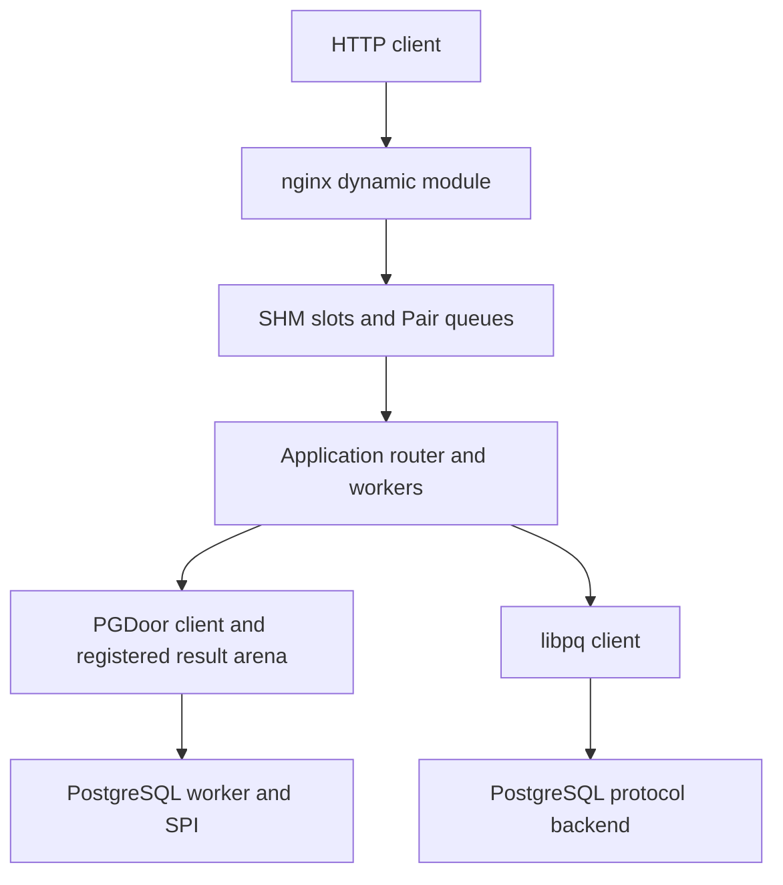

<a id="appendix4-2"></a>

## A4.2. nginx module: process and session architecture

nginx's master parses the configuration and forks workers. `nd_init()` opens
Door state only in a worker/single-process instance after fork. There is one
`nd_client` session and one local request-context array per nginx worker.
The master does not create a Door callback pool that workers inherit.

The worker opens the configured application endpoint and checks `door_info()`.
A random nonzero session nonce identifies its registration. In Pair mode it
creates two distinct regions against that Door generation:

1. an ordinary read/write data arena with fixed request/response slot ranges;
2. a Pair control region containing two event words, queue metadata and copied
   request/reply records after the reserved control page.

A synchronous `ND_REGISTER_PAIR` bootstrap sends the nonce, arena id, chunk-size
agreement and control-region id. The backend explicitly attaches both mappings
and validates the declared layout before accepting work. The Pair reply reader
starts in the nginx worker only after successful registration.

The backend associates the session with kernel-derived caller PID/jail id;
commands do not supply authority by claiming a PID. Its current endpoint does
not set `DOOR_CROSS_JAIL`: this web integration is a same-jail setup. Core Door
cross-jail support does not imply that this application configuration has
already enabled or qualified cross-jail sessions.

### A4.2.1. Actual arena and queue layout

| Item | Current definition |
|---|---|
| HTTP slots per nginx worker | `ND_SLOTS = 1024` |
| Payload capacity of one side of a slot | `ND_CAPACITY = chunk_size + 4096` |
| Full slot stride | `2 × ND_CAPACITY`: input followed by output |
| Data arena | `ND_SLOTS × ND_STRIDE` |
| HTTP request header | 28-byte `nd_http_request` plus length-delimited fields |
| Generic command / registration ACK / completion | 40 / 24 / 32 bytes |
| Pair registration | 48 bytes |
| Pair queue counts | 1024 request records and 1024 reply records |
| Pair channel structure | 74176 bytes, placed after the first VM page |
| Native-async admission window | 256; distinct from the 1024 slot budget |

At `door_chunk_size 64k`, the ordinary arena is 136 MiB per nginx worker:
1024 × 2 × (65536 + 4096). Four workers therefore reserve 544 MiB of logical
arena capacity. With 4 KiB VM pages the separate Pair region is 80 KiB per
worker after rounding. This is mapped capacity, not necessarily resident or
uniquely allocated physical memory. Summing both processes' mapping sizes can
double-count shared pages; unused demand-backed pages need not be resident.
The implementation uses fixed slots here, not `door_shm_pool_reserve()` for
each HTTP request. Pool-reuse microbenchmark results must not be mislabeled as
this module's allocator implementation.

### A4.2.2. Request admission and serialization

`nd_body()` first obtains the nginx request body and validates metadata and
combined capacity. It serializes a native local envelope containing lengths
for method, normalized URI, query, header block and body, then copies those
fields into the reserved input slot. No cross-process pointers are included.
The application interprets the envelope and selects its route; nginx does not
encode the blog/file/benchmark API's SQL or operation list.

Metadata is bounded by 4096 bytes; request body storage must be in memory.
File-backed nginx request-body buffers are rejected by this path. nginx's
`client_max_body_size` cannot override the smaller arena/envelope capacity.
This is bounded whole-request/whole-response forwarding, not incremental
socket streaming, arbitrary-size uploads, WebSocket tunnelling or chunked
application output. A bounded streaming IPC mechanism does not automatically
implement HTTP streaming in this module.

Slot allocation increments a per-slot generation and refuses poisoned or
exhausted slots. The worker publishes a fixed command containing session,
slot, length, operation and generation. Queue helpers validate `tail - head`
against `ND_SLOTS`, copy the record, then publish the index. Local producers
are serialized; consumers follow the mode's single-consumer or locked-dequeue
rule. Shared indices and waiter hints use the C atomic operations in
`pair_transport.h`/`ipc.c`; the code is not an unrestricted lock-free MPMC ring.

### A4.2.3. Pair data path and event-loop handoff

A Pair request enqueue runs in the nginx event context and does not post a
blocking native-submit task or execute a per-request synchronous Door CALL.
It may issue a Pair notification syscall when the receiver's waiting hint is
set. This still involves short local/kernel locking; it is not a promise of
wait-free execution. Queue publication establishes the local ACK state.

The backend publishes a checked 32-byte reply after its last payload access.
The dedicated nginx reply thread validates magic/session/slot/generation/length
and records completion under the client lock. An empty-to-nonempty slot bitmap
transition triggers a module-owned EVFILT_USER with NOTE_TRIGGER on nginx's
kqueue. Its event-loop handler drains the bitmap and finalizes requests there.
No pipe or payload byte stream is used for this bridge. On shutdown the
module closes/drains the Door client before removing the user event, and
unposts it only when it was actually posted. The regression check in
`tools/check-nginx-event.py` compiles the real cleanup fragment with nginx’s
multi-statement queue macro; it covers unposted, posted and repeated cleanup.
The notification still requires
a kevent trigger syscall; it is not a direct scheduler handoff. Its unique event
identity avoids replacing the global ngx_notify handler used by thread pools.

The reply reader sets its waiting hint and rechecks queue state before
parking; the event sequence is loaded before the queue check. Waits use a
100 ms bound for liveness/shutdown checks. That bound is not a 100 ms normal
response delay or a correctness substitute for the publish/wait ordering.

### A4.2.4. Native-async alternative

With `ND_TRANSPORT=async` the session instead registers a client-owned ONEWAY
READY Door with the backend and opens native async with a 256-operation window.
nginx submits through its named `door` thread pool because submission may wait
for admission. The ordinary backend callback returns a registration/admission
ACK; a job worker later sends ONEWAY READY. ACK and READY are stored separately,
and either ordering is tolerated. The specialized RAM-inline operation can
return its final record through native completion without a second READY send.
That optimization is not the generic HTTP route's universal completion path.

| Mode | Per-request submission | Final application completion | nginx event-loop bridge |
|---|---|---|---|
| Pair | SHM request queue plus conditional Pair notify | SHM reply queue plus conditional Pair notify | Reply thread → bitmap/user event → event loop |
| Native async, ordinary | Thread-pool native submit and ACK | Backend ONEWAY READY callback | Callback → bitmap/user event → event loop |
| Native async, special RAM-inline | Native submit | Native final completion | Completion callback → bitmap/user event → event loop |

### A4.2.5. Output lifetime, timeout and shutdown

`nd_complete()` verifies the response envelope's magic, HTTP status, length and
content-type flag. It points an nginx memory buffer directly into the output
slot and passes that chain to nginx's output filter. It does not make another
payload buffer solely to return data from the application. The network stack
still has its own send path; this is not NIC-to-application end-to-end zero-copy.

Request cleanup releases the slot after nginx no longer needs its memory.
Blocked-request/task pins prevent request/context destruction while submission
still executes. A five-second lifetime timer poisons uncertain slots rather
than immediately reusing bytes a peer may still modify. Transport failures map
to gateway errors; invalid response framing is rejected. There is no implicit
retry against a replacement application generation.

During exit the client stops admission, waits for sender pins, closes async
callbacks or wakes/joins the Pair reply thread, and invalidates/unmaps the Pair
control handle. Data-arena mappings remain process-scoped in this client path
because backend jobs may still hold mappings. Failure to join callbacks is a
fatal worker-exit condition; code is not unloaded underneath a live callback.
This is an explicit conservative lifetime policy, not a claim that every
mapping is eagerly reclaimed by `nd_close()`.

<a id="appendix4-3"></a>

## A4.3. Application backend: queued and direct dispatch

The application process owns the registered endpoint, HTTP routes and business
services. `process_job()` derives input/output addresses from checked slot
indices and calls `nd_app_process()` for the generic HTTP operation. It does
not follow a client-supplied virtual pointer.

There are three different concurrency controls:

| Setting | What it controls | What it does not control |
|---|---|---|
| `receivers` / `ND_RECEIVERS` | Private Door callback receiver pool for bootstrap and native requests | Number of Pair direct application threads per session |
| `workers` / `ND_JOB_WORKERS` | Shared queued-job worker pool | Direct dispatch's processing concurrency |
| `direct_threads` / `ND_DIRECT_THREADS` | 1–8 Pair direct threads per registered session | PostgreSQL endpoint count or nginx worker count |

In queued Pair mode one Pair receiver per session validates/copies commands
into a bounded shared application job queue. The global job-worker pool takes
work from that queue. This allows workers to serve different nginx sessions
without pinning SQL execution to one session's receiver. No new thread is
created for every request.

In direct mode the session's Pair threads dequeue/admit under the backend lock,
release it, execute application work and publish the reply. Multiple direct
consumers are locally serialized at dequeue; the lock is not held over SQL.
Each direct processing thread owns its own application/database state. Merely
raising `ND_JOB_WORKERS` does not increase direct-path processing concurrency.
The current backend bounds sessions at 64, queued jobs at 64×1024 and total
Pair threads at 128. Direct threads multiply by the number of nginx sessions,
so configure the product rather than just the per-session number.

Reply producers serialize on the existing backend lock before pushing to a
session's reply queue. The backend rejects a busy/replayed slot generation and
tracks active jobs; a session reaper joins Pair threads before unmapping or
reusing session state. This architecture is different from the benchmark's
atomic per-channel batch-claim scheme even though both use the same Pair API.

<a id="appendix4-4"></a>

## A4.4. Independent builds and configuration

The nginx module requires a matching nginx source tree to obtain the correct
module ABI and headers, but the helper builds only dynamic modules. It checks
the installed nginx version/configure flags, requires `--with-threads` and
`--with-compat`, and uses a private source copy. Existing external-module flags
require manual configure review. It does not replace the installed nginx binary.

```sh
cd door-stack
make -C nginx NGINX_SOURCE=/path/to/matching/nginx-source
make -C nginx install
make -C app WITH_PGSQL=1
```

The application build produces `app/build/libdoor_demo.a` and `door_app` without
nginx or PostgreSQL source checkouts. PostgreSQL support adds installed libpq
development files and the separately built `libpgdoor`; a non-PG build does not
need that server integration. Building a module is not installation/startup of
its peer services.

The core nginx directives are:

```nginx
load_module /usr/local/libexec/nginx/ngx_http_door_module.so;
# In http {}:
door_endpoint /tmp/door-demo/application.door;
door_chunk_size 64k;
# In the server/location selected by the deployment:
location / { door_pass; }
```

The supplied full configuration also declares the `door` thread pool, worker
processes, `env ND_TRANSPORT=pair;` and diagnostic controls. Do not copy the
fragment as a complete nginx.conf. Listener address/TLS/UID belong to deployment.
The repository's root/wheel benchmark profile is not a least-privilege service
policy. Chunk size must agree with the application's `chunk_kib` setting;
nginx accepts 64 KiB–4 MiB in 4 KiB increments, with 1 MiB as its directive default.

`conf/application.toml` owns application paths/routes and transport/database
policy. `app_config.py` rejects unknown keys and overlapping route prefixes,
resolves configured paths relative to the file, and constructs a controlled
environment for the executable without shell evaluation. Important sections are:

| Section | Representative keys | Owner |
|---|---|---|
| `[application]` | endpoint, binary, web root, state/token/database files | Application deployment |
| `[transport]` | mode, dispatch, chunk_kib, receivers, workers, direct_threads | App/backend transport |
| `[routes]` | blog, files, benchmark, workload, memory, pgbench, ipcbench | Application router |
| `[database]` | DSN, libpq/door, Door prefix/count, direct encoding, timings | Application database adapter |
| `[tests]`, `[benchmarks]` | Allowed binaries and result directories | Benchmark administration |
| `[pgbench]` | Dedicated benchmark DB/role, provisioning runner and endpoint prefix | Benchmark app; not PostgreSQL's active server GUCs |

`tools/stack.py` starts the app, waits for a fresh READY, starts nginx and checks
the exact configured health URL. It drains/stops nginx before the application
on restart. It does not restart PostgreSQL or silently activate a generated PG
profile on the manual path. The bundled demo wraps this supervisor with
its own cluster lifecycle; see [A4.9](#appendix4-9). Diagnose an inactive or
mismatched PostgreSQL prefix/database at that boundary.

<a id="appendix4-5"></a>

## A4.5. PGDoor extension: PostgreSQL main-thread execution

The extension is a PGXS shared module loaded through
`shared_preload_libraries`. `_PG_init()` declares restart-required GUCs and
registers background workers. Defaults create zero workers until a database
and SQL role are explicitly configured. Each worker initializes one UTF8
database connection under a fixed non-superuser role, then publishes an endpoint
named `<prefix>.<index>`.

Unlike a normal libdoor pthread callback service, the PostgreSQL worker creates
and binds its Door through raw operations and runs a receive/RETURN loop on its
**main PostgreSQL thread**. SPI, transactions, snapshots and memory contexts are
not invoked from arbitrary libdoor callback threads. Each worker processes one
request at a time; multiple clients targeting one endpoint share that serial
execution context. More endpoints provide more independently executing backend
processes, subject to CPU and database contention.

The raw endpoint uses `DOOR_PRIVATE | DOOR_REFUSE_DESC`. Each iteration can return
the previous fixed reply and receive the next request. `CHECK_FOR_INTERRUPTS()`
and postmaster-liveness checks surround the wait. A one-second PostgreSQL timer
interrupts the raw Door wait to bound idle shutdown/signal races; its handler
does not execute PostgreSQL operations. SQL has its separate statement timeout.
Workers are registered for restart after five seconds on failure; an old client
capability/session is not transparently rebound to the replacement generation.

### A4.5.1. Server configuration and build

```sh
cd door-stack/postgres
gmake PG_CONFIG=/usr/local/bin/pg_config
gmake install
make -f Makefile.lib
make -f Makefile.lib install
```

Installed PostgreSQL development headers and PGXS are needed for the extension;
a full PostgreSQL source checkout/world/server rebuild is not required. Rebuild
the extension for the selected PostgreSQL major. The standalone client library
requires libdoor, but no PostgreSQL headers or libpq. Benchmark comparison
programs additionally link libpq.

An example PostgreSQL profile selects the pool's fixed identity:

```conf
# Merge pg_door into the existing shared_preload_libraries list.
shared_preload_libraries = 'pg_door'
pg_door.database = 'application_db'
pg_door.role = 'application_read_role'
pg_door.prefix = 'pgdoor'
pg_door.workers = 8
pg_door.max_region_kib = 16384
# Configure the actual application process UID; -1 means the PostgreSQL UID.
pg_door.client_uid = -1
```

The UID value is not an SQL role and is not nginx's UID unless nginx itself is
the database client. In this stack `door_app` calls PGDoor, so authorize its UID.
All these GUCs are `PGC_POSTMASTER`; a PostgreSQL restart is required, not merely
SIGHUP or `stack.py restart`. `max_worker_processes` must accommodate these and
other background workers. Preserve existing preload libraries when installing.

The extension supports any appropriately permitted UTF8 database; no microblog
table names occur in its server. One configured pool belongs to one database
and one fixed role. Requests do not select an arbitrary database/role and this
implementation does not start simultaneous per-database pools within one
cluster. Separate clusters/prefixes can provide separate configured pools.

### A4.5.2. Authentication, sessions and registered mappings

A request is accepted only for the configured effective OS UID, a valid ABI,
known flags and an exact bounded wire size. `PGD_OPEN` registers an arena;
successful sessions record the kernel caller PID. Subsequent calls require
that PID and session id. Up to 32 sessions are held per worker; stale-PID cleanup
occurs on OPEN. The mapping registry reference-counts one process mapping per
region so closing one of several sessions does not unmap another's shared view.

The client creates an ordinary read/write region; the server attaches it with
write access for result publication. This is not a Pair region. An arena must
be at least 64 KiB and no larger than both the server's `max_region_kib` and the
client's 64 MiB cap. The default server limit is 16 MiB. A valid destination is
a nonempty range inside that mapping. No request supplies a server VA pointer.

OPEN, CLOSE, PING, QUERY and QUERY_PARAMS are distinct operations. The local
native-endian version-2 protocol has a 48-byte request prefix, at most 4095 bytes
of SQL/parameter envelope, and a 192-byte reply. Session/region identity and
range checks are independent of SQL parsing. Wire version/size mismatch is a
protocol failure, not an invitation to reinterpret old structures.

### A4.5.3. Query lifecycle, plans and error recovery

For a query the worker starts a PostgreSQL transaction, verifies UTF8 text,
sets read-only execution, enables a five-second statement timeout, acquires an
active snapshot and connects SPI. Parameter values are decoded separately from
SQL; up to eight inputs of text or int8 type are supported. A 32-slot per-worker
cache retains plans keyed by SQL plus parameter types and count.

`SPI_execute_plan()` runs read-only and requests up to 257 rows so a result over
256 is detected rather than silently truncated. Results must be SELECT-shaped
and have at most 64 columns. Normal SQL permissions and callable-function
policy remain part of the selected role; the IPC transport is not an arbitrary
SQL sandbox.

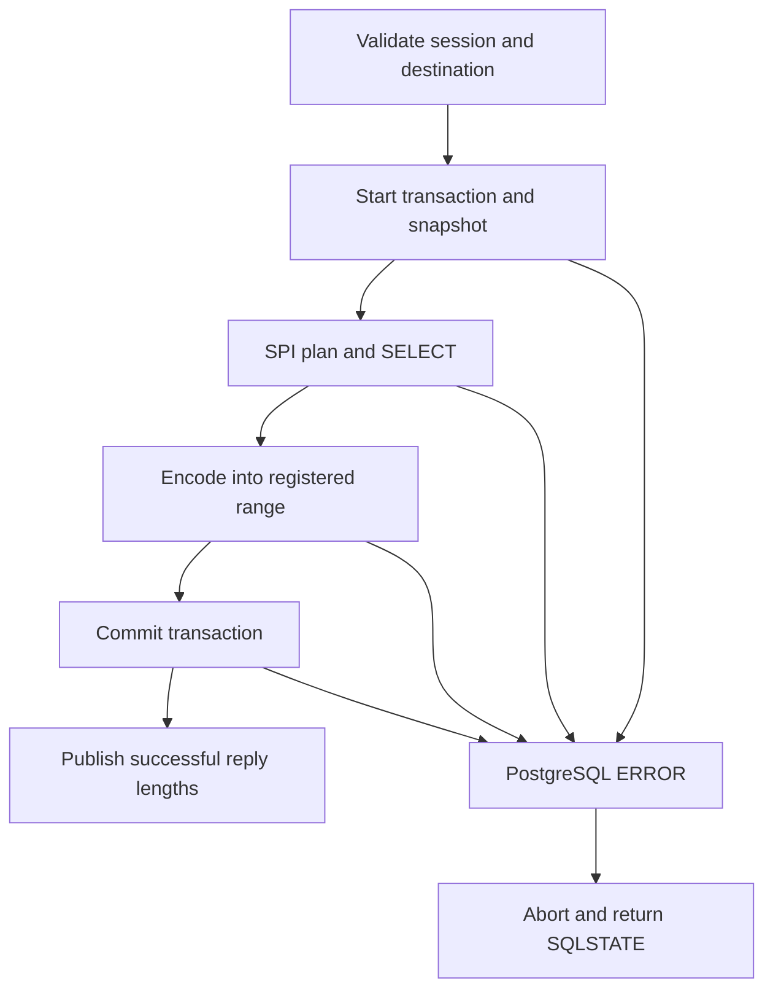

On success, SPI/snapshot cleanup and commit precede publication of valid byte,
row and column counts. On error `PG_CATCH` saves the error message/SQLSTATE,
flushes PostgreSQL error state, aborts the transaction and restores memory
context. The next request can continue in the same worker/session. Bytes already
written before an error can remain in the arena, but no successful result length
is published for them. Transport delivery, successful SQL completion and valid
result publication are therefore separate checks.

### A4.5.4. Direct encoding and the actual zero-copy boundary

Each result cell has a 32-bit byte length followed by text bytes; SQL NULL uses
`UINT32_MAX`. Results are row-major and currently omit column names/OIDs. The
baseline uses `SPI_getvalue()` and copies its textual value into the destination.
`PGD_F_DIRECT` instead obtains Datums with `SPI_getbinval()` and encodes text,
varchar, int2/int4/int8 and bool directly. Unknown types/domains fall back to the
normal output function. NULL is supported in either path.

For text/varchar, packed/detoasted bytes are written to the registered range;
detoasting may allocate. Integers still need decimal formatting; all cells need
length prefixes and payload stores. The optimization removes unnecessary
intermediate textual allocation/copying for supported types; it does not expose
backend Datum pointers, move SPI tuple storage into the client, or make query
execution/all result writes zero-cost. Appendix 2 compares direct versus
baseline encoding and libpq as whole execution paths.

The caller can select arbitrary offsets/capacities within its registered arena,
including unaligned byte offsets. It cannot target an unrelated process buffer
or an arena belonging to a different Door generation. `pgd_result_data()` returns
a borrowed pointer valid only while the arena/range is retained and not reused.
See the complete typed-parameter client in §14.20.

<a id="appendix4-6"></a>

## A4.6. How the HTTP application uses PostgreSQL

The application's SQL adapter can use libpq or PGDoor for selected reads. It
keeps database handles in thread-local state. PGDoor endpoint assignment is
round-robin at connection creation, not a per-query global work-stealing
scheduler. Several application threads may target one worker; setting the
client count greater than available endpoints does not create more PostgreSQL
workers.

At startup the adapter checks database, role and schema version against its
actual libpq connection and probes typed-parameter support. This catches the
previously observed situation where the benchmark profile named one database
but active PostgreSQL workers served another. The generic PGDoor extension
knows nothing about the application schema; this check belongs in the adapter.

The current microblog integration routes list/feed/get/user/me reads through
PGDoor when selected. Registration, login and SQL writes remain on libpq. It is
a mixed database transport application, not an application with libpq removed.
On protocol/transport poisoning the thread closes/reopens its database state
rather than consuming uncertain result bytes.

A normal request traverses the following boundaries:

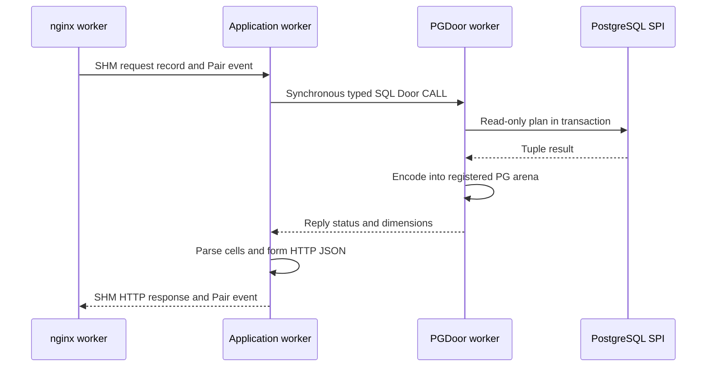

The adapter currently uses `pgd_connect()` with its own PG result arena and
then reads cell slices to form the application's JSON output. It does not borrow
the nginx HTTP arena for PostgreSQL output. Those arenas are associated with
different Door endpoints/generations; the library's borrowed-arena API does not
make them interchangeable. Further fusion would require an explicit authority,
layout and lifetime design, not passing an nginx output pointer to PostgreSQL.

The install-from-scratch demo selects libpq for the blog so the separate
SQL benchmark can own the PGDoor profile in its private PostgreSQL cluster.
The mixed HTTP/PGDoor path above is an available manual configuration, not
the managed demo default.

This also explains why a 2× improvement in tiny SQL microbenchmarks need not
produce 2× HTTP RPS: SQL work, application JSON construction, nginx scheduling,
network/client CPU and offered load remain in the path. Equal RPS at a fixed
8000/s offer can coexist with substantially lower latency.

<a id="appendix4-7"></a>

## A4.7. Validation, observations, and remaining boundaries

| Layer | Maintained check/example | What it establishes |
|---|---|---|
| HTTP envelope/router | `app/tests/router.c`, `app/tests/check-router.sh` | Bounded framing, route ownership and response construction without a server |
| Worker/client transport | Host transport models and native integration runs | Session, generation, mailbox and lifecycle paths under tested conditions |
| PG wire/parameters/encoding | `postgres/tests/check-wire.sh`, `client_into.c`, `mapping.c`, `encode.c` | Wire/typed-parameter checks plus separate host models for client ranges, mapping references and encoding |
| PG runtime | `postgres/tests/smoke.sh` | Reported SQL error recovery, NULL/UTF8, overflow, row limits, plan reuse and concurrent sessions |
| Borrowed arena/ranges | `pg_door_into_test` | Reported offset/capacity guards, direct/fallback equivalence, 1 MiB result, recovery and lifetime |
| End-to-end app behavior | `app/pgsql/smoke.py` | Reported registration/login, sessions, Unicode, pagination and ownership behavior |
| Performance | Appendix 2 | Measured configurations; not a substitute for functional/security coverage |

Do not interpret a host model as native PostgreSQL execution or an nginx browser
run. Do not label this SELECT-only PGDoor library a complete libpq replacement:
SQL writes, explicit multi-statement transactions, COPY, arbitrary type
parameters, network access and per-call database/role switching are not supplied.
The HTTP module does not yet provide incremental large-message streaming or
per-client jail deployment. The Pair primitive supports other architectures,
but their application protocols and qualification must be explicit.

Troubleshooting follows the boundary that failed:

| Symptom | First evidence to inspect |
|---|---|
| nginx cannot load `.so` | Installed module path, nginx version/configure match, libdoor loader dependencies |
| nginx master exists but HTTP hangs | Worker startup errors; application READY and active endpoint generation |
| Stack health timeout | Actual listen address/port and exact health URL, then app/nginx logs |
| Pair attach/wake gives EPERM | Which process created the region and whether the Door owner attached it |
| PGDoor endpoint missing | Active GUCs, preload library, worker startup logs and actual prefix/count |
| PGDoor fails but libpq works | Configured OS UID, fixed role/database, arena quota and typed-wire compatibility |
| HTTP 401 after DB switch | Application session/account data in the selected DB, not load-generator speed |
| Benchmark HTTP 500 with healthy app | Listener, exact response body, result directory and application log; accepted jobs have a separate output log |
| Full offered RPS but changed latency | Offered-load cap, scheduler lag and backend/client intervals |
| Memory mapping looks large but RSS low | Logical capacity versus resident unique shared pages |

<a id="appendix4-8"></a>

## A4.8. Source provenance

The architecture above was checked against `door-stack.zip` (9 November
2026) and `doors_07.11.2026.zip`, which includes the expanded forwarding suite.
The source files reviewed were:

- `nginx/ngx_http_door_module.c`
- `transport/ipc.c`
- `transport/pair_transport.h`
- `app/door_backend.c`
- `app/pgsql_door.inc`
- `postgres/pg_door.c`
- `postgres/pgd_client.c`
- `postgres/pgd_wire.h`
- `postgres/pgd_encode.h`
- `tools/app_config.py`

The module-owned kqueue user-event bridge replaces the earlier nginx pipe
bridge. Appendix 2 separates the earlier RAM campaign from the follow-up
FreeBSD runs. Native readiness and reported benchmarks are observations,
not exhaustive qualification of every shutdown or callback interleaving.

<a id="appendix4-9"></a>

## A4.9. Local demo installation and application routes

The bundled Door Stack is a local development demo. Install the matching
Door-enabled FreeBSD kernel, headers and libdoor, then boot that kernel.
From the extracted stack, run as root on a development host or VM:

```sh
make install
sh ./demo.sh status
curl -fsS http://127.0.0.1:8080/health
```

`make install` invokes `install-demo.sh`, checks that a Door can be created,
builds a private nginx and dynamic module, builds the application and benchmark
binaries, and starts the demo. PostgreSQL 18 is provisioned in a private cluster
by default; use `make install DEMO_ARGS=--no-pgsql` for the SQLite-only demo
and IPC/HTTP benchmarks. The generated configuration is
`conf/demo-application.toml` and `conf/demo-nginx.conf`. The installer keeps
its token, SQLite state, uploads and benchmark artifacts separate from the
manual stack. It prints the administrative token on an interactive terminal;
the default file is `state/demo-admin-token`. Keep the demo on loopback or a
trusted local network.

| Route | Application responsibility |
|---|---|
| `/`, `/filemanager/` | Application index and file manager; the app owns routing and the configured file root. |
| `/blog/` | Choose the default or a named SQLite database, or the configured PostgreSQL database. The choice is carried by the URL; each database keeps separate data and sessions. The admin token can create a named SQLite database, optionally with sample posts. |
| `/benchmark/` | HTTP workloads, Direct ping and SHM test controls and results. |
| `/ipcbench/` | IPC matrix, individual and extended plans, CPU telemetry, export and cleanup. |
| `/pgbench/` | Prepare dedicated SQL data, apply the worker profile, run transport comparisons, and download results. |
| `/health` | Returns `ok` from the application through nginx. |

An alternative to the blog's creation form is
`sh ./demo.sh sqlite demo-notes --sample`. Creating a named database does
not overwrite an existing name. In the default PostgreSQL demo the blog
uses `door_blog` over libpq; the SQL benchmark uses `door_pgbench` and its
own non-superuser role. The preload extension has one worker pool per
cluster, bound to the configured database/role. A benchmark profile would
displace a PGDoor blog profile in the same cluster, which is why the
managed demo keeps the blog on libpq. An external deployment can use a
separate cluster or select its own single pool profile.

Initial provisioning and the UI's **Create/refill the test database**
and **Apply the PGDoor profile to PostgreSQL** apply the profile, restart
only the installer-managed cluster, and probe the Door workers before
reporting readiness. Active connections to that cluster may be
interrupted. An ordinary benchmark job does not restart PostgreSQL;
a custom installation must restart its own cluster after applying settings
that show `pending_restart`. The generated profile's actual endpoint
prefix and worker count are authoritative.

After installation or reboot use `sh ./demo.sh start`; the supervisor
starts the app and its nginx together. Use `stop`, `restart`, `status`, or
`doctor` through the same script. A successful health probe confirms
that the application answered; it does not prove that a benchmark can
create a result directory or open every PGDoor endpoint. If a request
fails, check the exact listener and response body, then
`state/application.log` and `state/demo-nginx/nginx-error.log`. If the API
accepted the job, inspect `job-*/output.log` below the configured
`[benchmarks].results` path (default `state/demo-results`). A system nginx
on port 80 and the demo nginx on port 8080 are different listeners.

<a id="appendix4-10"></a>

## A4.10. Benchmark control, reproducibility and validation

| Suite | What is measured | Useful controls |
|---|---|---|
| Direct ping | Separate no-data and payload cases: synchronous ping-pong, ONEWAY with inline or SHM data, and native async cases supported by the runner. | Payload, clients, servers, CPU placement, in-flight window and warmup. Keep ONEWAY submission distinct from verified completion. |
| IPC matrix | Unix stream/datagram/seqpacket, loopback TCP/UDP, pipe and SHM/kqueue baselines, plus Door CALL, ONEWAY, async and SHM variants. | Single transport or matrix; report the effective worker topology and window, not just requested values. |
| SHM | Ring + batched CALL; Ring + Pair; Pool + Pair reserve/release; Pool reuse + Pair; SHM CALL/async; fixed-stream M:N Ring/Pool reuse + Pair; POSIX SHM + process-shared umtx/futex baseline. | Payload, flow, profile, slots, window, client and worker counts and CPU lists. M:N Pair and the futex baseline use fixed-stream payloads; unsupported selections are disabled. |
| SQL | `door`, `door-direct` and libpq over a Unix socket. SQL ping-pong is `SELECT 'pong'::text`; other cases are SELECT 1, text up to 8 MiB, 21 rows × 128 bytes, and a deterministic feed. | Run one scenario or the suite; match client and endpoint counts where possible. Identity and result-equivalence probes are outside timing. |
| HTTP | Closed-loop HTTP RAM capacity, or scheduled-rate HTTP blog traffic with PostgreSQL. | Match payload, generator threads, connections and benchmark duration. For the SQL-backed HTTP test, also match the account set, depth, mix and offered rate. |

The finite full plan has no overall deadline. The continuous plan repeats
until stopped. The monograph plan expands valid combinations of payloads,
windows, supported profiles and client/worker layouts; a selected transport
can be run alone with the same plan. Report p50/p95/p99/p99.9 and the timing
boundary, alongside throughput. Do not use aggregate ns/op as RTT. On
FreeBSD the UI samples logical CPU counters from `kern.cp_times`, including
other host activity. The first sample sets the baseline.

A download during a run is a checkpoint. The retained raw-record list can
roll over at 3,000 entries; `results.jsonl` on disk preserves the full run,
and completed finite monograph plans write `monograph.md` with all
aggregates. Check the current case and passed/failed/skipped counts before
treating a completed runner as a verified series. Job cleanup is disabled
while a managed run is active; it removes only benchmark results under the
manager's ownership rules.

`make check` exercises the router, SQLite database selection and creation,
the nginx notification model, the stack and demo lifecycle, IPC/futex and
benchmark job management, fixture creation and PGDoor wire handling. Use
native FreeBSD checks in addition to the portable suite:

```sh
make -C benchmarks/door-direct-ping check
make -C benchmarks/shm-transport-bench check-mt
make -C benchmarks/shm-transport-bench check-futex
python3 app/pgsql/smoke.py http://127.0.0.1:8080
```

The blog smoke command assumes the demo is running on its default port
with a configured blog database. Test doubles establish runner behavior;
they do not exercise native kernel Door delivery or PostgreSQL worker
execution. For the latest installation the reported `demo.sh status` and
HTTP 200 `/health` confirm service readiness on FreeBSD. That observation
and the separately reported benchmark runs are narrower than a complete
native integration matrix.
